# Page: Introduction to RL-Baselines3-Zoo

# Introduction to RL-Baselines3-Zoo

<details>
<summary>Relevant source files</summary>

The following files were used as context for generating this wiki page:

- [CHANGELOG.md](CHANGELOG.md)
- [README.md](README.md)
- [rl_zoo3/version.txt](rl_zoo3/version.txt)

</details>


## Purpose and Scope

RL-Baselines3-Zoo is a training framework for Reinforcement Learning (RL) that builds upon [Stable Baselines3](https://github.com/DLR-RM/stable-baselines3). It provides a comprehensive set of tools for training, evaluating, and benchmarking RL agents across a wide range of environments. This document introduces the core concepts, architecture, and workflow of the RL-Baselines3-Zoo framework.

This page focuses on the high-level overview of the framework. For specific details on installation, see [Getting Started](#2), or [Training System](#3) for information about the training process.

Sources: [README.md:8-16]()

## Overview

RL-Baselines3-Zoo serves several key purposes:

1. Providing a simple interface to train and evaluate RL agents
2. Benchmarking different RL algorithms
3. Offering tuned hyperparameters for various environments and algorithms
4. Facilitating experimentation with trained agents

The framework includes a collection of pre-configured hyperparameters and pre-trained agents for common environments, allowing researchers and practitioners to quickly get started with state-of-the-art RL algorithms.

Sources: [README.md:19-28]()

## System Architecture

### Core Components

RL-Baselines3-Zoo is built around a modular architecture that separates different aspects of the RL workflow. The core components are:

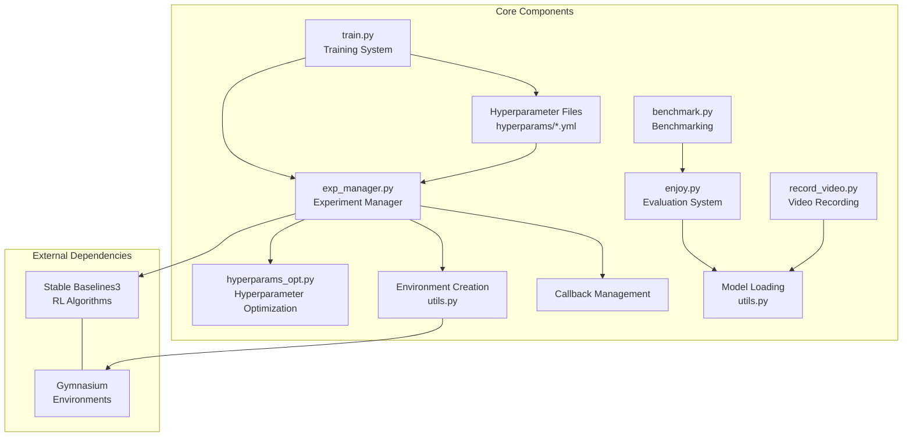

This diagram shows the main components of RL-Baselines3-Zoo and how they interact. The central element is the `ExperimentManager` class from `exp_manager.py`, which coordinates environment creation, model initialization, and training configuration.

Sources: [README.md:12-16](), [CHANGELOG.md:21-26]()

### Component Roles

| Component | File | Description |
|-----------|------|-------------|
| Training System | `train.py` | Main entry point for training RL agents; processes command line arguments and manages training workflow |
| Experiment Manager | `exp_manager.py` | Handles environment creation, algorithm setup, and training configuration |
| Hyperparameter Files | `hyperparams/*.yml` | YAML files containing default hyperparameters for each algorithm and environment |
| Hyperparameter Optimization | `hyperparams_opt.py` | Implements Optuna-based hyperparameter optimization |
| Evaluation System | `enjoy.py` | Allows running and visualizing trained agents |
| Video Recording | `record_video.py` | Records videos of trained agents |
| Benchmarking | `benchmark.py` | Benchmarks RL algorithms on various environments |

Sources: [README.md:12-16](), [CHANGELOG.md:21-26]()

## Training Workflow

The training process in RL-Baselines3-Zoo follows a structured workflow:

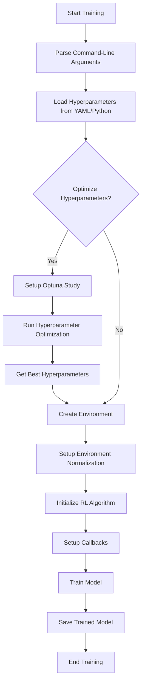

This diagram illustrates the typical workflow when training an agent with RL-Baselines3-Zoo. The process begins with parsing command-line arguments and loading hyperparameters, followed by either direct training or hyperparameter optimization, and finally saving the trained model.

Sources: [README.md:62-74](), [CHANGELOG.md:3-19]()

## Supported Algorithms and Environments

RL-Baselines3-Zoo supports a wide range of RL algorithms and environment types:

### Reinforcement Learning Algorithms

```mermaid
graph TD
    subgraph "RL Algorithms"
        PPO["PPO<br>Proximal Policy Optimization"]
        A2C["A2C<br>Advantage Actor-Critic"]
        SAC["SAC<br>Soft Actor-Critic"]
        TD3["TD3<br>Twin Delayed DDPG"]
        DDPG["DDPG<br>Deep Deterministic Policy Gradient"]
        DQN["DQN<br>Deep Q-Network"]
        TQC["TQC<br>Truncated Quantile Critics"]
        TRPO["TRPO<br>Trust Region Policy Optimization"]
        ARS["ARS<br>Augmented Random Search"]
        RecurrentPPO["RecurrentPPO<br>(LSTM-based PPO)"]
        CrossQ["CrossQ<br>Cross-Entropy Q-Learning"]
    end
    
    subgraph "Environment Types"
        Atari["Atari Games"]
        Classic["Classic Control"]
        Box2D["Box2D Environments"]
        PyBullet["PyBullet Environments"]
        MuJoCo["MuJoCo Environments"]
        Robotics["Robotics Environments"]
        MiniGrid["MiniGrid Environments"]
    end
    
    RL-Zoo["RL-Baselines3-Zoo"] --> "RL Algorithms"
    RL-Zoo --> "Environment Types"
```

The framework provides ready-to-use implementations and hyperparameters for all these algorithms across various environment types, making it easy to benchmark and compare different approaches.

Sources: [README.md:118-251](), [CHANGELOG.md:58-64]()

## Hyperparameter Management

Hyperparameter management is a core feature of RL-Baselines3-Zoo. The framework provides:

1. **Default Hyperparameters**: YAML files in the `hyperparams/` directory with pre-tuned parameters for each algorithm and environment.
2. **Hyperparameter Optimization**: Optuna-based optimization to find optimal hyperparameters.
3. **Python Configuration**: Support for both YAML and Python configuration files for flexibility.

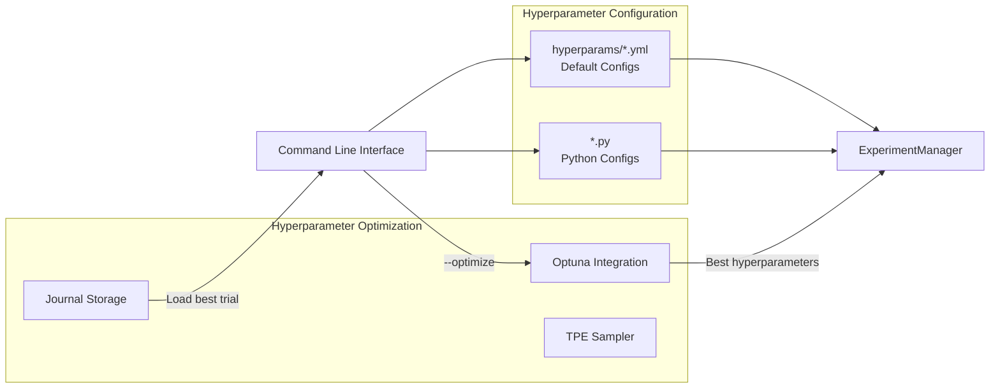

Recent versions have added improved hyperparameter optimization with Optuna Journal storage, allowing users to easily load and use tuned hyperparameters via the `--trial-id` argument.

Sources: [README.md:102-104](), [CHANGELOG.md:3-19](), [CHANGELOG.md:196-205]()

## Integration with External Tools

RL-Baselines3-Zoo integrates with several external tools for experiment tracking, model sharing, and deployment:

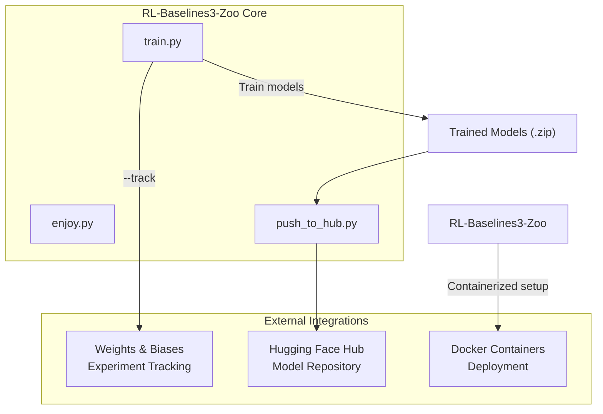

### Experiment Tracking with Weights & Biases

The framework supports tracking experiments via Weights & Biases, which can be activated using the `--track` flag. This allows you to monitor training progress, compare different runs, and analyze results.

### Model Sharing with Hugging Face Hub

Trained models can be shared on the Hugging Face Hub using the `push_to_hub.py` script, making it easy to distribute and reuse models across the community.

Sources: [README.md:79-81](), [CHANGELOG.md:316-325](), [CHANGELOG.md:292-296]()

## System Data Flow

The following diagram illustrates how data flows through the system during a typical RL workflow:

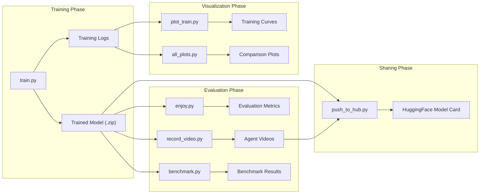

This diagram shows the complete data flow in RL-Baselines3-Zoo, from training to evaluation, visualization, and sharing. The trained model is the central artifact that connects the different phases of the workflow.

Sources: [README.md:87-99](), [CHANGELOG.md:292-296]()

## Recent Features and Updates

RL-Baselines3-Zoo is actively maintained and regularly updated with new features. Recent additions include:

- Support for Gymnasium v1.1
- Special vectorized environment support (Brax, IsaacSim)
- Command line logging
- Python config files instead of only YAML
- RecurrentPPO (LSTM-based PPO) support
- CrossQ algorithm support
- Hugging Face Hub integration for model sharing
- Weights & Biases integration for experiment tracking

Sources: [CHANGELOG.md:21-36](), [CHANGELOG.md:58-64](), [CHANGELOG.md:196-205](), [CHANGELOG.md:292-296](), [CHANGELOG.md:316-325]()

## Summary

RL-Baselines3-Zoo provides a comprehensive framework for training, evaluating, and benchmarking reinforcement learning agents. It extends Stable Baselines3 with additional tools for hyperparameter optimization, visualization, and integration with external services. The modular architecture and extensive documentation make it accessible for both researchers and practitioners in the field of reinforcement learning.

---

# Page: Getting Started

# Getting Started

<details>
<summary>Relevant source files</summary>

The following files were used as context for generating this wiki page:

- [README.md](README.md)
- [requirements.txt](requirements.txt)
- [setup.py](setup.py)

</details>


This guide provides essential information for setting up and using RL-Baselines3-Zoo, a training framework for Reinforcement Learning (RL) agents based on Stable Baselines3. You'll learn how to install the framework, configure your environment, and execute basic training and evaluation workflows.

For more detailed information about specific components like the training system architecture, see [Training System](#3), or for hyperparameter management, see [Hyperparameter Management](#4).

## Installation Options

RL-Baselines3-Zoo offers multiple installation methods depending on your needs. Choose the approach that best fits your requirements.

### Minimal Installation

The minimal installation includes just the core functionality without additional environments or testing dependencies.

**From source:**
```bash
pip install -e .
```

**As a Python package:**
```bash
pip install rl_zoo3
```

After installation, you can access the command-line interface from any directory:
```bash
rl_zoo3 train  # Equivalent to python train.py
```

Sources: [README.md:37-50](), [setup.py:17-27]()

### Full Installation

For complete functionality including all supported environments and testing capabilities:

```bash
apt-get install swig cmake ffmpeg
pip install -r requirements.txt
pip install -e .[plots,tests]
```

This installs:
- Core dependencies from `setup.py`
- Additional environment dependencies from `requirements.txt`
- Visualization tools (`plots`) and testing utilities (`tests`)

Sources: [README.md:52-59](), [setup.py:17-34](), [requirements.txt:1-15]()

### Python Version Requirements

RL-Baselines3-Zoo requires Python 3.9 or later. The package is tested with Python versions 3.9, 3.10, 3.11, and 3.12.

Sources: [setup.py:59-75]()

## System Architecture

Below is a high-level overview of the RL-Baselines3-Zoo architecture, showing the main components and their relationships.

**RL-Baselines3-Zoo Framework Components**

```mermaid
graph TD
    subgraph "User Interface"
        CLI["Command Line Interface<br>(rl_zoo3.cli)"]
        Scripts["Script Entry Points<br>(train.py, enjoy.py, etc.)"]
    end

    subgraph "Core Training Framework"
        Train["train.py"] --> ExpManager["Experiment Manager<br>(exp_manager.py)"]
        ExpManager --> EnvUtils["Environment Creation<br>(utils.py)"]
        ExpManager --> ModelUtils["Model Creation<br>(utils.py)"]
        ExpManager --> Callbacks["Callback System"]
    end

    subgraph "Configuration"
        HyperFiles["Hyperparameter Files<br>(hyperparams/*.yml)"]
        CLI --> Train
        Scripts --> Train
        HyperFiles --> Train
    end

    subgraph "Evaluation & Analysis"
        Enjoy["enjoy.py"]
        Benchmark["benchmark.py"]
        RecordVideo["record_video.py"]
        Plotting["plots/"]
    end

    subgraph "External Libraries"
        SB3["Stable-Baselines3<br>(RL Algorithms)"]
        Gym["Gymnasium<br>(Environments)"]
    end

    Train --> SB3
    EnvUtils --> Gym
    ExpManager --> "Evaluation & Analysis"
```

Sources: [README.md:12-16](), [setup.py:38-46]()

## Basic Usage Workflow

The typical workflow in RL-Baselines3-Zoo follows these stages:

**RL-Baselines3-Zoo Workflow**

```mermaid
flowchart LR
    subgraph "1. Setup"
        Install["Install RL-Zoo3"] --> ConfigEnv["Configure Environment"]
    end

    subgraph "2. Training"
        Train["Run train.py<br>with algorithm & environment"] --> TrainedModel["Trained Model (.zip)"]
    end

    subgraph "3. Evaluation"
        TrainedModel --> Enjoy["Run enjoy.py<br>to visualize agent"]
        TrainedModel --> Benchmark["Run benchmark.py<br>to measure performance"]
        TrainedModel --> Record["Run record_video.py<br>to create videos"]
    end

    subgraph "4. Analysis"
        Enjoy --> Analyze["Analyze results"]
        Benchmark --> Analyze
        Record --> Analyze
    end

    "1. Setup" --> "2. Training"
    "2. Training" --> "3. Evaluation"
    "3. Evaluation" --> "4. Analysis"
```

Sources: [README.md:62-100]()

## Training an Agent

To train an agent, use the `train.py` script or the CLI command `rl_zoo3 train`. You need to specify the algorithm and environment.

Basic training command:
```bash
python train.py --algo ALGORITHM_NAME --env ENVIRONMENT_ID
```

For example, to train a SAC agent on the HalfCheetah environment:
```bash
python train.py --algo sac --env HalfCheetahBulletEnv-v0
```

You can customize the training process with additional parameters:
```bash
python train.py --algo sac --env HalfCheetahBulletEnv-v0 --eval-freq 10000 --eval-episodes 10 --n-eval-envs 1
```

The `--eval-freq` parameter specifies how often (in timesteps) to evaluate the agent, `--eval-episodes` sets the number of evaluation episodes, and `--n-eval-envs` determines the number of parallel environments for evaluation.

Sources: [README.md:62-76]()

## Evaluating Trained Agents

After training, you can visualize your agent's performance using the `enjoy.py` script:

```bash
python enjoy.py --algo ALGORITHM_NAME --env ENVIRONMENT_ID
```

For example, to watch an A2C agent play Breakout for 5000 timesteps:
```bash
python enjoy.py --algo a2c --env BreakoutNoFrameskip-v4 --folder rl-trained-agents/ -n 5000
```

Sources: [README.md:88-100]()

## Accessing Pre-trained Agents

RL-Baselines3-Zoo comes with over 200 pre-trained agents. To access them:

1. Clone the repository with submodules:
   ```bash
   git clone --recursive https://github.com/DLR-RM/rl-baselines3-zoo
   ```

2. Use the pre-trained agents with the `enjoy.py` script:
   ```bash
   python enjoy.py --algo ALGORITHM_NAME --env ENVIRONMENT_ID --folder rl-trained-agents/
   ```

Pre-trained agents are also available on Hugging Face: https://huggingface.co/sb3

Sources: [README.md:88-115]()

## Interactive Usage

While RL-Baselines3-Zoo is primarily designed for command-line usage, you can also use it in interactive sessions (Jupyter notebooks, IPython) by modifying `sys.argv`:

```python
import sys
from rl_zoo3.train import train

sys.argv = ["python", "--algo", "ppo", "--env", "MountainCar-v0"]

train()
```

Sources: [README.md:259-271]()

## System Requirements and Dependencies

RL-Baselines3-Zoo has the following key dependencies:

| Dependency | Purpose | Version Requirements |
|------------|---------|----------------------|
| stable-baselines3 | Core RL algorithms | >=2.6.0, <3.0 |
| sb3_contrib | Additional RL algorithms | >=2.6.0, <3.0 |
| gymnasium | Environment interface | >=0.29.1, <1.2.0 |
| pybullet_envs_gymnasium | PyBullet environments | >=0.6.0 |
| optuna | Hyperparameter optimization | >=3.0 |
| wandb (optional) | Experiment tracking | - |
| moviepy (optional) | Video recording | >=1.0.0 |

Sources: [requirements.txt:1-15](), [setup.py:17-27]()

## Next Steps

Once you've set up RL-Baselines3-Zoo and tried the basic training and evaluation workflows, you can explore more advanced features:

- [Training System](#3) - Learn about the training system architecture in detail
- [Hyperparameter Management](#4) - Understand how to configure and optimize hyperparameters
- [Evaluation and Benchmarking](#5) - Discover more advanced evaluation techniques
- [External Integrations](#7) - Explore integrations with Weights & Biases and Hugging Face Hub
- [Visualization and Analysis](#8) - Learn about tools for visualizing and analyzing results

---

# Page: Installation Guide

# Installation Guide

<details>
<summary>Relevant source files</summary>

The following files were used as context for generating this wiki page:

- [docker/Dockerfile](docker/Dockerfile)
- [requirements.txt](requirements.txt)
- [scripts/build_docker.sh](scripts/build_docker.sh)
- [setup.py](setup.py)

</details>


This page provides detailed instructions for installing RL-Baselines3-Zoo on different platforms and environments. The guide covers standard Python installation methods as well as Docker-based deployment. For instructions on using Docker containers with this framework, see [Docker Deployment](#2.2).

## Prerequisites

Before installing RL-Baselines3-Zoo, ensure your system meets the following requirements:

- Python 3.9 or newer (supports up to Python 3.12)
- pip or conda package manager
- Git (for cloning the repository)

Optional but recommended:
- CUDA-compatible GPU for training (not required but greatly improves performance)
- ffmpeg (for video recording capabilities)

## Installation Workflow

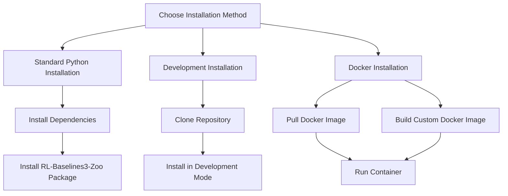

Sources: [setup.py](), [docker/Dockerfile](), [requirements.txt]()

## Standard Python Installation

### 1. Using pip (Recommended)

The simplest way to install RL-Baselines3-Zoo is using pip:

```bash
pip install rl_zoo3
```

This installs the core package with basic dependencies. For additional functionality, install optional components:

```bash
# For plotting tools
pip install "rl_zoo3[plots]"

# For all components including testing tools
pip install "rl_zoo3[plots,tests]"
```

Sources: [setup.py:36-59]()

### 2. Installation from Source

For the latest version or to make modifications:

```bash
# Clone the repository
git clone https://github.com/DLR-RM/rl-baselines3-zoo.git
cd rl-baselines3-zoo

# Install the package in development mode
pip install -e ".[plots,tests]"
```

Sources: [setup.py:17-28]()

## Dependencies Overview

RL-Baselines3-Zoo relies on several key dependencies:

```mermaid
graph TD
    subgraph "Core Dependencies"
        A["sb3_contrib ≥2.6.0,<3.0"] --> SB3["stable-baselines3"]
        B["gymnasium ≥0.29.1,<1.2.0"]
        C["huggingface_sb3 ≥3.0,<4.0"]
        D["optuna ≥3.0"]
        E["pyyaml ≥5.1"]
        F["tqdm & rich"]
    end
    
    subgraph "Optional Dependencies"
        G["seaborn & plotly"] --> PLOTS["Plotting Tools"]
        H["rliable ~1.2.0"] --> PLOTS
        I["scipy ~1.10"] --> PLOTS
        J["wandb"] --> TRACKING["Experiment Tracking"]
        K["moviepy ≥1.0.0"] --> VIDEO["Video Recording"]
    end
    
    subgraph "Environment Dependencies"
        L["box2d-py ==2.3.8"]
        M["pybullet_envs_gymnasium ≥0.6.0"]
        N["mujoco ≥2.3,<4"] 
        O["highway-env ≥1.10.1,<1.11.0"]
    end
    
    RL["RL-Baselines3-Zoo"] --> "Core Dependencies"
    RL --> "Optional Dependencies"
    RL --> "Environment Dependencies"
```

Sources: [setup.py:17-34](), [requirements.txt:1-14]()

## Environment-Specific Installations

### MuJoCo Environments

To use MuJoCo environments:

```bash
pip install "rl_zoo3[tests]"  # Includes mujoco package
```

### PyBullet Environments

For physics-based robot simulations:

```bash
pip install pybullet_envs_gymnasium>=0.6.0
```

### Box2D Environments

For 2D physics simulations:

```bash
pip install box2d-py==2.3.8
```

Sources: [requirements.txt:3-4](), [setup.py:29-34]()

## Docker Installation

RL-Baselines3-Zoo provides Docker support for containerized usage, which ensures consistent environments across different systems.

### Option 1: Pull Pre-built Image

```bash
# CPU version
docker pull stablebaselines/rl-baselines3-zoo-cpu:latest

# GPU version
docker pull stablebaselines/rl-baselines3-zoo:latest
```

### Option 2: Build Custom Image

```bash
git clone https://github.com/DLR-RM/rl-baselines3-zoo.git
cd rl-baselines3-zoo

# CPU version
USE_GPU=False ./scripts/build_docker.sh

# GPU version
USE_GPU=True ./scripts/build_docker.sh
```

### Running Docker Container

```bash
# CPU version
docker run -it --rm stablebaselines/rl-baselines3-zoo-cpu:latest

# GPU version (requires nvidia-docker)
docker run -it --rm --gpus all stablebaselines/rl-baselines3-zoo:latest
```

Sources: [docker/Dockerfile:1-36](), [scripts/build_docker.sh:1-21]()

## Docker Build Process

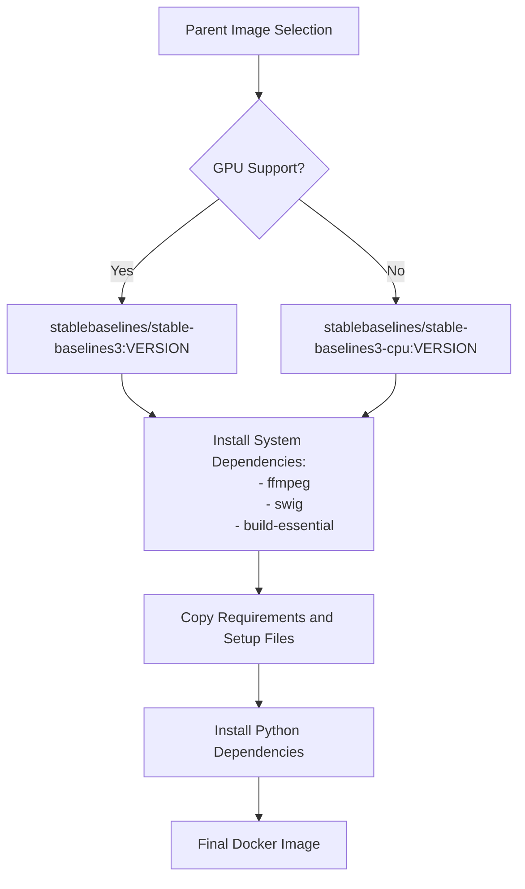

Sources: [docker/Dockerfile:1-36](), [scripts/build_docker.sh:1-21]()

## Installation Verification

To verify the installation, run a simple test that imports the package and checks the version:

```bash
python -c "import rl_zoo3; print(f'RL-Baselines3-Zoo version: {rl_zoo3.__version__}')"
```

You can also check that the command-line interface is properly installed:

```bash
rl_zoo3 --help
```

## Common Installation Issues

| Issue | Potential Solutions |
|-------|---------------------|
| Missing CUDA support | Ensure you have compatible GPU drivers and CUDA installed |
| Box2D compilation errors | Install system dependencies: `sudo apt install swig build-essential` |
| MuJoCo import errors | Ensure mujoco package is properly installed |
| Dependency conflicts | Use a virtual environment to isolate the installation |
| Permission errors | Use `pip install --user` or create a virtual environment |

## Package Structure

The installation places the following components in your Python environment:

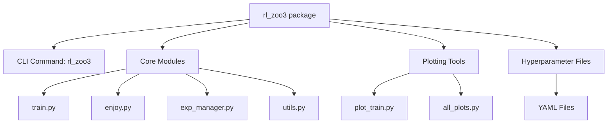

Sources: [setup.py:36-45]()

## Next Steps

After installation, you're ready to:

1. Train your first agent (see [Training System](#3) for details)
2. Explore hyperparameter configurations (see [Hyperparameter Management](#4))
3. Evaluate pre-trained agents (see [Evaluation and Benchmarking](#5))

---

# Page: Docker Deployment

# Docker Deployment

<details>
<summary>Relevant source files</summary>

The following files were used as context for generating this wiki page:

- [docker/Dockerfile](docker/Dockerfile)
- [requirements.txt](requirements.txt)
- [scripts/build_docker.sh](scripts/build_docker.sh)

</details>


This page provides instructions for deploying and using RL-Baselines3-Zoo with Docker containers. Docker offers a consistent environment that includes all necessary dependencies, making it easier to run reinforcement learning experiments across different systems. For standard installation without Docker, see [Installation Guide](#2.1).

## Docker Image Architecture

The RL-Baselines3-Zoo Docker images extend the Stable Baselines3 Docker images, providing a pre-configured environment with all required dependencies installed.

### Docker Image Structure Diagram

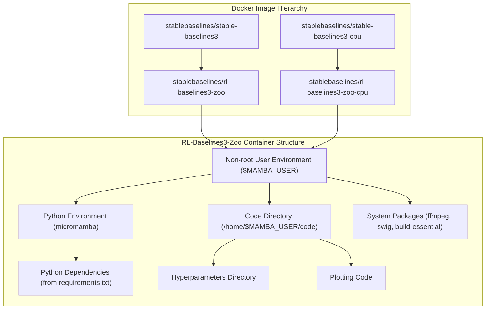

Sources: [docker/Dockerfile](), [scripts/build_docker.sh]()

## Building Docker Images

The repository provides a script (`scripts/build_docker.sh`) to build Docker images with either CPU or GPU support.

### Docker Build Process

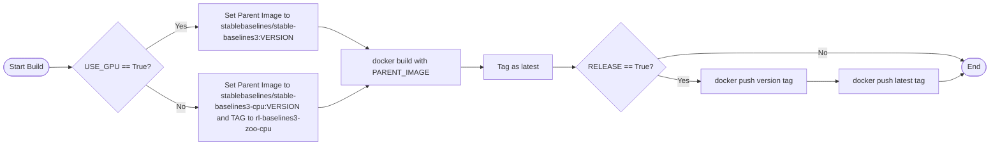

Sources: [scripts/build_docker.sh]()

### Building a CPU Image

To build a CPU-only Docker image:

```bash
USE_GPU=False ./scripts/build_docker.sh
```

This creates images tagged as `stablebaselines/rl-baselines3-zoo-cpu:version` and `stablebaselines/rl-baselines3-zoo-cpu:latest`.

### Building a GPU Image

To build a GPU-enabled Docker image:

```bash
USE_GPU=True ./scripts/build_docker.sh
```

This creates images tagged as `stablebaselines/rl-baselines3-zoo:version` and `stablebaselines/rl-baselines3-zoo:latest`.

### Publishing to Docker Hub

To build and push images to Docker Hub:

```bash
USE_GPU=True RELEASE=True ./scripts/build_docker.sh
```

Note: This requires Docker Hub credentials and appropriate permissions.

Sources: [scripts/build_docker.sh:8-21]()

## Docker Image Contents

The Docker image contains the following components:

| Component | Description |
|-----------|-------------|
| Base Image | `stablebaselines/stable-baselines3` or `stablebaselines/stable-baselines3-cpu` |
| System Packages | ffmpeg, swig, build-essential (for building Box2D) |
| Python Environment | Managed via micromamba |
| Code Directory | `/home/$MAMBA_USER/code` |
| RL-Baselines3-Zoo | Installed at `/home/$MAMBA_USER/code/rl_zoo3` in editable mode |
| Hyperparameters | Located at `/home/$MAMBA_USER/code/rl_zoo3/hyperparams/` |
| Plotting Code | Located at `/home/$MAMBA_USER/code/rl_zoo3/rl_zoo3/plots/` |

Sources: [docker/Dockerfile:1-36]()

## Python Dependencies

The Docker image includes all dependencies specified in `requirements.txt`:

| Category | Key Dependencies |
|----------|------------------|
| Core Libraries | gym==0.26.2, stable-baselines3[extra,tests,docs]>=2.6.0,<3.0 |
| Environments | box2d-py==2.3.8, pybullet_envs_gymnasium>=0.6.0 |
| Optimization | optunahub>=0.2.0, plotly |
| Visualization | wandb, moviepy>=1.0.0 |

Sources: [requirements.txt:1-15](), [docker/Dockerfile:27-34]()

## Running the Docker Container

### Basic Usage

To run the container with an interactive shell:

```bash
# CPU version
docker run -it --rm stablebaselines/rl-baselines3-zoo-cpu:latest

# GPU version (requires NVIDIA Container Toolkit)
docker run -it --rm --gpus all stablebaselines/rl-baselines3-zoo:latest
```

Inside the container, the RL-Baselines3-Zoo code is installed as an editable package at `/home/$MAMBA_USER/code/rl_zoo3`. The Python environment is automatically activated via micromamba.

Sources: [docker/Dockerfile:36]()

### Training an Agent

To train an agent using the container with persistent storage for logs:

```bash
docker run -it --rm \
  --gpus all \  # Remove for CPU version
  -v $(pwd)/logs:/home/$MAMBA_USER/logs \
  stablebaselines/rl-baselines3-zoo:latest \
  bash -c "cd /home/$MAMBA_USER/code/rl_zoo3 && python train.py --algo ppo --env CartPole-v1 -f /home/$MAMBA_USER/logs/"
```

This example mounts a local `logs` directory to store training results outside the container.

### Container Environment Details

The Docker container uses:
- A non-root user (`$MAMBA_USER`) for better security
- Micromamba for Python environment management
- An editable installation of RL-Baselines3-Zoo for easier modification
- Pre-copied hyperparameter configurations located in the container

## Customizing the Docker Image

If you need to customize the Docker image, you can:

1. Modify the Dockerfile: [docker/Dockerfile]()
2. Add additional requirements to `requirements.txt`
3. Rebuild the image using the build script

## Troubleshooting

### Common Issues

| Issue | Solution |
|-------|----------|
| GPU not detected | Ensure NVIDIA drivers and NVIDIA Container Toolkit (nvidia-docker2) are installed |
| Permission errors | Check volume mount permissions or run container with appropriate user mapping |
| Missing dependencies | The container includes all dependencies from requirements.txt; check if you need to rebuild with custom dependencies |

### Checking GPU Support

To verify GPU support inside the container:

```bash
docker run --rm --gpus all stablebaselines/rl-baselines3-zoo:latest nvidia-smi
```

If working correctly, this should display your GPU information.

---

# Page: Training System

# Training System

<details>
<summary>Relevant source files</summary>

The following files were used as context for generating this wiki page:

- [CHANGELOG.md](CHANGELOG.md)
- [rl_zoo3/exp_manager.py](rl_zoo3/exp_manager.py)
- [rl_zoo3/train.py](rl_zoo3/train.py)
- [train.py](train.py)

</details>


The Training System in RL-Baselines3-Zoo is responsible for configuring and executing reinforcement learning experiments. It handles environment creation, algorithm initialization, hyperparameter management, training, evaluation, and model saving. This page explains the system architecture and workflow for training reinforcement learning agents.

For information about command-line options, see [Command Line Interface](#3.1). For details on experiment management, see [Experiment Management](#3.2). For callback system information, see [Callbacks System](#3.3).

## System Architecture

The training system is built around the ExperimentManager class, which orchestrates the entire training process. The following diagram shows the high-level architecture:

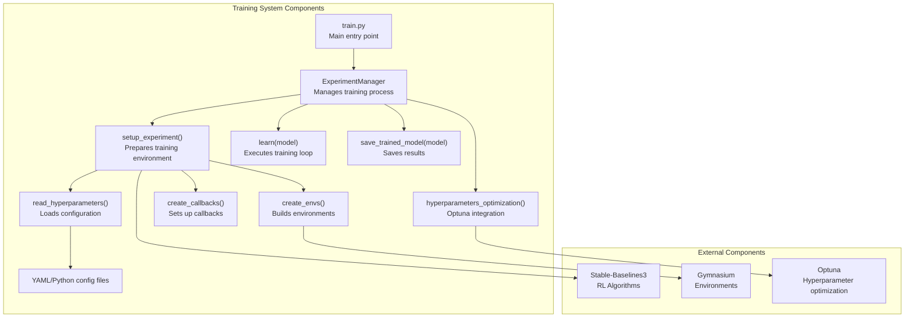

Sources: [rl_zoo3/exp_manager.py:56-193](), [rl_zoo3/train.py:20-266]()

## Training Workflow

The training workflow consists of several sequential steps, from parsing command-line arguments to saving the trained model:

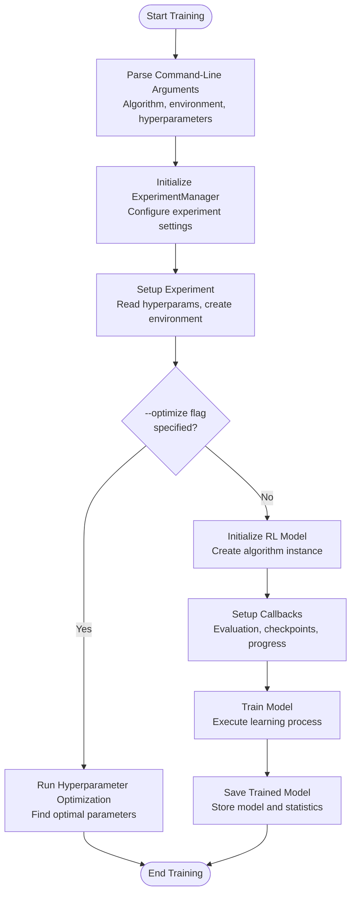

Sources: [rl_zoo3/train.py:20-286](), [rl_zoo3/exp_manager.py:193-232](), [rl_zoo3/exp_manager.py:233-270]()

## ExperimentManager Class

The `ExperimentManager` class serves as the central component of the training system:

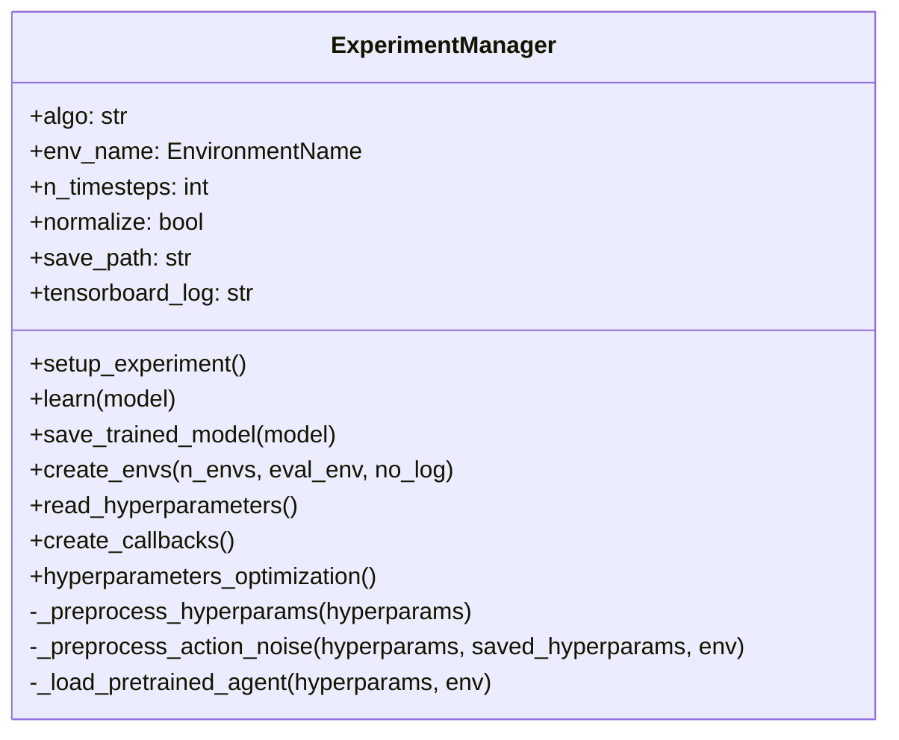

Sources: [rl_zoo3/exp_manager.py:56-193]()

### Key Methods

1. **setup_experiment()**: Prepares the training environment by reading hyperparameters, creating environments, and initializing the model.

2. **learn(model)**: Executes the training loop with the specified model and callbacks.

3. **save_trained_model(model)**: Saves the trained model, replay buffer (optional), and environment normalization statistics.

4. **create_envs()**: Creates vectorized environments for training or evaluation.

5. **read_hyperparameters()**: Loads hyperparameters from YAML or Python configuration files.

6. **create_callbacks()**: Sets up callbacks for evaluation, checkpointing, and progress tracking.

7. **hyperparameters_optimization()**: Runs hyperparameter optimization using Optuna.

Sources: [rl_zoo3/exp_manager.py:193-232](), [rl_zoo3/exp_manager.py:233-270](), [rl_zoo3/exp_manager.py:271-290](), [rl_zoo3/exp_manager.py:637-713](), [rl_zoo3/exp_manager.py:316-355](), [rl_zoo3/exp_manager.py:537-572](), [rl_zoo3/exp_manager.py:863-972]()

## Configuration and Hyperparameter Management

Hyperparameters are managed through a hierarchical system:

| Configuration Source | Priority | Description |
|----------------------|----------|-------------|
| Default YAML/Python files | Lowest | Base hyperparameters for each algorithm/environment combination |
| Optuna study results | Medium | Hyperparameters loaded from previous optimization trials |
| Command-line overrides | Highest | Parameters specified via `--hyperparams` option |

The hyperparameter loading process:

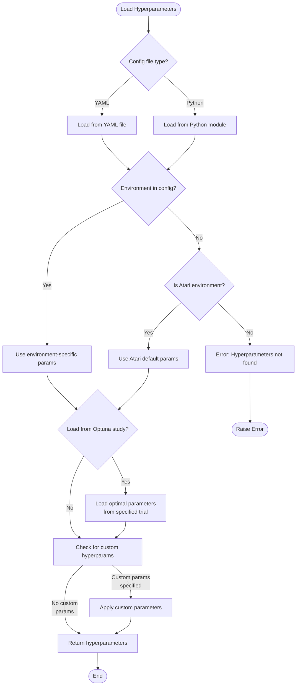

Sources: [rl_zoo3/exp_manager.py:316-355](), [rl_zoo3/exp_manager.py:357-373]()

## Environment Creation

The training system creates environments through a sophisticated process that handles various environment types and wrappers:

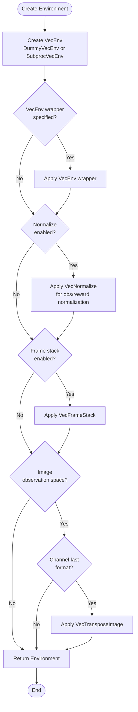

Sources: [rl_zoo3/exp_manager.py:637-713]()

## Training Execution

The `learn()` method handles the actual training execution:

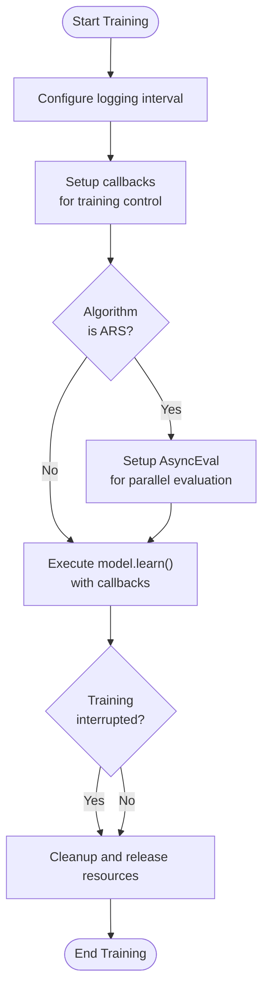

Sources: [rl_zoo3/exp_manager.py:233-270]()

## Hyperparameter Optimization

When enabled, the training system performs hyperparameter optimization using Optuna:

```mermaid
flowchart TD
    Start([Start Optimization]) --> CreateSampler["Create sampler\n(TPE, Random, Auto)"]
    CreateSampler --> CreatePruner["Create pruner\n(Median, Halving, None)"]
    CreatePruner --> SetupStorage["Setup storage\n(Journal file or DB)"]
    
    SetupStorage --> CreateStudy["Create or load Optuna study"]
    CreateStudy --> RunTrials["Run optimization trials"]
    
    RunTrials --> ForEachTrial["For each trial:"]
    ForEachTrial --> SampleParams["Sample hyperparameters"]
    SampleParams --> CreateEnv["Create environment"]
    CreateEnv --> CreateModel["Create model with sampled params"]
    CreateModel --> TrainEval["Train and evaluate model"]
    TrainEval --> CheckPerformance["Check performance"]
    
    CheckPerformance --> PruneCheck{"Should prune?"}
    PruneCheck -- Yes --> PruneTrial["Prune trial"]
    PruneCheck -- No --> NextTrial["Continue to next trial"]
    
    PruneTrial --> NextTrial
    NextTrial --> CheckDone{"All trials\ncomplete?"}
    
    CheckDone -- No --> ForEachTrial
    CheckDone -- Yes --> ReportResults["Report best parameters"]
    
    ReportResults --> SaveResults["Save results and plots"]
    SaveResults --> End([End Optimization])
```

Sources: [rl_zoo3/exp_manager.py:863-972](), [rl_zoo3/exp_manager.py:772-861]()

## Environment Handling and Wrappers

The training system supports various environment types and wrappers:

| Environment Type | Detection Method | Special Handling |
|------------------|------------------|------------------|
| Atari            | Entry point check | Frame skipping, episodic life, etc. |
| MiniGrid         | Entry point check | Non-deterministic evaluation |
| PyBullet         | Entry point check | Specific wrappers |
| Robotics/GoalEnv | Entry point check | Success rate logging |
| Panda Gym        | Entry point check | Robotics interface |
| Generic          | Default          | Standard processing |

Sources: [rl_zoo3/exp_manager.py:574-598](), [rl_zoo3/exp_manager.py:637-713]()

## Integration with Stable-Baselines3

The training system integrates with Stable-Baselines3 algorithms through the `ALGOS` dictionary:

```mermaid
graph TD
    subgraph "Training System"
        ExpManager["ExperimentManager"]
        ModelCreation["Model Creation"]
    end
    
    subgraph "Stable-Baselines3 Algorithms"
        A2C["A2C"]
        PPO["PPO"]
        SAC["SAC"]
        TD3["TD3"]
        DDPG["DDPG"]
        DQN["DQN"]
    end
    
    subgraph "SB3-Contrib Algorithms"
        TQC["TQC"]
        TRPO["TRPO"]
        ARS["ARS"]
        RecurrentPPO["RecurrentPPO"]
        CrossQ["CrossQ"]
    end
    
    ExpManager --> ModelCreation
    ModelCreation --> ALGOS["ALGOS Dictionary\nMaps algorithm name to class"]
    
    ALGOS --> A2C
    ALGOS --> PPO
    ALGOS --> SAC
    ALGOS --> TD3
    ALGOS --> DDPG
    ALGOS --> DQN
    
    ALGOS --> TQC
    ALGOS --> TRPO
    ALGOS --> ARS
    ALGOS --> RecurrentPPO
    ALGOS --> CrossQ
```

Sources: [rl_zoo3/train.py:20-266](), [rl_zoo3/exp_manager.py:193-232]()

## Callback System

The training system uses a flexible callback system to monitor and control training:

| Callback | Purpose |
|----------|---------|
| `ProgressBarCallback` | Displays training progress (when `--progress` is specified) |
| `CheckpointCallback` | Saves model checkpoints at specified frequency |
| `EvalCallback` | Evaluates model performance during training |
| `SaveVecNormalizeCallback` | Saves normalization statistics when a new best model is found |
| `TrialEvalCallback` | Used during hyperparameter optimization to evaluate trials |

Sources: [rl_zoo3/exp_manager.py:537-572]()

## Data Flow

The following diagram illustrates the data flow through the training system:

```mermaid
flowchart LR
    subgraph "Configuration Phase"
        CLI["Command-Line Arguments"] --> ExpManager["ExperimentManager"]
        HyperFiles["Hyperparameter Files"] --> ExpManager
    end
    
    subgraph "Setup Phase"
        ExpManager --> Hyperparams["Processed Hyperparameters"]
        Hyperparams --> EnvConfig["Environment Configuration"]
        Hyperparams --> ModelConfig["Model Configuration"]
        Hyperparams --> CBConfig["Callback Configuration"]
    end
    
    subgraph "Training Phase"
        EnvConfig --> Env["Training Environment"]
        ModelConfig --> Model["RL Algorithm Model"]
        CBConfig --> Callbacks["Training Callbacks"]
        
        Env --> Observations["Environment Observations"]
        Observations --> Model
        Model --> Actions["Agent Actions"]
        Actions --> Env
        
        Env --> Rewards["Environment Rewards"]
        Rewards --> Model
        
        Model --> TrainingStats["Training Statistics"]
        TrainingStats --> Callbacks
    end
    
    subgraph "Output Phase"
        Model --> SavedModel["Saved Model (.zip)"]
        Model --> ReplayBuffer["Replay Buffer (optional)"]
        Env --> NormStats["Normalization Statistics"]
    end
```

Sources: [rl_zoo3/train.py:20-286](), [rl_zoo3/exp_manager.py:193-232](), [rl_zoo3/exp_manager.py:233-270](), [rl_zoo3/exp_manager.py:271-290]()

## Using the Training System

The training system can be used in two primary ways:

1. **Command-line interface**: Run `python train.py` with appropriate arguments to train an agent.

2. **Python API**: Import and use the `ExperimentManager` directly in your code.

Example command to train a PPO agent on CartPole:

```bash
python train.py --algo ppo --env CartPole-v1 -n 50000 --eval-freq 10000
```

Example command for hyperparameter optimization:

```bash
python train.py --algo ppo --env CartPole-v1 -n 50000 --optimize-hyperparameters --n-trials 100 
```

Sources: [rl_zoo3/train.py:20-286]()

## Conclusion

The Training System in RL-Baselines3-Zoo provides a flexible and powerful framework for training reinforcement learning agents. It handles the complexity of environment creation, model initialization, hyperparameter management, and training execution, allowing users to focus on experimenting with different algorithms and environments.

---

# Page: Command Line Interface

# Command Line Interface

<details>
<summary>Relevant source files</summary>

The following files were used as context for generating this wiki page:

- [README.md](README.md)
- [rl_zoo3/train.py](rl_zoo3/train.py)
- [train.py](train.py)

</details>


The Command Line Interface (CLI) of RL-Baselines3-Zoo provides a comprehensive set of tools for training, evaluating, and optimizing reinforcement learning agents. This document covers the command-line arguments, usage patterns, and workflow for the CLI, focusing particularly on the training interface. For information about evaluation of trained agents, see [Evaluating Trained Agents](#5.1).

## Overview

RL-Baselines3-Zoo's CLI is primarily centered around the `train.py` script, which serves as the main entry point for training reinforcement learning agents. The CLI allows users to:

- Train agents with different algorithms on various environments
- Configure training parameters and hyperparameters
- Optimize hyperparameters using Optuna
- Track experiments with Weights & Biases
- Evaluate agent performance during training
- Save and load trained models

```mermaid
flowchart TD
    subgraph "Command Line Interface"
        direction LR
        CLI["train.py CLI"]
        TrainCommand["train() function"]
        ArgParser["ArgumentParser"]
        ExpManager["ExperimentManager"]
        
        CLI --> TrainCommand
        TrainCommand --> ArgParser
        ArgParser --> ExpManager
    end
    
    subgraph "Training System"
        Setup["setup_experiment()"]
        Learn["learn()"]
        HyperOpt["hyperparameters_optimization()"]
        SaveModel["save_trained_model()"]
    end
    
    ExpManager --> Setup
    Setup -- "Model exists" --> Learn --> SaveModel
    Setup -- "Optimization" --> HyperOpt
```

Sources: [rl_zoo3/train.py:20-286](), [train.py:1-5]()

## CLI Entry Points

There are two ways to use the RL-Baselines3-Zoo CLI:

1. **Direct script execution**: `python train.py [options]`
2. **Module execution**: `python -m rl_zoo3.train [options]` or `rl_zoo3 train [options]`

The second approach allows you to run the commands from any directory after installing the package.

Sources: [README.md:50-50]()

## Basic Usage

The most basic command to train an agent requires specifying an algorithm and an environment:

```bash
python train.py --algo ppo --env CartPole-v1
```

This will train a PPO agent on the CartPole-v1 environment using default hyperparameters defined in the corresponding YAML file.

Sources: [README.md:67-69](), [rl_zoo3/train.py:21-23]()

## Command Line Arguments

The CLI provides a wide range of arguments that can be grouped into the following categories:

### Core Training Arguments

```mermaid
classDiagram
    class "Core Training Arguments" {
        --algo: Algorithm name
        --env: Environment ID
        --n-timesteps: Total timesteps
        --trained-agent: Path to pretrained agent
        --seed: Random seed
        --num-threads: PyTorch threads
        --device: Computing device
    }
```

| Argument | Description | Default |
|----------|-------------|---------|
| `--algo` | RL algorithm to use (e.g., ppo, a2c, sac) | `ppo` |
| `--env` | Environment ID (e.g., CartPole-v1) | `CartPole-v1` |
| `--n-timesteps` | Number of training timesteps | Value from hyperparameters file |
| `--trained-agent` | Path to a pretrained agent to continue training | `""` (empty) |
| `--seed` | Random generator seed | Random value if negative |
| `--num-threads` | Number of threads for PyTorch | `-1` (default) |
| `--device` | PyTorch device (cpu, cuda, auto) | `auto` |

Sources: [rl_zoo3/train.py:22-24](), [rl_zoo3/train.py:33-34](), [rl_zoo3/train.py:61-63]()

### Evaluation Arguments

```mermaid
classDiagram
    class "Evaluation Arguments" {
        --eval-freq: Evaluation frequency
        --eval-episodes: Episodes per evaluation
        --n-eval-envs: Num of eval environments
        --save-freq: Model saving frequency
    }
```

| Argument | Description | Default |
|----------|-------------|---------|
| `--eval-freq` | Evaluate the agent every n steps | `25000` |
| `--eval-episodes` | Number of episodes for evaluation | `5` |
| `--n-eval-envs` | Number of environments for evaluation | `1` |
| `--save-freq` | Save the model every n steps | `-1` (no saving) |
| `--save-replay-buffer` | Save the replay buffer too | `False` |

Sources: [rl_zoo3/train.py:41-56](), [rl_zoo3/train.py:57-59]()

### Hyperparameter Optimization Arguments

```mermaid
classDiagram
    class "Optimization Arguments" {
        --optimize-hyperparameters: Enable optimization
        --n-trials: Number of trials
        --max-total-trials: Max pruned trials
        --n-jobs: Parallel jobs
        --sampler: Sampling method
        --pruner: Pruning method
        --n-startup-trials: Initial trials
        --n-evaluations: Evals per trial
    }
```

| Argument | Description | Default |
|----------|-------------|---------|
| `--optimize-hyperparameters` | Run hyperparameter search | `False` |
| `--n-trials` | Number of trials for optimization | `500` |
| `--max-total-trials` | Max number of pruned trials | `None` |
| `--n-jobs` | Number of parallel jobs | `1` |
| `--sampler` | Sampler to use (random, tpe, auto) | `tpe` |
| `--pruner` | Pruner to use (halving, median, none) | `median` |
| `--n-startup-trials` | Trials before using sampler | `10` |
| `--n-evaluations` | Evaluations per trial | `None` |
| `--storage` | Database storage for distributed optimization | `None` |
| `--study-name` | Study name for distributed optimization | `None` |
| `--trial-id` | Trial ID for Optuna storage | `None` |
| `--no-optim-plots` | Disable optimization plots | `False` |

Sources: [rl_zoo3/train.py:78-112]()

### Logging and Tracking Arguments

```mermaid
classDiagram
    class "Logging Arguments" {
        --tensorboard-log: TB log directory
        --log-folder: Log folder path
        --log-interval: Log display frequency
        --verbose: Verbosity level
        --track: Enable W&B tracking
        --wandb-project-name: W&B project
        --wandb-entity: W&B team/entity
        --wandb-tags: W&B tags
        --progress: Show progress bar
    }
```

| Argument | Description | Default |
|----------|-------------|---------|
| `--tensorboard-log` | Tensorboard log directory | `""` (empty) |
| `--log-folder` | Log folder path | `logs` |
| `--log-interval` | Override log interval | `-1` (no change) |
| `--verbose` | Verbosity level (0: none, 1: info) | `1` |
| `--track` | Track with Weights & Biases | `False` |
| `--wandb-project-name` | W&B project name | `sb3` |
| `--wandb-entity` | W&B team/entity | `None` |
| `--wandb-tags` | Tags for W&B run | `[]` (empty) |
| `--progress` | Display progress bar | `False` |
| `--uuid` | Ensure run has unique ID | `False` |

Sources: [rl_zoo3/train.py:24-25](), [rl_zoo3/train.py:35-40](), [rl_zoo3/train.py:60-61](), [rl_zoo3/train.py:112-112](), [rl_zoo3/train.py:147-164]()

### Environment and Configuration Arguments

```mermaid
classDiagram
    class "Environment Arguments" {
        --vec-env: Vector env type
        --env-kwargs: Env constructor args
        --eval-env-kwargs: Eval env args
        --gym-packages: External gym packages
        --hyperparams: Override hyperparams
        --conf-file: Custom config file
    }
```

| Argument | Description | Default |
|----------|-------------|---------|
| `--vec-env` | VecEnv type (dummy, subproc) | `dummy` |
| `--env-kwargs` | Keyword arguments for env constructor | `None` |
| `--eval-env-kwargs` | Keyword arguments for eval env | `None` |
| `--gym-packages` | Additional Gym environment packages | `[]` (empty) |
| `--hyperparams` | Overwrite hyperparameters | `None` |
| `--conf-file` | Custom YAML file or python package | `None` |
| `--truncate-last-trajectory` | Truncate last trajectory when using HER | `True` |

Sources: [rl_zoo3/train.py:26-32](), [rl_zoo3/train.py:62-62](), [rl_zoo3/train.py:113-145]()

## Command Processing Flow

The following diagram shows how the command-line arguments are processed and how they flow through the training system:

```mermaid
flowchart TD
    Start([Start]) --> ParseArgs["Parse Command Arguments"]
    ParseArgs --> ImportGym["Import Custom Gym Packages"]
    ImportGym --> ValidateEnv["Validate Environment"]
    ValidateEnv --> SetupSeed["Setup Random Seed"]
    SetupSeed --> CheckWandB{"W&B Tracking?"}
    
    CheckWandB -- Yes --> InitWandB["Initialize W&B"]
    CheckWandB -- No --> CreateManager["Create ExperimentManager"]
    InitWandB --> CreateManager
    
    CreateManager --> Setup["Setup Experiment"]
    Setup --> CheckResult{"Results?"}
    
    CheckResult -- "Yes (Normal Training)" --> LoadModel["Load/Create Model"]
    LoadResult -- "Yes (WandB)" --> SaveHyperparams["Save Hyperparameters to W&B"]
    CheckResult -- "No (Optimization)" --> RunOptimization["Run Hyperparameter Optimization"]
    
    LoadModel --> TrainModel["Train Model"]
    TrainModel --> SaveModel["Save Trained Model"]
    SaveModel --> End([End])
    
    RunOptimization --> End
```

Sources: [rl_zoo3/train.py:166-283]()

## Experiment Setup Process

When you run a training command, the CLI sets up the experiment in the following way:

```mermaid
sequenceDiagram
    participant User as "User"
    participant CLI as "train.py CLI"
    participant EM as "ExperimentManager"
    participant SB3 as "Stable-Baselines3"
    participant Env as "Gymnasium Environment"
    
    User->>CLI: Run with arguments
    CLI->>EM: Create with args
    EM->>EM: setup_experiment()
    
    alt Hyperparameter Optimization
        EM->>EM: hyperparameters_optimization()
        EM->>SB3: Create multiple models with different params
    else Normal Training
        EM->>Env: Create environment
        EM->>SB3: Create model
        EM->>EM: learn(model)
        EM->>SB3: model.learn()
        SB3->>Env: Interact with environment
        EM->>EM: save_trained_model(model)
    end
    
    CLI->>User: Return results
```

Sources: [rl_zoo3/train.py:227-282]()

## Examples

### Basic Training

Train a PPO agent on CartPole-v1 for the default number of timesteps:

```bash
python train.py --algo ppo --env CartPole-v1
```

### Customizing Training

Train a SAC agent on HalfCheetahBulletEnv-v0 with evaluation every 10000 steps:

```bash
python train.py --algo sac --env HalfCheetahBulletEnv-v0 --eval-freq 10000 --eval-episodes 10 --n-eval-envs 1
```

Sources: [README.md:72-74]()

### Hyperparameter Optimization

Run hyperparameter optimization for PPO on LunarLander-v2:

```bash
python train.py --algo ppo --env LunarLander-v2 --optimize-hyperparameters --n-trials 100 --n-jobs 2
```

### Using Weights & Biases

Train with Weights & Biases tracking:

```bash
python train.py --algo sac --env Hopper-v2 --track --wandb-project-name my_project --wandb-entity my_team
```

## Advanced Usage

### Providing Custom Hyperparameters

Override specific hyperparameters:

```bash
python train.py --algo ppo --env CartPole-v1 --hyperparams learning_rate:0.001 n_steps:1024
```

### Using Custom Configuration File

Load hyperparameters from a custom file:

```bash
python train.py --algo ppo --env CartPole-v1 --conf-file my_hyperparams.yml
```

### Interactive Session Usage

For using the CLI in an interactive Python session (e.g., Jupyter notebook):

```python
import sys
from rl_zoo3.train import train

sys.argv = ["python", "--algo", "ppo", "--env", "MountainCar-v0"]
train()
```

Sources: [README.md:264-271]()

## Integration with Other Components

```mermaid
flowchart LR
    subgraph "Command Line Interface"
        CLI["train.py CLI"]
    end
    
    subgraph "Core Components"
        ExpManager["ExperimentManager"]
        HyperOpt["Hyperparameter Optimization"]
        Callbacks["Callbacks System"]
        Utils["Utility Functions"]
    end
    
    subgraph "External Integrations"
        SB3["Stable-Baselines3"]
        Optuna["Optuna"]
        Gym["Gymnasium"]
        WandB["Weights & Biases"]
        Tensorboard["Tensorboard"]
    end
    
    CLI --> ExpManager
    ExpManager --> HyperOpt
    ExpManager --> Callbacks
    ExpManager --> Utils
    
    ExpManager --> SB3
    HyperOpt --> Optuna
    ExpManager --> Gym
    CLI --> WandB
    CLI --> Tensorboard
```

Sources: [rl_zoo3/train.py:16-17](), [rl_zoo3/train.py:205-225](), [rl_zoo3/train.py:227-265]()

## CLI Argument Relationship to Code Structure

```mermaid
classDiagram
    class ArgumentParser {
        parse_args()
    }
    
    class CLI_Arguments {
        algo: str
        env: str
        n_timesteps: int
        eval_freq: int
        optimize_hyperparameters: bool
        ...
    }
    
    class ExperimentManager {
        setup_experiment()
        learn(model)
        save_trained_model(model)
        hyperparameters_optimization()
    }
    
    class train_function {
        __main__
    }
    
    ArgumentParser --> CLI_Arguments: creates
    CLI_Arguments --> ExperimentManager: configures
    ExperimentManager --> train_function: used by
```

Sources: [rl_zoo3/train.py:20-265]()

## Conclusion

The RL-Baselines3-Zoo CLI provides a flexible and powerful interface for training, evaluating, and optimizing reinforcement learning agents. By understanding the available command-line arguments and how they interact with the underlying components, users can effectively utilize the framework for a wide range of reinforcement learning tasks.

For further information on evaluating trained agents, see [Evaluating Trained Agents](#5.1), and for more details on hyperparameter optimization, see [Hyperparameter Optimization](#4.2).

---

# Page: Experiment Management

# Experiment Management

<details>
<summary>Relevant source files</summary>

The following files were used as context for generating this wiki page:

- [CHANGELOG.md](CHANGELOG.md)
- [rl_zoo3/exp_manager.py](rl_zoo3/exp_manager.py)
- [rl_zoo3/utils.py](rl_zoo3/utils.py)

</details>


## Purpose and Scope

The Experiment Management system in RL-Baselines3-Zoo handles the entire lifecycle of reinforcement learning experiments, from hyperparameter configuration to model training and evaluation. This component serves as the core orchestrator that connects various parts of the framework, ensuring a standardized workflow for running RL experiments.

For training execution via the command line interface, see [Command Line Interface](#3.1). For hyperparameter configuration specifics, see [Hyperparameter Management](#4).

## Architecture Overview

The `ExperimentManager` class serves as the central component for managing RL experiments. It handles environment creation, hyperparameter processing, model initialization, training, and result saving.

```mermaid
classDiagram
    class ExperimentManager {
        +setup_experiment()
        +learn(model)
        +save_trained_model(model)
        +read_hyperparameters()
        +create_envs(n_envs, eval_env, no_log)
        +create_callbacks()
        +hyperparameters_optimization()
        +objective(trial)
        -_preprocess_hyperparams(hyperparams)
        -_preprocess_action_noise(hyperparams, saved_hyperparams, env)
        -_maybe_normalize(env, eval_env)
        -_load_pretrained_agent(hyperparams, env)
        -_save_config(saved_hyperparams)
    }
```

Sources: [rl_zoo3/exp_manager.py:56-973]()

## Experiment Manager Initialization

The `ExperimentManager` initialization accepts numerous parameters that configure the experiment, including:

- Algorithm name (`algo`) and environment ID (`env_id`)
- Logging configuration (`log_folder`, `tensorboard_log`)
- Training parameters (`n_timesteps`, `eval_freq`, `n_eval_episodes`, `save_freq`)
- Custom hyperparameters, environment arguments
- Hyperparameter optimization settings
- Device configuration, verbosity controls, and more

Sources: [rl_zoo3/exp_manager.py:67-191]()

## Experiment Workflow

### Setup Phase

The experiment workflow begins with the `setup_experiment()` method, which:

1. Reads hyperparameters from configuration files
2. Preprocesses these hyperparameters
3. Creates the environment
4. Initializes the RL model
5. Saves the configuration

```mermaid
flowchart TD
    A["setup_experiment()"] --> B["read_hyperparameters()"]
    B --> C["_preprocess_hyperparams()"]
    C --> D["create_log_folder()"]
    D --> E["create_callbacks()"]
    E --> F["create_envs()"]
    F --> G["_preprocess_action_noise()"]
    G --> H{{"Continue training?"}}
    H -->|Yes| I["_load_pretrained_agent()"]
    H -->|No| J{{"Optimize hyperparams?"}}
    J -->|Yes| K["Return None (for optimization)"]
    J -->|No| L["Initialize new model"]
    I --> M["_save_config()"]
    L --> M
    M --> N["Return model, hyperparams"]
```

Sources: [rl_zoo3/exp_manager.py:193-231]()

### Training Phase

The `learn()` method handles the training process by:

1. Setting up keyword arguments for logging
2. Adding callbacks for monitoring and logging
3. Handling special cases (e.g., for ARS algorithm)
4. Calling the model's `learn()` method
5. Cleaning up resources after training

```mermaid
flowchart TD
    A["learn(model)"] --> B["Setup logging kwargs"]
    B --> C{{"Callbacks available?"}}
    C -->|Yes| D["Add callbacks to kwargs"]
    C -->|No| E{{"Using ARS algorithm?"}}
    D --> E
    E -->|Yes| F["Setup AsyncEval"]
    E -->|No| G["Call model.learn()"]
    F --> G
    G --> H["Handle cleanup"]
    H --> I["Close environments"]
```

Sources: [rl_zoo3/exp_manager.py:233-270]()

## Hyperparameter Management

The `read_hyperparameters()` method loads hyperparameters from configuration files and processes them. It supports:

- YAML configuration files (`.yml`, `.yaml`)
- Python script files (`.py`)
- Python modules (imported directly)
- Loading from Optuna studies
- Custom hyperparameters passed at initialization

```mermaid
flowchart TD
    A["read_hyperparameters()"] --> B{{"Config file type?"}}
    B -->|YAML| C["Load from YAML file"]
    B -->|Python file| D["Load from Python file"]
    B -->|Python module| E["Import module hyperparams"]
    C --> F["Get env-specific hyperparams"]
    D --> F
    E --> F
    F --> G{{"Loading from Optuna study?"}}
    G -->|Yes| H["Load trial hyperparams"]
    G -->|No| I{{"Custom hyperparams provided?"}}
    H --> I
    I -->|Yes| J["Override with custom hyperparams"]
    I -->|No| K["Create ordered hyperparams"]
    J --> K
    K --> L["Return hyperparams, saved_hyperparams"]
```

Sources: [rl_zoo3/exp_manager.py:316-355]()

## Environment Creation

The `create_envs()` method handles environment creation with appropriate wrappers and configurations:

1. Sets up logging directory
2. Handles special environment types (e.g., robotics environments)
3. Creates vectorized environments
4. Applies environment wrappers
5. Sets up normalization if needed
6. Configures frame stacking and image transposition as needed

```mermaid
flowchart TD
    A["create_envs(n_envs, eval_env, no_log)"] --> B["Set log directory"]
    B --> C{{"Is robotics env?"}}
    C -->|Yes| D["Set monitor_kwargs for success tracking"]
    C -->|No| E["Get environment specification"]
    D --> E
    E --> F["Define make_env function"]
    F --> G["Create vectorized environment"]
    G --> H{{"Vec env wrapper specified?"}}
    H -->|Yes| I["Apply vec_env_wrapper"]
    H -->|No| J["_maybe_normalize(env, eval_env)"]
    I --> J
    J --> K{{"Frame stacking enabled?"}}
    K -->|Yes| L["Apply VecFrameStack"]
    K -->|No| M{{"Image observation space?"}}
    L --> M
    M -->|Yes, needs transpose| N["Apply VecTransposeImage"]
    M -->|No| O["Return environment"]
    N --> O
```

Sources: [rl_zoo3/exp_manager.py:637-714]()

## Callback System Integration

The `create_callbacks()` method sets up callbacks for monitoring training progress, saving checkpoints, and evaluating models:

1. Adds a progress bar callback if requested
2. Sets up model checkpointing based on save frequency
3. Creates an evaluation environment and callback if evaluation is enabled
4. Configures a VecNormalize callback to save normalization statistics

```mermaid
flowchart TD
    A["create_callbacks()"] --> B{{"Show progress bar?"}}
    B -->|Yes| C["Add ProgressBarCallback"]
    B -->|No| D{{"Save frequency > 0?"}}
    C --> D
    D -->|Yes| E["Adjust save frequency"]
    D -->|No| F{{"Eval frequency > 0?"}}
    E --> G["Add CheckpointCallback"]
    G --> F
    F -->|Yes| H["Adjust eval frequency"]
    F -->|No| I["Return callbacks"]
    H --> J["Create eval environment"]
    J --> K["Setup SaveVecNormalizeCallback"]
    K --> L["Create EvalCallback"]
    L --> M["Add EvalCallback to callbacks list"]
    M --> I
```

Sources: [rl_zoo3/exp_manager.py:537-572]()

## Hyperparameter Optimization

The `ExperimentManager` integrates with Optuna for hyperparameter optimization. This consists of two main components:

1. The `hyperparameters_optimization()` method, which sets up and executes the optimization process
2. The `objective()` method, which serves as the optimization objective function

### Optimization Workflow

```mermaid
flowchart TD
    A["hyperparameters_optimization()"] --> B["Create sampler"]
    B --> C["Create pruner"]
    C --> D["Setup storage"]
    D --> E["Create Optuna study"]
    E --> F{{"max_total_trials specified?"}}
    F -->|Yes| G["Optimize with max trials limit"]
    F -->|No| H["Optimize with n_trials"]
    G --> I["Process results"]
    H --> I
    I --> J["Save study data"]
    J --> K{{"Generate plots?"}}
    K -->|Yes| L["Create optimization plots"]
    K -->|No| M["Return"]
    L --> M
```

### Objective Function

```mermaid
flowchart TD
    A["objective(trial)"] --> B["Sample hyperparameters"]
    B --> C["Create environment"]
    C --> D["Initialize model"]
    D --> E["Create evaluation environment"]
    E --> F["Setup evaluation callback"]
    F --> G["Train model"]
    G --> H{{"Training successful?"}}
    H -->|No| I["Free resources and prune trial"]
    H -->|Yes| J["Get evaluation reward"]
    J --> K{{"Trial pruned?"}}
    K -->|Yes| L["Raise TrialPruned"]
    K -->|No| M["Return reward"]
```

Sources: [rl_zoo3/exp_manager.py:746-973]()

## Model Loading and Saving

The `ExperimentManager` handles loading pretrained models and saving trained models:

### Loading Pretrained Models

The `_load_pretrained_agent()` method:
1. Loads a model from a specified path
2. Loads the replay buffer if available
3. Applies the model to the current environment

### Saving Trained Models

The `save_trained_model()` method:
1. Saves the model to a zip file
2. Optionally saves the replay buffer
3. Saves VecNormalize statistics if normalization is used

```mermaid
flowchart TD
    A["save_trained_model(model)"] --> B["Save model to zip file"]
    B --> C{{"Save replay buffer?"}}
    C -->|Yes| D["Save replay buffer"]
    C -->|No| E{{"Using normalization?"}}
    D --> E
    E -->|Yes| F["Save VecNormalize statistics"]
    E -->|No| G["Done"]
    F --> G
```

Sources: [rl_zoo3/exp_manager.py:271-290](), [rl_zoo3/exp_manager.py:716-744]()

## Experiment Manager in the Training Pipeline

The `ExperimentManager` connects with the rest of the RL-Baselines3-Zoo framework to provide a complete training pipeline:

```mermaid
flowchart TD
    A["train.py"] --> B["Parse Arguments"]
    B --> C["Create ExperimentManager"]
    C --> D{{"Optimize hyperparameters?"}}
    D -->|Yes| E["hyperparameters_optimization()"]
    D -->|No| F["setup_experiment()"]
    F --> G["learn(model)"]
    G --> H["save_trained_model(model)"]
    E --> I["Continue with best hyperparameters"]
    I --> F
```

Sources: [rl_zoo3/exp_manager.py:56-973](), [rl_zoo3/utils.py:126-144]()

## Integration with ALGOS Dictionary

The `ExperimentManager` uses the `ALGOS` dictionary from `utils.py` to map algorithm names to algorithm classes:

```mermaid
classDiagram
    class ALGOS {
        +a2c: A2C
        +ddpg: DDPG
        +dqn: DQN
        +ppo: PPO
        +sac: SAC
        +td3: TD3
        +ars: ARS
        +crossq: CrossQ
        +qrdqn: QRDQN
        +tqc: TQC
        +trpo: TRPO
        +ppo_lstm: RecurrentPPO
    }
    
    ExperimentManager --> ALGOS: uses
```

Sources: [rl_zoo3/utils.py:26-40]()

## Conclusion

The Experiment Management system in RL-Baselines3-Zoo serves as the central orchestrator for reinforcement learning experiments. It provides a standardized way to configure, run, and evaluate RL agents, with support for hyperparameter optimization, environment customization, and comprehensive monitoring.

By handling the complexities of experiment setup and execution, the `ExperimentManager` allows users to focus on the core aspects of RL research while maintaining flexibility and extensibility.

---

# Page: Callbacks System

# Callbacks System

<details>
<summary>Relevant source files</summary>

The following files were used as context for generating this wiki page:

- [CHANGELOG.md](CHANGELOG.md)
- [rl_zoo3/exp_manager.py](rl_zoo3/exp_manager.py)
- [tests/test_callbacks.py](tests/test_callbacks.py)
- [tests/test_wrappers.py](tests/test_wrappers.py)

</details>


The callbacks system in RL-Baselines3-Zoo provides a mechanism to monitor, control, and extend the training process of reinforcement learning agents. This page explains how callbacks are integrated, managed, and used within the training framework to customize behavior without modifying core algorithms.

For information about the overall experiment management system, see [Experiment Management](#3.2).

## Callback System Overview

Callbacks in RL-Baselines3-Zoo are event handlers that can be triggered at specific points during the training process. They leverage Stable-Baselines3's callback architecture to enable users to:

- Monitor training metrics
- Save model checkpoints at regular intervals
- Perform periodic evaluations
- Implement early stopping conditions
- Log custom statistics
- Visualize training progress
- Control the training process adaptively

Callbacks are processed by the `ExperimentManager` which collects, initializes, and passes them to the learning algorithm.

```mermaid
flowchart TD
    subgraph "Training System"
        Train["train.py"] --> ExpManager["ExperimentManager"]
        ExpManager --> Setup["setup_experiment()"]
        Setup --> ReadHyperparams["read_hyperparameters()"]
        ReadHyperparams --> ProcessHyperparams["_preprocess_hyperparams()"]
        ProcessHyperparams --> GetCallbackList["get_callback_list()"]
        ExpManager --> CreateCB["create_callbacks()"]
        ExpManager --> Learn["learn()"]
        Learn --> ModelLearn["model.learn()"]
    end
    
    subgraph "Callback Sources"
        UserConfig["User Config\n(YAML/Python)"] --> ProcessHyperparams
        DefaultCB["Default Callbacks\n- ProgressBarCallback\n- CheckpointCallback\n- EvalCallback"] --> CreateCB
    end
    
    subgraph "Callback Execution"
        ModelLearn --> CallbackOnTrainingStart["on_training_start()"]
        ModelLearn --> CallbackOnRollout["on_rollout_start/end()"]
        ModelLearn --> CallbackOnStep["on_step()"]
        ModelLearn --> CallbackOnTrainingEnd["on_training_end()"]
    end
    
    CreateCB --> ModelLearn
    GetCallbackList --> CreateCB
```

Sources: [rl_zoo3/exp_manager.py:489-572]()

## Callback Integration

The `ExperimentManager` integrates callbacks into the training process in two main ways:

1. **User-specified callbacks** - defined in hyperparameter files or command line arguments
2. **Built-in callbacks** - automatically created based on training configuration

These callbacks are combined into a single list and passed to the learning algorithm.

```mermaid
classDiagram
    class BaseCallback {
        +on_training_start()
        +on_rollout_start()
        +on_step()
        +on_rollout_end()
        +on_training_end()
    }
    
    class CallbackList {
        +callbacks: List[BaseCallback]
        +on_training_start()
        +on_rollout_start()
        +on_step()
        +on_rollout_end()
        +on_training_end()
    }
    
    class CheckpointCallback {
        +save_freq: int
        +save_path: str
        +on_step()
    }
    
    class EvalCallback {
        +eval_env: VecEnv
        +eval_freq: int
        +on_step()
    }
    
    class SaveVecNormalizeCallback {
        +save_freq: int
        +save_path: str
        +on_step()
    }
    
    class ProgressBarCallback {
        +progress_bar
        +on_training_start()
        +on_step()
        +on_training_end()
    }
    
    class TrialEvalCallback {
        +trial: optuna.Trial
        +on_step()
    }
    
    class RawStatisticsCallback {
        +log_dir: str
        +on_rollout_end()
    }
    
    BaseCallback <|-- CheckpointCallback
    BaseCallback <|-- EvalCallback
    BaseCallback <|-- ProgressBarCallback
    BaseCallback <|-- RawStatisticsCallback
    BaseCallback <|-- SaveVecNormalizeCallback
    EvalCallback <|-- TrialEvalCallback
    CallbackList o-- BaseCallback
```

Sources: [rl_zoo3/exp_manager.py:30-31](), [rl_zoo3/exp_manager.py:51-52]()

## Built-in Callbacks

The `ExperimentManager` automatically creates several callbacks based on the training configuration:

### ProgressBarCallback

Shows a progress bar during training when the `--show-progress` flag is used.

### CheckpointCallback

Saves model checkpoints at regular intervals specified by `save_freq`.

```python
# Created when save_freq > 0
self.callbacks.append(
    CheckpointCallback(
        save_freq=self.save_freq,
        save_path=self.save_path,
        name_prefix="rl_model",
        verbose=1,
    )
)
```

### EvalCallback

Periodically evaluates the agent's performance on a separate evaluation environment, specified by `eval_freq` and `n_eval_episodes`.

```python
# Created when eval_freq > 0 and not optimizing hyperparameters
save_vec_normalize = SaveVecNormalizeCallback(save_freq=1, save_path=self.params_path)
eval_callback = EvalCallback(
    self.create_envs(self.n_eval_envs, eval_env=True),
    callback_on_new_best=save_vec_normalize,
    best_model_save_path=self.save_path,
    n_eval_episodes=self.n_eval_episodes,
    log_path=self.save_path,
    eval_freq=self.eval_freq,
    deterministic=self.deterministic_eval,
)
```

Sources: [rl_zoo3/exp_manager.py:537-572]()

## Custom Callbacks in RL-Baselines3-Zoo

RL-Baselines3-Zoo provides several custom callbacks beyond those in Stable-Baselines3:

### SaveVecNormalizeCallback

Saves the normalization parameters (mean, standard deviation) of `VecNormalize` wrapped environments whenever a new best model is found.

### TrialEvalCallback

Used during hyperparameter optimization to evaluate models and report performance to Optuna.

### RawStatisticsCallback

Records raw episode statistics for more detailed analysis.

Sources: [tests/test_callbacks.py:14-20]()

## Specifying Callbacks in Configuration

Callbacks can be specified in several ways:

### 1. YAML Configuration

```yaml
# Example callback specification in a YAML file
callback:
  - "stable_baselines3.common.callbacks.CheckpointCallback"
  - "rl_zoo3.callbacks.RawStatisticsCallback"
```

### 2. Python Configuration

```python
# Example callback specification in a Python file
hyperparams = {
    "CartPole-v1": {
        "callback": [
            "rl_zoo3.callbacks.RawStatisticsCallback",
            {"stable_baselines3.common.callbacks.StopTrainingOnMaxEpisodes": {"max_episodes": 10}}
        ]
    }
}
```

### 3. Command Line Parameters

```bash
python train.py --algo ppo --env CartPole-v1 -params callback:"'rl_zoo3.callbacks.RawStatisticsCallback'"
```

Sources: [tests/test_callbacks.py:16-18](), [tests/test_callbacks.py:23-43]()

## Callback Processing Workflow

The `ExperimentManager` processes callbacks in the following way:

```mermaid
flowchart TD
    Start("Start Training") --> ReadConfig["Read Configuration"]
    ReadConfig --> ProcessHypers["Process Hyperparameters"]
    ProcessHypers --> GetCallbacks["get_callback_list()"]
    GetCallbacks --> CreateDefaultCBs["Create Default Callbacks"]
    CreateDefaultCBs --> CombineCBs["Combine All Callbacks"]
    CombineCBs --> SetupTraining["Setup Training"]
    SetupTraining --> Learn["model.learn()"]
    Learn --> Finish("End Training")
    
    subgraph "get_callback_list"
        Parse["Parse Callback Specification"] --> |String| Import["Import Class"]
        Parse --> |Dict| ImportAndConfig["Import Class and Configure"]
        Parse --> |Object| UseDirectly["Use Directly"]
        Import --> CreateInstances["Create Instances"]
        ImportAndConfig --> CreateInstances
        UseDirectly --> CreateInstances
        CreateInstances --> ReturnList["Return Callback List"]
    end
```

Sources: [rl_zoo3/exp_manager.py:489-494](), [rl_zoo3/exp_manager.py:233-263]()

## Callback Formats

RL-Baselines3-Zoo supports several formats for specifying callbacks:

| Format | Example | Description |
|--------|---------|-------------|
| String | `"rl_zoo3.callbacks.RawStatisticsCallback"` | Simple string with the import path to the callback class |
| Dictionary | `{"stable_baselines3.common.callbacks.StopTrainingOnMaxEpisodes": {"max_episodes": 10}}` | Dictionary with class path as key and configuration as value |
| Object | `sb3.common.callbacks.StopTrainingOnMaxEpisodes(10)` | Direct Python object (only with Python configuration) |
| List | `[cb1, cb2, cb3]` | List of any of the above formats |

The `get_callback_list` function processes these formats and returns a list of instantiated callback objects:

```python
# Simplified version of the callback parsing logic
def get_callback_list(hyperparams):
    callbacks = []
    if "callback" in hyperparams.keys():
        callback_param = hyperparams["callback"]
        
        # Handle different formats
        if isinstance(callback_param, list):
            for callback_item in callback_param:
                # Process each item in the list
                callbacks.append(process_callback(callback_item))
        else:
            # Process single item
            callbacks.append(process_callback(callback_param))
            
    return callbacks
```

Sources: [tests/test_callbacks.py:23-43]()

## Example Use Cases

Below are some common use cases for callbacks in RL-Baselines3-Zoo:

### Logging Custom Metrics

```yaml
callback: "rl_zoo3.callbacks.RawStatisticsCallback"
```

### Early Stopping

```python
# Stop training after 100 episodes
hyperparams = {
    "CartPole-v1": {
        "callback": {"stable_baselines3.common.callbacks.StopTrainingOnMaxEpisodes": {"max_episodes": 100}}
    }
}
```

### Model Checkpointing

This is automatically set up when `save_freq > 0` but can also be explicitly specified:

```yaml
callback: 
  - {"stable_baselines3.common.callbacks.CheckpointCallback": {"save_freq": 10000, "save_path": "./logs/"}}
```

### Combining Multiple Callbacks

```yaml
callback:
  - "rl_zoo3.callbacks.RawStatisticsCallback"
  - {"stable_baselines3.common.callbacks.StopTrainingOnMaxEpisodes": {"max_episodes": 100}}
  - {"stable_baselines3.common.callbacks.CheckpointCallback": {"save_freq": 10000, "save_path": "./logs/"}}
```

## Creating Custom Callbacks

To create a custom callback, you need to extend the `BaseCallback` class from Stable-Baselines3:

```python
from stable_baselines3.common.callbacks import BaseCallback

class MyCustomCallback(BaseCallback):
    def __init__(self, verbose=0):
        super().__init__(verbose)
        
    def _on_training_start(self):
        # Called at the start of training
        pass
        
    def _on_step(self):
        # Called at each training step
        return True  # Return True to continue training
        
    def _on_training_end(self):
        # Called at the end of training
        pass
```

You can then use your custom callback by specifying its import path in the configuration:

```yaml
callback: "path.to.my_module.MyCustomCallback"
```

## RL-Baselines3-Zoo Callback Directory Structure

The organization of callback-related code in the repository:

```
rl-baselines3-zoo/
├── rl_zoo3/
│   ├── callbacks.py          # Custom callbacks implementation
│   ├── exp_manager.py        # Integration of callbacks into training
│   └── utils.py              # get_callback_list function
├── tests/
│   └── test_callbacks.py     # Tests for callbacks functionality
```

Sources: [rl_zoo3/exp_manager.py:30-31](), [rl_zoo3/exp_manager.py:51-52]()

## Summary

The callbacks system in RL-Baselines3-Zoo provides a flexible mechanism for extending and customizing the training process. By leveraging Stable-Baselines3's event-based architecture, callbacks can be used to monitor, visualize, control, and analyze various aspects of reinforcement learning training.

Key features of the callbacks system include:
- Integration with the ExperimentManager
- Multiple specification formats (strings, dictionaries, objects, lists)
- Built-in and custom callbacks
- Automatic creation of common callbacks
- Easy extension for custom use cases

This system allows researchers and practitioners to implement complex training procedures while maintaining clean separation between the core algorithms and experiment-specific logic.

---

# Page: Hyperparameter Management

# Hyperparameter Management

<details>
<summary>Relevant source files</summary>

The following files were used as context for generating this wiki page:

- [CHANGELOG.md](CHANGELOG.md)
- [hyperparams/a2c.yml](hyperparams/a2c.yml)
- [hyperparams/ars.yml](hyperparams/ars.yml)
- [hyperparams/ddpg.yml](hyperparams/ddpg.yml)
- [hyperparams/ppo.yml](hyperparams/ppo.yml)
- [hyperparams/ppo_lstm.yml](hyperparams/ppo_lstm.yml)
- [hyperparams/sac.yml](hyperparams/sac.yml)
- [hyperparams/td3.yml](hyperparams/td3.yml)
- [hyperparams/tqc.yml](hyperparams/tqc.yml)
- [hyperparams/trpo.yml](hyperparams/trpo.yml)

</details>


This document explains how hyperparameters are configured, managed, and optimized in RL-Baselines3-Zoo. Hyperparameters play a critical role in reinforcement learning, determining algorithm behavior and ultimately affecting training performance and convergence.

For specific details about algorithm-specific hyperparameters, see [Algorithm Hyperparameters](#4.1). For in-depth information about automated hyperparameter tuning, see [Hyperparameter Optimization](#4.2).

## Overview of Hyperparameter System

RL-Baselines3-Zoo uses a flexible hyperparameter management system that allows users to define, customize, and optimize hyperparameters for different algorithms and environments.

### Hyperparameter System Architecture

```mermaid
flowchart TD
    subgraph "Hyperparameter Configuration"
        YAMLFiles["YAML Config Files\nhyperparams/*.yml"]
        PythonFiles["Python Config Files\ncustom_config.py"]
        CommandLine["Command Line Arguments"]
    end
    
    subgraph "Training System"
        Train["train.py"]
        ExpManager["ExperimentManager"]
    end
    
    subgraph "Optimization System"
        Optuna["Optuna Integration"]
        HyperOpt["hyperparams_opt.py"]
        Storage["Storage Backends\n(Journal, SQLite)"]
        Dashboard["optuna-dashboard"]
    end
    
    YAMLFiles -->|"Default parameters"| Train
    PythonFiles -->|"Custom parameters"| Train
    CommandLine -->|"Override parameters"| Train
    
    Train -->|"--optimize flag"| HyperOpt
    HyperOpt --> Optuna
    Optuna <--> Storage
    Storage <--> Dashboard
    Optuna -->|"Best parameters"| Train
    
    Train -->|"Create with parameters"| ExpManager
    ExpManager -->|"Initialize algorithm"| AlgoInstance["RL Algorithm Instance"]
```

Sources: hyperparams/sac.yml, hyperparams/ppo.yml, CHANGELOG.md

The hyperparameter system consists of several key components:
1. **Configuration Files** - YAML or Python files containing default hyperparameters for each algorithm
2. **Command Line Interface** - Allows overriding specific hyperparameters at runtime 
3. **Optimization System** - Uses Optuna to find optimal hyperparameters
4. **Experiment Manager** - Applies the hyperparameters to initialize the reinforcement learning algorithm

## Configuration Files

### Structure and Organization

Configuration files are stored in the `hyperparams/` directory, with one file per algorithm:

```mermaid
graph TD
    subgraph "hyperparams/"
        PPO["ppo.yml"]
        A2C["a2c.yml"]
        SAC["sac.yml"]
        TD3["td3.yml"]
        DDPG["ddpg.yml"]
        DQN["dqn.yml"]
        TQC["tqc.yml"]
        TRPO["trpo.yml"]
        ARS["ars.yml"]
        PPO_LSTM["ppo_lstm.yml"]
    end
    
    Train["train.py"] -->|"Loads based on\n--algo argument"| hyperparams
```

Sources: hyperparams/sac.yml, hyperparams/ppo.yml, hyperparams/a2c.yml, hyperparams/tqc.yml, hyperparams/trpo.yml, hyperparams/ppo_lstm.yml, hyperparams/ddpg.yml, hyperparams/td3.yml, hyperparams/ars.yml

### YAML Configuration Format

Each YAML file contains environment-specific hyperparameter settings. Here's an example structure from `hyperparams/sac.yml`:

```yaml
# Default settings for the SAC algorithm on the Pendulum environment
Pendulum-v1:
  n_timesteps: 20000
  policy: 'MlpPolicy'
  learning_rate: !!float 1e-3

# Settings for a more complex environment
LunarLanderContinuous-v3:
  n_timesteps: !!float 5e5
  policy: 'MlpPolicy'
  batch_size: 256
  learning_rate: lin_7.3e-4  # Linear schedule starting at 7.3e-4
  buffer_size: 1000000
  ent_coef: 'auto'
  gamma: 0.99
  tau: 0.01
  train_freq: 1
  gradient_steps: 1
  learning_starts: 10000
  policy_kwargs: "dict(net_arch=[400, 300])"
```

Sources: hyperparams/sac.yml

### Reusing Configurations with YAML Anchors

To avoid repetition, YAML anchors and aliases are used to share common configurations:

```yaml
# Define common parameters for PyBullet environments
HalfCheetahBulletEnv-v0: &pybullet-defaults
  n_timesteps: !!float 1e6
  policy: 'MlpPolicy'
  learning_rate: !!float 7.3e-4
  buffer_size: 300000
  batch_size: 256
  ent_coef: 'auto'
  gamma: 0.98
  tau: 0.02
  train_freq: 8
  gradient_steps: 8
  learning_starts: 10000
  use_sde: True
  policy_kwargs: "dict(log_std_init=-3, net_arch=[400, 300])"

# Reuse the pybullet-defaults for other environments
AntBulletEnv-v0:
  <<: *pybullet-defaults

HopperBulletEnv-v0:
  <<: *pybullet-defaults
  learning_rate: lin_7.3e-4  # Override specific parameters
```

Sources: hyperparams/sac.yml, hyperparams/ppo.yml, hyperparams/tqc.yml

### Python Configuration Format

Since version 1.6.2, Python configuration files are also supported:

```python
# Example Python config (custom_config.py)
config = {
    "CartPole-v1": {
        "n_timesteps": 50000,
        "policy": "MlpPolicy",
        "learning_rate": 1e-3,
        # Other parameters
    }
}
```

Python configuration files offer more flexibility than YAML files, allowing for:
- Dynamic parameter computation
- Direct Python object references for callbacks and wrappers
- Complex logic for parameter selection

Sources: CHANGELOG.md

## Customizing Hyperparameters

There are three main ways to customize hyperparameters:

### 1. Command Line Arguments

Most common hyperparameters can be overridden directly from the command line:

```bash
python train.py --algo ppo --env CartPole-v1 --learning-rate 1e-4 --batch-size 64
```

### 2. Custom Configuration Files

Create custom YAML or Python configuration files with your preferred hyperparameters:

```bash
python train.py --algo ppo --env CartPole-v1 --conf-file custom_hyperparams.yml
```

### 3. Algorithm-Specific Parameters

Some parameters are specific to certain algorithms and environments. For example:

- `use_sde` (Stochastic Differential Equations exploration) - Available for some algorithms like PPO and SAC
- `n_critics` - Specific to algorithms like TQC
- Environment wrappers - Can be specified for specific environments

## Hyperparameter Optimization

RL-Baselines3-Zoo integrates with Optuna for automated hyperparameter optimization. This allows systematically finding effective hyperparameters for specific algorithm-environment combinations.

### Optimization Process

```mermaid
flowchart TD
    subgraph "Hyperparameter Optimization Flow"
        Start["Start Optimization"] --> CreateStudy["Create Optuna Study"]
        CreateStudy --> RunTrials["Run Multiple Trials"]
        
        RunTrials --> SampleParams["Sample Hyperparameters"]
        SampleParams --> TrainModel["Train Model with Parameters"]
        TrainModel --> EvalModel["Evaluate Model Performance"]
        EvalModel --> ReportResult["Report Result to Optuna"]
        
        ReportResult -->|"More trials"| SampleParams
        ReportResult -->|"All trials completed"| BestParams["Return Best Hyperparameters"]
        
        BestParams --> EndOptimization["End Optimization"]
    end
```

Sources: CHANGELOG.md

### Using Hyperparameter Optimization

To optimize hyperparameters, use the `--optimize` flag with the training script:

```bash
python train.py --algo ppo --env Pendulum-v1 -n 40000 --study-name demo --storage logs/demo.log --sampler tpe --n-evaluations 2 --optimize --no-optim-plots
```

Key optimization parameters:
- `--study-name`: Name of the Optuna study
- `--storage`: Storage backend for Optuna results
- `--sampler`: Sampling algorithm (tpe, random, grid)
- `--n-evaluations`: Number of evaluation episodes
- `--n-trials`: Number of trials (default: 500)

Sources: CHANGELOG.md

### Recent Improvements (v2.6.0+)

Since version 2.6.0, the hyperparameter optimization system has been refactored with the following enhancements:

1. Support for Optuna's Journal storage backend (recommended default)
2. Ability to load tuned hyperparameters via the new `--trial-id` argument

Example workflow:
```bash
# Run optimization
python train.py --algo ppo --env Pendulum-v1 -n 40000 --study-name demo --storage logs/demo.log --sampler tpe --n-evaluations 2 --optimize --no-optim-plots

# Visualize results
optuna-dashboard logs/demo.log

# Train with optimized hyperparameters from trial 21
python train.py --algo ppo --env Pendulum-v1 --study-name demo --storage logs/demo.log --trial-id 21
```

Sources: CHANGELOG.md

## Common Hyperparameters

This table shows the most common hyperparameters across different algorithms:

| Parameter | Description | Applicable Algorithms |
|-----------|-------------|----------------------|
| `n_timesteps` | Total timesteps for training | All |
| `policy` | Policy network type (e.g., 'MlpPolicy') | All |
| `learning_rate` | Learning rate or schedule | All |
| `batch_size` | Batch size for updates | All |
| `gamma` | Discount factor | All |
| `n_steps` | Rollout length | On-policy (PPO, A2C, TRPO) |
| `n_epochs` | Number of epochs per update | PPO, TRPO |
| `ent_coef` | Entropy coefficient | PPO, A2C, SAC |
| `buffer_size` | Replay buffer size | Off-policy (SAC, TD3, DQN) |
| `train_freq` | Update frequency | Off-policy |
| `gradient_steps` | Gradient steps per update | Off-policy |
| `learning_starts` | Timesteps before learning starts | Off-policy |
| `use_sde` | Use stochastic differential equations | PPO, SAC |
| `policy_kwargs` | Arguments for policy network | All |

Sources: hyperparams/sac.yml, hyperparams/ppo.yml, hyperparams/a2c.yml, hyperparams/td3.yml, hyperparams/ddpg.yml

## Special Parameter Types

RL-Baselines3-Zoo supports several special parameter formats:

1. **Linear schedules**: Values in the format `lin_X` create a linear schedule starting at value X and decreasing to 0 by the end of training.

2. **Python dictionaries**: Defined as strings, e.g., `"dict(net_arch=[400, 300])"`, which are evaluated to create Python objects.

3. **Auto entropy coefficient**: For algorithms like SAC, setting `ent_coef: 'auto'` enables automatic entropy tuning.

4. **Normalization parameters**: Specified with `normalize: true` or with detailed settings `normalize: "{'norm_obs': True, 'norm_reward': False}"`.

Sources: hyperparams/sac.yml, hyperparams/ppo.yml, hyperparams/a2c.yml

## Best Practices

1. **Start with defaults**: The default hyperparameters in RL-Baselines3-Zoo are well-tuned for many environments.

2. **Environment-specific tuning**: Some environments require specific hyperparameter settings to achieve good performance.

3. **Algorithm selection**: Different algorithms work better for different types of environments:
   - On-policy algorithms (PPO, A2C) often work better for discrete action spaces
   - Off-policy algorithms (SAC, TD3) often excel in continuous action spaces

4. **Hyperparameter optimization**: When fine-tuning performance, use hyperparameter optimization to find the best settings.

5. **Save and share configurations**: Save your hyperparameter configurations to ensure reproducibility.

---

# Page: Algorithm Hyperparameters

# Algorithm Hyperparameters

<details>
<summary>Relevant source files</summary>

The following files were used as context for generating this wiki page:

- [hyperparams/a2c.yml](hyperparams/a2c.yml)
- [hyperparams/ars.yml](hyperparams/ars.yml)
- [hyperparams/ddpg.yml](hyperparams/ddpg.yml)
- [hyperparams/ppo.yml](hyperparams/ppo.yml)
- [hyperparams/ppo_lstm.yml](hyperparams/ppo_lstm.yml)
- [hyperparams/sac.yml](hyperparams/sac.yml)
- [hyperparams/td3.yml](hyperparams/td3.yml)
- [hyperparams/tqc.yml](hyperparams/tqc.yml)
- [hyperparams/trpo.yml](hyperparams/trpo.yml)

</details>


This page documents the hyperparameter configurations for reinforcement learning algorithms in RL-Baselines3-Zoo. The repository includes carefully tuned hyperparameter sets for various algorithm-environment combinations, which are critical for achieving good performance in reinforcement learning tasks.

For information about hyperparameter optimization techniques, see [Hyperparameter Optimization](#4.2).

## Hyperparameter Organization

Hyperparameters in RL-Baselines3-Zoo are organized in YAML files within the `hyperparams` directory. Each file corresponds to a specific algorithm and contains hyperparameter configurations for multiple environments.

### File Structure

The main hyperparameter files include:

| Algorithm File | Description |
|----------------|-------------|
| `hyperparams/ppo.yml` | Proximal Policy Optimization hyperparameters |
| `hyperparams/a2c.yml` | Advantage Actor-Critic hyperparameters |
| `hyperparams/sac.yml` | Soft Actor-Critic hyperparameters |
| `hyperparams/td3.yml` | Twin Delayed DDPG hyperparameters |
| `hyperparams/ddpg.yml` | Deep Deterministic Policy Gradient hyperparameters |
| `hyperparams/tqc.yml` | Truncated Quantile Critics hyperparameters |
| `hyperparams/trpo.yml` | Trust Region Policy Optimization hyperparameters |
| `hyperparams/ars.yml` | Augmented Random Search hyperparameters |
| `hyperparams/ppo_lstm.yml` | PPO with LSTM policy hyperparameters |

Sources: [hyperparams/ppo.yml](), [hyperparams/a2c.yml](), [hyperparams/sac.yml](), [hyperparams/td3.yml](), [hyperparams/ddpg.yml](), [hyperparams/tqc.yml](), [hyperparams/trpo.yml](), [hyperparams/ars.yml](), [hyperparams/ppo_lstm.yml]()

### Hyperparameter File Structure Diagram

```mermaid
flowchart TD
    subgraph "Hyperparameter Files"
        ppo["hyperparams/ppo.yml"]
        a2c["hyperparams/a2c.yml"]
        sac["hyperparams/sac.yml"]
        td3["hyperparams/td3.yml"]
        ddpg["hyperparams/ddpg.yml"]
        tqc["hyperparams/tqc.yml"]
        trpo["hyperparams/trpo.yml"]
        ars["hyperparams/ars.yml"]
        ppo_lstm["hyperparams/ppo_lstm.yml"]
    end

    subgraph "Algorithm Implementation"
        SB3["Stable-Baselines3 Algorithms"]
    end

    subgraph "Training System"
        train["train.py"]
        exp_manager["ExperimentManager"]
    end

    "Hyperparameter Files" --> train
    train --> exp_manager
    exp_manager --> SB3
```

Sources: [hyperparams/ppo.yml](), [hyperparams/sac.yml]()

## Hyperparameter Structure

Each hyperparameter file contains environment-specific configurations organized by environment name. Environments are categorized into several types, including:

- Classic control environments (CartPole, Pendulum)
- Box2D environments (LunarLander, BipedalWalker)
- Atari games
- PyBullet environments
- MuJoCo environments
- Custom environments

### YAML Structure

The hyperparameter files use YAML anchors (`&`) and references (`*`) to share common configurations across similar environments, reducing duplication and maintaining consistency.

```mermaid
flowchart TD
    subgraph "YAML File Structure"
        env_config["Environment Configuration"]
        env_wrapper["Environment Wrappers"]
        algo_params["Algorithm Parameters"]
        policy_params["Policy Configuration"]
        
        env_config --> env_wrapper
        env_config --> algo_params
        algo_params --> policy_params
    end
    
    subgraph "YAML Anchors & References"
        anchor["YAML Anchor (e.g., &pybullet-defaults)"]
        ref1["Environment 1 Reference (*pybullet-defaults)"]
        ref2["Environment 2 Reference (*pybullet-defaults)"]
        ref3["Environment 3 Reference (*pybullet-defaults)"]
        
        anchor --> ref1
        anchor --> ref2
        anchor --> ref3
    end
```

Sources: [hyperparams/ppo.yml:137-158](), [hyperparams/sac.yml:73-94]()

## Common Hyperparameters

While specific hyperparameters vary by algorithm, several common parameters appear across most algorithms:

| Parameter | Description |
|-----------|-------------|
| `n_timesteps` | Total number of training timesteps |
| `policy` | Policy network architecture (e.g., 'MlpPolicy', 'CnnPolicy') |
| `learning_rate` | Learning rate or schedule |
| `n_envs` | Number of parallel environments |
| `batch_size` | Batch size for training |
| `gamma` | Discount factor |
| `buffer_size` | Replay buffer size (for off-policy algorithms) |
| `train_freq` | Training frequency |
| `gradient_steps` | Number of gradient steps per update |
| `policy_kwargs` | Dictionary of policy network configuration |

Sources: [hyperparams/ppo.yml](), [hyperparams/sac.yml](), [hyperparams/a2c.yml]()

### Parameter Types

```mermaid
flowchart TD
    subgraph "Hyperparameter Categories"
        algo_general["Algorithm General Parameters"]
        policy_specific["Policy Specific Parameters"]
        env_specific["Environment Specific Parameters"]
        optimization["Optimization Parameters"]
    end
    
    subgraph "Algorithm General"
        gamma["gamma: Discount factor"]
        n_timesteps["n_timesteps: Training duration"]
    end
    
    subgraph "Policy Specific"
        policy_type["policy: Network type"]
        policy_kwargs["policy_kwargs: Network architecture"]
        use_sde["use_sde: State-dependent exploration"]
    end
    
    subgraph "Environment Specific"
        normalize["normalize: Observation/reward normalization"]
        env_wrapper["env_wrapper: Environment wrappers"]
        frame_stack["frame_stack: Frame stacking"]
    end
    
    subgraph "Optimization"
        lr["learning_rate: Learning rate"]
        batch_size["batch_size: Batch size"]
        buffer_size["buffer_size: Replay buffer size"]
    end
    
    algo_general --> gamma
    algo_general --> n_timesteps
    policy_specific --> policy_type
    policy_specific --> policy_kwargs
    policy_specific --> use_sde
    env_specific --> normalize
    env_specific --> env_wrapper
    env_specific --> frame_stack
    optimization --> lr
    optimization --> batch_size
    optimization --> buffer_size
```

Sources: [hyperparams/ppo.yml](), [hyperparams/sac.yml](), [hyperparams/a2c.yml](), [hyperparams/td3.yml]()

## Algorithm-Specific Hyperparameters

Each reinforcement learning algorithm has specific hyperparameters that are unique to its approach. Below, we detail the key hyperparameters for major algorithms.

### PPO (Proximal Policy Optimization)

PPO is an on-policy algorithm that uses clipped surrogate objectives.

| Parameter | Description |
|-----------|-------------|
| `n_steps` | Number of steps to run per environment per update |
| `batch_size` | Minibatch size for optimization |
| `n_epochs` | Number of epochs when optimizing the surrogate loss |
| `clip_range` | Clipping parameter for the surrogate objective |
| `ent_coef` | Entropy coefficient for exploration |
| `gae_lambda` | Factor for trade-off of bias vs variance for GAE |
| `max_grad_norm` | Maximum norm for gradient clipping |
| `vf_coef` | Value function coefficient for loss calculation |

Example configuration for CartPole-v1:
```yaml
CartPole-v1:
  n_envs: 8
  n_timesteps: !!float 1e5
  policy: 'MlpPolicy'
  n_steps: 32
  batch_size: 256
  gae_lambda: 0.8
  gamma: 0.98
  n_epochs: 20
  ent_coef: 0.0
  learning_rate: lin_0.001
  clip_range: lin_0.2
```

Sources: [hyperparams/ppo.yml:32-43]()

### SAC (Soft Actor-Critic)

SAC is an off-policy algorithm that maximizes both expected return and entropy.

| Parameter | Description |
|-----------|-------------|
| `buffer_size` | Size of the replay buffer |
| `batch_size` | Minibatch size for optimization |
| `ent_coef` | Entropy coefficient ('auto' for automatic tuning) |
| `tau` | Soft update coefficient |
| `learning_starts` | Number of steps before learning starts |
| `train_freq` | Update frequency |
| `gradient_steps` | Gradient steps per update |
| `use_sde` | State-dependent exploration |

Example configuration for BipedalWalker-v3:
```yaml
BipedalWalker-v3:
  n_timesteps: !!float 5e5
  policy: 'MlpPolicy'
  learning_rate: !!float 7.3e-4
  buffer_size: 300000
  batch_size: 256
  ent_coef: 'auto'
  gamma: 0.98
  tau: 0.02
  train_freq: 64
  gradient_steps: 64
  learning_starts: 10000
  use_sde: True
  policy_kwargs: "dict(log_std_init=-3, net_arch=[400, 300])"
```

Sources: [hyperparams/sac.yml:41-54]()

### TD3 (Twin Delayed DDPG)

TD3 is an off-policy algorithm that addresses function approximation errors by using dual critics.

| Parameter | Description |
|-----------|-------------|
| `buffer_size` | Size of the replay buffer |
| `learning_starts` | Number of steps before learning starts |
| `noise_type` | Type of exploration noise |
| `noise_std` | Standard deviation of exploration noise |
| `train_freq` | Update frequency |
| `gradient_steps` | Gradient steps per update |

Example configuration for HalfCheetahBulletEnv-v0:
```yaml
HalfCheetahBulletEnv-v0:
  n_timesteps: !!float 1e6
  policy: 'MlpPolicy'
  gamma: 0.98
  buffer_size: 200000
  learning_starts: 10000
  noise_type: 'normal'
  noise_std: 0.1
  gradient_steps: 1
  train_freq: 1
  batch_size: 256
  learning_rate: !!float 7e-4
  policy_kwargs: "dict(net_arch=[400, 300])"
```

Sources: [hyperparams/td3.yml:67-79]()

### A2C (Advantage Actor-Critic)

A2C is an on-policy algorithm that uses multiple workers to collect experiences.

| Parameter | Description |
|-----------|-------------|
| `n_steps` | Number of steps per update |
| `ent_coef` | Entropy coefficient |
| `vf_coef` | Value function coefficient |
| `use_rms_prop` | Whether to use RMSProp optimizer |
| `normalize_advantage` | Whether to normalize advantages |
| `use_sde` | State-dependent exploration |
| `gae_lambda` | GAE lambda parameter |

Example configuration for Pendulum-v1:
```yaml
Pendulum-v1:
  normalize: True
  n_envs: 8
  n_timesteps: !!float 1e6
  policy: 'MlpPolicy'
  ent_coef: 0.0
  max_grad_norm: 0.5
  n_steps: 8
  gae_lambda: 0.9
  vf_coef: 0.4
  gamma: 0.9
  use_rms_prop: True
  normalize_advantage: False
  learning_rate: lin_7e-4
  use_sde: True
  policy_kwargs: "dict(log_std_init=-2, ortho_init=False)"
```

Sources: [hyperparams/a2c.yml:46-61]()

### TRPO (Trust Region Policy Optimization)

TRPO is an on-policy algorithm that uses a trust region constraint for policy updates.

| Parameter | Description |
|-----------|-------------|
| `n_steps` | Number of steps to run per environment per update |
| `batch_size` | Batch size for optimization |
| `cg_damping` | Conjugate gradient damping |
| `cg_max_steps` | Maximum number of CG iterations |
| `target_kl` | Target KL divergence |
| `sub_sampling_factor` | Subsampling factor for policy updates |
| `n_critic_updates` | Number of critic updates per iteration |

Example configuration for HalfCheetahBulletEnv-v0:
```yaml
HalfCheetahBulletEnv-v0:
  normalize: true
  n_envs: 2
  n_timesteps: !!float 2e6
  policy: 'MlpPolicy'
  batch_size: 128
  n_steps: 1024
  gamma: 0.99
  gae_lambda: 0.95
  sub_sampling_factor: 1
  cg_max_steps: 25
  cg_damping: 0.1
  n_critic_updates: 20
  learning_rate: !!float 1e-3
```

Sources: [hyperparams/trpo.yml:75-88]()

### ARS (Augmented Random Search)

ARS is a simple random search method for training linear policies.

| Parameter | Description |
|-----------|-------------|
| `n_delta` | Number of random perturbations |
| `n_top` | Number of top-performing perturbed policies |
| `delta_std` | Standard deviation of perturbations |
| `zero_policy` | Whether to start from a zero policy |
| `alive_bonus_offset` | Offset for alive bonus in reward |

Example configuration for Hopper-v4:
```yaml
Hopper-v4:
  n_envs: 1
  policy: 'LinearPolicy'
  n_timesteps: !!float 7e6
  learning_rate: !!float 0.01
  delta_std: !!float 0.025
  n_delta: 8
  n_top: 4
  alive_bonus_offset: -1
  normalize: "dict(norm_obs=True, norm_reward=False)"
```

Sources: [hyperparams/ars.yml:122-131]()

## Environment Types and Patterns

Environments in RL-Baselines3-Zoo are categorized into several types, with each type sharing common hyperparameter patterns.

```mermaid
flowchart TD
    subgraph "Environment Categories"
        classic["Classic Control Environments"]
        box2d["Box2D Environments"]
        atari["Atari Games"]
        pybullet["PyBullet Environments"]
        mujoco["MuJoCo Environments"]
        minigrid["MiniGrid Environments"]
        custom["Custom Environments"]
    end
    
    classic -->|Examples| classic_ex["CartPole-v1\nPendulum-v1\nMountainCar-v0\nAcrobot-v1"]
    box2d -->|Examples| box2d_ex["LunarLander-v2\nBipedalWalker-v3\nCarRacing-v2"]
    atari -->|Has| atari_wrap["AtariWrapper\nFrameStack=4"]
    pybullet -->|Examples| pb_ex["HalfCheetahBulletEnv-v0\nAntBulletEnv-v0\nHopperBulletEnv-v0"]
    mujoco -->|Examples| mj_ex["HalfCheetah-v4\nAnt-v4\nHumanoid-v4\nSwimmer-v4"]
    minigrid -->|Examples| mg_ex["MiniGrid-Empty-Random-5x5-v0\nMiniGrid-FourRooms-v0"]
    
    subgraph "Shared Patterns"
        normalize["normalize: Common in continuous control"]
        n_envs["n_envs: Higher for on-policy algorithms"]
        frame_stack["frame_stack: Common in image-based envs"]
        policy_type["policy: 'CnnPolicy' for images, 'MlpPolicy' for vectors"]
    end
```

Sources: [hyperparams/ppo.yml](), [hyperparams/sac.yml](), [hyperparams/a2c.yml]()

### Environment Grouping with YAML Anchors

The hyperparameter files use YAML anchors to define default configurations for environment groups:

```mermaid
flowchart TD
    subgraph "PyBullet Default Configuration"
        pybullet_anchor["&pybullet-defaults\nHalfCheetahBulletEnv-v0"]
    end
    
    pybullet_anchor --> ant["AntBulletEnv-v0\n<<: *pybullet-defaults"]
    pybullet_anchor --> hopper["HopperBulletEnv-v0\n<<: *pybullet-defaults"]
    pybullet_anchor --> walker["Walker2DBulletEnv-v0\n<<: *pybullet-defaults"]
    
    subgraph "MuJoCo Default Configuration"
        mujoco_anchor["&mujoco-defaults\nHalfCheetah-v4"]
    end
    
    mujoco_anchor --> mj_ant["Ant-v4\n<<: *mujoco-defaults"]
    mujoco_anchor --> mj_hopper["Hopper-v4\n<<: *mujoco-defaults"]
    mujoco_anchor --> mj_walker["Walker2d-v4\n<<: *mujoco-defaults"]
    mujoco_anchor --> mj_human["Humanoid-v4\n<<: *mujoco-defaults\nn_timesteps: 2e6"]
```

Sources: [hyperparams/ppo.yml:137-158](), [hyperparams/sac.yml:73-94](), [hyperparams/a2c.yml:130-147]()

## Policy Network Configurations

Policy network architectures are configured through the `policy_kwargs` parameter, which allows customization of network depth, width, activation functions, and other properties.

```mermaid
flowchart LR
    subgraph "Policy Network Configuration"
        policy_kwargs["policy_kwargs"]
        
        net_arch["net_arch: Layer sizes"]
        log_std_init["log_std_init: Initial log std for continuous actions"]
        ortho_init["ortho_init: Orthogonal initialization"]
        activation_fn["activation_fn: Activation function (e.g., ReLU)"]
    end
    
    policy_kwargs --> net_arch
    policy_kwargs --> log_std_init
    policy_kwargs --> ortho_init
    policy_kwargs --> activation_fn
    
    subgraph "Network Architecture Examples"
        shared["Shared Networks\nnet_arch=[64, 64]"]
        separate["Separate Networks\nnet_arch=dict(pi=[256, 256], vf=[256, 256])"]
    end
    
    net_arch --> shared
    net_arch --> separate
```

Example policy configurations:

```yaml
# Basic MLP network
policy_kwargs: "dict(net_arch=[64, 64])"

# Separate policy and value networks
policy_kwargs: "dict(
  log_std_init=-2,
  ortho_init=False,
  activation_fn=nn.ReLU,
  net_arch=dict(pi=[256, 256], vf=[256, 256])
)"

# LSTM policy configuration
policy_kwargs: "dict(
  ortho_init=False,
  activation_fn=nn.ReLU,
  lstm_hidden_size=64,
  enable_critic_lstm=True,
  net_arch=dict(pi=[64], vf=[64])
)"
```

Sources: [hyperparams/ppo.yml:432-436](), [hyperparams/ppo_lstm.yml:35-41]()

## Learning Rate Schedules

Learning rates can be constant or scheduled using various schemes:

| Pattern | Description | Example |
|---------|-------------|---------|
| `!!float 1e-3` | Constant learning rate | `learning_rate: !!float 1e-3` |
| `lin_X` | Linear schedule from X to 0 | `learning_rate: lin_7.3e-4` |
| Custom schedule | Defined in code | - |

Sources: [hyperparams/ppo.yml:42](), [hyperparams/sac.yml:29]()

## Customizing Hyperparameters

Hyperparameters can be customized in several ways:

1. Modifying existing YAML files
2. Creating new environment configurations in existing files
3. Overriding parameters via command line when launching training

Example command line override:
```bash
python train.py --algo ppo --env CartPole-v1 --learning-rate 0.0005 --n-timesteps 100000
```

## Common Hyperparameter Patterns

Based on the analysis of the hyperparameter files, some common patterns emerge:

1. **On-policy algorithms** (PPO, A2C, TRPO):
   - Often use multiple parallel environments (`n_envs` > 1)
   - Shorter trajectory segments (`n_steps` parameter)
   - No replay buffer

2. **Off-policy algorithms** (SAC, TD3, DDPG):
   - Often use fewer parallel environments
   - Rely on replay buffers (`buffer_size` parameter)
   - Specify gradient steps and training frequency

3. **State-dependent exploration** (`use_sde: True`):
   - Common in continuous control tasks
   - Often paired with a sampling frequency (`sde_sample_freq`)

4. **Network architectures**:
   - Continuous control often uses larger networks ([400, 300] is common)
   - Classic control often uses smaller networks ([64, 64] is common)

Sources: [hyperparams/ppo.yml](), [hyperparams/sac.yml](), [hyperparams/a2c.yml](), [hyperparams/td3.yml]()

## Tuning Status

Many environment configurations in the hyperparameter files are marked with comments indicating their tuning status:

| Status | Meaning |
|--------|---------|
| `# Tuned` | Hyperparameters have been optimized for performance |
| `# Almost tuned` | Hyperparameters are close to optimal but may be improved |
| `# To be tuned` | Hyperparameters are initial guesses that need optimization |

Sources: [hyperparams/sac.yml:1](), [hyperparams/ppo.yml:16](), [hyperparams/td3.yml:1]()

## Conclusion

The algorithm hyperparameters in RL-Baselines3-Zoo provide carefully tuned configurations for various algorithm-environment combinations. Understanding these hyperparameters is crucial for achieving good performance in reinforcement learning tasks and for customizing the training process to meet specific requirements.

For information on how to optimize hyperparameters automatically, see [Hyperparameter Optimization](#4.2).

---

# Page: Hyperparameter Optimization

# Hyperparameter Optimization

<details>
<summary>Relevant source files</summary>

The following files were used as context for generating this wiki page:

- [CHANGELOG.md](CHANGELOG.md)
- [rl_zoo3/exp_manager.py](rl_zoo3/exp_manager.py)

</details>


This page documents the hyperparameter optimization system in RL-Baselines3-Zoo, which allows users to automatically find optimal hyperparameters for reinforcement learning algorithms. The system integrates Optuna, a hyperparameter optimization framework, to efficiently search through hyperparameter spaces and identify configurations that maximize agent performance.

For information about specific algorithm hyperparameters, see [Algorithm Hyperparameters](#4.1).

## Overview

The hyperparameter optimization system allows users to:

1. Automatically search for optimal hyperparameters for any supported algorithm and environment
2. Save and visualize optimization results
3. Load optimized hyperparameters for training models
4. Distribute optimization across multiple workers
5. Use different sampling strategies and pruning techniques

```mermaid
flowchart TD
    subgraph "Hyperparameter Optimization System"
        CLI["Command Line\nInterface"] --> ExpManager["ExperimentManager"]
        ExpManager --> OptunaSampler["Sampler\n(TPE, Random)"]
        ExpManager --> OptunaPruner["Pruner\n(Median, Halving, None)"]
        ExpManager --> OptunaStudy["Optuna Study"]
        OptunaStudy --> |"Creates Trials"| TrialEval["Trial Evaluation\n(objective function)"]
        Storage["Storage Backend\n(Journal, SQLite)"] <--> OptunaStudy
        TrialEval --> TrainModel["Train Model\nwith Sampled Hyperparams"]
        TrainModel --> EvalCallback["Evaluation Callback"]
        EvalCallback --> |"Returns Reward"| OptunaStudy
        OptunaStudy --> |"Best Parameters"| Results["Optimization Results"]
        Results --> |"--trial-id"| LoadBest["Load Best Hyperparameters"]
    end
```

Sources: [rl_zoo3/exp_manager.py:772-972]()

## Key Components

### Optuna Integration

RL-Baselines3-Zoo uses Optuna to manage hyperparameter optimization. Optuna provides a framework for:

1. Sampling hyperparameters from defined search spaces
2. Pruning unpromising trials early to save compute resources
3. Storing and visualizing optimization results
4. Distributed optimization

```mermaid
classDiagram
    class ExperimentManager {
        +hyperparameters_optimization()
        +objective(trial)
        -_create_sampler(sampler_method)
        -_create_pruner(pruner_method)
    }
    
    class OptunaStudy {
        +optimize()
        +trials
        +best_trial
    }
    
    class TrialEvalCallback {
        +on_step()
        +last_mean_reward
        +is_pruned
    }
    
    ExperimentManager --> OptunaStudy : creates
    ExperimentManager --> TrialEvalCallback : uses
    OptunaStudy --> "n" Trial : contains
```

Sources: [rl_zoo3/exp_manager.py:863-972]()

### Samplers and Pruners

The system supports different sampling strategies to explore the hyperparameter space:

| Sampler | Description |
|---------|-------------|
| TPE (default) | Tree-structured Parzen Estimator, builds probabilistic models of good hyperparameters |
| Random | Simple random sampling from the hyperparameter space |

And pruning techniques to terminate unpromising trials early:

| Pruner | Description |
|--------|-------------|
| Median | Terminates trials if their performance is below the median of previous trials |
| Successive Halving | Allocates more resources to promising trials |
| None | No pruning is performed |

Sources: [rl_zoo3/exp_manager.py:746-770]()

### Hyperparameter Search Spaces

Each algorithm has a predefined search space for its hyperparameters. These are defined in the `hyperparams_opt.py` file and used by the `HYPERPARAMS_SAMPLER` dictionary to sample hyperparameters for each trial.

Key hyperparameters that are typically optimized include:

- Learning rate
- Network architecture
- Batch size
- Discount factor (gamma)
- Policy-specific parameters (e.g., entropy coefficient for PPO)

## Using Hyperparameter Optimization

### Command Line Interface

To optimize hyperparameters, use the `--optimize` flag with the `train.py` script:

```bash
python train.py --algo ppo --env Pendulum-v1 -n 40000 --optimize
```

Additional options for controlling the optimization process:

| Argument | Description |
|----------|-------------|
| `--study-name` | Name of the study for storage |
| `--storage` | Storage URL or path for optimization results |
| `--n-trials` | Number of trials to run |
| `--n-jobs` | Number of parallel jobs |
| `--sampler` | Sampling strategy (tpe, random) |
| `--pruner` | Pruning strategy (median, halving, none) |
| `--n-evaluations` | Number of evaluations during training |
| `--n-startup-trials` | Number of trials before pruning |
| `--n-eval-episodes` | Number of episodes for evaluation |
| `--trial-id` | Load hyperparameters from a specific trial |

Sources: [CHANGELOG.md:5-19]()

### Storage Options

Recent updates added support for Optuna's Journal storage backend, which is now the recommended default:

```bash
python train.py --algo ppo --env Pendulum-v1 -n 40000 --study-name demo --storage logs/demo.log --sampler tpe --n-evaluations 2 --optimize
```

You can then visualize the optimization process live using `optuna-dashboard`:

```bash
optuna-dashboard logs/demo.log
```

Sources: [CHANGELOG.md:7-14]()

### Loading Optimized Hyperparameters

After optimization, you can load the best hyperparameters using the `--trial-id` argument:

```bash
python train.py --algo ppo --env Pendulum-v1 --study-name demo --storage logs/demo.log --trial-id 21
```

This will train a model using the hyperparameters from trial 21, which might be the best performing trial.

Sources: [CHANGELOG.md:16-19](), [rl_zoo3/exp_manager.py:357-373]()

## How It Works

### Optimization Workflow

```mermaid
flowchart TD
    Start([Start Optimization]) --> SetupStudy["Setup Optuna Study\nwith Sampler and Pruner"]
    SetupStudy --> TrialLoop["For each trial:"]
    TrialLoop --> SampleParams["Sample Hyperparameters\nfrom Search Space"]
    SampleParams --> CreateEnv["Create Environment"]
    CreateEnv --> InitializeModel["Initialize RL Algorithm\nwith Sampled Hyperparams"]
    InitializeModel --> SetupCallbacks["Setup Evaluation Callback"]
    SetupCallbacks --> TrainAgent["Train Agent for\nFixed Timesteps"]
    TrainAgent --> Evaluate["Evaluate Agent\nPeriodically"]
    Evaluate --> CheckPrune{"Prune Trial?"}
    CheckPrune -- "Yes" --> NextTrial["Move to Next Trial"]
    CheckPrune -- "No" --> Continue["Continue Training"]
    Continue --> TrainAgent
    NextTrial --> CheckDone{"All Trials\nDone?"}
    CheckDone -- "No" --> TrialLoop
    CheckDone -- "Yes" --> SaveResults["Save Optimization\nResults and Plots"]
    SaveResults --> End([End Optimization])
```

Sources: [rl_zoo3/exp_manager.py:863-972]()

### Trial Evaluation

Each trial in the optimization process:

1. Samples hyperparameters using the specified sampler
2. Creates a training environment
3. Initializes the RL algorithm with the sampled hyperparameters
4. Trains the agent for a specified number of timesteps
5. Periodically evaluates the agent's performance
6. Returns the final evaluation score as the objective value

The `TrialEvalCallback` is used to periodically evaluate the agent and determine if the trial should be pruned.

```mermaid
sequenceDiagram
    participant EM as ExperimentManager
    participant OS as OptunaStudy
    participant OF as ObjectiveFunction
    participant A as Algorithm
    participant TEC as TrialEvalCallback
    participant E as Environment
    
    EM->>OS: create_study()
    OS->>OF: objective(trial)
    OF->>OF: sample_hyperparameters(trial)
    OF->>E: create_envs()
    OF->>A: initialize(hyperparams)
    OF->>TEC: create(eval_env, trial)
    OF->>A: learn(callbacks=[TEC])
    
    loop Training Loop
        A->>E: step()
        A->>TEC: on_step()
        
        alt Evaluation time
            TEC->>E: evaluate()
            E->>TEC: return rewards
            
            alt Should prune
                TEC->>OF: raise TrialPruned
                OF->>OS: trial pruned
            end
        end
    end
    
    A->>TEC: get last_mean_reward
    TEC->>OF: return last_mean_reward
    OF->>OS: return objective value
```

Sources: [rl_zoo3/exp_manager.py:772-861]()

### Result Visualization

After optimization, the system:

1. Saves the trials dataframe as a CSV file
2. Saves the complete Optuna study as a pickle file
3. Generates optimization history and parameter importance plots

These results can be found in the log folder under `{log_folder}/{algo}/report_{env_name}_{n_trials}...`

## Examples and Best Practices

### Example 1: Basic Optimization

```bash
python train.py --algo ppo --env CartPole-v1 -n 100000 --optimize --n-trials 10
```

### Example 2: Distributed Optimization

```bash
# Worker 1
python train.py --algo sac --env HalfCheetah-v4 -n 1000000 --study-name sac_halfcheetah --storage sqlite:///sac_halfcheetah.db --optimize --n-trials 5 --n-jobs 1 --max-total-trials 20

# Worker 2 (on another machine)
python train.py --algo sac --env HalfCheetah-v4 -n 1000000 --study-name sac_halfcheetah --storage sqlite:///sac_halfcheetah.db --optimize --n-trials 5 --n-jobs 1 --max-total-trials 20
```

### Example 3: Using Journal Storage

```bash
# Optimize
python train.py --algo td3 --env Hopper-v4 -n 1000000 --study-name td3_hopper --storage logs/td3_hopper.log --optimize --n-trials 10

# Visualize
optuna-dashboard logs/td3_hopper.log

# Load best trial
python train.py --algo td3 --env Hopper-v4 -n 1000000 --study-name td3_hopper --storage logs/td3_hopper.log --trial-id 5
```

### Best Practices

1. **Start with a small number of trials** to ensure your configuration works
2. **Set an appropriate number of evaluations** (1 per 100k steps is recommended)
3. **Use the TPE sampler** for most cases as it tends to perform better than random sampling
4. **Enable pruning** to save computational resources for promising trials
5. **Use Journal storage** for better tracking and visualization
6. **Set a reasonable time budget** for your optimization

Sources: [CHANGELOG.md:5-19](), [rl_zoo3/exp_manager.py:863-972]()

---

# Page: Evaluation and Benchmarking

# Evaluation and Benchmarking

<details>
<summary>Relevant source files</summary>

The following files were used as context for generating this wiki page:

- [CHANGELOG.md](CHANGELOG.md)
- [benchmark.md](benchmark.md)
- [enjoy.py](enjoy.py)
- [logs/benchmark/benchmark.md](logs/benchmark/benchmark.md)
- [rl_zoo3/utils.py](rl_zoo3/utils.py)

</details>


This page documents the tools and processes for evaluating trained reinforcement learning agents, recording performance videos, and benchmarking different algorithms in RL-Baselines3-Zoo. These tools help assess model performance, visualize agent behavior, and compare the effectiveness of different algorithms across environments.

## Overview of Evaluation Tools

RL-Baselines3-Zoo provides several specialized tools for evaluation:

1. **Agent Evaluation** - Running trained agents with `enjoy.py` to test performance
2. **Video Recording** - Creating videos of agent behavior with `record_video.py`
3. **Benchmarking** - Systematically comparing algorithm performance with `benchmark.py`

These tools work together to provide a comprehensive evaluation framework:

```mermaid
flowchart LR
    subgraph "Evaluation System"
        Enjoy["enjoy.py\nRun & evaluate\ntrained agents"]
        Record["record_video.py\nCreate agent\nperformance videos"]
        Benchmark["benchmark.py\nSystematic comparison\nof algorithms"]
    end
    
    subgraph "Support Components"
        Utils["utils.py\nModel loading &\nenvironment creation"]
        VecEnv["VecEnv\nVectorized environments"]
        SB3["Stable-Baselines3\nRL algorithms"]
    end
    
    Train["Training System"] --> |"Produces trained models"| Enjoy
    Train --> |"Produces trained models"| Record
    Train --> |"Produces trained models"| Benchmark
    
    Enjoy --> |"Uses"| Utils
    Record --> |"Uses"| Utils
    Benchmark --> |"Uses"| Enjoy
    
    Utils --> |"Creates"| VecEnv
    Utils --> |"Loads"| SB3
```

Sources: [enjoy.py:1-5](), [rl_zoo3/utils.py:201-292]()

## Evaluating Trained Agents

Trained agents can be evaluated using the `enjoy.py` script, which loads saved models and runs them in test environments.

### Evaluation Workflow

```mermaid
flowchart TD
    Start([Start Evaluation]) --> ParseArgs[Parse Command Line Arguments]
    ParseArgs --> LoadEnvVars[Load Environment Variables]
    LoadEnvVars --> FindModel["Find Model Path\n(latest, best, or checkpoint)"]
    FindModel --> LoadModel["Load Model\nusing algorithm-specific loader"]
    LoadModel --> CreateTestEnv["Create Test Environment\nwith appropriate wrappers"]
    CreateTestEnv --> SetSeed["Set Random Seed"]
    
    SetSeed --> EvalLoop["Evaluation Loop\n- Run episodes\n- Collect statistics"]
    EvalLoop --> DisplayResults["Display Results\n(mean reward, std, etc.)"]
    
    DisplayResults --> End([End Evaluation])
    
    subgraph "Key Components"
        GetModelPath["get_model_path()\nLocates model file"]
        CreateTestEnv --> GetModelPath
        CreateTestEnv --> LoadStats["Load saved normalization stats\n(if VecNormalize was used)"]
    end
```

Sources: [enjoy.py:1-5](), [rl_zoo3/utils.py:462-511]()

### Command Line Options

The `enjoy.py` script provides several command line options for evaluation:

| Option | Description |
|--------|-------------|
| `--algo` | RL algorithm to use (e.g., ppo, sac, td3) |
| `--env` | Environment ID to evaluate on |
| `--folder` | Log folder path containing trained models |
| `--exp-id` | Experiment ID (default: 0 for latest) |
| `--load-best` | Load best model instead of last model |
| `--load-checkpoint` | Load checkpoint instead of last model |
| `--num-threads` | Number of threads for PyTorch |
| `--n-envs` | Number of parallel environments |
| `--deterministic` | Use deterministic actions |
| `--stochastic` | Use stochastic actions |
| `--seed` | Random seed |
| `--no-render` | Do not render the environment |

### Basic Usage

To evaluate a trained PPO model on CartPole:

```bash
python -m rl_zoo3.enjoy --algo ppo --env CartPole-v1
```

To load the best model from a specific experiment:

```bash
python -m rl_zoo3.enjoy --algo sac --env HalfCheetah-v3 --load-best --exp-id 1
```

Sources: [enjoy.py:1-5](), [rl_zoo3/utils.py:462-511]()

## Model Loading System

The model loading process is handled by utility functions in `utils.py`:

```mermaid
classDiagram
    class get_model_path {
        +find_model_file(exp_id, folder, algo, env_name, load_best, load_checkpoint)
        +return model_path, log_path
    }
    
    class get_saved_hyperparams {
        +retrieve_saved_config(stats_path)
        +load_normalization_params()
        +return hyperparams, stats_path
    }
    
    class create_test_env {
        +create_environment(env_id, n_envs)
        +apply_wrappers()
        +load_normalization_stats()
        +return VecEnv
    }
    
    get_model_path --> get_saved_hyperparams: provides stats_path
    get_saved_hyperparams --> create_test_env: provides hyperparams
```

When evaluating models, the system:
1. Locates the model file based on parameters (latest, best, checkpoint)
2. Retrieves saved hyperparameters from the model folder
3. Creates a test environment with appropriate wrappers
4. Loads normalization statistics if applicable
5. Runs the model in the environment for evaluation

Sources: [rl_zoo3/utils.py:398-437](), [rl_zoo3/utils.py:462-511]()

## Recording Videos

The `record_video.py` script extends the evaluation functionality to record videos of agent performance.

### Video Recording Process

```mermaid
flowchart TD
    Start([Start Recording]) --> LoadModel["Load Trained Model"]
    LoadModel --> SetupEnv["Setup Environment\nwith Monitor wrapper"]
    SetupEnv --> RecordEpisodes["Record Episodes\n(run agent in environment)"]
    RecordEpisodes --> SaveVideo["Save Video Files"]
    SaveVideo --> End([End Recording])
    
    subgraph "Configuration Options"
        dir["Output Directory"]
        episodes["Number of Episodes"]
        deterministic["Action Type\n(deterministic or stochastic)"]
    end
    
    dir --> SetupEnv
    episodes --> RecordEpisodes
    deterministic --> RecordEpisodes
```

The recording process leverages Gym's built-in Monitor wrapper to capture frames during evaluation and compile them into videos.

Sources: [rl_zoo3/utils.py:201-292]()

## Benchmarking System

The `benchmark.py` script provides functionality for systematically evaluating multiple models across different environments.

### Benchmarking Process

```mermaid
flowchart TD
    Start([Start Benchmark]) --> LoadModels["Load Models\n(from local or Hugging Face)"]
    LoadModels --> SetupEnvs["Setup Test Environments"]
    SetupEnvs --> RunEvals["Run Evaluations\nfor Each Model-Environment Pair"]
    RunEvals --> CollectStats["Collect Performance Statistics\n(mean reward, std, episodes)"]
    CollectStats --> GenerateTable["Generate Markdown Table\nwith Benchmark Results"]
    GenerateTable --> End([End Benchmark])
    
    subgraph "Benchmark Configuration"
        models["Model Selection\n(algo, env)"]
        episodes["Evaluation Episodes"]
        steps["Evaluation Timesteps"]
        deterministic["Action Selection Method"]
    end
    
    models --> LoadModels
    episodes --> RunEvals
    steps --> RunEvals
    deterministic --> RunEvals
```

Sources: [benchmark.md:1-222]()

### Benchmark Results Format

The benchmark results are presented in a markdown table with the following columns:

| Column | Description |
|--------|-------------|
| algo | RL algorithm used |
| env_id | Environment ID |
| mean_reward | Average reward across evaluation episodes |
| std_reward | Standard deviation of rewards |
| n_timesteps | Number of timesteps used for training |
| eval_timesteps | Number of timesteps used for evaluation |
| eval_episodes | Number of evaluation episodes |

Example snippet from benchmark results:

```
|algo|env_id|mean_reward|std_reward|n_timesteps|eval_timesteps|eval_episodes|
|----|------|-----------|----------|-----------|--------------|-------------|
|ppo |CartPole-v1|500.000|0.000|100k|150000|300|
|sac |HalfCheetah-v3|9535.451|100.470|1M|150000|150|
|dqn |PongNoFrameskip-v4|20.602|0.613|10M|598998|88|
```

Sources: [benchmark.md:1-222](), [logs/benchmark/benchmark.md:20-222]()

## Integration with Hugging Face Hub

RL-Baselines3-Zoo integrates with the Hugging Face Hub to download pre-trained models for evaluation and benchmarking.

```mermaid
flowchart LR
    HFApi["HfApi\nHugging Face API client"] --> ListModels["list_models()\nList models by organization"]
    ListModels --> ExtractInfo["Extract algorithm & environment\nfrom model cards"]
    ExtractInfo --> CreateModelDict["Create dictionary of\navailable models"]
    CreateModelDict --> DownloadModel["Download model for\nevaluation/benchmarking"]
    
    subgraph "Model Identification"
        ModelName["ModelName class\n(algo, env_name)"]
        EnvironmentName["EnvironmentName class\n(environment ID)"]
    end
    
    ModelName --> CreateModelDict
    EnvironmentName --> ModelName
```

The function `get_hf_trained_models()` in `utils.py` retrieves available models from the Hugging Face Hub, which can then be used for evaluation or benchmarking.

Sources: [rl_zoo3/utils.py:337-377]()

## Benchmark Analysis and Interpretation

The benchmark results provide valuable insights into the performance of different RL algorithms across various environments.

### Key Performance Indicators

When analyzing benchmark results, consider:

1. **Mean Reward**: Higher mean reward indicates better performance
2. **Standard Deviation**: Lower standard deviation indicates more consistent performance
3. **Sample Efficiency**: Compare rewards against training timesteps
4. **Environment Compatibility**: Some algorithms perform better on specific environment types

### Sample Efficiency Analysis

For example, when comparing algorithms on the Swimmer-v3 environment:

| Algorithm | Mean Reward | Std Reward | Training Timesteps |
|-----------|-------------|------------|-------------------|
| A2C | 200.627 | 2.544 | 1M |
| PPO | 281.561 | 9.671 | 1M |
| SAC | 345.568 | 3.084 | 1M |
| TD3 | 359.127 | 1.244 | 1M |
| ARS | 355.267 | 12.796 | 2M |
| TRPO | 365.663 | 2.087 | 1M |
| TQC | 339.423 | 1.486 | 1M |

This shows that TRPO achieves the highest mean reward with relatively low variance, while TD3 and SAC also perform very well on this environment.

Sources: [benchmark.md:1-222](), [logs/benchmark/benchmark.md:20-222]()

## Best Practices for Evaluation

When evaluating and benchmarking RL agents, consider these best practices:

1. **Use Deterministic Policy** for most environments (except Atari games, which benefit from stochasticity)
2. **Evaluate Over Multiple Episodes** to get reliable statistics
3. **Use Consistent Evaluation Parameters** when comparing algorithms
4. **Consider Environment Variability** - some environments have high variance in outcomes
5. **Normalize Results** when comparing across different environments

## Related Pages

For additional information on related topics:
- For detailed information on training agents, see [Training System](#3)
- For hyperparameter management, see [Hyperparameter Management](#4)
- For detailed instructions on evaluating trained agents, see [Evaluating Trained Agents](#5.1)
- For information on recording videos, see [Recording Videos](#5.2)
- For additional details on benchmarking, see [Benchmarking](#5.3)

Sources: [benchmark.md:1-222](), [logs/benchmark/benchmark.md:1-19]()

---

# Page: Evaluating Trained Agents

# Evaluating Trained Agents

<details>
<summary>Relevant source files</summary>

The following files were used as context for generating this wiki page:

- [enjoy.py](enjoy.py)
- [rl_zoo3/utils.py](rl_zoo3/utils.py)

</details>


This page explains how to use the evaluation system in RL-Baselines3-Zoo to assess the performance of trained reinforcement learning agents. The evaluation system allows users to load previously trained models and run them in test environments to observe their behavior and measure their performance. For information about recording videos of agent performance, see [Recording Videos](#5.2), and for benchmarking multiple agents, see [Benchmarking](#5.3).

## Overview of the Evaluation Process

The evaluation system in RL-Baselines3-Zoo is implemented through the `enjoy.py` script, which serves as a simple entry point to the main `enjoy()` function. This system allows users to load trained models, configure test environments, and observe agent behavior.

```mermaid
flowchart TD
    subgraph "Evaluation Process"
        Start([Start enjoy.py]) -->|"Parse arguments"| LoadModel["Load trained model"]
        LoadModel -->|"Get saved hyperparameters"| CreateEnv["Create test environment"]
        CreateEnv --> RunAgent["Run agent in environment"]
        RunAgent --> CollectMetrics["Collect performance metrics"]
        CollectMetrics --> End([End evaluation])
    end
```

Sources: [enjoy.py:1-5]()

## Command-Line Interface

The evaluation system is primarily accessed through the `enjoy.py` script, which supports various command-line arguments to customize the evaluation process.

Common options include:
- Specifying the algorithm and environment
- Loading the best model instead of the latest one
- Setting the number of evaluation episodes
- Controlling environment rendering
- Customizing environment parameters

Example usage:
```bash
python enjoy.py --algo ppo --env CartPole-v1 --folder logs/ --exp-id 0 --n-timesteps 1000
```

## Key Components of the Evaluation System

The evaluation system consists of several components that work together to load and run trained agents in test environments.

```mermaid
flowchart TD
    subgraph "Evaluation System Components"
        enjoy["enjoy.py\nMain entry point"] -->|"imports"| enjoy_function["rl_zoo3.enjoy.enjoy()\nMain evaluation function"]
        
        enjoy_function -->|"calls"| get_model_path["get_model_path()\nLocates model file"]
        enjoy_function -->|"calls"| get_saved_hyperparams["get_saved_hyperparams()\nRetrieves training config"]
        enjoy_function -->|"calls"| create_test_env["create_test_env()\nCreates evaluation environment"]
        
        get_model_path -->|"returns"| ModelPath["Model path and metadata"]
        get_saved_hyperparams -->|"returns"| HyperParams["Hyperparameters for env setup"]
        
        ModelPath -->|"used to"| LoadModel["Load trained model"]
        HyperParams -->|"configures"| create_test_env
        
        LoadModel --> RunEvaluation["Run evaluation loop"]
        create_test_env -->|"provides"| TestEnv["Test environment"]
        TestEnv --> RunEvaluation
    end
```

Sources: [rl_zoo3/utils.py:462-511](), [rl_zoo3/utils.py:398-437](), [rl_zoo3/utils.py:202-292]()

### Model Path Resolution

The system uses the `get_model_path()` function to locate the trained model file based on the specified algorithm, environment, and experiment ID. It supports loading:

- The latest model (`*.zip`)
- The best model (`best_model.zip`)
- A specific checkpoint (`rl_model_*_steps.zip`)
- The latest checkpoint

```
Name prefix format:
- Final model: final-model-{algorithm}-{environment}
- Best model: best-model-{algorithm}-{environment}  
- Checkpoint: checkpoint-{steps}-{algorithm}-{environment}
```

Sources: [rl_zoo3/utils.py:462-511]()

### Hyperparameter Retrieval

The `get_saved_hyperparams()` function retrieves the hyperparameters used during training from:

1. The `config.yml` file in the model's directory
2. Normalization statistics files (if normalization was used)

These hyperparameters ensure that the test environment is configured identically to the training environment.

Sources: [rl_zoo3/utils.py:398-437]()

### Test Environment Creation

The `create_test_env()` function creates a test environment for evaluating the trained agent. It applies the same wrappers and preprocessing steps that were used during training:

```mermaid
flowchart LR
    subgraph "Test Environment Creation"
        start([Start]) --> load_hyperparam["Load hyperparameters"]
        load_hyperparam --> get_wrapper["Get environment wrappers"]
        get_wrapper --> create_vec_env["Create vectorized environment"]
        create_vec_env --> load_stats{"Load normalization stats?"}
        
        load_stats -->|"Yes"| vec_normalize["Apply VecNormalize"]
        load_stats -->|"No"| frame_stack
        
        vec_normalize --> frame_stack{"Apply frame stacking?"}
        
        frame_stack -->|"Yes"| stack["Apply VecFrameStack"]
        frame_stack -->|"No"| finalize
        
        stack --> finalize["Return finalized environment"]
        finalize --> end([End])
    end
```

Sources: [rl_zoo3/utils.py:202-292]()

## Model Loading and Algorithms

The system supports loading models from various reinforcement learning algorithms implemented in Stable-Baselines3 and SB3-Contrib. The `ALGOS` dictionary in `utils.py` maps algorithm names to their implementation classes:

| Algorithm | Description | Class |
|-----------|-------------|-------|
| a2c | Advantage Actor-Critic | A2C |
| ddpg | Deep Deterministic Policy Gradient | DDPG |
| dqn | Deep Q-Network | DQN |
| ppo | Proximal Policy Optimization | PPO |
| sac | Soft Actor-Critic | SAC |
| td3 | Twin Delayed DDPG | TD3 |
| ars | Augmented Random Search | ARS |
| crossq | CrossQ | CrossQ |
| qrdqn | Quantile Regression DQN | QRDQN |
| tqc | Truncated Quantile Critics | TQC |
| trpo | Trust Region Policy Optimization | TRPO |
| ppo_lstm | Recurrent PPO | RecurrentPPO |

Sources: [rl_zoo3/utils.py:26-40]()

## Workflow for Evaluating a Trained Agent

Here's a step-by-step breakdown of the evaluation process:

```mermaid
sequenceDiagram
    participant U as "User"
    participant E as "enjoy.py"
    participant GM as "get_model_path()"
    participant GH as "get_saved_hyperparams()"
    participant CT as "create_test_env()"
    participant SB3 as "Stable-Baselines3"
    
    U->>E: python enjoy.py --algo ppo --env CartPole-v1
    E->>GM: get_model_path(exp_id, folder, algo, env_name, load_best)
    GM-->>E: model_path, log_path
    
    E->>GH: get_saved_hyperparams(log_path)
    GH-->>E: hyperparams, stats_path
    
    E->>CT: create_test_env(env_id, hyperparams=hyperparams, stats_path=stats_path)
    CT-->>E: test_env
    
    E->>SB3: load trained model from model_path
    SB3-->>E: trained_model
    
    E->>E: run agent in environment and collect metrics
    E-->>U: display performance results
```

Sources: [enjoy.py:1-5](), [rl_zoo3/utils.py:462-511](), [rl_zoo3/utils.py:398-437](), [rl_zoo3/utils.py:202-292]()

## Common Use Cases

### 1. Evaluating the Latest Model

To evaluate the latest trained model for a specific algorithm and environment:

```bash
python enjoy.py --algo ppo --env CartPole-v1
```

### 2. Evaluating the Best Model

To evaluate the best model saved during training (based on the evaluation callback):

```bash
python enjoy.py --algo ppo --env CartPole-v1 --load-best
```

### 3. Evaluating a Specific Checkpoint

To evaluate a model at a specific timestep during training:

```bash
python enjoy.py --algo ppo --env CartPole-v1 --load-checkpoint 100000
```

### 4. Deterministic Evaluation

For algorithms with stochastic policies, you can run deterministic evaluation:

```bash
python enjoy.py --algo sac --env HalfCheetah-v4 --deterministic
```

## Environment Compatibility and Wrappers

The evaluation system ensures compatibility between training and evaluation environments by:

1. Using the same environment wrappers defined in hyperparameters
2. Loading saved normalization statistics
3. Applying the same frame stacking if it was used during training

The environment configuration flow is:

```mermaid
flowchart TD
    subgraph "Environment Compatibility Flow"
        hyperparams["Hyperparameters from config.yml"] -->|"Contains"| env_wrapper["Environment wrappers"]
        hyperparams -->|"Contains"| normalize["Normalization settings"]
        hyperparams -->|"Contains"| frame_stack["Frame stacking settings"]
        
        env_wrapper -->|"Applied to"| base_env["Base environment"]
        normalize -->|"If enabled"| norm_stats["Load normalization stats"]
        norm_stats -->|"Applied to"| wrapped_env["Wrapped environment"]
        
        base_env -->|"Transforms to"| wrapped_env
        
        frame_stack -->|"If enabled"| stacked_env["Stacked environment"]
        wrapped_env -->|"Transforms to"| stacked_env
        
        stacked_env -->|"Used for"| evaluation["Model evaluation"]
    end
```

Sources: [rl_zoo3/utils.py:202-292](), [rl_zoo3/utils.py:48-124]()

## Conclusion

The evaluation system in RL-Baselines3-Zoo provides a flexible way to assess trained reinforcement learning agents in their environments. By maintaining consistency between training and evaluation configurations, it ensures that performance metrics accurately reflect the agent's capabilities.

To extend the evaluation with video recording or systematic benchmarking, refer to the [Recording Videos](#5.2) and [Benchmarking](#5.3) pages.

---

# Page: Recording Videos

# Recording Videos

<details>
<summary>Relevant source files</summary>

The following files were used as context for generating this wiki page:

- [rl_zoo3/utils.py](rl_zoo3/utils.py)

</details>


This document explains how to record videos of trained reinforcement learning agents using the RL-Baselines3-Zoo framework. For information about evaluating agent performance without recording, see [Evaluating Trained Agents](#5.1).

## Purpose and Overview

The video recording functionality allows users to:
- Visually demonstrate agent behavior in environments
- Create shareable media for presentations or publications
- Qualitatively assess trained policies
- Generate content for model cards on Hugging Face Hub

RL-Baselines3-Zoo provides a dedicated script, `record_video.py`, which utilizes utility functions from the framework to load trained models, configure environments with rendering enabled, and save the resulting videos.

## Video Recording Process

The following diagram illustrates the high-level process of recording videos:

```mermaid
flowchart TD
    A["record_video.py"] --> B["Parse Command Line Arguments"]
    B --> C["Load Trained Model\n(utils.get_model_path)"]
    B --> D["Load Hyperparameters\n(utils.get_saved_hyperparams)"]
    C --> E["Create Test Environment\n(utils.create_test_env)"]
    D --> E
    E --> F["Run Agent for N Episodes"]
    F --> G["Capture Rendered Frames"]
    G --> H["Save as Video File"]
```

Sources: [rl_zoo3/utils.py:462-511](), [rl_zoo3/utils.py:398-437](), [rl_zoo3/utils.py:202-292]()

## Basic Usage

To record videos of a trained agent, use the following command structure:

```
python -m rl_zoo3.record_video --algo ALGORITHM --env ENVIRONMENT --folder LOGS_FOLDER
```

Example:
```
python -m rl_zoo3.record_video --algo ppo --env CartPole-v1 --folder logs/
```

## Command Line Arguments

The following table lists the main command-line arguments for video recording:

| Argument | Description | Default |
|----------|-------------|---------|
| `--algo` | RL algorithm (e.g., ppo, sac, dqn) | Required |
| `--env` | Environment name (e.g., CartPole-v1) | Required |
| `--folder` | Path to logs folder with trained models | Required |
| `--exp-id` | Experiment ID | 0 (latest) |
| `--n-episodes` | Number of episodes to record | 5 |
| `--deterministic` | Use deterministic actions | True |
| `--stochastic` | Use stochastic actions | False |
| `--load-best` | Load the best model instead of final | False |
| `--load-checkpoint` | Load specific checkpoint number | None |
| `--load-last-checkpoint` | Load the latest checkpoint | False |

## Key Components

The following diagram shows the key components and their interactions in the video recording system:

```mermaid
flowchart LR
    subgraph "Video Recording System"
        A["record_video.py"] --> B["Model Loading\nutils.get_model_path()"]
        A --> C["Environment Setup\nutils.create_test_env()"]
        A --> D["Hyperparameter Loading\nutils.get_saved_hyperparams()"]
        
        B --> E["Trained Agent Model (.zip)"]
        C --> F["Gymnasium Environment\nwith render_mode='human'"]
        D --> G["Training Configuration"]
        
        E --> H["Agent Execution Loop"]
        F --> H
        G --> C
        
        H --> I["Video Recording and Saving"]
    end
```

Sources: [rl_zoo3/utils.py:202-292](), [rl_zoo3/utils.py:462-511]()

### Model Loading

The `get_model_path` function locates trained models based on the provided parameters:

```python
name_prefix, model_path, log_path = get_model_path(
    exp_id=exp_id,
    folder=folder,
    algo=algo,
    env_name=env_name,
    load_best=load_best,
    load_checkpoint=load_checkpoint,
    load_last_checkpoint=load_last_checkpoint
)
```

This function supports four model loading options:
1. Latest trained model (default)
2. Best performing model (`--load-best`)
3. Specific checkpoint (`--load-checkpoint NUMBER`)
4. Latest checkpoint (`--load-last-checkpoint`)

Sources: [rl_zoo3/utils.py:462-511]()

### Environment Creation

The `create_test_env` function sets up the environment for video recording:

```mermaid
flowchart TD
    A["create_test_env()"] --> B["Set render_mode='human'"]
    A --> C["Create Environment\nmake_vec_env()"]
    A --> D["Apply Environment Wrappers\nget_wrapper_class()"]
    A --> E["Load Normalization Stats\nVecNormalize.load()"]
    A --> F["Apply Frame Stacking\nVecFrameStack()"]
    
    B --> C
    D --> C
    C --> E
    E --> F
```

Key parameters for video recording:
- `should_render=True`: Enables rendering for video capture
- `stats_path`: Path to normalization statistics (if used during training)
- `hyperparams`: Contains settings for frame stacking, normalization, etc.

Sources: [rl_zoo3/utils.py:202-292]()

## Advanced Features

### Environment Preprocessing

The video recording system applies the same preprocessing that was used during training:

1. **Normalization**: If the agent was trained with normalized observations or rewards, the same normalization is applied during recording. This is done by loading the saved `vecnormalize.pkl` file:

```python
if hyperparams["normalize"]:
    env = VecNormalize.load(path_, env)
    env.training = False
    env.norm_reward = False
```

2. **Frame Stacking**: If frame stacking was used during training, the same number of frames are stacked during recording:

```python
n_stack = hyperparams.get("frame_stack", 0)
if n_stack > 0:
    env = VecFrameStack(env, n_stack)
```

3. **Custom Wrappers**: Any custom environment wrappers used during training are applied during recording using the `get_wrapper_class` function.

Sources: [rl_zoo3/utils.py:202-292](), [rl_zoo3/utils.py:48-124]()

### Deterministic vs. Stochastic Policy

By default, videos are recorded using deterministic actions (the agent always takes the action with highest probability). For algorithms with stochastic policies (e.g., SAC, PPO), you can use the `--stochastic` flag to see non-deterministic behavior:

```
python -m rl_zoo3.record_video --algo sac --env BipedalWalker-v3 --folder logs/ --stochastic
```

### Integration with Hugging Face Hub

Recorded videos can be uploaded to the Hugging Face Hub along with trained models using the `push_to_hub.py` script. This creates model cards that include both the trained model and demonstration videos.

## Troubleshooting

Common issues and their solutions:

| Issue | Solution |
|-------|----------|
| Missing video encoding dependencies | Install ffmpeg (`apt-get install ffmpeg`) |
| Environment rendering issues | Check environment documentation for specific rendering requirements |
| Memory issues with large environments | Reduce the number of episodes or use a smaller environment |
| Normalization errors | Ensure the correct `stats_path` is provided to access normalization statistics |
| Model loading failures | Verify the correct experiment ID, algorithm name, and environment name |

For information about quantitatively evaluating agent performance, see [Benchmarking](#5.3).

Sources: [rl_zoo3/utils.py:202-292]()

---

# Page: Benchmarking

# Benchmarking

<details>
<summary>Relevant source files</summary>

The following files were used as context for generating this wiki page:

- [CHANGELOG.md](CHANGELOG.md)
- [benchmark.md](benchmark.md)
- [logs/benchmark/benchmark.md](logs/benchmark/benchmark.md)
- [rl_zoo3/hyperparams_opt.py](rl_zoo3/hyperparams_opt.py)
- [tests/test_enjoy.py](tests/test_enjoy.py)
- [tests/test_hyperparams_opt.py](tests/test_hyperparams_opt.py)
- [tests/test_train.py](tests/test_train.py)

</details>


The Benchmarking system in RL-Baselines3-Zoo provides a standardized way to evaluate and compare the performance of trained reinforcement learning agents across different algorithms and environments. This page documents how to use the benchmarking functionality, interpret results, and understand the underlying architecture. For information about evaluating individual trained agents, see [Evaluating Trained Agents](#5.1).

## Overview

The benchmarking system runs trained agents for a specified number of timesteps and collects performance metrics such as mean episode reward and standard deviation. These metrics provide a quantitative basis for comparing different algorithms or hyperparameter configurations.

```mermaid
flowchart TD
    subgraph "Benchmarking System"
        benchmark["Benchmark Module<br>(benchmark.py)"]
        results["Benchmark Results<br>(benchmark.md)"]
    end
    
    subgraph "External Components"
        enjoy["Enjoy Module<br>(enjoy.py)"]
        model_loading["Model Loading<br>(utils.py)"]
        trained_models["Trained Models<br>(.zip files)"]
        hub["Hugging Face Hub<br>(Remote Models)"]
    end
    
    benchmark --> enjoy
    enjoy --> model_loading
    model_loading --> trained_models
    model_loading --> hub
    benchmark --> results
    
    style benchmark fill:#f9f9f9, stroke:#333, stroke-width:2px
    style results fill:#f9f9f9, stroke:#333, stroke-width:2px
```

Sources: tests/test_enjoy.py, benchmark.md

## Architecture

The benchmarking system is built on top of the existing evaluation infrastructure in RL-Baselines3-Zoo. It systematically evaluates multiple trained agents and aggregates their performance metrics.

```mermaid
flowchart TD
    subgraph "Benchmark Execution Flow"
        start["Start Benchmark"]
        get_models["Get Local and<br>Remote Models"]
        for_each["For Each Model"]
        load_model["Load Model<br>from .zip file"]
        create_env["Create Environment"]
        evaluate["Evaluate Model<br>for eval_timesteps"]
        collect["Collect Performance<br>Metrics"]
        aggregate["Aggregate Results"]
        generate["Generate Report<br>(benchmark.md)"]
        end_benchmark["End Benchmark"]
    end
    
    start --> get_models
    get_models --> for_each
    for_each --> load_model
    load_model --> create_env
    create_env --> evaluate
    evaluate --> collect
    collect --> for_each
    for_each --> aggregate
    aggregate --> generate
    generate --> end_benchmark
    
    style start fill:#f9f9f9, stroke:#333, stroke-width:2px
    style end_benchmark fill:#f9f9f9, stroke:#333, stroke-width:2px
```

Sources: tests/test_enjoy.py

## Running Benchmarks

To run the benchmarking system, use the following command:

```bash
python -m rl_zoo3.benchmark [options]
```

Common options include:

| Option | Description |
|--------|-------------|
| `-n`, `--n-timesteps` | Number of timesteps to use for evaluation |
| `--benchmark-dir` | Directory to save benchmark results |
| `--test-mode` | Run benchmark in test mode (evaluates fewer models) |
| `--no-hub` | Disable downloading models from Hugging Face Hub |
| `--deterministic` | Use deterministic actions during evaluation (default except for Atari) |
| `--stochastic` | Use stochastic actions during evaluation (default for Atari) |

Sources: tests/test_enjoy.py

## Benchmark Results Format

The benchmark results are saved in a markdown file (`benchmark.md`) with the following format:

| Column | Description |
|--------|-------------|
| algo | RL algorithm used (e.g., PPO, A2C, SAC) |
| env_id | Environment ID (e.g., CartPole-v1, Hopper-v3) |
| mean_reward | Average episode reward across evaluations |
| std_reward | Standard deviation of episode rewards |
| n_timesteps | Number of timesteps the agent was trained for |
| eval_timesteps | Total number of timesteps used for evaluation |
| eval_episodes | Number of episodes completed during evaluation |

Results are sorted by algorithm and environment, making it easy to compare performance across different settings.

Sources: benchmark.md, logs/benchmark/benchmark.md

## Example Results

Here's a small sample of benchmark results to illustrate the format:

| algo | env_id | mean_reward | std_reward | n_timesteps | eval_timesteps | eval_episodes |
|------|--------|-------------|------------|-------------|----------------|---------------|
| ppo  | CartPole-v1 | 500.000 | 0.000 | 100k | 150000 | 300 |
| a2c  | CartPole-v1 | 500.000 | 0.000 | 500k | 150000 | 300 |
| dqn  | CartPole-v1 | 500.000 | 0.000 | 50k  | 150000 | 300 |
| ppo  | Hopper-v3   | 2410.435 | 10.026 | 1M | 150000 | 150 |
| sac  | Hopper-v3   | 2325.547 | 1129.676 | 1M | 149841 | 236 |
| td3  | Hopper-v3   | 3606.390 | 4.027 | 1M | 150000 | 150 |

The complete benchmark table includes results for all supported algorithms across all environments where trained models are available.

Sources: benchmark.md

## Integration with Tests

The benchmarking system is integrated with the testing framework to verify its functionality. The test runs a simplified version of the benchmark with the `--test-mode` flag:

```python
def test_benchmark(tmp_path):
    cmd = f"python -m rl_zoo3.benchmark -n {N_STEPS} --benchmark-dir {tmp_path} --test-mode --no-hub"
    return_code = subprocess.call(shlex.split(cmd))
    _assert_eq(return_code, 0)
```

This ensures that the benchmarking system works correctly but runs with minimal resource requirements.

Sources: tests/test_enjoy.py

## Using Benchmark Results

Benchmark results serve several purposes:

1. **Algorithm Comparison**: Compare the performance of different algorithms on the same environment
2. **Hyperparameter Validation**: Verify that hyperparameter changes lead to performance improvements
3. **Regression Testing**: Ensure that changes to the codebase don't negatively impact performance
4. **Documentation**: Provide empirical evidence of algorithm performance for users

The benchmark results can be viewed directly in the markdown file or processed further for visualization and analysis.

Sources: benchmark.md

## Hugging Face Hub Integration

The benchmarking system integrates with Hugging Face Hub to access pre-trained models. Each model on the Hub includes:

1. The trained model file
2. A model card with hyperparameters
3. Videos of the agent's performance
4. Benchmark results

For example, to view models for the PPO algorithm:
```bash
https://huggingface.co/sb3/ppo
```

This integration makes it easy to reproduce benchmark results and use pre-trained models.

Sources: benchmark.md

## Interpreting Benchmark Results

When interpreting benchmark results, consider the following:

1. **Mean reward**: Higher values generally indicate better performance
2. **Standard deviation**: Lower values indicate more consistent performance
3. **Training timesteps**: More timesteps usually lead to better performance, but with diminishing returns
4. **Number of episodes**: More episodes provide more reliable metrics

Note that benchmark results represent performance on a single run and may not reflect the algorithm's general performance or its applicability to new tasks.

Sources: benchmark.md

## Relationship to Hyperparameter Optimization

The benchmarking system complements the hyperparameter optimization system in RL-Baselines3-Zoo. While hyperparameter optimization focuses on finding the best parameters during training, benchmarking evaluates the final performance of trained agents.

```mermaid
flowchart LR
    subgraph "Training Phase"
        train["Training<br>(train.py)"]
        hyperparam_opt["Hyperparameter Optimization<br>(hyperparams_opt.py)"]
        trained_model["Trained Model<br>(.zip file)"]
    end
    
    subgraph "Evaluation Phase"
        enjoy["Model Evaluation<br>(enjoy.py)"]
        benchmark["Benchmarking<br>(benchmark.py)"]
    end
    
    train <--> hyperparam_opt
    train --> trained_model
    trained_model --> enjoy
    trained_model --> benchmark
    
    style train fill:#f9f9f9, stroke:#333, stroke-width:2px
    style benchmark fill:#f9f9f9, stroke:#333, stroke-width:2px
```

Sources: tests/test_hyperparams_opt.py, rl_zoo3/hyperparams_opt.py

## Best Practices

When using the benchmarking system, follow these best practices:

1. **Sufficient evaluation timesteps**: Use at least 100,000 timesteps for reliable results
2. **Deterministic policy**: Enable deterministic actions for continuous control tasks unless testing robustness
3. **Multiple runs**: Consider running benchmarks multiple times to account for variability
4. **Consistent environments**: Use the same environment versions when comparing algorithms
5. **Resource planning**: Benchmarking many models can be computationally intensive

Following these practices will help ensure reliable and useful benchmark results.

Sources: benchmark.md

## Limitations

The benchmarking system has several limitations to be aware of:

1. Results represent single runs and may not reflect general algorithm performance
2. Performance is specific to the environment and hyperparameters used
3. The system doesn't account for training stability or sample efficiency
4. Metrics are limited to episode rewards and don't capture other aspects of performance

These limitations should be considered when using benchmark results to make decisions about algorithm selection or implementation.

Sources: benchmark.md

---

# Page: Environment Integration

# Environment Integration

<details>
<summary>Relevant source files</summary>

The following files were used as context for generating this wiki page:

- [.github/ISSUE_TEMPLATE/bug_report.yml](.github/ISSUE_TEMPLATE/bug_report.yml)
- [.github/ISSUE_TEMPLATE/documentation.yml](.github/ISSUE_TEMPLATE/documentation.yml)
- [.github/ISSUE_TEMPLATE/question.yml](.github/ISSUE_TEMPLATE/question.yml)
- [CHANGELOG.md](CHANGELOG.md)
- [docs/Makefile](docs/Makefile)
- [rl_zoo3/utils.py](rl_zoo3/utils.py)
- [rl_zoo3/wrappers.py](rl_zoo3/wrappers.py)

</details>


This page describes how RL-Baselines3-Zoo integrates with various reinforcement learning environments and allows for customization of environment behavior through wrappers. For information on specific hyperparameters for environments, see [Hyperparameter Management](#4) and for evaluation of trained agents in environments, see [Evaluation and Benchmarking](#5).

## Overview of Environment Integration

RL-Baselines3-Zoo supports a wide range of reinforcement learning environments through Gymnasium (formerly Gym) and provides mechanisms to customize environment behavior through wrappers and configuration options.

```mermaid
flowchart LR
    subgraph "Environment Integration System"
        EnvCreation["Environment Creation"]
        EnvWrappers["Environment Wrappers"]
        VecEnvs["Vectorized Environments"]
        NormWrapper["Normalization Wrapper"]
    end
    
    subgraph "Environment Types"
        Atari["Atari Games"]
        Classic["Classic Control"]
        Box2D["Box2D Environments"]
        PyBullet["PyBullet Environments"]
        MuJoCo["MuJoCo Environments"]
        Robotics["Robotics Environments"]
        MiniGrid["MiniGrid Environments"]
    end
    
    EnvCreation --> "Environment Types"
    EnvWrappers --> EnvCreation
    VecEnvs --> EnvCreation
    NormWrapper --> VecEnvs
    
    ExpManager["ExperimentManager"] --> EnvCreation
    
    Train["Training System"] --> ExpManager
    Hyperparameters["Hyperparameter Files"] --> EnvCreation
```

Sources: [rl_zoo3/utils.py:202-292](), [rl_zoo3/wrappers.py:1-326]()

## Environment Creation Process

The environment creation process in RL-Baselines3-Zoo is handled primarily by the `create_test_env` function in `utils.py`. This function creates and configures environments based on various parameters.

```mermaid
sequenceDiagram
    participant Caller as "Calling Code"
    participant CreateTestEnv as "create_test_env()"
    participant MakeVecEnv as "make_vec_env()"
    participant WrapperClass as "get_wrapper_class()"
    participant VecEnvWrapperClass as "get_wrapper_class() for vec_env"
    participant VecNormalize as "VecNormalize"
    
    Caller->>CreateTestEnv: create_test_env(env_id, n_envs, stats_path, seed, ...)
    
    CreateTestEnv->>WrapperClass: get_wrapper_class(hyperparams)
    WrapperClass-->>CreateTestEnv: env_wrapper
    
    CreateTestEnv->>MakeVecEnv: make_vec_env(make_env, n_envs, wrapper_class=env_wrapper, ...)
    MakeVecEnv-->>CreateTestEnv: env (VecEnv)
    
    alt vec_env_wrapper specified
        CreateTestEnv->>VecEnvWrapperClass: get_wrapper_class(hyperparams, "vec_env_wrapper")
        VecEnvWrapperClass-->>CreateTestEnv: vec_env_wrapper
        CreateTestEnv->>CreateTestEnv: env = vec_env_wrapper(env)
    end
    
    alt stats_path is not None and normalize is True
        CreateTestEnv->>VecNormalize: VecNormalize.load(path, env)
        VecNormalize-->>CreateTestEnv: normalized_env
        CreateTestEnv->>CreateTestEnv: env.training = False
        CreateTestEnv->>CreateTestEnv: env.norm_reward = False
    end
    
    alt frame_stack > 0
        CreateTestEnv->>CreateTestEnv: env = VecFrameStack(env, n_stack)
    end
    
    CreateTestEnv-->>Caller: env (configured VecEnv)
```

Sources: [rl_zoo3/utils.py:202-292]()

## Supported Environment Types

RL-Baselines3-Zoo supports a wide range of environment types through Gymnasium (formerly Gym):

| Environment Type | Description | Examples |
|------------------|-------------|----------|
| Atari Games | Classic Atari arcade games | Pong, Breakout, Space Invaders |
| Classic Control | Simple control tasks | CartPole, Acrobot, Pendulum |
| Box2D | 2D physics environments | LunarLander, BipedalWalker, CarRacing |
| PyBullet | 3D physics simulation environments | HalfCheetah, Ant, Humanoid |
| MuJoCo | MuJoCo physics simulator environments | Swimmer, Hopper, Walker2d |
| Robotics | Robotic manipulation tasks | FetchReach, FetchPush, HandManipulate |
| MiniGrid | Grid-world environments | MiniGrid-Empty, MiniGrid-DoorKey |

Sources: [rl_zoo3/utils.py:248-254]()

## Environment Wrappers

Environment wrappers are a key mechanism for customizing environment behavior. RL-Baselines3-Zoo includes several wrappers in the `wrappers.py` file:

| Wrapper | Purpose |
|---------|---------|
| `TruncatedOnSuccessWrapper` | Resets on success and offsets rewards; useful for goal environments |
| `ActionNoiseWrapper` | Adds Gaussian noise to actions to test robustness of control |
| `ActionSmoothingWrapper` | Smooths actions using exponential moving average |
| `DelayedRewardWrapper` | Delays rewards by a specified number of steps |
| `HistoryWrapper` | Stacks past observations and actions to provide history to the agent |
| `HistoryWrapperObsDict` | Similar to `HistoryWrapper` but for dictionary observations |
| `FrameSkip` | Returns only every n-th frame (frameskipping) |
| `MaskVelocityWrapper` | Masks velocity terms in observations to make the MDP partially observable |

Sources: [rl_zoo3/wrappers.py:11-326]()

### Specifying Wrappers in Hyperparameters

Wrappers can be specified in hyperparameter files using the `env_wrapper` key:

```yaml
# Single wrapper
env_wrapper: gym_minigrid.wrappers.FlatObsWrapper

# Multiple wrappers
env_wrapper:
  - rl_zoo3.wrappers.FrameSkip
  - rl_zoo3.wrappers.DelayedRewardWrapper:
      delay: 5
```

The `get_wrapper_class` function in `utils.py` handles parsing these specifications and creating wrapper functions:

```mermaid
flowchart TD
    GetWrapperClass["get_wrapper_class(hyperparams, key)"]
    
    GetWrapperClass --> CheckKey{"key in\nhyperparams?"}
    
    CheckKey -->|No| ReturnNone["Return None"]
    
    CheckKey -->|Yes| GetWrapperName["wrapper_name = hyperparams.get(key)"]
    
    GetWrapperName --> CheckNone{"wrapper_name\nis None?"}
    
    CheckNone -->|Yes| ReturnNone
    
    CheckNone -->|No| CheckList{"Is wrapper_name\na list?"}
    
    CheckList -->|Yes| SetWrapperNames["wrapper_names = wrapper_name"]
    CheckList -->|No| SetWrapperNamesFromSingle["wrapper_names = [wrapper_name]"]
    
    SetWrapperNames --> ProcessWrappers["Process each wrapper"]
    SetWrapperNamesFromSingle --> ProcessWrappers
    
    ProcessWrappers --> CreateWrapFunc["Create wrap_env function"]
    
    CreateWrapFunc --> ReturnWrapFunc["Return wrap_env"]
```

Sources: [rl_zoo3/utils.py:48-124]()

## Vectorized Environments

RL-Baselines3-Zoo supports vectorized environments through Stable Baselines3's VecEnv classes. Vectorized environments allow running multiple environments in parallel, which can significantly speed up training.

```mermaid
flowchart TD
    subgraph "VecEnv Types"
        DummyVecEnv["DummyVecEnv\n(Single Environment)"]
        SubprocVecEnv["SubprocVecEnv\n(Multiple Parallel Environments)"]
    end
    
    CreateTestEnv --> CheckNEnvs{"n_envs > 1?"}
    
    CheckNEnvs -->|Yes| UseSubprocVecEnv["Use SubprocVecEnv"]
    CheckNEnvs -->|No| UseDummyVecEnv["Use DummyVecEnv"]
    
    UseSubprocVecEnv --> MakeVecEnv
    UseDummyVecEnv --> MakeVecEnv
    
    MakeVecEnv --> CreateEnvs["Create Environments"]
    
    CreateEnvs --> CreateVecEnv["Return VecEnv Instance"]
```

The decision between `DummyVecEnv` and `SubprocVecEnv` is made based on the `n_envs` parameter:

```python
# From create_test_env in utils.py
if vec_env_cls is None:
    vec_env_cls = SubprocVecEnv if n_envs > 1 else DummyVecEnv
```

Sources: [rl_zoo3/utils.py:239-240]()

### Vectorized Environment Wrappers

In addition to regular environment wrappers, RL-Baselines3-Zoo also supports wrappers for vectorized environments through the `vec_env_wrapper` key in hyperparameters:

```yaml
vec_env_wrapper: stable_baselines3.common.vec_env.VecFrameStack
```

These wrappers are processed similarly to regular environment wrappers but are applied to the vectorized environment after it has been created.

Sources: [rl_zoo3/utils.py:267-271]()

## Environment Normalization

RL-Baselines3-Zoo supports environment normalization through the `VecNormalize` class from Stable Baselines3. Normalization helps stabilize training by normalizing observations and rewards.

```mermaid
flowchart TD
    CreateTestEnv --> CheckStatsPath{"stats_path is\nnot None?"}
    
    CheckStatsPath -->|No| SkipNormalization["Skip Normalization"]
    
    CheckStatsPath -->|Yes| CheckNormalize{"hyperparams['normalize']\nis True?"}
    
    CheckNormalize -->|No| SkipNormalization
    
    CheckNormalize -->|Yes| LoadVecNormalize["Load VecNormalize from stats_path"]
    
    LoadVecNormalize --> SetTrainingFalse["env.training = False"]
    
    SetTrainingFalse --> SetNormRewardFalse["env.norm_reward = False"]
```

When loading a saved model for evaluation, normalization statistics can be loaded from a file to ensure consistent normalization between training and testing:

```python
# From create_test_env in utils.py
if stats_path is not None:
    if hyperparams["normalize"]:
        print("Loading running average")
        print(f"with params: {hyperparams['normalize_kwargs']}")
        path_ = os.path.join(stats_path, "vecnormalize.pkl")
        if os.path.exists(path_):
            env = VecNormalize.load(path_, env)
            # Deactivate training and reward normalization
            env.training = False
            env.norm_reward = False
```

Sources: [rl_zoo3/utils.py:275-286]()

## Special Environments and Dict Observations

RL-Baselines3-Zoo includes special support for:

1. Environments with dictionary observations through the `flatten_dict_observations` function
2. Special vectorized environments like Brax and IsaacSim through VecEnv class overriding

```python
def flatten_dict_observations(env: gym.Env) -> gym.Env:
    assert isinstance(env.observation_space, spaces.Dict)
    return gym.wrappers.FlattenObservation(env)
```

Recent updates have added support for overriding the `VecEnv` class used to instantiate environments in the `ExperimentManager`, which enables support for special vectorized environments like Brax and IsaacSim.

Sources: [rl_zoo3/utils.py:43-45](), [CHANGELOG.md:24]()

## Customizing Environments

There are several ways to customize environments in RL-Baselines3-Zoo:

1. **Environment Wrappers**: Modify environment behavior using wrappers specified in hyperparameters.
2. **Environment Arguments**: Pass additional arguments to environment constructors using `env_kwargs`.
3. **VecEnv Customization**: Override the VecEnv class and provide custom VecEnv kwargs.
4. **Normalization Settings**: Configure normalization parameters.
5. **Frame Stacking**: Enable frame stacking for observations.

Example of customization through command line arguments:

```bash
python train.py --algo ppo --env CartPole-v1 --env-kwargs render_mode=rgb_array
```

Example of customization through hyperparameter files:

```yaml
CartPole-v1:
  env_wrapper:
    - rl_zoo3.wrappers.MaskVelocityWrapper
  normalize: true
  n_envs: 8
  frame_stack: 4
```

Sources: [rl_zoo3/utils.py:202-292]()

## Environment Integration in the Training Workflow

Environment integration is a key part of the training workflow in RL-Baselines3-Zoo:

```mermaid
flowchart TD
    subgraph "Training Workflow"
        ParseArgs["Parse Command Line Arguments"]
        LoadHyperparams["Load Hyperparameters"]
        InitExpManager["Initialize ExperimentManager"]
        CreateEnv["Create Environment"]
        InitAlgo["Initialize Algorithm"]
        Train["Train Algorithm"]
        SaveModel["Save Model"]
        SaveStats["Save Normalization Statistics"]
    end
    
    ParseArgs --> LoadHyperparams
    LoadHyperparams --> InitExpManager
    InitExpManager --> CreateEnv
    CreateEnv --> InitAlgo
    InitAlgo --> Train
    Train --> SaveModel
    Train --> SaveStats
    
    subgraph "Environment Integration"
        Direction LR
        CreateTestEnv["create_test_env()"]
        ApplyWrappers["Apply Environment Wrappers"]
        CreateVecEnv["Create Vectorized Environment"]
        ApplyVecWrappers["Apply VecEnv Wrappers"]
        SetupNormalization["Setup Normalization"]
        SetupFrameStack["Setup Frame Stacking"]
    end
    
    CreateEnv --> CreateTestEnv
    CreateTestEnv --> ApplyWrappers
    ApplyWrappers --> CreateVecEnv
    CreateVecEnv --> ApplyVecWrappers
    ApplyVecWrappers --> SetupNormalization
    SetupNormalization --> SetupFrameStack
```

The `ExperimentManager` class is responsible for creating environments during training. It uses the `create_test_env` function to create environments for both training and evaluation.

Sources: [rl_zoo3/utils.py:202-292]()

## Recent Environment Support Updates

RL-Baselines3-Zoo has seen several updates to its environment support:

1. **Gymnasium Support**: Added support for Gymnasium v1.0 and v1.1, which is the successor to Gym.
2. **Special Vectorized Environments**: Added support for special vectorized environments like Brax and IsaacSim.
3. **Python Object Wrappers**: Added support for specifying callbacks and environment wrappers as Python objects in Python config files (instead of strings).
4. **Environment Version Updates**: Updated several environment IDs to match newer versions (e.g., `LunarLander-v2` to `LunarLander-v3`, `CarRacing-v1` to `CarRacing-v2`).
5. **MuJoCo Environments**: Upgraded MuJoCo environment hyperparameters to v4.

Sources: [CHANGELOG.md:1-188]()

## Conclusion

RL-Baselines3-Zoo provides a flexible and powerful system for integrating with various reinforcement learning environments. It supports a wide range of environment types, provides numerous customization options through wrappers and configuration parameters, and includes mechanisms for environment normalization and vectorization. This makes it suitable for a wide range of reinforcement learning tasks and research scenarios.

---

# Page: Supported Environments

# Supported Environments

<details>
<summary>Relevant source files</summary>

The following files were used as context for generating this wiki page:

- [README.md](README.md)
- [hyperparams/a2c.yml](hyperparams/a2c.yml)
- [hyperparams/ppo.yml](hyperparams/ppo.yml)
- [rl_zoo3/utils.py](rl_zoo3/utils.py)

</details>


This document provides a comprehensive overview of the environments supported by RL-Baselines3-Zoo and how they are configured. RL-Baselines3-Zoo supports a wide range of environments for reinforcement learning experimentation, from classic control problems to more complex robotic simulations. For information about environment wrappers and customization, see [Environment Wrappers](#6.2).

## Environment Categories

RL-Baselines3-Zoo supports multiple categories of environments, each with different characteristics and challenges. The framework leverages the Gymnasium (formerly Gym) interface for consistent environment interaction.

### Environment Category Overview

```mermaid
flowchart TD
    subgraph "Supported Environment Categories"
        AtariEnvs["Atari Games"]
        ClassicEnvs["Classic Control"]
        Box2DEnvs["Box2D"]
        PyBulletEnvs["PyBullet"]
        MuJoCoEnvs["MuJoCo"]
        RoboticsEnvs["Robotics"]
        PandaEnvs["Panda Robot"]
        MiniGridEnvs["MiniGrid"]
    end

    AtariEnvs --> |"Examples"| Atari["BreakoutNoFrameskip-v4\nBeamRiderNoFrameskip-v4\nPongNoFrameskip-v4"]
    ClassicEnvs --> |"Examples"| Classic["CartPole-v1\nMountainCar-v0\nPendulum-v1"]
    Box2DEnvs --> |"Examples"| Box2D["BipedalWalker-v3\nLunarLander-v2\nCarRacing-v2"]
    PyBulletEnvs --> |"Examples"| PyBullet["HalfCheetahBulletEnv-v0\nAntBulletEnv-v0\nHopperBulletEnv-v0"]
    MuJoCoEnvs --> |"Examples"| MuJoCo["HalfCheetah-v4\nAnt-v4\nHumanoid-v4"]
    RoboticsEnvs --> |"Examples"| Robotics["FetchReach\nFetchPickAndPlace"]
    PandaEnvs --> |"Examples"| Panda["PandaReach\nPandaPickAndPlace"]
    MiniGridEnvs --> |"Examples"| MiniGrid["MiniGrid-Empty-Random-5x5-v0\nMiniGrid-FourRooms-v0"]
```

Sources: [README.md:118-252]()

## Environment Configuration

Environments in RL-Baselines3-Zoo are configured through hyperparameter YAML files organized by algorithm. Each environment has a specific set of hyperparameters optimized for training with a particular algorithm.

### Hyperparameter Structure

The hyperparameter files are organized as follows:
- Each algorithm has its own YAML file (e.g., `ppo.yml`, `a2c.yml`)
- Within these files, environments are listed with their specific configurations
- Environment configurations can inherit from default configurations using YAML anchors and references

Example from `ppo.yml` for `CartPole-v1`:

```yaml
CartPole-v1:
  n_envs: 8
  n_timesteps: !!float 1e5
  policy: 'MlpPolicy'
  n_steps: 32
  batch_size: 256
  gae_lambda: 0.8
  gamma: 0.98
  n_epochs: 20
  ent_coef: 0.0
  learning_rate: lin_0.001
  clip_range: lin_0.2
```

Sources: [hyperparams/ppo.yml:32-43](), [hyperparams/a2c.yml:16-21]()

### Environment Initialization Process

```mermaid
sequenceDiagram
    participant Train as "train.py"
    participant ExpManager as "ExperimentManager"
    participant Utils as "utils.py"
    participant Gymnasium as "Gymnasium"

    Train->>ExpManager: Initialize with env_id
    ExpManager->>Utils: create_test_env(env_id)
    Utils->>Utils: Load hyperparameters for env_id
    Utils->>Utils: Get wrapper_class from hyperparams
    Utils->>Gymnasium: make_vec_env(make_env, wrapper_class)
    Gymnasium-->>Utils: Return created environment
    Utils->>Utils: Apply normalization if needed
    Utils->>Utils: Apply frame_stack if needed
    Utils-->>ExpManager: Return configured environment
    ExpManager-->>Train: Return initialized environment
```

Sources: [rl_zoo3/utils.py:202-292]()

## Environment-Algorithm Compatibility

Not all algorithms work with all environment types. The compatibility depends on factors such as:
- Whether the environment has discrete or continuous action spaces
- Whether the environment has discrete or continuous observation spaces
- The complexity of the task

### Algorithm-Environment Compatibility Matrix

| Environment Type | A2C | PPO | DQN | SAC | TD3 | DDPG | TQC | TRPO | ARS | QR-DQN |
|-----------------|-----|-----|-----|-----|-----|------|-----|------|-----|--------|
| Atari Games | ✓ | ✓ | ✓ | ✗ | ✗ | ✗ | ✗ | ✗ | ✗ | ✓ |
| Classic Control | ✓ | ✓ | ✓ | ✓* | ✓* | ✓* | ✓* | ✓ | ✓ | ✓ |
| Box2D | ✓ | ✓ | ✓* | ✓* | ✓* | ✓* | ✓* | ✓* | ✓* | ✓* |
| PyBullet | ✓ | ✓ | ✗ | ✓ | ✓ | ✓ | ✓ | ✓ | ✓* | ✗ |
| MuJoCo | ✓ | ✓ | ✗ | ✓ | ✓ | ✓* | ✓ | ✓ | ✓* | ✗ |
| Robotics | ✗ | ✗ | ✗ | ✗ | ✗ | ✗ | ✓** | ✗ | ✗ | ✗ |
| Panda Robot | ✗ | ✗ | ✗ | ✗ | ✗ | ✗ | ✓** | ✗ | ✗ | ✗ |
| MiniGrid | ✓* | ✓ | ✓* | ✗ | ✗ | ✗ | ✗ | ✓* | ✗ | ✓* |

✓: Fully supported
✓*: Partially supported (some environments in this category)
✓**: Requires HER (Hindsight Experience Replay)
✗: Not supported

Sources: [README.md:118-252]()

## Environment Requirements and Dependencies

Different environment categories have different dependencies:

```mermaid
graph LR
    subgraph "Base Dependencies"
        Gymnasium["gymnasium"]
        SB3["stable_baselines3"]
    end

    subgraph "Environment Dependencies"
        AtariDeps["atari-py\nopencv-python"]
        Box2DDeps["box2d-py"]
        PyBulletDeps["pybullet"]
        MuJoCoDeps["mujoco>=2.1.0"]
        MiniGridDeps["minigrid"]
    end

    Gymnasium --> SB3
    AtariDeps --> AtariEnvs["Atari Environments"]
    Box2DDeps --> Box2DEnvs["Box2D Environments"]
    PyBulletDeps --> PyBulletEnvs["PyBullet Environments"]
    MuJoCoDeps --> MuJoCoEnvs["MuJoCo Environments"]
    MiniGridDeps --> MiniGridEnvs["MiniGrid Environments"]
    
    SB3 --> |"Used by"| AllEnvs["All Environment Types"]
```

Sources: [README.md:30-31](), [README.md:172-176](), [README.md:239-243]()

## Environment Configuration System

The environment configuration system in RL-Baselines3-Zoo is designed to be flexible and extensible, allowing for both standard environments and customized wrappers.

### Environment Creation and Wrapping Flow

```mermaid
flowchart TD
    subgraph "Environment Creation Process"
        LoadHyperparams["Load Hyperparameters\nfrom YAML"] --> CheckWrapper["Check for env_wrapper\nin hyperparams"]
        CheckWrapper --> |"wrapper specified"| GetWrapperClass["Get wrapper class\nvia get_wrapper_class()"]
        CheckWrapper --> |"no wrapper"| SkipWrapper["Skip wrapper step"]
        GetWrapperClass --> CreateEnv["Create environment\nvia make_vec_env()"]
        SkipWrapper --> CreateEnv
        CreateEnv --> CheckVecWrapper["Check for vec_env_wrapper\nin hyperparams"]
        CheckVecWrapper --> |"wrapper specified"| ApplyVecWrapper["Apply vector env wrapper"]
        CheckVecWrapper --> |"no wrapper"| SkipVecWrapper["Skip vec wrapper step"]
        ApplyVecWrapper --> CheckNormalize["Check for normalization\nin hyperparams"]
        SkipVecWrapper --> CheckNormalize
        CheckNormalize --> |"normalize=true"| ApplyNormalize["Apply VecNormalize wrapper"]
        CheckNormalize --> |"normalize=false"| SkipNormalize["Skip normalization"]
        ApplyNormalize --> CheckFrameStack["Check for frame_stack\nin hyperparams"]
        SkipNormalize --> CheckFrameStack
        CheckFrameStack --> |"frame_stack>0"| ApplyFrameStack["Apply VecFrameStack wrapper"]
        CheckFrameStack --> |"no frame_stack"| FinalEnv["Return Final Environment"]
        ApplyFrameStack --> FinalEnv
    end
```

Sources: [rl_zoo3/utils.py:202-292](), [rl_zoo3/utils.py:48-124]()

## Specialized Environment Configurations

Different environment types often require specialized configurations:

### Atari Environments

Atari environments typically use:
- Frame stacking (usually 4 frames)
- Image preprocessing via `AtariWrapper`
- CNN policies instead of MLP policies
- Multiple parallel environments (n_envs > 1)

Example from `ppo.yml`:
```yaml
atari:
  env_wrapper:
    - stable_baselines3.common.atari_wrappers.AtariWrapper
  frame_stack: 4
  policy: 'CnnPolicy'
  n_envs: 8
  n_steps: 128
  n_epochs: 4
  batch_size: 256
  n_timesteps: !!float 1e7
  learning_rate: lin_2.5e-4
  clip_range: lin_0.1
  vf_coef: 0.5
  ent_coef: 0.01
```

Sources: [hyperparams/ppo.yml:1-14](), [hyperparams/a2c.yml:1-14]()

### MuJoCo and PyBullet Environments

These physics-based environments typically use:
- Observation normalization
- MLP policies
- Multiple parallel environments
- Different hyperparameters for different locomotion tasks

Example from `ppo.yml` for PyBullet:
```yaml
HalfCheetahBulletEnv-v0: &pybullet-defaults
  normalize: true
  n_envs: 16
  n_timesteps: !!float 2e6
  policy: 'MlpPolicy'
  batch_size: 128
  n_steps: 512
  gamma: 0.99
  gae_lambda: 0.9
  n_epochs: 20
  ent_coef: 0.0
  sde_sample_freq: 4
  max_grad_norm: 0.5
  vf_coef: 0.5
  learning_rate: !!float 3e-5
  use_sde: True
  clip_range: 0.4
  policy_kwargs: "dict(log_std_init=-2,
                       ortho_init=False,
                       activation_fn=nn.ReLU,
                       net_arch=dict(pi=[256, 256], vf=[256, 256])
                       )"
```

Sources: [hyperparams/ppo.yml:137-158](), [hyperparams/a2c.yml:130-147]()

### MiniGrid Environments

MiniGrid environments use:
- Flat observation wrappers
- Observation normalization
- Multiple environments run in parallel
- Specific network architectures

Example from `ppo.yml`:
```yaml
MiniGrid-Empty-Random-5x5-v0: &minigrid-defaults
  env_wrapper: minigrid.wrappers.FlatObsWrapper
  normalize: true
  n_envs: 8
  n_timesteps: !!float 1e5
  policy: 'MlpPolicy'
  n_steps: 128
  batch_size: 64
  gae_lambda: 0.95
  gamma: 0.99
  n_epochs: 10
  ent_coef: 0.0
  learning_rate: 2.5e-4
  clip_range: 0.2
```

Sources: [hyperparams/ppo.yml:289-302]()

## Environment Registry and Algorithms

The framework uses a mapping of algorithms to their implementations to ensure proper integration with environments:

```mermaid
classDiagram
    class ALGOS {
        +a2c: A2C
        +ddpg: DDPG
        +dqn: DQN
        +ppo: PPO
        +sac: SAC
        +td3: TD3
        +ars: ARS
        +qrdqn: QRDQN
        +tqc: TQC
        +trpo: TRPO
    }
    
    ALGOS -- "Used with" Environments
    
    class Environments {
        +Atari
        +ClassicControl
        +Box2D
        +PyBullet
        +MuJoCo
        +Robotics
        +PandaRobot
        +MiniGrid
    }
```

Sources: [rl_zoo3/utils.py:26-40]()

## Available Environment Count

In total, RL-Baselines3-Zoo supports over 200 trained agent configurations across different environment types and algorithms. The full list of trained agents can be found in the repository's benchmark documentation.

| Environment Category | Approximate Count |
|---------------------|-------------------|
| Atari Games | 10+ environments × 4 algorithms |
| Classic Control | 5 environments × 5-8 algorithms |
| Box2D | 5 environments × 4-8 algorithms |
| PyBullet | 10+ environments × 5-7 algorithms |
| MuJoCo | 6+ environments × 5-7 algorithms |
| Robotics | 4 environments × 1 algorithm (HER+TQC) |
| Panda Robot | 5 environments × 1 algorithm (HER+TQC) |
| MiniGrid | 22 environment groups × 1-5 algorithms |

Sources: [README.md:110-112](), [README.md:118-252]()

---

# Page: Environment Wrappers

# Environment Wrappers

<details>
<summary>Relevant source files</summary>

The following files were used as context for generating this wiki page:

- [.github/ISSUE_TEMPLATE/bug_report.yml](.github/ISSUE_TEMPLATE/bug_report.yml)
- [.github/ISSUE_TEMPLATE/documentation.yml](.github/ISSUE_TEMPLATE/documentation.yml)
- [.github/ISSUE_TEMPLATE/question.yml](.github/ISSUE_TEMPLATE/question.yml)
- [CHANGELOG.md](CHANGELOG.md)
- [docs/Makefile](docs/Makefile)
- [rl_zoo3/wrappers.py](rl_zoo3/wrappers.py)

</details>


Environment wrappers are an essential component in the RL-Baselines3-Zoo framework that modify or enhance the behavior of reinforcement learning environments. They provide a way to implement common preprocessing steps, add noise for robustness testing, modify rewards, or change the observability properties of environments without modifying the original environment code.

This page documents the available environment wrappers in RL-Baselines3-Zoo, how they work, and how to use them in your training workflows. For information about the supported environment types, see [Supported Environments](#6.1).

## Architecture Overview

Environment wrappers in RL-Baselines3-Zoo follow the standard Gymnasium wrapper pattern, where each wrapper is a class that inherits from `gym.Wrapper` or one of its subclasses. When applied to an environment, the wrapper intercepts and potentially modifies the interactions between the agent and the environment.

```mermaid
flowchart TD
    Agent["Agent/Algorithm"] <-->|"actions/observations"| WrapperStack
    
    subgraph WrapperStack["Environment Wrapper Stack"]
        Wrapper1["Wrapper Layer 1"] <-->|"modified actions/observations"| Wrapper2["Wrapper Layer 2"]
        Wrapper2 <-->|"modified actions/observations"| Wrapper3["Wrapper Layer 3"]
        Wrapper3 <-->|"modified actions/observations"| WrapperN["Wrapper Layer N"]
    end
    
    WrapperN <-->|"original actions/observations"| BaseEnv["Base Environment"]
```

Sources: [rl_zoo3/wrappers.py:1-326]()

The wrappers are applied in a stack, where each wrapper can modify the actions going to the environment or the observations, rewards, and termination signals coming from the environment. This allows for compositional modifications to environment behavior.

## Wrapper Integration in RL-Baselines3-Zoo

In the RL-Baselines3-Zoo framework, environment wrappers are integrated into the experiment management system and can be specified through configuration files.

```mermaid
flowchart LR
    Train["train.py"] --> ExpManager["ExperimentManager"]
    ExpManager --> EnvCreation["Environment Creation"]
    
    subgraph EnvCreation
        MakeEnv["make_vec_env()"] --> WrapperApplication["Apply Custom Wrappers"]
        WrapperApplication --> VecNormalize["VecNormalize (if enabled)"]
    end
    
    Configuration["Hyperparameter Files<br>YAML/Python Configs"] -->|"env_wrapper specifications"| WrapperApplication
```

Sources: [rl_zoo3/wrappers.py:1-326]()

## Available Wrappers

RL-Baselines3-Zoo provides several built-in wrappers for common use cases:

### TruncatedOnSuccessWrapper

This wrapper is designed for goal-based environments. It resets the environment upon successful completion of the task and can apply a reward offset.

```python
TruncatedOnSuccessWrapper(env, reward_offset=0.0, n_successes=1)
```

Parameters:
- `env`: The environment to wrap
- `reward_offset`: Additional reward to add after each step
- `n_successes`: Number of consecutive successes needed before truncating the episode

Sources: [rl_zoo3/wrappers.py:11-42]()

### ActionNoiseWrapper

Adds Gaussian noise to the actions to test the robustness of controllers.

```python
ActionNoiseWrapper(env, noise_std=0.1)
```

Parameters:
- `env`: The environment to wrap
- `noise_std`: Standard deviation of the Gaussian noise to add to actions

Sources: [rl_zoo3/wrappers.py:44-61]()

### ActionSmoothingWrapper

Smooths actions over time using an exponential moving average.

```python
ActionSmoothingWrapper(env, smoothing_coef=0.0)
```

Parameters:
- `env`: The environment to wrap
- `smoothing_coef`: Smoothing coefficient (0 for no smoothing, 1 for extreme smoothing)

Sources: [rl_zoo3/wrappers.py:64-91]()

### DelayedRewardWrapper

Delays rewards by a specified number of steps, making tasks harder but more realistic.

```python
DelayedRewardWrapper(env, delay=10)
```

Parameters:
- `env`: The environment to wrap
- `delay`: Number of steps to delay rewards

Sources: [rl_zoo3/wrappers.py:94-126]()

### HistoryWrapper and HistoryWrapperObsDict

These wrappers stack past observations and actions to give an agent access to history, which can be crucial for environments that are not fully observable.

```python
HistoryWrapper(env, horizon=2)
HistoryWrapperObsDict(env, horizon=2)  # For dict observations
```

Parameters:
- `env`: The environment to wrap
- `horizon`: Number of past steps to include in the history

Sources: [rl_zoo3/wrappers.py:129-259]()

### FrameSkip

Performs frame skipping, a common technique in Atari environments where the agent only receives every n-th frame.

```python
FrameSkip(env, skip=4)
```

Parameters:
- `env`: The environment to wrap
- `skip`: Number of frames to skip

Sources: [rl_zoo3/wrappers.py:262-290]()

### MaskVelocityWrapper

Masks velocity terms in observations to make environments partially observable, which can be useful for testing the generalization capabilities of agents.

```python
MaskVelocityWrapper(env)
```

Parameters:
- `env`: The environment to wrap

This wrapper supports specific environments including CartPole-v1, MountainCar-v0, Pendulum-v1, and LunarLander variants.

Sources: [rl_zoo3/wrappers.py:292-325]()

### TimeFeatureWrapper

While not defined in the codebase itself, TimeFeatureWrapper is imported from sb3_contrib for backward compatibility. It adds a time feature to the observations which can help with time-dependent policies.

## Wrapper Hierarchy

The following diagram illustrates the inheritance hierarchy of the environment wrappers:

```mermaid
classDiagram
    class gym.Wrapper {
        +env
        +reset()
        +step()
    }
    
    class gym.ObservationWrapper {
        +observation()
    }
    
    gym.Wrapper <|-- TruncatedOnSuccessWrapper
    gym.Wrapper <|-- ActionNoiseWrapper
    gym.Wrapper <|-- ActionSmoothingWrapper
    gym.Wrapper <|-- DelayedRewardWrapper
    gym.Wrapper <|-- HistoryWrapper
    gym.Wrapper <|-- HistoryWrapperObsDict
    gym.Wrapper <|-- FrameSkip
    gym.ObservationWrapper <|-- MaskVelocityWrapper
    
    class TruncatedOnSuccessWrapper {
        +reward_offset
        +n_successes
        +current_successes
    }
    
    class ActionNoiseWrapper {
        +noise_std
    }
    
    class ActionSmoothingWrapper {
        +smoothing_coef
        +smoothed_action
    }
    
    class DelayedRewardWrapper {
        +delay
        +current_step
        +accumulated_reward
    }
    
    class HistoryWrapper {
        +horizon
        +obs_history
        +action_history
    }
    
    class HistoryWrapperObsDict {
        +horizon
        +obs_history
        +action_history
    }
    
    class FrameSkip {
        +_skip
    }
    
    class MaskVelocityWrapper {
        +mask
        +velocity_indices
    }
```

Sources: [rl_zoo3/wrappers.py:1-326]()

## Using Environment Wrappers

There are multiple ways to use environment wrappers in RL-Baselines3-Zoo:

### 1. Specifying Wrappers in Configuration Files

You can specify environment wrappers in the YAML or Python configuration files:

```yaml
# Example in YAML config
env_wrapper:
  - utils.wrappers:DelayedRewardWrapper:
      delay: 5
  - utils.wrappers:FrameSkip:
      skip: 4
```

Or in Python configuration files (added in release 2.5.0):

```python
# Example in Python config
env_wrapper = [
    (DelayedRewardWrapper, {"delay": 5}),
    (FrameSkip, {"skip": 4})
]
```

### 2. Using Wrappers with VecEnvs

For vectorized environments, you can use the `vec_env_wrapper` parameter:

```yaml
vec_env_wrapper:
  - stable_baselines3.common.vec_env:VecNormalize:
      norm_obs: true
      norm_reward: true
```

### 3. Using Wrappers Programmatically

You can also apply wrappers programmatically when creating environments:

```python
from gymnasium import make
from rl_zoo3.wrappers import FrameSkip, ActionNoiseWrapper

env = make("CartPole-v1")
env = FrameSkip(env, skip=4)
env = ActionNoiseWrapper(env, noise_std=0.1)
```

## Common Use Cases

Here are some common use cases for the different wrappers:

| Wrapper | Use Case |
|---------|----------|
| TruncatedOnSuccessWrapper | Goal-based environments where early success should end the episode |
| ActionNoiseWrapper | Testing policy robustness against action noise |
| ActionSmoothingWrapper | Enforcing smooth actions for physical control tasks |
| DelayedRewardWrapper | Making tasks more challenging with delayed rewards |
| HistoryWrapper | Dealing with POMDPs by providing action and observation history |
| FrameSkip | Speeding up training on environments with high frame rates |
| MaskVelocityWrapper | Testing policy generalization by hiding velocity information |

## Creating Custom Wrappers

You can create custom wrappers by extending the `gym.Wrapper` class or one of its subclasses:

1. Create a new Python file with your wrapper class.
2. Extend `gym.Wrapper` or an appropriate subclass.
3. Override the necessary methods (`reset`, `step`, etc.).
4. Specify your wrapper in the configuration file with the path to your module.

```yaml
env_wrapper:
  - path.to.your.module:YourCustomWrapper:
      param1: value1
      param2: value2
```

## Conclusion

Environment wrappers are a powerful tool for modifying environment behavior and implementing common preprocessing techniques. RL-Baselines3-Zoo provides a flexible framework for using both built-in and custom wrappers to enhance your reinforcement learning experiments.

By properly using environment wrappers, you can:
- Test the robustness of your policies
- Deal with partially observable environments
- Modify rewards to shape learning
- Implement common preprocessing techniques
- Create custom environment modifications without changing the underlying environment code

For more information on how to integrate these wrappers into your training workflows, see [Training System](#3) and [Experiment Management](#3.2).

---

# Page: External Integrations

# External Integrations

<details>
<summary>Relevant source files</summary>

The following files were used as context for generating this wiki page:

- [CHANGELOG.md](CHANGELOG.md)
- [rl_zoo3/enjoy.py](rl_zoo3/enjoy.py)
- [rl_zoo3/push_to_hub.py](rl_zoo3/push_to_hub.py)
- [rl_zoo3/record_video.py](rl_zoo3/record_video.py)
- [rl_zoo3/train.py](rl_zoo3/train.py)

</details>


This page documents the external integrations available in RL-Baselines3-Zoo, focusing on how the framework connects with third-party services and tools to enhance training, tracking, sharing, and deployment capabilities. For information about environment integration, see [Environment Integration](#6).

## Overview

RL-Baselines3-Zoo provides several key integrations with external services that extend its functionality:

1. **Weights & Biases Integration**: For experiment tracking, visualization, and collaboration
2. **Hugging Face Hub Integration**: For sharing and discovering trained models
3. **Docker Support**: For containerized deployment and reproducible environments

The following diagram illustrates how these external integrations fit into the overall architecture:

```mermaid
flowchart TB
    subgraph "RL-Baselines3-Zoo Core"
        Train["train.py"]
        Enjoy["enjoy.py"]
        RecordVideo["record_video.py"]
        PushHub["push_to_hub.py"]
    end

    subgraph "External Services"
        WandB["Weights & Biases Service"]
        HF["Hugging Face Hub"]
        Docker["Docker Container"]
    end

    Train -- "experiment tracking" --> WandB
    Train -- "save model" --> RL_Model["Trained Model (.zip)"]
    
    PushHub -- "upload model & metadata" --> HF
    RL_Model -- "packaged for sharing" --> PushHub
    RecordVideo -- "record agent videos" --> Videos["Agent Videos"]
    Videos -- "included in model card" --> PushHub
    
    RL_Model -- "loaded for evaluation" --> Enjoy
    
    Docker -- "containerizes" --> RL-Baselines3-Zoo["Complete Framework"]
```

Sources: [rl_zoo3/train.py:147-164](), [rl_zoo3/push_to_hub.py:128-278](), [rl_zoo3/enjoy.py:97-122]()

## Weights & Biases Integration

Weights & Biases (W&B) is integrated for experiment tracking, allowing users to monitor training progress, compare runs, and visualize results.

### Configuration and Usage

W&B integration is activated using the `--track` flag when training models. Additional customization options include project name, team name, and custom tags.

```mermaid
flowchart LR
    subgraph "W&B Integration Flow"
        CLI["Command Line Arguments"]
        TrackFlag["--track flag"]
        WandBInit["wandb.init()"]
        Training["Training Process"]
        Metrics["Performance Metrics"]
        Videos["Agent Videos"]
    end

    CLI --> TrackFlag
    TrackFlag -- "enables" --> WandBInit
    WandBInit -- "configures" --> WandBSettings["wandb settings:
    - project name
    - entity (team)
    - tags
    - tensorboard sync
    - gym monitoring"]
    
    WandBInit --> Training
    Training -- "logs" --> Metrics
    Training -- "uploads" --> Videos
    
    Metrics -- "synced to" --> WandBDashboard["W&B Dashboard"]
    Videos -- "synced to" --> WandBDashboard
```

Sources: [rl_zoo3/train.py:205-225]()

### Key W&B Features

The integration provides the following capabilities:

- **Automatic TensorBoard Sync**: Syncs all SB3's TensorBoard metrics to W&B
- **Environment Monitoring**: Automatically uploads videos of agents during training
- **Experiment Configuration**: Stores all command-line arguments and hyperparameters
- **Version Tagging**: Adds the SB3 version as a tag to facilitate filtering
- **Code Saving**: Optionally saves the code for reproducibility

### Command Line Parameters

| Parameter | Description | Default |
|-----------|-------------|---------|
| `--track` | Enable W&B tracking | False |
| `--wandb-project-name` | W&B project name | "sb3" |
| `--wandb-entity` | W&B team/organization | None |
| `--tags` / `--wandb-tags` | Custom tags for the run | [] |

Sources: [rl_zoo3/train.py:147-164]()

## Hugging Face Hub Integration

The Hugging Face Hub integration allows users to share trained models with the community and download pre-trained models.

### Pushing Models to the Hub

The `push_to_hub.py` script handles packaging and uploading trained models to the Hugging Face Hub. The process includes:

1. Evaluating the model's performance
2. Generating a demonstration video
3. Creating a comprehensive model card
4. Uploading all artifacts to the Hub

```mermaid
flowchart TB
    subgraph "Push to Hub Process"
        ModelPath["Model Path"]
        EvalEnv["Evaluation Environment"]
        PackageToHub["package_to_hub() function"]
        HFApi["HuggingFace API"]
    end

    ModelPath -- "loads" --> Model["Trained RL Model"]
    Model -- "evaluated in" --> EvalEnv
    EvalEnv -- "produces" --> Metrics["Performance Metrics"]
    Model -- "generates" --> Video["Demo Video"]
    
    Model -- "input to" --> PackageToHub
    Metrics -- "input to" --> PackageToHub
    Video -- "input to" --> PackageToHub
    
    PackageToHub -- "creates" --> ModelCard["Model Card README.md"]
    PackageToHub -- "packages" --> Artifacts["Model Artifacts:
    - model weights (.zip)
    - config files
    - evaluation metrics
    - videos"]
    
    ModelCard -- "uploaded via" --> HFApi
    Artifacts -- "uploaded via" --> HFApi
    
    HFApi -- "publishes to" --> HFHub["Hugging Face Hub Repository"]
```

Sources: [rl_zoo3/push_to_hub.py:128-278](), [rl_zoo3/push_to_hub.py:30-45]()

### Loading Models from the Hub

The framework can automatically download pre-trained models from the Hugging Face Hub using the `enjoy.py` script. If a requested model isn't found locally, the system attempts to fetch it from the Hub.

### Model Cards

Model cards are automatically generated with:

- Algorithm and environment information
- Performance metrics (mean reward and standard deviation)
- Usage instructions for the RL Zoo
- Hyperparameters used for training
- Environment configuration

### Command Line Parameters for Push to Hub

| Parameter | Description | Required |
|-----------|-------------|----------|
| `--env` | Environment ID | Yes |
| `--algo` | RL Algorithm | Yes |
| `-f` / `--folder` | Log folder | Yes |
| `-orga` / `--organization` | Hugging Face organization | Yes |
| `-name` / `--repo-name` | Repository name (default: algo-env) | No |
| `-n` / `--n-timesteps` | Number of timesteps for video | No |
| `-m` / `--commit-message` | Commit message | No |

Sources: [rl_zoo3/push_to_hub.py:282-320]()

## Example Workflow

The following diagram shows a typical workflow combining both W&B tracking and Hugging Face sharing:

```mermaid
sequenceDiagram
    participant User
    participant Train as train.py
    participant WandB as Weights & Biases
    participant PushHub as push_to_hub.py
    participant HF as Hugging Face Hub

    User->>Train: python train.py --algo ppo --env CartPole-v1 --track
    activate Train
    Train->>WandB: Initialize tracking
    activate WandB
    
    loop Training Process
        Train->>WandB: Log metrics, hyperparameters
        Train->>Train: Save checkpoints
    end
    
    Train-->>User: Training complete
    deactivate Train
    deactivate WandB
    
    User->>PushHub: python push_to_hub.py --algo ppo --env CartPole-v1 -orga myorg
    activate PushHub
    PushHub->>PushHub: Evaluate model
    PushHub->>PushHub: Generate video
    PushHub->>PushHub: Create model card
    PushHub->>HF: Upload model package
    HF-->>PushHub: Upload complete
    PushHub-->>User: Model available on HF Hub
    deactivate PushHub
    
    User->>HF: Access model in browser
```

Sources: [rl_zoo3/train.py:205-225](), [rl_zoo3/push_to_hub.py:265-275]()

## Code Integration Points

This diagram shows the specific code entities that handle external integrations:

```mermaid
classDiagram
    class train_py {
        +train()
        -parse_arguments()
        -setup_wandb()
    }
    
    class push_to_hub_py {
        +package_to_hub()
        +generate_model_card()
        +save_model_card()
    }
    
    class enjoy_py {
        +enjoy()
        -download_from_hub()
    }
    
    class ExperimentManager {
        +setup_experiment()
        +learn()
        +save_trained_model()
    }
    
    class HfApi {
        +create_repo()
        +upload_folder()
        +snapshot_download()
    }
    
    class wandb {
        +init()
        +log()
    }
    
    train_py --> ExperimentManager : creates
    train_py --> wandb : initializes if --track
    push_to_hub_py --> HfApi : uses
    enjoy_py --> HfApi : uses for download
    ExperimentManager --> wandb : logs metrics if enabled
```

Sources: [rl_zoo3/train.py:205-225](), [rl_zoo3/push_to_hub.py:128-278](), [rl_zoo3/enjoy.py:97-122]()

## Docker Support

While not extensively documented in the provided code files, RL-Baselines3-Zoo includes Docker support for containerized deployment. Docker containers provide a consistent and reproducible environment for training and evaluating RL agents across different systems.

The Docker integration is referenced in the CHANGELOG.md, where updates to the Docker image are mentioned:
- "Updated docker image, removed support for X server" [CHANGELOG.md:106]()
- "Updated Dockerfile" [CHANGELOG.md:51]()

Docker support allows users to run the entire framework in an isolated environment with all dependencies pre-installed, ensuring consistency across different computing environments.

Sources: [CHANGELOG.md:51](), [CHANGELOG.md:106]()

---

# Page: Experiment Tracking with W&B

# Experiment Tracking with W&B

<details>
<summary>Relevant source files</summary>

The following files were used as context for generating this wiki page:

- [CHANGELOG.md](CHANGELOG.md)
- [README.md](README.md)
- [rl_zoo3/train.py](rl_zoo3/train.py)

</details>


## Purpose and Scope

This document explains how to use Weights & Biases (W&B) for experiment tracking in RL-Baselines3-Zoo. It covers enabling W&B integration, configuring experiment tracking, understanding what data gets tracked, and how to interpret the results in the W&B dashboard. For information about sharing trained models with external services, see [Sharing Models with Hugging Face](#7.2).

## What is Weights & Biases?

Weights & Biases is a platform for tracking, visualizing, and comparing machine learning experiments. In reinforcement learning, where parameter tuning and environment variations can lead to vastly different results, W&B provides a centralized location to monitor:

- Training metrics (rewards, losses, etc.)
- Agent performance (via video recordings)
- Hyperparameters 
- Resource utilization

## Enabling W&B Tracking

### Installation

First, ensure W&B is installed in your environment:

```bash
pip install wandb
```

### Basic Usage

To track an experiment with W&B, add the `--track` flag to your training command:

```bash
python train.py --algo ppo --env CartPole-v1 --track
```

This will:
1. Create a W&B run with a unique name
2. Track all metrics, hyperparameters, and videos
3. Create a TensorBoard log directory that syncs with W&B

Sources: [rl_zoo3/train.py:147-153](), [rl_zoo3/train.py:205-225]()

### Configuration Options

The following command-line options control W&B tracking:

| Option | Description | Default |
|--------|-------------|---------|
| `--track` | Enable W&B tracking | `False` |
| `--wandb-project-name` | Project name in W&B | `"sb3"` |
| `--wandb-entity` | Team or username in W&B | `None` (your default account) |
| `--wandb-tags` | Custom tags for the run | `[]` |

For example, to track an experiment under a specific project and add custom tags:

```bash
python train.py --algo sac --env HalfCheetah-v4 --track --wandb-project-name "halfcheetah-experiments" --wandb-tags tuned production
```

Sources: [rl_zoo3/train.py:147-164]()

## W&B Integration Architecture

### Integration Workflow

The following diagram illustrates how W&B integrates with the RL-Baselines3-Zoo training workflow:

```mermaid
flowchart TD
    subgraph "Command Line Interface"
        CLI["Train Command with --track"]
    end
    
    subgraph "Initialization"
        CLI --> TrainScript["train.py"]
        TrainScript --> CheckWandB["Check if W&B is installed"]
        CheckWandB --> InitWandB["Initialize W&B<br>wandb.init()"]
        InitWandB --> SetTensorboard["Set TensorBoard path<br>for syncing"]
    end
    
    subgraph "ExperimentManager"
        TrainScript --> ExpManager["Create ExperimentManager"]
        ExpManager --> Setup["setup_experiment()"]
        Setup --> Learn["learn(model)"]
    end
    
    subgraph "W&B Tracking"
        InitWandB --> ConfigTracking["Track CLI arguments<br>as hyperparameters"]
        InitWandB --> TBSync["Sync TensorBoard<br>metrics"]
        InitWandB --> GymMonitor["Monitor Gym<br>for videos"]
        InitWandB --> CodeSaving["Save code<br>for reproducibility"]
        
        Learn --> Metrics["Training metrics"]
        Metrics --> TBSync
        Learn --> Eval["Agent evaluation"]
        Eval --> GymMonitor
    end
    
    subgraph "W&B Dashboard"
        ConfigTracking --> Dashboard["Web Dashboard"]
        TBSync --> Dashboard
        GymMonitor --> Dashboard
        CodeSaving --> Dashboard
    end
```

Sources: [rl_zoo3/train.py:205-225](), [rl_zoo3/train.py:227-265]()

### Data Flow Architecture

```mermaid
flowchart LR
    subgraph "Training Process"
        CLI["Command Line Arguments"] --> TrainPy["train.py"]
        TrainPy --> WandBInit["wandb.init()"]
        TrainPy --> ExpManager["ExperimentManager"]
        
        ExpManager --> Model["RL Algorithm (PPO, SAC, etc.)"]
        Model --> Training["Training Loop"]
        
        Training --> TensorBoard["TensorBoard Logs"]
        Training --> Videos["Agent Videos"]
        Training --> SavedModels["Saved Models (.zip)"]
    end
    
    subgraph "W&B Infrastructure"
        WandBAPI["W&B API"]
        WandBDB["W&B Database"]
        WandBWeb["W&B Web Interface"]
        
        WandBAPI --> WandBDB
        WandBDB --> WandBWeb
    end
    
    WandBInit --> WandBAPI
    TensorBoard --> |"sync_tensorboard=True"| WandBAPI
    Videos --> |"monitor_gym=True"| WandBAPI
    CLI --> |"config=vars(args)"| WandBAPI
    SavedModels -.- |"Not automatically tracked"| WandBAPI
```

Sources: [rl_zoo3/train.py:205-225]()

## Tracked Information

W&B automatically tracks the following information:

### Hyperparameters

All command-line arguments are tracked as hyperparameters, including:
- Algorithm selection (`--algo`)
- Environment ID (`--env`)
- Training parameters (timesteps, learning rate, etc.)
- Custom hyperparameters passed with `--hyperparams`

Additionally, the version of Stable-Baselines3 is automatically added as a tag.

### Metrics

Through TensorBoard synchronization, W&B captures:
- Episode rewards
- Episode lengths
- Learning rates
- Losses (policy loss, value loss, etc.)
- Explanations (e.g., entropy)
- Resource usage (CPU, memory)

### Videos

When `monitor_gym=True` is set (the default), W&B captures:
- Videos of the agent during evaluation
- Environment renderings

### Code

When `save_code=True` is set (the default), W&B saves:
- A snapshot of the code being executed
- Diff from the last commit (if using git)

Sources: [rl_zoo3/train.py:205-225](), [CHANGELOG.md:315-325]()

## Using the W&B Dashboard

After starting a training run with `--track`, the terminal will display a link to the W&B dashboard where you can monitor your experiment in real-time.

### Key Dashboard Features

1. **Run Overview**: Summary of the experiment with metrics, hyperparameters, and system usage
2. **Charts**: Customizable visualizations of training metrics
3. **Videos**: Recordings of agent performance
4. **System**: Resource utilization graphs
5. **Logs**: Console output from the training process

### Comparing Experiments

One of the most valuable features of W&B is the ability to compare multiple runs:

1. Select multiple runs in the project
2. Click "Compare"
3. Create custom charts comparing key metrics
4. Filter by tags, algorithms, environments, or other parameters

This is particularly useful when:
- Tuning hyperparameters
- Comparing different algorithms on the same environment
- Analyzing the effect of environment variations
- Tracking progress across multiple seeds

Sources: [README.md:80-81]()

## Advanced Usage

### Using Tags for Organization

Tags help organize and filter experiments. You can add tags with the `--wandb-tags` option:

```bash
python train.py --algo ppo --env CartPole-v1 --track --wandb-tags baseline v1 cartpole
```

Common tag strategies include:
- Algorithm variant (`baseline`, `tuned`)
- Environment type (`atari`, `mujoco`)
- Status (`production`, `experiment`)
- Feature flags (`with_curiosity`, `recurrent`)

### Custom Metrics with RawStatisticsCallback

The `RawStatisticsCallback` can be used to log additional metrics not captured by default:

```bash
python train.py --algo ppo --env CartPole-v1 --track --callback "callbacks.RawStatisticsCallback:100"
```

This callback logs raw episode statistics every 100 episodes, providing more granular data than standard metrics.

Sources: [CHANGELOG.md:323-325]()

### Team Projects

For collaborative work, specify a team (entity) when tracking:

```bash
python train.py --algo ppo --env CartPole-v1 --track --wandb-entity "my-team" --wandb-project-name "shared-project"
```

This organizes all team experiments in a central location.

## Best Practices

1. **Always track experiments**: Use `--track` for all significant experiments to maintain a complete history

2. **Use consistent project names**: Maintain a coherent naming scheme for projects to facilitate comparisons

3. **Add descriptive tags**: Tags help filter experiments when you have many runs

4. **Combine with hyperparameter optimization**: When using `--optimize-hyperparameters`, W&B can help visualize the optimization process

5. **Link to saved models**: After pushing models to Hugging Face Hub, add the model link to W&B for easy reference

## Conclusion

W&B integration in RL-Baselines3-Zoo provides a powerful way to track, visualize, and compare reinforcement learning experiments. By enabling the `--track` flag, you gain access to a comprehensive dashboard that helps identify optimal hyperparameters, diagnose training issues, and showcase agent performance.

For more information about other external integrations, see [Sharing Models with Hugging Face](#7.2).

Sources: [CHANGELOG.md:315-325](), [README.md:80-81](), [rl_zoo3/train.py:147-164](), [rl_zoo3/train.py:205-225]()

---

# Page: Sharing Models with Hugging Face

# Sharing Models with Hugging Face

<details>
<summary>Relevant source files</summary>

The following files were used as context for generating this wiki page:

- [CHANGELOG.md](CHANGELOG.md)
- [README.md](README.md)
- [rl_zoo3/enjoy.py](rl_zoo3/enjoy.py)
- [rl_zoo3/push_to_hub.py](rl_zoo3/push_to_hub.py)
- [rl_zoo3/record_video.py](rl_zoo3/record_video.py)

</details>


## Purpose and Scope

This page explains how to share trained reinforcement learning models from RL-Baselines3-Zoo with the Hugging Face Hub. The Hugging Face integration allows you to publish, share, and discover reinforcement learning models trained with Stable Baselines3. For information about training models, see [Training System](#3) and for evaluating models locally, see [Evaluating Trained Agents](#5.1).

## Overview

RL-Baselines3-Zoo provides a streamlined process for uploading trained models to the Hugging Face Hub. This integration enables:

1. Publishing trained RL models with metadata and documentation
2. Automatic generation of model cards with performance metrics
3. Sharing videos of agent performance
4. Easy downloading and reuse of models by others

```mermaid
flowchart TD
    subgraph "Local Environment"
        Train["Train Model\n(train.py)"] --> SavedModel["Saved Model (.zip)"]
        SavedModel --> PushToHub["Push to Hub\n(push_to_hub.py)"]
    end

    subgraph "Hugging Face Hub"
        PushToHub --> ModelRepo["Model Repository"]
        ModelRepo --> ModelCard["Model Card\n(README.md)"]
        ModelRepo --> ModelFiles["Model Files\n(.zip, configs)"]
        ModelRepo --> Videos["Performance Videos\n(.mp4)"]
    end

    subgraph "Other Users"
        ModelRepo --> Download["Download Model\n(load_from_hub.py)"]
        Download --> UseModel["Use Model\n(enjoy.py)"]
    end
```

Sources: [rl_zoo3/push_to_hub.py](), [README.md:79-82]()

## Command-Line Interface

The primary way to share models is through the `push_to_hub.py` script, which can be called directly or through the RL Zoo CLI.

```bash
# Direct command
python -m rl_zoo3.push_to_hub --algo ppo --env CartPole-v1 -f logs/ -orga your-organization

# Using the RL Zoo CLI
rl_zoo3 push_to_hub --algo ppo --env CartPole-v1 -f logs/ -orga your-organization
```

### Key Arguments

| Argument | Description | Required |
|----------|-------------|----------|
| `--algo` | RL algorithm used (e.g., ppo, sac) | Yes |
| `--env` | Environment ID | Yes |
| `-f, --folder` | Log folder containing saved models | Yes |
| `-orga, --organization` | Hugging Face Hub organization | Yes |
| `-name, --repo-name` | Repository name (default: algo-env) | No |
| `-n, --n-timesteps` | Number of timesteps for video recording | No |
| `--deterministic` | Use deterministic actions | No |
| `--no-render` | Do not render environment (disables video generation) | No |

Sources: [rl_zoo3/push_to_hub.py:282-319]()

## Push to Hub Process

The core functionality for sharing models is implemented in the `package_to_hub` function. This function handles the entire process from model evaluation to uploading to the Hugging Face Hub.

```mermaid
flowchart TD
    Start["package_to_hub()"] --> CreateRepo["Create HF Repository\n(HfApi.create_repo)"]
    CreateRepo --> SaveModel["Save Model\nmodel.save()"]
    SaveModel --> Evaluate["Evaluate Agent\n_evaluate_agent()"]
    
    Evaluate --> GenerateVideo{"Generate Video?"}
    GenerateVideo -- "Yes" --> RecordVideo["Record Agent Video\n_generate_replay()"]
    GenerateVideo -- "No" --> CreateCard["Create Model Card"]
    RecordVideo --> CreateCard
    
    CreateCard --> UploadFiles["Upload to Hub\n(HfApi.upload_folder)"]
    UploadFiles --> End["Return Repository URL"]
```

Sources: [rl_zoo3/push_to_hub.py:128-278]()

### Key Components

1. **Repository Creation**: Uses the Hugging Face API to create or update a repository
2. **Model Preparation**: Saves the model and related files
3. **Evaluation**: Tests the model to generate performance metrics
4. **Video Generation**: Optionally records videos of the agent's performance
5. **Model Card Generation**: Creates documentation with metadata and instructions
6. **Upload**: Pushes all files to the Hugging Face Hub

Sources: [rl_zoo3/push_to_hub.py:128-278]()

## Model Card Generation

When uploading a model, a detailed model card (README.md) is automatically generated. This includes:

1. Model and environment information
2. Performance metrics (mean reward and standard deviation)
3. Usage instructions
4. Hyperparameters used for training
5. Environment arguments (if applicable)

The model card generation is handled by the `generate_model_card` function, which creates the content and associated metadata.

Sources: [rl_zoo3/push_to_hub.py:46-126]()

## Code Structure

The push to hub functionality is organized across several key functions:

```mermaid
classDiagram
    class push_to_hub_module {
        package_to_hub()
        generate_model_card()
        save_model_card()
    }
    
    class package_to_hub {
        +model: BaseAlgorithm
        +model_name: ModelName
        +algo_name: str
        +env_name: EnvironmentName
        +eval_env: VecEnv
        +repo_id: ModelRepoId
        -HF repository setup
        -Model evaluation
        -Video generation
        -Model card creation
        -Upload to Hub
    }
    
    class generate_model_card {
        +algo_name: str
        +env_id: str
        +mean_reward: float
        +std_reward: float
        +hyperparams: dict
        -Create README content
        -Generate metadata
        -Return model card and metadata
    }
    
    class save_model_card {
        +repo_dir: Path
        +generated_model_card: str
        +metadata: dict
        -Save README.md
        -Save metadata
    }
    
    push_to_hub_module --> package_to_hub
    push_to_hub_module --> generate_model_card
    push_to_hub_module --> save_model_card
```

Sources: [rl_zoo3/push_to_hub.py:28-126](), [rl_zoo3/push_to_hub.py:128-278]()

## Usage Example

Here's a complete example of training a model and sharing it on Hugging Face Hub:

1. **Train a model**:
   ```bash
   python -m rl_zoo3.train --algo ppo --env CartPole-v1 -f logs/
   ```

2. **Push the model to Hugging Face Hub**:
   ```bash
   python -m rl_zoo3.push_to_hub --algo ppo --env CartPole-v1 -f logs/ -orga your-organization
   ```

3. **How others can use your model**:
   ```bash
   # Download the model
   python -m rl_zoo3.load_from_hub --algo ppo --env CartPole-v1 -orga your-organization -f logs/
   
   # Run the model
   python -m rl_zoo3.enjoy --algo ppo --env CartPole-v1 -f logs/
   ```

Sources: [rl_zoo3/push_to_hub.py:90-103](), [README.md:79-82]()

## Behind the Scenes

When you push a model to the Hugging Face Hub, the following happens:

1. The model is saved in the local repository path
2. The VecNormalize wrapper (if used) is saved to preserve normalization statistics
3. Configuration files (args.yml, config.yml) are copied to the repository
4. Training and evaluation metrics are packaged
5. The agent is evaluated to generate performance metrics
6. Videos of the agent's performance are recorded (if not disabled)
7. A model card is generated with usage instructions and metadata
8. All files are uploaded to the Hugging Face Hub

Sources: [rl_zoo3/push_to_hub.py:180-278]()

## Data Flow Between Components

```mermaid
flowchart TD
    subgraph "Local Files"
        Model["Trained Model\n(.zip)"]
        Config["Configuration Files\n(args.yml, config.yml)"]
        Stats["Normalization Statistics\n(vec_normalize.pkl)"]
        Metrics["Training Metrics\n(evaluations.npz, *.csv)"]
    end
    
    subgraph "push_to_hub.py"
        PackageHub["package_to_hub()"]
        EvalAgent["_evaluate_agent()"]
        GenReplay["_generate_replay()"]
        GenCard["generate_model_card()"]
    end
    
    subgraph "Hugging Face Hub"
        Repo["Repository"]
        ReadMe["README.md\n(Model Card)"]
        ModelFiles["Model Files"]
        VideoFiles["MP4 Videos"]
    end
    
    Model --> PackageHub
    Config --> PackageHub
    Stats --> PackageHub
    Metrics --> PackageHub
    
    PackageHub --> EvalAgent
    EvalAgent --> GenCard
    PackageHub --> GenReplay
    GenReplay --> VideoFiles
    GenCard --> ReadMe
    
    PackageHub --> ModelFiles
    PackageHub --> Repo
    ReadMe --> Repo
    ModelFiles --> Repo
    VideoFiles --> Repo
```

Sources: [rl_zoo3/push_to_hub.py:180-276]()

## Loading Models from Hugging Face

Once models are shared on Hugging Face, they can be downloaded and used by others. The RL Zoo provides functionality to load models from the Hub using the `load_from_hub.py` script.

```bash
python -m rl_zoo3.load_from_hub --algo ppo --env CartPole-v1 -orga organization-name -f logs/
```

After downloading, the model can be used like any locally trained model:

```bash
python -m rl_zoo3.enjoy --algo ppo --env CartPole-v1 -f logs/
```

The model loading process is also integrated into the `enjoy.py` script, which will automatically attempt to download models from the Hugging Face Hub if they are not found locally.

Sources: [rl_zoo3/enjoy.py:95-122]()

## Common Issues and Troubleshooting

1. **Authentication**: Ensure you have the appropriate Hugging Face token set up if pushing to private repositories
2. **Video Generation**: If video generation fails, try using `--no-render` to skip it
3. **Repository Naming**: If you encounter naming conflicts, use the `-name/--repo-name` parameter to specify a custom repository name
4. **Large Files**: Videos and model files are handled via Git LFS, so ensure it's properly configured
5. **File Size Limits**: Be aware that Hugging Face Hub has file size limits for individual files

Sources: [rl_zoo3/push_to_hub.py:204-207]()

## Conclusion

The Hugging Face integration in RL-Baselines3-Zoo provides a simple way to share trained reinforcement learning models, enabling collaboration and reuse within the community. The automated model card generation and performance evaluation helps users understand the capabilities and limitations of shared models.

---

# Page: Visualization and Analysis

# Visualization and Analysis

<details>
<summary>Relevant source files</summary>

The following files were used as context for generating this wiki page:

- [CHANGELOG.md](CHANGELOG.md)
- [scripts/all_plots.py](scripts/all_plots.py)
- [scripts/plot_from_file.py](scripts/plot_from_file.py)
- [scripts/plot_train.py](scripts/plot_train.py)

</details>


This page documents the visualization and analysis tools available in RL-Baselines3-Zoo for monitoring training, comparing performance across algorithms, and analyzing results. The zoo provides several dedicated plotting scripts to help users gain insights into agent training and performance. For information about evaluating trained agents, see [Evaluation and Benchmarking](#5).

## Overview of Visualization Tools

RL-Baselines3-Zoo includes a set of tools for visualizing and analyzing reinforcement learning experiments. These tools help users understand training progress, compare different algorithms, and analyze hyperparameter optimization results.

```mermaid
flowchart TD
    subgraph "Training Data"
        TrainingLogs["Training Logs"]
        Studies["Optuna Studies"]
        Models["Trained Models"]
    end

    subgraph "Visualization Tools"
        PlotTrain["plot_train.py<br>Training progress visualization"]
        AllPlots["all_plots.py<br>Compare multiple runs"]
        PlotFromFile["plot_from_file.py<br>Custom log analysis"]
        OptunaDashboard["optuna-dashboard<br>Hyperparameter visualization"]
        WandB["Weights & Biases<br>Experiment tracking"]
        VideoRecording["record_video.py<br>Agent behavior visualization"]
    end

    TrainingLogs --> PlotTrain
    TrainingLogs --> AllPlots
    TrainingLogs --> PlotFromFile
    Studies --> OptunaDashboard
    TrainingLogs --> WandB
    Models --> VideoRecording
```

Sources: [scripts/plot_train.py](), [scripts/all_plots.py](), [scripts/plot_from_file.py](), [CHANGELOG.md:3-29]()

## Training Progress Visualization

### Plot Train

The `plot_train.py` script allows you to visualize training progress from saved logs. It plots metrics such as episode rewards, episode lengths, and success rates over time, providing insights into training performance.

Usage:
```
python -m rl_zoo3.plots.plot_train [options] /path/to/logs
```

Key features:
- Plots training metrics from Tensorboard-format logs
- Can compare multiple runs on the same environment
- Supports smoothing of the curves for better readability
- Newer models appear on top of older ones for easier visualization

Sources: [scripts/plot_train.py](), [CHANGELOG.md:214-215]()

### Weights & Biases Integration

RL-Baselines3-Zoo supports experiment tracking via Weights & Biases (W&B), which provides real-time visualization of training metrics and experiment organization.

```mermaid
flowchart LR
    subgraph "Training System"
        Train["train.py"]
        ExpManager["ExperimentManager"]
    end

    subgraph "W&B Integration"
        WandBInit["Initialize W&B Run"]
        WandBLog["Log Metrics"]
        WandBTags["Add Tags"]
    end

    subgraph "Visualization"
        WandBDashboard["W&B Dashboard<br>- Training curves<br>- Environment info<br>- Hyperparameters"]
    end

    Train -->|"--track"| WandBInit
    ExpManager -->|"Training metrics"| WandBLog
    Train -->|"--wandb-tags"| WandBTags
    WandBLog --> WandBDashboard
```

To enable W&B tracking, use the `--track` flag when running the training script:

```
python train.py --algo ppo --env CartPole-v1 --track
```

You can also add tags to your W&B run using the `--wandb-tags` argument:

```
python train.py --algo ppo --env CartPole-v1 --track --wandb-tags "experiment-1,best-model"
```

Sources: [CHANGELOG.md:322-325]()

## Multi-Run Analysis

### All Plots

The `all_plots.py` script generates comparison plots for multiple training runs, allowing you to compare the performance of different algorithms or hyperparameter configurations on the same environment.

Usage:
```
python -m rl_zoo3.plots.all_plots [options] /path/to/logs
```

Key features:
- Compares performance across multiple runs
- Generates plots with confidence intervals
- Can filter runs by environment, algorithm, or other criteria

Sources: [scripts/all_plots.py]()

### Plot From File

The `plot_from_file.py` script enables custom analysis of training logs by plotting metrics from specific log files.

Usage:
```
python -m rl_zoo3.plots.plot_from_file [options] /path/to/log_file
```

Key features:
- Works with custom log formats
- Allows for more targeted analysis
- Supports various customization options

Sources: [scripts/plot_from_file.py]()

### Rliable for Statistical Analysis

RL-Baselines3-Zoo supports using the `rliable` library for statistical analysis and performance comparison. This provides more rigorous evaluation metrics for comparing RL algorithms.

Key features:
- Generates performance profiles
- Computes statistical metrics like stratified bootstrap confidence intervals
- Creates probability of improvement and score distribution plots

Sources: [CHANGELOG.md:369-370]()

## Hyperparameter Optimization Visualization

### Optuna Dashboard

RL-Baselines3-Zoo uses Optuna for hyperparameter optimization and supports visualization of optimization results via Optuna Dashboard.

```mermaid
flowchart TD
    subgraph "Hyperparameter Optimization"
        Train["train.py"]
        Optuna["Optuna Framework"]
        JournalStorage["Journal Storage<br>logs/study_name.log"]
    end

    subgraph "Visualization"
        OptunaDashboard["optuna-dashboard<br>- Parameter importance<br>- Parallel coordinate plot<br>- Intermediate values plot"]
    end

    Train -->|"--optimize --storage logs/study_name.log"| Optuna
    Optuna -->|"Save trials"| JournalStorage
    JournalStorage -->|"Load study"| OptunaDashboard
```

To visualize hyperparameter optimization with Optuna Dashboard:

1. Run optimization with the journal storage:
```
python train.py --algo ppo --env Pendulum-v1 --study-name demo --storage logs/demo.log --optimize
```

2. Visualize with Optuna Dashboard:
```
optuna-dashboard logs/demo.log
```

Sources: [CHANGELOG.md:3-19]()

### Loading Optimized Hyperparameters

After optimization, you can load the best hyperparameters and train a model:

```
python train.py --algo ppo --env Pendulum-v1 --study-name demo --storage logs/demo.log --trial-id 21
```

Sources: [CHANGELOG.md:16-19]()

## Agent Behavior Visualization

### Recording Videos

RL-Baselines3-Zoo provides tools for recording videos of trained agents, allowing visual analysis of agent behavior.

```mermaid
flowchart LR
    subgraph "Video Recording"
        RecordVideo["record_video.py"]
        Enjoy["enjoy.py"]
    end

    subgraph "Inputs"
        TrainedModel["Trained Model (.zip)"]
        EnvSettings["Environment Settings"]
    end

    subgraph "Outputs"
        Videos["Agent Videos"]
        HFUpload["Hugging Face Upload"]
    end

    TrainedModel --> RecordVideo
    EnvSettings --> RecordVideo
    RecordVideo --> Videos
    Videos --> HFUpload
    TrainedModel --> Enjoy
    Enjoy -->|"--record-video"| Videos
```

To record a video of a trained agent:

```
python -m rl_zoo3.record_video --algo ppo --env CartPole-v1 -f logs/ppo/CartPole-v1_1/best_model
```

You can also record videos during training experiments or when pushing models to Hugging Face Hub.

Sources: [CHANGELOG.md:413-414]()

## Data Flow in Visualization Systems

The following diagram illustrates how data flows through the visualization and analysis systems in RL-Baselines3-Zoo:

```mermaid
flowchart TD
    subgraph "Data Generation"
        Train["train.py<br>Training process"]
        HPOpt["hyperparams_opt.py<br>Hyperparameter optimization"]
    end

    subgraph "Storage"
        TensorboardLogs["Tensorboard Logs"]
        CSVLogs["CSV Logs"]
        CheckpointModels["Checkpoint Models"]
        OptunaDB["Optuna Storage"]
        WandBCloud["Weights & Biases Cloud"]
    end

    subgraph "Visualization Tools"
        PlotTrain["plot_train.py"]
        AllPlots["all_plots.py"]
        PlotFromFile["plot_from_file.py"]
        OptunaDashboard["optuna-dashboard"]
        WandBUI["W&B Web Interface"]
        RecordVideo["record_video.py"]
    end

    Train -->|"Generate logs"| TensorboardLogs
    Train -->|"Generate logs"| CSVLogs
    Train -->|"Save checkpoints"| CheckpointModels
    Train -->|"Online tracking"| WandBCloud
    HPOpt -->|"Save trials"| OptunaDB

    TensorboardLogs --> PlotTrain
    TensorboardLogs --> AllPlots
    CSVLogs --> PlotFromFile
    OptunaDB --> OptunaDashboard
    WandBCloud --> WandBUI
    CheckpointModels --> RecordVideo
```

Sources: [CHANGELOG.md](), [scripts/plot_train.py](), [scripts/all_plots.py](), [scripts/plot_from_file.py]()

## Best Practices for Visualization

### Comparing Algorithms

When comparing different algorithms or hyperparameter configurations:

1. Use `all_plots.py` to generate comparison plots with confidence intervals
2. Consider using `rliable` for more rigorous statistical comparison
3. Standardize evaluation environments and metrics

### Monitoring Training

For effective training monitoring:

1. Use W&B tracking for real-time visualization by adding the `--track` flag
2. Set appropriate logging frequency with `--log-interval`
3. Save checkpoints regularly with `--save-freq`

### Hyperparameter Analysis

For hyperparameter optimization analysis:

1. Use Optuna Dashboard to visualize parameter importance and correlations
2. Save optimization results with appropriate study names for future reference
3. Use the `--trial-id` parameter to load and evaluate specific configurations

## Conclusion

RL-Baselines3-Zoo provides a comprehensive suite of visualization and analysis tools that help users understand training progress, compare algorithm performance, and analyze results. By leveraging these tools, researchers and practitioners can gain valuable insights into the behavior and performance of reinforcement learning agents.

---

# Page: Development Guide

# Development Guide

<details>
<summary>Relevant source files</summary>

The following files were used as context for generating this wiki page:

- [.github/workflows/ci.yml](.github/workflows/ci.yml)
- [Makefile](Makefile)
- [pyproject.toml](pyproject.toml)
- [setup.py](setup.py)

</details>


This guide provides information for developers who want to contribute to the RL-Baselines3-Zoo project. It covers the development environment setup, code quality standards, testing procedures, and contribution workflow.

For information about using the framework for training agents, see [Training System](#3), and for evaluating trained agents, see [Evaluation and Benchmarking](#5).

## Development Environment Setup

Setting up a development environment for RL-Baselines3-Zoo requires Python 3.9 or newer.

```mermaid
flowchart TD
    subgraph "Development Setup"
        A["Clone Repository"] --> B["Install Dependencies"]
        B --> C["Install in Development Mode"]
        C --> D["Run Tests to Verify Setup"]
    end
    
    A --> |"git clone https://github.com/DLR-RM/rl-baselines3-zoo.git"| A1["Local Repository"]
    B --> |"pip install -r requirements.txt"| B1["Core Dependencies"]
    B --> |"pip install -e .[plots,tests]"| B2["Dev Dependencies"]
    C --> |"make pytest"| D1["Test Suite"]
```

### Installation for Development

1. Clone the repository and change to the project directory
2. Install the package in development mode with test and plotting dependencies:

```bash
pip install -r requirements.txt
pip install -e .[plots,tests]
```

Sources: [setup.py:17-34](), [Makefile:4-5]()

## Code Style and Quality Standards

RL-Baselines3-Zoo uses several tools to maintain code quality and consistency:

```mermaid
flowchart LR
    subgraph "Code Quality Tools"
        A["black"] --> |"Code Formatting"| A1["PEP 8 Compliance"]
        B["ruff"] --> |"Linting"| B1["Error Detection"]
        C["mypy"] --> |"Type Checking"| C1["Type Annotations"]
    end
    
    subgraph "Development Commands"
        M1["make format"] --> A
        M2["make lint"] --> B
        M3["make type"] --> C
        M4["make commit-checks"] --> M1 & M2 & M3
    end
```

### Code Formatting

The project uses Black for code formatting with a line length of 127 characters:

```bash
make format    # Format code
make check-codestyle    # Check code style without modifying files
```

### Linting

Linting is performed using ruff:

```bash
make lint    # Run linter
```

### Type Checking

The project uses mypy for static type checking:

```bash
make type    # Run type checker
```

Sources: [Makefile:11-36](), [pyproject.toml:1-31]()

## Testing Framework

RL-Baselines3-Zoo has a comprehensive testing suite to ensure functionality and prevent regressions.

```mermaid
flowchart TD
    subgraph "Testing Framework"
        A["pytest"] --> B["Unit Tests"]
        A --> C["Integration Tests"]
        A --> D["Trained Agent Tests"]
        
        B --> E["Test Coverage"]
        C --> E
        D --> E
    end
    
    subgraph "Test Commands"
        M1["make pytest"] --> A
        M2["make check-trained-agents"] --> D
    end
```

### Running Tests

To run the test suite:

```bash
make pytest    # Run all tests
make check-trained-agents    # Test all trained agents (slow)
```

The `run_tests.sh` script is used to execute the tests with proper environment variables and coverage reporting.

### Test Coverage

Test coverage is tracked using the coverage tool, with configuration in pyproject.toml that excludes certain files from coverage reporting.

Sources: [Makefile:4-9](), [pyproject.toml:49-61]()

## Documentation

Documentation is built using Sphinx and is an essential part of the project.

```mermaid
flowchart LR
    subgraph "Documentation System"
        A["Sphinx"] --> B["HTML Docs"]
        A --> C["API Reference"]
        D["Spelling Check"] --> A
    end
    
    subgraph "Documentation Commands"
        M1["make doc"] --> A
        M2["make spelling"] --> D
        M3["make clean"] --> |"Clean Docs"| A
    end
```

### Building Documentation

To build the documentation:

```bash
make doc    # Build HTML documentation
make spelling    # Check documentation spelling
make clean    # Clean documentation build files
```

Sources: [Makefile:37-44]()

## Continuous Integration

The project uses GitHub Actions for continuous integration to ensure code quality and compatibility.

```mermaid
flowchart TD
    subgraph "CI Pipeline"
        A["GitHub Actions"] --> B["Multiple Python Versions"]
        B --> C["Install Dependencies"]
        C --> D["Lint"]
        D --> E["Check Code Style"]
        E --> F["Build Documentation"]
        F --> G["Type Check"]
        G --> H["Run Tests"]
    end
    
    B --> B1["Python 3.9"]
    B --> B2["Python 3.10"]
    B --> B3["Python 3.11"]
    B --> B4["Python 3.12"]
    B --> B5["Python 3.10 with Gymnasium 0.29.1"]
```

The CI workflow:
1. Runs on push to master and pull requests
2. Tests on multiple Python versions (3.9, 3.10, 3.11, 3.12)
3. Tests with different Gymnasium versions
4. Performs linting, code style checks, documentation building, type checking, and testing

Sources: [.github/workflows/ci.yml:1-74]()

## Docker Development

For containerized development, Docker images are provided:

```mermaid
flowchart LR
    subgraph "Docker Images"
        A["CPU Image"] --> C["Development Environment"]
        B["GPU Image"] --> C
    end
    
    subgraph "Docker Commands"
        M1["make docker-cpu"] --> A
        M2["make docker-gpu"] --> B
        M3["make docker"] --> M1 & M2
    end
```

### Building Docker Images

To build Docker images:

```bash
make docker-cpu    # Build CPU Docker image
make docker-gpu    # Build GPU Docker image
make docker        # Build both images
```

Sources: [Makefile:46-52]()

## Package Release Process

The project provides commands for building and releasing packages:

```mermaid
flowchart TD
    subgraph "Release Process"
        A["Build Package"] --> B["Source Distribution"]
        A --> C["Wheel Distribution"]
        B & C --> D["Upload to PyPI"]
        B & C --> E["Upload to Test PyPI"]
    end
    
    subgraph "Release Commands"
        M1["make release"] --> D
        M2["make test-release"] --> E
    end
```

### Creating Releases

To create a package release:

```bash
make release        # Build and upload to PyPI
make test-release   # Build and upload to Test PyPI
```

Sources: [Makefile:54-66]()

## Project Organization

The project is structured as follows:

```mermaid
graph TD
    subgraph "Project Structure"
        A["rl_zoo3/"] --> A1["Core Package"]
        B["hyperparams/"] --> B1["Algorithm Configurations"]
        C["tests/"] --> C1["Test Suite"]
        D["scripts/"] --> D1["Utility Scripts"]
        E["docs/"] --> E1["Documentation"]
    end
    
    A --> A2["version.txt"]
    A --> A3["plots/"]
    B --> B2["*.yml Files"]
    B --> B3["python/*.py"]
```

### Key Files and Directories

- `rl_zoo3/`: The main package directory
- `hyperparams/`: YAML configuration files for algorithms
- `tests/`: Test suite
- `scripts/`: Utility scripts for development and testing
- `docs/`: Documentation source files

Sources: [setup.py:9-10](), [setup.py:36-45]()

## Contributing Workflow

When contributing to RL-Baselines3-Zoo, follow this workflow:

```mermaid
flowchart LR
    A["Fork Repository"] --> B["Create Branch"]
    B --> C["Make Changes"]
    C --> D["Run Commit-Checks"]
    D --> E["Push Changes"]
    E --> F["Create Pull Request"]
    
    D --> |"make commit-checks"| D1["Format, Lint, Type Check"]
```

### Before Submitting a Pull Request

1. Ensure code passes all checks:
   ```bash
   make commit-checks   # Runs format, lint, and type checks
   make pytest          # Runs tests
   ```
2. Update documentation if necessary
3. Add tests for new functionality
4. Follow the code style guidelines

Sources: [Makefile:35]()

## Dependencies Management

Dependencies are managed in several files:

1. Core dependencies in `setup.py`
2. Additional dependencies for plots and tests
3. Development dependencies in `requirements.txt`

The project uses specific versions of dependencies to ensure compatibility:

- Stable Baselines3 Contributors (sb3_contrib): >=2.6.0,<3.0
- Gymnasium: >=0.29.1,<1.2.0
- Python: >=3.9

Sources: [setup.py:17-34](), [.github/workflows/ci.yml:39-57]()

---

# Page: Testing Framework

# Testing Framework

<details>
<summary>Relevant source files</summary>

The following files were used as context for generating this wiki page:

- [.github/workflows/trained_agents.yml](.github/workflows/trained_agents.yml)
- [Makefile](Makefile)
- [pyproject.toml](pyproject.toml)
- [rl_zoo3/hyperparams_opt.py](rl_zoo3/hyperparams_opt.py)
- [tests/test_enjoy.py](tests/test_enjoy.py)
- [tests/test_hyperparams_opt.py](tests/test_hyperparams_opt.py)
- [tests/test_train.py](tests/test_train.py)

</details>


This page documents the testing system of RL-Baselines3-Zoo, explaining how tests are organized, executed, and configured. The testing framework ensures the reliability and correctness of the codebase through a combination of unit tests, functional tests, and continuous integration. For information about the documentation system, see [Documentation System](#9.2).

## Testing Architecture Overview

The testing framework in RL-Baselines3-Zoo consists of several key components:

1. **Test Files**: Python files in the `tests/` directory that contain test functions
2. **Test Runner**: pytest for test discovery and execution
3. **Makefile Commands**: Simplified commands to run different test configurations
4. **GitHub Actions**: CI pipeline for automated testing on each commit and pull request
5. **Code Quality Tools**: Code formatting, linting, and type checking

```mermaid
flowchart LR
    subgraph "Test Components"
        TestFiles["Test Files"]
        TestRunner["Test Runner (pytest)"]
        Makefile["Makefile Commands"]
        CI["GitHub Actions CI"]
    end

    subgraph "Test Categories"
        FunctionalTests["Functional Tests"]
        TrainedAgentsTests["Trained Agent Tests"]
        HyperparamTests["Hyperparameter Optimization Tests"]
    end

    subgraph "Code Quality"
        Linting["Linting (ruff)"]
        Formatting["Formatting (black)"]
        TypeChecking["Type Checking (mypy)"]
    end

    TestFiles --> FunctionalTests
    TestFiles --> TrainedAgentsTests
    TestFiles --> HyperparamTests
    
    FunctionalTests --> TestRunner
    TrainedAgentsTests --> TestRunner
    HyperparamTests --> TestRunner
    
    TestRunner --> Makefile
    Makefile --> CI
    
    Linting --> Makefile
    Formatting --> Makefile
    TypeChecking --> Makefile
```

Sources: [Makefile:1-25](), [.github/workflows/trained_agents.yml:1-66](), [tests/test_train.py:1-122](), [tests/test_hyperparams_opt.py:1-134](), [tests/test_enjoy.py:1-135]()

## Test Categories

The testing framework includes several categories of tests that validate different aspects of the codebase:

### Functional Tests

These tests verify the core functionality of the training, evaluation, and hyperparameter optimization systems.

| Test File | Purpose |
|-----------|---------|
| `test_train.py` | Tests the training system with different algorithms and environments |
| `test_enjoy.py` | Tests the evaluation system and model loading |
| `test_hyperparams_opt.py` | Tests hyperparameter optimization with different samplers and pruners |

### Trained Agent Verification Tests

These tests check that pre-trained agents can be loaded and perform as expected in their environments, ensuring backwards compatibility.

```mermaid
flowchart TD
    subgraph "Trained Agent Testing"
        LoadModels["Load Trained Models"] --> CheckEnvs["Environment Compatibility"]
        CheckEnvs --> RunAgent["Run Agent in Environment"]
        RunAgent --> VerifyPerformance["Verify Performance"]
    end

    subgraph "Test Sources"
        LocalModels["Local Models (rl-trained-agents)"]
        HFModels["Hugging Face Models"]
    end

    LocalModels --> LoadModels
    HFModels --> LoadModels
```

Sources: [tests/test_enjoy.py:20-60](), [.github/workflows/trained_agents.yml:63-65]()

### CI Pipeline

The continuous integration system automatically runs tests on each pull request and commit to the master branch.

```mermaid
flowchart TD
    PR["Pull Request/Commit"] --> Checkout["Checkout Code"]
    Checkout --> Setup["Setup Python Environment"]
    Setup --> InstallDeps["Install Dependencies"]
    InstallDeps --> RunTests["Run Tests"]
    RunTests --> Success["Successful Build"]
    RunTests --> Failure["Failed Build"]
```

Sources: [.github/workflows/trained_agents.yml:1-66]()

## Test Runner Configuration

The test runner (pytest) is configured through the `pyproject.toml` file:

```toml
[tool.pytest.ini_options]
# Deterministic ordering for tests; useful for pytest-xdist.
env = [
    "PYTHONHASHSEED=0"
]

filterwarnings = [
    # Tensorboard warnings
    "ignore::DeprecationWarning:tensorboard",
    # Gym warnings
    "ignore::UserWarning:gym",
]
markers = [
    "slow: marks tests as slow (deselect with '-m \"not slow\"')"
]
```

Sources: [pyproject.toml:33-47]()

## Running Tests

The Makefile provides several commands to run different types of tests:

### Basic Test Commands

| Command | Description |
|---------|-------------|
| `make pytest` | Run all tests |
| `make check-trained-agents` | Check all trained agents (slow) |
| `make mypy` | Run type checker |
| `make lint` | Run linter to check code style |
| `make format` | Format code with black and ruff |
| `make check-codestyle` | Check code style without formatting |
| `make commit-checks` | Run format, type checking, and linting |

Sources: [Makefile:1-35]()

### Test Implementation Details

The test files contain parameterized tests that run against different algorithms and environments:

```mermaid
classDiagram
    class TestRunner {
        +run_tests()
    }
    
    class TestTrain {
        +test_train(experiment)
        +test_continue_training(tmp_path)
        +test_save_load_replay_buffer(tmp_path)
        +test_parallel_train(tmp_path)
        +test_custom_yaml(tmp_path)
        +test_python_config_file(tmp_path, config_file)
        +test_gym_packages(tmp_path)
    }
    
    class TestHyperparamsOpt {
        +test_optimize(tmp_path, sampler, pruner, experiment)
        +test_optimize_log_path(tmp_path)
        +test_multiple_workers(tmp_path)
    }
    
    class TestEnjoy {
        +test_trained_agents(trained_model)
        +test_benchmark(tmp_path)
        +test_load(tmp_path)
        +test_record_video(tmp_path)
        +test_record_training(tmp_path)
    }
    
    TestRunner --> TestTrain
    TestRunner --> TestHyperparamsOpt
    TestRunner --> TestEnjoy
```

Sources: [tests/test_train.py:30-121](), [tests/test_hyperparams_opt.py:40-133](), [tests/test_enjoy.py:26-134]()

## Continuous Integration

The project uses GitHub Actions for continuous integration, running tests on multiple Python versions and Gymnasium versions to ensure compatibility.

### CI Configuration

The CI workflow is defined in `.github/workflows/trained_agents.yml`:

```yaml
name: Check-Trained-Agents

on:
  push:
    branches: [master]
  pull_request:
    branches: [master]

jobs:
  build:
    runs-on: ubuntu-latest
    strategy:
      matrix:
        python-version: ["3.9", "3.10", "3.11", "3.12"]
        include:
          # Default version
          - gymnasium-version: "1.0.0"
          # Add a new config to test gym<1.0
          - python-version: "3.10"
            gymnasium-version: "0.29.1"
```

The CI process runs the following steps:
1. Checkout the code repository
2. Set up Python environment
3. Install dependencies
4. Install specific Gymnasium version
5. Run the trained agent tests

Sources: [.github/workflows/trained_agents.yml:1-66]()

## Code Quality Tools

The project uses several tools to maintain code quality:

### Type Checking

The project uses mypy for static type checking:

```bash
make mypy
```

Type checking configuration:

```toml
[tool.mypy]
ignore_missing_imports = true
follow_imports = "silent"
show_error_codes = true
exclude = """(?x)(
    tests/dummy_env/*$
  )"""
```

Sources: [Makefile:11-14](), [pyproject.toml:25-31]()

### Code Formatting and Linting

The project uses:
- black for code formatting
- ruff for linting

Configuration for these tools is in `pyproject.toml`.

Sources: [Makefile:16-33](), [pyproject.toml:1-24]()

### Coverage Reporting

Test coverage configuration is defined in `pyproject.toml`:

```toml
[tool.coverage.run]
disable_warnings = ["couldnt-parse"]
branch = false
omit = [
    "tests/*",
    "setup.py",
    "rl_zoo3/plots/*",
    "rl_zoo3/push_to_hub.py",
    "scripts/*",
]

[tool.coverage.report]
exclude_lines = [ "pragma: no cover", "raise NotImplementedError()", "if typing.TYPE_CHECKING:"]
```

Sources: [pyproject.toml:49-61]()

## Test Implementation Strategy

The testing strategy focuses on verifying that:

1. Training works with different algorithms and environments
2. Hyperparameter optimization functions correctly
3. Pre-trained agents can be loaded and evaluated
4. Model saving and loading works correctly
5. Various features like video recording function as expected

```mermaid
flowchart TD
    subgraph "Testing Strategy"
        TrainingTests["Training Tests"]
        HyperparamTests["Hyperparameter Optimization Tests"]
        EvaluationTests["Evaluation Tests"]
        FeatureTests["Feature-specific Tests"]
    end
    
    subgraph "What's Verified"
        VerifyAlgos["Algorithm Implementations"]
        VerifyEnvs["Environment Compatibility"]
        VerifyLoading["Model Loading"]
        VerifySaving["Model Saving"]
        VerifyEval["Evaluation"]
        VerifyHyperparams["Hyperparameter Systems"]
        VerifyRecording["Video Recording"]
    end
    
    TrainingTests --> VerifyAlgos
    TrainingTests --> VerifyEnvs
    TrainingTests --> VerifySaving
    
    HyperparamTests --> VerifyHyperparams
    HyperparamTests --> VerifyAlgos
    
    EvaluationTests --> VerifyLoading
    EvaluationTests --> VerifyEval
    
    FeatureTests --> VerifyRecording
```

Sources: [tests/test_train.py:1-122](), [tests/test_hyperparams_opt.py:1-134](), [tests/test_enjoy.py:1-135]()

## Test Script Details

The test script `run_tests.sh` is executed by the `make pytest` command and handles running the tests with proper settings:

```bash
./scripts/run_tests.sh
```

This script likely runs pytest with coverage reporting and handles environment variables needed for testing.

Sources: [Makefile:4-5]()

---

# Page: Documentation System

# Documentation System

<details>
<summary>Relevant source files</summary>

The following files were used as context for generating this wiki page:

- [.readthedocs.yml](.readthedocs.yml)
- [Makefile](Makefile)
- [docs/conda_env.yml](docs/conda_env.yml)
- [pyproject.toml](pyproject.toml)
- [setup.py](setup.py)

</details>


This page describes the documentation system used by RL-Baselines3-Zoo, including how documentation is structured, built, and published. For information about testing the codebase, see [Testing Framework](#9.1).

## Purpose and Overview

The RL-Baselines3-Zoo documentation system provides comprehensive information about the framework's installation, usage, API, and implementation details. It uses Sphinx for documentation generation and is hosted on Read the Docs to ensure accessibility and up-to-date content for users and contributors.

## Documentation Architecture

The documentation system consists of several interconnected components:

```mermaid
graph TD
    subgraph "Repository Structure"
        RootDir["Repository Root"] --> RootMakefile["Makefile"]
        RootDir --> RTDConfig[".readthedocs.yml"]
        RootDir --> DocsDir["docs/ Directory"]
        DocsDir --> ConfPy["conf.py"]
        DocsDir --> DocsMakefile["Makefile"]
        DocsDir --> SourceFiles["Documentation Source Files"]
        DocsDir --> CondaEnv["conda_env.yml"]
    end
    
    subgraph "Build Process"
        RootMakefile -- "make doc" --> DocsMakefile
        DocsMakefile -- "make html" --> SphinxBuild["Sphinx Build Process"]
        ConfPy --> SphinxBuild
        SourceFiles --> SphinxBuild
        SphinxBuild --> HTMLOutput["HTML Documentation"]
    end
    
    subgraph "Publication Process"
        RTDConfig --> RTDService["Read the Docs Service"]
        CondaEnv --> RTDService
        ConfPy --> RTDService
        RTDService --> PublishedDocs["Published Documentation (HTML, PDF, ePub)"]
    end
```

Sources: [Makefile:37-44](), [.readthedocs.yml:1-21]()

## Build System

Documentation building is managed through a two-level Makefile structure:

1. The root `Makefile` in the repository contains high-level documentation targets:

| Target | Description | Command |
|--------|-------------|---------|
| `doc` | Build HTML documentation | `cd docs && make html` |
| `spelling` | Check documentation spelling | `cd docs && make spelling` |
| `clean` | Clean documentation build files | `cd docs && make clean` |

2. An internal `Makefile` within the `docs/` directory contains Sphinx-specific build commands.

Running `make doc` from the repository root will build the documentation and generate HTML files.

Sources: [Makefile:37-44]()

## Documentation Environment

The documentation build environment is defined in `docs/conda_env.yml`, specifying all dependencies needed to build the documentation:

```mermaid
graph TD
    CondaEnv["conda_env.yml"] --> PythonDep["Python 3.11"]
    CondaEnv --> SphinxDep["Sphinx (>=5, <8)"]
    CondaEnv --> ThemeDep["sphinx_rtd_theme (>=1.3.0)"]
    CondaEnv --> CopyDep["sphinx_copybutton"]
    CondaEnv --> OtherDeps["Other Dependencies"]
    
    SphinxDep --> DocGen["Documentation Generation"]
    ThemeDep --> DocStyle["Documentation Styling"]
    CopyDep --> CodeBlocks["Code Block Copy Functionality"]
```

Sources: [docs/conda_env.yml:1-27]()

## Read the Docs Integration

RL-Baselines3-Zoo uses Read the Docs for automatically building and hosting documentation. The configuration is defined in `.readthedocs.yml`:

| Configuration | Value |
|---------------|-------|
| Sphinx configuration file | `docs/conf.py` |
| Documentation formats | All (HTML, PDF, ePub) |
| Environment | Conda environment from `docs/conda_env.yml` |
| Build OS | Ubuntu 24.04 |
| Python distribution | mambaforge-23.11 |

This configuration ensures that documentation is automatically rebuilt whenever changes are pushed to the repository.

Sources: [.readthedocs.yml:1-21]()

## Documentation Workflow

The typical workflow for updating documentation in RL-Baselines3-Zoo:

```mermaid
graph TD
    UpdateDocs["Update Documentation Files"] --> BuildLocal["Build Locally (make doc)"]
    BuildLocal --> CheckOutput["Review Generated Documentation"]
    CheckOutput -- "Issues Found" --> FixIssues["Fix Issues"]
    FixIssues --> BuildLocal
    CheckOutput -- "No Issues" --> CommitPush["Commit and Push Changes"]
    CommitPush --> RTDHook["Read the Docs Webhook Triggered"]
    RTDHook --> AutoBuild["Automatic Build Process"]
    AutoBuild --> PublishedDocs["Updated Documentation Published"]
```

Sources: [Makefile:37-44](), [.readthedocs.yml:1-21]()

## Documentation in Project Information

The documentation URL is specified in `setup.py` as one of the project URLs:

```python
project_urls={
    "Documentation": "https://rl-baselines3-zoo.readthedocs.io/en/master/",
    # Other URLs...
}
```

This makes it easy for users to find the documentation from the project's PyPI page.

Sources: [setup.py:61-68]()

## Documentation Maintenance Guidelines

To maintain the documentation:

1. Build documentation locally with `make doc` before committing changes
2. Check for spelling errors with `make spelling`
3. Ensure all key components and features are documented
4. Keep API references up-to-date with code changes
5. Update tutorials and examples as the codebase evolves

Following these guidelines helps ensure that the documentation remains accurate, comprehensive, and useful for all users of RL-Baselines3-Zoo.

Sources: [Makefile:37-44]()

## Documentation and Package Distribution

The documentation URL is built into the package metadata in `setup.py`, making it accessible to users who install the package. The long description in `setup.py` also contains a brief overview and a link to the GitHub repository, providing users with immediate access to more information.

Sources: [setup.py:12-16](), [setup.py:61-68]()

---

# Page: API Reference

# API Reference

<details>
<summary>Relevant source files</summary>

The following files were used as context for generating this wiki page:

- [rl_zoo3/exp_manager.py](rl_zoo3/exp_manager.py)
- [rl_zoo3/utils.py](rl_zoo3/utils.py)

</details>


This API Reference provides detailed documentation of the core components, classes, and functions in the RL-Baselines3-Zoo framework. It covers the main programming interfaces that developers can use to integrate, extend, or customize the framework's functionality. For usage examples and tutorials, see the [Getting Started](#2) section.

## Core Components Overview

RL-Baselines3-Zoo consists of several key components that provide a comprehensive API for managing reinforcement learning experiments.

### Component Architecture

```mermaid
graph TD
    subgraph "Core API Components"
        ExpManager["ExperimentManager"]
        ExpManager --> HyperparamLoading["Hyperparameter Loading"]
        ExpManager --> EnvCreation["Environment Creation"]
        ExpManager --> ModelCreation["Model Creation"]
        ExpManager --> TrainingMgmt["Training Management"]
        ExpManager --> HyperparamOpt["Hyperparameter Optimization"]
        
        Utils["Utility Functions"]
        Utils --> EnvUtils["Environment Utilities"]
        Utils --> ModelUtils["Model Utilities"]
        Utils --> CallbackUtils["Callback Utilities"]
        Utils --> PathUtils["Path Utilities"]
        
        AlgoInterfaces["Algorithm Interfaces (ALGOS)"]
    end
    
    ExpManager --> Utils
    TrainingMgmt --> AlgoInterfaces
```

Sources: [rl_zoo3/exp_manager.py:56-973](), [rl_zoo3/utils.py:26-40]()

### Workflow Integration

```mermaid
sequenceDiagram
    participant U as User Code
    participant T as train.py
    participant EM as ExperimentManager
    participant SB3 as Stable Baselines3
    
    U->>T: Call with arguments
    T->>EM: Initialize with parameters
    EM->>EM: read_hyperparameters()
    EM->>EM: setup_experiment()
    EM->>EM: create_envs()
    EM->>SB3: Create algorithm instance
    EM->>EM: learn(model)
    EM->>EM: save_trained_model(model)
```

Sources: [rl_zoo3/exp_manager.py:193-231](), [rl_zoo3/exp_manager.py:233-270](), [rl_zoo3/exp_manager.py:271-290]()

## ExperimentManager Class

The `ExperimentManager` class is the central component managing the entire lifecycle of reinforcement learning experiments.

### Class Definition

```mermaid
classDiagram
    class ExperimentManager {
        +__init__(args, algo, env_id, log_folder, ...)
        +setup_experiment() tuple[BaseAlgorithm, dict]
        +learn(model) void
        +save_trained_model(model) void
        +create_envs(n_envs, eval_env, no_log) VecEnv
        +hyperparameters_optimization() void
        +read_hyperparameters() tuple[dict, dict]
        -_preprocess_hyperparams(hyperparams) tuple
        -_preprocess_action_noise(hyperparams, saved_hyperparams, env) dict
        -_maybe_normalize(env, eval_env) VecEnv
        -_load_pretrained_agent(hyperparams, env) BaseAlgorithm
        -_create_sampler(sampler_method) BaseSampler
        -_create_pruner(pruner_method) BasePruner
    }
```

Sources: [rl_zoo3/exp_manager.py:56-64]()

### Constructor

The `ExperimentManager` constructor initializes an experiment with extensive configuration options:

```python
def __init__(
    self,
    args: argparse.Namespace,
    algo: str,                     # Algorithm name (e.g., "ppo", "sac")
    env_id: str,                   # Environment ID (e.g., "CartPole-v1")
    log_folder: str,               # Directory for saving logs
    tensorboard_log: str = "",     # Tensorboard log directory
    n_timesteps: int = 0,          # Number of training timesteps
    eval_freq: int = 10000,        # Evaluation frequency
    n_eval_episodes: int = 5,      # Number of evaluation episodes
    save_freq: int = -1,           # Model saving frequency
    hyperparams: Optional[dict[str, Any]] = None,  # Custom hyperparameters
    env_kwargs: Optional[dict[str, Any]] = None,   # Environment kwargs
    eval_env_kwargs: Optional[dict[str, Any]] = None,  # Evaluation env kwargs
    trained_agent: str = "",       # Path to pretrained agent
    optimize_hyperparameters: bool = False,  # Whether to optimize hyperparams
    # ... and many more parameters for hyperparameter optimization, logging, etc.
)
```

Sources: [rl_zoo3/exp_manager.py:67-107]()

### Key Methods

#### setup_experiment()

Sets up the experiment by reading hyperparameters, creating environments, and initializing the RL model.

```python
def setup_experiment(self) -> Optional[tuple[BaseAlgorithm, dict[str, Any]]]
```

Returns the initialized model and saved hyperparameters, or None when doing hyperparameter optimization.

Sources: [rl_zoo3/exp_manager.py:193-231]()

#### learn(model)

Trains the provided reinforcement learning model.

```python
def learn(self, model: BaseAlgorithm) -> None
```

Handles training with callbacks, interruption, and resource cleanup.

Sources: [rl_zoo3/exp_manager.py:233-270]()

#### create_envs(n_envs, eval_env, no_log)

Creates vectorized environments for training or evaluation.

```python
def create_envs(self, n_envs: int, eval_env: bool = False, no_log: bool = False) -> VecEnv
```

Applies appropriate wrappers, normalization, and preprocessing based on configuration.

Sources: [rl_zoo3/exp_manager.py:637-714]()

#### hyperparameters_optimization()

Performs hyperparameter optimization using Optuna.

```python
def hyperparameters_optimization(self) -> None
```

Sets up and runs an Optuna study to find optimal hyperparameters.

Sources: [rl_zoo3/exp_manager.py:863-972]()

#### read_hyperparameters()

Reads hyperparameters from YAML files or Python modules.

```python
def read_hyperparameters(self) -> tuple[dict[str, Any], dict[str, Any]]
```

Returns both the raw hyperparameters and saved hyperparameters.

Sources: [rl_zoo3/exp_manager.py:316-355]()

## Utility Functions

The framework provides utility functions for working with environments, models, and hyperparameters.

### Environment Utilities

#### get_wrapper_class()

```python
def get_wrapper_class(hyperparams: dict[str, Any], key: str = "env_wrapper") -> Optional[Callable[[gym.Env], gym.Env]]
```

Gets environment wrapper classes specified in hyperparameters. Supports both single wrappers and lists of wrappers with kwargs.

Sources: [rl_zoo3/utils.py:48-124]()

#### create_test_env()

```python
def create_test_env(
    env_id: str,
    n_envs: int = 1,
    stats_path: Optional[str] = None,
    seed: int = 0,
    log_dir: Optional[str] = None,
    should_render: bool = True,
    hyperparams: Optional[dict[str, Any]] = None,
    env_kwargs: Optional[dict[str, Any]] = None,
    vec_env_cls: Optional[type[VecEnv]] = None,
    vec_env_kwargs: Optional[dict[str, Any]] = None,
) -> VecEnv
```

Creates environments for testing trained agents, with proper wrapping and normalization.

Sources: [rl_zoo3/utils.py:202-292]()

### Model Utilities

#### get_trained_models()

```python
def get_trained_models(log_folder: str) -> dict[str, tuple[str, str]]
```

Scans a log folder and returns information about trained models.

Sources: [rl_zoo3/utils.py:316-334]()

#### get_hf_trained_models()

```python
def get_hf_trained_models(organization: str = "sb3", check_filename: bool = False) -> dict[str, tuple[str, str]]
```

Retrieves models available on the Hugging Face Hub.

Sources: [rl_zoo3/utils.py:337-377]()

### Hyperparameter Utilities

#### get_saved_hyperparams()

```python
def get_saved_hyperparams(
    stats_path: str,
    norm_reward: bool = False,
    test_mode: bool = False,
) -> tuple[dict[str, Any], Optional[str]]
```

Retrieves saved hyperparameters from a path.

Sources: [rl_zoo3/utils.py:398-437]()

#### linear_schedule()

```python
def linear_schedule(initial_value: Union[float, str]) -> Callable[[float], float]
```

Creates a linear learning rate schedule that decreases from initial value to 0.

Sources: [rl_zoo3/utils.py:295-313]()

### Callback Utilities

#### get_callback_list()

```python
def get_callback_list(hyperparams: dict[str, Any]) -> list[BaseCallback]
```

Creates a list of callback objects from hyperparameters.

Sources: [rl_zoo3/utils.py:147-199]()

#### get_class_by_name()

```python
def get_class_by_name(name: str) -> type
```

Imports and returns a class given its fully qualified name.

Sources: [rl_zoo3/utils.py:127-144]()

### Path Utilities

#### get_model_path()

```python
def get_model_path(
    exp_id: int,
    folder: str,
    algo: str,
    env_name: EnvironmentName,
    load_best: bool = False,
    load_checkpoint: Optional[str] = None,
    load_last_checkpoint: bool = False,
) -> tuple[str, str, str]
```

Constructs the path to a model file based on experiment parameters.

Sources: [rl_zoo3/utils.py:462-511]()

#### get_latest_run_id()

```python
def get_latest_run_id(log_path: str, env_name: EnvironmentName) -> int
```

Returns the latest run number for a given environment and log path.

Sources: [rl_zoo3/utils.py:380-395]()

## Algorithm Interfaces

The `ALGOS` dictionary maps algorithm names to their respective classes:

```python
ALGOS: dict[str, type[BaseAlgorithm]] = {
    "a2c": A2C,
    "ddpg": DDPG,
    "dqn": DQN,
    "ppo": PPO,
    "sac": SAC,
    "td3": TD3,
    # SB3 Contrib algorithms
    "ars": ARS,
    "crossq": CrossQ,
    "qrdqn": QRDQN,
    "tqc": TQC,
    "trpo": TRPO,
    "ppo_lstm": RecurrentPPO,
}
```

This dictionary is used throughout the framework to create algorithm instances based on string identifiers.

Sources: [rl_zoo3/utils.py:26-40]()

## Hyperparameter Management

### StoreDict Action

```python
class StoreDict(argparse.Action):
    def __init__(self, option_strings, dest, nargs=None, **kwargs)
    def __call__(self, parser, namespace, values, option_string=None)
```

Custom argparse action for storing dictionaries from command-line arguments.

Example:
```
--env-kwargs "render_mode:human" "max_episode_steps:1000"
```

Sources: [rl_zoo3/utils.py:440-459]()

## System Integration Diagram

```mermaid
graph TD
    subgraph "RL-Baselines3-Zoo API"
        ExpManager["ExperimentManager"]
        Utils["Utility Functions"]
        ALGOS["Algorithm Map (ALGOS)"]
    end
    
    subgraph "External Libraries"
        SB3["Stable Baselines3"]
        Gym["Gymnasium"]
        Optuna["Optuna"]
        WandB["Weights & Biases"]
        HF["Hugging Face Hub"]
    end
    
    ExpManager --> SB3
    ExpManager --> Gym
    ExpManager --> Optuna
    ExpManager --> WandB
    ExpManager --> HF
    
    ALGOS --> SB3
    Utils --> Gym
    Utils --> HF
```

Sources: [rl_zoo3/exp_manager.py:13-25](), [rl_zoo3/utils.py:8-24]()

## Common API Usage Patterns

### Training a Model

```python
from rl_zoo3.exp_manager import ExperimentManager

# Initialize ExperimentManager
exp_manager = ExperimentManager(
    args=args,
    algo="ppo",
    env_id="CartPole-v1",
    log_folder="logs",
    tensorboard_log="tensorboard_logs",
    n_timesteps=100000,
    verbose=1
)

# Setup experiment
model, _ = exp_manager.setup_experiment()

# Train model
exp_manager.learn(model)

# Save trained model
exp_manager.save_trained_model(model)
```

### Hyperparameter Optimization

```python
from rl_zoo3.exp_manager import ExperimentManager

# Initialize ExperimentManager with optimization enabled
exp_manager = ExperimentManager(
    args=args,
    algo="ppo",
    env_id="CartPole-v1",
    log_folder="logs",
    optimize_hyperparameters=True,
    n_trials=10,
    sampler="tpe",
    pruner="median",
    n_evaluations=5,
    n_timesteps=100000
)

# This will return None when doing hyperparameter optimization
model, _ = exp_manager.setup_experiment()

# Run hyperparameter optimization
exp_manager.hyperparameters_optimization()
```