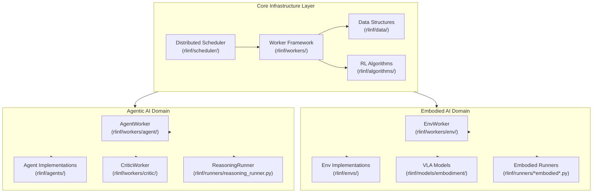
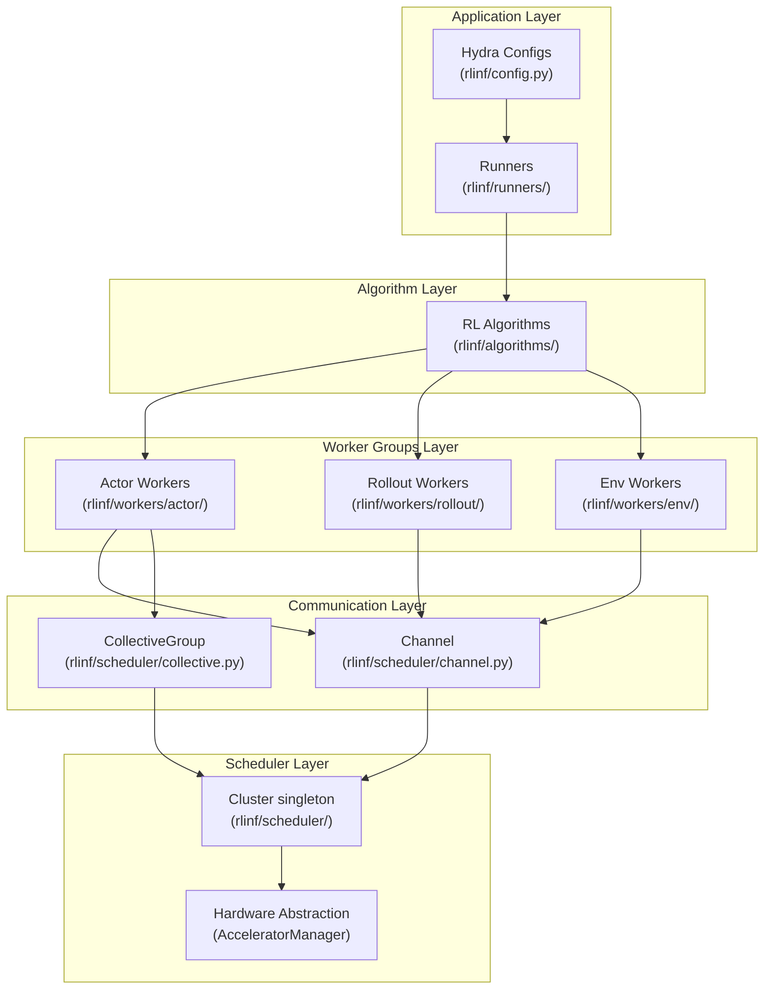

<!-- source: DeepWiki mcp.deepwiki.com · repo RLinf/RLinf · page 1 Overview · fetched 2026-10-21 -->

# Overview

Relevant source files

The following files were used as context for generating this wiki page:

- [.github/workflows/ci-tests.yml](.github/workflows/ci-tests.yml)
- [README.md](README.md)
- [README.zh-CN.md](README.zh-CN.md)
- [docs/source-en/_static/css/custom.css](docs/source-en/_static/css/custom.css)
- [docs/source-en/_static/js/ai-chat-service.js](docs/source-en/_static/js/ai-chat-service.js)
- [docs/source-en/_static/js/lang-switcher.js](docs/source-en/_static/js/lang-switcher.js)
- [docs/source-en/_static/js/theme-toggle.js](docs/source-en/_static/js/theme-toggle.js)
- [docs/source-en/_static/svg/overview.svg](docs/source-en/_static/svg/overview.svg)
- [docs/source-en/_templates/language-switcher.html](docs/source-en/_templates/language-switcher.html)
- [docs/source-en/_templates/sidebar-tools.html](docs/source-en/_templates/sidebar-tools.html)
- [docs/source-en/conf.py](docs/source-en/conf.py)
- [docs/source-en/index.rst](docs/source-en/index.rst)
- [docs/source-en/rst_source/examples/index.rst](docs/source-en/rst_source/examples/index.rst)
- [docs/source-zh/_static/css/custom.css](docs/source-zh/_static/css/custom.css)
- [docs/source-zh/_static/js/ai-chat-service.js](docs/source-zh/_static/js/ai-chat-service.js)
- [docs/source-zh/_static/svg/overview.svg](docs/source-zh/_static/svg/overview.svg)
- [docs/source-zh/conf.py](docs/source-zh/conf.py)
- [docs/source-zh/index.rst](docs/source-zh/index.rst)
- [docs/source-zh/rst_source/examples/index.rst](docs/source-zh/rst_source/examples/index.rst)

RLinf is a flexible and scalable open-source reinforcement learning infrastructure designed for **Embodied AI** and **Agentic AI**. The 'inf' in RLinf represents both `Infrastructure` (robust backbone for next-generation training) and `Infinite` (support for open-ended learning and continuous generalization) [README.md:21-25](). RLinf abstracts the complexity of distributed programming while providing high flexibility to scale RL training across GPU nodes without code modifications.

A core innovation of RLinf is the **Macro-to-Micro Flow (M2Flow)** paradigm, which executes macro-level logical flows through micro-level execution flows, decoupling logical workflow construction from physical communication and scheduling [README.md:27-28]().

This page provides a high-level overview of RLinf's architecture, key features, and system organization.

- For installation instructions, see [Installation and Setup](#1.1).
- For hands-on tutorials, see [Quick Start Guide](#1.2).
- For CI/CD details, see [CI/CD and Testing](#1.3).

**Sources:** [README.md:21-28](), [README.zh-CN.md:21-25]()

---

## Dual-Domain Architecture

RLinf is architected to serve two distinct but unified application domains through shared infrastructure.

### Architecture Mapping: Code Entities to System Domains

**Sources:** [.github/workflows/ci-tests.yml:65-156](), [docs/source-en/rst_source/examples/index.rst:9-54]()

### Embodied AI Domain
The Embodied AI domain focuses on vision-language-action (VLA) models for robotic control. It supports various simulation environments (e.g., `ManiSkill`, `LIBERO`, `IsaacLab`, `Genesis`, `Polaris`), real-world robots, and world models [README.md:33-42](), [docs/source-en/rst_source/examples/index.rst:15-20]().

| Component | Code Entity / Feature | Description |
|-----------|----------------------|-------------|
| Benchmarks | `LIBERO`, `ManiSkill`, `RoboTwin`, `Genesis`, `Polaris` | Integrated benchmarks for robotic manipulation [README.md:35-37](), [README.md:51-57]() |
| Models | `π₀`, `π₀.₅`, `OpenVLA`, `GR00T-N1.7`, `LingBot-VLA`, `StarVLA` | Support for SOTA VLA architectures including PyTorch re-implementations of π₀ [README.md:33-36](), [README.md:51-57]() |
| Algorithms | `PPO`, `GRPO`, `SAC`, `IQL`, `DAgger`, `RECAP`, `STEAM`, `OPD`, `RLT` | Diverse algorithms for on-policy, off-policy, offline learning, and online distillation [README.md:33-37](), [README.md:46-48](), [README.md:56-56]() |
| Real-World | `Franka`, `GimArm`, `Turtle2`, `DOS-W1` | Direct support for physical robot hardware with dexterous hands and ZED cameras [README.md:43-50](), [README.md:57-57](), [README.zh-CN.md:64-64]() |

**Sources:** [README.md:33-57](), [docs/source-en/rst_source/examples/index.rst:15-43](), [README.zh-CN.md:64-64]()

### Agentic AI Domain
The Agentic AI domain emphasizes large language model training for reasoning tasks, including math reasoning, code generation, and multi-agent collaboration [README.md:57-59]().

| Component | Code Entity / Feature | Description |
|-----------|----------------------|-------------|
| Reasoning | `rStar2`, `AgentLightning`, `SearchR1`, `Calc-X` | Advanced reasoning and search-based RL workflows [README.md:43-45](), [README.md:68-68]() |
| Multi-Agent | `WideSeek-R1` | Multi-agent RL for broad information seeking with width scaling [README.md:63-65]() |
| Training | `Megatron-Bridge` | Backend for RL training and SFT with Megatron integration [README.md:42-44]() |

**Sources:** [README.md:39-68](), [docs/source-en/rst_source/examples/index.rst:50-54]()

---

## Key Features

### Backend Agnosticism
RLinf provides training backends that share algorithmic logic but differ in performance characteristics.

- **FSDP Backend**: Ideal for rapid prototyping and HuggingFace model integration [README.md:73-74](), [docs/source-en/index.rst:82-83]().
- **Megatron Backend**: Optimized for large-scale training with model parallelism (TP/PP/EP/CP/DP) and `Megatron-Bridge` support [README.md:42-44](), [README.md:63-65]().

### Hybrid Execution and System Optimization
RLinf includes system-level optimizations to maximize throughput and resource utilization.

- **FUSCO**: Accelerates MoE All-to-All communication via transformation-communication fusion [README.md:62-64]().
- **Hybrid Pipeline Parallelism**: Achieves significant speedups (e.g., 25× for BEHAVIOR simulator) through system-level slimming and on-demand observation [README.md:40-42]().
- **Dynamic Scheduling**: Flexibly allocates compute resources between environment simulation and model training [docs/source-en/rst_source/examples/index.rst:56-60]().

**Sources:** [README.md:38-65](), [docs/source-en/rst_source/examples/index.rst:56-60]()

---

## High-Level System Organization

RLinf follows a modular organization from application to hardware abstraction.

### System Layer Organization

1.  **Application Layer**: `Runners` (e.g., `EmbodiedRunner`, `ReasoningRunner`, `AgentLightningRunner`) coordinate the high-level training loop [.github/workflows/ci-tests.yml:126-128]().
2.  **Algorithm Layer**: Implements core RL logic like `PPO`, `SAC`, and `GAE` [.github/workflows/ci-tests.yml:69-69]().
3.  **Worker Groups Layer**: Distributed actors managing training (`fsdp_actor_worker.py`), inference (`rollout/`), and simulation (`env/`) [.github/workflows/ci-tests.yml:72-75]().
4.  **Communication Layer**: Provides `Channel` for FIFO data transfer and `CollectiveGroup` for distributed tensor operations [.github/workflows/ci-tests.yml:69-70]().
5.  **Scheduler Layer**: Manages `Ray` actors, resource placement, and hardware-specific abstractions [.github/workflows/ci-tests.yml:70-70]().

**Sources:** [.github/workflows/ci-tests.yml:65-156]()

---

## Installation and Setup

RLinf supports multiple installation methods tailored to specific machine setups:

-   **Custom Setup**: Uses `requirements/` scripts to build an environment matched to the machine, supporting targets like `embodied` or `agentic` [.github/workflows/ci-tests.yml:57-60]().
-   **Docker**: Provides reproducible environments with pre-bundled stacks for different workloads [.github/workflows/ci-tests.yml:62-65]().
-   **Platform Support**: Support for high-performance distributed computing on GPU clusters [.github/workflows/ci-tests.yml:70-71]().

For details, see [Installation and Setup](#1.1).

**Sources:** [.github/workflows/ci-tests.yml:57-71]()

---

## CI/CD and Testing

RLinf maintains high code quality through an automated CI pipeline.

-   **Test Suites**: Includes `unit_tests`, `e2e_tests` (embodied/agent/reasoning/sft), and `scheduler_tests` [.github/workflows/ci-tests.yml:103-166]().
-   **Workflow**: Triggered on pull requests to `main` and release branches, requiring the `run-ci` label [.github/workflows/ci-tests.yml:3-43]().
-   **Change Detection**: Uses filters to run only relevant tests based on modified files (e.g., `embodied_filter`, `agent_reason_filter`) [.github/workflows/ci-tests.yml:81-166]().

For details, see [CI/CD and Testing](#1.3).

**Sources:** [.github/workflows/ci-tests.yml:3-166]()

---

