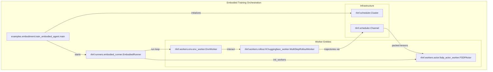
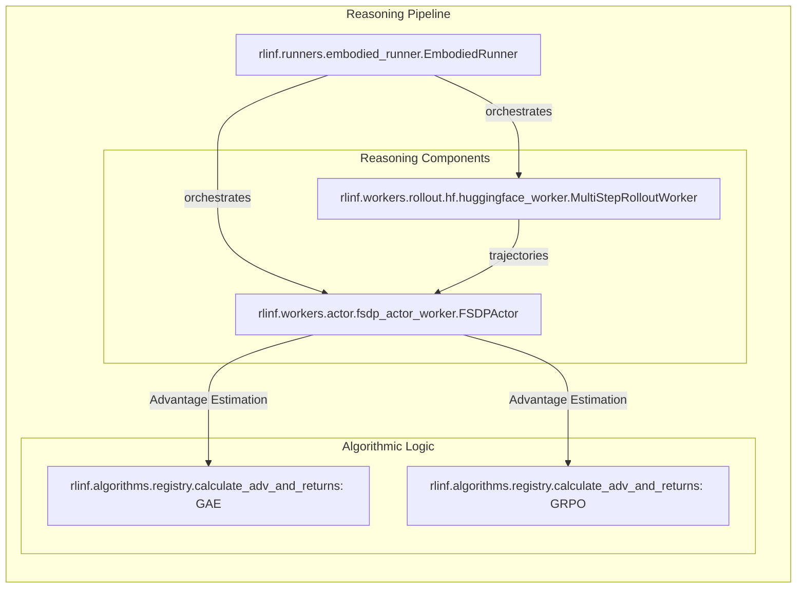

<!-- source: DeepWiki mcp.deepwiki.com · repo RLinf/RLinf · page 1.2 Quick Start Guide · fetched 2026-10-21 -->

# Quick Start Guide

<details>
<summary>Relevant source files</summary>

The following files were used as context for generating this wiki page:

- [.gitignore](.gitignore)
- [examples/embodiment/config/libero_10_grpo_openvlaoft.yaml](examples/embodiment/config/libero_10_grpo_openvlaoft.yaml)
- [examples/embodiment/config/libero_130_grpo_openvlaoft.yaml](examples/embodiment/config/libero_130_grpo_openvlaoft.yaml)
- [examples/embodiment/config/libero_90_grpo_openvlaoft.yaml](examples/embodiment/config/libero_90_grpo_openvlaoft.yaml)
- [examples/embodiment/config/libero_goal_grpo_openvlaoft.yaml](examples/embodiment/config/libero_goal_grpo_openvlaoft.yaml)
- [examples/embodiment/config/libero_object_grpo_openvlaoft.yaml](examples/embodiment/config/libero_object_grpo_openvlaoft.yaml)
- [examples/embodiment/config/libero_spatial_grpo_openvlaoft.yaml](examples/embodiment/config/libero_spatial_grpo_openvlaoft.yaml)
- [examples/embodiment/config/maniskill_grpo_openvla.yaml](examples/embodiment/config/maniskill_grpo_openvla.yaml)
- [examples/embodiment/config/maniskill_grpo_openvlaoft.yaml](examples/embodiment/config/maniskill_grpo_openvlaoft.yaml)
- [examples/embodiment/config/maniskill_ppo_openvla.yaml](examples/embodiment/config/maniskill_ppo_openvla.yaml)
- [examples/embodiment/config/maniskill_ppo_openvla_quickstart.yaml](examples/embodiment/config/maniskill_ppo_openvla_quickstart.yaml)
- [examples/embodiment/config/maniskill_ppo_openvlaoft.yaml](examples/embodiment/config/maniskill_ppo_openvlaoft.yaml)
- [examples/embodiment/config/maniskill_ppo_openvlaoft_quickstart.yaml](examples/embodiment/config/maniskill_ppo_openvlaoft_quickstart.yaml)
- [examples/embodiment/run_embodiment.sh](examples/embodiment/run_embodiment.sh)
- [examples/embodiment/train_async.py](examples/embodiment/train_async.py)
- [examples/embodiment/train_embodied_agent.py](examples/embodiment/train_embodied_agent.py)
- [rlinf/config.py](rlinf/config.py)
- [rlinf/runners/embodied_runner.py](rlinf/runners/embodied_runner.py)
- [rlinf/workers/actor/fsdp_actor_worker.py](rlinf/workers/actor/fsdp_actor_worker.py)
- [rlinf/workers/env/env_worker.py](rlinf/workers/env/env_worker.py)
- [rlinf/workers/rollout/hf/huggingface_worker.py](rlinf/workers/rollout/hf/huggingface_worker.py)
- [tests/parity_tests/README.md](tests/parity_tests/README.md)
- [tests/parity_tests/analyze_logs.py](tests/parity_tests/analyze_logs.py)
- [tests/parity_tests/check.py](tests/parity_tests/check.py)
- [tests/parity_tests/compare_baseline.py](tests/parity_tests/compare_baseline.py)
- [tests/parity_tests/parse_success_once.py](tests/parity_tests/parse_success_once.py)
- [tests/parity_tests/plot_success_once.py](tests/parity_tests/plot_success_once.py)
- [tests/parity_tests/run_all.sh](tests/parity_tests/run_all.sh)
- [tests/unit_tests/test_overlap_env_bootstrap.py](tests/unit_tests/test_overlap_env_bootstrap.py)

</details>


This document provides hands-on tutorials for running your first experiments with RLinf. It demonstrates basic usage patterns through two practical examples: an embodied RL experiment using ManiSkill3 and an agentic reasoning task using GRPO.

## Prerequisites

Before starting, ensure you have:

1. Completed installation via one of the methods in [1.1 Installation and Setup]().
2. Downloaded the required pre-trained models (e.g., OpenVLA or OpenVLA-OFT) [rlinf/config.py:86-87]().
3. Downloaded simulation assets, such as the ManiSkill3 dataset [examples/embodiment/config/maniskill_ppo_openvlaoft.yaml:2-2]().
4. Set the `PYTHONPATH` to include the RLinf repository root [examples/embodiment/run_embodiment.sh:10-10]().
5. Configured appropriate GPU resources. Quickstart configs typically target 4-8 GPUs [examples/embodiment/config/maniskill_ppo_openvlaoft.yaml:19-21]().

---

## Quickstart 1: Embodied RL with ManiSkill3 and OpenVLA

This example demonstrates training a Vision-Language-Action (VLA) model on robotic manipulation tasks using the PPO algorithm. RLinf supports a wide range of environments including ManiSkill, LIBERO, and IsaacLab [rlinf/workers/env/env_worker.py:35-38]().

### System Overview

The diagram below illustrates the relationship between high-level training concepts and the specific code entities responsible for them.

**Embodied RL Data Flow and Code Entities**

**Sources:** [examples/embodiment/train_embodied_agent.py:38-164](), [rlinf/runners/embodied_runner.py:52-173](), [rlinf/workers/actor/fsdp_actor_worker.py:190-200]()

### Launching the Experiment

**Step 1: Modify Configuration**
Update your `.yaml` config (e.g., `maniskill_ppo_openvlaoft.yaml`) to point to your local model paths for `rollout.model.model_path` and `actor.model.model_path` [examples/embodiment/config/maniskill_ppo_openvlaoft.yaml:104-117]().

**Step 2: Start Training**
Launch using the embodiment runner script. This script handles environment setup and Hydra configuration loading [examples/embodiment/run_embodiment.sh:62-64]().

```bash
# Launch training with the quickstart config
bash examples/embodiment/run_embodiment.sh maniskill_ppo_openvlaoft
```

**Step 3: Training Pipeline Mode (Optional)**
For higher throughput, enable `runner.use_training_pipeline: True`. This allows `PipelineEmbodiedFSDPActor` to train on micro-batches while rollouts are still being generated [examples/embodiment/train_embodied_agent.py:87-91]().

---

## Quickstart 2: Agentic RL with GRPO

RLinf supports Group Relative Policy Optimization (GRPO) for both agentic reasoning and embodied VLA fine-tuning [examples/embodiment/config/libero_10_grpo_openvlaoft.yaml:49-50]().

### Agentic Data Flow

The following diagram bridges the "Natural Language Space" (prompts, reasoning) to the "Code Entity Space" (workers, algorithms).

**Reasoning RL Architecture (GRPO)**

**Sources:** [rlinf/workers/actor/fsdp_actor_worker.py:28-28](), [examples/embodiment/config/libero_10_grpo_openvlaoft.yaml:39-60]()

### Key Implementation Details
* **Algorithm Configuration**: Advantages are calculated via `calculate_adv_and_returns` based on the `adv_type` config (e.g., `gae` or `grpo`) [rlinf/workers/actor/fsdp_actor_worker.py:28-28](), [examples/embodiment/config/libero_10_grpo_openvlaoft.yaml:49-49]().
* **Advantage Normalization**: For GRPO, advantage normalization is typically enabled to compare relative performance within the group [examples/embodiment/config/libero_10_grpo_openvlaoft.yaml:40-40]().
* **Data Transport**: Trajectories are converted to batches and processed for advantage computation using specialized nested dictionary utilities [rlinf/workers/actor/fsdp_actor_worker.py:33-33](), [rlinf/workers/actor/fsdp_actor_worker.py:92-110]().

---

## Resource Allocation and Scaling

RLinf uses a distributed scheduler to manage component placement via the `Cluster` configuration [rlinf/scheduler/cluster.py:28-28]().

### Placement Strategies
You can specify GPU usage by modifying `cluster.component_placement` in your YAML config. This supports specifying ranges of GPUs for different worker types [examples/embodiment/config/maniskill_ppo_openvlaoft.yaml:18-21]().

| Strategy | Description | Config Example |
| :--- | :--- | :--- |
| **Collocated** | Components share the same GPU set | `actor,env,rollout: all` [examples/embodiment/config/libero_10_grpo_openvlaoft.yaml:19-19]() |
| **Disaggregated** | Separate GPUs for training and sampling | `actor: 0-7`, `env: 0-3`, `rollout: 4-7` [examples/embodiment/config/maniskill_ppo_openvlaoft.yaml:19-21]() |

**Sources:** [examples/embodiment/config/maniskill_ppo_openvlaoft.yaml:16-21](), [examples/embodiment/config/libero_10_grpo_openvlaoft.yaml:16-19]()

---

## Viewing Results

Training metrics and models are saved to the directory specified in the config, typically controlled by the `runner.logger.log_path` [examples/embodiment/config/maniskill_ppo_openvlaoft.yaml:26-26]().

1. **Metrics**: Use TensorBoard or WandB to monitor environment returns and success rates [examples/embodiment/config/maniskill_ppo_openvlaoft.yaml:27-29]().
2. **Logs**: Detailed execution logs are stored in the log directory generated by the run script [examples/embodiment/run_embodiment.sh:51-53]().

```bash
# Example command to view metrics
tensorboard --host 0.0.0.0 --logdir ./logs
```

**Sources:** [examples/embodiment/run_embodiment.sh:51-53](), [rlinf/runners/embodied_runner.py:115-118]()

---

