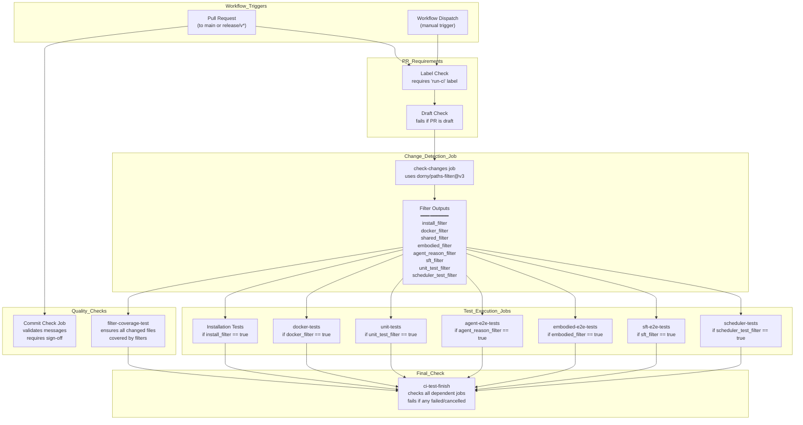
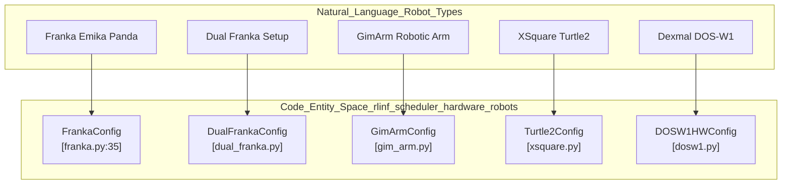
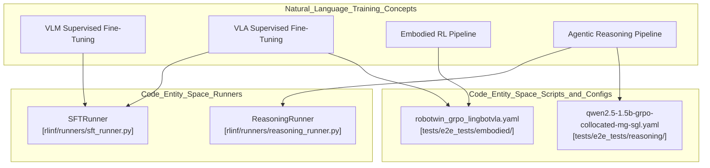

<!-- source: DeepWiki mcp.deepwiki.com · repo RLinf/RLinf · page 1.3 CI/CD and Testing · fetched 2026-10-21 -->

# CI/CD and Testing

<details>
<summary>Relevant source files</summary>

The following files were used as context for generating this wiki page:

- [.github/workflows/ci-tests.yml](.github/workflows/ci-tests.yml)
- [.github/workflows/commit_check.yml](.github/workflows/commit_check.yml)
- [.github/workflows/lint.yml](.github/workflows/lint.yml)
- [.github/workflows/scheduler-tests.yml](.github/workflows/scheduler-tests.yml)
- [.github/workflows/unit-tests.yml](.github/workflows/unit-tests.yml)
- [.gitignore](.gitignore)
- [README.md](README.md)
- [README.zh-CN.md](README.zh-CN.md)
- [docs/source-en/rst_source/examples/embodied/lingbotvla.rst](docs/source-en/rst_source/examples/embodied/lingbotvla.rst)
- [docs/source-en/rst_source/examples/index.rst](docs/source-en/rst_source/examples/index.rst)
- [docs/source-zh/rst_source/examples/embodied/lingbotvla.rst](docs/source-zh/rst_source/examples/embodied/lingbotvla.rst)
- [docs/source-zh/rst_source/examples/index.rst](docs/source-zh/rst_source/examples/index.rst)
- [examples/embodiment/config/model/lingbotvla.yaml](examples/embodiment/config/model/lingbotvla.yaml)
- [examples/embodiment/run_embodiment.sh](examples/embodiment/run_embodiment.sh)
- [rlinf/envs/realworld/franka/franka_controller.py](rlinf/envs/realworld/franka/franka_controller.py)
- [rlinf/models/embodiment/lingbotvla/lingbotvla_action_model.py](rlinf/models/embodiment/lingbotvla/lingbotvla_action_model.py)
- [rlinf/models/embodiment/openpi_cfg/openpi_cfg_action_model.py](rlinf/models/embodiment/openpi_cfg/openpi_cfg_action_model.py)
- [rlinf/runners/sft_runner.py](rlinf/runners/sft_runner.py)
- [rlinf/scheduler/dynamic_scheduler/scheduler_worker.py](rlinf/scheduler/dynamic_scheduler/scheduler_worker.py)
- [rlinf/scheduler/hardware/__init__.py](rlinf/scheduler/hardware/__init__.py)
- [rlinf/scheduler/hardware/robots/__init__.py](rlinf/scheduler/hardware/robots/__init__.py)
- [rlinf/scheduler/hardware/robots/auto_config.py](rlinf/scheduler/hardware/robots/auto_config.py)
- [rlinf/scheduler/hardware/robots/dosw1.py](rlinf/scheduler/hardware/robots/dosw1.py)
- [rlinf/scheduler/hardware/robots/dual_franka.py](rlinf/scheduler/hardware/robots/dual_franka.py)
- [rlinf/scheduler/hardware/robots/gim_arm.py](rlinf/scheduler/hardware/robots/gim_arm.py)
- [rlinf/scheduler/hardware/robots/xsquare.py](rlinf/scheduler/hardware/robots/xsquare.py)
- [rlinf/utils/data_process.py](rlinf/utils/data_process.py)
- [tests/e2e_tests/dynamic_scheduler/qwen2.5-1.5b-grpo-dynamic-mg-vllm.yaml](tests/e2e_tests/dynamic_scheduler/qwen2.5-1.5b-grpo-dynamic-mg-vllm.yaml)
- [tests/e2e_tests/embodied/robotwin_grpo_lingbotvla.yaml](tests/e2e_tests/embodied/robotwin_grpo_lingbotvla.yaml)
- [tests/parity_tests/README.md](tests/parity_tests/README.md)
- [tests/parity_tests/analyze_logs.py](tests/parity_tests/analyze_logs.py)
- [tests/parity_tests/check.py](tests/parity_tests/check.py)
- [tests/parity_tests/compare_baseline.py](tests/parity_tests/compare_baseline.py)
- [tests/parity_tests/parse_success_once.py](tests/parity_tests/parse_success_once.py)
- [tests/parity_tests/plot_success_once.py](tests/parity_tests/plot_success_once.py)
- [tests/parity_tests/run_all.sh](tests/parity_tests/run_all.sh)
- [tests/unit_tests/test_broadcast_sync.py](tests/unit_tests/test_broadcast_sync.py)
- [tests/unit_tests/test_cluster_config.py](tests/unit_tests/test_cluster_config.py)
- [tests/unit_tests/test_math_dataset_multithread.py](tests/unit_tests/test_math_dataset_multithread.py)

</details>


## Purpose and Scope

This document describes RLinf's continuous integration and testing infrastructure, including GitHub Actions workflows, test suite organization, change detection mechanisms, and quality checks. It details how the system validates core components like the distributed scheduler, worker lifecycle, and environment integrations across diverse hardware (NVIDIA, AMD ROCm, Ascend CANN) and software configurations. The testing framework ensures reliability for both Embodied AI (e.g., ManiSkill, LIBERO, RoboTwin) and Agentic AI (e.g., Reasoning with Megatron-LM or SGLang) pipelines.

## CI/CD Architecture Overview

RLinf implements a comprehensive CI/CD pipeline that validates code quality, installation procedures, and end-to-end training workflows. The system uses intelligent change detection to run only relevant test suites, optimizing execution time while maintaining thorough coverage.

### Workflow Structure



**Diagram: CI/CD Workflow Execution Flow**

Sources: [.github/workflows/ci-tests.yml:1-180](), [.github/workflows/unit-tests.yml:1-175]()

### Concurrency Control

The CI system implements concurrency control to prevent redundant test executions and optimize resource usage. When new commits are pushed to a PR, previous CI runs for that PR are automatically cancelled [[.github/workflows/ci-tests.yml:11-13]]().

## Change Detection and Smart Test Execution

RLinf uses path-based filtering via `dorny/paths-filter@v3` to detect which files have changed and execute only relevant test suites [[.github/workflows/ci-tests.yml:51-53]]().

### Filter Categories and File Mappings

| Filter Name | Core Paths Monitored | Impacted Test Suites |
| :--- | :--- | :--- |
| `install_filter` | `pyproject.toml`, `requirements/*.sh`, `requirements/*.txt` | Environment Setup |
| `shared_filter` | `rlinf/scheduler/`, `rlinf/algorithms/`, `rlinf/config.py` | Core Unit & E2E Tests |
| `embodied_filter` | `rlinf/envs/`, `rlinf/workers/env/`, `rlinf/models/embodiment/` | Embodied E2E Tests |
| `agent_reason_filter`| `rlinf/agents/`, `rlinf/workers/rollout/vllm/`, `rlinf/runners/reasoning_runner.py` | Agentic E2E Tests |
| `sft_filter` | `rlinf/workers/sft/`, `rlinf/runners/sft_runner.py`, `examples/sft/` | SFT E2E Tests |
| `scheduler_test_filter`| `tests/e2e_tests/auto_placement/`, `tests/e2e_tests/dynamic_scheduler/` | Scheduler E2E Tests |

Sources: [.github/workflows/ci-tests.yml:56-156]()

## Test Suites and Implementation

RLinf organizes tests into suites targeting specific infrastructure components and training pipelines.

### Unit Tests: Core Infrastructure

Unit tests validate foundational distributed computing primitives and data processing logic across different hardware backends.

*   **Multi-Hardware Support**: Unit tests are executed on `unit-tests-cuda`, `unit-tests-cpu`, `scheduler-unit-tests-rocm` (AMD), and `scheduler-unit-tests-ascend` (NPU) environments [[.github/workflows/unit-tests.yml:7-121]]().
*   **Package Structure**: Automated checks ensure that every subpackage within `rlinf/` contains a required `__init__.py` file, validated in the `package-structure-check` job [[.github/workflows/unit-tests.yml:167-175]]().
*   **Doctests**: The scheduler component is additionally validated via Python doctests using `pytest --doctest-modules rlinf/scheduler` [[.github/workflows/unit-tests.yml:30-34]]().

### Installation and System Validation

Testing the environment setup is critical due to the complex dependencies of RL environments:
1.  **Unified Installer**: The `requirements/install.sh` script handles multi-platform configuration for NVIDIA, AMD, and Ascend [[.github/workflows/unit-tests.yml:77]](), [[.github/workflows/unit-tests.yml:108]]().
2.  **Package Integrity**: Validates the build and import of the wheel file for both `embodied` and `agentic` variants [[.github/workflows/unit-tests.yml:127-160]]().

### Robot Hardware Abstraction Mapping

The following diagram bridges the natural language robot hardware concepts to the specific code entities in the scheduler's hardware layer.



**Diagram: Robot Hardware Abstraction Mapping**

Sources: [rlinf/scheduler/hardware/robots/franka.py:35-37](), [rlinf/scheduler/hardware/robots/gim_arm.py](), [rlinf/scheduler/hardware/robots/dual_franka.py](), [rlinf/scheduler/hardware/robots/dosw1.py](), [rlinf/scheduler/hardware/robots/xsquare.py]()

### SFT and Training Pipeline Mapping

The SFT (Supervised Fine-Tuning) infrastructure supports multiple model types including VLA (Vision-Language-Action) and VLM (Vision-Language Models). The pipeline is orchestrated by the `SFTRunner` and verified through specific end-to-end tests.



**Diagram: Training Pipeline to Code Entity Mapping**

Sources: [rlinf/runners/sft_runner.py](), [rlinf/runners/reasoning_runner.py](), [.github/workflows/sft-e2e-tests.yml](), [tests/e2e_tests/embodied/robotwin_grpo_lingbotvla.yaml](), [tests/e2e_tests/reasoning/qwen2.5-1.5b-ppo-collocated-mg-sgl.yaml:206]()

## End-to-End (E2E) Test Categories

RLinf maintains a rigorous E2E testing suite that covers diverse training scenarios from behavioral cloning to complex reasoning tasks.

| Test Category | Primary Components Validated | Source Workflow |
| :--- | :--- | :--- |
| **Embodied E2E** | SAC (Sync/Async), Offline IQL, DAgger, Robotwin GRPO | [.github/workflows/embodied-e2e-tests.yml:7-220]() |
| **Agentic E2E** | GRPO, AgentLightning, Megatron-LM Reasoning | [.github/workflows/agent-e2e-tests.yml:7-213]() |
| **SFT E2E** | VLM SFT (Qwen-VL), VLA SFT (DreamZero, OpenPI, LingbotVLA) | [.github/workflows/sft-e2e-tests.yml]() |
| **Scheduler E2E** | Auto-Placement, Dynamic Scheduler, Hybrid Execution | [.github/workflows/scheduler-tests.yml]() |

### Specific E2E Validations
*   **Embodied MLP/SAC**: Tested using `maniskill_sac_mlp` and `maniskill_sac_mlp_async` [[.github/workflows/embodied-e2e-tests.yml:23-37]]().
*   **Offline RL**: Validated using D4RL MuJoCo datasets with IQL, testing both standard and FSDP-wrapped configurations [[.github/workflows/embodied-e2e-tests.yml:83-97]]().
*   **Reasoning**: Extensive testing of GRPO on Qwen models using both SGLang and vLLM backends in collocated and pipeline modes [[.github/workflows/agent-e2e-tests.yml:23-77]]().
*   **Agentic Frameworks**: Verification of `AgentLightning` integration for multiturn tasks like `calc_x` [[.github/workflows/agent-e2e-tests.yml:109-114]]().
*   **LingbotVLA GRPO**: Validated on RoboTwin tasks such as `Click Bell` and `Place Shoe` [[docs/source-en/rst_source/examples/embodied/lingbotvla.rst:65-72]]().

## Quality Assurance Workflow

### Required PR State
To optimize resource usage, the CI workflow checks for:
*   **Label Requirements**: Pull requests must have the `run-ci` label to trigger execution [[.github/workflows/ci-tests.yml:38-43]]().
*   **Draft Status**: Draft PRs are automatically failed to prevent wasting CI resources on incomplete work [[.github/workflows/ci-tests.yml:44-49]]().
*   **Commit Quality**: Validates commit messages and requires sign-off [[.github/workflows/commit_check.yml:1-30]]().

### Package Integrity
The CI includes a `package-build-test` job [[.github/workflows/unit-tests.yml:127-166]] that:
1.  Builds the wheel using `uv build` [[.github/workflows/unit-tests.yml:138]]().
2.  Installs the wheel with various extras (e.g., `[embodied]`, `[agentic-sglang]`) [[.github/workflows/unit-tests.yml:146-148]]().
3.  Verifies the package structure and imports [[.github/workflows/unit-tests.yml:151-160]]().

## Local Development and Testing

Developers are encouraged to run tests locally using the `uv` environment manager to ensure changes meet baseline requirements before pushing to GitHub.

### Local Execution Commands

```bash
# Setup environment for embodied testing (NVIDIA default)
bash requirements/install.sh embodied --env dummy --venv .venv

# Run unit tests
source .venv/bin/activate
export PYTHONPATH=$(pwd):$(pwd)/tests/unit_tests
pytest tests/unit_tests

# Run a specific reasoning test locally
source .venv/bin/activate
bash tests/e2e_tests/reasoning/run.sh qwen2.5-1.5b-grpo-collocated-mg-sgl
```

Sources: [.github/workflows/unit-tests.yml:23-26](), [.github/workflows/agent-e2e-tests.yml:23-29](), [requirements/install.sh:88-125]()

---

