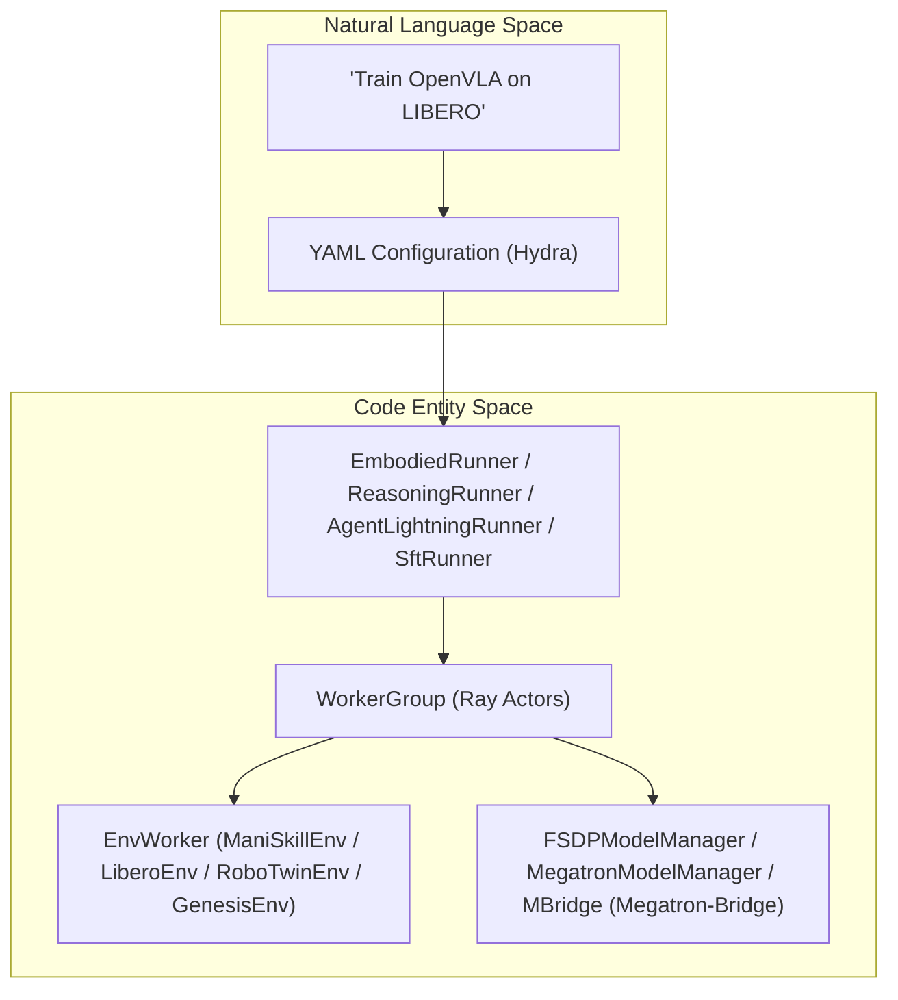
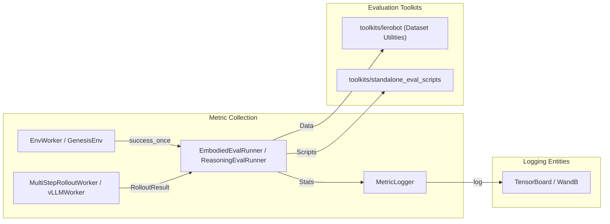

<!-- source: DeepWiki mcp.deepwiki.com · repo RLinf/RLinf · page 10 Examples and Evaluation · fetched 2026-10-21 -->

# Examples and Evaluation

Relevant source files

The following files were used as context for generating this wiki page:

- [.github/workflows/ci-tests.yml](.github/workflows/ci-tests.yml)
- [README.md](README.md)
- [README.zh-CN.md](README.zh-CN.md)
- [docs/source-en/rst_source/examples/index.rst](docs/source-en/rst_source/examples/index.rst)
- [docs/source-en/rst_source/resources/index.rst](docs/source-en/rst_source/resources/index.rst)
- [docs/source-en/rst_source/resources/release_v0.1_v0.2.rst](docs/source-en/rst_source/resources/release_v0.1_v0.2.rst)
- [docs/source-en/rst_source/resources/release_v0.3.rst](docs/source-en/rst_source/resources/release_v0.3.rst)
- [docs/source-zh/rst_source/examples/index.rst](docs/source-zh/rst_source/examples/index.rst)
- [docs/source-zh/rst_source/resources/index.rst](docs/source-zh/rst_source/resources/index.rst)
- [docs/source-zh/rst_source/resources/release_v0.1_v0.2.rst](docs/source-zh/rst_source/resources/release_v0.1_v0.2.rst)
- [docs/source-zh/rst_source/resources/release_v0.3.rst](docs/source-zh/rst_source/resources/release_v0.3.rst)

This page provides a high-level overview of the concrete experiments, benchmarks, and evaluation protocols supported by RLinf. As a unified infrastructure for both Embodied and Agentic AI, RLinf provides standardized workflows for training Large Vision-Language-Action (VLA) models, reasoning agents, and real-world robotic controllers.

## Experiment Categories

RLinf organizes its examples into three primary domains: Embodied AI, Agentic AI, and System Performance. These examples demonstrate the framework's ability to scale from single-node simulation to multi-node distributed training across heterogeneous hardware.

### High-Level Workflow Overview

The following diagram illustrates how the system transitions from high-level natural language tasks to concrete code entities during experiment execution.

**From Task to Execution Entities**

Sources: [README.md:44-44](), [docs/source-en/rst_source/examples/index.rst:15-61](), [.github/workflows/ci-tests.yml:81-160]()

---

## Embodied AI Examples

Embodied AI experiments in RLinf focus on fine-tuning VLA models (such as $\pi_0$, $\pi_{0.5}$, GR00T, and OpenVLA) for robotic manipulation. These examples cover a range of complexities, from simulated benchmarks to real-world deployment on physical hardware.

*   **Simulation Benchmarks:** Support for `LIBERO` (including Pro/Plus), `ManiSkill`, `RoboTwin`, `IsaacLab`, `Genesis`, `Polaris`, `RoboVerse`, `RoboCasa`, and `CALVIN`. [README.md:38-55]()
*   **VLA Models:** RL fine-tuning for `GR00T-N1.6/N1.7`, `OpenPI` (PyTorch implementation), `Dexbotic DM0`, `StarVLA`, `LingBot-VLA`, and `OpenVLA-OFT`. [README.md:33-55]()
*   **Specialized Algorithms:** Implementation of `PPO`, `GRPO`, `SAC-Flow`, `DSRL` (Diffusion Steering), `DAgger`, `HG-DAgger`, `RECAP`, `STEAM`, and `IQL` (Offline RL). [README.md:34-56]()
*   **World Models:** Training and evaluation within Action-conditioned `OpenSora`, `Wan`, and `DreamZero` (VLA policy from world model). [README.md:46-46](), [docs/source-en/rst_source/resources/release_v0.3.rst:18-22]()
*   **Real-World Robotics:** Full pipeline (Collection → SFT → RL → Deploy) for `Franka`, `Dual-arm Franka`, `GimArm`, `XSquare Turtle2`, and `DOS-W1` with `DexHand` or `Robotiq` grippers. [README.md:47-57]()

For detailed walkthroughs and configuration guides, see **[Embodied AI Examples](#10.1)**.

Sources: [README.md:32-65](), [docs/source-en/rst_source/resources/release_v0.3.rst:11-115]()

---

## Agentic AI Examples

Agentic AI examples showcase RLinf's capabilities in building agent workflows and training agents for complex reasoning and multi-agent collaboration.

*   **Reasoning Tasks:** Math reasoning with `GRPO` and `PPO`, `rStar2` for autonomous reflection, and `SearchR1` for information seeking. [docs/source-en/rst_source/resources/release_v0.1_v0.2.rst:65-69]()
*   **WideSeek-R1:** A multi-agent RL solution exploring width scaling for broad information seeking, featuring native multi-agent training support and unified data interfaces. [README.md:65-65](), [docs/source-en/rst_source/resources/release_v0.1_v0.2.rst:63-63]()
*   **AgentLightning Integration:** Support for single-agent RL training (e.g., `Calc-X`) via the `AgentLightning` framework. [README.md:45-45]()
*   **System Optimizations:** Integration of `FUSCO` for high-performance All-to-All communication in MoE models. [README.md:64-64]()

For details on dataset integration and reasoning workflows, see **[Agentic AI Examples](#10.2)**.

Sources: [README.md:63-65](), [docs/source-en/rst_source/resources/release_v0.1_v0.2.rst:58-70]()

---

## Evaluation and Metrics

Evaluation in RLinf is standardized through metric logging, automated parity testing, and specialized visualization toolkits. The system provides dedicated entry points for assessing policy performance outside of the training loop via `EmbodiedEvalRunner` and `ReasoningEvalRunner`.

### Metric Tracking and Visualization
RLinf logs metrics across multiple dimensions to monitor training stability and performance:
*   **Training Metrics:** Monitoring loss values, gradient norms, and throughput (e.g., 25x speedup for `BEHAVIOR`) via `Runner` orchestrators. [README.md:42-42]()
*   **Evaluation Metrics:** Success rates (e.g., `success_once`) and rewards computed by `compute_evaluate_metrics`.
*   **Visualization:** Native support for logging data to `MetricLogger` which interfaces with `TensorBoard` and `WandB` backends.

**System-to-Code Mapping for Evaluation**

Sources: [.github/workflows/ci-tests.yml:105-111](), [docs/source-en/rst_source/resources/release_v0.3.rst:139-140]()

### Parity Testing and Baseline Comparison
RLinf includes an automated testing toolkit for batch-running experiments and comparing them against established baselines:
*   **Automated Workflow:** CI workflows (e.g., `embodied-e2e-tests.yml`) execute tasks and detect regressions. [.github/workflows/ci-tests.yml:106-106]()
*   **Metric Logging:** New support for unified accelerator profiling and metrics logging files. [docs/source-en/rst_source/resources/release_v0.3.rst:139-139]()
*   **VLA Evaluation:** Specialized scripts for `OpenPI` and `Dexbotic` model evaluation in `toolkits/eval_scripts_openpi/` and `toolkits/eval_scripts_dexbotic/`. [docs/source-en/rst_source/resources/release_v0.3.rst:19-29]()

For details on evaluation protocols and logging configuration, see **[Evaluation and Metrics](#10.3)**.

Sources: [docs/source-en/rst_source/resources/release_v0.1_v0.2.rst:112-167](), [docs/source-en/rst_source/resources/release_v0.3.rst:139-140](), [.github/workflows/ci-tests.yml:103-160]()

---

