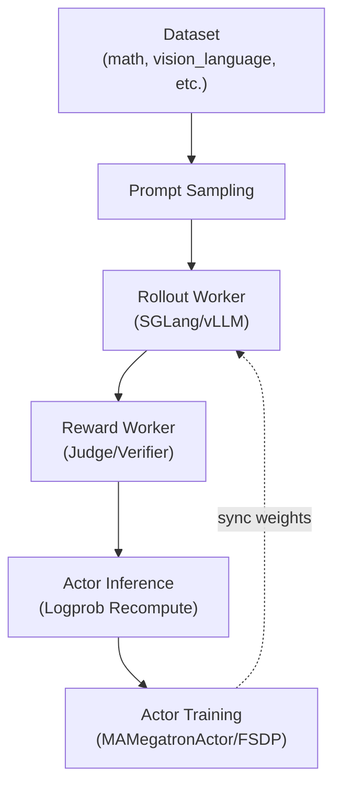
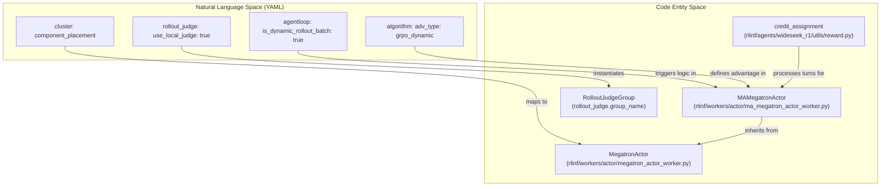

<!-- source: DeepWiki mcp.deepwiki.com · repo RLinf/RLinf · page 10.2 Agentic AI Examples · fetched 2026-10-21 -->

# Agentic AI Examples

Relevant source files

The following files were used as context for generating this wiki page:

- [docs/source-en/rst_source/examples/agentic/agentlightning_calc_x.rst](docs/source-en/rst_source/examples/agentic/agentlightning_calc_x.rst)
- [docs/source-en/rst_source/examples/agentic/index.rst](docs/source-en/rst_source/examples/agentic/index.rst)
- [docs/source-en/rst_source/examples/agentic/reasoning.rst](docs/source-en/rst_source/examples/agentic/reasoning.rst)
- [docs/source-en/rst_source/examples/agentic/reasoning_ppo.rst](docs/source-en/rst_source/examples/agentic/reasoning_ppo.rst)
- [docs/source-en/rst_source/examples/agentic/wideseek_r1/eval.rst](docs/source-en/rst_source/examples/agentic/wideseek_r1/eval.rst)
- [docs/source-en/rst_source/examples/agentic/wideseek_r1/index.rst](docs/source-en/rst_source/examples/agentic/wideseek_r1/index.rst)
- [docs/source-en/rst_source/examples/agentic/wideseek_r1/tools.rst](docs/source-en/rst_source/examples/agentic/wideseek_r1/tools.rst)
- [docs/source-zh/rst_source/examples/agentic/agentlightning_calc_x.rst](docs/source-zh/rst_source/examples/agentic/agentlightning_calc_x.rst)
- [docs/source-zh/rst_source/examples/agentic/index.rst](docs/source-zh/rst_source/examples/agentic/index.rst)
- [docs/source-zh/rst_source/examples/agentic/reasoning.rst](docs/source-zh/rst_source/examples/agentic/reasoning.rst)
- [docs/source-zh/rst_source/examples/agentic/reasoning_ppo.rst](docs/source-zh/rst_source/examples/agentic/reasoning_ppo.rst)
- [docs/source-zh/rst_source/examples/agentic/wideseek_r1/eval.rst](docs/source-zh/rst_source/examples/agentic/wideseek_r1/eval.rst)
- [docs/source-zh/rst_source/examples/agentic/wideseek_r1/index.rst](docs/source-zh/rst_source/examples/agentic/wideseek_r1/index.rst)
- [docs/source-zh/rst_source/examples/agentic/wideseek_r1/tools.rst](docs/source-zh/rst_source/examples/agentic/wideseek_r1/tools.rst)
- [examples/agent/agentlightning/calc_x/calc_agent.py](examples/agent/agentlightning/calc_x/calc_agent.py)
- [examples/agent/agentlightning/calc_x/config/base_calc_x.yaml](examples/agent/agentlightning/calc_x/config/base_calc_x.yaml)
- [examples/agent/agentlightning/calc_x/config/qwen2.5-1.5b-enginehttp-multiturn.yaml](examples/agent/agentlightning/calc_x/config/qwen2.5-1.5b-enginehttp-multiturn.yaml)
- [examples/agent/agentlightning/calc_x/config/qwen2.5-1.5b-enginehttp-multiturn_eval.yaml](examples/agent/agentlightning/calc_x/config/qwen2.5-1.5b-enginehttp-multiturn_eval.yaml)
- [examples/agent/agentlightning/calc_x/config/qwen2.5-1.5b-enginehttp-trajectory.yaml](examples/agent/agentlightning/calc_x/config/qwen2.5-1.5b-enginehttp-trajectory.yaml)
- [examples/reasoning/config/math/qwen2.5-1.5b-grpo-fsdp.yaml](examples/reasoning/config/math/qwen2.5-1.5b-grpo-fsdp.yaml)
- [examples/reasoning/config/vqa/qwen2.5-vl-3b-grpo-fsdp.yaml](examples/reasoning/config/vqa/qwen2.5-vl-3b-grpo-fsdp.yaml)
- [rlinf/agents/wideseek_r1/tools.py](rlinf/agents/wideseek_r1/tools.py)
- [rlinf/agents/wideseek_r1/utils/reward.py](rlinf/agents/wideseek_r1/utils/reward.py)
- [rlinf/agents/wideseek_r1/wideseek_r1.py](rlinf/agents/wideseek_r1/wideseek_r1.py)
- [tests/e2e_tests/reasoning/qwen2.5-1.5b-grpo-collocated-fsdp-sgl-rollout-logprobs.yaml](tests/e2e_tests/reasoning/qwen2.5-1.5b-grpo-collocated-fsdp-sgl-rollout-logprobs.yaml)
- [tests/e2e_tests/reasoning/qwen2.5-1.5b-grpo-collocated-fsdp-sgl.yaml](tests/e2e_tests/reasoning/qwen2.5-1.5b-grpo-collocated-fsdp-sgl.yaml)
- [tests/e2e_tests/reasoning/qwen2.5-1.5b-grpo-collocated-fsdp-vllm-rollout-logprobs.yaml](tests/e2e_tests/reasoning/qwen2.5-1.5b-grpo-collocated-fsdp-vllm-rollout-logprobs.yaml)
- [tests/e2e_tests/reasoning/qwen2.5-1.5b-grpo-collocated-fsdp-vllm.yaml](tests/e2e_tests/reasoning/qwen2.5-1.5b-grpo-collocated-fsdp-vllm.yaml)
- [tests/e2e_tests/reasoning/qwen2.5-vl-3b-grpo-collocated-fsdp-sgl.yaml](tests/e2e_tests/reasoning/qwen2.5-vl-3b-grpo-collocated-fsdp-sgl.yaml)
- [tests/e2e_tests/reasoning/qwen2.5-vl-3b-grpo-collocated-fsdp-vllm.yaml](tests/e2e_tests/reasoning/qwen2.5-vl-3b-grpo-collocated-fsdp-vllm.yaml)

This page provides step-by-step tutorials for training agentic AI models using RLinf, demonstrating reinforcement learning for reasoning tasks such as mathematical problem-solving, online code generation, and multi-agent collaboration. These examples showcase the `ReasoningRunner`, specialized agent loops, and integration with frameworks like AgentLightning.

---

## Overview of Agentic Training Pipeline

Agentic AI training in RLinf follows a unified pattern across all reasoning tasks, leveraging worker abstractions and flexible communication modules to support reasoning-centric agent training [docs/source-en/rst_source/examples/agentic/index.rst:4-6]().

**Training Data Flow Diagram**

**Key Components:**
- **Dataset**: Task-specific prompts handled by reasoning dataset configurations. Examples include the `math` dataset type [examples/agent/agentlightning/calc_x/config/base_calc_x.yaml:140-141]() and `vision_language` for VQA tasks [examples/reasoning/config/vqa/qwen2.5-vl-3b-grpo-fsdp.yaml:127]().
- **Rollout Worker**: Generates responses using engines like `sglang` or `vllm`. Configurations allow toggling between backends [examples/agent/agentlightning/calc_x/config/base_calc_x.yaml:104-117]().
- **Reward Worker**: Computes rewards based on LLM judges or rule-based verifiers. In Agentic scenarios, this often involves code execution or calculator tool feedback [docs/source-en/rst_source/examples/agentic/agentlightning_calc_x.rst:4-5]().
- **Actor Training**: Updates policy using algorithms like GRPO or PPO. Multi-agent scenarios use `MAMegatronActor` for distributed training [rlinf/workers/actor/ma_megatron_actor_worker.py:66-70]().

**Sources:** [docs/source-en/rst_source/examples/agentic/index.rst:1-94](), [examples/agent/agentlightning/calc_x/config/base_calc_x.yaml:1-140](), [examples/reasoning/config/vqa/qwen2.5-vl-3b-grpo-fsdp.yaml:126-146]()

---

## WideSeek-R1: Multi-Agent RL

WideSeek-R1 is a framework for broad information retrieval using multi-agent reinforcement learning (MARL). It utilizes a lead-agent and subagent architecture to scale information seeking through parallel execution [docs/source-en/rst_source/examples/agentic/wideseek_r1/index.rst:6-9]().

### Tool Backends
WideSeek-R1 supports both online and offline retrieval [docs/source-en/rst_source/examples/agentic/wideseek_r1/tools.rst:6-9]():
- **Online Mode**: Uses `Serper` for web search and `Jina AI` for webpage content access [docs/source-en/rst_source/examples/agentic/wideseek_r1/tools.rst:50-53]().
- **Offline Mode**: Leverages a local `Qdrant` vector database and the `Wiki-2018-Corpus` for low-latency retrieval during training [docs/source-en/rst_source/examples/agentic/wideseek_r1/tools.rst:79-83]().

### LLM Judge Integration
To provide reliable feedback, WideSeek-R1 uses an LLM-based judge, often implemented via `verify_answer_with_llm_judge` [rlinf/agents/wideseek_r1/utils/reward.py:183-188](). This can be implemented in two ways:
1. **External Server**: Running `SGLang` on a separate node (e.g., Qwen3-30B) [docs/source-en/rst_source/examples/agentic/wideseek_r1/index.rst:101-112]().
2. **Local Judge**: Using RLinf's built-in `rollout_judge` engine, which manages the judge model within the training framework [docs/source-en/rst_source/examples/agentic/wideseek_r1/index.rst:154-162]().

**Sources:** [docs/source-en/rst_source/examples/agentic/wideseek_r1/index.rst:1-192](), [docs/source-en/rst_source/examples/agentic/wideseek_r1/tools.rst:1-186](), [rlinf/agents/wideseek_r1/utils/reward.py:134-200]()

---

## Math Reasoning with GRPO

### Basic Setup
Mathematical reasoning using Group Relative Policy Optimization (GRPO) is a primary use case. This method encourages models to explore diverse reasoning paths while prioritizing correct final answers. RLinf achieves SOTA performance on benchmarks like AIME24/25 and GPQA-diamond using this pipeline [docs/source-en/rst_source/examples/agentic/index.rst:78-81]().

### GRPO Algorithm Parameters
The GRPO implementation utilizes group-based advantage estimation to normalize rewards within a set of generated responses [examples/agent/agentlightning/calc_x/config/base_calc_x.yaml:40-68]().

- **Group Size**: Typically set to 4 or 8, meaning multiple responses are generated per prompt to compute relative advantages [examples/agent/agentlightning/calc_x/config/base_calc_x.yaml:41](), [examples/reasoning/config/math/qwen2.5-1.5b-grpo-fsdp.yaml:39]().
- **Advantage Type**: Set to `grpo` or `grpo_dynamic` for dynamic group relative advantage estimation in agentic loops [examples/reasoning/config/math/qwen2.5-1.5b-grpo-fsdp.yaml:68](), [examples/agent/agentlightning/calc_x/config/base_calc_x.yaml:64]().
- **KL Penalty**: Uses `low_var_kl` to maintain stability against the reference model [examples/agent/agentlightning/calc_x/config/base_calc_x.yaml:56]().
- **Logprob Recomputation**: Can be toggled via `recompute_logprobs`. If `False`, the rollout engine must return logprobs [examples/agent/agentlightning/calc_x/config/base_calc_x.yaml:50, 125]().

**Sources:** [examples/agent/agentlightning/calc_x/config/base_calc_x.yaml:40-125](), [docs/source-en/rst_source/examples/agentic/index.rst:74-82](), [examples/reasoning/config/math/qwen2.5-1.5b-grpo-fsdp.yaml:39-68]()

---

## AgentLightning and Calc-X Integration

RLinf integrates with `AgentLightning` to train agents that utilize tools, such as calculators, to solve multi-step mathematical problems [docs/source-en/rst_source/examples/agentic/agentlightning_calc_x.rst:1-5]().

### Workflow Components
- **Orchestration**: AgentLightning manages the high-level agent loop and tool calls [docs/source-en/rst_source/examples/agentic/agentlightning_calc_x.rst:10-11]().
- **Backend**: RLinf serves as the distributed training backend for updating the underlying LLM [docs/source-en/rst_source/examples/agentic/agentlightning_calc_x.rst:28]().
- **Tools**: Integration with MCP (Model Context Protocol) calculators and AutoGen agent chat [docs/source-en/rst_source/examples/agentic/agentlightning_calc_x.rst:29]().

### Configuration Details
The `calc_x` example uses a specific configuration to enable multi-turn agent RL [examples/agent/agentlightning/calc_x/config/base_calc_x.yaml:23-24]().
- **Dynamic Rollout**: `is_dynamic_rollout_batch: True` is required to handle varying interaction lengths [examples/agent/agentlightning/calc_x/config/base_calc_x.yaml:88]().
- **Advantage Mode**: Set to `turn` to compute advantages at each interaction turn [examples/agent/agentlightning/calc_x/config/base_calc_x.yaml:65]().

**Sources:** [docs/source-en/rst_source/examples/agentic/agentlightning_calc_x.rst:1-35](), [examples/agent/agentlightning/calc_x/config/base_calc_x.yaml:1-100]()

---

## Vision-Language Reasoning (VQA)

RLinf extends agentic training to vision-language models (VLM), such as Qwen2.5-VL, using GRPO for geometric problem solving (Geo3K) [docs/source-en/rst_source/examples/agentic/index.rst:99-102]().

### VQA Configuration
The vision-language pipeline requires specific dataset and model handling [examples/reasoning/config/vqa/qwen2.5-vl-3b-grpo-fsdp.yaml:127-139]():
- **Dataset Type**: `vision_language` with support for multiple image keys [examples/reasoning/config/vqa/qwen2.5-vl-3b-grpo-fsdp.yaml:127, 135]().
- **Precision**: Typically uses `bf16` or `fp16` for both rollout and actor models [examples/reasoning/config/vqa/qwen2.5-vl-3b-grpo-fsdp.yaml:92, 167]().
- **Sharding**: Uses FSDP `full_shard` strategy to manage memory on visual reasoning tasks [examples/reasoning/config/vqa/qwen2.5-vl-3b-grpo-fsdp.yaml:215]().

**Sources:** [examples/reasoning/config/vqa/qwen2.5-vl-3b-grpo-fsdp.yaml:1-220](), [docs/source-en/rst_source/examples/agentic/index.rst:95-104]()

---

## Component Placement and Code Mapping

The association between system configuration and code entities is defined through the Hydra configuration and worker abstractions.

**Configuration to Code Mapping**

- **Dynamic Load Balancing**: In multi-agent or tool-use training, `enable_dp_load_balance` must be `True` when `is_dynamic_rollout_batch` is active to handle varying rollout lengths across the cluster [rlinf/workers/actor/ma_megatron_actor_worker.py:76-78]().
- **Judge Orchestration**: When `use_local_judge` is enabled, the framework manages a dedicated `RolloutJudgeGroup` for reward computation, avoiding external API dependencies [docs/source-en/rst_source/examples/agentic/wideseek_r1/index.rst:154-162]().
- **Credit Assignment**: The `credit_assignment` function handles reward shaping and selects trainable turns from multi-turn trajectories for policy updates [rlinf/agents/wideseek_r1/utils/reward.py:28-34]().

**Sources:** [examples/agent/agentlightning/calc_x/config/base_calc_x.yaml:12-290](), [rlinf/workers/actor/ma_megatron_actor_worker.py:66-86](), [rlinf/agents/wideseek_r1/utils/reward.py:28-131](), [docs/source-en/rst_source/examples/agentic/wideseek_r1/index.rst:151-176]()

---

