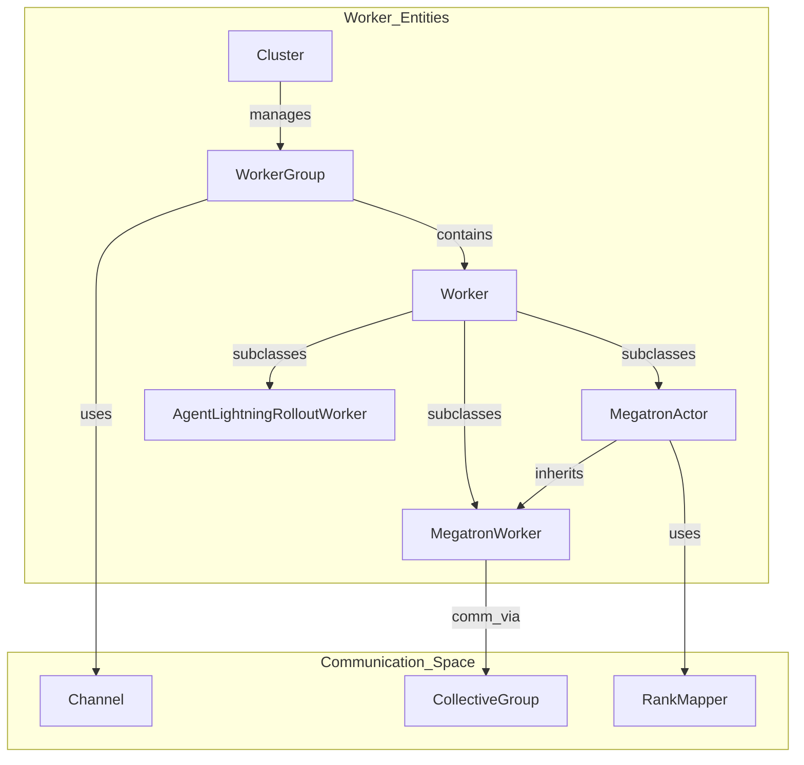
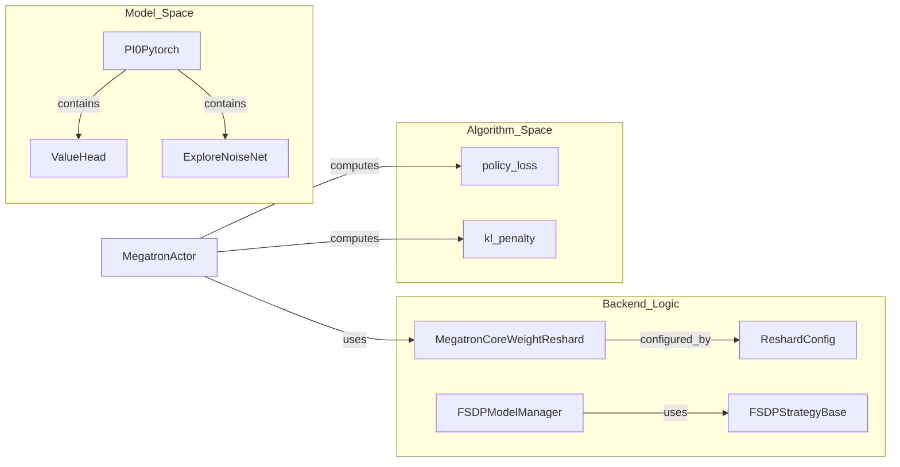

<!-- source: DeepWiki mcp.deepwiki.com · repo RLinf/RLinf · page 12 Glossary · fetched 2026-10-21 -->

# Glossary

Relevant source files

The following files were used as context for generating this wiki page:

- [.github/workflows/agent-e2e-tests.yml](.github/workflows/agent-e2e-tests.yml)
- [.github/workflows/ci-tests.yml](.github/workflows/ci-tests.yml)
- [.github/workflows/sft-e2e-tests.yml](.github/workflows/sft-e2e-tests.yml)
- [README.md](README.md)
- [README.zh-CN.md](README.zh-CN.md)
- [docs/source-en/rst_source/examples/index.rst](docs/source-en/rst_source/examples/index.rst)
- [docs/source-en/rst_source/extending/weight_syncer.rst](docs/source-en/rst_source/extending/weight_syncer.rst)
- [docs/source-zh/rst_source/examples/index.rst](docs/source-zh/rst_source/examples/index.rst)
- [docs/source-zh/rst_source/extending/weight_syncer.rst](docs/source-zh/rst_source/extending/weight_syncer.rst)
- [examples/embodiment/config/maniskill_async_ppo_openvlaoft.yaml](examples/embodiment/config/maniskill_async_ppo_openvlaoft.yaml)
- [rlinf/algorithms/losses.py](rlinf/algorithms/losses.py)
- [rlinf/hybrid_engines/fsdp/fsdp_model_manager.py](rlinf/hybrid_engines/fsdp/fsdp_model_manager.py)
- [rlinf/hybrid_engines/fsdp/strategy/base.py](rlinf/hybrid_engines/fsdp/strategy/base.py)
- [rlinf/hybrid_engines/fsdp/strategy/fsdp.py](rlinf/hybrid_engines/fsdp/strategy/fsdp.py)
- [rlinf/hybrid_engines/fsdp/utils.py](rlinf/hybrid_engines/fsdp/utils.py)
- [rlinf/hybrid_engines/megatron/token_dispatcher.py](rlinf/hybrid_engines/megatron/token_dispatcher.py)
- [rlinf/hybrid_engines/megatron/utils.py](rlinf/hybrid_engines/megatron/utils.py)
- [rlinf/hybrid_engines/weight_syncer/base.py](rlinf/hybrid_engines/weight_syncer/base.py)
- [rlinf/hybrid_engines/weight_syncer/bucket_syncer.py](rlinf/hybrid_engines/weight_syncer/bucket_syncer.py)
- [rlinf/hybrid_engines/weight_syncer/patch_syncer.py](rlinf/hybrid_engines/weight_syncer/patch_syncer.py)
- [rlinf/models/__init__.py](rlinf/models/__init__.py)
- [rlinf/models/embodiment/openpi/dataconfig/__init__.py](rlinf/models/embodiment/openpi/dataconfig/__init__.py)
- [rlinf/models/embodiment/openpi/openpi_action_model.py](rlinf/models/embodiment/openpi/openpi_action_model.py)
- [rlinf/runners/agentlightning_runner.py](rlinf/runners/agentlightning_runner.py)
- [rlinf/scheduler/channel/channel.py](rlinf/scheduler/channel/channel.py)
- [rlinf/scheduler/channel/channel_worker.py](rlinf/scheduler/channel/channel_worker.py)
- [rlinf/scheduler/cluster/__init__.py](rlinf/scheduler/cluster/__init__.py)
- [rlinf/scheduler/cluster/utils.py](rlinf/scheduler/cluster/utils.py)
- [rlinf/scheduler/collective/async_work.py](rlinf/scheduler/collective/async_work.py)
- [rlinf/scheduler/collective/collective_group.py](rlinf/scheduler/collective/collective_group.py)
- [rlinf/scheduler/collective/multi_channel_pg.py](rlinf/scheduler/collective/multi_channel_pg.py)
- [rlinf/scheduler/manager/worker_manager.py](rlinf/scheduler/manager/worker_manager.py)
- [rlinf/scheduler/worker/worker.py](rlinf/scheduler/worker/worker.py)
- [rlinf/scheduler/worker/worker_group.py](rlinf/scheduler/worker/worker_group.py)
- [rlinf/utils/ckpt_convertor/fsdp_convertor/convert_pt_to_hf.py](rlinf/utils/ckpt_convertor/fsdp_convertor/convert_pt_to_hf.py)
- [rlinf/utils/metric_utils.py](rlinf/utils/metric_utils.py)
- [rlinf/utils/utils.py](rlinf/utils/utils.py)
- [rlinf/workers/actor/async_ppo_fsdp_worker.py](rlinf/workers/actor/async_ppo_fsdp_worker.py)
- [rlinf/workers/actor/fsdp_iql_policy_worker.py](rlinf/workers/actor/fsdp_iql_policy_worker.py)
- [rlinf/workers/actor/ma_megatron_actor_worker.py](rlinf/workers/actor/ma_megatron_actor_worker.py)
- [rlinf/workers/actor/megatron_actor_worker.py](rlinf/workers/actor/megatron_actor_worker.py)
- [rlinf/workers/agent/agentlightning_rollout_worker.py](rlinf/workers/agent/agentlightning_rollout_worker.py)
- [rlinf/workers/critic/megatron_critic_worker.py](rlinf/workers/critic/megatron_critic_worker.py)
- [rlinf/workers/megatron_worker.py](rlinf/workers/megatron_worker.py)
- [rlinf/workers/sft/fsdp_vla_sft_worker.py](rlinf/workers/sft/fsdp_vla_sft_worker.py)
- [tests/e2e_tests/reasoning/qwen3-moe-2.5b-collocated-mg-sgl-ep-fusco-test.yaml](tests/e2e_tests/reasoning/qwen3-moe-2.5b-collocated-mg-sgl-ep-fusco-test.yaml)
- [tests/unit_tests/bench_channel.py](tests/unit_tests/bench_channel.py)
- [tests/unit_tests/test_channel.py](tests/unit_tests/test_channel.py)
- [tests/unit_tests/test_comm.py](tests/unit_tests/test_comm.py)
- [tests/unit_tests/test_weight_syncer.py](tests/unit_tests/test_weight_syncer.py)

This page defines codebase-specific terms, abbreviations, and domain concepts used within RLinf. RLinf is a unified Reinforcement Learning infrastructure designed for both **Embodied AI** (robotics, control) and **Agentic AI** (reasoning, LLMs) [[README.md:21-25]]().

## RL Algorithms

*   **PPO (Proximal Policy Optimization)**: An on-policy RL algorithm that uses a clipped surrogate objective to prevent large policy updates. In RLinf, it is implemented for both LLM reasoning and VLA models [[rlinf/workers/actor/megatron_actor_worker.py:71-81]]().
*   **GRPO (Group Relative Policy Optimization)**: An RL algorithm that computes advantages relative to a group of sampled responses instead of using a separate critic/value function. Widely used in reasoning tasks like math and coding [[README.md:65]]().
*   **SAC (Soft Actor-Critic)**: An off-policy actor-critic algorithm that maximizes both reward and policy entropy. Implementation in `FSDPSACActor` supports automatic entropy tuning and Q-function updates [[rlinf/workers/actor/fsdp_actor_worker.py:146]]().
*   **RLPD (Reinforcement Learning from Prior Data)**: An extension of SAC that incorporates offline demonstrations into the replay buffer to accelerate online learning.
*   **GAE (Generalized Advantage Estimation)**: A method for computing advantage targets that balances bias and variance via a $\lambda$ parameter. Advantage computation is registered in `calculate_adv_and_returns` [[rlinf/workers/actor/fsdp_actor_worker.py:27]]().
*   **DAgger (Dataset Aggregation)**: An imitation learning algorithm where the agent's policy is trained to mimic an expert on states visited by the agent itself [[README.md:62]]().
*   **HG-DAgger (Human-Gated DAgger)**: A variant of DAgger used for real-world online training where a human operator intervenes to provide expert corrections [[README.md:56]]().
*   **NFT (Neural Flow Transformation)**: A technique used in flow-based policies for embodied AI, specifically supported in OpenPI configurations [[rlinf/models/embodiment/openpi/openpi_action_model.py:89-90]]().
*   **CrossQ / DrQ**: Advanced off-policy algorithms for image-based RL. RLinf implements utilities for data augmentation in off-policy pipelines.
*   **RECAP**: RL with Experience and Corrections via Advantage-conditioned Policies, used for offline advantage-based policy optimization [[README.md:51]]().
*   **IQL (Implicit Q-Learning)**: An offline RL algorithm that avoids querying out-of-distribution actions by treating the state-value function as an expectile [[README.md:52]]().
*   **STEAM**: Offline advantage estimation and policy optimization method supported for embodied tasks [[README.md:37]]().
*   **RLT (Reinforcement Learning with Token-level guidance)**: Supports online RL fine-tuning of VLA policies using token-level rewards or expert guidance [[README.md:36]]().

**Sources:** [[README.md:32-75]](), [[rlinf/workers/actor/megatron_actor_worker.py:71-81]](), [[rlinf/models/embodiment/openpi/openpi_action_model.py:89-90]](), [[rlinf/workers/actor/fsdp_actor_worker.py:27-146]]().

## Distributed Training Concepts

*   **FSDP (Fully Sharded Data Parallel)**: A PyTorch-based backend that shards model parameters, gradients, and optimizer states across data-parallel ranks. Managed by `FSDPModelManager` [[rlinf/hybrid_engines/fsdp/fsdp_model_manager.py:53-58]]().
*   **Megatron**: A backend for large-scale model parallelism, supporting 3D parallelism (TP, PP, DP). Managed by `MegatronWorker` and `MegatronActor` [[rlinf/workers/actor/megatron_actor_worker.py:51-60]]().
*   **TP (Tensor Parallelism)**: Splitting individual layers across multiple GPUs. Configured via `tensor_parallel_size` [[rlinf/workers/actor/megatron_actor_worker.py:63-64]]().
*   **PP (Pipeline Parallelism)**: Splitting model layers across different GPUs in a sequence (stages). Managed via `pipeline_parallel_size` in rollout and training workers [[rlinf/workers/actor/megatron_actor_worker.py:104]]().
*   **EP (Expert Parallelism)**: Sharding MoE (Mixture of Experts) experts across ranks [[rlinf/workers/actor/megatron_actor_worker.py:105]]().
*   **CP (Context Parallelism)**: Splitting the sequence dimension across GPUs for long-context processing.
*   **DP (Data Parallelism)**: Replicating the model (or shards) and processing different data batches per rank [[rlinf/workers/actor/megatron_actor_worker.py:21-22]]().

**Sources:** [[rlinf/workers/actor/megatron_actor_worker.py:51-105]](), [[rlinf/hybrid_engines/fsdp/fsdp_model_manager.py:53-58]](), [[rlinf/hybrid_engines/fsdp/utils.py:65-68]]().

## Embodied AI Terminology

*   **VLA (Vision-Language-Action)**: Models that take vision and language inputs to output robotic actions (e.g., OpenVLA, OpenPI, GR00T, StarVLA, LingBot-VLA) [[README.md:33-55]]().
*   **Action Chunking**: Predicting a sequence of future actions (a "chunk") at once to handle temporal dependencies and high-frequency control. Configured via `action_chunk` in models like Pi0 [[rlinf/models/embodiment/openpi/openpi_action_model.py:60]]().
*   **Sim-Real Co-Training**: Training a policy simultaneously on simulation data and real-world robot data to improve generalization [[README.zh-CN.md:40]]().
*   **World Model**: A learned simulator (e.g., OpenSora, Wan, WoVR) used to generate synthetic rollouts for RL training [[README.md:72-73]]().
*   **LeRobot Format**: A standardized data format for robotic datasets supported by RLinf for dataset conversion and storage [[README.md:35]]().
*   **Welford's Algorithm**: Used for online computation of running mean and variance for observation normalization.
*   **WoVR**: World Models as Reliable Simulators for Post-Training VLA Policies with RL, a publication supported by the framework [[README.md:72]]().

**Sources:** [[README.md:33-73]](), [[rlinf/models/embodiment/openpi/openpi_action_model.py:60]](), [[README.zh-CN.md:40-41]]().

## Infrastructure Concepts

*   **Channel**: A high-performance FIFO queue abstraction used for asynchronous data exchange between workers [[rlinf/scheduler/channel/channel.py:1]]().
*   **CollectiveGroup**: An abstraction for tensor-based communication (NCCL/Gloo), supporting operations like `broadcast` and `all_reduce` [[rlinf/scheduler/collective/collective_group.py:187-197]]().
*   **WorkerGroup**: A logical collection of `Worker` instances (e.g., ActorGroup, RolloutGroup) managed as a unit [[rlinf/scheduler/worker/worker_group.py:1]]().
*   **CommMapper**: A utility to map ranks and manage communication routes between different worker groups [[rlinf/workers/actor/megatron_actor_worker.py:41]]().
*   **AcceleratorManager**: Interface for managing hardware-specific details like AMD GPU support and NCCL configuration.

**Sources:** [[rlinf/scheduler/collective/collective_group.py:187-197]](), [[rlinf/scheduler/worker/worker_group.py:1]](), [[rlinf/scheduler/channel/channel.py:1]](), [[rlinf/scheduler/worker/worker.py:39]]().

## System-Specific Terms

*   **FUSCO**: A high-performance system for MoE All-to-All communication optimization via transformation-communication fusion [[README.md:64]]().
*   **DSRL (Diffusion Steering via RL)**: A method to steer pre-trained diffusion policies by training a lightweight SAC agent in the latent noise space [[README.zh-CN.md:69]](), implemented via components like `ExploreNoiseNet` [[rlinf/models/embodiment/openpi/openpi_action_model.py:32]]().
*   **RLinf-USER**: A unified system for real-world online policy learning in Embodied AI [[README.md:76]]().
*   **Macro-to-Micro Flow Transformation**: The underlying principle of FUSCO for high-performance distributed data shuffling.
*   **BFD Partitioning**: Best-Fit Decreasing partitioning used for sequence-length balanced data distribution across workers.
*   **AgentLightning**: A framework integration for single-agent RL training supported by RLinf [[README.md:45]]().

**Sources:** [[README.md:45-76]](), [[rlinf/models/embodiment/openpi/openpi_action_model.py:32]](), [[README.zh-CN.md:64-69]]().

## Code-to-System Mapping

### 1. Worker Hierarchy and Communication
This diagram maps the logical worker roles to their implementation classes and communication primitives.

Title: Worker and Communication Mapping

**Sources:** [[rlinf/workers/actor/megatron_actor_worker.py:51-60]](), [[rlinf/scheduler/worker/worker.py:103]](), [[rlinf/scheduler/worker/worker_group.py:1]](), [[rlinf/workers/agent/agentlightning_rollout_worker.py:1]]().

### 2. Data and Model Flow
This diagram associates model management concepts with specific backend structures in the code.

Title: Data Structures and Model Flow

**Sources:** [[rlinf/workers/actor/megatron_actor_worker.py:108-109]](), [[rlinf/hybrid_engines/fsdp/fsdp_model_manager.py:53]](), [[rlinf/models/embodiment/openpi/openpi_action_model.py:106-192]](), [[rlinf/workers/actor/megatron_actor_worker.py:25-26]]().

## Terminology Table

| Term | Definition | Code Pointer |
| :--- | :--- | :--- |
| **SupportedModel** | Enum of all validated architectures (Qwen, OpenVLA, OpenPI, etc.) | [[rlinf/config.py:28]]() |
| **Worker** | Base class for remote processes in the cluster | [[rlinf/scheduler/worker/worker.py:103]]() |
| **Weight Resharding** | Converting weights between different TP/PP degrees | [[rlinf/workers/actor/megatron_actor_worker.py:109]]() |
| **AsyncWork** | Future-like object for tracking asynchronous collective operations | [[rlinf/scheduler/collective/async_work.py:1]]() |
| **FSDPModelManager** | Handles sharding and initialization of models using FSDP | [[rlinf/hybrid_engines/fsdp/fsdp_model_manager.py:53]]() |
| **ForwardType** | Enum defining different forward pass modes (SFT, RL, INFERENCE) | [[rlinf/models/embodiment/base_policy.py:31]]() |
| **ValueHead** | MLP head attached to VLM for value estimation | [[rlinf/models/embodiment/modules/value_head.py:1]]() |
| **ExploreNoiseNet** | Network used to generate noise for flow-based exploration | [[rlinf/models/embodiment/modules/explore_noise_net.py:1]]() |
| **DeviceMesh** | PyTorch structure for defining process grids in FSDP | [[rlinf/hybrid_engines/fsdp/utils.py:65]]() |

**Sources:** [[rlinf/config.py:28]](), [[rlinf/scheduler/worker/worker.py:103]](), [[rlinf/workers/actor/megatron_actor_worker.py:109]](), [[rlinf/hybrid_engines/fsdp/fsdp_model_manager.py:53]](), [[rlinf/models/embodiment/openpi/openpi_action_model.py:165-192]]().