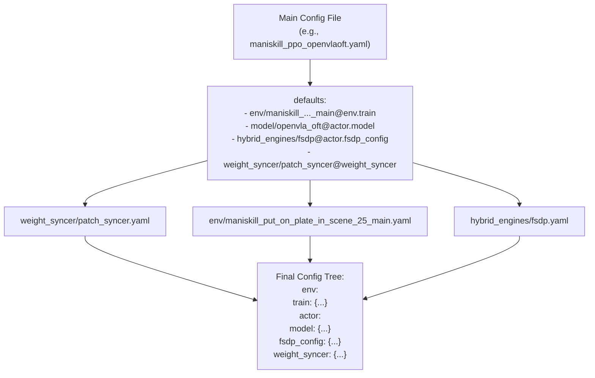
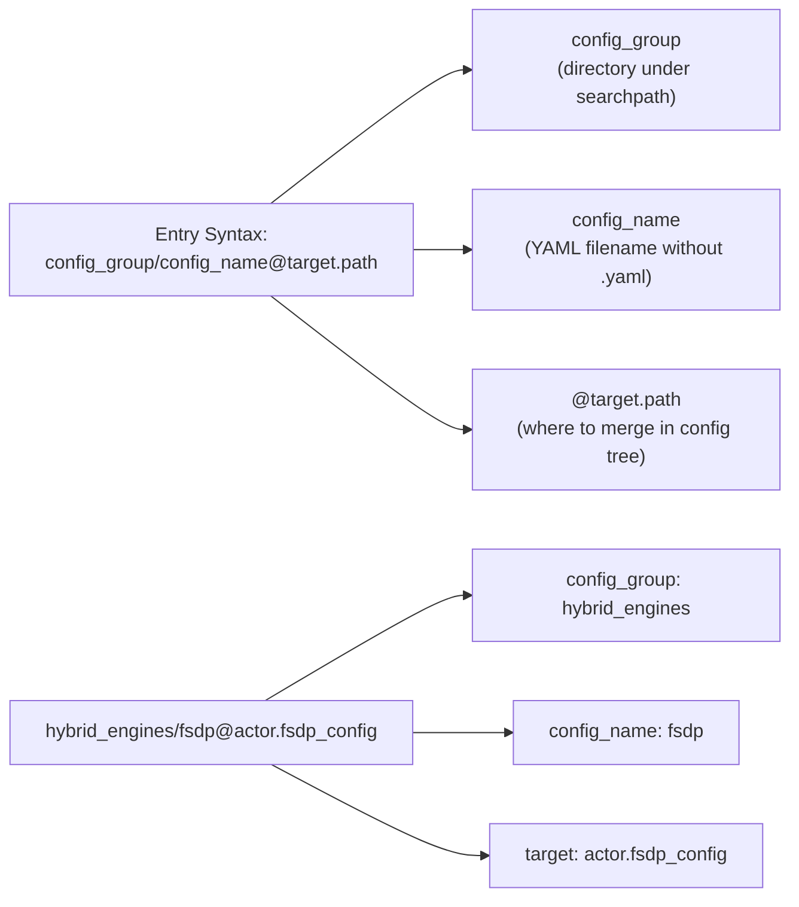
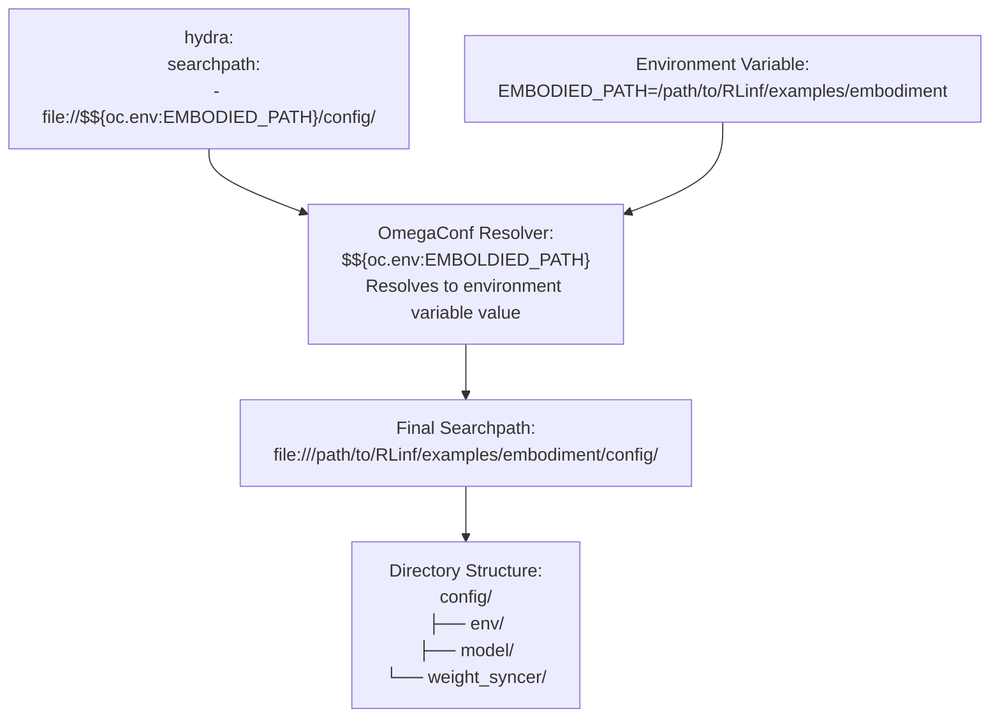
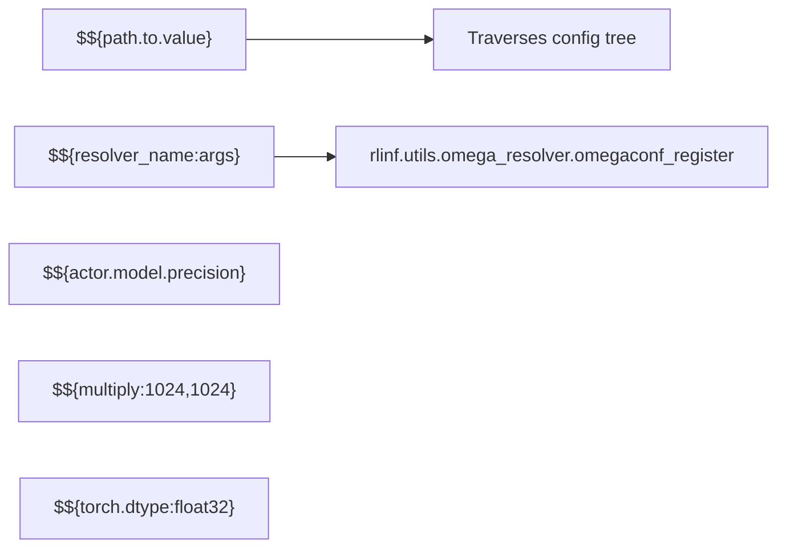
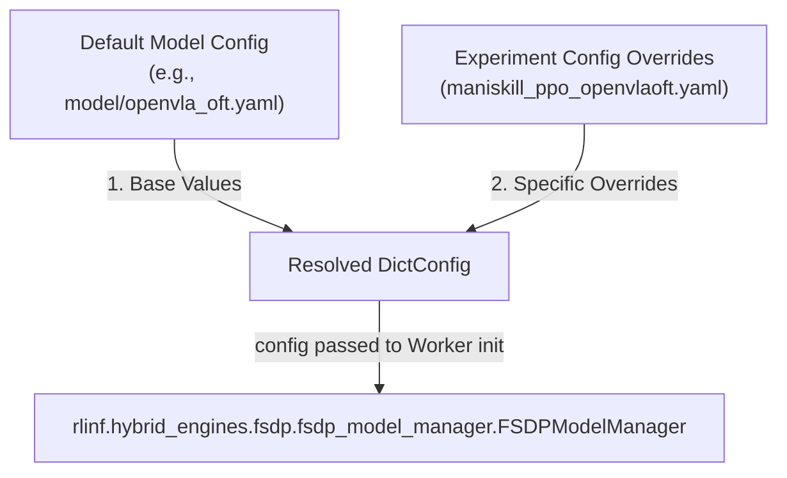
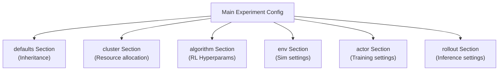

<!-- source: DeepWiki mcp.deepwiki.com · repo RLinf/RLinf · page 2.1 Hydra Composition and Defaults · fetched 2026-10-21 -->

# Hydra Composition and Defaults

<details>
<summary>Relevant source files</summary>

The following files were used as context for generating this wiki page:

- [docs/source-en/rst_source/guides/agentic_config.rst](docs/source-en/rst_source/guides/agentic_config.rst)
- [docs/source-en/rst_source/guides/basic_config.rst](docs/source-en/rst_source/guides/basic_config.rst)
- [docs/source-en/rst_source/guides/embodiment_config.rst](docs/source-en/rst_source/guides/embodiment_config.rst)
- [docs/source-en/rst_source/guides/env_decoupled_mode.rst](docs/source-en/rst_source/guides/env_decoupled_mode.rst)
- [docs/source-en/rst_source/guides/performance/index.rst](docs/source-en/rst_source/guides/performance/index.rst)
- [docs/source-zh/rst_source/guides/agentic_config.rst](docs/source-zh/rst_source/guides/agentic_config.rst)
- [docs/source-zh/rst_source/guides/basic_config.rst](docs/source-zh/rst_source/guides/basic_config.rst)
- [docs/source-zh/rst_source/guides/embodiment_config.rst](docs/source-zh/rst_source/guides/embodiment_config.rst)
- [docs/source-zh/rst_source/guides/env_decoupled_mode.rst](docs/source-zh/rst_source/guides/env_decoupled_mode.rst)
- [docs/source-zh/rst_source/guides/performance/index.rst](docs/source-zh/rst_source/guides/performance/index.rst)
- [examples/embodiment/train_async.py](examples/embodiment/train_async.py)
- [examples/embodiment/train_embodied_agent.py](examples/embodiment/train_embodied_agent.py)
- [rlinf/config.py](rlinf/config.py)
- [rlinf/runners/embodied_runner.py](rlinf/runners/embodied_runner.py)
- [rlinf/utils/omega_resolver.py](rlinf/utils/omega_resolver.py)
- [rlinf/workers/actor/fsdp_actor_worker.py](rlinf/workers/actor/fsdp_actor_worker.py)
- [rlinf/workers/env/env_worker.py](rlinf/workers/env/env_worker.py)
- [rlinf/workers/rollout/hf/huggingface_worker.py](rlinf/workers/rollout/hf/huggingface_worker.py)
- [tests/unit_tests/test_overlap_env_bootstrap.py](tests/unit_tests/test_overlap_env_bootstrap.py)

</details>


This document explains how RLinf uses Hydra's compositional configuration system to enable modular experiment design. It covers the `defaults` list mechanism, package directive syntax, searchpath resolution, variable interpolation, and override priorities.

For information about configuring component placement and cluster setup, see **2.2 Component Placement Strategies**. For algorithm and model-specific configuration parameters, see **2.3 Algorithm and Model Configuration**.

---

## Overview of Hydra Composition

RLinf configurations use Hydra's defaults list to compose multiple YAML files into a single unified configuration. This allows experiments to inherit base configurations and override only the parameters that differ between tasks. Each configuration file starts with a `defaults` section that specifies which other configs to merge.

**Key Concepts:**
- **Defaults List**: Ordered list of configs to compose, processed top-to-bottom.
- **Package Directive (`@`)**: Controls where in the config tree a default is merged. Used to mount configs onto specific nodes like `actor.model` [docs/source-en/rst_source/guides/embodiment_config.rst:20-23]().
- **Searchpath**: Directories where Hydra searches for config files, often utilizing environment variables like `EMBODIED_PATH` [docs/source-en/rst_source/guides/embodiment_config.rst:28-35]().
- **Variable Interpolation**: References to other config values using `${path.to.value}` [rlinf/utils/omega_resolver.py:18]().
- **Override Priority**: Top-level keys in the main file override defaults; later entries in the defaults list override earlier ones.

Sources: [docs/source-en/rst_source/guides/embodiment_config.rst:8-35](), [rlinf/utils/omega_resolver.py:1-46]()

---

## Defaults List Structure

The `defaults` list at the top of each config file specifies which configs to compose. Each entry can be a simple string or use the package directive to control placement. RLinf frequently uses this to compose complex distributed training setups, such as adding profiling or weight synchronization strategies.

### Configuration Composition Flow

Title: Configuration Composition Flow


**Defaults List Processing Example:**

| Order | Entry | Source File | Merged At |
|-------|-------|-------------|-----------|
| 1 | `env/maniskill_..._main@env.train` | `env/maniskill_..._main.yaml` | `env.train` |
| 2 | `env/maniskill_ood_template@env.eval` | `env/maniskill_ood_template.yaml` | `env.eval` |
| 3 | `model/openvla_oft@actor.model` | `model/openvla_oft.yaml` | `actor.model` |
| 4 | `hybrid_engines/fsdp@actor.fsdp_config` | `hybrid_engines/fsdp.yaml` | `actor.fsdp_config` |
| 5 | `weight_syncer/patch_syncer@weight_syncer`| `weight_syncer/patch_syncer.yaml` | `weight_syncer` |

Sources: [docs/source-en/rst_source/guides/embodiment_config.rst:12-18](), [examples/embodiment/train_embodied_agent.py:35-37]()

---

## Package Directive (`@`) Syntax

The package directive (`@`) controls where in the configuration tree a default config is placed. Without `@`, configs are merged at the root level. With `@`, you can place the same config file at different locations (e.g., separate settings for `env.train` and `env.eval`).

### Package Directive Components

Title: Package Directive Components


**Common Patterns in RLinf:**

| Pattern | Purpose | Example |
|---------|---------|---------|
| `env/task@env.train` | Load environment config for training | `env/maniskill_..._main@env.train` [docs/source-en/rst_source/guides/embodiment_config.rst:13]() |
| `model/name@actor.model` | Load model architecture for the actor | `model/openvla_oft@actor.model` [docs/source-en/rst_source/guides/embodiment_config.rst:16]() |
| `weight_syncer/type@weight_syncer` | Load weight synchronization strategy | `weight_syncer/patch_syncer@weight_syncer` [docs/source-en/rst_source/guides/embodiment_config.rst:17]() |

Sources: [docs/source-en/rst_source/guides/embodiment_config.rst:12-18](), [docs/source-zh/rst_source/guides/embodiment_config.rst:12-17]()

---

## Searchpath Resolution

Hydra searches for config files in directories specified in `hydra.searchpath`. RLinf uses environment variables and relative paths to locate domain-specific config directories, ensuring portability across different environments.

### Searchpath Resolution Mechanism

Title: Searchpath Resolution Mechanism


**Searchpath Entries:**

```yaml
hydra:
  searchpath:
    - file://${oc.env:EMBODIED_PATH}/config/
```

When Hydra encounters `model/openvla_oft@actor.model`, it looks for `openvla_oft.yaml` in the `${searchpath}/model/` directory [docs/source-en/rst_source/guides/embodiment_config.rst:30-35]().

Sources: [docs/source-en/rst_source/guides/embodiment_config.rst:28-35]()

---

## Variable Interpolation and Custom Resolvers

RLinf configs extensively use variable interpolation to reference other config values, enabling DRY (Don't Repeat Yourself) configuration. Additionally, RLinf registers custom OmegaConf resolvers in `rlinf/utils/omega_resolver.py` to perform arithmetic and type conversions directly within YAML files [rlinf/utils/omega_resolver.py:32-42]().

### Interpolation and Resolvers

Title: Variable Interpolation and Resolvers


**Custom Resolvers Registered in `rlinf/utils/omega_resolver.py`:**

| Resolver | Functionality | Example Usage |
|----------|---------------|---------------|
| `multiply` | Multiplies two numbers | `${multiply: 128, 1024}` [rlinf/utils/omega_resolver.py:37]() |
| `int_div` | Integer division | `${int_div: 1024, 8}` [rlinf/utils/omega_resolver.py:38]() |
| `subtract` | Subtracts two numbers | `${subtract: ${runner.seq_length}, ${data.max_prompt_length}}` [docs/source-zh/rst_source/guides/agentic_config.rst:44]() |
| `not` | Boolean negation | `${not: ${algorithm.recompute_logprobs}}` [docs/source-zh/rst_source/guides/agentic_config.rst:92]() |
| `torch.dtype`| Converts string to `torch.dtype` | `${torch.dtype: bfloat16}` [rlinf/utils/omega_resolver.py:41]() |

Sources: [rlinf/utils/omega_resolver.py:32-42](), [docs/source-zh/rst_source/guides/agentic_config.rst:43-46]()

---

## Override Priorities and Merging

RLinf configs follow Hydra's override priority rules. Merging is recursive: only leaf values are overridden, while parent dictionaries are merged. This allows users to define a base model configuration and override specific fields like `model_path` in the main experiment file.

### Configuration Override Association

Title: Config Value Association


**Override Priority Order:**

1.  **Command-line arguments**: `python train.py runner.only_eval=True` (Highest)
2.  **Top-level keys in main config**: Overrides defaults provided in the `defaults` list.
3.  **Later entries in defaults list**: Configs merged at the same path later override earlier ones.
4.  **Earlier entries in defaults list**: (Lowest)

Sources: [rlinf/workers/actor/fsdp_actor_worker.py:190-205](), [examples/embodiment/train_embodied_agent.py:35-40]()

---

## Standard Config Structure in RLinf

RLinf uses several standard composition patterns across experiments, typically organizing the config into `cluster`, `runner`, `algorithm`, `env`, `rollout`, `actor`, and `reward` sections.

### Standard Config Sections

Title: High-Level Configuration Sections


**Config Categories:**

| Section | Purpose | Key Parameters |
|---------|---------|----------------|
| `cluster` | Hardware resources | `cluster_cfg`, `profiling` [rlinf/runners/embodied_runner.py:79-91]() |
| `algorithm` | RL Logic | `loss_type`, `adv_type`, `gamma` [docs/source-en/rst_source/guides/embodiment_config.rst:78-100]() |
| `actor` | Training Worker | `training_backend`, `model`, `fsdp_config` [docs/source-zh/rst_source/guides/agentic_config.rst:250-259]() |
| `env` | Simulation | `total_num_envs`, `max_steps_per_rollout_epoch` [rlinf/workers/env/env_worker.py:135-157]() |
| `rollout` | Inference Worker | `backend`, `pipeline_stage_num`, `sampling_params` [rlinf/workers/rollout/hf/huggingface_worker.py:50-60]() |
| `runner` | Orchestration | `only_eval`, `val_check_interval`, `weight_sync_interval` [rlinf/runners/embodied_runner.py:67-73]() |

Sources: [rlinf/runners/embodied_runner.py:52-120](), [rlinf/workers/env/env_worker.py:58-130](), [docs/source-en/rst_source/guides/embodiment_config.rst:148-214]()

---

