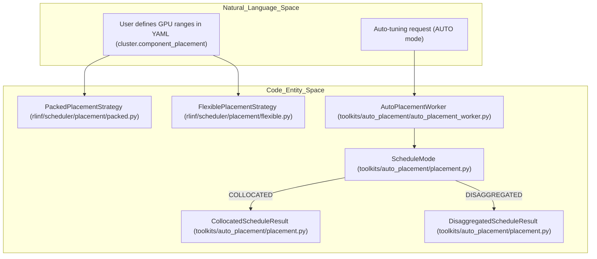
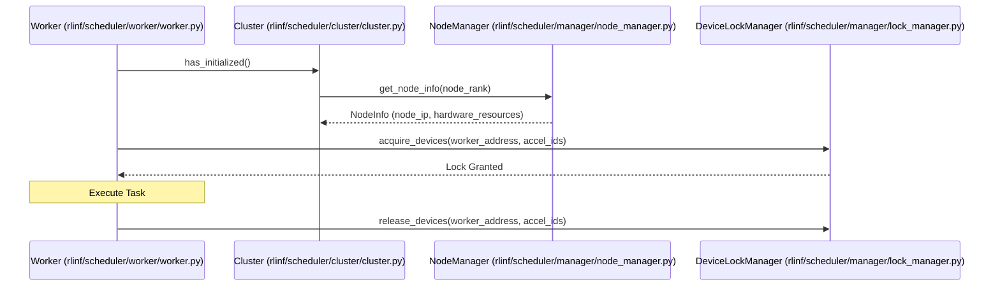

<!-- source: DeepWiki mcp.deepwiki.com · repo RLinf/RLinf · page 2.2 Component Placement Strategies · fetched 2026-10-21 -->

# Component Placement Strategies

Relevant source files

The following files were used as context for generating this wiki page:

- [examples/embodiment/run_placement_autotune.sh](examples/embodiment/run_placement_autotune.sh)
- [examples/reasoning/run_placement_autotune.sh](examples/reasoning/run_placement_autotune.sh)
- [rlinf/scheduler/cluster/cluster.py](rlinf/scheduler/cluster/cluster.py)
- [rlinf/scheduler/cluster/config.py](rlinf/scheduler/cluster/config.py)
- [rlinf/scheduler/cluster/node.py](rlinf/scheduler/cluster/node.py)
- [rlinf/scheduler/manager/__init__.py](rlinf/scheduler/manager/__init__.py)
- [rlinf/scheduler/manager/lock_manager.py](rlinf/scheduler/manager/lock_manager.py)
- [rlinf/scheduler/manager/manager.py](rlinf/scheduler/manager/manager.py)
- [rlinf/scheduler/placement/flexible.py](rlinf/scheduler/placement/flexible.py)
- [rlinf/scheduler/placement/packed.py](rlinf/scheduler/placement/packed.py)
- [rlinf/scheduler/worker/lock.py](rlinf/scheduler/worker/lock.py)
- [rlinf/workers/rollout/sglang/sglang_worker.py](rlinf/workers/rollout/sglang/sglang_worker.py)
- [tests/e2e_tests/auto_placement/qwen2.5-1.5b-grpo.yaml](tests/e2e_tests/auto_placement/qwen2.5-1.5b-grpo.yaml)
- [tests/e2e_tests/auto_placement/run.sh](tests/e2e_tests/auto_placement/run.sh)
- [tests/e2e_tests/reasoning/qwen2.5-1.5b-grpo-collocated-mg-sgl-rollout-logprobs.yaml](tests/e2e_tests/reasoning/qwen2.5-1.5b-grpo-collocated-mg-sgl-rollout-logprobs.yaml)
- [tests/e2e_tests/reasoning/qwen2.5-1.5b-grpo-collocated-mg-vllm.yaml](tests/e2e_tests/reasoning/qwen2.5-1.5b-grpo-collocated-mg-vllm.yaml)
- [tests/e2e_tests/reasoning/qwen2.5-1.5b-grpo-pipeline-mg-sgl-rollout-logprobs.yaml](tests/e2e_tests/reasoning/qwen2.5-1.5b-grpo-pipeline-mg-sgl-rollout-logprobs.yaml)
- [tests/e2e_tests/reasoning/qwen2.5-1.5b-grpo-pipeline-mg-sgl.yaml](tests/e2e_tests/reasoning/qwen2.5-1.5b-grpo-pipeline-mg-sgl.yaml)
- [tests/e2e_tests/reasoning/qwen2.5-1.5b-grpo-pipeline-mg-vllm-rollout-logprobs.yaml](tests/e2e_tests/reasoning/qwen2.5-1.5b-grpo-pipeline-mg-vllm-rollout-logprobs.yaml)
- [tests/e2e_tests/reasoning/qwen2.5-1.5b-grpo-pipeline-mg-vllm.yaml](tests/e2e_tests/reasoning/qwen2.5-1.5b-grpo-pipeline-mg-vllm.yaml)
- [tests/unit_tests/test_auto_placement.py](tests/unit_tests/test_auto_placement.py)
- [tests/unit_tests/test_placement.py](tests/unit_tests/test_placement.py)
- [tests/unit_tests/test_worker.py](tests/unit_tests/test_worker.py)
- [toolkits/auto_placement/__init__.py](toolkits/auto_placement/__init__.py)
- [toolkits/auto_placement/auto_placement_worker.py](toolkits/auto_placement/auto_placement_worker.py)
- [toolkits/auto_placement/fitter.py](toolkits/auto_placement/fitter.py)
- [toolkits/auto_placement/node.py](toolkits/auto_placement/node.py)
- [toolkits/auto_placement/placement.py](toolkits/auto_placement/placement.py)
- [toolkits/auto_placement/util.py](toolkits/auto_placement/util.py)
- [toolkits/auto_placement/workflow.py](toolkits/auto_placement/workflow.py)

This page documents how RLinf assigns GPUs and accelerators to different worker components (actor, rollout, inference, env, etc.) in distributed RL training. It explains the placement modes—**COLLOCATED**, **DISAGGREGATED**, and **AUTO**—their GPU allocation syntax, and how the underlying scheduler manages these resources across single and multi-node clusters.

Component placement determines which GPUs each worker type runs on and whether components share or partition GPU resources. This affects performance, memory usage, and weight synchronization overhead.

---

## Core Components and Placement Configuration

RLinf training pipelines involve multiple worker components:
- **Actor workers**: Train the policy model (backward pass, gradient updates). Represented by classes like `EmbodiedFSDPActor` or `MegatronActor`.
- **Rollout workers**: Generate trajectories via policy inference. These coordinate with actors and may use specialized backends like `vllm` or `sglang` [rlinf/workers/rollout/sglang/sglang_worker.py:49-50]().
- **Inference workers**: Perform standalone inference or recompute logprobs in reasoning tasks.
- **Env workers**: Interact with simulators (e.g., ManiSkill, LIBERO) in embodied AI.
- **Reward workers**: Compute reward signals, often placed on dedicated or shared GPUs [tests/e2e_tests/auto_placement/qwen2.5-1.5b-grpo.yaml:12]().

Component placement is configured via the `cluster.component_placement` block in Hydra YAML files [tests/e2e_tests/auto_placement/qwen2.5-1.5b-grpo.yaml:11-12]().

**Sources:** [rlinf/workers/rollout/sglang/sglang_worker.py:49-50](), [tests/e2e_tests/auto_placement/qwen2.5-1.5b-grpo.yaml:11-12]()

---

## GPU Allocation Syntax

The `component_placement` configuration uses a range-based syntax to map components to specific GPU indices.

### GPU Allocation Formats

| Format | Example | Meaning |
|--------|---------|---------|
| Single GPU | `actor: 0` | Actor uses GPU 0 |
| Range | `actor,env,rollout: 0-3` | All three components share GPUs 0 through 3 |
| Keyword | `actor,rollout,reward: all` | Components share all available GPUs on the node [tests/e2e_tests/auto_placement/qwen2.5-1.5b-grpo.yaml:12]() |

The `PackedPlacementStrategy` and `FlexiblePlacementStrategy` classes implement the underlying logic for mapping these user-defined ranges to hardware resources [rlinf/scheduler/placement/packed.py:22-23](), [rlinf/scheduler/placement/flexible.py:23-24]().

**Sources:** [tests/e2e_tests/auto_placement/qwen2.5-1.5b-grpo.yaml:11-12](), [rlinf/scheduler/placement/packed.py:22-23](), [rlinf/scheduler/placement/flexible.py:23-24]()

---

## Placement Modes

RLinf supports several primary placement modes, which can be manually specified or automatically determined.

### COLLOCATED Mode
Components share the same set of GPUs. This is common when the actor and rollout model fit within the same memory or when weights are shared via pointers.
- **Implementation**: Managed by `CollocatedScheduleResult` which aggregates placements from multiple nodes.

### DISAGGREGATED Mode
Each component has its own dedicated, non-overlapping set of GPUs. This is preferred for large models where training and inference cannot fit on the same device.
- **Implementation**: Managed by `DisaggregatedScheduleResult`, which calculates the cost of separate execution and communication.

### AUTO Mode
Automatically selects the placement mode based on a cost model and task type.
- **Workflow Analysis**: The `AutoPlacementWorker` analyzes the workflow graph (e.g., `rollout -> inference -> actor`) [tests/unit_tests/test_auto_placement.py:172-182]().
- **Profile-Driven Tuning**: It uses profiling data like `actor_cost`, `rollout_cost`, and `inference_cost` to calculate the optimal split [tests/unit_tests/test_auto_placement.py:49-53]().
- **Validation**: `_validate_gpu_num` ensures that the allocated GPU count is compatible with the model's parallelization requirements (e.g., TP/PP sizes) [tests/unit_tests/test_auto_placement.py:151-157]().

### Natural Language Space to Placement Logic Mapping
Title: "Configuration to Code Placement Mapping"

**Sources:** [tests/unit_tests/test_auto_placement.py:172-182](), [tests/unit_tests/test_auto_placement.py:49-53](), [tests/unit_tests/test_auto_placement.py:151-157]()

---

## Resource Management and Node Discovery

The `Cluster` singleton manages the physical resources of the cluster [rlinf/scheduler/cluster/cluster.py:110-111]().

### Node and Group Info
- **NodeInfo**: Tracks individual node properties like `node_ip`, `num_cpus`, and `hardware_resources` [rlinf/scheduler/cluster/node.py:37-64]().
- **NodeGroupInfo**: Aggregates nodes with the same label (e.g., "cluster" or "node") and provides global hardware rank mapping [rlinf/scheduler/cluster/node.py:111-133]().

### Device Locking
To prevent resource contention, the `DeviceLockManager` maintains an `asyncio.Lock` for every accelerator in the cluster [rlinf/scheduler/manager/lock_manager.py:88-101]().
- **Acquisition**: Workers call `acquire_devices` before starting execution on specific GPUs [rlinf/scheduler/manager/lock_manager.py:103-104]().
- **Release**: Locks are released via `release_devices` [rlinf/scheduler/manager/lock_manager.py:119-120]().

### Resource Discovery Flow
Title: "Cluster Resource Discovery and Locking"

**Sources:** [rlinf/scheduler/cluster/cluster.py:110-111](), [rlinf/scheduler/cluster/node.py:37-133](), [rlinf/scheduler/manager/lock_manager.py:88-120]()

---

## Multi-Node and Distributed Configuration

RLinf manages multi-node resource allocation through specialized placement strategies.

### Node Placement Strategies
- **PackedPlacementStrategy**: Fills up nodes with workers before moving to the next node [rlinf/scheduler/placement/packed.py:53-54]().
    - `num_hardware_per_process`: Allows a single process to hold multiple GPUs (e.g., for Tensor Parallelism) [rlinf/scheduler/placement/packed.py:62-65]().
    - `stride`: Allows strided placement (e.g., GPU 0, 2, 4 with stride 2) [rlinf/scheduler/placement/packed.py:76-79]().
- **FlexiblePlacementStrategy**: Explicitly maps global hardware ranks to processes [rlinf/scheduler/placement/flexible.py:23-28](). It ensures that all hardware ranks for a single process reside on the same node [rlinf/scheduler/placement/flexible.py:150-157]().

### Configuration Reference
| Parameter | Type | Description |
|-----------|------|-------------|
| `cluster.num_nodes` | int | Total number of nodes to use [tests/e2e_tests/auto_placement/qwen2.5-1.5b-grpo.yaml:10](). |
| `cluster.component_placement` | dict | Mapping of component groups to GPU ranges [tests/e2e_tests/auto_placement/qwen2.5-1.5b-grpo.yaml:11-12](). |
| `RLINF_NODE_RANK` | env | Environment variable identifying the rank of the current node [rlinf/scheduler/cluster/cluster.py:62-63](). |

**Sources:** [rlinf/scheduler/placement/packed.py:53-79](), [rlinf/scheduler/placement/flexible.py:23-157](), [rlinf/scheduler/cluster/cluster.py:62-63](), [tests/e2e_tests/auto_placement/qwen2.5-1.5b-grpo.yaml:10-12]()

---

