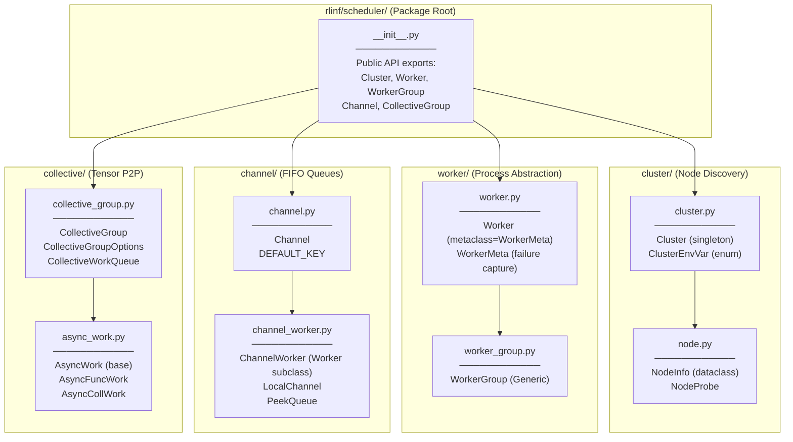

<!-- source: DeepWiki mcp.deepwiki.com · repo RLinf/RLinf · page 3 Core Infrastructure · fetched 2026-10-21 -->

# Core Infrastructure

Relevant source files

The following files were used as context for generating this wiki page:

- [rlinf/scheduler/channel/channel.py](rlinf/scheduler/channel/channel.py)
- [rlinf/scheduler/channel/channel_worker.py](rlinf/scheduler/channel/channel_worker.py)
- [rlinf/scheduler/cluster/__init__.py](rlinf/scheduler/cluster/__init__.py)
- [rlinf/scheduler/cluster/cluster.py](rlinf/scheduler/cluster/cluster.py)
- [rlinf/scheduler/cluster/node.py](rlinf/scheduler/cluster/node.py)
- [rlinf/scheduler/cluster/utils.py](rlinf/scheduler/cluster/utils.py)
- [rlinf/scheduler/collective/async_work.py](rlinf/scheduler/collective/async_work.py)
- [rlinf/scheduler/collective/collective_group.py](rlinf/scheduler/collective/collective_group.py)
- [rlinf/scheduler/collective/multi_channel_pg.py](rlinf/scheduler/collective/multi_channel_pg.py)
- [rlinf/scheduler/manager/__init__.py](rlinf/scheduler/manager/__init__.py)
- [rlinf/scheduler/manager/lock_manager.py](rlinf/scheduler/manager/lock_manager.py)
- [rlinf/scheduler/manager/manager.py](rlinf/scheduler/manager/manager.py)
- [rlinf/scheduler/manager/worker_manager.py](rlinf/scheduler/manager/worker_manager.py)
- [rlinf/scheduler/worker/lock.py](rlinf/scheduler/worker/lock.py)
- [rlinf/scheduler/worker/worker.py](rlinf/scheduler/worker/worker.py)
- [rlinf/scheduler/worker/worker_group.py](rlinf/scheduler/worker/worker_group.py)
- [rlinf/utils/ckpt_convertor/fsdp_convertor/convert_pt_to_hf.py](rlinf/utils/ckpt_convertor/fsdp_convertor/convert_pt_to_hf.py)
- [rlinf/workers/rollout/sglang/sglang_worker.py](rlinf/workers/rollout/sglang/sglang_worker.py)
- [tests/unit_tests/bench_channel.py](tests/unit_tests/bench_channel.py)
- [tests/unit_tests/test_channel.py](tests/unit_tests/test_channel.py)
- [tests/unit_tests/test_comm.py](tests/unit_tests/test_comm.py)
- [tests/unit_tests/test_worker.py](tests/unit_tests/test_worker.py)

This page documents the distributed infrastructure layer (`rlinf/scheduler/`) that underlies all training and execution in RLinf. The infrastructure provides the foundational primitives for cluster management, remote process orchestration, and high-performance communication.

Both embodied RL workflows (see [Embodied RL](#6)) and agentic/reasoning workflows (see [Agentic and Reasoning RL](#7)) utilize these primitives to achieve backend-agnostic distributed execution.

---

## Overview

RLinf's core infrastructure enables distributed execution across heterogeneous hardware (GPU clusters, simulators, real robots) via a layered architecture:

| Layer | Responsibility | Key Classes/Files |
|---|---|---|
| **Cluster Discovery** | Ray initialization, node enumeration, hardware detection | `Cluster`, `ClusterEnvVar`, `NodeInfo` |
| **Worker Abstraction** | Remote process lifecycle, RANK/WORLD_SIZE setup, failure handling | `Worker`, `WorkerGroup`, `WorkerMeta` |
| **Communication** | Async queues (Channel), P2P tensors (CollectiveGroup), NCCL backends | `Channel`, `ChannelWorker`, `CollectiveGroup`, `AsyncWork` |
| **Hardware Abstraction** | Accelerator detection, environment variable management | `AcceleratorUtil`, `AcceleratorType`, `HardwareInfo` |

All public infrastructure APIs are exposed through `rlinf.scheduler` [rlinf/scheduler/__init__.py:1-62]().

Sources: [rlinf/scheduler/cluster/cluster.py:110-128](), [rlinf/scheduler/worker/worker.py:103-138](), [rlinf/scheduler/channel/channel.py:38-137](), [rlinf/scheduler/collective/collective_group.py:112-136](), [rlinf/scheduler/worker/worker_group.py:40-64]()

### Code Organization Map

The following diagram maps conceptual subsystems to their implementation files and primary classes.

**Diagram: rlinf/scheduler Package Structure and Key Classes**

Sources: [rlinf/scheduler/cluster/cluster.py:110-128](), [rlinf/scheduler/worker/worker.py:51-138](), [rlinf/scheduler/worker/worker_group.py:40-64](), [rlinf/scheduler/channel/channel.py:38-137](), [rlinf/scheduler/channel/channel_worker.py:32-73](), [rlinf/scheduler/collective/collective_group.py:76-136](), [rlinf/scheduler/collective/async_work.py:28-198]()

---

## Distributed Scheduler

The `Cluster` class ([rlinf/scheduler/cluster/cluster.py:110-128]()) manages Ray initialization and node discovery. It serves as the singleton entry point for resource allocation and worker deployment.

- **Node Discovery**: The scheduler utilizes classes like `NodeInfo` and `NodeProbe` ([rlinf/scheduler/cluster/node.py:37-109]()) to detect available accelerators and CPUs across the cluster.
- **Environment Management**: Automatically configures critical variables like `MASTER_ADDR`, `MASTER_PORT`, `RANK`, and `LOCAL_RANK` for distributed PyTorch initialization ([rlinf/scheduler/worker/worker.py:103-108]()).
- **Global Management**: Uses `Manager` and `ManagerProxy` to provide a singleton proxy per worker process to access global cluster state [rlinf/scheduler/cluster/cluster.py:45-46]().
- **Log Collection**: Includes `DistributedRayLogCollector` to split and tail Ray worker logs into per-worker files [rlinf/scheduler/cluster/utils.py:113-132]().
- **Hybrid Execution**: Supports dynamic resource allocation between environment and training tasks to optimize throughput via components like `RolloutScalingScheduler` [rlinf/workers/rollout/sglang/sglang_worker.py:103-111]().

For details, see [Distributed Scheduler](#3.1).

Sources: [rlinf/scheduler/cluster/cluster.py:110-128](), [rlinf/scheduler/worker/worker.py:103-111](), [rlinf/scheduler/cluster/node.py:37-109](), [rlinf/scheduler/cluster/utils.py:113-132](), [rlinf/workers/rollout/sglang/sglang_worker.py:103-111]()

---

## Worker Groups and Lifecycle

The `Worker` class ([rlinf/scheduler/worker/worker.py:103-138]()) is the base abstraction for any remote process. Workers are typically managed in a `WorkerGroup` ([rlinf/scheduler/worker/worker_group.py:40-41]()) to provide a unified interface for collective execution.

- **Metaclass Orchestration**: `WorkerMeta` ([rlinf/scheduler/worker/worker.py:51-61]()) wraps class functions to catch `SystemExit` and exceptions in remote workers, ensuring that failures are logged with full tracebacks ([rlinf/scheduler/worker/worker.py:72-89]()).
- **Group Management**: `WorkerGroup` allows launching a set of workers across the cluster using specific `PlacementStrategy` ([rlinf/scheduler/worker/worker_group.py:144-168]()) and retrieving existing groups by name via `from_group_name` ([rlinf/scheduler/worker/worker_group.py:92-142]()).
- **Method Proxying**: Method calls on a `WorkerGroup` are automatically proxied to the underlying Ray actors, supporting execution on specific ranks ([rlinf/scheduler/worker/worker_group.py:183]()).

For details, see [Worker Groups and Lifecycle](#3.2).

Sources: [rlinf/scheduler/worker/worker.py:51-138](), [rlinf/scheduler/worker/worker_group.py:40-168]()

---

## Communication Primitives

RLinf provides two high-level communication abstractions designed for different data transfer patterns:

- **Channel**: A FIFO queue-like abstraction ([rlinf/scheduler/channel/channel.py:38-58]()) for asynchronous data exchange. It supports key-based routing, weight-based batching ([rlinf/scheduler/channel/channel.py:49-55]()), and distributed routing via `ChannelWorker` actors ([rlinf/scheduler/channel/channel.py:156-160]()).
- **CollectiveGroup**: A low-latency primitive for tensor communication. It uses `CollectiveWorkQueue` ([rlinf/scheduler/collective/collective_group.py:112-136]()) to manage dedicated accelerator streams and `AsyncWork` wrappers ([rlinf/scheduler/collective/async_work.py:28-59]()) to unify `torch.distributed` and Ray futures.
- **Multi-Channel Communication**: `MultiChannelProcessGroup` wraps multiple `dist.ProcessGroup` instances to support concurrent communication channels for tensors [rlinf/scheduler/collective/multi_channel_pg.py:31-48]().

For details, see [Communication Primitives](#3.3).

Sources: [rlinf/scheduler/channel/channel.py:38-58](), [rlinf/scheduler/collective/collective_group.py:112-136](), [rlinf/scheduler/collective/async_work.py:28-150](), [rlinf/scheduler/collective/multi_channel_pg.py:31-48]()

---

## Hardware Abstraction Layer (HAL)

The infrastructure abstracts hardware details to support diverse compute environments, including NVIDIA and AMD GPUs.

- **Accelerator Management**: `AcceleratorUtil` and `AcceleratorType` ([rlinf/scheduler/worker/worker.py:40]()) provide a unified interface for detecting and managing different GPU types.
- **Hardware Info**: `NodeInfo` ([rlinf/scheduler/cluster/node.py:37-109]()) encapsulates node-level resource counts and device identifiers via `HardwareResource` [rlinf/scheduler/cluster/node.py:64]().
- **Collective Tuning**: `CollectiveGroupOptions` ([rlinf/scheduler/collective/collective_group.py:76-96]()) allows tuning accelerator CCL parameters such as `accel_max_ctas` and `accel_min_ctas` to optimize communication efficiency based on hardware capabilities.

For details, see [Hardware Abstraction Layer](#3.4).

Sources: [rlinf/scheduler/cluster/node.py:26-34](), [rlinf/scheduler/collective/collective_group.py:76-96](), [rlinf/scheduler/worker/worker.py:40]()

---

## Data Structures and I/O

Core data structures are optimized for efficient distributed exchange through specialized metadata handling.

- **Optimized Tensor Transfer**: `TensorData` ([rlinf/scheduler/collective/collective_group.py:45-74]()) pre-partitions tensors into CPU and Accelerator lists to avoid repeated extraction during communication.
- **Asynchronous Flow**: The `AsyncWork` hierarchy ([rlinf/scheduler/collective/async_work.py:28-59]()) allows for chaining operations and provides a unified `.wait()` interface for both sync and async Python contexts ([rlinf/scheduler/collective/async_work.py:152-186]()).
- **Dataclass Serialization**: Infrastructure includes utilities like `DataclassTensorFieldsMetadata` to handle complex Python dataclasses for optimized network transmission [rlinf/scheduler/cluster/utils.py:31-40]().

For details, see [Data Structures and I/O](#3.5).

Sources: [rlinf/scheduler/collective/collective_group.py:45-74](), [rlinf/scheduler/collective/async_work.py:28-198](), [rlinf/scheduler/cluster/utils.py:31-40]()

---

