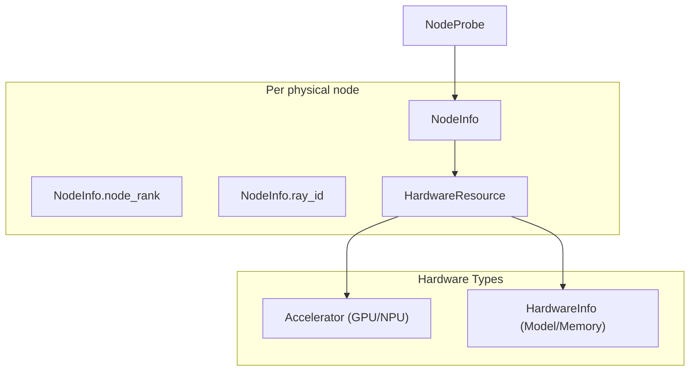

<!-- source: DeepWiki mcp.deepwiki.com · repo RLinf/RLinf · page 3.1 Distributed Scheduler · fetched 2026-10-21 -->

# Distributed Scheduler

<details>
<summary>Relevant source files</summary>

The following files were used as context for generating this wiki page:

- [docs/source-en/rst_source/examples/embodied/gim_arm.rst](docs/source-en/rst_source/examples/embodied/gim_arm.rst)
- [docs/source-zh/rst_source/examples/embodied/gim_arm.rst](docs/source-zh/rst_source/examples/embodied/gim_arm.rst)
- [rlinf/envs/realworld/__init__.py](rlinf/envs/realworld/__init__.py)
- [rlinf/envs/realworld/gim_arm/__init__.py](rlinf/envs/realworld/gim_arm/__init__.py)
- [rlinf/envs/realworld/gim_arm/gim_arm_controller.py](rlinf/envs/realworld/gim_arm/gim_arm_controller.py)
- [rlinf/envs/realworld/gim_arm/gim_arm_env.py](rlinf/envs/realworld/gim_arm/gim_arm_env.py)
- [rlinf/envs/realworld/gim_arm/gim_arm_robot_state.py](rlinf/envs/realworld/gim_arm/gim_arm_robot_state.py)
- [rlinf/scheduler/__init__.py](rlinf/scheduler/__init__.py)
- [rlinf/scheduler/cluster/cluster.py](rlinf/scheduler/cluster/cluster.py)
- [rlinf/scheduler/cluster/config.py](rlinf/scheduler/cluster/config.py)
- [rlinf/scheduler/cluster/node.py](rlinf/scheduler/cluster/node.py)
- [rlinf/scheduler/collective/__init__.py](rlinf/scheduler/collective/__init__.py)
- [rlinf/scheduler/manager/__init__.py](rlinf/scheduler/manager/__init__.py)
- [rlinf/scheduler/manager/lock_manager.py](rlinf/scheduler/manager/lock_manager.py)
- [rlinf/scheduler/manager/manager.py](rlinf/scheduler/manager/manager.py)
- [rlinf/scheduler/placement/flexible.py](rlinf/scheduler/placement/flexible.py)
- [rlinf/scheduler/placement/packed.py](rlinf/scheduler/placement/packed.py)
- [rlinf/scheduler/worker/lock.py](rlinf/scheduler/worker/lock.py)
- [rlinf/workers/rollout/sglang/sglang_worker.py](rlinf/workers/rollout/sglang/sglang_worker.py)
- [tests/e2e_tests/reasoning/qwen2.5-1.5b-grpo-collocated-mg-sgl-rollout-logprobs.yaml](tests/e2e_tests/reasoning/qwen2.5-1.5b-grpo-collocated-mg-sgl-rollout-logprobs.yaml)
- [tests/e2e_tests/reasoning/qwen2.5-1.5b-grpo-collocated-mg-vllm.yaml](tests/e2e_tests/reasoning/qwen2.5-1.5b-grpo-collocated-mg-vllm.yaml)
- [tests/e2e_tests/reasoning/qwen2.5-1.5b-grpo-pipeline-mg-sgl-rollout-logprobs.yaml](tests/e2e_tests/reasoning/qwen2.5-1.5b-grpo-pipeline-mg-sgl-rollout-logprobs.yaml)
- [tests/e2e_tests/reasoning/qwen2.5-1.5b-grpo-pipeline-mg-sgl.yaml](tests/e2e_tests/reasoning/qwen2.5-1.5b-grpo-pipeline-mg-sgl.yaml)
- [tests/e2e_tests/reasoning/qwen2.5-1.5b-grpo-pipeline-mg-vllm-rollout-logprobs.yaml](tests/e2e_tests/reasoning/qwen2.5-1.5b-grpo-pipeline-mg-vllm-rollout-logprobs.yaml)
- [tests/e2e_tests/reasoning/qwen2.5-1.5b-grpo-pipeline-mg-vllm.yaml](tests/e2e_tests/reasoning/qwen2.5-1.5b-grpo-pipeline-mg-vllm.yaml)
- [tests/unit_tests/test_placement.py](tests/unit_tests/test_placement.py)
- [tests/unit_tests/test_worker.py](tests/unit_tests/test_worker.py)

</details>


This page covers the core distributed infrastructure of RLinf: the `Cluster` singleton, `NodeInfo`/`NodeGroupInfo` node discovery, and the management of distributed resources through singleton managers. Together these components abstract over Ray to provide a consistent model for launching, addressing, and communicating between remote processes across one or many machines.

Communication primitives (`Channel`, `CollectiveGroup`, `AsyncWork`) are described in [3.3 Communication Primitives](). GPU/node placement modes (`COLLOCATED`, `DISAGGREGATED`, etc.) are described in [2.2 Component Placement Strategies]().

---

## Architecture Overview

**Figure 1: Scheduler layer class relationships (code-level)**

```mermaid
graph TD
    subgraph "rlinf/scheduler/cluster/cluster.py"
        Cluster["Cluster (singleton)"]
    end

    subgraph "rlinf/scheduler/cluster/node.py"
        NodeInfo["NodeInfo"]
        NodeGroupInfo["NodeGroupInfo"]
    end

    subgraph "rlinf/scheduler/worker/worker.py"
        Worker["Worker"]
    end

    subgraph "rlinf/scheduler/manager/manager.py"
        Manager["Manager (Base Class)"]
        ManagerProxy["ManagerProxy"]
        Manager --> ProxyMethod["ProxyMethod"]
    end

    subgraph "rlinf/scheduler/manager/worker_manager.py"
        WorkerManager["WorkerManager"]
    end

    Cluster --> Manager
    Cluster --> NodeGroupInfo
    NodeGroupInfo --> NodeInfo
    Worker --> Cluster
    ManagerProxy --> Manager
    WorkerManager --|> Manager
```

Sources: [rlinf/scheduler/cluster/cluster.py:110-161](), [rlinf/scheduler/cluster/node.py:37-130](), [rlinf/scheduler/manager/manager.py:30-45](), [rlinf/scheduler/manager/manager.py:94-110]()

---

## Cluster

`Cluster` [rlinf/scheduler/cluster/cluster.py:110-111]() is a **singleton**. Only one instance exists per Python process. It is the entry point for all distributed setup and resource management.

### Initialization

```python
cluster = Cluster(num_nodes=2)          # driver process: full init
cluster = Cluster()                     # worker process: connect to existing
cluster = Cluster(cluster_cfg=cfg)      # from Hydra DictConfig
```

Calling `Cluster(num_nodes=N)` (or with `cluster_cfg`) triggers initialization logic [rlinf/scheduler/cluster/cluster.py:182-192](), which:

1. Starts or connects to a Ray cluster using `ray.init` with the defined `Cluster.NAMESPACE` [rlinf/scheduler/cluster/cluster.py:114]().
2. Handles Ray namespace conflicts by retrying with a new namespace if `NamespaceConflictError` occurs [rlinf/scheduler/cluster/cluster.py:139-141]().
3. Discovers hardware (GPUs, NPUs) on every node [rlinf/scheduler/cluster/node.py:15-32]().
4. Starts singleton Ray actors (managers) such as `WorkerManager`, `CollectiveManager`, and `LockManager`.

### Manager Services

Managers are implemented as Ray actors that offer a `ManagerProxy` [rlinf/scheduler/manager/manager.py:27-28]() for workers to access global state. The proxy handles remote calls by wrapping class methods into `ProxyMethod` calls that invoke `ray.get` on remote actor handles [rlinf/scheduler/manager/manager.py:57-67]().

| Manager | Purpose | File |
|---|---|---|
| `WorkerManager` | Tracks all worker metadata and addressing across the cluster. | [rlinf/scheduler/manager/worker_manager.py:19-20]() |
| `CollectiveManager` | Tracks NCCL/Gloo process group initialization state. | [rlinf/scheduler/manager/coll_manager.py:15-16]() |
| `DeviceLockManager` | Distributed mutex for GPU device IDs across the cluster. | [rlinf/scheduler/manager/lock_manager.py:88-94]() |
| `PortLockManager` | Distributed mutex for TCP ports to prevent conflicts. | [rlinf/scheduler/manager/lock_manager.py:136-143]() |

Sources: [rlinf/scheduler/cluster/cluster.py:110-161](), [rlinf/scheduler/cluster/node.py:37-130](), [rlinf/scheduler/manager/manager.py:27-67]()

### Cluster Environment Variables

`ClusterEnvVar` [rlinf/scheduler/cluster/cluster.py:50-51]() defines the system-level environment variables, all prefixed `{Cluster.SYS_NAME}_` (typically `RLINF_`):

| Env Var | Default | Description |
|---|---|---|
| `RLINF_CATCH_FAILURE` | `"0"` | Catch failures in workers to avoid exiting main process [rlinf/scheduler/cluster/cluster.py:53-54]() |
| `RLINF_LOG_LEVEL` | `"INFO"` | Logging level for cluster and workers [rlinf/scheduler/cluster/cluster.py:56-57]() |
| `RLINF_TIMEOUT` | `"180"` | Timeout for all inter-worker communications [rlinf/scheduler/cluster/cluster.py:59-60]() |
| `RLINF_NODE_RANK` | `None` | Rank of each node in the cluster [rlinf/scheduler/cluster/cluster.py:62-63]() |
| `RLINF_COMM_NET_DEVICES` | `None` | Network devices for inter-node communication [rlinf/scheduler/cluster/cluster.py:65-66]() |
| `RLINF_EXT_MODULE` | `None` | Load extension modules for custom envs/models [rlinf/scheduler/cluster/cluster.py:68-79]() |
| `RLINF_PATH_ENV_MERGE_MODE`| `"append"` | Merge strategy for path-like env vars (append/override) [rlinf/scheduler/cluster/cluster.py:81-88]() |
| `RLINF_CODE_WORKING_DIR` | `"0"` | Ship `rlinf` package to workers via Ray `runtime_env` [rlinf/scheduler/cluster/cluster.py:89-100]() |

Sources: [rlinf/scheduler/cluster/cluster.py:50-100]()

---

## Node Discovery and Hardware Abstraction

**Figure 2: Node discovery data model**



`NodeProbe` launches Ray actors per node to inspect resources. Each probe returns a `NodeInfo` dataclass [rlinf/scheduler/cluster/node.py:37-38](). RLinf supports heterogeneous hardware:
* **Accelerators**: Standard GPUs (NVIDIA/AMD) and NPUs. The `Accelerator` class abstracts these into a unified interface [rlinf/scheduler/cluster/node.py:70-84]().
* **Profiling Backends**: Discovers if tools like `nsight` are available [rlinf/scheduler/cluster/node.py:67-68]().

### Node Groups

`NodeGroupInfo` [rlinf/scheduler/cluster/node.py:111-112]() organizes nodes into logical sets:
* `"cluster"`: The default group containing all nodes [rlinf/scheduler/cluster/node.py:129]().
* `"node"`: Reserved for node-level placement [rlinf/scheduler/cluster/node.py:131]().

Sources: [rlinf/scheduler/cluster/node.py:37-134]()

---

## Resource Management and Locking

To prevent resource contention (e.g., multiple workers trying to use the same GPU or network port), RLinf provides distributed locking mechanisms managed by `DeviceLockManager` and `PortLockManager`.

### Device and Port Locks
* **`DeviceLock`**: A handle that ensures only one worker accesses an accelerator's memory or computation at a time. It interacts with the `DeviceLockManager` [rlinf/scheduler/manager/lock_manager.py:88-94]().
* **`PortLock`**: Manages network port resources to prevent conflicts when multiple workers reside on the same node. The `PortLockManager` [rlinf/scheduler/manager/lock_manager.py:136-143]() includes a `_release_daemon` [rlinf/scheduler/manager/lock_manager.py:172-187]() to clean up locks if a worker process dies, checking worker liveness via `Worker.check_worker_alive` [rlinf/scheduler/manager/lock_manager.py:181-182]().

### Node Configuration and Validation
The `ClusterConfig` [rlinf/scheduler/cluster/config.py:164-165]() (referenced in `node.py`) validates node group assignments to ensure no overlapping node ranks and that hardware types are consistent within a group. `NodeGroupInfo` provides utilities to map between global hardware ranks and local hardware ranks within a node [rlinf/scheduler/cluster/node.py:195-201]().

Sources: [rlinf/scheduler/manager/lock_manager.py:88-188](), [rlinf/scheduler/cluster/node.py:173-201](), [rlinf/scheduler/cluster/config.py:136-162]()

---

## Worker and WorkerGroup Management

The system manages distributed execution through `Worker` actors and `WorkerGroup` abstractions.

### Worker Lifecycle
The `Worker` base class [rlinf/scheduler/worker/rollout/sglang/sglang_worker.py:49]() handles the heavy lifting of distributed setup. Each worker is assigned a `WorkerAddress` [rlinf/scheduler/__init__.py:36]() containing its group name and rank. 

### Addressing and Routing
Workers are addressed using `WorkerAddress` [rlinf/scheduler/__init__.py:36](). The `CommMapper` [rlinf/scheduler/__init__.py:38]() and routing utilities handle message splitting and plan building for inter-worker communication:
* `build_send_plan` and `build_recv_plan` [rlinf/scheduler/__init__.py:39-43]() facilitate complex data routing.
* `split_channel_message` [rlinf/scheduler/__init__.py:49]() allows distributing large payloads across multiple channels.

### Dynamic Scheduling
For workloads like LLM inference, workers can integrate with a `RolloutScalingScheduler` [rlinf/workers/rollout/sglang/sglang_worker.py:108-110]() to dynamically manage memory occupation and scaling via requests like `ReleaseMemoryOccupationReqInput` [rlinf/workers/rollout/sglang/sglang_worker.py:21-24]().

Sources: [rlinf/scheduler/__init__.py:36-50](), [rlinf/workers/rollout/sglang/sglang_worker.py:21-110]()

---

## Placement Strategies

RLinf implements several placement strategies to map processes to hardware resources:

| Strategy | Description | Entity |
|---|---|---|
| **Packed** | Fills nodes with workers sequentially, allowing processes to hold multiple accelerators. | `PackedPlacementStrategy` [rlinf/scheduler/placement/packed.py:22-24]() |
| **Flexible** | Allows manual specification of global hardware ranks for each process. | `FlexiblePlacementStrategy` [rlinf/scheduler/placement/flexible.py:23-25]() |
| **Node** | Places workers based on specific node rank lists. | `NodePlacementStrategy` [rlinf/scheduler/__init__.py:32]() |

Sources: [rlinf/scheduler/placement/packed.py:22-90](), [rlinf/scheduler/placement/flexible.py:23-85]()

---

## Extension Modules and Dynamic Registration

RLinf supports loading user-defined extensions (custom models, environments, or configurations) without modifying the core codebase via the `RLINF_EXT_MODULE` environment variable [rlinf/scheduler/cluster/cluster.py:68-79]().

### Mechanism
When `RLINF_EXT_MODULE` is set, the system identifies the module and ensures it is available to all workers. The `Cluster` singleton manages this via environment variable propagation and module registration logic.

### Path Merging
When launching workers with custom environments, RLinf manages path-like environment variables (like `PYTHONPATH` or `LD_LIBRARY_PATH`) using the `PathEnvMergeMode` [rlinf/scheduler/cluster/cluster.py:103-107](). This ensures that extension code is correctly discovered by the worker processes.

Sources: [rlinf/scheduler/cluster/cluster.py:68-88](), [rlinf/scheduler/cluster/cluster.py:103-107]()

---

