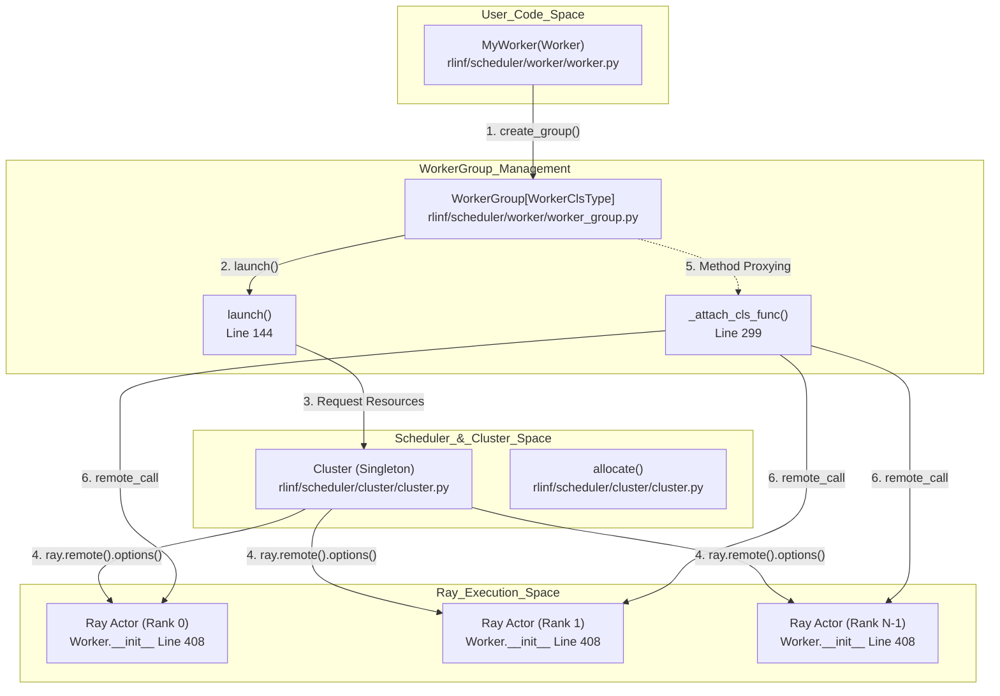
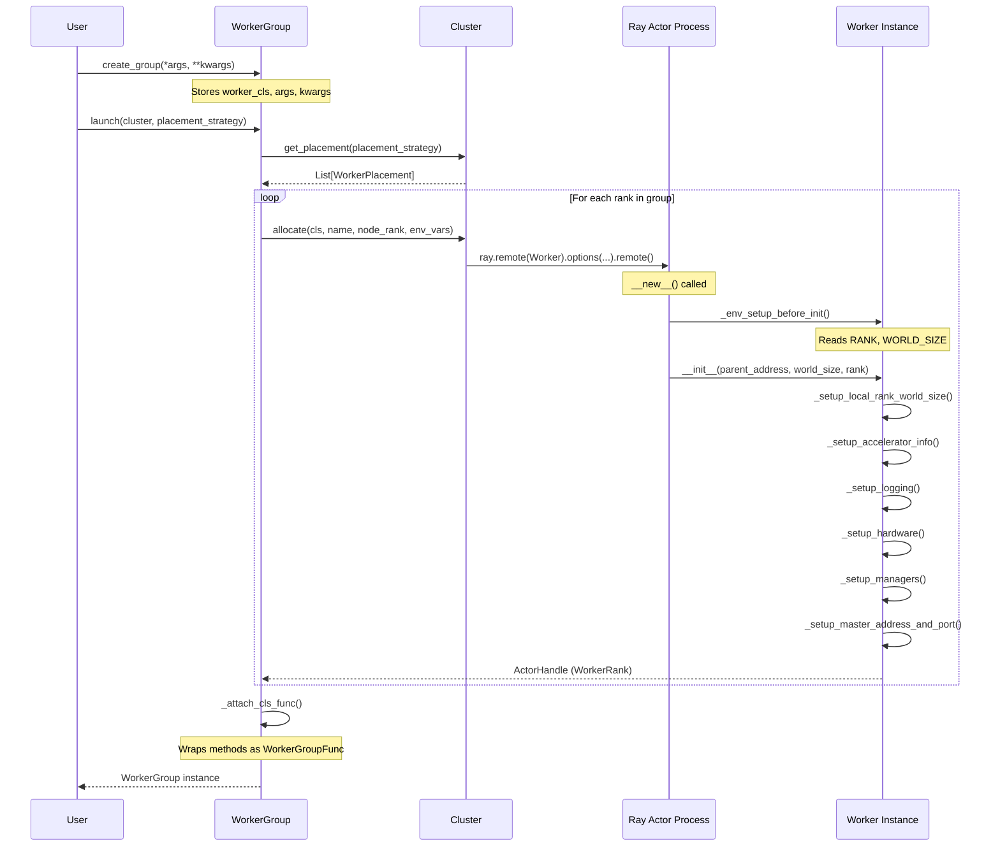
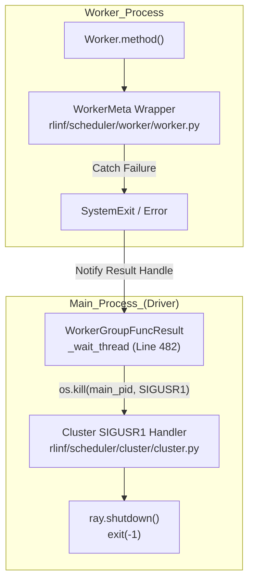

<!-- source: DeepWiki mcp.deepwiki.com · repo RLinf/RLinf · page 3.2 Worker Groups and Lifecycle · fetched 2026-10-21 -->

# Worker Groups and Lifecycle

Relevant source files

The following files were used as context for generating this wiki page:

- [rlinf/scheduler/channel/channel.py](rlinf/scheduler/channel/channel.py)
- [rlinf/scheduler/channel/channel_worker.py](rlinf/scheduler/channel/channel_worker.py)
- [rlinf/scheduler/cluster/__init__.py](rlinf/scheduler/cluster/__init__.py)
- [rlinf/scheduler/cluster/cluster.py](rlinf/scheduler/cluster/cluster.py)
- [rlinf/scheduler/cluster/node.py](rlinf/scheduler/cluster/node.py)
- [rlinf/scheduler/cluster/utils.py](rlinf/scheduler/cluster/utils.py)
- [rlinf/scheduler/collective/async_work.py](rlinf/scheduler/collective/async_work.py)
- [rlinf/scheduler/collective/collective_group.py](rlinf/scheduler/collective/collective_group.py)
- [rlinf/scheduler/collective/multi_channel_pg.py](rlinf/scheduler/collective/multi_channel_pg.py)
- [rlinf/scheduler/manager/__init__.py](rlinf/scheduler/manager/__init__.py)
- [rlinf/scheduler/manager/lock_manager.py](rlinf/scheduler/manager/lock_manager.py)
- [rlinf/scheduler/manager/manager.py](rlinf/scheduler/manager/manager.py)
- [rlinf/scheduler/manager/worker_manager.py](rlinf/scheduler/manager/worker_manager.py)
- [rlinf/scheduler/worker/lock.py](rlinf/scheduler/worker/lock.py)
- [rlinf/scheduler/worker/worker.py](rlinf/scheduler/worker/worker.py)
- [rlinf/scheduler/worker/worker_group.py](rlinf/scheduler/worker/worker_group.py)
- [rlinf/utils/ckpt_convertor/fsdp_convertor/convert_pt_to_hf.py](rlinf/utils/ckpt_convertor/fsdp_convertor/convert_pt_to_hf.py)
- [rlinf/workers/rollout/sglang/sglang_worker.py](rlinf/workers/rollout/sglang/sglang_worker.py)
- [tests/unit_tests/bench_channel.py](tests/unit_tests/bench_channel.py)
- [tests/unit_tests/test_channel.py](tests/unit_tests/test_channel.py)
- [tests/unit_tests/test_comm.py](tests/unit_tests/test_comm.py)
- [tests/unit_tests/test_worker.py](tests/unit_tests/test_worker.py)

This page documents the `Worker` and `WorkerGroup` abstractions that enable distributed computation in RLinf, including worker creation, initialization, addressing, method execution, and failure handling. These abstractions form the foundation for all distributed training and inference operations in the system.

For cluster-level resource management and node allocation, see [3.1 Distributed Scheduler](). For communication primitives between workers, see [3.3 Communication Primitives]().

---

## Worker and WorkerGroup Overview

RLinf provides two core abstractions for distributed execution:

- **`Worker`** [rlinf/scheduler/worker/worker.py:103-108](): A base class representing a single remote process (Ray actor) that can execute methods and communicate with other workers. Inheriting from this class grants a process the ability to run remotely and automatically sets distributed environment variables like `RANK`, `LOCAL_RANK`, and `WORLD_SIZE` [rlinf/scheduler/worker/worker.py:106-108]().
- **`WorkerGroup`** [rlinf/scheduler/worker/worker_group.py:40-41](): A generic container managing multiple `Worker` instances that can execute methods collectively across all workers.

### Key Characteristics

| Aspect | Worker | WorkerGroup |
|--------|--------|-------------|
| **Execution Context** | Single Ray actor process [rlinf/scheduler/worker/worker.py:104-105]() | Multiple distributed workers [rlinf/scheduler/worker/worker_group.py:40-41]() |
| **Instantiation** | Via `Worker.create_group().launch()` [rlinf/scheduler/worker/worker.py:136-137]() | Created by `Worker.create_group()` [rlinf/scheduler/worker/worker.py:558-570]() |
| **Method Calls** | Direct (within worker) | Collective across all ranks [rlinf/scheduler/worker/worker_group.py:41]() |
| **Communication** | `send()`, `recv()`, `broadcast()` [rlinf/scheduler/worker/worker.py:153-163]() | Method proxying to all workers [rlinf/scheduler/worker/worker_group.py:299-352]() |
| **Environment Variables** | Auto-configured (RANK, WORLD_SIZE, etc.) [rlinf/scheduler/worker/worker.py:107-108]() | Manages per-worker env vars [rlinf/scheduler/worker/worker_group.py:244-273]() |

**Sources:** [rlinf/scheduler/worker/worker.py:103-163, 558-570](), [rlinf/scheduler/worker/worker_group.py:40-63, 244-273, 299-352]()

---

## Architecture: Worker Groups to Ray Actors

The following diagram shows how user-defined `Worker` subclasses are transformed into distributed Ray actors through the `WorkerGroup` abstraction.

**Worker Group to Code Entity Mapping**

**Sources:** [rlinf/scheduler/worker/worker.py:103-138, 408-410](), [rlinf/scheduler/worker/worker_group.py:144-197, 299-352](), [rlinf/scheduler/cluster/cluster.py:447-525]()

---

## Worker Creation and Initialization Lifecycle

The worker lifecycle consists of distinct phases from creation to readiness.

### Lifecycle Sequence

**Sources:** [rlinf/scheduler/worker/worker_group.py:144-197, 223-297, 299-352](), [rlinf/scheduler/worker/worker.py:319-336, 408-500]()

### Initialization Phases

#### Phase 1: WorkerGroup Creation
`Worker.create_group(*args, **kwargs)` [rlinf/scheduler/worker/worker.py:558-570]() returns a `WorkerGroup` instance without starting any remote processes. It stores the class and arguments for later instantiation [rlinf/scheduler/worker/worker_group.py:50-61]().

#### Phase 2: Placement and Allocation
`WorkerGroup.launch()` [rlinf/scheduler/worker/worker_group.py:144-197]() determines worker placement using a `PlacementStrategy`. For each rank, `Cluster.allocate()` [rlinf/scheduler/cluster/cluster.py:447-525]() creates a Ray actor with:
- **Node Affinity**: Assigned to specific physical nodes based on `NodePlacementStrategy` [rlinf/scheduler/placement/placement.py:32-33]().
- **Environment Variables**: Sets `RANK`, `WORLD_SIZE`, `MASTER_ADDR`, etc. [rlinf/scheduler/worker/worker_group.py:244-273]().
- **Hardware Isolation**: Controls `CUDA_VISIBLE_DEVICES` if `isolate_gpu=True` [rlinf/scheduler/worker/worker_group.py:150, 172]().

#### Phase 3: Worker Initialization
When Ray creates each actor, the `Worker` class executes:
1. **`__new__` phase** [rlinf/scheduler/worker/worker.py:319-336](): Calls `_env_setup_before_init()` to read system-critical environment variables before the Python class is fully initialized.
2. **`__init__` phase** [rlinf/scheduler/worker/worker.py:408-500](): 
   - Configures `WorkerAddress` [rlinf/scheduler/worker/worker.py:459-464]().
   - Sets up `AcceleratorManager` and hardware info [rlinf/scheduler/worker/worker.py:476-485]().
   - Configures `MASTER_ADDR` and `MASTER_PORT` for distributed groups [rlinf/scheduler/worker/worker.py:493]().

#### Phase 4: Method Attachment
`_attach_cls_func()` [rlinf/scheduler/worker/worker_group.py:299-352]() inspects the worker class and wraps all public methods as `WorkerGroupFunc` objects. This allows the `WorkerGroup` to intercept calls and proxy them to all underlying Ray actors [rlinf/scheduler/worker/worker_group.py:382-449]().

**Sources:** [rlinf/scheduler/worker/worker.py:319-500](), [rlinf/scheduler/worker/worker_group.py:144-352]()

---

## Worker Addressing System

Workers are identified using a hierarchical `WorkerAddress` system, managed by the `WorkerManager` [rlinf/scheduler/manager/worker_manager.py:22-138]().

### Address Components

| Component | Code Entity | Description |
|-----------|-------------|-------------|
| **Root Group** | `root_group_name` | The unique name of the top-level worker group [rlinf/scheduler/manager/worker_manager.py:38](). |
| **Rank Path** | `rank_path` | A list of integers representing the path in nested groups [rlinf/scheduler/manager/worker_manager.py:39](). |
| **Global Name** | `get_name()` | Colon-separated string format, e.g., `my_group:0:1` [rlinf/scheduler/manager/worker_manager.py:42-49](). |

**Key Methods:**
- `get_child_address(rank)` [rlinf/scheduler/manager/worker_manager.py:72-82](): Generates an address for a sub-worker.
- `get_parent_address()` [rlinf/scheduler/manager/worker_manager.py:60-70](): Navigates up the hierarchy.
- `WorkerAddress.from_name(name)` [rlinf/scheduler/manager/worker_manager.py:109-122](): Deserializes a string address.

**Sources:** [rlinf/scheduler/manager/worker_manager.py:22-138](), [rlinf/scheduler/worker/worker.py:341-346]()

---

## Method Execution and Proxying

`WorkerGroup` enables calling user-defined methods collectively through automatic proxying.

### Method Execution Logic
1. **Call Interception**: When `worker_group.my_method()` is called, it triggers `WorkerGroupFunc.__call__` [rlinf/scheduler/worker/worker_group.py:399]().
2. **Rank Selection**: By default, the method executes on all ranks. `execute_on(*ranks)` [rlinf/scheduler/worker/worker_group.py:199-209]() can be used to target specific workers.
3. **Asynchronous Dispatch**: Methods are dispatched as Ray remote calls (`actor.method.remote()`) [rlinf/scheduler/worker/worker_group.py:425]().
4. **Result Collection**: Returns a `WorkerGroupFuncResult` [rlinf/scheduler/worker/worker_group.py:452-556](), which manages a background thread to wait for all Ray `ObjectRefs` [rlinf/scheduler/worker/worker_group.py:482-498]().

### WorkerGroupFuncResult Handle
- `wait()` [rlinf/scheduler/worker/worker_group.py:542-546](): Blocks until all workers return results.
- `async_wait()` [rlinf/scheduler/worker/worker_group.py:548-552](): Non-blocking awaitable for `asyncio` contexts.

**Sources:** [rlinf/scheduler/worker/worker_group.py:199-209, 382-556]()

---

## Failure Handling Mechanisms

RLinf implements robust failure detection to prevent distributed jobs from hanging.

### WorkerMeta Metaclass
The `WorkerMeta` metaclass [rlinf/scheduler/worker/worker.py:51-61]() wraps all worker methods in a try-except block [rlinf/scheduler/worker/worker.py:55-61](). It specifically catches `SystemExit` and converts them into `RuntimeError` with a full traceback to ensure Ray captures the failure [rlinf/scheduler/worker/worker.py:75-89]().

### Signal Management
- **SIGUSR1**: Workers and results handles send `SIGUSR1` to the main process upon critical failure [rlinf/scheduler/worker/worker_group.py:494](). The `Cluster` singleton catches this signal and shuts down all actors in the namespace [rlinf/scheduler/cluster/cluster.py:313-338]().
- **SIGUSR2**: Triggers a diagnostic stack trace print on the worker for debugging [rlinf/scheduler/worker/worker.py:879-926]().

### Failure Catching Diagram

**Sources:** [rlinf/scheduler/worker/worker.py:51-101, 862-926](), [rlinf/scheduler/worker/worker_group.py:489-497](), [rlinf/scheduler/cluster/cluster.py:313-338]()

---

## Worker Environment Variables

The system automatically populates critical environment variables to support distributed backends like PyTorch `dist`.

| Variable | Source | Purpose |
|----------|--------|---------|
| `RANK` | `WorkerGroup` | Global index in the group [rlinf/scheduler/worker/worker_group.py:246](). |
| `WORLD_SIZE` | `WorkerGroup` | Total workers in the group [rlinf/scheduler/worker/worker_group.py:247](). |
| `LOCAL_RANK` | `Worker` | Index on the local physical node [rlinf/scheduler/worker/worker.py:473](). |
| `MASTER_ADDR` | `WorkerGroup` | IP of Rank 0 worker [rlinf/scheduler/worker/worker_group.py:248](). |
| `MASTER_PORT` | `Worker` | Free port allocated on Rank 0 node [rlinf/scheduler/worker/worker.py:493](). |

**Sources:** [rlinf/scheduler/worker/worker_group.py:244-273](), [rlinf/scheduler/worker/worker.py:473-496](), [rlinf/scheduler/cluster/cluster.py:50-63]()

---

## Worker Cleanup and Termination

Workers can be explicitly closed via `WorkerGroup._close()` [rlinf/scheduler/worker/worker_group.py:211-221](). This method:
1. Iterates through all `WorkerRank` objects [rlinf/scheduler/worker/worker_group.py:213]().
2. Triggers an internal `_close()` call on the Ray actor if it exists [rlinf/scheduler/worker/worker_group.py:216]().
3. Forcefully terminates the actor using `ray.kill()` [rlinf/scheduler/worker/worker_group.py:217]().
4. Clears the worker list and internal cluster references [rlinf/scheduler/worker/worker_group.py:218-221]().

**Sources:** [rlinf/scheduler/worker/worker_group.py:211-221]()

---

