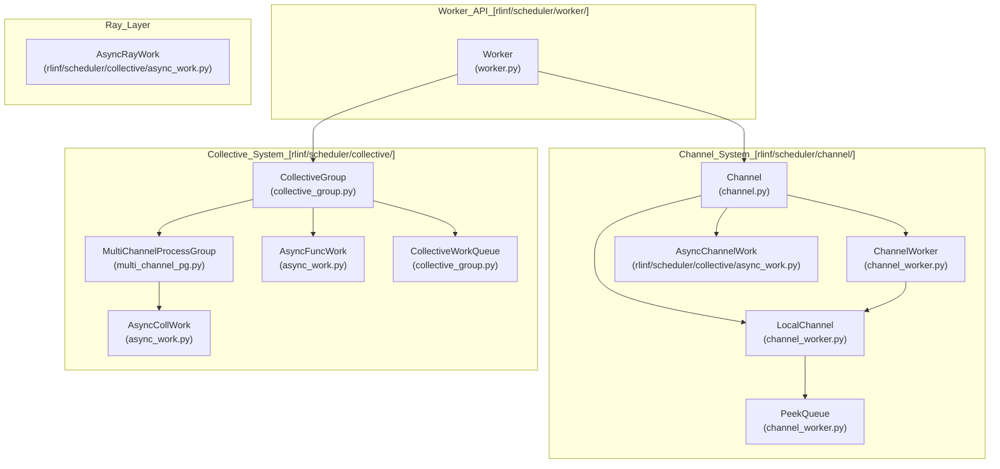
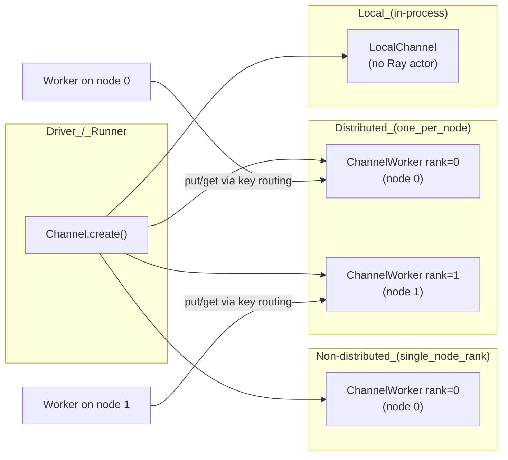
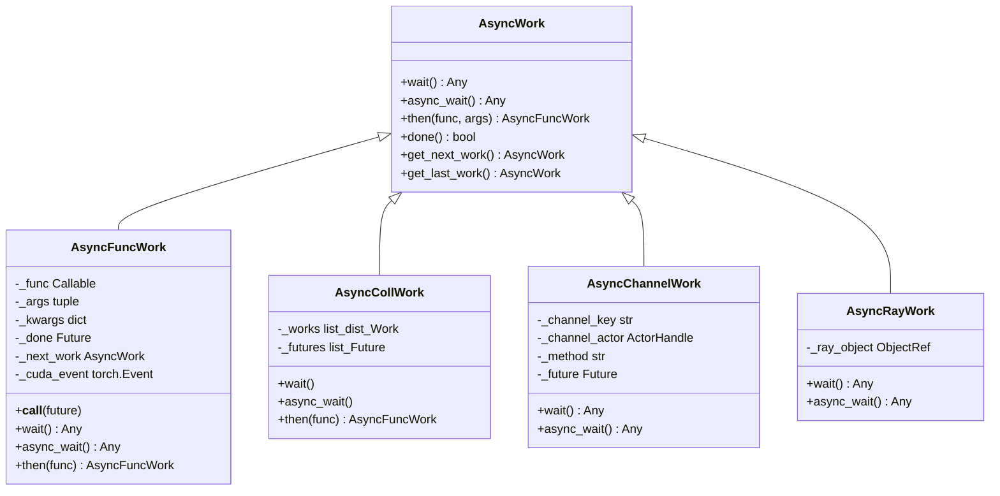
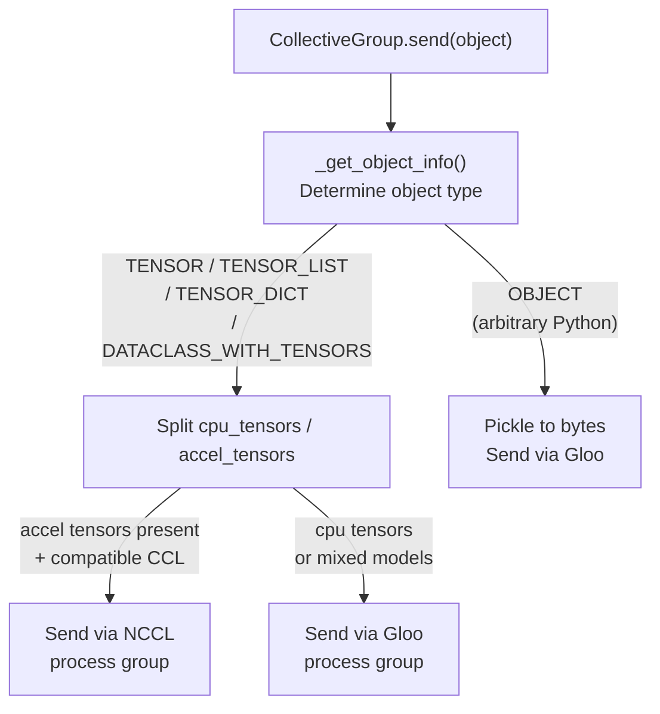
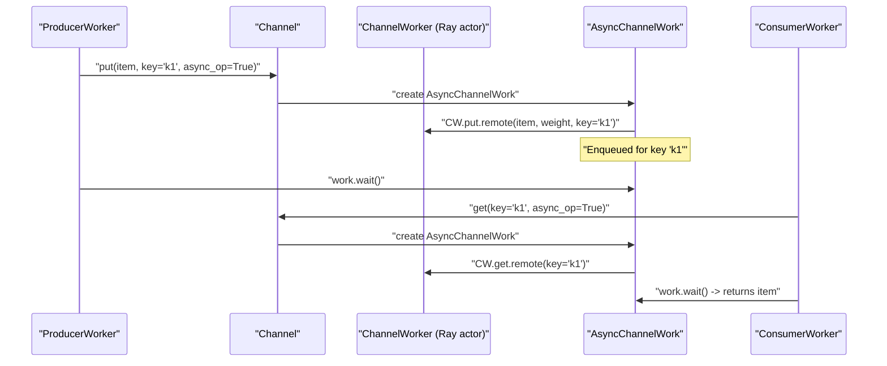
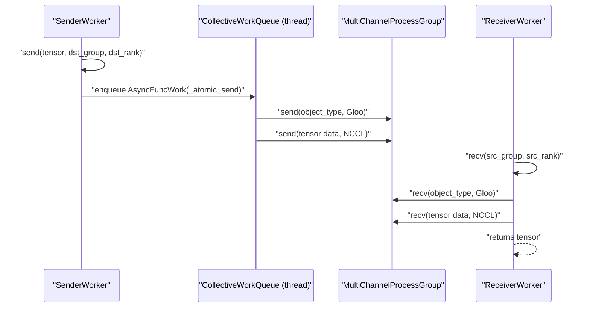

<!-- source: DeepWiki mcp.deepwiki.com · repo RLinf/RLinf · page 3.3 Communication Primitives · fetched 2026-10-21 -->

# Communication Primitives

Relevant source files

The following files were used as context for generating this wiki page:

- [examples/reasoning/main_grpo.py](examples/reasoning/main_grpo.py)
- [rlinf/runners/agent_eval_runner.py](rlinf/runners/agent_eval_runner.py)
- [rlinf/runners/agent_runner.py](rlinf/runners/agent_runner.py)
- [rlinf/runners/coding_online_rl_runner.py](rlinf/runners/coding_online_rl_runner.py)
- [rlinf/runners/reasoning_eval_runner.py](rlinf/runners/reasoning_eval_runner.py)
- [rlinf/runners/reasoning_runner.py](rlinf/runners/reasoning_runner.py)
- [rlinf/scheduler/channel/channel.py](rlinf/scheduler/channel/channel.py)
- [rlinf/scheduler/channel/channel_worker.py](rlinf/scheduler/channel/channel_worker.py)
- [rlinf/scheduler/cluster/__init__.py](rlinf/scheduler/cluster/__init__.py)
- [rlinf/scheduler/cluster/utils.py](rlinf/scheduler/cluster/utils.py)
- [rlinf/scheduler/collective/async_work.py](rlinf/scheduler/collective/async_work.py)
- [rlinf/scheduler/collective/collective_group.py](rlinf/scheduler/collective/collective_group.py)
- [rlinf/scheduler/collective/multi_channel_pg.py](rlinf/scheduler/collective/multi_channel_pg.py)
- [rlinf/scheduler/manager/worker_manager.py](rlinf/scheduler/manager/worker_manager.py)
- [rlinf/scheduler/worker/worker.py](rlinf/scheduler/worker/worker.py)
- [rlinf/scheduler/worker/worker_group.py](rlinf/scheduler/worker/worker_group.py)
- [rlinf/utils/ckpt_convertor/fsdp_convertor/convert_pt_to_hf.py](rlinf/utils/ckpt_convertor/fsdp_convertor/convert_pt_to_hf.py)
- [rlinf/utils/data_iter_utils.py](rlinf/utils/data_iter_utils.py)
- [rlinf/utils/distributed.py](rlinf/utils/distributed.py)
- [rlinf/workers/agent/agent_loop.py](rlinf/workers/agent/agent_loop.py)
- [rlinf/workers/inference/fsdp_inference_worker.py](rlinf/workers/inference/fsdp_inference_worker.py)
- [tests/unit_tests/bench_channel.py](tests/unit_tests/bench_channel.py)
- [tests/unit_tests/test_channel.py](tests/unit_tests/test_channel.py)
- [tests/unit_tests/test_comm.py](tests/unit_tests/test_comm.py)

This page documents the two distinct communication systems available to `Worker` instances in RLinf: the **Channel** system (asynchronous FIFO queues backed by Ray actors) and the **CollectiveGroup** system (synchronous or asynchronous point-to-point and collective operations using NCCL and Gloo). It also documents the `AsyncWork` class hierarchy used for non-blocking operations.

For the overall distributed scheduler architecture (how workers are created, how groups are launched, and what RANK/WORLD_SIZE mean), see [Distributed Scheduler](3.1).

---

## Architectural Overview

Two independent communication primitives exist side by side to handle different data exchange patterns.

**Channel** — A named, FIFO queue abstraction backed by long-lived Ray actor(s) (`ChannelWorker`). It supports arbitrary Python objects, tensors, and dataclasses. Suitable for producer/consumer workflows where data flows one way and timing is decoupled [rlinf/scheduler/channel/channel.py:39-58]().

**CollectiveGroup** — A peer-to-point or multi-party communication group using `torch.distributed` process groups (NCCL for GPU tensors, Gloo for CPU tensors or non-GPU objects). Suitable for time-coupled send/recv pairs and model weight broadcasts [rlinf/scheduler/collective/collective_group.py:187-191]().

Both systems are exposed on the `Worker` base class so that any user-defined worker class has access to them without extra setup [rlinf/scheduler/worker/worker.py:103-111]().

**Communication System Component Map:**

Sources: [rlinf/scheduler/channel/channel.py:39-58](), [rlinf/scheduler/collective/collective_group.py:112-136](), [rlinf/scheduler/worker/worker.py:103-111](), [rlinf/scheduler/collective/async_work.py:28-61](), [rlinf/scheduler/collective/multi_channel_pg.py:31-41]()

---

## The Channel Abstraction

`Channel` is defined in [rlinf/scheduler/channel/channel.py]() and is the primary mechanism for passing data between worker groups in an asynchronous, decoupled fashion. Its interface mirrors `asyncio.Queue`.

### Creation and Connection

| Method | Description |
|---|---|
| `Channel.create()` | Creates a new channel and its backing `ChannelWorker` actor(s) [rlinf/scheduler/channel/channel.py:142-150](). |
| `Channel.connect()` | Connects to an existing named channel [rlinf/scheduler/channel/channel.py:213-220](). |
| `Worker.create_channel()` | Convenience wrapper callable from inside a worker [rlinf/scheduler/worker/worker.py:534-544](). |

The `distributed` flag controls topology [rlinf/scheduler/channel/channel.py:156-157]():
- **`distributed=False`** (default): A single `ChannelWorker` is placed on `node_rank`. All workers communicate through it.
- **`distributed=True`**: One `ChannelWorker` is placed on each node of the cluster. Puts and gets are routed by `key` to the actor co-located with the requester.
- **`local=True`**: A `LocalChannel` is created in-process. No Ray actor is involved [rlinf/scheduler/channel/channel.py:148-148]().

**Channel Creation and Routing Topology:**

Sources: [rlinf/scheduler/channel/channel.py:141-160](), [rlinf/scheduler/channel/channel_worker.py:73-86]()

### Core Operations

| Method | Signature | Notes |
|---|---|---|
| `put` | `put(item, weight, key, async_op)` | Returns `AsyncChannelWork` when `async_op=True` [rlinf/scheduler/channel/channel.py:280-305](). |
| `get` | `get(key, async_op)` | Blocks until an item is available (sync) or returns a handle (async) [rlinf/scheduler/channel/channel.py:348-375](). |
| `get_batch` | `get_batch(target_weight, key, async_op)` | Accumulates items until their total weight meets or exceeds `target_weight` [rlinf/scheduler/channel/channel.py:397-422](). |
| `put_nowait` | `put_nowait(item, key)` | Non-blocking put [rlinf/scheduler/channel/channel.py:326-335](). |
| `get_nowait` | `get_nowait(key)` | Non-blocking get [rlinf/scheduler/channel/channel.py:440-450](). |

**Key-based routing** allows multiple independent logical queues within one named channel [rlinf/scheduler/channel/channel.py:53-54](). This is particularly useful in multi-turn agent and embodied RL scenarios where data must be processed by specific workers.

**Weight-based batching** in `get_batch` is used to retrieve a batch of messages which respects the assigned weights [rlinf/scheduler/channel/channel.py:55-56](). The internal `WeightedItem` class handles priority/weight sorting within the `PeekQueue` [rlinf/scheduler/channel/channel_worker.py:24-30]().

Sources: [rlinf/scheduler/channel/channel.py:53-56](), [rlinf/scheduler/channel/channel.py:280-450](), [rlinf/scheduler/channel/channel_worker.py:24-30]()

---

## The AsyncWork Hierarchy

Every asynchronous operation in both the Channel and CollectiveGroup systems returns an `AsyncWork` object. The hierarchy is defined in [rlinf/scheduler/collective/async_work.py]().

**AsyncWork Class Hierarchy:**

Sources: [rlinf/scheduler/collective/async_work.py:28-197](), [rlinf/scheduler/collective/async_work.py:222-245]()

### AsyncFuncWork
Wraps any callable with its arguments [rlinf/scheduler/collective/async_work.py:61-90](). Supports chaining via `then()`, which creates a linked list of `AsyncFuncWork` nodes [rlinf/scheduler/collective/async_work.py:136-150](). It also supports accelerator events for synchronization [rlinf/scheduler/collective/async_work.py:126-127]().

### AsyncCollWork
Wraps one or more `torch.distributed.Work` objects returned by `dist.send(async_op=True)` etc [rlinf/scheduler/collective/async_work.py:197-210](). It allows asyncio-like awaitables for standard PyTorch distributed operations.

### AsyncChannelWork
Used for `Channel.put()` and `Channel.get()` when `async_op=True` [rlinf/scheduler/collective/async_work.py:222-245](). It ensures that operations on the same key pair execute in submission order.

---

## CollectiveGroup: Point-to-Point and Broadcast

The `CollectiveGroup` class in [rlinf/scheduler/collective/collective_group.py]() implements typed send/recv/broadcast using `torch.distributed`.

### Transport Selection

Each `CollectiveGroup` utilizes a `MultiChannelProcessGroup` [rlinf/scheduler/collective/multi_channel_pg.py:31-41]() which manages multiple `dist.ProcessGroup` instances:
- **NCCL** (or equivalent accelerator CCL) for GPU tensors when workers have matching accelerator types and models [rlinf/scheduler/collective/multi_channel_pg.py:69-81]().
- **Gloo** for CPU tensors, Python objects, and heterogeneous hardware scenarios (e.g., mixed GPU models) [rlinf/scheduler/collective/multi_channel_pg.py:71-81]().

Sources: [rlinf/scheduler/collective/collective_group.py:297-354](), [rlinf/scheduler/collective/multi_channel_pg.py:68-88]()

### Object Types and Metadata

RLinf defines specific object types for optimized communication:
- `TENSOR`: A single `torch.Tensor`.
- `TENSOR_LIST`: `list[torch.Tensor]`.
- `TENSOR_DICT`: `dict[str, torch.Tensor]`.
- `OBJECT`: Any Python object (serialized via pickle).
- `DATACLASS_WITH_TENSORS`: A dataclass containing tensor fields [rlinf/scheduler/collective/collective_group.py:192-196]().

The `TensorData` dataclass is used to pass precomputed device info and partitioned tensor lists to avoid repeated extraction [rlinf/scheduler/collective/collective_group.py:45-63]().

### Ordering and Async Execution

Both `send()` and `recv()` wrap work in `AsyncFuncWork` and submit it to a `CollectiveWorkQueue` [rlinf/scheduler/collective/collective_group.py:112-136](). This queue runs in a background thread and processes one operation at a time, guaranteeing FIFO ordering [rlinf/scheduler/collective/collective_group.py:154-185](). It manages its own accelerator stream for non-blocking execution [rlinf/scheduler/collective/collective_group.py:174-180]().

### Multi-Channel Support

The `MultiChannelProcessGroup` supports multiple communication channels to avoid head-of-line blocking between different types of traffic [rlinf/scheduler/collective/multi_channel_pg.py:31-41](). It manages lists of both accelerator (NCCL) and CPU (Gloo) process groups for each channel [rlinf/scheduler/collective/multi_channel_pg.py:89-106]().

### Worker-Level API Summary

Methods on `Worker` ([rlinf/scheduler/worker/worker.py:570-812]()) proxy to the `CollectiveGroup`:

| Method | Description | Pairs With |
|---|---|---|
| `send()` | Out-of-place send of any supported type [rlinf/scheduler/worker/worker.py:570-610](). | `recv` |
| `recv()` | Out-of-place receive [rlinf/scheduler/worker/worker.py:612-646](). | `send` |
| `send_tensor()` | In-place send of a single contiguous tensor [rlinf/scheduler/worker/worker.py:648-682](). | `recv_tensor` |
| `recv_tensor()` | In-place receive into a preallocated tensor [rlinf/scheduler/worker/worker.py:684-716](). | `send_tensor` |
| `broadcast()` | One-to-many broadcast across `WorkerGroup`s [rlinf/scheduler/worker/worker.py:718-812](). | `broadcast` |

Sources: [rlinf/scheduler/worker/worker.py:570-812](), [rlinf/scheduler/collective/collective_group.py:112-136](), [rlinf/scheduler/collective/multi_channel_pg.py:31-106]()

---

## Communication Flow Summary

**Channel Put/Get Flow (Async):**

Sources: [rlinf/scheduler/channel/channel.py:280-450](), [rlinf/scheduler/collective/async_work.py:222-245]()

**CollectiveGroup Send/Recv Flow:**

Sources: [rlinf/scheduler/collective/collective_group.py:154-185](), [rlinf/scheduler/collective/multi_channel_pg.py:113-165]()

---

