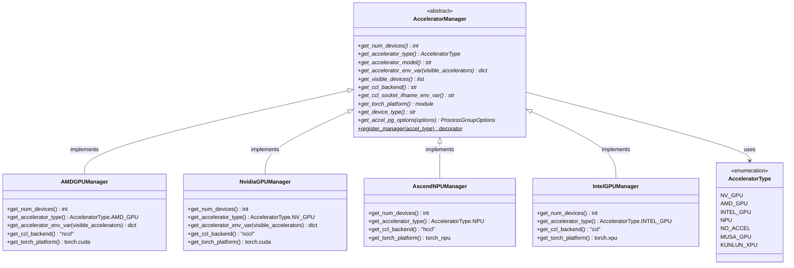
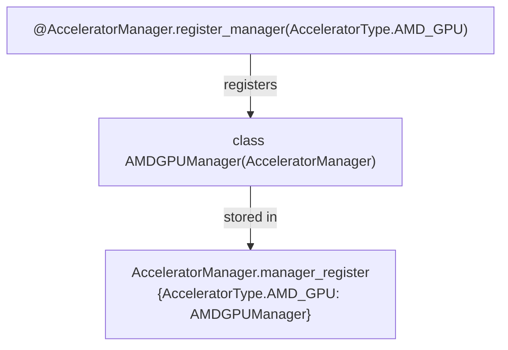
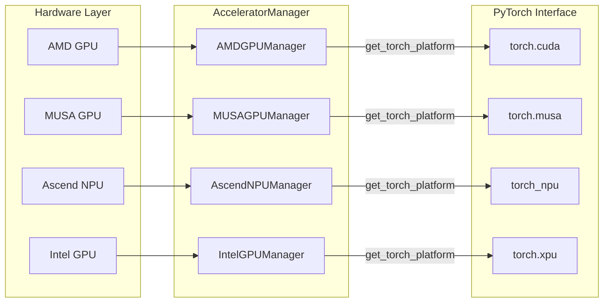

<!-- source: DeepWiki mcp.deepwiki.com · repo RLinf/RLinf · page 3.4 Hardware Abstraction Layer · fetched 2026-10-21 -->

# Hardware Abstraction Layer

Relevant source files

The following files were used as context for generating this wiki page:

- [.github/workflows/unit-tests.yml](.github/workflows/unit-tests.yml)
- [docs/source-en/rst_source/guides/ascend_cann.rst](docs/source-en/rst_source/guides/ascend_cann.rst)
- [docs/source-zh/rst_source/guides/ascend_cann.rst](docs/source-zh/rst_source/guides/ascend_cann.rst)
- [requirements/embodied/models/ascend/gr00t.txt](requirements/embodied/models/ascend/gr00t.txt)
- [requirements/sys_deps.sh](requirements/sys_deps.sh)
- [rlinf/envs/realworld/franka/franka_controller.py](rlinf/envs/realworld/franka/franka_controller.py)
- [rlinf/models/embodiment/gr00t/gr00t_n1d5/__init__.py](rlinf/models/embodiment/gr00t/gr00t_n1d5/__init__.py)
- [rlinf/models/embodiment/gr00t/gr00t_n1d5/gr00t_action_model.py](rlinf/models/embodiment/gr00t/gr00t_n1d5/gr00t_action_model.py)
- [rlinf/models/embodiment/gr00t/gr00t_n1d5/npu_patches.py](rlinf/models/embodiment/gr00t/gr00t_n1d5/npu_patches.py)
- [rlinf/scheduler/hardware/__init__.py](rlinf/scheduler/hardware/__init__.py)
- [rlinf/scheduler/hardware/accelerators/__init__.py](rlinf/scheduler/hardware/accelerators/__init__.py)
- [rlinf/scheduler/hardware/accelerators/accelerator.py](rlinf/scheduler/hardware/accelerators/accelerator.py)
- [rlinf/scheduler/hardware/accelerators/amd_gpu.py](rlinf/scheduler/hardware/accelerators/amd_gpu.py)
- [rlinf/scheduler/hardware/accelerators/ascend_npu.py](rlinf/scheduler/hardware/accelerators/ascend_npu.py)
- [rlinf/scheduler/hardware/accelerators/intel_gpu.py](rlinf/scheduler/hardware/accelerators/intel_gpu.py)
- [rlinf/scheduler/hardware/accelerators/kunlun_xpu.py](rlinf/scheduler/hardware/accelerators/kunlun_xpu.py)
- [rlinf/scheduler/hardware/accelerators/musa_gpu.py](rlinf/scheduler/hardware/accelerators/musa_gpu.py)
- [rlinf/scheduler/hardware/accelerators/nvidia_gpu.py](rlinf/scheduler/hardware/accelerators/nvidia_gpu.py)
- [rlinf/scheduler/hardware/robots/__init__.py](rlinf/scheduler/hardware/robots/__init__.py)
- [rlinf/scheduler/hardware/robots/auto_config.py](rlinf/scheduler/hardware/robots/auto_config.py)
- [rlinf/scheduler/hardware/robots/dosw1.py](rlinf/scheduler/hardware/robots/dosw1.py)
- [rlinf/scheduler/hardware/robots/dual_franka.py](rlinf/scheduler/hardware/robots/dual_franka.py)
- [rlinf/scheduler/hardware/robots/gim_arm.py](rlinf/scheduler/hardware/robots/gim_arm.py)
- [rlinf/scheduler/hardware/robots/xsquare.py](rlinf/scheduler/hardware/robots/xsquare.py)
- [rlinf/utils/patcher.py](rlinf/utils/patcher.py)
- [tests/unit_tests/test_broadcast_sync.py](tests/unit_tests/test_broadcast_sync.py)
- [tests/unit_tests/test_cluster_config.py](tests/unit_tests/test_cluster_config.py)
- [tests/unit_tests/test_intel_gpu_platform.py](tests/unit_tests/test_intel_gpu_platform.py)
- [tests/unit_tests/test_math_dataset_multithread.py](tests/unit_tests/test_math_dataset_multithread.py)

## Purpose and Scope

The Hardware Abstraction Layer (HAL) provides a unified interface for managing different accelerator types (NVIDIA CUDA, AMD ROCm, Moore Threads MUSA, Intel GPU, Kunlun XPU, and Huawei Ascend NPU) in RLinf's distributed training infrastructure. This abstraction enables the scheduler to allocate and configure hardware resources without coupling to vendor-specific APIs. The HAL manages device visibility, environment variables, collective communication backends, and PyTorch platform integration.

For cluster-level resource allocation and node placement, see [Distributed Scheduler](3.1). For NCCL/MCCL/HCCL-based tensor communication primitives built on top of the HAL, see [Communication Primitives](3.3).

---

## AcceleratorManager Interface

RLinf abstracts hardware accelerators through the `AcceleratorManager` base class [rlinf/scheduler/hardware/accelerators/accelerator.py:127-214](), which defines a common API for device enumeration, environment configuration, and collective communication setup. Concrete implementations register themselves for specific accelerator types using a class decorator pattern [rlinf/scheduler/hardware/accelerators/accelerator.py:134-142]().

### Core Manager Architecture

The following diagram illustrates the relationship between the base `AcceleratorManager` and its hardware-specific implementations.

**Accelerator Class Hierarchy**

**Sources:** [rlinf/scheduler/hardware/accelerators/accelerator.py:115-158](), [rlinf/scheduler/hardware/accelerators/amd_gpu.py:128-129](), [rlinf/scheduler/hardware/accelerators/ascend_npu.py:31-32](), [rlinf/scheduler/hardware/accelerators/intel_gpu.py:36-37]()

The `AcceleratorManager` class defines methods that concrete implementations must provide:

| Method | Return Type | Purpose |
|--------|-------------|---------|
| `get_num_devices()` | `int` | Number of accelerators on current node |
| `get_accelerator_type()` | `AcceleratorType` | Enum identifying the hardware type |
| `get_accelerator_model()` | `str` | Human-readable model name (e.g., "H100", "910B") |
| `get_accelerator_env_var(visible_accelerators)` | `dict[str, str]` | Environment variables for device visibility |
| `get_visible_devices()` | `list[int]` | Parse current visible device IDs |
| `get_ccl_backend()` | `str` | Collective communication backend (nccl, mccl, hccl, ccl, etc.) |
| `get_ccl_socket_ifname_env_var()` | `str` | Network interface environment variable name |
| `get_torch_platform()` | `module` | PyTorch platform module (e.g., `torch.cuda`, `torch_npu`, or `torch.xpu`) |
| `get_device_type()` | `str` | PyTorch device string (e.g., `"cuda"`, `"npu"`, or `"xpu"`) |

**Sources:** [rlinf/scheduler/hardware/accelerators/accelerator.py:161-214]()

---

## Accelerator Type Registration

Managers register via the `@AcceleratorManager.register_manager(AcceleratorType)` decorator [rlinf/scheduler/hardware/accelerators/accelerator.py:134-142](). The infrastructure uses these registrations to enumerate node resources during cluster discovery.

**Hardware Discovery Flow**

**Sources:** [rlinf/scheduler/hardware/accelerators/accelerator.py:130-142](), [rlinf/scheduler/hardware/accelerators/amd_gpu.py:128-129]()

---

## Environment Variable Management

The HAL manages vendor-specific environment variables to control device visibility and prevent Ray from overriding user configurations.

### AMD GPU Environment
`AMDGPUManager` configures `HIP_VISIBLE_DEVICES` [rlinf/scheduler/hardware/accelerators/amd_gpu.py:160]() and sets `RAY_EXPERIMENTAL_NOSET_ROCR_VISIBLE_DEVICES` and `RAY_EXPERIMENTAL_NOSET_HIP_VISIBLE_DEVICES` to "1" [rlinf/scheduler/hardware/accelerators/amd_gpu.py:161-164]() to maintain control over the ROCR and HIP runtimes.

### Ascend NPU Environment
For Huawei Ascend hardware, RLinf requires mounting host drivers such as `/usr/local/Ascend/driver` and specific devices like `/dev/davinci_manager` and `/dev/davinci0` into the container [docs/source-en/rst_source/guides/ascend_cann.rst:43-51](). The `install.sh` script facilitates the installation of the matching `torch-npu` package for the platform [docs/source-en/rst_source/guides/ascend_cann.rst:13-15]().

### Intel GPU Environment
`IntelGPUManager` configures `ONEAPI_DEVICE_SELECTOR` [rlinf/scheduler/hardware/accelerators/intel_gpu.py:68]() and sets `RAY_EXPERIMENTAL_NOSET_ONEAPI_DEVICE_SELECTOR` to "1" [rlinf/scheduler/hardware/accelerators/intel_gpu.py:69]().

### MUSA GPU Environment
`MUSAGPUManager` (Moore Threads) configures `MUSA_VISIBLE_DEVICES` [rlinf/scheduler/hardware/accelerators/musa_gpu.py:102]() and sets `RAY_EXPERIMENTAL_NOSET_MUSA_VISIBLE_DEVICES` [rlinf/scheduler/hardware/accelerators/musa_gpu.py:105]().

**Sources:** [rlinf/scheduler/hardware/accelerators/amd_gpu.py:148-166](), [rlinf/scheduler/hardware/accelerators/intel_gpu.py:56-72](), [rlinf/scheduler/hardware/accelerators/musa_gpu.py:89-106](), [docs/source-en/rst_source/guides/ascend_cann.rst:43-51]()

---

## Collective Communication Configuration

The HAL configures backends for distributed training.

### Backend Mapping
- **AMD**: Uses the `"nccl"` backend [rlinf/scheduler/hardware/accelerators/amd_gpu.py:197]().
- **Intel**: Uses the `"ccl"` backend [rlinf/scheduler/hardware/accelerators/intel_gpu.py:94]().
- **MUSA**: Uses `"mccl"` [rlinf/scheduler/hardware/accelerators/musa_gpu.py:128]().
- **Ascend**: Uses `"hccl"` [rlinf/scheduler/hardware/accelerators/ascend_npu.py:128]().

### Socket Interface Variables
Different hardware uses different environment variables to specify the network interface for collective communication:
- **Intel**: `CCL_MNIC_NAME` [rlinf/scheduler/hardware/accelerators/intel_gpu.py:103]().
- **MUSA**: `MCCL_SOCKET_IFNAME` [rlinf/scheduler/hardware/accelerators/musa_gpu.py:137]().
- **Ascend**: `HCCL_IF_IP` [rlinf/scheduler/hardware/accelerators/ascend_npu.py:137]().

**Sources:** [rlinf/scheduler/hardware/accelerators/intel_gpu.py:92-103](), [rlinf/scheduler/hardware/accelerators/musa_gpu.py:126-137](), [rlinf/scheduler/hardware/accelerators/ascend_npu.py:126-137]()

---

## PyTorch Platform Integration

HAL bridges hardware to PyTorch modules. Despite AMD using ROCm, it maps to `torch.cuda` for API compatibility [rlinf/scheduler/hardware/accelerators/amd_gpu.py:203](). MUSA maps to `torch.musa` [rlinf/scheduler/hardware/accelerators/musa_gpu.py:144](). Ascend NPU maps to `torch_npu` [rlinf/scheduler/hardware/accelerators/ascend_npu.py:144](). Intel GPU maps to `torch.xpu` [rlinf/scheduler/hardware/accelerators/intel_gpu.py:110]().

**Hardware to PyTorch Mapping**

**Sources:** [rlinf/scheduler/hardware/accelerators/amd_gpu.py:203](), [rlinf/scheduler/hardware/accelerators/musa_gpu.py:144](), [rlinf/scheduler/hardware/accelerators/ascend_npu.py:144](), [rlinf/scheduler/hardware/accelerators/intel_gpu.py:106-121]()

---

## Profiling and Debugging

The HAL includes a registration system for profiling tools via `ProfileConfig` [rlinf/scheduler/hardware/accelerators/accelerator.py:35-112]().

- **AMD**: Supports `RocprofSysConfig` for ROCm Systems Profiler [rlinf/scheduler/hardware/accelerators/amd_gpu.py:56-125](). It wraps the Python interpreter with `rocprof-sys-python` [rlinf/scheduler/hardware/accelerators/amd_gpu.py:118]().
- **NVIDIA**: Supports `NsightConfig` [rlinf/scheduler/hardware/accelerators/nvidia_gpu.py:34]().
- **Generic**: The `ProfileConfig` class provides logic for gating profiling by worker group name [rlinf/scheduler/hardware/accelerators/accelerator.py:92-97]() and step indices [rlinf/scheduler/hardware/accelerators/accelerator.py:99-105]().

### Ascend NPU Specifics
For Ascend hardware, specific patches are applied to support models like GR00T. The `npu_patches.py` handles NPU-specific optimizations and kernel overrides [rlinf/models/embodiment/gr00t/gr00t_n1d5/npu_patches.py:1-100](). The `get_model` function for GR00T N1.5 explicitly applies these patches before model construction and restores them afterward [rlinf/models/embodiment/gr00t/gr00t_n1d5/__init__.py:38-84]().

**Sources:** [rlinf/scheduler/hardware/accelerators/accelerator.py:35-112](), [rlinf/scheduler/hardware/accelerators/amd_gpu.py:56-125](), [rlinf/models/embodiment/gr00t/gr00t_n1d5/__init__.py:18-94](), [docs/source-en/rst_source/guides/ascend_cann.rst:133-146]()

---

