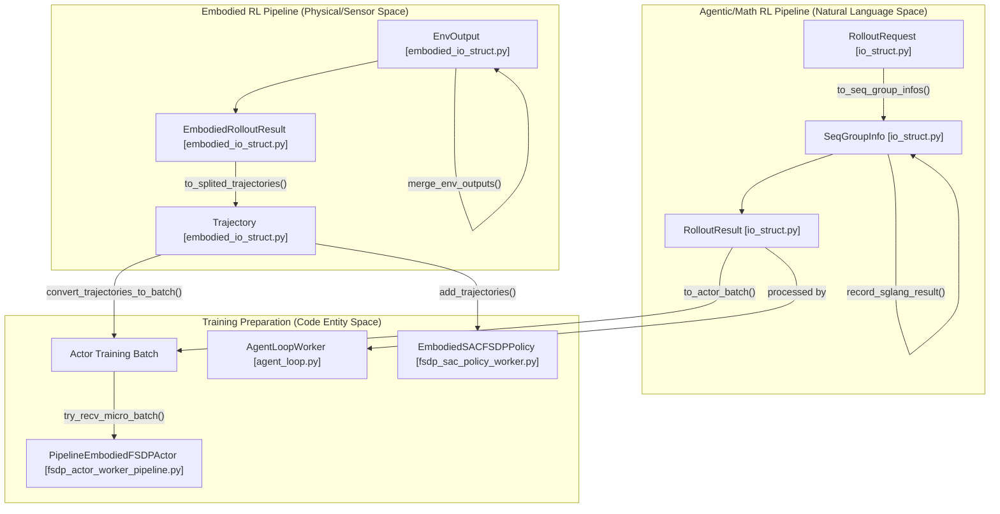
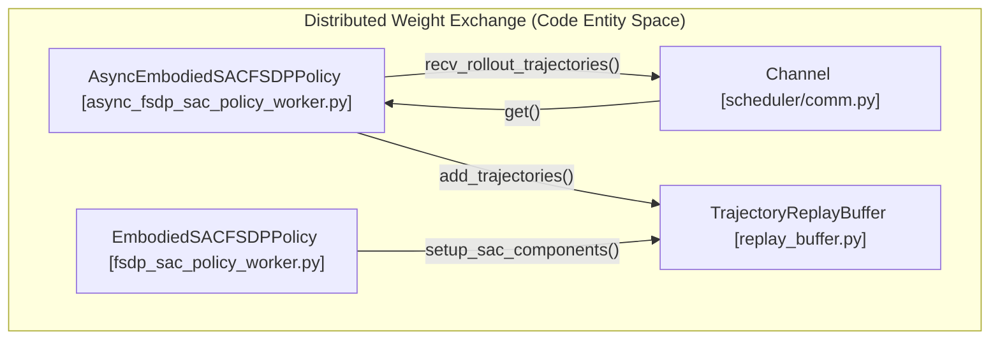

<!-- source: DeepWiki mcp.deepwiki.com · repo RLinf/RLinf · page 3.5 Data Structures and I/O · fetched 2026-10-21 -->

# Data Structures and I/O

Relevant source files

The following files were used as context for generating this wiki page:

- [.github/workflows/docker-build.yml](.github/workflows/docker-build.yml)
- [.github/workflows/embodied-e2e-tests.yml](.github/workflows/embodied-e2e-tests.yml)
- [docker/Dockerfile](docker/Dockerfile)
- [docker/README.md](docker/README.md)
- [examples/embodiment/config/maniskill_ppo_mlp_collect.yaml](examples/embodiment/config/maniskill_ppo_mlp_collect.yaml)
- [examples/sft/run_vlm_sft.sh](examples/sft/run_vlm_sft.sh)
- [requirements/embodied/download_assets.sh](requirements/embodied/download_assets.sh)
- [requirements/embodied/ros_install.sh](requirements/embodied/ros_install.sh)
- [requirements/install.sh](requirements/install.sh)
- [rlinf/algorithms/rewards/math/__init__.py](rlinf/algorithms/rewards/math/__init__.py)
- [rlinf/data/__init__.py](rlinf/data/__init__.py)
- [rlinf/data/datasets/__init__.py](rlinf/data/datasets/__init__.py)
- [rlinf/data/datasets/item.py](rlinf/data/datasets/item.py)
- [rlinf/data/datasets/vlm.py](rlinf/data/datasets/vlm.py)
- [rlinf/data/embodied_buffer_dataset.py](rlinf/data/embodied_buffer_dataset.py)
- [rlinf/data/embodied_io_struct.py](rlinf/data/embodied_io_struct.py)
- [rlinf/data/io_struct.py](rlinf/data/io_struct.py)
- [rlinf/envs/__init__.py](rlinf/envs/__init__.py)
- [rlinf/envs/action_utils.py](rlinf/envs/action_utils.py)
- [rlinf/scheduler/worker/routing.py](rlinf/scheduler/worker/routing.py)
- [rlinf/utils/nested_dict_process.py](rlinf/utils/nested_dict_process.py)
- [rlinf/workers/actor/async_fsdp_dagger_policy_worker.py](rlinf/workers/actor/async_fsdp_dagger_policy_worker.py)
- [rlinf/workers/actor/async_fsdp_sac_policy_worker.py](rlinf/workers/actor/async_fsdp_sac_policy_worker.py)
- [rlinf/workers/actor/fsdp_dagger_policy_worker.py](rlinf/workers/actor/fsdp_dagger_policy_worker.py)
- [rlinf/workers/actor/fsdp_sac_policy_worker.py](rlinf/workers/actor/fsdp_sac_policy_worker.py)
- [rlinf/workers/sft/fsdp_vlm_sft_worker.py](rlinf/workers/sft/fsdp_vlm_sft_worker.py)
- [tests/unit_tests/test_comm_mapper.py](tests/unit_tests/test_comm_mapper.py)

This page documents the core data structures and I/O systems that enable data flow across RLinf's distributed training pipeline. These structures serve as the interface between workers (actor, rollout, environment, inference) and handle serialization, transformation, and communication of training data.

---

## Overview

RLinf defines two parallel data structure hierarchies to support different task types:

1.  **Agentic/Reasoning RL**: Token-based structures for LLM reasoning and multi-turn agent tasks (`RolloutResult`, `SeqGroupInfo`, `RolloutRequest`) [rlinf/data/io_struct.py:52-449]().
2.  **Embodied RL**: Trajectory-based structures for robotics tasks (`Trajectory`, `EnvOutput`, `EmbodiedRolloutResult`) [rlinf/data/embodied_io_struct.py:48-742]().

Both hierarchies support common operations: merging batches across workers, splitting for distributed processing, serialization for channel communication, and transformation between worker-specific formats.

**Sources:** [rlinf/data/io_struct.py:1-449](), [rlinf/data/embodied_io_struct.py:1-742]()

---

## Data Structure Hierarchy

### Pipeline Transformation Flow
The following diagram maps high-level concepts to the specific code entities used in the RLinf pipelines.

**Data Structure Hierarchy and Transformations**

**Sources:** [rlinf/data/io_struct.py:52-181](), [rlinf/data/embodied_io_struct.py:48-742](), [rlinf/workers/actor/fsdp_sac_policy_worker.py:171-180]()

---

## Agentic/Reasoning RL Data Structures

### RolloutRequest and SeqGroupInfo

The `RolloutRequest` represents a batch of prompts to be rolled out, supporting multi-modal inputs and group sampling (generating `n` completions per prompt) [rlinf/data/io_struct.py:52-90]().

`SeqGroupInfo` tracks rollout progress for group sampling, handling both completed sequences and aborted sequences (requiring re-rollout due to engine-level interruptions) [rlinf/data/io_struct.py:100-132]().

**Key Methods:**
*   `to_seq_group_infos()`: [rlinf/data/io_struct.py:68-90]() - Converts request to tracking objects.
*   `record_vllm_result()`: [rlinf/data/io_struct.py:134-145]() - Records vLLM completion and updates completion status.
*   `record_sglang_result()`: [rlinf/data/io_struct.py:146-181]() - Records SGLang completion with re-rollout merging.

**Sources:** [rlinf/data/io_struct.py:52-181]()

---

## Embodied RL Data Structures

### EnvOutput and Trajectory

In embodied tasks, data is organized into trajectories consisting of observation-action-reward sequences.

*   **EnvOutput**: Captures a single step from the environment, including observations, rewards, and termination flags [rlinf/data/embodied_io_struct.py:51-60](). It automatically handles device placement, moving tensors to CPU for efficient storage/exchange [rlinf/data/embodied_io_struct.py:66-106]().
*   **Trajectory**: Represents a complete episode or segment, containing stacked tensors for observations and actions [rlinf/data/embodied_io_struct.py:614-635](). It is the primary unit of data for actor training in embodied PPO and SAC.

### Environment Batch Merging
When environments are distributed across multiple workers, `EnvOutput.merge_env_outputs()` is used to concatenate tensor fields (like `dones`, `rewards`) on the batch dimension and flatten list fields [rlinf/data/embodied_io_struct.py:130-180](). This ensures batch alignment even when some shards return partial data (e.g., `final_obs`) [rlinf/data/embodied_io_struct.py:138-141]().

### Action Preparation
Before being sent to the environment, raw model outputs are transformed via environment-specific utilities in `rlinf/envs/action_utils.py`. These handle scaling, rotation delta conversion, and gripper binarization for different platforms:
*   `prepare_actions_for_maniskill`: [rlinf/envs/action_utils.py:22-63]()
*   `prepare_actions_for_libero`: [rlinf/envs/action_utils.py:66-79]()
*   `prepare_actions_for_robocasa`: [rlinf/envs/action_utils.py:162-200]()

**Sources:** [rlinf/data/embodied_io_struct.py:48-635](), [rlinf/envs/action_utils.py:22-200]()

---

## Data Transformation and I/O Utilities

### Nested Dictionary Processing
Embodied data often involves nested dictionaries (e.g., multiple camera views). RLinf provides specialized processing functions in `rlinf.utils.nested_dict_process`:
*   **Device Placement**: `put_tensor_device` recursively moves all tensors in a nested structure to a target device [rlinf/utils/nested_dict_process.py:70-81]().
*   **Chunking**: `split_dict_to_chunk` splits batches along the batch dimension for distributed ranks [rlinf/utils/nested_dict_process.py:96-118]().
*   **Aggregation**: `cat_list_of_dict_tensor` and `stack_list_of_dict_tensor` merge lists of dictionaries into single batch-aligned dictionaries [rlinf/utils/nested_dict_process.py:172-197](), [rlinf/utils/nested_dict_process.py:151-169]().

### Replay Buffers and Dataset Integration
For off-policy algorithms like SAC, trajectories are stored in a `TrajectoryReplayBuffer` [rlinf/workers/actor/fsdp_sac_policy_worker.py:173-178](). The `AsyncEmbodiedSACFSDPPolicy` uses a background thread to receive trajectories from rollout workers and populate the buffer [rlinf/workers/actor/async_fsdp_sac_policy_worker.py:32-53]().

**Sources:** [rlinf/utils/nested_dict_process.py:70-203](), [rlinf/workers/actor/fsdp_sac_policy_worker.py:55-60](), [rlinf/workers/actor/async_fsdp_sac_policy_worker.py:32-90]()

---

## Distributed Communication and Weight Synchronization

Efficient I/O across model-parallel boundaries (e.g., Actor to Inference) requires specialized weight synchronization and resharding.

**SAC Distributed Data Flow**

### Asynchronous Rollout Reception
In asynchronous training modes, the actor worker maintains a `_recv_queue` and a dedicated `_recv_rollout_thread` to prevent blocking the training loop while waiting for environment data [rlinf/workers/actor/async_fsdp_sac_policy_worker.py:32-53](). This is critical for high-throughput embodied RL where environment steps are costly.

**Sources:** [rlinf/workers/actor/async_fsdp_sac_policy_worker.py:29-53](), [rlinf/workers/actor/fsdp_sac_policy_worker.py:171-180]()

---

