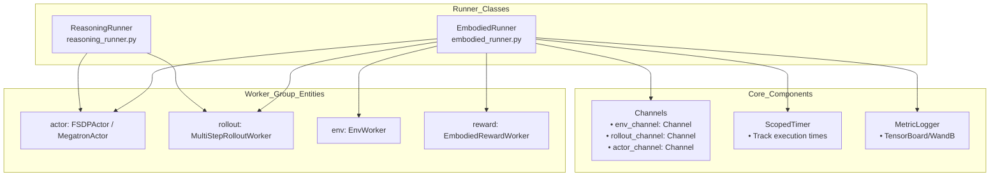

<!-- source: DeepWiki mcp.deepwiki.com · repo RLinf/RLinf · page 4 Training Orchestration · fetched 2026-10-21 -->

# Training Orchestration

<details>
<summary>Relevant source files</summary>

The following files were used as context for generating this wiki page:

- [docs/source-en/rst_source/extending/weight_syncer.rst](docs/source-en/rst_source/extending/weight_syncer.rst)
- [docs/source-zh/rst_source/extending/weight_syncer.rst](docs/source-zh/rst_source/extending/weight_syncer.rst)
- [examples/embodiment/config/maniskill_async_ppo_openvlaoft.yaml](examples/embodiment/config/maniskill_async_ppo_openvlaoft.yaml)
- [examples/embodiment/train_async.py](examples/embodiment/train_async.py)
- [examples/embodiment/train_embodied_agent.py](examples/embodiment/train_embodied_agent.py)
- [rlinf/config.py](rlinf/config.py)
- [rlinf/hybrid_engines/weight_syncer/base.py](rlinf/hybrid_engines/weight_syncer/base.py)
- [rlinf/hybrid_engines/weight_syncer/bucket_syncer.py](rlinf/hybrid_engines/weight_syncer/bucket_syncer.py)
- [rlinf/hybrid_engines/weight_syncer/patch_syncer.py](rlinf/hybrid_engines/weight_syncer/patch_syncer.py)
- [rlinf/runners/embodied_runner.py](rlinf/runners/embodied_runner.py)
- [rlinf/utils/utils.py](rlinf/utils/utils.py)
- [rlinf/workers/actor/fsdp_actor_worker.py](rlinf/workers/actor/fsdp_actor_worker.py)
- [rlinf/workers/actor/fsdp_iql_policy_worker.py](rlinf/workers/actor/fsdp_iql_policy_worker.py)
- [rlinf/workers/env/env_worker.py](rlinf/workers/env/env_worker.py)
- [rlinf/workers/rollout/hf/huggingface_worker.py](rlinf/workers/rollout/hf/huggingface_worker.py)
- [tests/unit_tests/test_overlap_env_bootstrap.py](tests/unit_tests/test_overlap_env_bootstrap.py)
- [tests/unit_tests/test_weight_syncer.py](tests/unit_tests/test_weight_syncer.py)

</details>


Training orchestration in RLinf refers to the coordination of distributed worker groups, execution of training loops, management of data channels, and collection of metrics. Runners are the top-level components that orchestrate the interaction between actor workers (policy training), rollout workers (inference), environment workers (simulation/real-world interaction), and optional critic/reward workers. This page covers the runner architecture, training loop execution patterns, and communication primitives.

For details on specific worker implementations, see [Worker Groups and Lifecycle](#3.2). For algorithm-specific training logic, see [RL Algorithms Reference](#8). For runner-specific implementations, see [Runner Architecture](#4.1).

---

## Core Runner Responsibilities

Runners are responsible for:

1.  **Worker Lifecycle Management**: Initializing worker groups, loading checkpoints, and coordinating shutdown [rlinf/runners/embodied_runner.py:163-185]().
2.  **Training Loop Execution**: Orchestrating the sequence of operations (weight sync, rollout generation, advantage computation, policy updates) [rlinf/runners/embodied_runner.py:251-412]().
3.  **Channel-based Communication**: Creating and managing channels for data exchange between worker groups [rlinf/runners/embodied_runner.py:94-100]().
4.  **Metric Collection**: Aggregating metrics from distributed workers and logging to TensorBoard/WandB via `MetricLogger` [rlinf/runners/embodied_runner.py:115-125]().
5.  **Checkpointing**: Saving and resuming training state at configurable intervals [rlinf/runners/embodied_runner.py:419-428]().
6.  **Progress Tracking**: Monitoring training progress via `check_progress` [rlinf/utils/runner_utils.py:31]().

The primary runner implementations are:
*   **`EmbodiedRunner`**: Synchronous and pipeline execution for embodied RL (PPO/GRPO/SAC/NFT) [rlinf/runners/embodied_runner.py:52]().
*   **`ReasoningRunner`**: Orchestration for agentic/reasoning tasks using backends like SGLang or vLLM [rlinf/runners/reasoning_runner.py:22]().
*   **`AsyncEmbodiedRunner`**: High-throughput asynchronous orchestration.
*   **`AsyncPPOEmbodiedRunner`**: Specialized asynchronous runner for PPO-based embodied tasks.

**Sources**: [rlinf/runners/embodied_runner.py:52-125](), [rlinf/runners/embodied_runner.py:163-185](), [rlinf/runners/embodied_runner.py:251-412](), [rlinf/utils/runner_utils.py:31]()

---

## Runner Class Hierarchy

This diagram maps the natural language orchestration roles to the specific code entities used in the system.

| Role | Code Entity |
| :--- | :--- |
| **Embodied Orchestrator** | `EmbodiedRunner` [rlinf/runners/embodied_runner.py:52]() |
| **Reasoning Orchestrator** | `ReasoningRunner` [rlinf/runners/reasoning_runner.py:22]() |
| **Actor Worker** | `FSDPActor` [rlinf/workers/actor/fsdp_actor_worker.py:190]() |
| **Rollout Worker** | `MultiStepRolloutWorker` [rlinf/workers/rollout/hf/huggingface_worker.py:42]() |
| **Env Worker** | `EnvWorker` [rlinf/workers/env/env_worker.py:58]() |
| **Data Pipe** | `Channel` [rlinf/scheduler/channel.py:25]() |

Training Loop Orchestration Diagram:


**Sources**: [rlinf/runners/embodied_runner.py:52-125](), [rlinf/workers/actor/fsdp_actor_worker.py:190](), [rlinf/workers/rollout/hf/huggingface_worker.py:42](), [rlinf/workers/env/env_worker.py:58]()

---

## Training Loop Structure

### Synchronous Execution Pattern (EmbodiedRunner)

The synchronous training loop follows a strict sequential pattern. The key method `EmbodiedRunner.run()` orchestrates this flow:

| Phase | Method Call | Purpose |
|-------|------------|---------|
| **Weight Sync** | `update_rollout_weights()` | Copy actor weights to rollout workers [rlinf/runners/embodied_runner.py:187-192]() |
| **Rollout Generation** | `env.interact()`, `rollout.generate()` | Generate trajectories in parallel [rlinf/runners/embodied_runner.py:264-276]() |
| **Trajectory Collection** | `actor.recv_rollout_trajectories()` | Transfer data to actor workers [rlinf/runners/embodied_runner.py:277-279]() |
| **Policy Training** | `actor.run_training()` | Gradient descent on policy/value losses [rlinf/runners/embodied_runner.py:286-288]() |
| **Evaluation** | `evaluate()` | Run evaluation rollouts (periodic) [rlinf/runners/embodied_runner.py:193-249]() |

**Sources**: [rlinf/runners/embodied_runner.py:251-412](), [rlinf/runners/embodied_runner.py:187-192](), [rlinf/runners/embodied_runner.py:193-249]()

---

### Asynchronous Execution and Pipelining

RLinf supports advanced pipelining to overlap computation and communication, significantly increasing throughput.

```mermaid
sequenceDiagram
    participant Runner as "EmbodiedRunner"
    participant Env as "EnvWorker"
    participant Actor as "FSDPActor"
    
    Note over Env,Actor: runner.use_training_pipeline=True
    Env->>Env: Interact with Simulation
    Env->>Env: Pack Trajectories into Micro-batches
    Env->>Actor: Stream Packed Tensors (Channel)
    Note right of Actor: Train on Micro-batch 1
    Env->>Actor: Stream Packed Tensors (Channel)
    Note right of Actor: Train on Micro-batch 2
```

Key features of asynchronous orchestration:
- **Overlapped Bootstrap**: The runner can prefetch environment bootstrap observations while training [rlinf/runners/embodied_runner.py:74-76](). `EnvWorker` supports prefetching via `_prefetched_train_bootstrap` [rlinf/workers/env/env_worker.py:72]().
- **Training Pipeline Mode**: Enabled via `runner.use_training_pipeline=True`, this mode allows `EnvWorker` to convert trajectories into packed actor micro-batches and stream them to the `Actor` through a channel [rlinf/workers/env/env_worker.py:101-162]().
- **Decoupled Execution**: In `enable_decoupled_mode`, environment workers and rollout workers can operate at different speeds, managed by `batch_router` and `rollout_queue_size` [rlinf/workers/env/env_worker.py:174-183](), [rlinf/workers/rollout/hf/huggingface_worker.py:131-139]().

For details, see [Synchronous vs Asynchronous Execution](#4.2).

**Sources**: [rlinf/runners/embodied_runner.py:74-76](), [rlinf/workers/env/env_worker.py:72-162](), [rlinf/workers/env/env_worker.py:174-183](), [rlinf/workers/rollout/hf/huggingface_worker.py:131-139]()

---

## Channel-based Communication

Runners use `Channel` objects to coordinate data flow between worker groups.

| Channel | Producer | Consumer | Purpose |
|---------|----------|----------|---------|
| `env_channel` | `EnvWorker` | `MultiStepRolloutWorker` | Send observations for action generation [rlinf/runners/embodied_runner.py:94]() |
| `rollout_channel` | `MultiStepRolloutWorker` | `EnvWorker` | Send generated actions [rlinf/runners/embodied_runner.py:95]() |
| `actor_channel` | `EnvWorker` | `FSDPActor` | Send completed trajectories for training [rlinf/runners/embodied_runner.py:96]() |
| `reward_channel` | `EnvWorker` | `EmbodiedRewardWorker` | Send data for reward computation [rlinf/runners/embodied_runner.py:98]() |

**Sources**: [rlinf/runners/embodied_runner.py:94-100]()

---

## Weight Synchronization Strategies

Weight synchronization transfers trained policy parameters from actor workers to rollout workers.

- **Blocking Sync**: In `EmbodiedRunner`, the loop waits for both `rollout.sync_model_from_actor()` and `actor.sync_model_to_rollout()` handles [rlinf/runners/embodied_runner.py:187-192]().
- **WeightSyncer**: A specialized utility `WeightSyncer` manages the actual tensor transfer, supporting different backends (e.g., `BucketWeightSyncer`, `PatchWeightSyncer`) and communication options [rlinf/workers/rollout/hf/huggingface_worker.py:121-129]().
- **Sparse Patching**: `PatchWeightSyncer` allows for sparse weight updates by identifying changed values and transporting them in COO-like form [rlinf/hybrid_engines/weight_syncer/patch_syncer.py:138-164]().
- **Bucketization**: `BucketWeightSyncer` groups state dict tensors into buckets of a target size (e.g., `bucket_size`) for efficient transport [rlinf/hybrid_engines/weight_syncer/bucket_syncer.py:113-149]().
- **Staleness Control**: Synchronization frequency is controlled by `runner.weight_sync_interval` [rlinf/runners/embodied_runner.py:73]().

For detailed strategies, see [Weight Synchronization Strategies](#4.3).

**Sources**: [rlinf/runners/embodied_runner.py:73](), [rlinf/runners/embodied_runner.py:187-192](), [rlinf/workers/rollout/hf/huggingface_worker.py:121-129](), [rlinf/hybrid_engines/weight_syncer/patch_syncer.py:138-164](), [rlinf/hybrid_engines/weight_syncer/bucket_syncer.py:113-149]()

---

