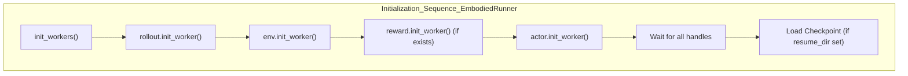
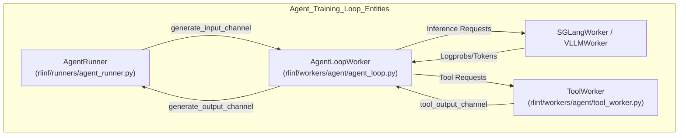

<!-- source: DeepWiki mcp.deepwiki.com · repo RLinf/RLinf · page 4.1 Runner Architecture · fetched 2026-10-21 -->

# Runner Architecture

Relevant source files

The following files were used as context for generating this wiki page:

- [examples/embodiment/train_async.py](examples/embodiment/train_async.py)
- [examples/embodiment/train_embodied_agent.py](examples/embodiment/train_embodied_agent.py)
- [examples/reasoning/main_grpo.py](examples/reasoning/main_grpo.py)
- [rlinf/config.py](rlinf/config.py)
- [rlinf/runners/agent_eval_runner.py](rlinf/runners/agent_eval_runner.py)
- [rlinf/runners/agent_runner.py](rlinf/runners/agent_runner.py)
- [rlinf/runners/coding_online_rl_runner.py](rlinf/runners/coding_online_rl_runner.py)
- [rlinf/runners/embodied_eval_runner.py](rlinf/runners/embodied_eval_runner.py)
- [rlinf/runners/embodied_runner.py](rlinf/runners/embodied_runner.py)
- [rlinf/runners/reasoning_eval_runner.py](rlinf/runners/reasoning_eval_runner.py)
- [rlinf/runners/reasoning_runner.py](rlinf/runners/reasoning_runner.py)
- [rlinf/utils/data_iter_utils.py](rlinf/utils/data_iter_utils.py)
- [rlinf/utils/distributed.py](rlinf/utils/distributed.py)
- [rlinf/workers/actor/fsdp_actor_worker.py](rlinf/workers/actor/fsdp_actor_worker.py)
- [rlinf/workers/agent/agent_loop.py](rlinf/workers/agent/agent_loop.py)
- [rlinf/workers/env/env_worker.py](rlinf/workers/env/env_worker.py)
- [rlinf/workers/inference/fsdp_inference_worker.py](rlinf/workers/inference/fsdp_inference_worker.py)
- [rlinf/workers/rollout/hf/huggingface_worker.py](rlinf/workers/rollout/hf/huggingface_worker.py)
- [tests/unit_tests/test_overlap_env_bootstrap.py](tests/unit_tests/test_overlap_env_bootstrap.py)

Runners are the top-level orchestration layer in RLinf that coordinate the entire RL training workflow. A Runner initializes worker groups, manages inter-worker communication through channels, executes the training loop, and handles checkpointing and metrics logging. RLinf provides specialized runners for both Embodied AI (robotics/control) and Agentic AI (reasoning/LLM agents).

**Sources:** [rlinf/runners/embodied_runner.py:52-66](), [rlinf/runners/reasoning_runner.py:54-73]()

## Runner Responsibilities

Runners serve as the control plane for RL training with the following responsibilities:

| Responsibility | Description |
|---------------|-------------|
| **Worker Group Orchestration** | Create and initialize worker groups (actor, rollout, env, critic, reward) with appropriate placement strategies. |
| **Channel Management** | Establish communication channels (`Channel.create`) between workers for data exchange [rlinf/runners/embodied_runner.py:94-98](). |
| **Weight Synchronization** | Coordinate periodic weight updates from actor to rollout/inference workers [rlinf/runners/embodied_runner.py:187-192](). |
| **Training Loop Execution** | Orchestrate the main training loop including rollout generation, advantage computation, and policy updates [rlinf/runners/embodied_runner.py:207-250](). |
| **Checkpointing** | Save and resume training state (`load_checkpoint`, `save_checkpoint`) at configured intervals [rlinf/runners/embodied_runner.py:175-186](). |
| **Metrics Collection** | Aggregate and log metrics from all worker groups using `MetricLogger` [rlinf/runners/embodied_runner.py:115](). |
| **Evaluation** | Coordinate evaluation runs by triggering `evaluate` on environment and rollout workers [rlinf/runners/embodied_runner.py:193-206](). |

**Sources:** [rlinf/runners/embodied_runner.py:73-118](), [rlinf/runners/embodied_runner.py:163-206]()

## Runner Types

RLinf provides specialized runners for different training paradigms:

### Runner Class Hierarchy and Component Association

The following diagram bridges the high-level Runner concepts to their specific implementation classes and the worker entities they manage.

```mermaid
graph TB
    subgraph "Embodied_AI_Runners"
        EmbodiedRunner["EmbodiedRunner<br/>(rlinf/runners/embodied_runner.py)"]
        EmbodiedEvalRunner["EmbodiedEvalRunner<br/>(rlinf/runners/embodied_eval_runner.py)"]
        AsyncEmbodiedRunner["AsyncEmbodiedRunner<br/>(rlinf/runners/async_embodied_runner.py)"]
    end
    
    subgraph "Agentic_Reasoning_Runners"
        ReasoningRunner["ReasoningRunner<br/>(rlinf/runners/reasoning_runner.py)"]
        AgentRunner["AgentRunner<br/>(rlinf/runners/agent_runner.py)"]
        CodingOnlineRLRunner["CodingOnlineRLRunner<br/>(rlinf/runners/coding_online_rl_runner.py)"]
    end
    
    EmbodiedRunner -->|"manages"| MultiStepRolloutWorker["MultiStepRolloutWorker<br/>(rlinf/workers/rollout/hf/huggingface_worker.py)"]
    EmbodiedRunner -->|"manages"| EnvWorker["EnvWorker<br/>(rlinf/workers/env/env_worker.py)"]
    EmbodiedRunner -->|"manages"| FSDPActor["FSDPActor<br/>(rlinf/workers/actor/fsdp_actor_worker.py)"]
    EmbodiedRunner -->|"manages"| EmbodiedRewardWorker["EmbodiedRewardWorker<br/>(rlinf/workers/reward/reward_worker.py)"]
    
    ReasoningRunner -->|"manages"| MegatronActor["MegatronActor<br/>(rlinf/workers/actor/megatron_actor_worker.py)"]
    ReasoningRunner -->|"manages"| RewardWorker["RewardWorker<br/>(rlinf/workers/reward/reward_worker.py)"]
    
    AgentRunner -->|"manages"| AgentLoopWorker["AgentLoopWorker<br/>(rlinf/workers/agent/agent_loop.py)"]
    AgentRunner -->|"manages"| ToolWorker["ToolWorker<br/>(rlinf/workers/agent/tool_worker.py)"]
```

**Sources:** [rlinf/runners/embodied_runner.py:52-66](), [rlinf/runners/reasoning_runner.py:54-73](), [rlinf/runners/agent_runner.py:42-58](), [rlinf/workers/actor/fsdp_actor_worker.py:190-205](), [rlinf/workers/rollout/hf/huggingface_worker.py:42-52](), [rlinf/workers/env/env_worker.py:58-65]()

### Embodied AI Runners
- **`EmbodiedRunner`**: Synchronous runner for embodied AI training. It handles environment interaction, rollout generation, and actor training in sequential steps [rlinf/runners/embodied_runner.py:52-66]().
- **`EmbodiedEvalRunner`**: Dedicated runner for evaluation tasks, coordinating `MultiStepRolloutWorker` and `EnvWorker` without training logic [rlinf/runners/embodied_eval_runner.py:32-43]().
- **`AsyncEmbodiedRunner`**: Asynchronous runner allowing environment interaction and training to overlap for high throughput [examples/embodiment/train_async.py:49-55]().

### Agentic and Reasoning AI Runners
- **`ReasoningRunner`**: Base runner for training reasoning models (e.g., via GRPO) using dataset-based prompts [rlinf/runners/reasoning_runner.py:54-73]().
- **`AgentRunner`**: Specialized runner for agentic tasks involving multi-turn loops and tool calls. It manages an `AgentLoopWorker` and multiple `ToolWorker` instances to coordinate complex interaction trajectories [rlinf/runners/agent_runner.py:42-58]().
- **`CodingOnlineRLRunner`**: Orchestrates online reinforcement learning specifically for coding tasks.

## Core Runner Architecture

### Component Initialization

Runners initialize worker groups in a specific order to manage peak memory usage and handle dependencies. For embodied tasks, rollout and environment workers are initialized before the actor to ensure the simulation and inference environments are ready.

**Sources:** [rlinf/runners/embodied_runner.py:163-186](), [examples/embodiment/train_embodied_agent.py:163-164]()

### Channel-Based Communication

Runners create `Channel` objects to coordinate data flow between worker groups. This abstraction allows runners to pass data handles without moving heavy tensors through the runner process.

| Channel Name | Runner Type | Purpose |
|--------------|-------------|---------|
| `env_channel` | Embodied | Passes observations from environment to rollout [rlinf/runners/embodied_runner.py:94]() |
| `rollout_channel` | Embodied | Passes actions from rollout to environment [rlinf/runners/embodied_runner.py:95]() |
| `actor_channel` | Embodied | Passes trajectories from environment to actor [rlinf/runners/embodied_runner.py:96]() |
| `reward_channel` | Embodied | Coordinates reward computation between env and reward workers [rlinf/runners/embodied_runner.py:98]() |
| `dataloader_channel` | Reasoning | Distributes requests from the dataset [rlinf/runners/reasoning_runner.py:105]() |
| `generate_input_channel` | Agentic | Sends task prompts to the agent loop [rlinf/runners/agent_runner.py:89]() |
| `tool_output_channel` | Agentic | Receives tool execution results back to the loop [rlinf/runners/agent_runner.py:109]() |

**Sources:** [rlinf/runners/embodied_runner.py:93-101](), [rlinf/runners/reasoning_runner.py:105-132](), [rlinf/runners/agent_runner.py:89-112]()

## Training Loop Lifecycle

### Agentic AI Data Flow (AgentRunner)

The `AgentRunner` orchestrates interactions between the LLM and the `AgentLoopWorker` which manages multi-turn logic and tool calls.

**Sources:** [rlinf/runners/agent_runner.py:85-112](), [rlinf/runners/agent_runner.py:113-155]()

### Weight Synchronization Strategies

RLinf implements strategies to keep rollout workers updated with the latest policy weights from the actor.

#### Synchronous Weight Sync
In `EmbodiedRunner`, the runner calls `sync_model_from_actor` on the rollout group and `sync_model_to_rollout` on the actor group, waiting for both to finish to ensure consistency before the next rollout [rlinf/runners/embodied_runner.py:187-192]().

#### Asynchronous and Pipeline Modes
When `runner.use_training_pipeline` is enabled, the system overlaps environment interaction with training. `EnvWorker` and `MultiStepRolloutWorker` coordinate to stream data to the actor, allowing the training of early micro-batches while later steps of the rollout are still being collected [rlinf/workers/env/env_worker.py:101-105](), [rlinf/workers/rollout/hf/huggingface_worker.py:59-60]().

#### Decoupled Mode
In decoupled mode, `EnvWorker` uses a `batch_router` to map tags to batch indices, allowing for more flexible distribution of environment steps across distributed workers [rlinf/workers/env/env_worker.py:174-182]().

**Sources:** [rlinf/runners/embodied_runner.py:187-192](), [rlinf/workers/env/env_worker.py:101-162](), [rlinf/workers/env/env_worker.py:174-182]()

## Checkpointing and Metrics

### Checkpoint Resumption
Runners support resuming from a specific directory. The `init_workers` method detects the `resume_dir` configuration, triggers `actor.load_checkpoint()`, and restores the `global_step` from the directory name [rlinf/runners/embodied_runner.py:175-186]().

### Asynchronous Logging
To prevent logging I/O from blocking the training loop, `EmbodiedRunner` uses a dedicated `_log_thread` and a `log_queue` to process log messages and print metrics tables asynchronously [rlinf/runners/embodied_runner.py:121-152]().

**Sources:** [rlinf/runners/embodied_runner.py:121-152](), [rlinf/runners/embodied_runner.py:175-186]()

---

