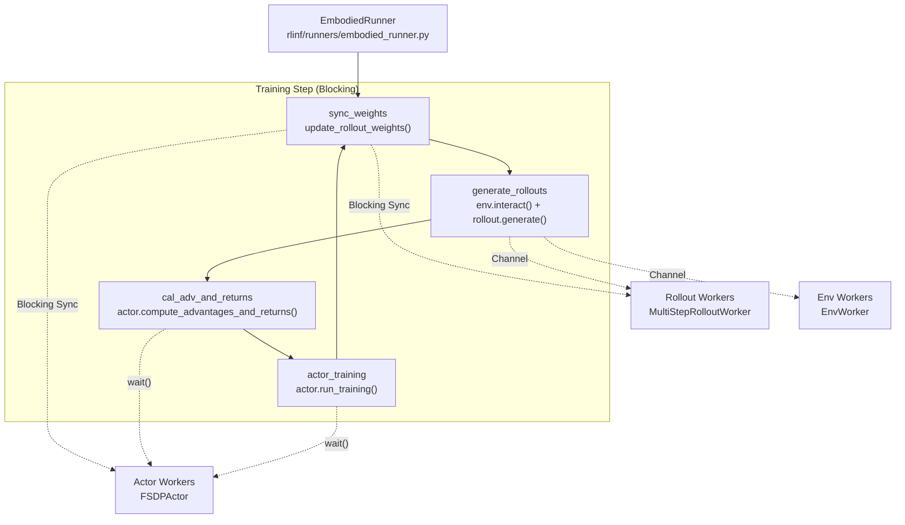
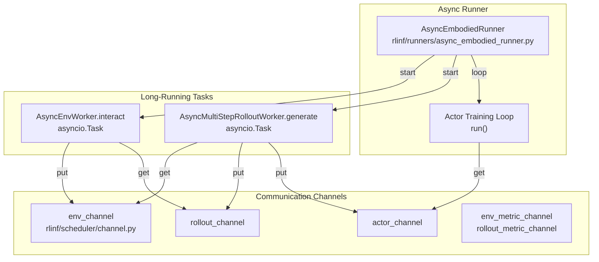

<!-- source: DeepWiki mcp.deepwiki.com · repo RLinf/RLinf · page 4.2 Synchronous vs Asynchronous Execution · fetched 2026-10-21 -->

# Synchronous vs Asynchronous Execution

<details>
<summary>Relevant source files</summary>

The following files were used as context for generating this wiki page:

- [examples/embodiment/config/libero_goal_async_ppo_gr00t.yaml](examples/embodiment/config/libero_goal_async_ppo_gr00t.yaml)
- [examples/embodiment/config/libero_object_async_ppo_openpi_pi05.yaml](examples/embodiment/config/libero_object_async_ppo_openpi_pi05.yaml)
- [examples/embodiment/config/libero_spatial_async_ppo_openpi.yaml](examples/embodiment/config/libero_spatial_async_ppo_openpi.yaml)
- [examples/embodiment/config/libero_spatial_async_ppo_openpi_pi05.yaml](examples/embodiment/config/libero_spatial_async_ppo_openpi_pi05.yaml)
- [examples/embodiment/config/maniskill_async_ppo_openpi.yaml](examples/embodiment/config/maniskill_async_ppo_openpi.yaml)
- [examples/embodiment/config/maniskill_async_ppo_openpi_pi05.yaml](examples/embodiment/config/maniskill_async_ppo_openpi_pi05.yaml)
- [examples/embodiment/config/maniskill_async_ppo_openvla.yaml](examples/embodiment/config/maniskill_async_ppo_openvla.yaml)
- [examples/embodiment/train_async.py](examples/embodiment/train_async.py)
- [examples/embodiment/train_embodied_agent.py](examples/embodiment/train_embodied_agent.py)
- [rlinf/config.py](rlinf/config.py)
- [rlinf/envs/maniskill/maniskill_offload_env.py](rlinf/envs/maniskill/maniskill_offload_env.py)
- [rlinf/envs/robocasa/venv.py](rlinf/envs/robocasa/venv.py)
- [rlinf/envs/utils.py](rlinf/envs/utils.py)
- [rlinf/models/embodiment/openpi/policies/robocasa_policy.py](rlinf/models/embodiment/openpi/policies/robocasa_policy.py)
- [rlinf/runners/async_embodied_runner.py](rlinf/runners/async_embodied_runner.py)
- [rlinf/runners/async_ppo_embodied_runner.py](rlinf/runners/async_ppo_embodied_runner.py)
- [rlinf/runners/embodied_runner.py](rlinf/runners/embodied_runner.py)
- [rlinf/workers/actor/fsdp_actor_worker.py](rlinf/workers/actor/fsdp_actor_worker.py)
- [rlinf/workers/env/async_env_worker.py](rlinf/workers/env/async_env_worker.py)
- [rlinf/workers/env/env_worker.py](rlinf/workers/env/env_worker.py)
- [rlinf/workers/rollout/hf/async_huggingface_worker.py](rlinf/workers/rollout/hf/async_huggingface_worker.py)
- [rlinf/workers/rollout/hf/huggingface_worker.py](rlinf/workers/rollout/hf/huggingface_worker.py)
- [tests/unit_tests/test_maniskill_offload_env.py](tests/unit_tests/test_maniskill_offload_env.py)
- [tests/unit_tests/test_overlap_env_bootstrap.py](tests/unit_tests/test_overlap_env_bootstrap.py)

</details>


## Purpose and Scope

This document explains the execution modes available in RLinf for training embodied RL agents: **synchronous** and **asynchronous**. Synchronous execution uses strict step-by-step coordination between environment interaction, rollout generation, and policy training. Asynchronous execution decouples these components into continuously running workers that communicate through `Channel` primitives [rlinf/scheduler/channel.py:1](), enabling higher throughput at the cost of potential sample staleness.

In RLinf, synchronous execution is the standard for basic algorithms, while asynchronous execution (Async PPO/SAC/DAGGER) is specifically optimized for cases where environment stepping or model inference creates significant system bottlenecks, often seen in high-resolution vision-language-action (VLA) tasks.

---

## Synchronous Execution Model

### Core Architecture

Synchronous execution is typically implemented in `EmbodiedRunner` [rlinf/runners/embodied_runner.py:52]() and follows a sequential training loop where each step waits for the previous step to complete. The runner coordinates three main worker groups: **actor**, **rollout**, and **env**.

**Data Flow Diagram (Synchronous):**



**Sources:** [rlinf/runners/embodied_runner.py:52](), [rlinf/runners/embodied_runner.py:187-192](), [rlinf/workers/actor/fsdp_actor_worker.py:190](), [rlinf/workers/env/env_worker.py:58](), [rlinf/workers/rollout/hf/huggingface_worker.py:42]()

---

## Asynchronous Execution Model

### Core Architecture

Asynchronous execution is implemented in `AsyncEmbodiedRunner` [rlinf/runners/async_embodied_runner.py:41]() and `AsyncPPOEmbodiedRunner` [rlinf/runners/async_ppo_embodied_runner.py:36](). Instead of sequential blocking steps, environment and rollout workers run in continuous `asyncio.Task` loops [rlinf/workers/rollout/hf/async_huggingface_worker.py:56-62]().

**Data Flow Diagram (Asynchronous):**



**Sources:** [rlinf/runners/async_embodied_runner.py:162-181](), [rlinf/workers/rollout/hf/async_huggingface_worker.py:47-58](), [rlinf/runners/async_embodied_runner.py:54-55]()

### Trajectory Storage and Staleness

Staleness is controlled by the `staleness_threshold` config [rlinf/workers/rollout/hf/async_huggingface_worker.py:27](). In `AsyncMultiStepRolloutWorker`, the worker can wait if it is too far ahead of the actor using `wait_if_stale()` [rlinf/workers/rollout/hf/async_huggingface_worker.py:92-110](). This ensures that the rollout generation does not exceed the training progress by more than the specified threshold, maintaining sample relevance.

**Sources:** [rlinf/workers/rollout/hf/async_huggingface_worker.py:27](), [rlinf/workers/rollout/hf/async_huggingface_worker.py:92-110]()

---

## Training Pipeline Mode

RLinf introduces a specialized `use_training_pipeline` mode to overlap environment interaction and actor training. When enabled, the environment worker initializes specific pipeline parameters to stream data efficiently [rlinf/workers/env/env_worker.py:161-162]().

### Micro-batch Streaming
The environment worker processes trajectories and streams them to the actor. This mode is enabled via `runner.use_training_pipeline: True` in the configuration [rlinf/workers/env/env_worker.py:101](). It is specifically designed to reduce idle time in large-scale distributed training by starting the training process as soon as initial micro-batches are available.

**Sources:** [rlinf/workers/env/env_worker.py:101](), [rlinf/workers/env/env_worker.py:161-162](), [examples/embodiment/train_embodied_agent.py:49-55]()

---

## Weight Synchronization Strategies

### Blocking vs Non-Blocking Sync

1.  **Blocking Sync:** The runner calls `update_rollout_weights()` and waits for both actor and rollout to finish the transfer [rlinf/runners/embodied_runner.py:187-192]().
2.  **Non-Blocking Background Sync:** Enabled by `sync_weight_no_wait: True` [rlinf/runners/async_embodied_runner.py:60](). The runner initiates the transfer but does not block the main loop, allowing training and rollout to continue while weights are transferred in the background [rlinf/runners/async_embodied_runner.py:122-138]().

In `AsyncMultiStepRolloutWorker`, background weight sync is managed via `_poll_background_weight_sync()` [rlinf/workers/rollout/hf/async_huggingface_worker.py:131-144]().

**Non-Blocking Workflow:**

```mermaid
sequenceDiagram
    participant Runner as "AsyncEmbodiedRunner"
    participant Actor as "AsyncActorWorker"
    participant Rollout as "AsyncMultiStepRolloutWorker"
    
    Runner->>Rollout: "request_actor_sync_model()"
    Runner->>Actor: "sync_model_to_rollout()"
    Note right of Runner: Returns immediately (no wait)
    
    loop "Background Sync"
        Note over Actor,Rollout: "Weight Transfer (NCCL/P2P)"
        Rollout->>Rollout: "_poll_background_weight_sync()"
    end
```

**Sources:** [rlinf/runners/async_embodied_runner.py:60](), [rlinf/runners/async_embodied_runner.py:122-138](), [rlinf/workers/rollout/hf/async_huggingface_worker.py:131-144](), [rlinf/runners/embodied_runner.py:187-192]()

---

## Performance and Throughput Trade-offs

| Feature | Synchronous | Asynchronous | Pipeline Mode |
| :--- | :--- | :--- | :--- |
| **Execution** | Sequential (A -> B -> C) | Overlapped (A, B, C concurrent) | Streaming Micro-batches |
| **Staleness** | Zero | Configurable via `staleness_threshold` | Zero (On-policy) |
| **Resource Use** | Periodic idle time | Maximized GPU/CPU utilization | Reduced reconstruction overhead |
| **Best Use Case** | Small models, simple envs | Large VLA models (OpenVLA, Pi) | Multi-node distributed training |

**Sources:** [rlinf/runners/embodied_runner.py:52](), [rlinf/runners/async_embodied_runner.py:41](), [rlinf/workers/env/env_worker.py:101](), [rlinf/workers/rollout/hf/async_huggingface_worker.py:27]()

---

## Configuration Reference

Execution modes are selected via the `runner` and `algorithm` sections of the Hydra configuration.

**Example Config (Async SAC):**
```yaml
# examples/embodiment/config/maniskill_sac_mlp_async.yaml
algorithm:
  loss_type: embodied_sac
  staleness_threshold: 10

runner:
  use_training_pipeline: False
  sync_weight_no_wait: True
```

**Example Config (Pipeline Mode):**
```yaml
# config/maniskill_ppo_openvlaoft.yaml
runner:
  task_type: embodied
  use_training_pipeline: True
```

**Sources:** [examples/embodiment/train_async.py:34-79](), [examples/embodiment/train_embodied_agent.py:36-96](), [rlinf/workers/rollout/hf/async_huggingface_worker.py:37-39]()

---

