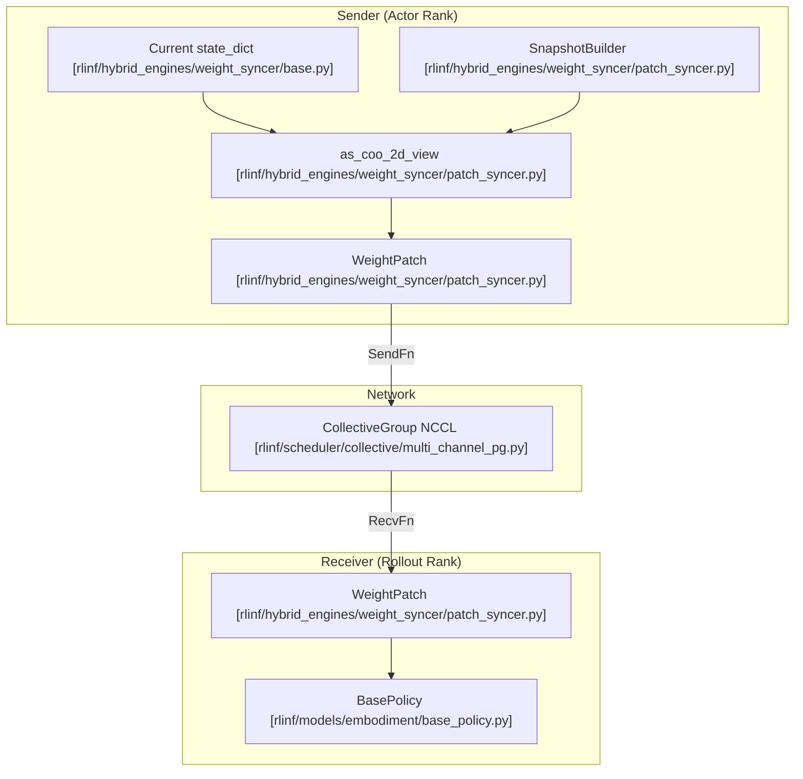

<!-- source: DeepWiki mcp.deepwiki.com · repo RLinf/RLinf · page 4.3 Weight Synchronization Strategies · fetched 2026-10-21 -->

# Weight Synchronization Strategies

Relevant source files

The following files were used as context for generating this wiki page:

- [docs/source-en/rst_source/extending/weight_syncer.rst](docs/source-en/rst_source/extending/weight_syncer.rst)
- [docs/source-zh/rst_source/extending/weight_syncer.rst](docs/source-zh/rst_source/extending/weight_syncer.rst)
- [examples/embodiment/config/maniskill_async_ppo_openvlaoft.yaml](examples/embodiment/config/maniskill_async_ppo_openvlaoft.yaml)
- [examples/embodiment/train_async.py](examples/embodiment/train_async.py)
- [examples/embodiment/train_embodied_agent.py](examples/embodiment/train_embodied_agent.py)
- [examples/reasoning/config/math/qwen3-30b-grpo-megatron.yaml](examples/reasoning/config/math/qwen3-30b-grpo-megatron.yaml)
- [rlinf/config.py](rlinf/config.py)
- [rlinf/hybrid_engines/megatron/megatron_model_manager.py](rlinf/hybrid_engines/megatron/megatron_model_manager.py)
- [rlinf/hybrid_engines/weight_syncer/base.py](rlinf/hybrid_engines/weight_syncer/base.py)
- [rlinf/hybrid_engines/weight_syncer/bucket_syncer.py](rlinf/hybrid_engines/weight_syncer/bucket_syncer.py)
- [rlinf/hybrid_engines/weight_syncer/patch_syncer.py](rlinf/hybrid_engines/weight_syncer/patch_syncer.py)
- [rlinf/runners/embodied_runner.py](rlinf/runners/embodied_runner.py)
- [rlinf/utils/convertor/utils.py](rlinf/utils/convertor/utils.py)
- [rlinf/utils/resharding/mcore_weight_reshard.py](rlinf/utils/resharding/mcore_weight_reshard.py)
- [rlinf/utils/resharding/reshard_config.py](rlinf/utils/resharding/reshard_config.py)
- [rlinf/utils/resharding/utils.py](rlinf/utils/resharding/utils.py)
- [rlinf/utils/utils.py](rlinf/utils/utils.py)
- [rlinf/workers/actor/fsdp_actor_worker.py](rlinf/workers/actor/fsdp_actor_worker.py)
- [rlinf/workers/actor/fsdp_iql_policy_worker.py](rlinf/workers/actor/fsdp_iql_policy_worker.py)
- [rlinf/workers/env/env_worker.py](rlinf/workers/env/env_worker.py)
- [rlinf/workers/rollout/hf/huggingface_worker.py](rlinf/workers/rollout/hf/huggingface_worker.py)
- [tests/unit_tests/test_overlap_env_bootstrap.py](tests/unit_tests/test_overlap_env_bootstrap.py)
- [tests/unit_tests/test_weight_syncer.py](tests/unit_tests/test_weight_syncer.py)

## Purpose and Scope

This page documents the mechanisms and strategies for synchronizing model weights between actor workers (training) and rollout/inference workers (policy execution) in RLinf. Weight synchronization is a critical component of distributed RL training that ensures rollout workers use sufficiently up-to-date policy parameters while minimizing communication and loading overhead.

RLinf provides a unified `WeightSyncer` abstraction to handle synchronization across different backends (FSDP, Megatron) and execution modes (Synchronous, Asynchronous). It specifically optimizes the path from **FSDP actors** to **HuggingFace-based rollout workers** used in embodied AI training, and from **Megatron actors** to rollout workers in reasoning tasks.

**Sources:** [rlinf/hybrid_engines/weight_syncer/base.py:30-54](), [rlinf/hybrid_engines/weight_syncer/patch_syncer.py:30-33](), [rlinf/workers/rollout/hf/huggingface_worker.py:112-121]()

---

## Weight Syncer Architecture

The synchronization logic is abstracted to handle various transfer strategies (e.g., incremental patches vs. full buckets), allowing the rollout worker to remain agnostic of the underlying transport.

*   **Initialization**: The `WeightSyncer` is created via `WeightSyncer.create(config)` [rlinf/hybrid_engines/weight_syncer/base.py:77-142](). It identifies parameters requiring synchronization using `collect_param_names_need_sync`, which filters parameters based on `requires_grad` and persistent buffers [rlinf/utils/utils.py:119-142]().
*   **Sender Logic**: Orchestrated by the Actor (e.g., `EmbodiedFSDPActor`), which prepares the weights. The `sync` method takes a `state_dict`, a `version`, and a `SendFn` to transmit data [rlinf/hybrid_engines/weight_syncer/base.py:46-51]().
*   **Receiver Logic**: Rollout workers (e.g., `MultiStepRolloutWorker`) call `apply`, which takes a `RecvFn` to receive and load weights into the local model [rlinf/hybrid_engines/weight_syncer/base.py:53-54]().

Title: Weight Synchronization Code Entities and Flow

```mermaid
graph LR
    subgraph "Actor Worker (Sender)"
        EFA["EmbodiedFSDPActor [rlinf/workers/actor/fsdp_actor_worker.py]"]
        WS_S["WeightSyncer.sync() [rlinf/hybrid_engines/weight_syncer/base.py]"]
    end

    subgraph "Transport"
        SF["SendFn [rlinf/hybrid_engines/weight_syncer/base.py]"]
        RF["RecvFn [rlinf/hybrid_engines/weight_syncer/base.py]"]
    end

    subgraph "Rollout Worker (Receiver)"
        MSRW["MultiStepRolloutWorker [rlinf/workers/rollout/hf/huggingface_worker.py]"]
        WS_R["WeightSyncer.apply() [rlinf/hybrid_engines/weight_syncer/base.py]"]
    end

    EFA -- "sync_model_to_rollout" --> WS_S
    WS_S -- "serialized payload" --> SF
    SF --> RF
    RF --> WS_R
    WS_R -- "sync_model_from_actor" --> MSRW
```

**Sources:** [rlinf/hybrid_engines/weight_syncer/base.py:26-54](), [rlinf/workers/actor/fsdp_actor_worker.py:190-210](), [rlinf/workers/rollout/hf/huggingface_worker.py:42-62](), [rlinf/utils/utils.py:119-142]()

---

## Synchronization Strategies

### 1. Patch Mode (Incremental)
The `PatchWeightSyncer` maintains a snapshot of weights and only transmits the sparse differences (patches). This is highly efficient for large models where only a fraction of weights change per step.

*   **Sparse Encoding**: Changed values are organized in a COO-like format (`WeightPatch`) containing `ordinals`, `nnz_per_tensor`, `rows`, `cols`, and `values` [rlinf/hybrid_engines/weight_syncer/patch_syncer.py:138-163]().
*   **Snapshot Management**: The syncer uses a `SnapshotPatchBuilder` (either `CPUSnapshotPatchBuilder` or `GPUSnapshotPatchBuilder`) to track the previous state [rlinf/hybrid_engines/weight_syncer/patch_syncer.py:32-34](). Comparison and `nonzero` index gathering are performed to identify updates [rlinf/hybrid_engines/weight_syncer/patch_syncer.py:59-94]().
*   **Empty Patches**: If no weights have changed, an `EmptyWeightPatch` is sent containing only the new version number [rlinf/hybrid_engines/weight_syncer/patch_syncer.py:98-106]().
*   **Index Downscaling**: To reduce metadata overhead, indices are cast to the smallest possible integer dtype (e.g., `uint8`, `int32`, or `int64`) via `downscale_nonnegative_indices` [rlinf/hybrid_engines/weight_syncer/patch_syncer.py:35-56]().

### 2. Bucket Mode (Full Tensors)
The `BucketWeightSyncer` sends full tensors grouped into buckets to optimize network utilization.

*   **Bucketization**: Tensors are packed into buckets using `iter_named_tensor_buckets` until a `bucket_size` threshold is reached [rlinf/hybrid_engines/weight_syncer/bucket_syncer.py:34-111]().
*   **Dtype Conversion**: Floating-point tensors can be cast to a specific `bucket_dtype` (e.g., `bf16`) for transport to reduce bandwidth [rlinf/hybrid_engines/weight_syncer/bucket_syncer.py:178-195]().
*   **Instant Loading**: The receiver can apply buckets immediately as they arrive (`load_instant=True`) or stage them all on CPU first [rlinf/hybrid_engines/weight_syncer/bucket_syncer.py:148-155]().

**Sources:** [rlinf/hybrid_engines/weight_syncer/patch_syncer.py:138-163](), [rlinf/hybrid_engines/weight_syncer/bucket_syncer.py:34-111](), [rlinf/hybrid_engines/weight_syncer/patch_syncer.py:35-56](), [rlinf/hybrid_engines/weight_syncer/base.py:80-97]()

---

## Implementation Details

### Blocking vs. Non-Blocking Weight Sync
In standard execution, weight synchronization is managed by the `EmbodiedRunner`.

*   **Synchronous Execution**: The runner calls `sync_model_to_rollout` on the actor and `sync_model_from_actor` on the rollout worker, waiting for both handles to complete [rlinf/runners/embodied_runner.py:187-191]().
*   **Background Threads**: In some advanced configurations (e.g., `AsyncMultiStepRolloutWorker`), weight synchronization can be offloaded to background tasks to prevent stalling generation loops.

### Collective Communication Options
Strategies utilize NCCL-based transfers. The `WeightSyncer` configures `CollectiveGroupOptions` to tune the underlying communication:
*   **`use_ring_sync`**: Forces the broadcast to use a ring algorithm by setting `CollectiveGroupOptions.use_ring_broadcast` [rlinf/hybrid_engines/weight_syncer/base.py:160]().
*   **`nccl_max_ctas` / `nccl_min_ctas`**: Caps the GPU SM resources consumed by NCCL via `accel_max_ctas` and `accel_min_ctas` [rlinf/hybrid_engines/weight_syncer/base.py:161-168]().

### CPU Weight Swapping and Memory
For memory-constrained scenarios, RLinf provides utilities to move weights and manage memory:
*   **`retrieve_model_state_dict_in_cpu`**: Efficiently copies model states to CPU, utilizing `non_blocking` copies where possible [rlinf/utils/utils.py:199-210]().
*   **`clear_memory`**: Synchronizes the platform via `Worker.torch_platform.synchronize()` and clears caches [rlinf/utils/utils.py:35-41]().
*   **`tensors_record_stream`**: Ensures tensors used in async communication are not freed prematurely by recording the current stream for each tensor [rlinf/utils/utils.py:145-180]().

Title: Patch Synchronization Data Flow

**Sources:** [rlinf/hybrid_engines/weight_syncer/patch_syncer.py:59-94](), [rlinf/utils/utils.py:199-210](), [rlinf/utils/utils.py:145-180](), [rlinf/hybrid_engines/weight_syncer/base.py:144-169]()

---

## Staleness and Versioning

In decoupled RL, the rollout worker tracks the model version used to generate trajectories.

*   **Version Counters**: The `WeightSyncer` passes a `version` (typically a `torch.Tensor` or `int`) during `sync` [rlinf/hybrid_engines/weight_syncer/base.py:50]().
*   **Metadata**: Both `WeightPatch` and `EmptyWeightPatch` structures explicitly include a `version` tensor field [rlinf/hybrid_engines/weight_syncer/patch_syncer.py:106, 158]().
*   **Sync Intervals**: The `EmbodiedRunner` controls how often weights are pushed to rollout workers via `self.weight_sync_interval` [rlinf/runners/embodied_runner.py:73]().

**Sources:** [rlinf/hybrid_engines/weight_syncer/base.py:46-54](), [rlinf/hybrid_engines/weight_syncer/patch_syncer.py:98-107](), [rlinf/hybrid_engines/weight_syncer/patch_syncer.py:138-163](), [rlinf/runners/embodied_runner.py:73]()

---

