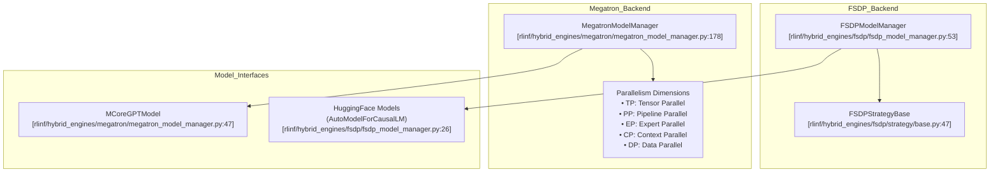
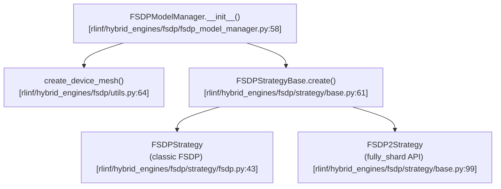

<!-- source: DeepWiki mcp.deepwiki.com · repo RLinf/RLinf · page 5 Training Backends · fetched 2026-10-21 -->

# Training Backends

Relevant source files

The following files were used as context for generating this wiki page:

- [.github/workflows/agent-e2e-tests.yml](.github/workflows/agent-e2e-tests.yml)
- [rlinf/algorithms/losses.py](rlinf/algorithms/losses.py)
- [rlinf/hybrid_engines/fsdp/fsdp_model_manager.py](rlinf/hybrid_engines/fsdp/fsdp_model_manager.py)
- [rlinf/hybrid_engines/fsdp/strategy/base.py](rlinf/hybrid_engines/fsdp/strategy/base.py)
- [rlinf/hybrid_engines/fsdp/strategy/fsdp.py](rlinf/hybrid_engines/fsdp/strategy/fsdp.py)
- [rlinf/hybrid_engines/fsdp/utils.py](rlinf/hybrid_engines/fsdp/utils.py)
- [rlinf/hybrid_engines/megatron/token_dispatcher.py](rlinf/hybrid_engines/megatron/token_dispatcher.py)
- [rlinf/hybrid_engines/megatron/utils.py](rlinf/hybrid_engines/megatron/utils.py)
- [rlinf/models/__init__.py](rlinf/models/__init__.py)
- [rlinf/runners/agentlightning_runner.py](rlinf/runners/agentlightning_runner.py)
- [rlinf/utils/metric_utils.py](rlinf/utils/metric_utils.py)
- [rlinf/workers/actor/async_ppo_fsdp_worker.py](rlinf/workers/actor/async_ppo_fsdp_worker.py)
- [rlinf/workers/actor/ma_megatron_actor_worker.py](rlinf/workers/actor/ma_megatron_actor_worker.py)
- [rlinf/workers/actor/megatron_actor_worker.py](rlinf/workers/actor/megatron_actor_worker.py)
- [rlinf/workers/agent/agentlightning_rollout_worker.py](rlinf/workers/agent/agentlightning_rollout_worker.py)
- [rlinf/workers/critic/megatron_critic_worker.py](rlinf/workers/critic/megatron_critic_worker.py)
- [rlinf/workers/megatron_worker.py](rlinf/workers/megatron_worker.py)
- [tests/e2e_tests/reasoning/qwen3-moe-2.5b-collocated-mg-sgl-ep-fusco-test.yaml](tests/e2e_tests/reasoning/qwen3-moe-2.5b-collocated-mg-sgl-ep-fusco-test.yaml)

RLinf provides two complementary training backends—**FSDP** and **Megatron**—each optimized for different scales and use cases. This page describes the architectural differences, selection criteria, and integration points between these backends and the rest of the RLinf system.

---

## Backend Architecture Overview

RLinf's training backends are implemented as model managers that wrap PyTorch models with distributed training capabilities. Both backends expose a common interface through actor workers but employ fundamentally different parallelism strategies and optimization techniques.

**Backend Comparison**

**Sources:** [rlinf/hybrid_engines/fsdp/fsdp_model_manager.py:53-90](), [rlinf/hybrid_engines/megatron/megatron_model_manager.py:178-208](), [rlinf/hybrid_engines/fsdp/strategy/base.py:47-60]()

---

## Backend Selection and Configuration

The training backend is selected via configuration. The system validates backend compatibility with model types and task types during configuration.

**Backend-Task Affinity**

| Task Type | Backend Affinity | Reason |
| :--- | :--- | :--- |
| **Embodied AI** (`embodied`) | **FSDP** | Rapid prototyping with HuggingFace VLA models like OpenVLA [rlinf/hybrid_engines/fsdp/utils.py:187-209](). |
| **Agentic Reasoning** (`reasoning`) | **Megatron** | Large-scale MoE models requiring TP/EP parallelism and FUSCO optimizations [rlinf/hybrid_engines/megatron/megatron_model_manager.py:95-109](). |

**Supported Model Categories**

RLinf maintains a model registry that associates model types with specific builders. For instance, `OPENVLA` and `OPENPI` are registered for embodied tasks and typically use FSDP [rlinf/models/__init__.py:149-172]().

| Model Type | Category | FSDP Support | Megatron Support | Reference |
|------------|----------|--------------|------------------|-----------|
| `CNN_POLICY` | embodied | ✓ | — | [rlinf/models/__init__.py:203-208]() |
| `QWEN2_5` | reasoning | ✓ | ✓ | [.github/workflows/agent-e2e-tests.yml:28-77]() |
| `OPENVLA` | embodied | ✓ | — | [rlinf/models/__init__.py:149-154]() |

**Sources:** [rlinf/hybrid_engines/fsdp/utils.py:187-209](), [rlinf/hybrid_engines/megatron/megatron_model_manager.py:95-109](), [rlinf/models/__init__.py:149-208](), [.github/workflows/agent-e2e-tests.yml:28-77]()

---

## Actor Worker Implementations

Actor workers provide the training loop interface. Backends implement specific logic for gradient clipping, model wrapping, and loss computation.

**Key Method Signatures and Behaviors**

| Method | Backend Source | Purpose |
|--------|----------------|---------|
| `model_provider_func()` | `FSDPModelManager` | Load and optimize HF models for FSDP [rlinf/hybrid_engines/fsdp/fsdp_model_manager.py:135-194]() |
| `wrap_model()` | `FSDPStrategy` | Wrap model with FSDP, applying mixed precision and sharding [rlinf/hybrid_engines/fsdp/strategy/fsdp.py:134-188]() |
| `clip_grad_norm_()` | `FSDPStrategyBase` | Abstract method for gradient clipping across FSDP versions [rlinf/hybrid_engines/fsdp/strategy/base.py:112-130]() |
| `get_forward_step_func()` | `MegatronActor` | Acquires the forward step function for Megatron training [rlinf/workers/actor/megatron_actor_worker.py:115-172]() |

**Sources:** [rlinf/hybrid_engines/fsdp/fsdp_model_manager.py:135-194](), [rlinf/hybrid_engines/fsdp/strategy/fsdp.py:134-188](), [rlinf/hybrid_engines/fsdp/strategy/base.py:112-130](), [rlinf/workers/actor/megatron_actor_worker.py:115-172]()

---

## Model Manager Initialization Patterns

The model managers handle model construction, wrapping with distributed training frameworks, and device mesh setup.

**FSDP Initialization Flow**

**Sources:** [rlinf/hybrid_engines/fsdp/fsdp_model_manager.py:58-112](), [rlinf/hybrid_engines/fsdp/utils.py:64-67](), [rlinf/hybrid_engines/fsdp/strategy/base.py:61-110](), [rlinf/hybrid_engines/fsdp/strategy/fsdp.py:43-70]()

---

## Weight Synchronization and Resharding

RLinf supports efficient weight synchronization between training actors and rollout workers, even when they use different parallelism configurations.

- **FSDP Backend**: Manages bucket capacity for weight sync, default 128MB [rlinf/hybrid_engines/fsdp/fsdp_model_manager.py:109]().
- **Megatron Backend**: Employs resharding logic for TP/PP/EP transitions. It uses `MegatronCoreWeightReshard` to manage communication subgroups and bucketized transfers [rlinf/workers/actor/megatron_actor_worker.py:100-111]().
- **Multi-Agent Support**: `MAMegatronActor` extends standard Megatron actors to handle dynamic rollout batches and data broadcasting across model/context parallel groups [rlinf/workers/actor/ma_megatron_actor_worker.py:67-118]().

**Sources:** [rlinf/hybrid_engines/fsdp/fsdp_model_manager.py:109](), [rlinf/workers/actor/megatron_actor_worker.py:100-111](), [rlinf/workers/actor/ma_megatron_actor_worker.py:67-118]()

---

## Backend-Specific Optimizations

### FSDP Optimizations
- **Liger Kernel**: Replaces standard modules with optimized kernels for improved memory efficiency [rlinf/hybrid_engines/fsdp/fsdp_model_manager.py:191-194]().
- **Mixed Precision**: Supports `MixedPrecision` policies with configurable `param_dtype`, `reduce_dtype`, and `buffer_dtype` [rlinf/hybrid_engines/fsdp/strategy/fsdp.py:146-154]().
- **Async Execution**: `AsyncPPOEmbodiedFSDPActor` implements decoupled actor-critic training with a `PriorityStore` to handle stale trajectories [rlinf/workers/actor/async_ppo_fsdp_worker.py:72-82]().
- **VLA Wrapping**: Specialized FSDP wrap policies handle `language_model` and `visual` submodules for Vision-Language-Action models [rlinf/hybrid_engines/fsdp/utils.py:187-195]().

### Megatron Optimizations
- **FUSCO MoE**: Integration for optimized Mixture-of-Experts communication using the `fusco` library for all-to-all dispatch [rlinf/hybrid_engines/megatron/megatron_model_manager.py:95-109]().
- **Transformer Engine**: Support for NVIDIA Transformer Engine (`te_gpt` specs) to leverage FP8 and optimized kernels [rlinf/hybrid_engines/megatron/megatron_model_manager.py:112-130]().
- **DP Load Balance**: Supports load balancing for data parallelism, particularly important for dynamic rollout batches in reasoning tasks [rlinf/workers/megatron_worker.py:157-160]().

**Sources:** [rlinf/hybrid_engines/fsdp/fsdp_model_manager.py:191-194](), [rlinf/hybrid_engines/fsdp/strategy/fsdp.py:146-154](), [rlinf/workers/actor/async_ppo_fsdp_worker.py:72-82](), [rlinf/hybrid_engines/fsdp/utils.py:187-195](), [rlinf/hybrid_engines/megatron/megatron_model_manager.py:95-130](), [rlinf/workers/megatron_worker.py:157-160]()

---

## Inference Engine Integration

Training backends coordinate with inference engines for rollout generation. RLinf supports multiple rollout backends including `sglang` and `vllm`.

- **Engine Coordination**: Training backends like `MegatronActor` and `FSDPActor` can be collocated or pipelined with inference engines like SGLang and vLLM [.github/workflows/agent-e2e-tests.yml:23-77]().
- **Resharding Configuration**: `ReshardConfig` defines the mapping from training parallelism dimensions (TP/PP/EP) to the target rollout configuration [rlinf/workers/actor/megatron_actor_worker.py:100-109]().

For more details, see:
- [FSDP Backend](#5.1) — Document FSDPModelManager, sharding strategies, mixed precision, and rapid prototyping.
- [Megatron Backend](#5.2) — Explain MegatronModelManager, model parallelism dimensions (TP/PP/EP/CP/DP), and FUSCO MoE.
- [Inference Engine Integration](#5.3) — Document integration with SGLang, vLLM, and HuggingFace for rollout generation.

**Sources:** [.github/workflows/agent-e2e-tests.yml:23-77](), [rlinf/workers/actor/megatron_actor_worker.py:100-109]()

---

