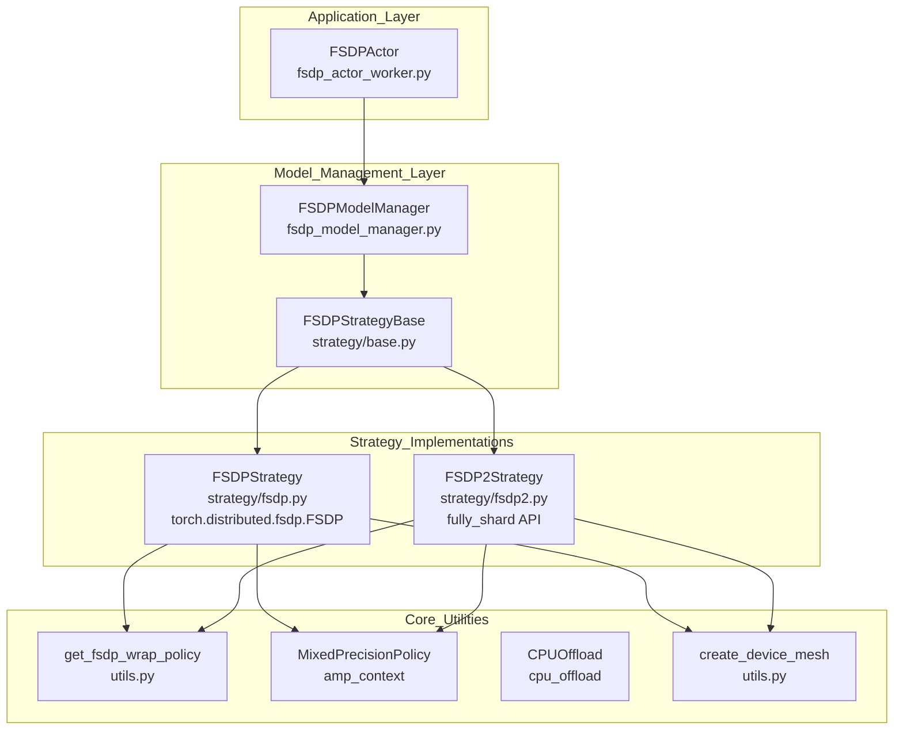
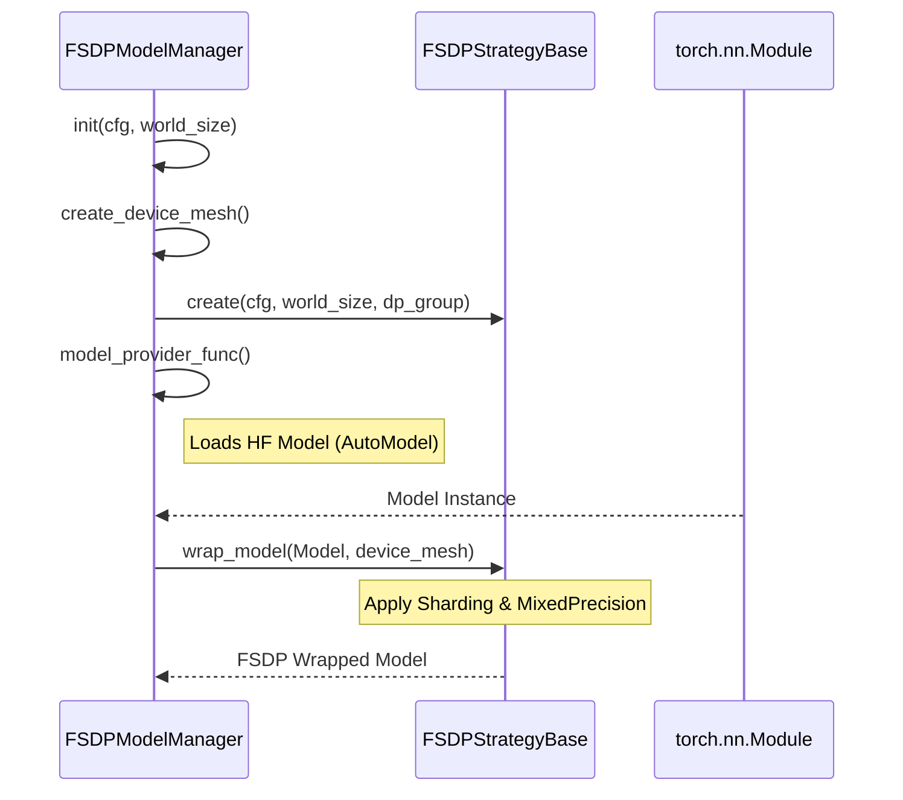

<!-- source: DeepWiki mcp.deepwiki.com · repo RLinf/RLinf · page 5.1 FSDP Backend · fetched 2026-10-21 -->

# FSDP Backend

<details>
<summary>Relevant source files</summary>

The following files were used as context for generating this wiki page:

- [docs/source-en/rst_source/start/installation.rst](docs/source-en/rst_source/start/installation.rst)
- [docs/source-en/rst_source/start/vla.rst](docs/source-en/rst_source/start/vla.rst)
- [docs/source-zh/rst_source/start/installation.rst](docs/source-zh/rst_source/start/installation.rst)
- [docs/source-zh/rst_source/start/vla.rst](docs/source-zh/rst_source/start/vla.rst)
- [examples/embodiment/train_async.py](examples/embodiment/train_async.py)
- [examples/embodiment/train_embodied_agent.py](examples/embodiment/train_embodied_agent.py)
- [rlinf/config.py](rlinf/config.py)
- [rlinf/hybrid_engines/fsdp/fsdp_model_manager.py](rlinf/hybrid_engines/fsdp/fsdp_model_manager.py)
- [rlinf/hybrid_engines/fsdp/strategy/base.py](rlinf/hybrid_engines/fsdp/strategy/base.py)
- [rlinf/hybrid_engines/fsdp/strategy/fsdp.py](rlinf/hybrid_engines/fsdp/strategy/fsdp.py)
- [rlinf/hybrid_engines/fsdp/utils.py](rlinf/hybrid_engines/fsdp/utils.py)
- [rlinf/models/__init__.py](rlinf/models/__init__.py)
- [rlinf/runners/embodied_runner.py](rlinf/runners/embodied_runner.py)
- [rlinf/workers/actor/fsdp_actor_worker.py](rlinf/workers/actor/fsdp_actor_worker.py)
- [rlinf/workers/actor/fsdp_actor_worker_pipeline.py](rlinf/workers/actor/fsdp_actor_worker_pipeline.py)
- [rlinf/workers/env/env_worker.py](rlinf/workers/env/env_worker.py)
- [rlinf/workers/rollout/hf/huggingface_worker.py](rlinf/workers/rollout/hf/huggingface_worker.py)
- [tests/e2e_tests/embodied/maniskill_ppo_openpi05_pipeline.yaml](tests/e2e_tests/embodied/maniskill_ppo_openpi05_pipeline.yaml)
- [tests/unit_tests/test_overlap_env_bootstrap.py](tests/unit_tests/test_overlap_env_bootstrap.py)

</details>


The FSDP Backend provides a fast-prototyping training infrastructure for embodied AI, vision-language-action (VLA) models, and agentic reasoning tasks, built on PyTorch's Fully Sharded Data Parallel (FSDP) framework. It prioritizes rapid iteration, flexible model architecture exploration, and seamless HuggingFace integration.

**Scope**: This page covers the `FSDPModelManager` architecture, strategy pattern, model management, weight synchronization, and offloading mechanisms. For production-scale training with advanced parallelism (TP/PP/EP), see **Megatron Backend**.

---

## Architecture Overview

The FSDP backend follows a layered architecture where `FSDPModelManager` serves as the primary interface for workers to interact with distributed model states.

### FSDP Backend System Mapping
Title: "FSDP Backend Architecture Mapping"

Sources: `[rlinf/hybrid_engines/fsdp/fsdp_model_manager.py:53-99]()`, `[rlinf/hybrid_engines/fsdp/strategy/base.py:47-110]()`, `[rlinf/hybrid_engines/fsdp/utils.py:65-68]()`, `[rlinf/workers/actor/fsdp_actor_worker.py:190-196]()`

---

## Key Components and Code Entities

### FSDPModelManager

The `FSDPModelManager` class orchestrates model initialization, optimizer setup, and device configuration. It initializes a `DeviceMesh` specifically for the FSDP group.

| Component | Method | Purpose |
|-----------|--------|---------|
| **Model Provider** | `model_provider_func()` | Load HuggingFace models with optional GPTQ/8-bit quantization `[rlinf/hybrid_engines/fsdp/fsdp_model_manager.py:135-186]()` |
| **AMP Context** | `_create_amp_context()` | Create autocast context manager for mixed precision `[rlinf/hybrid_engines/fsdp/fsdp_model_manager.py:113-133]()` |
| **Device Mesh** | `create_device_mesh()` | Initialize N-dimensional device mesh for sharding `[rlinf/hybrid_engines/fsdp/utils.py:65-68]()` |
| **Liger Optimization** | `_optimize_with_liger_kernel()` | Replace modules with optimized Liger kernels `[rlinf/hybrid_engines/fsdp/fsdp_model_manager.py:196-203]()` |

Sources: `[rlinf/hybrid_engines/fsdp/fsdp_model_manager.py:53-203]()`, `[rlinf/hybrid_engines/fsdp/utils.py:65-68]()`

---

## Strategy Pattern: FSDP v1 vs FSDP v2

The backend uses a strategy pattern to support both FSDP v1 (classic `torch.distributed.fsdp.FSDP`) and FSDP v2 (`fully_shard` API). Strategy selection is determined by `fsdp_config.strategy` in the Hydra configuration.

### Selection Logic
The `FSDPStrategyBase.create` factory method resolves the implementation:
```python
strategy = str(cfg.fsdp_config.get("strategy", "fsdp2")).lower()
match strategy:
    case FSDPVersion.FSDP:   # Returns FSDPStrategy (v1)
    case FSDPVersion.FSDP2:  # Returns FSDP2Strategy (v2)
```
Sources: `[rlinf/hybrid_engines/fsdp/strategy/base.py:84-110]()`, `[rlinf/hybrid_engines/fsdp/utils.py:60-63]()`

### Model Wrapping and Sharding

The `get_fsdp_wrap_policy()` function handles both standard transformer models and VLA models by inspecting `_no_split_modules`.

**Auto-Wrap Logic**:
1. **VLA Models**: If the module has a `language_model` attribute, it extracts transformer classes from that submodule and optionally the `visual` submodule `[rlinf/hybrid_engines/fsdp/utils.py:188-196]()`.
2. **Standard Models**: Extracts classes directly from the module's `_no_split_modules` attribute `[rlinf/hybrid_engines/fsdp/utils.py:199-202]()`.
3. **Custom Config**: Allows explicit override via `transformer_layer_cls_to_wrap` or `module_classes_to_wrap` in YAML `[rlinf/hybrid_engines/fsdp/utils.py:168-185]()`.

Sources: `[rlinf/hybrid_engines/fsdp/utils.py:151-210]()`

---

## Weight Synchronization and Model Management

Distributed training requires efficient weight transfer between Training Actors (FSDP) and Rollout Workers (Inference).

### Synchronization Orchestration
In `EmbodiedRunner`, weight updates are coordinated between the actor and rollout groups.
- `update_rollout_weights()`: Triggers a bidirectional sync where the rollout worker pulls weights and the actor pushes them `[rlinf/runners/embodied_runner.py:187-192]()`.
- `sync_model_from_actor()`: Rollout worker side implementation using `WeightSyncer` `[rlinf/workers/rollout/hf/huggingface_worker.py:121-129]()`.

### Implementation Details
- **Selective Sync**: `collect_param_names_need_sync` identifies trainable parameters and persistent buffers, filtering out non-essential states `[rlinf/hybrid_engines/fsdp/fsdp_model_manager.py:111]()`.
- **HuggingFace Models**: `MultiStepRolloutWorker` initializes models using `get_model` and can load specific checkpoints `[rlinf/workers/rollout/hf/huggingface_worker.py:141-152]()`.
- **Bucket Capacity**: Controlled via `sync_bucket_capacity` (default 128MB) to manage communication throughput `[rlinf/hybrid_engines/fsdp/fsdp_model_manager.py:109]()`.

Sources: `[rlinf/runners/embodied_runner.py:187-192]()`, `[rlinf/workers/rollout/hf/huggingface_worker.py:121-152]()`, `[rlinf/hybrid_engines/fsdp/fsdp_model_manager.py:108-111]()`

---

## Memory Management and Offloading

### CPU Offloading
The FSDP backend supports offloading to handle models that exceed aggregate GPU memory.
- **FSDP Native Offload**: Controlled via `fsdp_config.cpu_offload`, setting the `CPUOffload` policy in the FSDP constructor `[rlinf/hybrid_engines/fsdp/strategy/fsdp.py:171-187]()`.
- **Worker-level Offload**: `EnvWorker` and `MultiStepRolloutWorker` can enable offloading for specific stages of the pipeline `[rlinf/workers/env/env_worker.py:117-126]()`, `[rlinf/workers/rollout/hf/huggingface_worker.py:60]()`.

### Mixed Precision
Precision is managed through `MixedPrecision` policies and `amp_context`.
- `torch_dtype_from_precision`: Converts config strings (e.g., "bf16", "fp16") to `torch.dtype` `[rlinf/config.py:159-173]()`.
- **AMP Context**: `FSDPModelManager` provides an `amp_context` using `torch.amp.autocast` for operator execution `[rlinf/hybrid_engines/fsdp/fsdp_model_manager.py:113-133]()`.

Sources: `[rlinf/hybrid_engines/fsdp/strategy/fsdp.py:146-187]()`, `[rlinf/hybrid_engines/fsdp/fsdp_model_manager.py:113-133]()`, `[rlinf/config.py:159-173]()`

---

## Model Lifecycle and Integration

### Lifecycle Diagram
Title: "FSDP Model Manager Lifecycle"

Sources: `[rlinf/hybrid_engines/fsdp/fsdp_model_manager.py:58-99]()`, `[rlinf/hybrid_engines/fsdp/strategy/fsdp.py:134-188]()`

### HuggingFace Integration
- **Auto Classes**: Dynamically selects between `AutoModelForCausalLM` and `AutoModelForVision2Seq` `[rlinf/hybrid_engines/fsdp/fsdp_model_manager.py:176-186]()`.
- **Quantization**: Supports `gptq_model` and `load_in_8bit` flags to reduce initial memory footprint before FSDP sharding `[rlinf/hybrid_engines/fsdp/fsdp_model_manager.py:143-174]()`.
- **Liger Kernels**: Optional module replacement with Liger-kernel optimized versions for throughput `[rlinf/hybrid_engines/fsdp/fsdp_model_manager.py:191-194]()`.

Sources: `[rlinf/hybrid_engines/fsdp/fsdp_model_manager.py:143-194]()`

---

