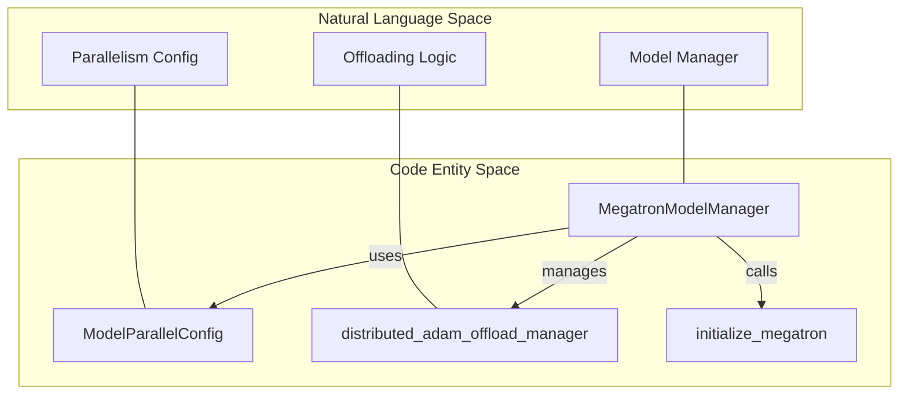
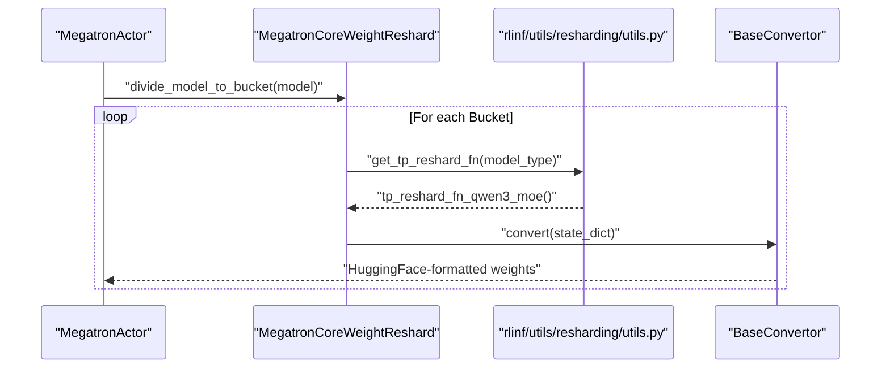

<!-- source: DeepWiki mcp.deepwiki.com · repo RLinf/RLinf · page 5.2 Megatron Backend · fetched 2026-10-21 -->

# Megatron Backend

Relevant source files

The following files were used as context for generating this wiki page:

- [.github/workflows/agent-e2e-tests.yml](.github/workflows/agent-e2e-tests.yml)
- [docs/source-en/rst_source/extending/mbridge.rst](docs/source-en/rst_source/extending/mbridge.rst)
- [docs/source-zh/rst_source/extending/mbridge.rst](docs/source-zh/rst_source/extending/mbridge.rst)
- [examples/embodiment/config/behavior_ppo_openvlaoft.yaml](examples/embodiment/config/behavior_ppo_openvlaoft.yaml)
- [examples/reasoning/config/math/qwen3-30b-grpo-megatron.yaml](examples/reasoning/config/math/qwen3-30b-grpo-megatron.yaml)
- [examples/sft/config/qwen2_5_vl_megatron_sft_vlm.yaml](examples/sft/config/qwen2_5_vl_megatron_sft_vlm.yaml)
- [examples/sft/config/qwen2_5_vl_sft_vlm.yaml](examples/sft/config/qwen2_5_vl_sft_vlm.yaml)
- [examples/sft/config/qwen3_vl_moe_megatron_sft_vlm.yaml](examples/sft/config/qwen3_vl_moe_megatron_sft_vlm.yaml)
- [examples/sft/config/qwen3_vl_sft_vlm.yaml](examples/sft/config/qwen3_vl_sft_vlm.yaml)
- [rlinf/algorithms/losses.py](rlinf/algorithms/losses.py)
- [rlinf/hybrid_engines/megatron/megatron_model_manager.py](rlinf/hybrid_engines/megatron/megatron_model_manager.py)
- [rlinf/hybrid_engines/megatron/token_dispatcher.py](rlinf/hybrid_engines/megatron/token_dispatcher.py)
- [rlinf/hybrid_engines/megatron/utils.py](rlinf/hybrid_engines/megatron/utils.py)
- [rlinf/runners/agentlightning_runner.py](rlinf/runners/agentlightning_runner.py)
- [rlinf/utils/convertor/utils.py](rlinf/utils/convertor/utils.py)
- [rlinf/utils/metric_utils.py](rlinf/utils/metric_utils.py)
- [rlinf/utils/resharding/mcore_weight_reshard.py](rlinf/utils/resharding/mcore_weight_reshard.py)
- [rlinf/utils/resharding/reshard_config.py](rlinf/utils/resharding/reshard_config.py)
- [rlinf/utils/resharding/utils.py](rlinf/utils/resharding/utils.py)
- [rlinf/workers/actor/async_ppo_fsdp_worker.py](rlinf/workers/actor/async_ppo_fsdp_worker.py)
- [rlinf/workers/actor/ma_megatron_actor_worker.py](rlinf/workers/actor/ma_megatron_actor_worker.py)
- [rlinf/workers/actor/megatron_actor_worker.py](rlinf/workers/actor/megatron_actor_worker.py)
- [rlinf/workers/agent/agentlightning_rollout_worker.py](rlinf/workers/agent/agentlightning_rollout_worker.py)
- [rlinf/workers/critic/megatron_critic_worker.py](rlinf/workers/critic/megatron_critic_worker.py)
- [rlinf/workers/megatron_worker.py](rlinf/workers/megatron_worker.py)
- [tests/e2e_tests/reasoning/qwen3-moe-2.5b-collocated-mg-sgl-ep-fusco-test.yaml](tests/e2e_tests/reasoning/qwen3-moe-2.5b-collocated-mg-sgl-ep-fusco-test.yaml)

The Megatron training backend is a core component of the RLinf infrastructure, specifically designed for large-scale Agentic and Reasoning RL tasks. It leverages Megatron-Core to manage model and optimizer lifecycles across multiple dimensions of parallelism (TP, PP, EP, CP, DP). This backend coordinates the conversion of sharded Megatron weights into HuggingFace-compatible formats for rollout engines like vLLM and SGLang.

---

## Overview

The Megatron backend enables training of state-of-the-art LLMs (e.g., Qwen2.5, Qwen3-MoE) by providing high-performance distributed primitives. After training updates, weights are resharded and synchronized with inference workers to maintain the RL loop.

**Key components and their roles:**

| Component | File | Role |
|---|---|---|
| `MegatronModelManager` | [rlinf/hybrid_engines/megatron/megatron_model_manager.py:178-183]() | Manages Megatron-Core initialization, model/optimizer setup, and memory offloading. |
| `MegatronActor` | [rlinf/workers/actor/megatron_actor_worker.py:51-51]() | Implementation of the actor worker using Megatron-Core, handling PPO/GRPO policy losses. |
| `MAMegatronActor` | [rlinf/workers/actor/ma_megatron_actor_worker.py:67-67]() | Specialized actor for multi-agent reasoning tasks with dynamic rollout batch support. |
| `MegatronCoreWeightReshard` | [rlinf/utils/resharding/mcore_weight_reshard.py:23-24]() | Handles the logic of gathering and re-sharding TP/PP/EP weights for rollout. |
| `ReshardConfig` | [rlinf/utils/resharding/reshard_config.py:26-27]() | Data class holding target resharding dimensions and transformer configurations. |
| `MoEAlltoAllTokenDispatcher` | [rlinf/hybrid_engines/megatron/token_dispatcher.py:226-227]() | Specialized dispatcher for MoE models, supporting FUSCO-based optimizations. |
| `LinearForLastLayer` | [rlinf/hybrid_engines/megatron/megatron_model_manager.py:134-135]() | Custom linear layer for sequence parallel output gathering. |

Sources: [rlinf/hybrid_engines/megatron/megatron_model_manager.py:178-183](), [rlinf/workers/actor/megatron_actor_worker.py:51-51](), [rlinf/workers/actor/ma_megatron_actor_worker.py:67-67](), [rlinf/hybrid_engines/megatron/token_dispatcher.py:226-227]()

---

## MegatronModelManager

`MegatronModelManager` acts as the bridge between RLinf's worker abstractions and the Megatron-Core library.

### Model and Optimizer Lifecycle
The manager initializes the Megatron environment using `initialize_megatron(cfg)` [rlinf/hybrid_engines/megatron/megatron_model_manager.py:189]() and builds the transformer configuration via `build_transformer_config(cfg.model)` [rlinf/hybrid_engines/megatron/megatron_model_manager.py:191](). It supports modern layer specifications through `MCoreGPTModel` [rlinf/hybrid_engines/megatron/megatron_model_manager.py:47]().

Key initialization steps include:
- Setting Megatron arguments via `set_megatron_args` [rlinf/hybrid_engines/megatron/megatron_model_manager.py:29]().
- Configuring layer specifications (e.g., `te_gpt`, `local_gpt`, `decoder_gpt`) based on the `spec_name` parameter [rlinf/hybrid_engines/megatron/megatron_model_manager.py:112-130]().
- Providing a non-strict checkpoint loading context via `patch_load_checkpoint_to_be_non_strict` [rlinf/hybrid_engines/megatron/megatron_model_manager.py:163-176]().

### Sequence Packing and Context Parallelism
To optimize throughput, the manager supports sequence packing.
- **Pre-processing**: Padding is removed using `preprocess_packed_seqs`, which accounts for Context Parallelism (CP) chunking to maintain load balancing with causal masking [rlinf/hybrid_engines/megatron/utils.py:27-102]().
- **Post-processing**: After the forward pass, sequences are restored to their padded form using `postprocess_packed_seqs` [rlinf/hybrid_engines/megatron/utils.py:105-171]().

### Memory Management (Offloading)
In scenarios where training and rollout share GPUs, the manager implements weight and optimizer offloading to CPU pinned memory to maximize available VRAM for inference. This is controlled via the `distributed_adam_offload_manager` [rlinf/hybrid_engines/megatron/megatron_model_manager.py:201]().

**Diagram: Megatron System Architecture and Entity Mapping**

Sources: [rlinf/hybrid_engines/megatron/megatron_model_manager.py:178-201](), [rlinf/utils/initialize.py:29]()

---

## Weight Resharding and Synchronization

The Megatron backend must synchronize weights with rollout workers (vLLM/SGLang). This involves resharding weights from the training parallelism (e.g., TP=4, PP=2) to the rollout parallelism (e.g., TP=1).

### MegatronCoreWeightReshard
The `MegatronCoreWeightReshard` class manages this transformation. It uses `divide_model_to_bucket` to split the model into manageable chunks for transmission based on `bucket_capacity` (default 128MB) [rlinf/utils/resharding/mcore_weight_reshard.py:72-111]().

**Resharding Logic:**
1. **Pipeline Parallelism (PP)**: Weights are gathered across the pipeline group if the training PP size is greater than the rollout PP size [rlinf/utils/resharding/mcore_weight_reshard.py:177-178](). `get_pp_reshard_fn` provides model-specific logic for architectures like Qwen2.5 or Qwen3 [rlinf/utils/resharding/utils.py:46-58]().
2. **Tensor Parallelism (TP)**: Column and Row parallel weights are gathered and re-split according to the `reshard_tp_size` [rlinf/utils/resharding/mcore_weight_reshard.py:174-175](). Functions like `tp_reshard_fn_qwen2_5` [rlinf/utils/resharding/utils.py:75-114]() and `tp_reshard_fn_qwen3_moe` [rlinf/utils/resharding/utils.py:162-211]() handle specific layer transformations.
3. **Expert Parallelism (EP)**: For MoE models, expert weights are gathered across the expert parallel group using `tpe_reshard_fn` [rlinf/utils/resharding/mcore_weight_reshard.py:181-184]().

### Conversion to HuggingFace Format
The `ReshardConfig` facilitates weight format conversion [rlinf/utils/resharding/reshard_config.py:26-27](). This uses rules defined in `ConvertorRule` to map Megatron layer names to HuggingFace names (e.g., splitting fused QKV tensors via `_split_gqa_tensor`) [rlinf/utils/convertor/utils.py:34-95]().

**Diagram: Weight Flow from Actor to Rollout**

Sources: [rlinf/utils/resharding/mcore_weight_reshard.py:72-184](), [rlinf/utils/resharding/utils.py:22-114](), [rlinf/utils/convertor/utils.py:34-188](), [rlinf/workers/actor/megatron_actor_worker.py:108-109]()

---

## FUSCO MoE Optimization

For Mixture-of-Experts (MoE) models, RLinf integrates **FUSCO** (Fast Unified Sparse Communication) to optimize the all-to-all communication bottleneck [rlinf/hybrid_engines/megatron/megatron_model_manager.py:94-109]().

### 2D Dispatch and Implementation
FUSCO implements a multi-stage communication strategy for MoE tokens:
- **Intra-node vs Cross-node**: It distinguishes between local and global token movements using `intra_fusco` and `global_fusco` [rlinf/hybrid_engines/megatron/token_dispatcher.py:45-55]().
- **Raw Dispatch**: The `dispatch_raw` function handles the 2D mode where tokens are first moved across nodes and then within nodes to reach their target experts [rlinf/hybrid_engines/megatron/token_dispatcher.py:67-123]().
- **Token Combining**: `combine_raw` reverses the process, using `torch.segment_reduce` to aggregate expert outputs before returning them to the original sequence order [rlinf/hybrid_engines/megatron/token_dispatcher.py:126-193]().

The backend dynamically loads `libfusco.so` and utilizes `FUSCOLibrary` for high-performance tensor shuffling [rlinf/hybrid_engines/megatron/megatron_model_manager.py:99-105]().

Sources: [rlinf/hybrid_engines/megatron/megatron_model_manager.py:94-109](), [rlinf/hybrid_engines/megatron/token_dispatcher.py:43-193]()

---

## Configuration

Megatron backend settings are configured via YAML files under `actor` and `model` keys.

- **Parallelism Dimensions**: Users define `tensor_model_parallel_size`, `pipeline_model_parallel_size`, `expert_model_parallel_size`, and `expert_tensor_parallel_size` [tests/e2e_tests/reasoning/qwen3-moe-2.5b-collocated-mg-sgl-ep-fusco-test.yaml:166-169]().
- **MoE Settings**: Supports `moe_grouped_gemm` (e.g., `te`) [tests/e2e_tests/reasoning/qwen3-moe-2.5b-collocated-mg-sgl-ep-fusco-test.yaml:170]() and `moe_router_topk` [tests/e2e_tests/reasoning/qwen3-moe-2.5b-collocated-mg-sgl-ep-fusco-test.yaml:202]().
- **Memory Optimization**: `recompute_method` (e.g., `uniform`, `block`) and `recompute_granularity` (e.g., `full`, `selective`) control gradient checkpointing [tests/e2e_tests/reasoning/qwen3-moe-2.5b-collocated-mg-sgl-ep-fusco-test.yaml:177-178]().
- **FUSCO Activation**: Enabled by setting `moe_token_dispatcher_type: alltoall` and ensuring the `FUSCO_SO_PATH` environment variable is set [tests/e2e_tests/reasoning/qwen3-moe-2.5b-collocated-mg-sgl-ep-fusco-test.yaml:196]().

Sources: [tests/e2e_tests/reasoning/qwen3-moe-2.5b-collocated-mg-sgl-ep-fusco-test.yaml:164-205](), [rlinf/hybrid_engines/megatron/megatron_model_manager.py:104-105]()

---

