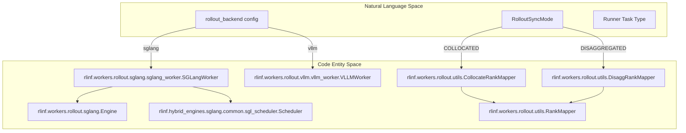

<!-- source: DeepWiki mcp.deepwiki.com · repo RLinf/RLinf · page 5.3 Inference Engine Integration · fetched 2026-10-21 -->

# Inference Engine Integration

<details>
<summary>Relevant source files</summary>

The following files were used as context for generating this wiki page:

- [docs/source-en/rst_source/guides/hardware/index.rst](docs/source-en/rst_source/guides/hardware/index.rst)
- [docs/source-en/rst_source/guides/index.rst](docs/source-en/rst_source/guides/index.rst)
- [docs/source-en/rst_source/guides/inference_http_client.rst](docs/source-en/rst_source/guides/inference_http_client.rst)
- [docs/source-en/rst_source/guides/rollout-engines/index.rst](docs/source-en/rst_source/guides/rollout-engines/index.rst)
- [docs/source-en/rst_source/guides/sglang_server.rst](docs/source-en/rst_source/guides/sglang_server.rst)
- [docs/source-zh/rst_source/guides/hardware/index.rst](docs/source-zh/rst_source/guides/hardware/index.rst)
- [docs/source-zh/rst_source/guides/index.rst](docs/source-zh/rst_source/guides/index.rst)
- [docs/source-zh/rst_source/guides/inference_http_client.rst](docs/source-zh/rst_source/guides/inference_http_client.rst)
- [docs/source-zh/rst_source/guides/rollout-engines/index.rst](docs/source-zh/rst_source/guides/rollout-engines/index.rst)
- [docs/source-zh/rst_source/guides/sglang_server.rst](docs/source-zh/rst_source/guides/sglang_server.rst)
- [rlinf/algorithms/rewards/vqa/__init__.py](rlinf/algorithms/rewards/vqa/__init__.py)
- [rlinf/algorithms/rewards/vqa/format_rewards.py](rlinf/algorithms/rewards/vqa/format_rewards.py)
- [rlinf/algorithms/rewards/vqa/qa_rewards.py](rlinf/algorithms/rewards/vqa/qa_rewards.py)
- [rlinf/hybrid_engines/sglang/common/detokenizer_manager.py](rlinf/hybrid_engines/sglang/common/detokenizer_manager.py)
- [rlinf/hybrid_engines/sglang/common/sgl_engine.py](rlinf/hybrid_engines/sglang/common/sgl_engine.py)
- [rlinf/hybrid_engines/sglang/common/sgl_scheduler.py](rlinf/hybrid_engines/sglang/common/sgl_scheduler.py)
- [rlinf/hybrid_engines/sglang/common/tokenizer_manager.py](rlinf/hybrid_engines/sglang/common/tokenizer_manager.py)
- [rlinf/hybrid_engines/vllm/vllm_0_8_5/worker.py](rlinf/hybrid_engines/vllm/vllm_0_8_5/worker.py)
- [rlinf/utils/placement.py](rlinf/utils/placement.py)
- [rlinf/workers/rollout/sglang/__init__.py](rlinf/workers/rollout/sglang/__init__.py)
- [rlinf/workers/rollout/sglang_server/__init__.py](rlinf/workers/rollout/sglang_server/__init__.py)
- [rlinf/workers/rollout/sglang_server/launcher.py](rlinf/workers/rollout/sglang_server/launcher.py)
- [rlinf/workers/rollout/sglang_server/server_worker.py](rlinf/workers/rollout/sglang_server/server_worker.py)
- [rlinf/workers/rollout/utils.py](rlinf/workers/rollout/utils.py)
- [rlinf/workers/rollout/vllm/vllm_worker.py](rlinf/workers/rollout/vllm/vllm_worker.py)

</details>


This page documents how RLinf integrates with high-performance inference engines (SGLang, vLLM, and HuggingFace) for efficient rollout generation during RL training. This integration supports both collocated and disaggregated deployment modes, enabling seamless weight synchronization between training and inference components.

## Purpose and Scope

During reinforcement learning training, the policy must generate rollout trajectories by sampling actions or generating text responses. RLinf abstracts these engines into specialized `Worker` classes that handle initialization, weight loading, and generation requests.

- **SGLang**: Optimized for low-latency and complex sampling. RLinf supports SGLang via the `SGLangWorker` [rlinf/workers/rollout/sglang/sglang_worker.py:49-50]() and a customized `Scheduler` [rlinf/hybrid_engines/sglang/common/sgl_scheduler.py:53-54]().
- **vLLM**: High-throughput engine with PagedAttention. RLinf supports vLLM integration for reasoning and agentic tasks via `VLLMWorker` [rlinf/workers/rollout/vllm/vllm_worker.py:43-44]().
- **HuggingFace**: Standard implementation used primarily in embodied AI for multi-step rollout workers, supporting models like OpenVLA.

## Integration Architecture

The integration relies on a mapping between the training ranks (Actor) and inference ranks (Rollout). This is managed by the `RankMapper` [rlinf/workers/rollout/utils.py:91-92]() and specialized `Worker` implementations for each engine.

### Engine Component Mapping

The following diagram bridges the configuration space to the internal code entities used to manage inference.

### Rollout Engine Entity Relationship

Sources: [rlinf/workers/rollout/sglang/sglang_worker.py:49-55](), [rlinf/hybrid_engines/sglang/common/sgl_scheduler.py:53-54](), [rlinf/workers/rollout/utils.py:91-133]()

### Weight Synchronization Flow

A critical feature of RLinf is the ability to synchronize weights from the Actor (training) to the Inference Engine (rollout) with minimal overhead. This process handles resharding if the Tensor Parallel (TP) sizes differ between training and inference.

### Actor-to-Rollout Weight Sync Sequence
```mermaid
sequenceDiagram
    participant Actor as "rlinf.workers.actor.megatron_actor_worker.MegatronActor"
    participant Resharder as "rlinf.utils.resharding.mcore_weight_reshard.MegatronCoreWeightReshard"
    participant SGLSch as "rlinf.hybrid_engines.sglang.common.sgl_scheduler.Scheduler"

    Actor->>Resharder: reshard_weights()
    Note over Actor, Resharder: Transform Actor TP/PP to Rollout TP/PP
    
    Actor->>SGLSch: sync_hf_weight(SyncHFWeightInput)
    
    alt Sync Mode
        SGLSch->>SGLSch: batch_load_hf_weight()
    else CPU Mode
        SGLSch->>SGLSch: resume_memory_occupation()
    end
    
    SGLSch->>SGLSch: tp_worker.worker.model_runner.model.load_weights()
```
Sources: [rlinf/hybrid_engines/sglang/common/sgl_scheduler.py:112-141](), [rlinf/hybrid_engines/sglang/common/sgl_scheduler.py:167-185](), [rlinf/hybrid_engines/vllm/vllm_0_8_5/worker.py:106-153]()

## Inference Engine Configuration

### SGLang Specifics
RLinf extends SGLang's internal management to support weight reloading and memory management. The `SGLangWorker` manages the lifecycle of the SGLang Engine [rlinf/workers/rollout/sglang/sglang_worker.py:49](). 

For high-level server management, RLinf provides the `SGLangServerWorker` [rlinf/workers/rollout/sglang_server/server_worker.py:87](), which spawns an HTTP server in a separate process using `mp.get_context("spawn")` [rlinf/workers/rollout/sglang_server/server_worker.py:179]().

| Feature | Implementation |
| :--- | :--- |
| **Worker Wrapper** | `rlinf.workers.rollout.sglang.sglang_worker.SGLangWorker` [rlinf/workers/rollout/sglang/sglang_worker.py:49]() |
| **Custom Scheduler** | `rlinf.hybrid_engines.sglang.common.sgl_scheduler.Scheduler` overrides SGLang's `_Scheduler` [rlinf/hybrid_engines/sglang/common/sgl_scheduler.py:53]() |
| **Weight Loading** | `weight_reload` supports `sync` and `cpu` modes [rlinf/workers/rollout/sglang/sglang_worker.py:151-163]() |
| **HTTP Router** | `SGLangRouterWorker` manages traffic across multiple backend servers [rlinf/workers/rollout/sglang_server/router_worker.py:34]() |

Sources: [rlinf/workers/rollout/sglang/sglang_worker.py:49-185](), [rlinf/hybrid_engines/sglang/common/sgl_scheduler.py:53-110](), [rlinf/workers/rollout/sglang_server/server_worker.py:87-180]()

### vLLM Specifics
The `VLLMWorker` integrates the vLLM engine into the RLinf distributed framework, specifically using the V1 engine architecture [rlinf/workers/rollout/vllm/vllm_worker.py:92]().

- **Environment Setup**: Configures `VLLM_USE_V1`, attention backends, and multi-processing methods (spawn) [rlinf/workers/rollout/vllm/vllm_worker.py:87-100]().
- **Async Execution**: Tracks running generate tasks in an asyncio level to handle abortions correctly [rlinf/workers/rollout/vllm/vllm_worker.py:71-72]().
- **Engine Offloading**: Supports offloading model weights and KV cache via `offload_engine` [rlinf/workers/rollout/vllm/vllm_worker.py:169-174]().
- **Weight Synchronization**: The `VLLMWorker` implementation in `vllm_0_8_5` uses `batch_load_hf_weight` to load tensors received from the actor [rlinf/hybrid_engines/vllm/vllm_0_8_5/worker.py:84-105]().

Sources: [rlinf/workers/rollout/vllm/vllm_worker.py:43-174](), [rlinf/hybrid_engines/vllm/vllm_0_8_5/worker.py:34-162]()

## Performance and Resource Management

### Dynamic Scheduling and Auto-Scaling
When using `PlacementMode.AUTO` [rlinf/utils/placement.py:41](), RLinf can dynamically allocate resources. The `SGLangWorker` and `VLLMWorker` initialize a `RolloutScalingScheduler` to communicate with the cluster manager [rlinf/workers/rollout/sglang/sglang_worker.py:103-110](), [rlinf/workers/rollout/vllm/vllm_worker.py:78-85]().

- **Scheduler Connection**: Connects to a dedicated `schedule_channel` for rollout scaling via `get_scheduler_channel` [rlinf/workers/rollout/sglang/sglang_worker.py:104-106]().
- **Status Monitoring**: Uses `RunningStatusManager` to track engine health and throughput [rlinf/workers/rollout/sglang/sglang_worker.py:90]().

### Memory Optimization Techniques
RLinf provides several mechanisms to optimize VRAM usage during rollout:

1.  **Memory Offloading**: `Scheduler` can release and resume memory occupation using `ReleaseMemoryOccupationReqInput` and `ResumeMemoryOccupationReqInput` [rlinf/hybrid_engines/sglang/common/sgl_scheduler.py:97-105]().
2.  **Static Memory Allocation**: SGLang engines use `gpu_memory_utilization` (via `mem_fraction_static`) to pre-allocate KV caches [rlinf/workers/rollout/sglang/sglang_worker.py:172]().
3.  **CUDA Graph and Torch Compile**: SGLang integration supports `enable_torch_compile` and CUDA graph capture to reduce launch overhead [rlinf/workers/rollout/sglang/sglang_worker.py:174-178]().

### Rank Mapping and Communication
The `RankMapper` determines how training ranks correspond to inference ranks, supporting both `COLLOCATED` and `DISAGGREGATED` modes [rlinf/workers/rollout/utils.py:91-133]().

- **CollocateRankMapper**: Maps actor ranks to rollout ranks when they share GPUs [rlinf/workers/rollout/utils.py:136-183]().
- **DisaggRankMapper**: Maps ranks when training and inference are on separate resources [rlinf/workers/rollout/utils.py:215-220]().
- **Weight Transfer**: In `COLLOCATED` mode, weights can be shared via handle passing to avoid copies, while `DISAGGREGATED` mode uses direct tensor transfer [rlinf/hybrid_engines/sglang/common/sgl_scheduler.py:117-133]().

### HTTP Server and Router Integration
For high-availability reasoning tasks, RLinf provides a launcher for SGLang Router and Server groups. The `launch_sglang_router_and_server` helper wires placement to the server and router groups [rlinf/workers/rollout/sglang_server/launcher.py:55]().

- **Unified Endpoint**: The launcher starts multiple backend engines and a single router, providing an OpenAI-compatible interface [rlinf/workers/rollout/sglang_server/launcher.py:153-164]().
- **Inference Client**: The `InferenceHTTPClient` [docs/source-zh/rst_source/guides/inference_http_client.rst:4-7]() encapsulates `requests` and `aiohttp` to interact with these endpoints via native `/generate` or `/v1/chat/completions`.

Sources: [rlinf/workers/rollout/sglang/sglang_worker.py:90-110](), [rlinf/hybrid_engines/sglang/common/sgl_scheduler.py:97-141](), [rlinf/workers/rollout/vllm/vllm_worker.py:71-85](), [rlinf/workers/rollout/utils.py:91-220](), [rlinf/utils/placement.py:28-41](), [rlinf/workers/rollout/sglang_server/launcher.py:55-164]()

---

