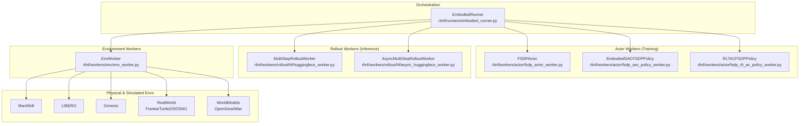
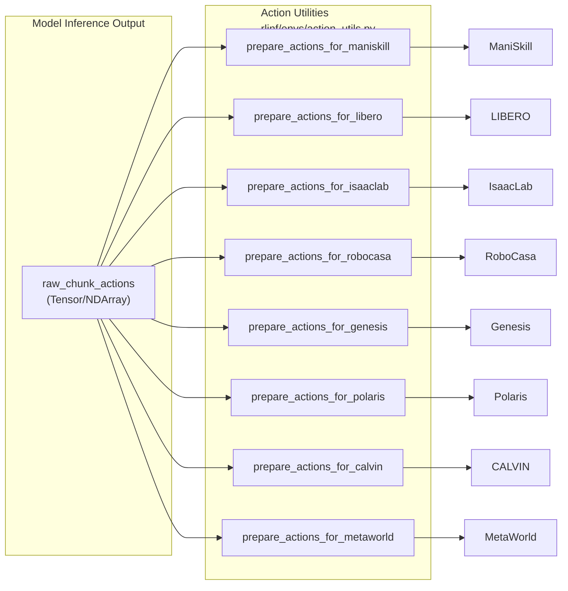

<!-- source: DeepWiki mcp.deepwiki.com · repo RLinf/RLinf · page 6 Embodied RL · fetched 2026-10-21 -->

# Embodied RL

Relevant source files

The following files were used as context for generating this wiki page:

- [.github/workflows/docker-build.yml](.github/workflows/docker-build.yml)
- [.github/workflows/embodied-e2e-tests.yml](.github/workflows/embodied-e2e-tests.yml)
- [docker/Dockerfile](docker/Dockerfile)
- [docker/README.md](docker/README.md)
- [examples/embodiment/train_async.py](examples/embodiment/train_async.py)
- [examples/embodiment/train_embodied_agent.py](examples/embodiment/train_embodied_agent.py)
- [requirements/embodied/download_assets.sh](requirements/embodied/download_assets.sh)
- [requirements/embodied/ros_install.sh](requirements/embodied/ros_install.sh)
- [requirements/install.sh](requirements/install.sh)
- [rlinf/config.py](rlinf/config.py)
- [rlinf/data/io_struct.py](rlinf/data/io_struct.py)
- [rlinf/envs/__init__.py](rlinf/envs/__init__.py)
- [rlinf/envs/action_utils.py](rlinf/envs/action_utils.py)
- [rlinf/runners/embodied_runner.py](rlinf/runners/embodied_runner.py)
- [rlinf/workers/actor/fsdp_actor_worker.py](rlinf/workers/actor/fsdp_actor_worker.py)
- [rlinf/workers/env/env_worker.py](rlinf/workers/env/env_worker.py)
- [rlinf/workers/rollout/hf/huggingface_worker.py](rlinf/workers/rollout/hf/huggingface_worker.py)
- [tests/unit_tests/test_overlap_env_bootstrap.py](tests/unit_tests/test_overlap_env_bootstrap.py)

This page provides a high-level overview of the Embodied RL infrastructure within RLinf. It describes the primary components, their coordination, and the supported models and environments. Detailed technical specifications for each subsystem are available in the linked child pages:

- **Full training loop and worker coordination**: see [Embodied Training Pipeline](#6.1)
- **Environment abstraction and observation processing**: see [Environment Workers](#6.2)
- **Simulator and benchmark support (ManiSkill, LIBERO, etc.)**: see [Environment Integrations](#6.3)
- **High-throughput action generation**: see [Rollout Workers](#6.4)
- **VLA model architectures (OpenVLA, Pi0, GR00T)**: see [VLA Models and Architectures](#6.5)
- **On-policy algorithms for control**: see [PPO and GRPO for Embodied AI](#6.6)
- **Off-policy and sample-efficient learning**: see [SAC and RLPD for Embodied AI](#6.7)
- **Experience replay and demo management**: see [Replay Buffers and Data Collection](#6.8)
- **Physical robot integration (Franka, Turtle2)**: see [Real-World Robot Training](#6.9)
- **Training in learned dynamics models**: see [World Model Training](#6.10)

---

## Domain Summary

The Embodied RL domain handles reinforcement learning for robotic control, scaling from simulated tabletop manipulation to real-world mobile base navigation. Key features include:

*   **On-Policy & Off-Policy Support**: Implementation of PPO, GRPO, SAC, and RLPD tailored for continuous action spaces and high-dimensional observations [rlinf/runners/embodied_runner.py:52-66]().
*   **VLA Fine-Tuning**: Native support for Vision-Language-Action models like `OPENVLA`, `OPENPI`, `STARVLA`, `GR00T`, `DEXBOTIC`, and `LingBotVLA` [rlinf/config.py:81-109]().
*   **Action Chunking**: Support for multi-step action prediction to improve temporal consistency, managed via environment-specific preparation utilities [rlinf/envs/action_utils.py:22-63]().
*   **Real-World Integration**: Specialized support for Franka robots, XSquare Turtle2, GimArm, and DOS-W1 hardware [requirements/install.sh:83-84]().
*   **World Model Training**: Capabilities to train policies within learned simulators such as `OpenSora` and `Wan` [requirements/install.sh:83-84]().
*   **Asynchronous Orchestration**: Support for overlapping environment interaction with training to maximize throughput via `AsyncEmbodiedRunner` variants [rlinf/runners/embodied_runner.py:74-76]().

Sources: [rlinf/runners/embodied_runner.py:52-76](), [rlinf/envs/action_utils.py:22-63](), [rlinf/config.py:81-109](), [requirements/install.sh:83-84]()

---

## High-Level Component Map

The following diagram illustrates the relationship between the orchestration runners, distributed workers, and underlying code entities.

**Diagram: Embodied RL System Architecture**

Sources: [rlinf/runners/embodied_runner.py:52-72](), [rlinf/workers/actor/fsdp_actor_worker.py:190-201](), [rlinf/workers/rollout/hf/huggingface_worker.py:42-62](), [rlinf/workers/env/env_worker.py:58-75](), [examples/embodiment/train_embodied_agent.py:51-95]()

---

## Worker Roles and Communication

RLinf decouples simulation, inference, and training into specialized worker groups to maximize throughput.

| Worker Class | Code Entity | Primary Responsibility |
|---|---|---|
| **EnvWorker** | `EnvWorker` | Manages environment lifecycle, observation processing, and auto-reset behavior [rlinf/workers/env/env_worker.py:58-140](). |
| **RolloutWorker** | `MultiStepRolloutWorker` | Performs model inference to generate action chunks using HuggingFace backends [rlinf/workers/rollout/hf/huggingface_worker.py:42-139](). |
| **FSDPActor** | `FSDPActor` | Orchestrates distributed training using FSDP, handles policy updates and advantage computation [rlinf/workers/actor/fsdp_actor_worker.py:190-210](). |

### Communication Channels
Workers communicate using asynchronous `Channel` primitives to ensure non-blocking execution [rlinf/runners/embodied_runner.py:94-100]():
*   **Env Channel**: Transfers environment observations to rollout workers [rlinf/runners/embodied_runner.py:94]().
*   **Rollout Channel**: Transfers generated actions back to environment workers [rlinf/runners/embodied_runner.py:95]().
*   **Actor Channel**: Transfers collected experience (trajectories) to training actors [rlinf/runners/embodied_runner.py:96]().
*   **Reward Channel**: Optional channel for standalone reward model computation [rlinf/runners/embodied_runner.py:98]().

Sources: [rlinf/runners/embodied_runner.py:94-100](), [rlinf/workers/env/env_worker.py:176-180](), [rlinf/workers/rollout/hf/huggingface_worker.py:131-136]()

---

## Supported Models and Environments

### VLA Models
RLinf supports a wide array of Vision-Language-Action architectures via the `SupportedModel` registry [rlinf/config.py:81-115]():
*   **OpenVLA / OpenVLA-OFT**: SOTA vision-language-action models with optimized fine-tuning [rlinf/config.py:86-87]().
*   **OpenPI / StarVLA**: High-performance embodied foundation models [rlinf/config.py:88-90]().
*   **GR00T / GR00T_N1D6 / GR00T_N1D7**: Specialized models for humanoid and general simulation [rlinf/config.py:93, 114-115]().
*   **LingBotVLA / DexBotic**: Advanced models for dexterous manipulation [rlinf/config.py:94-95, 100]().
*   **DreamZero / ABot-M0**: New additions for SFT and RL fine-tuning [rlinf/config.py:96, 101]().

### Environments and Action Preparation
Different environments require specific action transformations (e.g., gripper normalization, dimension extraction). These are centralized in `action_utils.py`.

**Diagram: Action Preparation Flow**

Sources: [rlinf/envs/action_utils.py:22-200](), [rlinf/config.py:117-142](), [requirements/install.sh:84]()

---

## Training Algorithms

*   **On-Policy (PPO/GRPO)**: Standard for fine-tuning VLAs. Supported via `EmbodiedRunner` and `FSDPActor` [rlinf/runners/embodied_runner.py:52-66]().
*   **Off-Policy (SAC/RLPD/IQL)**: Preferred for sample efficiency and offline learning. Implementation handles continuous control and entropy tuning [rlinf/runners/embodied_runner.py:56-60]().
*   **RLT (RL with Transitions)**: Support for online RL fine-tuning of VLA policies via `RLTACFSDPPolicy` [examples/embodiment/train_embodied_agent.py:64-66]().
*   **DAgger / Online LeRobot**: Support for dataset aggregation and online imitation learning updates [rlinf/workers/env/env_worker.py:128-134]().
*   **STEAM / RECAP**: Offline advantage-based policy optimization methods supported via specialized value models [rlinf/config.py:104-109]().

For implementation details, see [PPO and GRPO for Embodied AI](#6.6) and [SAC and RLPD for Embodied AI](#6.7).

---

## Sub-Page Index

| Page | Coverage |
|---|---|
| [Embodied Training Pipeline](#6.1) | Full training loop, weight synchronization, and worker interaction [rlinf/runners/embodied_runner.py](). |
| [Environment Workers](#6.2) | `EnvWorker` logic, observation processing, and reset behavior [rlinf/workers/env/env_worker.py](). |
| [Environment Integrations](#6.3) | Setup for ManiSkill, LIBERO, Genesis, and real-world hardware [rlinf/envs/action_utils.py](). |
| [Rollout Workers](#6.4) | Inference optimization, action generation, and multi-step rollout [rlinf/workers/rollout/hf/huggingface_worker.py](). |
| [VLA Models and Architectures](#6.5) | Deep-dive into supported model architectures like `OPENVLA` and `GR00T` [rlinf/config.py](). |
| [PPO and GRPO for Embodied AI](#6.6) | Advantage estimation and policy loss computation for on-policy VLA tuning [rlinf/workers/actor/fsdp_actor_worker.py](). |
| [SAC and RLPD for Embodied AI](#6.7) | Off-policy Q-learning and entropy temperature tuning for robotic control [rlinf/workers/actor/fsdp_sac_policy_worker.py](). |
| [Replay Buffers and Data Collection](#6.8) | Trajectory storage, demonstration preloading, and async data sampling. |
| [Real-World Robot Training](#6.9) | Physical robot integration (Franka, Turtle2, DOSW1) and hardware verification [requirements/install.sh](). |
| [World Model Training](#6.10) | Training policies within learned dynamics models like `OpenSora` and `Wan`. |

Sources: [rlinf/runners/embodied_runner.py:52-115](), [rlinf/workers/env/env_worker.py:58-140](), [rlinf/config.py:81-142](), [requirements/install.sh:83-84]()

---

