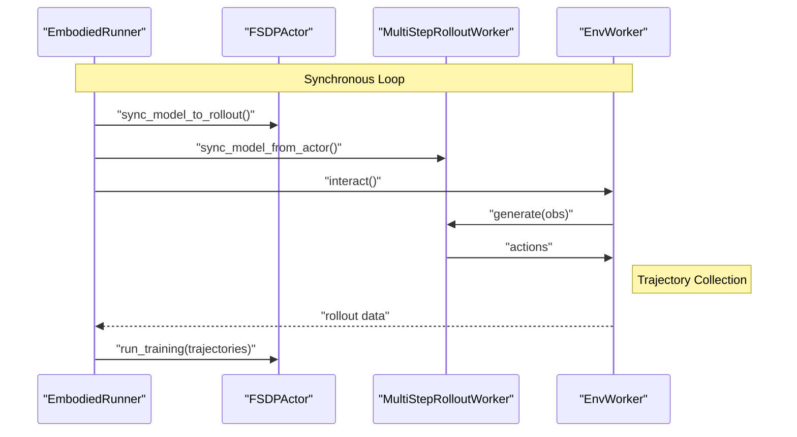

<!-- source: DeepWiki mcp.deepwiki.com · repo RLinf/RLinf · page 6.1 Embodied Training Pipeline · fetched 2026-10-21 -->

# Embodied Training Pipeline

<details>
<summary>Relevant source files</summary>

The following files were used as context for generating this wiki page:

- [docs/source-en/rst_source/start/installation.rst](docs/source-en/rst_source/start/installation.rst)
- [docs/source-en/rst_source/start/vla.rst](docs/source-en/rst_source/start/vla.rst)
- [docs/source-zh/rst_source/start/installation.rst](docs/source-zh/rst_source/start/installation.rst)
- [docs/source-zh/rst_source/start/vla.rst](docs/source-zh/rst_source/start/vla.rst)
- [examples/embodiment/train_async.py](examples/embodiment/train_async.py)
- [examples/embodiment/train_embodied_agent.py](examples/embodiment/train_embodied_agent.py)
- [rlinf/algorithms/advantages.py](rlinf/algorithms/advantages.py)
- [rlinf/algorithms/registry.py](rlinf/algorithms/registry.py)
- [rlinf/algorithms/utils.py](rlinf/algorithms/utils.py)
- [rlinf/config.py](rlinf/config.py)
- [rlinf/runners/embodied_runner.py](rlinf/runners/embodied_runner.py)
- [rlinf/workers/actor/fsdp_actor_worker.py](rlinf/workers/actor/fsdp_actor_worker.py)
- [rlinf/workers/actor/fsdp_actor_worker_pipeline.py](rlinf/workers/actor/fsdp_actor_worker_pipeline.py)
- [rlinf/workers/env/env_worker.py](rlinf/workers/env/env_worker.py)
- [rlinf/workers/rollout/hf/huggingface_worker.py](rlinf/workers/rollout/hf/huggingface_worker.py)
- [tests/e2e_tests/embodied/maniskill_ppo_openpi05_pipeline.yaml](tests/e2e_tests/embodied/maniskill_ppo_openpi05_pipeline.yaml)
- [tests/unit_tests/test_overlap_env_bootstrap.py](tests/unit_tests/test_overlap_env_bootstrap.py)

</details>


This page documents the orchestration layer and actor-side training mechanics for the Embodied RL domain: the `EmbodiedRunner`, `FSDPActor`, and the interaction between worker groups. It explains how the training loop coordinates environment interaction, rollout generation, and model updates.

For documentation of the rollout-side workers that feed data into this pipeline, see [6.2 Environment Workers](). For the VLA models that `FSDPActor` wraps, see [6.5 VLA Models and Architectures](). For the RL algorithms whose losses are applied during training, see [8. RL Algorithms Reference]().

---

## Overview

The embodied training pipeline consists of four co-operating worker groups coordinated by a central runner.

| Group | Primary Class | Role |
|---|---|---|
| **Actor** | `FSDPActor` / `MegatronActor` | Model training, gradient updates, and weight management. [rlinf/workers/actor/fsdp_actor_worker.py:190-201](), [rlinf/workers/actor/megatron_actor_worker.py:50-59]() |
| **Rollout** | `MultiStepRolloutWorker` | Inference for action generation using VLA models (e.g., OpenVLA, OpenPI). [rlinf/workers/rollout/hf/huggingface_worker.py:42-51]() |
| **Environment** | `EnvWorker` | Simulation execution (ManiSkill, LIBERO, etc.) and observation collection. [rlinf/workers/env/env_worker.py:58-60]() |
| **Reward** | `EmbodiedRewardWorker` | (Optional) Standalone reward computation for real-world or complex reward models. [rlinf/runners/embodied_runner.py:64-64]() |

These groups are created and connected by `EmbodiedRunner`, which manages the `Channel` objects for passing weights and trajectory data. [rlinf/runners/embodied_runner.py:94-100]()

**Pipeline diagram — class names and their source files:**

```mermaid
graph TD
    subgraph ["rlinf/runners/embodied_runner.py"]
        ER["EmbodiedRunner"]
    end

    subgraph ["rlinf/workers/actor/fsdp_actor_worker.py"]
        FA["FSDPActor"]
    end

    subgraph ["rlinf/workers/rollout/hf/huggingface_worker.py"]
        RW["MultiStepRolloutWorker"]
    end

    subgraph ["rlinf/workers/env/env_worker.py"]
        EW["EnvWorker"]
    end
    
    subgraph ["rlinf/workers/reward/reward_worker.py"]
        RE["EmbodiedRewardWorker"]
    end

    ER -- "init_workers()" --> FA
    ER -- "init_workers()" --> RW
    ER -- "init_workers()" --> EW
    ER -- "init_workers()" --> RE
    FA -- "inherits" --> FM["FSDPModelManager"]
    FM -- "uses" --> GM["get_model()"]
```

Sources: [rlinf/runners/embodied_runner.py:52-66](), [rlinf/workers/actor/fsdp_actor_worker.py:190-201](), [rlinf/workers/rollout/hf/huggingface_worker.py:42-51](), [rlinf/workers/env/env_worker.py:58-60](), [rlinf/workers/actor/fsdp_actor_worker.py:36-36](), [rlinf/workers/actor/fsdp_actor_worker.py:44-44]()

---

## Runner Orchestration

The runner acts as the conductor for the distributed RL loop. It supports both synchronous execution (`EmbodiedRunner`) and specialized variants for high-throughput training such as `AsyncEmbodiedRunner` or `AsyncPPOEmbodiedRunner`. [examples/embodiment/train_async.py:49-75]()

### EmbodiedRunner (Synchronous)

`EmbodiedRunner` [rlinf/runners/embodied_runner.py:52-72]() drives a sequential loop where rollout generation and training are synchronized.

Four primary `Channel` objects are used for data flow:
- `env_channel`: Carries actions from Rollout to Env and observations back. [rlinf/runners/embodied_runner.py:94-94]()
- `rollout_channel`: Carries rollout requests and results. [rlinf/runners/embodied_runner.py:95-95]()
- `actor_channel`: Carries collected trajectories to the Actor for training. [rlinf/runners/embodied_runner.py:96-96]()
- `reward_channel`: (Optional) Carries data to the reward worker. [rlinf/runners/embodied_runner.py:98-98]()

### Training Loop Lifecycle

The training loop is orchestrated through the following sequence:
1. **Worker Initialization:** `init_workers()` triggers `init_worker()` on all groups and handles checkpoint resumption. [rlinf/runners/embodied_runner.py:163-185]()
2. **Weight Sync:** `update_rollout_weights()` pushes actor parameters to rollout workers via `sync_model_from_actor` and `sync_model_to_rollout`. [rlinf/runners/embodied_runner.py:187-191]()
3. **Interaction & Rollout:** The environment interaction generates trajectories. In pipeline mode (`runner.use_training_pipeline: True`), trajectories are processed on the environment worker and streamed to the actor as micro-batches. [rlinf/workers/env/env_worker.py:101-101](), [rlinf/workers/env/env_worker.py:161-162]()
4. **Training:** Trajectories are passed to the `Actor` via the `actor_channel` for gradient updates.
5. **Evaluation:** Periodically executes `evaluate()` to track performance on validation environments. [rlinf/runners/embodied_runner.py:193-198]()

**Synchronous Execution Sequence:**



Sources: [rlinf/runners/embodied_runner.py:163-203](), [rlinf/workers/env/env_worker.py:161-162](), [examples/embodiment/train_embodied_agent.py:46-46]()

---

## Actor Mechanics and Training Loop

The `FSDPActor` [rlinf/workers/actor/fsdp_actor_worker.py:190-201]() and `MegatronActor` [rlinf/workers/actor/megatron_actor_worker.py:50-59]() are responsible for gradient updates.

### Training Step Mechanics

The training process executes the core RL update:
1. **Data Preparation:** Collected trajectories are converted into a batch using `convert_trajectories_to_batch`. [rlinf/workers/actor/fsdp_actor_worker.py:33-33]()
2. **Advantage Estimation:** Computes advantages (e.g., GAE) utilizing `process_nested_dict_for_adv` to reshape tensors from `[rollout_epoch x n_chunk_steps, bsz, ...]` to training-ready shapes. [rlinf/workers/actor/fsdp_actor_worker.py:92-110]()
3. **Loss Computation:** Computes policy loss, entropy bonuses, and KL penalties using `policy_loss` and `kl_penalty`. [rlinf/workers/actor/fsdp_actor_worker.py:28-31]()
4. **Metrics:** Calculates rollout metrics such as rewards, advantages, and returns for logging. [rlinf/utils/metric_utils.py:67-67]()

### FSDP vs Megatron Backends
- **FSDPActor:** Inherits from `FSDPModelManager` [rlinf/workers/actor/fsdp_actor_worker.py:190-190](), managing distributed model sharding and mixed precision for HuggingFace-compatible models.
- **MegatronActor:** Inherits from `MegatronWorker` [rlinf/workers/actor/megatron_actor_worker.py:50-50](), supporting advanced model parallelism (TP/PP/EP) and weight resharding. [rlinf/workers/actor/megatron_actor_worker.py:108-108]()

Sources: [rlinf/workers/actor/fsdp_actor_worker.py:190-201](), [rlinf/workers/actor/megatron_actor_worker.py:50-59](), [rlinf/workers/actor/fsdp_actor_worker.py:92-110](), [rlinf/utils/metric_utils.py:62-70]()

---

## Rollout Generation and Weight Sync

The `MultiStepRolloutWorker` [rlinf/workers/rollout/hf/huggingface_worker.py:42-51]() manages inference for the policy.

### Weight Synchronization

Because rollout workers are often distributed on different nodes/GPUs than the actor, weights must be synchronized periodically.
- **WeightSyncer:** Managed via `self.weight_syncer` [rlinf/workers/rollout/hf/huggingface_worker.py:128-128]().
- **Communication Options:** Uses `_sync_weight_comm_options` to configure NCCL or other backend transfers. [rlinf/workers/rollout/hf/huggingface_worker.py:129-129]()
- **Async Synchronization:** `AsyncMultiStepRolloutWorker` supports background weight syncing via `_poll_background_weight_sync` to avoid blocking inference. [rlinf/workers/rollout/hf/async_huggingface_worker.py:131-142]()

### Rollout Optimization
- **CUDA Graphs:** Can capture CUDA graphs to speed up inference if `enable_cuda_graph` is set. [rlinf/workers/rollout/hf/huggingface_worker.py:103-103]()
- **Torch Compile:** Supports `torch.compile` for model acceleration. [rlinf/workers/rollout/hf/huggingface_worker.py:178-179]()
- **Offloading:** Supports `enable_offload` to move models to CPU when not in use. [rlinf/workers/rollout/hf/huggingface_worker.py:60-60]()

Sources: [rlinf/workers/rollout/hf/huggingface_worker.py:128-129](), [rlinf/workers/rollout/hf/huggingface_worker.py:178-179](), [rlinf/workers/rollout/hf/huggingface_worker.py:60-60](), [rlinf/workers/rollout/hf/async_huggingface_worker.py:131-142]()

---

## RL Token (RLT) Pipeline

The pipeline supports **RL Token (RLT)** training, which bootstraps online RL with VLA models.

1. **Stage 1 (Representation):** Jointly train VLA SFT and an RLT token transformer on demonstration data.
2. **Stage 2 (RL Control):** Freeze the Stage 1 feature model and train a compact off-policy actor-critic on the extracted `z_rl` state.

In rollout, the `rlt_feature_model` converts raw observations into a compact RLT representation, proprioception, and a VLA reference chunk. [rlinf/workers/rollout/hf/huggingface_worker.py:153-160]()

Sources: [rlinf/workers/rollout/hf/huggingface_worker.py:153-160](), [rlinf/workers/rollout/hf/huggingface_worker.py:27-30]()

---

## Data Structures and Flow

Data exchange between workers is standardized via dataclasses in `rlinf.data.embodied_io_struct`.

| Class | Description | Source |
|---|---|---|
| `Trajectory` | Contains observations, actions, rewards, and logprobs for a full episode. | [rlinf/data/embodied_io_struct.py:32-32]() |
| `EnvOutput` | Output from environment workers containing step results (obs, rewards, dones). | [rlinf/data/embodied_io_struct.py:30-30]() |
| `RolloutResult` | Combined output of rollout and environment interaction for the runner. | [rlinf/data/embodied_io_struct.py:31-31]() |
| `ChunkStepResult` | Results for a specific chunk of steps (e.g., action chunking). | [rlinf/data/embodied_io_struct.py:27-27]() |

**Embodied Data Flow Diagram:**

```mermaid
graph LR
    subgraph ["rlinf/workers/env/env_worker.py"]
        ENV["EnvWorker"]
    end

    subgraph ["rlinf/workers/rollout/hf/huggingface_worker.py"]
        ROLL["MultiStepRolloutWorker"]
    end

    subgraph ["rlinf/workers/actor/fsdp_actor_worker.py"]
        ACT["FSDPActor"]
    end

    ENV -- "EnvOutput (obs)" --> ROLL
    ROLL -- "actions" --> ENV
    ENV -- "Trajectory / RolloutResult" --> ACT
    ACT -- "Weight Sync" --> ROLL
```

Sources: [rlinf/workers/env/env_worker.py:26-34](), [rlinf/workers/actor/fsdp_actor_worker.py:33-34](), [rlinf/data/embodied_io_struct.py:26-33]()

---

