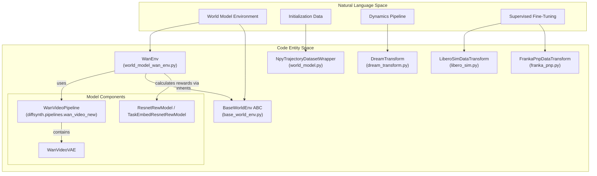
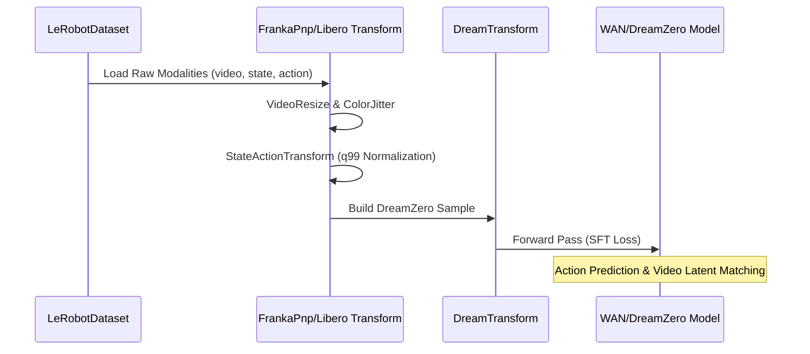

<!-- source: DeepWiki mcp.deepwiki.com · repo RLinf/RLinf · page 6.10 World Model Training · fetched 2026-10-21 -->

# World Model Training

Relevant source files

The following files were used as context for generating this wiki page:

- [docs/source-en/rst_source/examples/embodied/sft_dreamzero.rst](docs/source-en/rst_source/examples/embodied/sft_dreamzero.rst)
- [docs/source-en/rst_source/examples/embodied/wan.rst](docs/source-en/rst_source/examples/embodied/wan.rst)
- [docs/source-zh/rst_source/examples/embodied/sft_dreamzero.rst](docs/source-zh/rst_source/examples/embodied/sft_dreamzero.rst)
- [docs/source-zh/rst_source/examples/embodied/wan.rst](docs/source-zh/rst_source/examples/embodied/wan.rst)
- [examples/embodiment/config/env/wan_libero_spatial.yaml](examples/embodiment/config/env/wan_libero_spatial.yaml)
- [examples/embodiment/config/wan_libero_goal_grpo_openvlaoft.yaml](examples/embodiment/config/wan_libero_goal_grpo_openvlaoft.yaml)
- [examples/embodiment/config/wan_libero_object_grpo_openvlaoft.yaml](examples/embodiment/config/wan_libero_object_grpo_openvlaoft.yaml)
- [examples/embodiment/config/wan_libero_spatial_grpo_openvlaoft.yaml](examples/embodiment/config/wan_libero_spatial_grpo_openvlaoft.yaml)
- [requirements/embodied/models/openpi.txt](requirements/embodied/models/openpi.txt)
- [rlinf/data/datasets/dreamzero/data_transforms/franka_pnp.py](rlinf/data/datasets/dreamzero/data_transforms/franka_pnp.py)
- [rlinf/data/datasets/dreamzero/data_transforms/libero_sim.py](rlinf/data/datasets/dreamzero/data_transforms/libero_sim.py)
- [rlinf/data/datasets/world_model.py](rlinf/data/datasets/world_model.py)
- [rlinf/envs/libero/utils.py](rlinf/envs/libero/utils.py)
- [rlinf/envs/libero/venv.py](rlinf/envs/libero/venv.py)
- [rlinf/envs/world_model/base_world_env.py](rlinf/envs/world_model/base_world_env.py)
- [rlinf/envs/world_model/world_model_wan_env.py](rlinf/envs/world_model/world_model_wan_env.py)
- [toolkits/lerobot/generate_dreamzero_metadata.py](toolkits/lerobot/generate_dreamzero_metadata.py)

## Purpose and Scope

This document describes world model training in RLinf—a framework for training Vision-Language-Action (VLA) policies using learned world models as simulators instead of traditional physics engines or real robots [docs/source-en/rst_source/examples/embodied/wan.rst:15-18](). World models generate video frames conditioned on actions, enabling closed-loop policy optimization through "imagined" rollouts using reinforcement learning algorithms like GRPO or PPO [docs/source-en/rst_source/examples/embodied/wan.rst:15-18]().

RLinf supports world model backends such as **Wan**, an action-conditioned video generation model [docs/source-en/rst_source/examples/embodied/wan.rst:13-17](), and **DreamZero**, which provides a unified dataset and transformation pipeline for SFT (Supervised Fine-Tuning) and deployment of VLA models [docs/source-en/rst_source/examples/embodied/sft_dreamzero.rst:8-12](). This page covers the architecture, environment integration, and training orchestration for these learned dynamics models.

---

## World Model Architecture Overview

World models in RLinf function as environment simulators, exposing a Gym-like interface while internally using video generation to predict future observations.

### System Components to Code Entity Mapping

The following diagram bridges conceptual world model components to their specific implementations in the codebase.

**World Model System Mapping**

**Sources:** [rlinf/envs/world_model/base_world_env.py:27-32](), [rlinf/envs/world_model/world_model_wan_env.py:36-48](), [rlinf/data/datasets/world_model.py:92-109](), [rlinf/envs/world_model/world_model_wan_env.py:125-137](), [rlinf/data/datasets/dreamzero/data_transforms/libero_sim.py:52-53](), [rlinf/data/datasets/dreamzero/data_transforms/franka_pnp.py:48-49]()

---

## Environment and Data Implementation

The `BaseWorldEnv` abstract base class provides shared utilities for world model environments, including seed management, dataset creation, and metric recording [rlinf/envs/world_model/base_world_env.py:27-55]().

### World Model Environment Logic
- **Action Conditioned Rollout**: The `WanEnv` uses a `WanVideoPipeline` to generate future frames based on a `condition_frame_length` (history) and a `chunk` of actions [rlinf/envs/world_model/world_model_wan_env.py:62-68](), [rlinf/envs/world_model/world_model_wan_env.py:125-137]().
- **KIR Trick**: Supports "KeyFrame-Init Rollout" (KIR) to diversify starting states during simulation by seeding from specific keyframes in the `NpyTrajectoryDatasetWrapper` [rlinf/envs/world_model/base_world_env.py:66-68](), [rlinf/data/datasets/world_model.py:124-125](), [rlinf/envs/world_model/world_model_wan_env.py:120-123]().
- **State Management**: The environment maintains an `image_queue` to track the history required for temporal consistency in video generation [rlinf/envs/world_model/world_model_wan_env.py:90-92]().
- **Reward Modeling**: `WanEnv` integrates `ResnetRewModel` or `TaskEmbedResnetRewModel` to provide rewards from the generated video frames [rlinf/envs/world_model/world_model_wan_env.py:139-149]().

### Dataset and Transformation Logic
Training and evaluation rely on the LeRobot v2/v3 layout [docs/source-en/rst_source/examples/embodied/sft_dreamzero.rst:157-158]().
- **NpyTrajectoryDatasetWrapper**: Wraps `.npy` files to provide custom frame selection policies like `first_frame`, `last_n_frames`, or `closest_timestamp` [rlinf/data/datasets/world_model.py:92-116]().
- **LiberoSimDataTransform**: Defines the modality configuration (video, state, action, language) and build chain for LIBERO simulation data [rlinf/data/datasets/dreamzero/data_transforms/libero_sim.py:86-119]().
- **FrankaPnpDataTransform**: Extends LIBERO logic for dual-view real-world Franka data, including `VideoColorJitter` and `VideoResize` to 256x256 [rlinf/data/datasets/dreamzero/data_transforms/franka_pnp.py:48-53](), [rlinf/data/datasets/dreamzero/data_transforms/franka_pnp.py:142-161]().

**Sources:** [rlinf/envs/world_model/base_world_env.py:27-68](), [rlinf/envs/world_model/world_model_wan_env.py:62-149](), [rlinf/data/datasets/world_model.py:92-125](), [rlinf/data/datasets/dreamzero/data_transforms/libero_sim.py:52-110](), [rlinf/data/datasets/dreamzero/data_transforms/franka_pnp.py:142-191]()

---

## Training Orchestration

World model training (specifically SFT for DreamZero) involves preparing model checkpoints and metadata before launching distributed training.

### Model Preparation
- **Cold Start**: Models can be initialized from raw components (DiT, T5, VAE, CLIP) by setting `model_path: null` and providing specific pretrained paths [docs/source-en/rst_source/examples/embodied/sft_dreamzero.rst:117-124]().
- **Checkpoint Resuming**: Architecture and weights can load directly from a directory like `DreamZero-DROID` [docs/source-en/rst_source/examples/embodied/sft_dreamzero.rst:86-93]().
- **Metadata Generation**: A `metadata.json` containing normalization statistics (e.g., `q99` for states/actions) must be generated for new datasets [docs/source-en/rst_source/examples/embodied/sft_dreamzero.rst:181-189](), [rlinf/data/datasets/dreamzero/data_transforms/franka_pnp.py:166-172]().

### Execution Flow
The training is typically launched via `run_vla_sft.sh` which executes `train_vla_sft.py` [docs/source-en/rst_source/examples/embodied/sft_dreamzero.rst:210-210]().

**World Model Training Data Flow**

**Sources:** [docs/source-en/rst_source/examples/embodied/sft_dreamzero.rst:86-152](), [rlinf/data/datasets/dreamzero/data_transforms/franka_pnp.py:142-191](), [rlinf/data/datasets/dreamzero/data_transforms/libero_sim.py:120-139]()

---

## Optimization and Hardware Integration

### Precision and Memory
- **Mixed Precision**: World model pipelines and reward models utilize `torch.bfloat16` for DiT and VAE operations [rlinf/envs/world_model/world_model_wan_env.py:126-126]().
- **VRAM Management**: The `WanVideoPipeline` supports offloading model components to CPU via `offload_device="cpu"` in `ModelConfig` [rlinf/envs/world_model/world_model_wan_env.py:125-133]().
- **Cache Clearing**: `BaseWorldEnv` provides `_clear_accelerator_cache()` to invoke `torch.cuda.empty_cache()` (or equivalent) through the `AcceleratorManager` [rlinf/envs/world_model/base_world_env.py:117-119]().

### Inference Optimization
- **Denoising Steps**: The number of diffusion inference steps is configurable (e.g., `num_inference_steps: 5`) to balance simulation fidelity and throughput [docs/source-en/rst_source/examples/embodied/wan.rst:238-239]().
- **Action Chunking**: Policies generate fixed action chunks (e.g., `num_action_chunks: 8`) which the world model consumes as conditions for the next video segment [docs/source-en/rst_source/examples/embodied/wan.rst:218-222]().

**Sources:** [rlinf/envs/world_model/world_model_wan_env.py:125-137](), [rlinf/envs/world_model/base_world_env.py:111-119](), [docs/source-en/rst_source/examples/embodied/wan.rst:218-239]()

---

