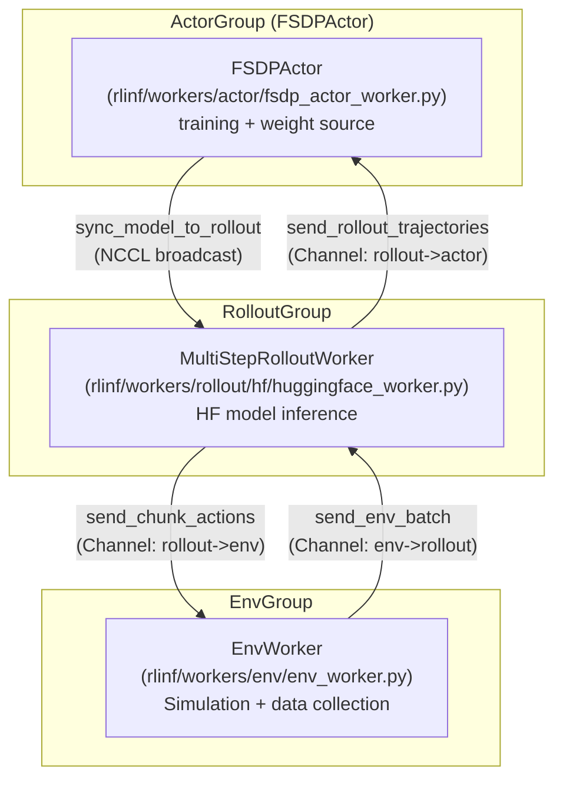
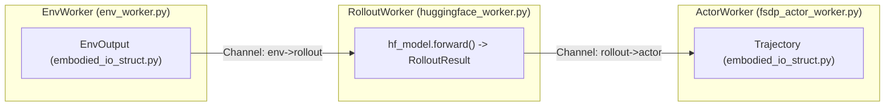

<!-- source: DeepWiki mcp.deepwiki.com · repo RLinf/RLinf · page 6.2 Environment Workers · fetched 2026-10-21 -->

# Environment Workers

Relevant source files

The following files were used as context for generating this wiki page:

- [.github/workflows/docker-build.yml](.github/workflows/docker-build.yml)
- [.github/workflows/embodied-e2e-tests.yml](.github/workflows/embodied-e2e-tests.yml)
- [docker/Dockerfile](docker/Dockerfile)
- [docker/README.md](docker/README.md)
- [examples/embodiment/train_async.py](examples/embodiment/train_async.py)
- [examples/embodiment/train_embodied_agent.py](examples/embodiment/train_embodied_agent.py)
- [requirements/embodied/download_assets.sh](requirements/embodied/download_assets.sh)
- [requirements/embodied/ros_install.sh](requirements/embodied/ros_install.sh)
- [requirements/install.sh](requirements/install.sh)
- [rlinf/config.py](rlinf/config.py)
- [rlinf/data/io_struct.py](rlinf/data/io_struct.py)
- [rlinf/envs/__init__.py](rlinf/envs/__init__.py)
- [rlinf/envs/action_utils.py](rlinf/envs/action_utils.py)
- [rlinf/envs/maniskill/maniskill_offload_env.py](rlinf/envs/maniskill/maniskill_offload_env.py)
- [rlinf/envs/robocasa/venv.py](rlinf/envs/robocasa/venv.py)
- [rlinf/envs/utils.py](rlinf/envs/utils.py)
- [rlinf/models/embodiment/openpi/policies/robocasa_policy.py](rlinf/models/embodiment/openpi/policies/robocasa_policy.py)
- [rlinf/runners/async_embodied_runner.py](rlinf/runners/async_embodied_runner.py)
- [rlinf/runners/async_ppo_embodied_runner.py](rlinf/runners/async_ppo_embodied_runner.py)
- [rlinf/runners/embodied_runner.py](rlinf/runners/embodied_runner.py)
- [rlinf/workers/actor/fsdp_actor_worker.py](rlinf/workers/actor/fsdp_actor_worker.py)
- [rlinf/workers/env/async_env_worker.py](rlinf/workers/env/async_env_worker.py)
- [rlinf/workers/env/env_worker.py](rlinf/workers/env/env_worker.py)
- [rlinf/workers/rollout/hf/async_huggingface_worker.py](rlinf/workers/rollout/hf/async_huggingface_worker.py)
- [rlinf/workers/rollout/hf/huggingface_worker.py](rlinf/workers/rollout/hf/huggingface_worker.py)
- [tests/unit_tests/test_maniskill_offload_env.py](tests/unit_tests/test_maniskill_offload_env.py)
- [tests/unit_tests/test_overlap_env_bootstrap.py](tests/unit_tests/test_overlap_env_bootstrap.py)

This page documents the two worker types that drive data collection in the Embodied RL pipeline: `MultiStepRolloutWorker` (model inference) and `EnvWorker` (environment simulation). It also covers the data structures that flow between them, observation processing, and auto-reset behavior.

For the actor-side training logic that consumes the data these workers produce, see [Embodied Training Pipeline](./6.1). For the environment integrations themselves (LiberoEnv, ManiskillEnv, etc.), see [Environment Integrations](./6.3).

---

## Component Overview

The interaction between workers is managed through `Channel` primitives, enabling distributed execution across the cluster.

**Diagram: Worker roles and channel connections**

Sources: [rlinf/workers/rollout/hf/huggingface_worker.py:42-138](), [rlinf/workers/env/env_worker.py:58-185](), [rlinf/workers/actor/fsdp_actor_worker.py:190-200](), [rlinf/runners/embodied_runner.py:93-100](), [rlinf/runners/embodied_runner.py:187-192]()

---

## MultiStepRolloutWorker

`MultiStepRolloutWorker` extends the base `Worker` class and manages a HuggingFace-compatible model in inference mode. It is responsible for receiving observations from `EnvWorker`, performing forward passes to predict actions, and aggregating results into `Trajectory` objects for the actor.

### Initialization and Model Loading
The worker initializes its model during the `init_worker` call [rlinf/workers/rollout/hf/huggingface_worker.py:141-180](). It supports optional features like `torch.compile` and CUDA graph capture to optimize inference throughput.

- **Model Setup**: Loads a `BasePolicy` using `get_model` based on the `rollout.model` configuration [rlinf/workers/rollout/hf/huggingface_worker.py:142-147]().
- **Batch Sizing**: Computes `per_node_train_batch_size` and `per_node_eval_batch_size` by dividing total environments by world size and pipeline stages [rlinf/workers/rollout/hf/huggingface_worker.py:96-101]().
- **Optimization**: If `enable_cuda_graph` is set, it captures CUDA graphs for the computed batch sizes to reduce CPU overhead during rollout [rlinf/workers/rollout/hf/huggingface_worker.py:103-103]().
- **Expert Models**: Supports loading an auxiliary `expert_model` for RLT (Reinforcement Learning from Transitions) or DAGGER-style data collection [rlinf/workers/rollout/hf/huggingface_worker.py:162-172]().
- **Weight Synchronization**: Utilizes a `WeightSyncer` to receive updated model weights from training actors [rlinf/workers/rollout/hf/huggingface_worker.py:121-129]().

### Action Preparation
Before actions are sent to the `EnvWorker`, they often require environment-specific processing (e.g., gripper normalization or coordinate transformations).
- **`prepare_actions`**: A utility function in `rlinf/envs/action_utils.py` that routes raw model outputs to specific handlers based on environment types [rlinf/envs/action_utils.py:22-200]().
- **Normalization**: For example, in LIBERO, gripper actions are transformed from `[0, 1]` to `[-1, 1]` and signs are flipped to match simulation conventions [rlinf/envs/action_utils.py:66-79]().
- **Robocasa Preparation**: Specifically handles model outputs by extracting valid dimensions and padding to the format required by the environment [rlinf/envs/action_utils.py:162-200]().

### Async and Decoupled Rollout
The `AsyncMultiStepRolloutWorker` (documented via references in [rlinf/runners/embodied_runner.py:46-49]()) provides a non-blocking execution mode.
- **Staleness Control**: Uses a `staleness_threshold` to pause generation if rollout versions get too far ahead of the trainer.
- **Background Weight Sync**: Polling and applying new weights in the background while generation tasks are active.
- **Decoupled Mode**: Enabled via `runner.enable_decoupled_mode=True` [rlinf/workers/rollout/hf/huggingface_worker.py:131-138](). It uses a `batch_router` to handle irregular environment throughput where `EnvWorker` ranks and `RolloutWorker` ranks may not be 1:1.

Sources: [rlinf/workers/rollout/hf/huggingface_worker.py:42-180](), [rlinf/envs/action_utils.py:22-200](), [rlinf/runners/embodied_runner.py:131-138]()

---

## EnvWorker

`EnvWorker` manages the physical or simulated environment instances. It handles the low-level details of stepping the environment and processing observations.

### Environment Management and Wrappers
- **Vectorization**: Creates multiple environment instances based on `pipeline_stage_num` and `train_num_envs_per_stage` [rlinf/workers/env/env_worker.py:135-138]().
- **Auto-Reset**: Environments are typically initialized with wrappers that handle automatic resets upon termination, ensuring continuous data collection [rlinf/workers/env/env_worker.py:165-173]().
- **Video Recording**: Uses `RecordVideo` wrapper to buffer frames in memory and flush them to disk during training or evaluation [rlinf/workers/env/env_worker.py:38]().

### Interaction Cycle
The `EnvWorker` operates through several key stages:
1. **Bootstrap**: Produces initial observations via `_init_env` or prefetched bootstrap buffers [rlinf/workers/env/env_worker.py:71-72]().
2. **Action Reception**: Establishes communication maps via `CommMapper` to route data between environment and rollout workers [rlinf/workers/env/env_worker.py:39]().
3. **Step**: Executes the actions in the environment. The `EnvWorker` supports `chunk_step` behavior where a sequence of actions (predicted by VLA models) is executed sequentially [rlinf/workers/env/env_worker.py:146-157]().
4. **Observation Dispatch**: Collects environment outputs (`EnvOutput`) and sends them to rollout workers using `Channel`.

### Reward Modeling and History
`EnvWorker` can integrate learned reward models or history-based reward assignment [rlinf/workers/env/env_worker.py:82-98]().
- **External Reward Models**: When `use_reward_model` is enabled, the worker can use external models to compute rewards from observations [rlinf/workers/env/env_worker.py:92-94]().
- **History Management**: Supports `HistoryManager` for reward assignment across a buffer of previous states [rlinf/workers/env/env_worker.py:55]().

Sources: [rlinf/workers/env/env_worker.py:58-185](), [rlinf/data/embodied_io_struct.py:26-33](), [rlinf/envs/utils.py:36-58]()

---

## Data Structures and Flow

**Diagram: Natural Language Space to Code Entity Space (Data Flow)**

### Key Data Classes
- **`EnvOutput`**: Encapsulates observations, rewards, and terminal flags produced by the environment [rlinf/data/embodied_io_struct.py:30]().
- **`ChunkStepResult`**: Stores the results of executing a chunk of actions, including observations and metadata [rlinf/data/embodied_io_struct.py:27]().
- **`Trajectory`**: The final data structure sent to the actor, containing stacked tensors of observations and actions [rlinf/data/embodied_io_struct.py:32]().
- **`RolloutResult`**: A generic container for rollout outputs used across different task types [rlinf/data/embodied_io_struct.py:31]().

Sources: [rlinf/data/embodied_io_struct.py:26-33](), [rlinf/workers/env/env_worker.py:26-34]()

---

## Observation Processing and Sharding

The `CommMapper` and rank mapping logic are critical for routing data between workers when the world sizes of the `EnvGroup` and `RolloutGroup` do not match.

### Distributed Batch Sharding
- **Rank Mapping**: `EnvWorker` uses `CommMapper` to establish the communication topology between environment ranks and rollout ranks [rlinf/workers/env/env_worker.py:39]().
- **Data Splitting**: `split_dict_to_chunk` is used to divide batch dictionaries into sub-batches for different destination ranks or pipeline stages [rlinf/workers/env/env_worker.py:46]().
- **Decoupled Mode**: Supports `enable_decoupled_mode` where environment execution is decoupled from rollout inference via a `batch_router` [rlinf/workers/env/env_worker.py:174-182]().

### Training Pipeline Mode
For high-throughput training, `runner.use_training_pipeline` enables a mode where `EnvWorker` converts rollout trajectories into packed actor micro-batches and streams them directly [rlinf/workers/env/env_worker.py:101-101]().
- **Advantage Computation**: In this mode, advantages can be computed using `calculate_adv_and_returns` on the `EnvWorker` side to reduce actor load [rlinf/workers/env/env_worker.py:24]().
- **Packed Payloads**: Reduces reconstruction overhead on the `ActorWorker` using utilities like `pack_batch` [rlinf/workers/env/env_worker.py:52]().

Sources: [rlinf/workers/env/env_worker.py:101-182](), [rlinf/runners/embodied_runner.py:74-76](), [rlinf/workers/actor/fsdp_actor_worker.py:28-33]()

---

