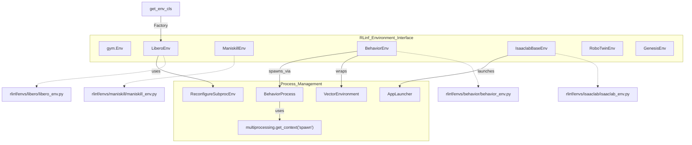
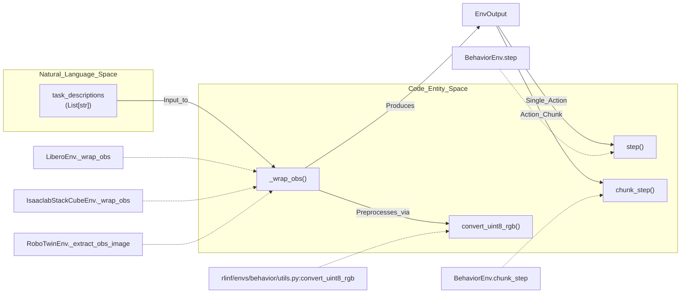

<!-- source: DeepWiki mcp.deepwiki.com · repo RLinf/RLinf · page 6.3 Environment Integrations · fetched 2026-10-21 -->

# Environment Integrations

Relevant source files

The following files were used as context for generating this wiki page:

- [docs/source-en/rst_source/evaluations/index.rst](docs/source-en/rst_source/evaluations/index.rst)
- [docs/source-en/rst_source/examples/embodied/behavior.rst](docs/source-en/rst_source/examples/embodied/behavior.rst)
- [docs/source-en/rst_source/examples/embodied/calvin.rst](docs/source-en/rst_source/examples/embodied/calvin.rst)
- [docs/source-en/rst_source/examples/embodied/embodichain.rst](docs/source-en/rst_source/examples/embodied/embodichain.rst)
- [docs/source-en/rst_source/examples/embodied/frankasim.rst](docs/source-en/rst_source/examples/embodied/frankasim.rst)
- [docs/source-en/rst_source/examples/embodied/genesis.rst](docs/source-en/rst_source/examples/embodied/genesis.rst)
- [docs/source-en/rst_source/examples/embodied/gsenv.rst](docs/source-en/rst_source/examples/embodied/gsenv.rst)
- [docs/source-en/rst_source/examples/embodied/isaaclab.rst](docs/source-en/rst_source/examples/embodied/isaaclab.rst)
- [docs/source-en/rst_source/examples/embodied/maniskill.rst](docs/source-en/rst_source/examples/embodied/maniskill.rst)
- [docs/source-en/rst_source/examples/embodied/metaworld.rst](docs/source-en/rst_source/examples/embodied/metaworld.rst)
- [docs/source-en/rst_source/examples/embodied/robocasa365.rst](docs/source-en/rst_source/examples/embodied/robocasa365.rst)
- [docs/source-en/rst_source/examples/simulators_index.rst](docs/source-en/rst_source/examples/simulators_index.rst)
- [docs/source-zh/rst_source/evaluations/index.rst](docs/source-zh/rst_source/evaluations/index.rst)
- [docs/source-zh/rst_source/examples/embodied/behavior.rst](docs/source-zh/rst_source/examples/embodied/behavior.rst)
- [docs/source-zh/rst_source/examples/embodied/calvin.rst](docs/source-zh/rst_source/examples/embodied/calvin.rst)
- [docs/source-zh/rst_source/examples/embodied/embodichain.rst](docs/source-zh/rst_source/examples/embodied/embodichain.rst)
- [docs/source-zh/rst_source/examples/embodied/genesis.rst](docs/source-zh/rst_source/examples/embodied/genesis.rst)
- [docs/source-zh/rst_source/examples/embodied/isaaclab.rst](docs/source-zh/rst_source/examples/embodied/isaaclab.rst)
- [docs/source-zh/rst_source/examples/embodied/maniskill.rst](docs/source-zh/rst_source/examples/embodied/maniskill.rst)
- [docs/source-zh/rst_source/examples/embodied/metaworld.rst](docs/source-zh/rst_source/examples/embodied/metaworld.rst)
- [docs/source-zh/rst_source/examples/embodied/robocasa365.rst](docs/source-zh/rst_source/examples/embodied/robocasa365.rst)
- [docs/source-zh/rst_source/examples/simulators_index.rst](docs/source-zh/rst_source/examples/simulators_index.rst)
- [evaluations/robocasa365/robocasa365_eval_openpi.yaml](evaluations/robocasa365/robocasa365_eval_openpi.yaml)
- [evaluations/run_eval.sh](evaluations/run_eval.sh)
- [examples/embodiment/config/behavior_ppo_openpi.yaml](examples/embodiment/config/behavior_ppo_openpi.yaml)
- [examples/embodiment/config/behavior_ppo_openpi_pi05.yaml](examples/embodiment/config/behavior_ppo_openpi_pi05.yaml)
- [examples/embodiment/config/env/behavior_r1pro.yaml](examples/embodiment/config/env/behavior_r1pro.yaml)
- [examples/embodiment/config/env/embodichain_cart_pole.yaml](examples/embodiment/config/env/embodichain_cart_pole.yaml)
- [examples/embodiment/config/env/genesis_cubepick.yaml](examples/embodiment/config/env/genesis_cubepick.yaml)
- [examples/embodiment/config/env/isaaclab_stack_cube.yaml](examples/embodiment/config/env/isaaclab_stack_cube.yaml)
- [examples/embodiment/config/env/metaworld_45_ood.yaml](examples/embodiment/config/env/metaworld_45_ood.yaml)
- [examples/embodiment/config/env/robocasa365.yaml](examples/embodiment/config/env/robocasa365.yaml)
- [examples/embodiment/config/env/robotwin_beat_block_hammer.yaml](examples/embodiment/config/env/robotwin_beat_block_hammer.yaml)
- [examples/embodiment/config/env/robotwin_handover_block.yaml](examples/embodiment/config/env/robotwin_handover_block.yaml)
- [examples/embodiment/config/env/robotwin_lift_pot.yaml](examples/embodiment/config/env/robotwin_lift_pot.yaml)
- [examples/embodiment/config/env/robotwin_move_can_pot.yaml](examples/embodiment/config/env/robotwin_move_can_pot.yaml)
- [examples/embodiment/config/env/robotwin_pick_dual_bottles.yaml](examples/embodiment/config/env/robotwin_pick_dual_bottles.yaml)
- [examples/embodiment/config/env/robotwin_place_empty_cup.yaml](examples/embodiment/config/env/robotwin_place_empty_cup.yaml)
- [examples/embodiment/config/genesis_cubepick_ppo_cnn.yaml](examples/embodiment/config/genesis_cubepick_ppo_cnn.yaml)
- [examples/embodiment/config/genesis_cubepick_ppo_mlp.yaml](examples/embodiment/config/genesis_cubepick_ppo_mlp.yaml)
- [examples/embodiment/config/isaaclab_franka_stack_cube_ppo_gr00t.yaml](examples/embodiment/config/isaaclab_franka_stack_cube_ppo_gr00t.yaml)
- [examples/embodiment/config/isaaclab_franka_stack_cube_ppo_openpi_pi05.yaml](examples/embodiment/config/isaaclab_franka_stack_cube_ppo_openpi_pi05.yaml)
- [examples/embodiment/config/metaworld_50_grpo_openvlaoft.yaml](examples/embodiment/config/metaworld_50_grpo_openvlaoft.yaml)
- [examples/embodiment/config/robocasa365_opendrawer_ppo_openpi.yaml](examples/embodiment/config/robocasa365_opendrawer_ppo_openpi.yaml)
- [examples/embodiment/config/robotwin_beat_block_hammer_grpo_openvlaoft.yaml](examples/embodiment/config/robotwin_beat_block_hammer_grpo_openvlaoft.yaml)
- [examples/embodiment/config/robotwin_handover_block_grpo_openvlaoft.yaml](examples/embodiment/config/robotwin_handover_block_grpo_openvlaoft.yaml)
- [examples/embodiment/config/robotwin_lift_pot_grpo_openvlaoft.yaml](examples/embodiment/config/robotwin_lift_pot_grpo_openvlaoft.yaml)
- [examples/embodiment/config/robotwin_move_can_pot_grpo_openvlaoft.yaml](examples/embodiment/config/robotwin_move_can_pot_grpo_openvlaoft.yaml)
- [examples/embodiment/config/robotwin_pick_dual_bottles_grpo_openvlaoft.yaml](examples/embodiment/config/robotwin_pick_dual_bottles_grpo_openvlaoft.yaml)
- [examples/embodiment/config/robotwin_place_empty_cup_grpo_openvlaoft.yaml](examples/embodiment/config/robotwin_place_empty_cup_grpo_openvlaoft.yaml)
- [rlinf/envs/behavior/behavior_env.py](rlinf/envs/behavior/behavior_env.py)
- [rlinf/envs/behavior/instance_generator.py](rlinf/envs/behavior/instance_generator.py)
- [rlinf/envs/behavior/instance_loader.py](rlinf/envs/behavior/instance_loader.py)
- [rlinf/envs/behavior/utils.py](rlinf/envs/behavior/utils.py)
- [rlinf/envs/calvin/calvin_cfg/.hydra/calvin_scene_A.yaml](rlinf/envs/calvin/calvin_cfg/.hydra/calvin_scene_A.yaml)
- [rlinf/envs/calvin/calvin_cfg/.hydra/calvin_scene_B.yaml](rlinf/envs/calvin/calvin_cfg/.hydra/calvin_scene_B.yaml)
- [rlinf/envs/calvin/calvin_gym_env.py](rlinf/envs/calvin/calvin_gym_env.py)
- [rlinf/envs/calvin/venv.py](rlinf/envs/calvin/venv.py)
- [rlinf/envs/embodichain/embodichain_env.py](rlinf/envs/embodichain/embodichain_env.py)
- [rlinf/envs/isaaclab/__init__.py](rlinf/envs/isaaclab/__init__.py)
- [rlinf/envs/isaaclab/isaaclab_env.py](rlinf/envs/isaaclab/isaaclab_env.py)
- [rlinf/envs/isaaclab/tasks/stack_cube.py](rlinf/envs/isaaclab/tasks/stack_cube.py)
- [rlinf/envs/isaaclab/venv.py](rlinf/envs/isaaclab/venv.py)
- [rlinf/envs/libero/libero_env.py](rlinf/envs/libero/libero_env.py)
- [rlinf/envs/maniskill/maniskill_env.py](rlinf/envs/maniskill/maniskill_env.py)
- [rlinf/envs/maniskill/tasks/put_on_in_scene_multi.py](rlinf/envs/maniskill/tasks/put_on_in_scene_multi.py)
- [rlinf/envs/metaworld/metaworld_env.py](rlinf/envs/metaworld/metaworld_env.py)
- [rlinf/envs/metaworld/venv.py](rlinf/envs/metaworld/venv.py)
- [rlinf/envs/robotwin/robotwin_env.py](rlinf/envs/robotwin/robotwin_env.py)
- [rlinf/envs/robotwin/seed_utils.py](rlinf/envs/robotwin/seed_utils.py)
- [rlinf/models/embodiment/gr00t/__init__.py](rlinf/models/embodiment/gr00t/__init__.py)
- [rlinf/models/embodiment/gr00t/embodiment_tags.py](rlinf/models/embodiment/gr00t/embodiment_tags.py)
- [rlinf/models/embodiment/gr00t/simulation_io.py](rlinf/models/embodiment/gr00t/simulation_io.py)
- [rlinf/models/embodiment/gr00t/utils.py](rlinf/models/embodiment/gr00t/utils.py)
- [rlinf/models/embodiment/openpi/dataconfig/isaaclab_dataconfig.py](rlinf/models/embodiment/openpi/dataconfig/isaaclab_dataconfig.py)
- [rlinf/models/embodiment/openpi/policies/isaaclab_policy.py](rlinf/models/embodiment/openpi/policies/isaaclab_policy.py)
- [tests/e2e_tests/embodied/isaaclab_ppo_gr00t.yaml](tests/e2e_tests/embodied/isaaclab_ppo_gr00t.yaml)
- [tests/e2e_tests/embodied/libero_spatial_ppo_gr00t.yaml](tests/e2e_tests/embodied/libero_spatial_ppo_gr00t.yaml)
- [tests/unit_tests/test_robotwin_seed_partition.py](tests/unit_tests/test_robotwin_seed_partition.py)

## Purpose and Scope

This document describes RLinf's support for **13+ distinct environment types** in the embodied AI domain, covering simulation environments, real-world robotic platforms, and learned world models. It details the environment abstraction layer, installation procedures, action preparation utilities, and integration specifics for each supported environment, including ManiSkill, LIBERO, MetaWorld, BEHAVIOR, IsaacLab, and RoboTwin.

**Related Pages:**
- For overall embodied RL training pipeline, see [Embodied Training Pipeline](6.1)
- For environment worker implementation, see [Environment Workers](6.2)
- For VLA model architectures, see [VLA Models and Architectures](6.5)

---

## Supported Environments Overview

RLinf integrates diverse environments through a unified abstraction layer, enabling consistent policy training across simulation, real-world, and world model environments. Supported environments are managed via a centralized installation script.

| Category | Environment | Description | Action Space |
|----------|-------------|-------------|--------------|
| **Simulation** | ManiSkill | GPU-accelerated manipulation with 100+ tasks [rlinf/envs/maniskill/maniskill_env.py:45-46]() | 7-DOF continuous |
| | LIBERO | Language-conditioned manipulation benchmarks [rlinf/envs/libero/libero_env.py:80-81]() | 7-DOF continuous |
| | MetaWorld | 50 meta-learning manipulation tasks [rlinf/envs/metaworld/metaworld_env.py:40-41]() | 4-DOF continuous |
| | BEHAVIOR-1K | Household tasks with 1000+ activities [rlinf/envs/behavior/behavior_env.py:130-131]() | 23-DOF continuous [docs/source-en/rst_source/examples/embodied/behavior.rst:71-72]() |
| | CALVIN | Long-horizon language-conditioned tasks [rlinf/envs/calvin/calvin_gym_env.py:25-26]() | 7-DOF continuous |
| | IsaacLab | Physics simulation with massive parallelism [rlinf/envs/isaaclab/isaaclab_env.py:25-29]() | 7-DOF continuous [docs/source-en/rst_source/examples/embodied/isaaclab.rst:73-74]() |
| | RoboTwin | Multi-task robot manipulation platform [rlinf/envs/robotwin/robotwin_env.py:25-26]() | 14-DOF continuous |
| | Genesis | Physics engine for robotics and tactile sensing [rlinf/envs/__init__.py:112-115]() | Task-dependent |
| | RoboCasa | Large-scale simulation for kitchen tasks [rlinf/envs/__init__.py:96-99]() | Task-dependent |
| **World Model** | OpenSora | Learned dynamics via OpenSora [rlinf/envs/__init__.py:116-119]() | Latent space |
| | Wan | Learned dynamics via Wan [rlinf/envs/__init__.py:120-123]() | Latent space |

---

## Environment Abstraction Layer

RLinf abstracts all environment types through a **factory pattern** and specialized wrappers that handle observation normalization and action execution.

### Environment Process and Class Mapping

Title: "Environment Process and Class Mapping"

**Key Implementation Classes:**
- `LiberoEnv`: Wraps LIBERO benchmarks using `ReconfigureSubprocEnv` [rlinf/envs/libero/libero_env.py:151]() to handle task switching. It supports variant routing (standard, pro, plus) via `get_libero_type` [rlinf/envs/libero/libero_env.py:43-78]().
- `ManiskillEnv`: Integrates ManiSkill 3.0 `BaseEnv`. It manages GPU-resident tensors and handles "success/fail" info extraction for reward computation [rlinf/envs/maniskill/maniskill_env.py:31-42]().
- `BehaviorEnv`: Interfaces with OmniGibson/IsaacSim. It uses a `ray.remote` process `BehaviorProcess` [rlinf/envs/behavior/behavior_env.py:61]() to manage the environment.
- `IsaaclabBaseEnv`: Base class for IsaacLab integration. Unlike other environments, IsaacLab outputs are tensors residing directly on CUDA [rlinf/envs/isaaclab/isaaclab_env.py:25-29]().
- `RoboTwinEnv`: Integrates the RoboTwin platform, supporting multi-camera observations and proprioception [rlinf/envs/robotwin/robotwin_env.py:31-205]().
- `get_env_cls`: A centralized factory function that returns the appropriate environment class based on the `SupportedEnvType` enum [rlinf/envs/__init__.py:38-137]().

Sources: [rlinf/envs/libero/libero_env.py:43-151](), [rlinf/envs/maniskill/maniskill_env.py:31-45](), [rlinf/envs/behavior/behavior_env.py:61-128](), [rlinf/envs/isaaclab/isaaclab_env.py:25-29](), [rlinf/envs/robotwin/robotwin_env.py:31-205](), [rlinf/envs/__init__.py:18-137]()

---

## Installation and Environment-Specific Setup

RLinf supports modular installation. Configuration variables must be set correctly for complex simulators like IsaacSim.

### Setup Requirements

| Environment | Primary Dependencies | Key Configuration |
|-------------|----------------------|-------------------|
| **BEHAVIOR** | Isaac Sim 4.5, OmniGibson | `OMNIGIBSON_DATA_PATH`, `ISAAC_PATH` [docs/source-en/rst_source/examples/embodied/behavior.rst:132-151]() |
| **IsaacLab** | Isaac Sim 5.1.0, `isaaclab` | `AppLauncher(headless=True)`, `ISAAC_PATH` [docs/source-en/rst_source/examples/embodied/isaaclab.rst:125-136]() |
| **LIBERO** | `libero`, `robosuite` | `LIBERO_TYPE` (pro/plus/standard) [rlinf/envs/libero/libero_env.py:43-45]() |
| **ManiSkill** | `mani_skill`, `sapien` | `obs_mode="rgb"` or `"state"` [rlinf/envs/maniskill/maniskill_env.py:153-155]() |
| **MetaWorld** | `metaworld`, `mujoco` | `MUJOCO_GL="egl"` [examples/embodiment/run_embodiment.sh:7]() |
| **RoboTwin** | `robotwin` | `ASSETS_PATH`, `ROBOTWIN_PATH` [rlinf/envs/robotwin/robotwin_env.py:82](), [examples/embodiment/run_embodiment.sh:9]() |

**BEHAVIOR Integration Details:**
- **Instance Loading**: Uses `ActivityInstanceLoader` to manage cached task instances, supporting `tro_state` and `template` formats [rlinf/envs/behavior/behavior_env.py:27](), [rlinf/envs/behavior/behavior_env.py:74]().
- **Configuration**: The `setup_omni_cfg` function merges RLinf's Hydra config with OmniGibson's base YAML, overriding `env`, `render`, `camera`, `macro`, `task`, `scene`, and `robots` [rlinf/envs/behavior/utils.py:201-224]().
- **Runtime Optimization**: Disables texture streaming memory budget via `apply_runtime_renderer_settings` to ensure consistent rendering [rlinf/envs/behavior/utils.py:104-116]().
- **Cyclic GC**: Explicitly enables cyclic GC (`gc.enable()`) because Isaac Sim's startup disables it, which can lead to memory leaks in self-referential OmniGibson objects [rlinf/envs/behavior/behavior_env.py:94-98]().
- **Renderer Patching**: `patch_omnigibson_wrapper_reset_signature` ensures the `EnvironmentWrapper` can handle modern `reset` keyword arguments [rlinf/envs/behavior/utils.py:157-177]().

**IsaacLab Integration Details:**
- **Headless Execution**: Forces headless mode by removing the `DISPLAY` environment variable to avoid GLX errors in cluster environments [rlinf/envs/isaaclab/tasks/stack_cube.py:49]().
- **Parallelism**: Configures the simulator's internal environment count via `isaac_env_cfg.scene.num_envs` [rlinf/envs/isaaclab/tasks/stack_cube.py:62]().
- **Setup Script**: Requires running `source ./setup_conda_env.sh` from the Isaac Sim directory before launching [docs/source-en/rst_source/examples/embodied/isaaclab.rst:137-142]().

Sources: [docs/source-en/rst_source/examples/embodied/behavior.rst:132-151](), [docs/source-en/rst_source/examples/embodied/isaaclab.rst:125-142](), [rlinf/envs/isaaclab/tasks/stack_cube.py:45-62](), [rlinf/envs/behavior/behavior_env.py:27-98](), [rlinf/envs/behavior/utils.py:104-224](), [examples/embodiment/run_embodiment.sh:7-19](), [rlinf/envs/libero/libero_env.py:43-45](), [rlinf/envs/robotwin/robotwin_env.py:82]()

---

## Action Preparation and Data Flow

RLinf maps VLA model outputs (action chunks) to the specific requirements of each simulator.

### Natural Language to Code Entity Space Association

Title: "Natural Language to Code Entity Space Association"

| Environment | Observation Structure | Action Handling |
|-------------|-----------------------|-----------------|
| **ManiSkill** | `main_images`, `extra_view_images`, `states` [rlinf/envs/maniskill/maniskill_env.py:173-177]() | Standard `gym.step` |
| **BEHAVIOR** | `head_images`, `wrist_images`, `task_descriptions` [docs/source-en/rst_source/examples/embodied/behavior.rst:70-72]() | Supports `chunk_step` for multi-action execution [rlinf/envs/behavior/behavior_env.py:228-245]() |
| **IsaacLab** | `main_images`, `wrist_images`, `states` [rlinf/envs/isaaclab/tasks/stack_cube.py:94-100]() | 7-dim continuous actions (pos + axis-angle + gripper) [rlinf/envs/isaaclab/tasks/stack_cube.py:85-92]() |
| **RoboTwin** | `main_images`, `wrist_images`, `states` [rlinf/envs/robotwin/robotwin_env.py:197-202]() | 14-dim continuous actions |
| **LIBERO** | `main_images`, `wrist_images`, `states` [rlinf/envs/libero/libero_env.py:355-359]() | 7-dim continuous actions (EEF control) |

**Observation Processing Details:**
- **ManiSkill**: Uses `_show_goal_site_visual` to keep goal sites visible for reward models [rlinf/envs/maniskill/maniskill_env.py:134-145]().
- **BEHAVIOR**: Images are converted to `uint8` and stripped of alpha channels via `convert_uint8_rgb` [rlinf/envs/behavior/utils.py:139-154](). The robot state includes a comprehensive list of proprioceptive keys defined in `R1PRO_PROPRIO_KEYS` [rlinf/envs/behavior/utils.py:26-62]().
- **IsaacLab**: Converts quaternions from `wxyz` (IsaacLab default) to axis-angle representation for the policy [rlinf/envs/isaaclab/tasks/stack_cube.py:82-92]().
- **RoboTwin**: Supports optional `center_crop` for images before passing them to the model [rlinf/envs/robotwin/robotwin_env.py:155-161]().

Sources: [rlinf/envs/maniskill/maniskill_env.py:134-177](), [rlinf/envs/behavior/behavior_env.py:228-245](), [rlinf/envs/isaaclab/tasks/stack_cube.py:82-100](), [rlinf/envs/behavior/utils.py:26-154](), [rlinf/envs/robotwin/robotwin_env.py:155-202](), [rlinf/envs/libero/libero_env.py:355-359]()

---

## Configuration and Launching

Environments are configured using Hydra YAML files, allowing for deep customization of simulator internals.

### Key Configuration Parameters (`behavior_r1pro.yaml`)
- `base_config_name`: References the underlying OmniGibson YAML `r1pro_behavior` [examples/embodiment/config/env/behavior_r1pro.yaml:21]().
- `omni_config.env.env_wrapper`: Specifies the observation wrapper (e.g., `rgb`) [examples/embodiment/config/env/behavior_r1pro.yaml:29]().
- `omni_config.camera`: Defines `head_resolution` ([720, 720]) and `wrist_resolution` ([480, 480]) [examples/embodiment/config/env/behavior_r1pro.yaml:45-46]().
- `omni_config.robots`: Configures `R1Pro` with specific `controller_config` for base, trunk, arms, and grippers [examples/embodiment/config/env/behavior_r1pro.yaml:57-110]().
- `skip_intermediate_obs_in_chunk`: Optimization to skip rendering for intermediate steps in an action chunk to improve throughput [examples/embodiment/config/env/behavior_r1pro.yaml:12]().

### Instance Generation (BEHAVIOR)
RLinf provides `rlinf/envs/behavior/instance_generator.py` to generate compatible cached activity instances. It supports:
- **Output Formats**: `template` (full scene reload) or `tro_state` (task-relevant object states only) [rlinf/envs/behavior/instance_generator.py:32]().
- **Sampling Macros**: Adjusts particle system densities and sampling attempts to ensure high-quality instance generation [rlinf/envs/behavior/instance_generator.py:197-205]().

### Seed Partitioning (RoboTwin)
For multi-node training in RoboTwin, RLinf provides utilities to partition "success seeds" (seeds known to be solvable) across different workers to ensure diverse and productive data collection.
- `partition_success_seeds`: Splits a list of success seeds among processes [rlinf/envs/robotwin/seed_utils.py:26]().
- `distribute_seeds_round_robin`: Ensures even distribution of task seeds across worker ranks [rlinf/envs/robotwin/seed_utils.py:17]().

### Simulator Offloading (ManiSkill)
For memory-efficient large-scale training, ManiSkill supports state offloading. The `_ManiskillEnvCore` implements the `EnvOffloadMixin` to serialize the entire simulator state (including PhysX articulation data and RNG states) into a bytes buffer [rlinf/envs/maniskill/maniskill_offload_env.py:41-98]().
- `get_state()`: Captures PhysX articulation data (qpos, qvel, target_qpos) and simulator metadata [rlinf/envs/maniskill/maniskill_offload_env.py:61-70]().
- `load_state()`: Restores the environment to a previously saved checkpoint by reloading simulator state and articulation kinematics [rlinf/envs/maniskill/maniskill_offload_env.py:118-160]().

Sources: [examples/embodiment/config/env/behavior_r1pro.yaml:12-110](), [rlinf/envs/behavior/instance_generator.py:32-205](), [rlinf/envs/behavior/utils.py:201-224](), [rlinf/envs/robotwin/seed_utils.py:17-45](), [rlinf/envs/maniskill/maniskill_offload_env.py:41-160]()

---

