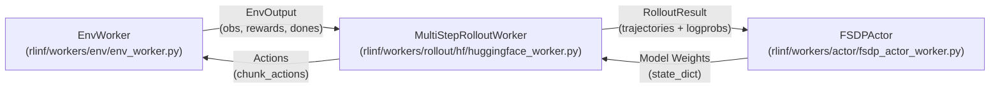
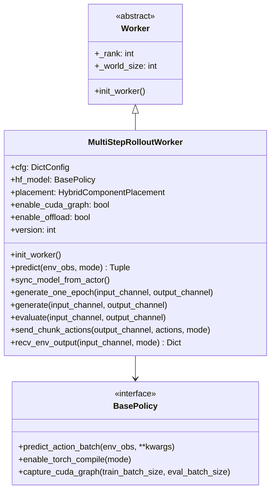
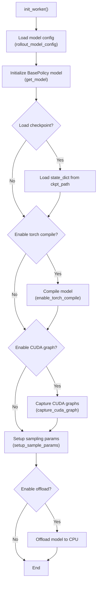
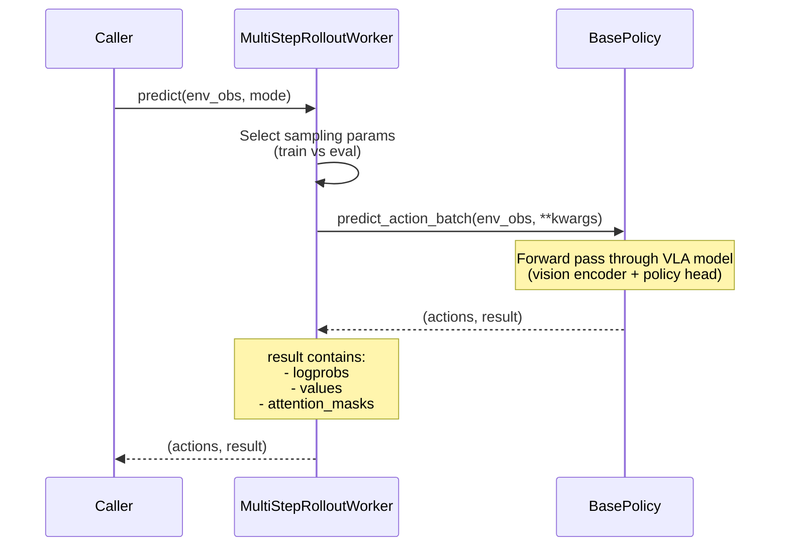
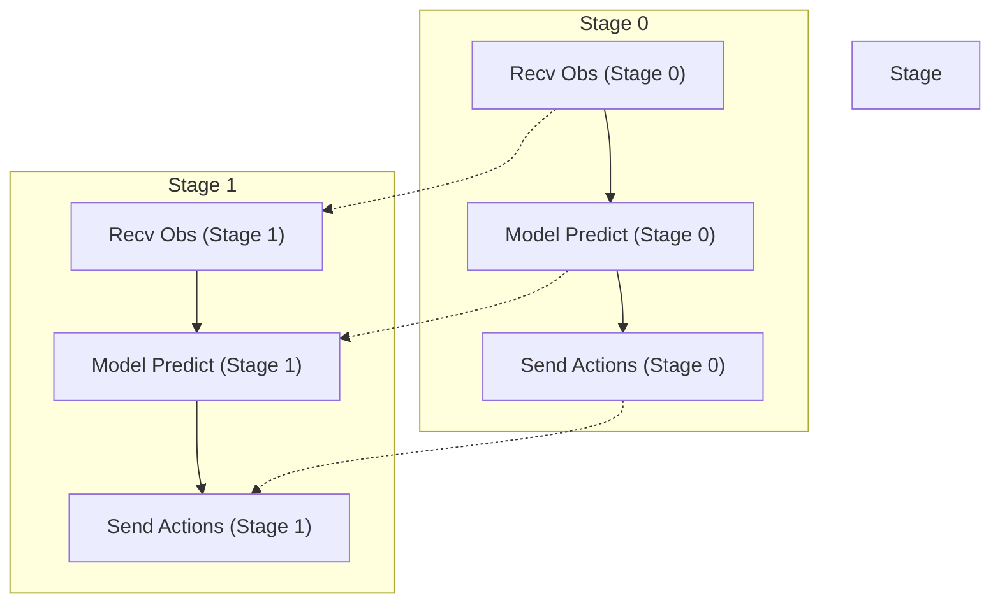

<!-- source: DeepWiki mcp.deepwiki.com · repo RLinf/RLinf · page 6.4 Rollout Workers · fetched 2026-10-21 -->

# Rollout Workers

<details>
<summary>Relevant source files</summary>

The following files were used as context for generating this wiki page:

- [docs/source-en/rst_source/start/installation.rst](docs/source-en/rst_source/start/installation.rst)
- [docs/source-en/rst_source/start/vla.rst](docs/source-en/rst_source/start/vla.rst)
- [docs/source-zh/rst_source/start/installation.rst](docs/source-zh/rst_source/start/installation.rst)
- [docs/source-zh/rst_source/start/vla.rst](docs/source-zh/rst_source/start/vla.rst)
- [examples/embodiment/train_async.py](examples/embodiment/train_async.py)
- [examples/embodiment/train_embodied_agent.py](examples/embodiment/train_embodied_agent.py)
- [rlinf/algorithms/rewards/vqa/__init__.py](rlinf/algorithms/rewards/vqa/__init__.py)
- [rlinf/algorithms/rewards/vqa/format_rewards.py](rlinf/algorithms/rewards/vqa/format_rewards.py)
- [rlinf/algorithms/rewards/vqa/qa_rewards.py](rlinf/algorithms/rewards/vqa/qa_rewards.py)
- [rlinf/config.py](rlinf/config.py)
- [rlinf/hybrid_engines/sglang/common/detokenizer_manager.py](rlinf/hybrid_engines/sglang/common/detokenizer_manager.py)
- [rlinf/hybrid_engines/sglang/common/sgl_engine.py](rlinf/hybrid_engines/sglang/common/sgl_engine.py)
- [rlinf/hybrid_engines/sglang/common/sgl_scheduler.py](rlinf/hybrid_engines/sglang/common/sgl_scheduler.py)
- [rlinf/hybrid_engines/sglang/common/tokenizer_manager.py](rlinf/hybrid_engines/sglang/common/tokenizer_manager.py)
- [rlinf/hybrid_engines/vllm/vllm_0_8_5/worker.py](rlinf/hybrid_engines/vllm/vllm_0_8_5/worker.py)
- [rlinf/runners/embodied_runner.py](rlinf/runners/embodied_runner.py)
- [rlinf/utils/placement.py](rlinf/utils/placement.py)
- [rlinf/workers/actor/fsdp_actor_worker.py](rlinf/workers/actor/fsdp_actor_worker.py)
- [rlinf/workers/actor/fsdp_actor_worker_pipeline.py](rlinf/workers/actor/fsdp_actor_worker_pipeline.py)
- [rlinf/workers/env/env_worker.py](rlinf/workers/env/env_worker.py)
- [rlinf/workers/rollout/hf/huggingface_worker.py](rlinf/workers/rollout/hf/huggingface_worker.py)
- [rlinf/workers/rollout/sglang/__init__.py](rlinf/workers/rollout/sglang/__init__.py)
- [rlinf/workers/rollout/utils.py](rlinf/workers/rollout/utils.py)
- [rlinf/workers/rollout/vllm/vllm_worker.py](rlinf/workers/rollout/vllm/vllm_worker.py)
- [tests/e2e_tests/embodied/maniskill_ppo_openpi05_pipeline.yaml](tests/e2e_tests/embodied/maniskill_ppo_openpi05_pipeline.yaml)
- [tests/unit_tests/test_overlap_env_bootstrap.py](tests/unit_tests/test_overlap_env_bootstrap.py)

</details>


Rollout Workers are responsible for policy inference during embodied RL training. They receive observations from environment workers, use the policy model to predict actions, and return both actions and auxiliary information (logprobs, values) needed for training. Rollout workers act as the bridge between environment interaction and policy optimization, enabling efficient separation of inference and training compute.

**Scope**: This page covers rollout workers specifically for embodied AI tasks (VLA models, robotic control). For agentic AI rollout generation using inference engines like vLLM and SGLang, see [Inference Engine Integration](). For the environment workers that provide observations, see [Environment Workers](). For actor workers that consume rollout data for training, see the FSDP and Megatron actor implementations in [FSDP Backend]() and [Megatron Backend]().

---

## System Position

Rollout workers sit in the policy inference loop of the embodied RL training pipeline. The following diagram shows their position in the overall data flow:

### Rollout Data Flow


**Sources**: [rlinf/workers/rollout/hf/huggingface_worker.py:42-137](), [rlinf/workers/actor/fsdp_actor_worker.py:146-186](), [rlinf/workers/env/env_worker.py:58-158]()

---

## Core Implementation: MultiStepRolloutWorker

The primary rollout worker implementation for embodied tasks is `MultiStepRolloutWorker`, which uses HuggingFace-compatible VLA models for action prediction.

### Class Structure



**Sources**: [rlinf/workers/rollout/hf/huggingface_worker.py:42-137](), [rlinf/models/embodiment/base_policy.py:29-33]()

### Key Attributes

| Attribute | Type | Purpose |
|-----------|------|---------|
| `hf_model` | `BasePolicy` | VLA model instance for action prediction [rlinf/workers/rollout/hf/huggingface_worker.py:145]() |
| `placement` | `HybridComponentPlacement` | Worker placement strategy (collocated/disaggregated) [rlinf/workers/rollout/hf/huggingface_worker.py:62]() |
| `train_batch_size` | `int` | Number of environments per pipeline stage for training [rlinf/workers/rollout/hf/huggingface_worker.py:91]() |
| `eval_batch_size` | `int` | Number of environments per pipeline stage for evaluation [rlinf/workers/rollout/hf/huggingface_worker.py:92]() |
| `num_pipeline_stages` | `int` | Number of pipeline stages for parallelization [rlinf/workers/rollout/hf/huggingface_worker.py:89]() |
| `enable_cuda_graph` | `bool` | Whether to use CUDA graphs for inference optimization [rlinf/workers/rollout/hf/huggingface_worker.py:101]() |
| `enable_offload` | `bool` | Whether to offload model to CPU when not in use [rlinf/workers/rollout/hf/huggingface_worker.py:60]() |
| `version` | `int` | Current model version (increments with training steps) [rlinf/workers/rollout/hf/huggingface_worker.py:116]() |

---

## Initialization and Model Setup

The `init_worker` method sets up the rollout worker's model and optimization features:

### Model Initialization Workflow


**Sources**: [rlinf/workers/rollout/hf/huggingface_worker.py:139-182]()

### Model Precision and Path

The rollout worker uses a potentially different precision and checkpoint path than the actor worker to optimize for inference:

- **Precision**: Configured via `cfg.rollout.model.precision` [rlinf/workers/rollout/hf/huggingface_worker.py:142]().
- **Model Path**: Configured via `cfg.rollout.model.model_path` [rlinf/workers/rollout/hf/huggingface_worker.py:143]().
- **Base Model**: Uses the architecture specified in `cfg.actor.model` but with rollout-specific settings [rlinf/workers/rollout/hf/huggingface_worker.py:140-141]().

---

## Action Prediction

The `predict` method generates actions and auxiliary training data (logprobs, values) from environment observations. It handles standard inference and can also integrate RLT (Route Layer Training) features for hybrid action selection [rlinf/workers/rollout/hf/huggingface_worker.py:151-158]().

### Prediction Sequence


**Sources**: [rlinf/workers/rollout/hf/huggingface_worker.py:240-274]()

---

## Asynchronous Execution and Decoupled Mode

The `AsyncMultiStepRolloutWorker` extends the base worker to support non-blocking execution and staleness control.

### Staleness Management
In asynchronous mode, the worker tracks `finished_episodes` and compares it against a `staleness_threshold` [rlinf/workers/rollout/hf/async_huggingface_worker.py:27-31](). The `wait_if_stale` function blocks rollout generation if the rollout version is too far ahead of the training progress [rlinf/workers/rollout/hf/async_huggingface_worker.py:92-110]().

### Decoupled Generation
When `env_decoupled_mode` is enabled, the worker uses a specialized generation loop `decoupled_generate_one_epoch` [rlinf/workers/rollout/hf/async_huggingface_worker.py:153-189](). It polls the `input_channel` for `EnvOutput` batches using `recv_from_and_record_batch_routes_with_timeout`, performs inference, and routes `RolloutResult` back through the `output_channel` [rlinf/workers/rollout/hf/async_huggingface_worker.py:168-188]().

**Sources**: [rlinf/workers/rollout/hf/async_huggingface_worker.py:23-189]()

---

## Pipeline Parallelism for Rollout

RLinf utilizes pipeline parallelism to overlap model inference with environment execution. This is controlled by `pipeline_stage_num` [rlinf/workers/rollout/hf/huggingface_worker.py:59]().

### Pipeline Execution Flow


**Sources**: [rlinf/workers/rollout/hf/huggingface_worker.py:307-345](), [rlinf/workers/env/env_worker.py:77-78]()

---

## Data Structures

### EnvOutput and RolloutResult

Rollout workers exchange structured data defined in `rlinf/data/embodied_io_struct.py` and `rlinf/data/io_struct.py`.

| Class | Purpose | Key Fields |
|-------|---------|------------|
| `EnvOutput` | Data from environment step | `obs`, `rewards`, `dones`, `env_infos` [rlinf/data/embodied_io_struct.py:30]() |
| `RolloutResult` | Data from policy inference | `actions`, `logprobs`, `values`, `version` [rlinf/data/io_struct.py:33]() |
| `Trajectory` | Complete episode segment | `env_outputs`, `rollout_results` [rlinf/data/embodied_io_struct.py:32]() |

**Sources**: [rlinf/data/embodied_io_struct.py:30-33](), [rlinf/data/io_struct.py:33]()

---

## Weight Synchronization

Rollout workers periodically receive updated model weights from actor workers. This is managed by the `WeightSyncer` [rlinf/workers/rollout/hf/huggingface_worker.py:126](). In asynchronous mode, workers can perform background weight synchronization via `_poll_background_weight_sync` to avoid blocking the rollout loop [rlinf/workers/rollout/hf/async_huggingface_worker.py:131-144]().

### Weight Sync Workflow
```mermaid
sequenceDiagram
    participant Actor as FSDPActor
    participant Rollout as MultiStepRolloutWorker
    
    Note over Actor: Update Step Complete
    Actor->>Rollout: sync_model_to_rollout()
    Rollout->>Rollout: sync_model_from_actor()
    Note over Rollout: weight_syncer.sync()
    Rollout->>Rollout: Increment version
```

**Sources**: [rlinf/workers/rollout/hf/huggingface_worker.py:121-128](), [rlinf/runners/embodied_runner.py:187-192](), [rlinf/workers/rollout/hf/async_huggingface_worker.py:115-151]()

---

## Inference Optimizations

### CUDA Graphs
When `enable_cuda_graph=True`, the worker captures the model's execution graph during `init_worker` for both training and evaluation batch sizes [rlinf/workers/rollout/hf/huggingface_worker.py:101](). This significantly reduces CPU overhead for small batch sizes typical in robotic rollouts.

### Model Offloading
If `enable_offload=True`, the model is moved to CPU RAM during idle periods (e.g., when only environment stepping is occurring) and reloaded to GPU only when `generate()` or `evaluate()` is called [rlinf/workers/rollout/hf/huggingface_worker.py:60]().

### Torch Compile
The worker supports `torch.compile` via `enable_torch_compile=True`, allowing for kernel fusion and graph optimizations tailored to the specific hardware [rlinf/workers/rollout/hf/huggingface_worker.py:178-182]().

**Sources**: [rlinf/workers/rollout/hf/huggingface_worker.py:60-182]()

---

