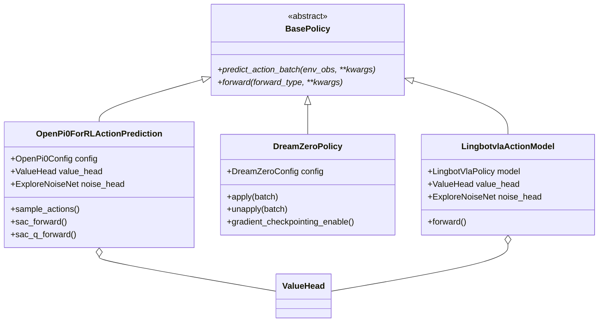
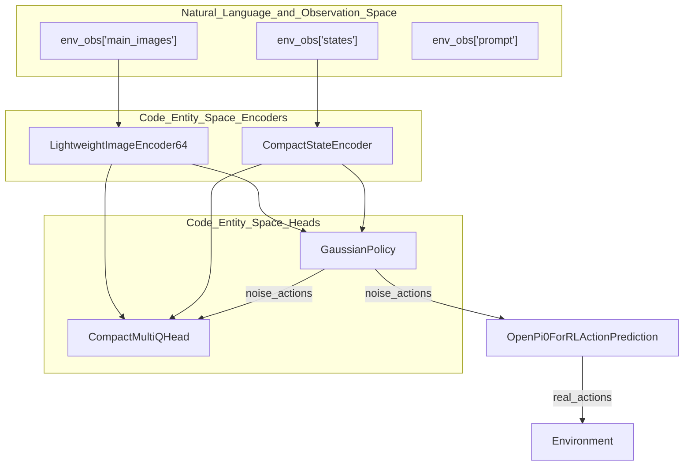
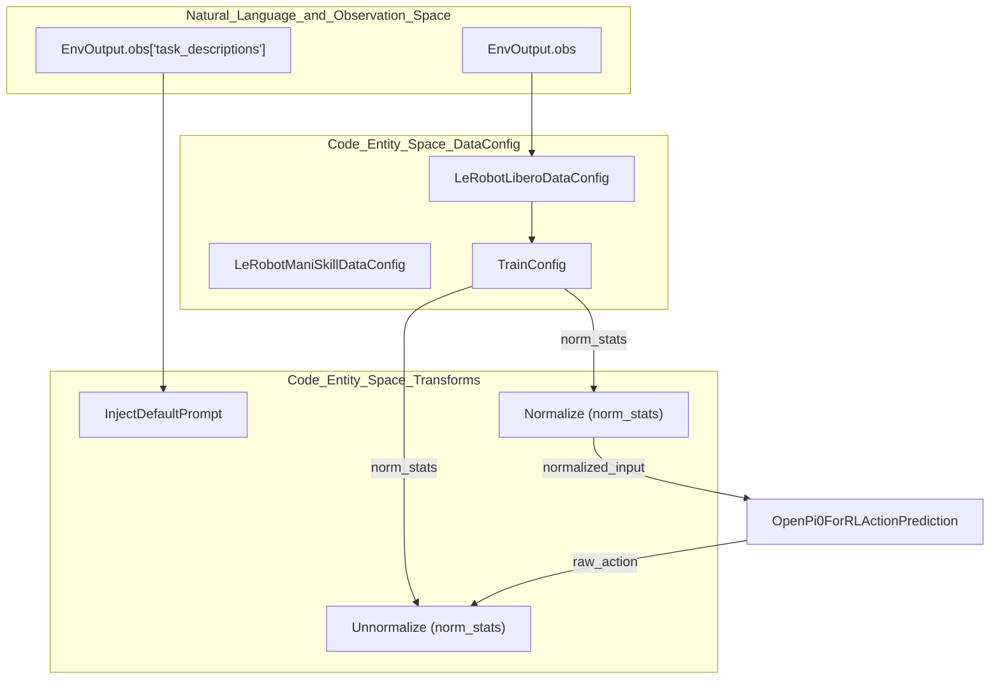

<!-- source: DeepWiki mcp.deepwiki.com · repo RLinf/RLinf · page 6.5 VLA Models and Architectures · fetched 2026-10-21 -->

# VLA Models and Architectures

Relevant source files

The following files were used as context for generating this wiki page:

- [.github/workflows/commit_check.yml](.github/workflows/commit_check.yml)
- [.github/workflows/lint.yml](.github/workflows/lint.yml)
- [.github/workflows/sft-e2e-tests.yml](.github/workflows/sft-e2e-tests.yml)
- [docs/source-en/rst_source/evaluations/guides/behavior.rst](docs/source-en/rst_source/evaluations/guides/behavior.rst)
- [docs/source-en/rst_source/evaluations/guides/robotwin.rst](docs/source-en/rst_source/evaluations/guides/robotwin.rst)
- [docs/source-en/rst_source/examples/embodied/dexbotic.rst](docs/source-en/rst_source/examples/embodied/dexbotic.rst)
- [docs/source-en/rst_source/examples/embodied/gr00t.rst](docs/source-en/rst_source/examples/embodied/gr00t.rst)
- [docs/source-en/rst_source/examples/embodied/lingbotvla.rst](docs/source-en/rst_source/examples/embodied/lingbotvla.rst)
- [docs/source-en/rst_source/examples/embodied/opensora.rst](docs/source-en/rst_source/examples/embodied/opensora.rst)
- [docs/source-en/rst_source/examples/embodied/pi0.rst](docs/source-en/rst_source/examples/embodied/pi0.rst)
- [docs/source-en/rst_source/examples/embodied/robotwin.rst](docs/source-en/rst_source/examples/embodied/robotwin.rst)
- [docs/source-en/rst_source/examples/embodied/starvla.rst](docs/source-en/rst_source/examples/embodied/starvla.rst)
- [docs/source-zh/rst_source/evaluations/guides/robotwin.rst](docs/source-zh/rst_source/evaluations/guides/robotwin.rst)
- [docs/source-zh/rst_source/examples/embodied/dexbotic.rst](docs/source-zh/rst_source/examples/embodied/dexbotic.rst)
- [docs/source-zh/rst_source/examples/embodied/gr00t.rst](docs/source-zh/rst_source/examples/embodied/gr00t.rst)
- [docs/source-zh/rst_source/examples/embodied/lingbotvla.rst](docs/source-zh/rst_source/examples/embodied/lingbotvla.rst)
- [docs/source-zh/rst_source/examples/embodied/opensora.rst](docs/source-zh/rst_source/examples/embodied/opensora.rst)
- [docs/source-zh/rst_source/examples/embodied/pi0.rst](docs/source-zh/rst_source/examples/embodied/pi0.rst)
- [docs/source-zh/rst_source/examples/embodied/robotwin.rst](docs/source-zh/rst_source/examples/embodied/robotwin.rst)
- [docs/source-zh/rst_source/examples/embodied/starvla.rst](docs/source-zh/rst_source/examples/embodied/starvla.rst)
- [examples/embodiment/config/env/manikill_put_carrot_on_plate_in_scene.yaml](examples/embodiment/config/env/manikill_put_carrot_on_plate_in_scene.yaml)
- [examples/embodiment/config/env/maniskill_ood_template.yaml](examples/embodiment/config/env/maniskill_ood_template.yaml)
- [examples/embodiment/config/env/maniskill_pick_cube.yaml](examples/embodiment/config/env/maniskill_pick_cube.yaml)
- [examples/embodiment/config/env/maniskill_put_on_plate_in_scene_25_main.yaml](examples/embodiment/config/env/maniskill_put_on_plate_in_scene_25_main.yaml)
- [examples/embodiment/config/env/robotwin_place_shoe.yaml](examples/embodiment/config/env/robotwin_place_shoe.yaml)
- [examples/embodiment/config/libero_spatial_grpo_starvla.yaml](examples/embodiment/config/libero_spatial_grpo_starvla.yaml)
- [examples/embodiment/config/libero_spatial_ppo_dexbotic_dm0.yaml](examples/embodiment/config/libero_spatial_ppo_dexbotic_dm0.yaml)
- [examples/embodiment/config/libero_spatial_ppo_dexbotic_pi0.yaml](examples/embodiment/config/libero_spatial_ppo_dexbotic_pi0.yaml)
- [examples/embodiment/config/maniskill_ppo_openpi.yaml](examples/embodiment/config/maniskill_ppo_openpi.yaml)
- [examples/embodiment/config/maniskill_ppo_openpi_pi05.yaml](examples/embodiment/config/maniskill_ppo_openpi_pi05.yaml)
- [examples/embodiment/config/model/dexbotic_dm0.yaml](examples/embodiment/config/model/dexbotic_dm0.yaml)
- [examples/embodiment/config/model/dexbotic_pi.yaml](examples/embodiment/config/model/dexbotic_pi.yaml)
- [examples/embodiment/config/model/lingbotvla.yaml](examples/embodiment/config/model/lingbotvla.yaml)
- [examples/sft/run_vla_sft.sh](examples/sft/run_vla_sft.sh)
- [requirements/embodied/models/dreamzero.txt](requirements/embodied/models/dreamzero.txt)
- [rlinf/data/datasets/dreamzero/data_transforms/__init__.py](rlinf/data/datasets/dreamzero/data_transforms/__init__.py)
- [rlinf/data/datasets/dreamzero/data_transforms/base.py](rlinf/data/datasets/dreamzero/data_transforms/base.py)
- [rlinf/data/datasets/dreamzero/data_transforms/oxe_droid.py](rlinf/data/datasets/dreamzero/data_transforms/oxe_droid.py)
- [rlinf/data/datasets/dreamzero/dataloader.py](rlinf/data/datasets/dreamzero/dataloader.py)
- [rlinf/data/datasets/dreamzero/lerobot_dataset.py](rlinf/data/datasets/dreamzero/lerobot_dataset.py)
- [rlinf/data/datasets/dreamzero/sampling_strategy.py](rlinf/data/datasets/dreamzero/sampling_strategy.py)
- [rlinf/models/embodiment/dexbotic_dm0/__init__.py](rlinf/models/embodiment/dexbotic_dm0/__init__.py)
- [rlinf/models/embodiment/dexbotic_dm0/dm0_policy.py](rlinf/models/embodiment/dexbotic_dm0/dm0_policy.py)
- [rlinf/models/embodiment/dexbotic_pi/dexbotic_pi_policy.py](rlinf/models/embodiment/dexbotic_pi/dexbotic_pi_policy.py)
- [rlinf/models/embodiment/dreamzero/__init__.py](rlinf/models/embodiment/dreamzero/__init__.py)
- [rlinf/models/embodiment/dreamzero/dreamzero_policy.py](rlinf/models/embodiment/dreamzero/dreamzero_policy.py)
- [rlinf/models/embodiment/lingbotvla/lingbotvla_action_model.py](rlinf/models/embodiment/lingbotvla/lingbotvla_action_model.py)
- [rlinf/models/embodiment/modules/mlp.py](rlinf/models/embodiment/modules/mlp.py)
- [rlinf/models/embodiment/openpi/__init__.py](rlinf/models/embodiment/openpi/__init__.py)
- [rlinf/models/embodiment/openpi/dataconfig/__init__.py](rlinf/models/embodiment/openpi/dataconfig/__init__.py)
- [rlinf/models/embodiment/openpi/dataconfig/maniskill_dataconfig.py](rlinf/models/embodiment/openpi/dataconfig/maniskill_dataconfig.py)
- [rlinf/models/embodiment/openpi/openpi_action_model.py](rlinf/models/embodiment/openpi/openpi_action_model.py)
- [rlinf/models/embodiment/openpi/policies/maniskill_policy.py](rlinf/models/embodiment/openpi/policies/maniskill_policy.py)
- [rlinf/models/embodiment/openpi_cfg/openpi_cfg_action_model.py](rlinf/models/embodiment/openpi_cfg/openpi_cfg_action_model.py)
- [rlinf/models/embodiment/starvla/action_heads/oft.py](rlinf/models/embodiment/starvla/action_heads/oft.py)
- [rlinf/models/embodiment/starvla/starvla_action_model.py](rlinf/models/embodiment/starvla/starvla_action_model.py)
- [rlinf/runners/sft_runner.py](rlinf/runners/sft_runner.py)
- [rlinf/workers/sft/fsdp_vla_sft_worker.py](rlinf/workers/sft/fsdp_vla_sft_worker.py)
- [tests/e2e_tests/embodied/robotwin_grpo_lingbotvla.yaml](tests/e2e_tests/embodied/robotwin_grpo_lingbotvla.yaml)

This page documents the Vision-Language-Action (VLA) model layer of the Embodied RL domain. It covers the `BasePolicy` interface, model registration, and supported model classes including **OpenVLA**, **OpenVLA-OFT**, **Pi0/Pi0.5** (OpenPi), **GR00T**, **StarVLA**, **DexBotic**, **DreamZero**, **LingBotVLA**, and **CNN-based** policies. It also details the **DSRL** (Diffusion-guided Soft RL) architecture and the data configuration pipeline for various environments.

---

## Overview

All VLA models in the RLinf embodied pipeline implement the `BasePolicy` abstract base class [rlinf/models/embodiment/base_policy.py:31](). Models are instantiated by factory functions that dispatch based on the `model_type` specified in the Hydra configuration.

During rollout, the `MultiStepRolloutWorker` holds a `BasePolicy` instance and calls `predict_action_batch` to generate action chunks. During training, the `FSDPModelManager` (or `MegatronModelManager`) wraps the model for gradient updates and calls `model.forward` to recompute log-probabilities or values [rlinf/models/embodiment/openpi/openpi_action_model.py:324-371]().

---

## Model Registry and Interface

The `model_type` string in the configuration selects the implementation class. Supported models are listed in the installation utility and registry.

| `model_type` | Implementation Class | Primary File |
| :--- | :--- | :--- |
| `openpi` | `OpenPi0ForRLActionPrediction` | [rlinf/models/embodiment/openpi/openpi_action_model.py:106]() |
| `gr00t` | `FlowMatchingActionHeadForRLActionPrediction` | [rlinf/models/embodiment/gr00t/gr00t_n1d5/gr00t_action_model.py:47]() |
| `dexbotic` | `DexBoticPiPolicy` | [rlinf/models/embodiment/dexbotic_pi/dexbotic_pi_policy.py:35]() |
| `dreamzero` | `DreamZeroPolicy` | [rlinf/models/embodiment/dreamzero/dreamzero_policy.py:32]() |
| `starvla` | `StarVLAForRLActionPrediction` | [rlinf/models/embodiment/starvla/starvla_action_model.py:43]() |
| `lingbotvla` | `LingbotvlaActionModel` | [rlinf/models/embodiment/lingbotvla/lingbotvla_action_model.py:77]() |

### BasePolicy Class Diagram

**Title: BasePolicy Interface and VLA Implementation Hierarchy**

Sources: [rlinf/models/embodiment/base_policy.py:31](), [rlinf/models/embodiment/openpi/openpi_action_model.py:106-187](), [rlinf/models/embodiment/lingbotvla/lingbotvla_action_model.py:77-121](), [rlinf/models/embodiment/dreamzero/dreamzero_policy.py:32-48]()

---

## OpenPi (Pi0 & Pi0.5) Architecture

The Pi0 model (OpenPi) is a flow-matching diffusion policy based on the PaliGemma/Gemma backbone. RLinf extends this with RL-specific heads for value estimation and noise exploration. **Pi0.5** introduces architectural variations such as `value_after_vlm` [rlinf/models/embodiment/openpi/openpi_action_model.py:73]() and different projection widths (2048 for Pi0.5 vs 1024 for Pi0) [rlinf/models/embodiment/openpi/openpi_action_model.py:166-169]().

### Configuration and Initialization
The `OpenPi0Config` class defines parameters for RL training, including `noise_method` (flow_ode, flow_sde, flow_noise, flow_cps), `action_chunk` size, and critic detachment strategies [rlinf/models/embodiment/openpi/openpi_action_model.py:44-75](). The model is instantiated via `get_model` which handles weight loading from FSDP checkpoints or original safetensors [rlinf/models/embodiment/openpi/__init__.py:23-88]().

### DSRL (Diffusion-guided Soft RL)
DSRL integrates SAC-style critics with the diffusion backbone. When `use_dsrl` is enabled [rlinf/models/embodiment/openpi/openpi_action_model.py:77](), RLinf initializes specialized components:
* `CompactStateEncoder` and `LightweightImageEncoder64` for latent extraction [rlinf/models/embodiment/openpi/openpi_action_model.py:183-186]().
* `CompactMultiQHead` for multi-critic estimation [rlinf/models/embodiment/openpi/openpi_action_model.py:184]().

**Title: DSRL Component Data Flow**

Sources: [rlinf/models/embodiment/openpi/openpi_action_model.py:181-233](), [rlinf/models/embodiment/openpi/openpi_action_model.py:76-86](), [rlinf/models/embodiment/openpi/__init__.py:23-136]()

---

## DreamZero Architecture

`DreamZeroPolicy` implements a lightweight action model composed of an `IdentityBackbone` and a `WANPolicyHead` [rlinf/models/embodiment/dreamzero/dreamzero_policy.py:33](). It is designed for efficient rollout and training with `torch.compile` optimizations.

### Core Components
* **Backbone and Action Head**: Inherits from `VLA` and manages the `action_head` which typically uses a diffusion-based `CausalWanModel` [rlinf/models/embodiment/dreamzero/dreamzero_policy.py:32-42]().
* **Data Transformation Pipeline**: Uses `ComposedModalityTransform` to handle video, state, and action preprocessing, including normalization via quantile stats from `metadata.json` [rlinf/models/embodiment/dreamzero/dreamzero_policy.py:100-113]().
* **Memory Optimization**: Explicitly enables gradient checkpointing for the diffusion model and configures `torch._dynamo` cache limits to prevent recompile overhead during rollout [rlinf/models/embodiment/dreamzero/dreamzero_policy.py:62-88](), [rlinf/models/embodiment/dreamzero/__init__.py:33-55]().

### Transformation Logic
The `apply` method prepares environment observations for the model [rlinf/models/embodiment/dreamzero/dreamzero_policy.py:90-118](), while `unapply` reverses model predictions (e.g., width 32 padded actions) back to environment-scale tensors (e.g., 7-DOF for Libero) [rlinf/models/embodiment/dreamzero/dreamzero_policy.py:120-148]().

Sources: [rlinf/models/embodiment/dreamzero/dreamzero_policy.py:32-173](), [rlinf/models/embodiment/dreamzero/__init__.py:15-174]()

---

## StarVLA and QwenOFT Architecture

StarVLA is a modular toolkit composing a VLM backbone (e.g., Qwen2.5-VL) with specialized action heads. RLinf supports **QwenOFT**, where the VLM provides multimodal hidden states and an MLP head regresses continuous action chunks.

### StarVLA Components
* **StarVLAForRLActionPrediction**: An adapter class that bridges StarVLA checkpoints to the RLinf `BasePolicy` interface [rlinf/models/embodiment/starvla/starvla_action_model.py:43-54]().
* **Action Unnormalization**: Uses `resolve_action_norm_stats` to map predicted actions from model space back to environment space using `minmax` or dataset stats [rlinf/models/embodiment/starvla/starvla_action_model.py:84-89]().

Sources: [rlinf/models/embodiment/starvla/starvla_action_model.py:43-113]()

---

## LingBotVLA and RoboTwin Integration

LingBotVLA is adapted for reinforcement learning (GRPO/PPO) and SFT, with specific support for the **RoboTwin** environment [rlinf/models/embodiment/lingbotvla/lingbotvla_action_model.py:79-81]().

### Architectural Features
* **Backbone**: Uses `LingbotVlaPolicy` based on Qwen2/Qwen2.5-VL [rlinf/models/embodiment/lingbotvla/lingbotvla_action_model.py:84-89]().
* **RL Components**: Integrates `ValueHead` for advantage estimation and `ExploreNoiseNet` for flow-noise exploration methods [rlinf/models/embodiment/lingbotvla/lingbotvla_action_model.py:214-230]().
* **Training**: Supports GRPO and full-parameter SFT using the FSDP training backend [docs/source-en/rst_source/examples/embodied/lingbotvla.rst:182-210]().

Sources: [rlinf/models/embodiment/lingbotvla/lingbotvla_action_model.py:77-230](), [docs/source-en/rst_source/examples/embodied/lingbotvla.rst:15-191]()

---

## GR00T Models (N1.5, N1.6, N1.7)

RLinf supports multiple versions of the NVIDIA GR00T foundation model.

### Version Differences
* **N1.5**: Utilizes a `modality.json` for unified dataset interfaces and specific `DataConfig` classes [docs/source-zh/rst_source/examples/embodied/gr00t.rst:254-264]().
* **N1.6**: Introduces flow-matching action heads, FSDP training support, and expanded cross-embodiment capabilities [docs/source-zh/rst_source/examples/embodied/gr00t.rst:19]().
* **N1.7**: Upgrades the backbone to `Cosmos-Reason2-2B` or `Qwen3-VL`. It adopts a Relative End-Effector (EEF) action space [docs/source-zh/rst_source/examples/embodied/gr00t.rst:215-219]().

Sources: [docs/source-zh/rst_source/examples/embodied/gr00t.rst:17-270]()

---

## OpenPi Data Configuration

OpenPi utilizes a specialized `DataConfig` and `TrainConfig` system to manage normalization statistics and dataset-specific transforms across multiple environments [rlinf/models/embodiment/openpi/dataconfig/__init__.py:25-29]().

### Environment Specific Configs
RLinf provides predefined `TrainConfig` objects for major benchmarks:
* **LIBERO**: `pi0_libero` uses `LeRobotLiberoDataConfig` with `extra_delta_transform` enabled [rlinf/models/embodiment/openpi/dataconfig/__init__.py:78-86]().
* **ManiSkill**: `pi0_maniskill` uses `LeRobotManiSkillDataConfig` with a default prompt from task descriptions [rlinf/models/embodiment/openpi/dataconfig/__init__.py:132-139]().
* **RoboTwin**: Supports `LeRobotAlohaDataConfig` for dual-arm ALOHA-style control [rlinf/models/embodiment/openpi/dataconfig/__init__.py:73-75]().

### Data Transformation Pipeline
The `get_model` function in the OpenPi module sets up a transformation stack using `openpi.transforms`. This includes `Normalize` and `Unnormalize` layers that consume `norm_stats` loaded from checkpoint directories [rlinf/models/embodiment/openpi/__init__.py:112-134]().

**Title: OpenPi Data Configuration and Normalization Flow**

Sources: [rlinf/models/embodiment/openpi/dataconfig/__init__.py:77-240](), [rlinf/models/embodiment/openpi/__init__.py:94-134]()

---

## SFT and Training Workers

Training is orchestrated by specialized workers that handle data loading and gradient updates.

* **FSDPVlaSftWorker**: Extends the base FSDP worker to support VLA-specific data loaders for OpenPI, LingBotVLA, and DreamZero [rlinf/workers/sft/fsdp_vla_sft_worker.py:28-79]().
* **OpenPI DataLoader**: Uses `openpi.training.data_loader` to create PyTorch-compatible loaders from `TrainConfig` definitions [rlinf/workers/sft/fsdp_vla_sft_worker.py:41-55]().
* **Loss Computation**: The `get_train_model_output` method calls the model's forward pass with `ForwardType.SFT` and extracts the loss for optimization [rlinf/workers/sft/fsdp_vla_sft_worker.py:85-104]().

Sources: [rlinf/workers/sft/fsdp_vla_sft_worker.py:1-171]()

---

