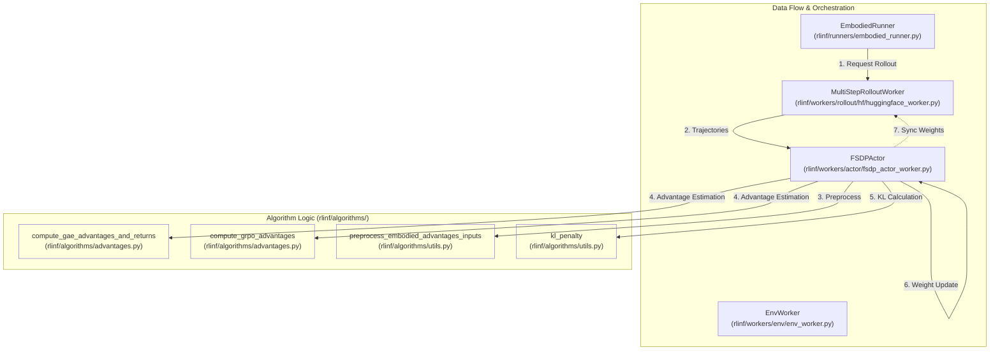
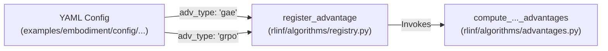

<!-- source: DeepWiki mcp.deepwiki.com · repo RLinf/RLinf · page 6.6 PPO and GRPO for Embodied AI · fetched 2026-10-21 -->

# PPO and GRPO for Embodied AI

Relevant source files

The following files were used as context for generating this wiki page:

- [examples/embodiment/config/libero_10_grpo_openpi.yaml](examples/embodiment/config/libero_10_grpo_openpi.yaml)
- [examples/embodiment/config/libero_10_grpo_openpi_pi05.yaml](examples/embodiment/config/libero_10_grpo_openpi_pi05.yaml)
- [examples/embodiment/config/libero_10_grpo_openvlaoft.yaml](examples/embodiment/config/libero_10_grpo_openvlaoft.yaml)
- [examples/embodiment/config/libero_10_ppo_openpi.yaml](examples/embodiment/config/libero_10_ppo_openpi.yaml)
- [examples/embodiment/config/libero_10_ppo_openpi_pi05.yaml](examples/embodiment/config/libero_10_ppo_openpi_pi05.yaml)
- [examples/embodiment/config/libero_130_grpo_openvlaoft.yaml](examples/embodiment/config/libero_130_grpo_openvlaoft.yaml)
- [examples/embodiment/config/libero_90_grpo_openvlaoft.yaml](examples/embodiment/config/libero_90_grpo_openvlaoft.yaml)
- [examples/embodiment/config/libero_goal_grpo_openpi.yaml](examples/embodiment/config/libero_goal_grpo_openpi.yaml)
- [examples/embodiment/config/libero_goal_grpo_openpi_pi05.yaml](examples/embodiment/config/libero_goal_grpo_openpi_pi05.yaml)
- [examples/embodiment/config/libero_goal_grpo_openvlaoft.yaml](examples/embodiment/config/libero_goal_grpo_openvlaoft.yaml)
- [examples/embodiment/config/libero_goal_ppo_openpi.yaml](examples/embodiment/config/libero_goal_ppo_openpi.yaml)
- [examples/embodiment/config/libero_goal_ppo_openpi_pi05.yaml](examples/embodiment/config/libero_goal_ppo_openpi_pi05.yaml)
- [examples/embodiment/config/libero_object_grpo_openpi.yaml](examples/embodiment/config/libero_object_grpo_openpi.yaml)
- [examples/embodiment/config/libero_object_grpo_openpi_pi05.yaml](examples/embodiment/config/libero_object_grpo_openpi_pi05.yaml)
- [examples/embodiment/config/libero_object_grpo_openvlaoft.yaml](examples/embodiment/config/libero_object_grpo_openvlaoft.yaml)
- [examples/embodiment/config/libero_object_ppo_openpi.yaml](examples/embodiment/config/libero_object_ppo_openpi.yaml)
- [examples/embodiment/config/libero_object_ppo_openpi_pi05.yaml](examples/embodiment/config/libero_object_ppo_openpi_pi05.yaml)
- [examples/embodiment/config/libero_spatial_grpo_openpi.yaml](examples/embodiment/config/libero_spatial_grpo_openpi.yaml)
- [examples/embodiment/config/libero_spatial_grpo_openpi_pi05.yaml](examples/embodiment/config/libero_spatial_grpo_openpi_pi05.yaml)
- [examples/embodiment/config/libero_spatial_grpo_openvlaoft.yaml](examples/embodiment/config/libero_spatial_grpo_openvlaoft.yaml)
- [examples/embodiment/config/libero_spatial_ppo_openpi.yaml](examples/embodiment/config/libero_spatial_ppo_openpi.yaml)
- [examples/embodiment/config/libero_spatial_ppo_openpi_pi05.yaml](examples/embodiment/config/libero_spatial_ppo_openpi_pi05.yaml)
- [examples/embodiment/config/maniskill_grpo_openvla.yaml](examples/embodiment/config/maniskill_grpo_openvla.yaml)
- [examples/embodiment/config/maniskill_grpo_openvlaoft.yaml](examples/embodiment/config/maniskill_grpo_openvlaoft.yaml)
- [examples/embodiment/config/maniskill_ppo_openvla.yaml](examples/embodiment/config/maniskill_ppo_openvla.yaml)
- [examples/embodiment/config/maniskill_ppo_openvla_quickstart.yaml](examples/embodiment/config/maniskill_ppo_openvla_quickstart.yaml)
- [examples/embodiment/config/maniskill_ppo_openvlaoft.yaml](examples/embodiment/config/maniskill_ppo_openvlaoft.yaml)
- [examples/embodiment/config/maniskill_ppo_openvlaoft_quickstart.yaml](examples/embodiment/config/maniskill_ppo_openvlaoft_quickstart.yaml)
- [examples/embodiment/config/metaworld_50_ppo_openpi_pi05.yaml](examples/embodiment/config/metaworld_50_ppo_openpi_pi05.yaml)
- [rlinf/algorithms/advantages.py](rlinf/algorithms/advantages.py)
- [rlinf/algorithms/registry.py](rlinf/algorithms/registry.py)
- [rlinf/algorithms/utils.py](rlinf/algorithms/utils.py)

This page documents the implementation of **Proximal Policy Optimization (PPO)** and **Group Relative Policy Optimization (GRPO)** algorithms for embodied AI tasks in RLinf. These algorithms train vision-language-action (VLA) models to perform robotic manipulation tasks through reinforcement learning.

## Algorithm Overview

PPO and GRPO represent two distinct approaches to policy gradient optimization for embodied tasks, differing primarily in their advantage computation and value function usage. RLinf provides a unified interface for both via the `embodied` task type.

### Logic Flow and Code Entities

The following diagram maps the conceptual RL steps to the specific classes and methods in the codebase.

**RL Execution Flow to Code Mapping**

**Sources:** `[rlinf/algorithms/advantages.py:25-121]()`, `[rlinf/algorithms/utils.py:67-131]()`, `[rlinf/algorithms/utils.py:26-64]()`

### Key Differences in Implementation

| Aspect | PPO Implementation | GRPO Implementation |
|--------|-----|------|
| **Advantage Type** | `adv_type: gae` [examples/embodiment/config/maniskill_ppo_openvlaoft.yaml:49]() | `adv_type: grpo` [examples/embodiment/config/libero_10_grpo_openvlaoft.yaml:49]() |
| **Loss Type** | `actor_critic` [examples/embodiment/config/maniskill_ppo_openvlaoft.yaml:50]() | `actor` [examples/embodiment/config/libero_10_grpo_openvlaoft.yaml:50]() |
| **Value Head** | Required (`add_value_head: True`) [examples/embodiment/config/maniskill_ppo_openvlaoft.yaml:122]() | Not used [examples/embodiment/config/libero_10_grpo_openvlaoft.yaml:151]() |
| **Group Size** | `group_size: 1` [examples/embodiment/config/maniskill_ppo_openvlaoft.yaml:44]() | `group_size: 8` [examples/embodiment/config/libero_10_grpo_openvlaoft.yaml:43]() |
| **Rollout Epochs** | Typically 1 [examples/embodiment/config/maniskill_ppo_openvlaoft.yaml:70]() | Can be higher (e.g., 16) [examples/embodiment/config/libero_10_grpo_openvlaoft.yaml:74]() |
| **Granularity** | Often `action_level` [examples/embodiment/config/maniskill_ppo_openvlaoft.yaml:45-47]() | Often `token_level` [examples/embodiment/config/libero_10_grpo_openvlaoft.yaml:46-47]() |

## Advantage Computation

Before computation, the system calls `preprocess_embodied_advantages_inputs` to unify names and formats, transposing and reshaping rewards and dones to align with mathematical interfaces [rlinf/algorithms/utils.py:67-131]().

### PPO: GAE-Based Advantages
PPO utilizes Generalized Advantage Estimation (GAE) to balance bias and variance.
- **Implementation**: Handled by `compute_gae_advantages_and_returns` [rlinf/algorithms/advantages.py:25-86]().
- **Bootstrap Handling**: Supports `bootstrap_type: always` which bootstraps on both terminations and truncations [examples/embodiment/config/maniskill_ppo_openvlaoft.yaml:53-53]().
- **Normalization**: Advantages are normalized using `safe_normalize` to stabilize training [rlinf/algorithms/advantages.py:81-82]().
- **Hyperparameters**: Controlled by `gamma` (discount factor) and `gae_lambda` [rlinf/algorithms/advantages.py:27-28]().

### GRPO: Group-Based Advantages
GRPO calculates relative advantages within a group of trajectories generated from the same initial state, eliminating the need for a critic model.
- **Implementation**: Handled by `compute_grpo_advantages` [rlinf/algorithms/advantages.py:89-121](). It computes mean and standard deviation over `group_size` rewards [rlinf/algorithms/advantages.py:107-117]().
- **Reward Filtering**: GRPO configurations often include `filter_rewards: True` with bounds (e.g., `[0.5, 4.5]`) to stabilize estimation [examples/embodiment/config/libero_10_grpo_openvlaoft.yaml:65-67]().
- **Reward Scaling**: Controlled via `reward_coef` to scale the reward signal [examples/embodiment/config/libero_10_grpo_openvlaoft.yaml:63]().

**Sources:** `[rlinf/algorithms/advantages.py:25-121]()`, `[rlinf/algorithms/utils.py:67-131]()`, `[examples/embodiment/config/maniskill_ppo_openvlaoft.yaml:41-65]()`, `[examples/embodiment/config/libero_10_grpo_openvlaoft.yaml:41-67]()`

## Policy Loss and Objectives

The implementation provides clipped objectives and optional dual-clipping for training stability.

### Clipped Objective and Dual Clipping
- **Clipped Ratio**: The probability ratio is clipped between `clip_ratio_low` and `clip_ratio_high` [examples/embodiment/config/maniskill_ppo_openvlaoft.yaml:56-57]().
- **Dual Clipping**: Controlled by `clip_ratio_c` to prevent excessively large policy updates [examples/embodiment/config/maniskill_ppo_openvlaoft.yaml:58]().
- **Huber Loss**: Value function updates (in PPO) use `huber_loss` controlled by `huber_delta` to handle outliers [rlinf/algorithms/utils.py:20-23]().

### Entropy and KL Tuning
- **Entropy Bonus**: Configured via `entropy_bonus` to encourage exploration [examples/embodiment/config/maniskill_ppo_openvlaoft.yaml:55]().
- **KL Penalty**: Divergence is computed using the `kl_penalty` utility, supporting various modes like `kl`, `mse`, and `low_var_kl` [rlinf/algorithms/utils.py:26-64]().
- **KL Beta**: A coefficient `kl_beta` scales the KL term [examples/embodiment/config/libero_10_grpo_openvlaoft.yaml:52]().

**Sources:** `[rlinf/algorithms/utils.py:20-23]()`, `[rlinf/algorithms/utils.py:26-64]()`, `[examples/embodiment/config/maniskill_ppo_openvlaoft.yaml:50-61]()`, `[examples/embodiment/config/libero_10_grpo_openvlaoft.yaml:41-52]()`

## Training Configuration and Backends

The system uses Hydra for flexible configuration of backends (FSDP) and model architectures.

### Model-Algorithm Compatibility
**Configuration to Code Mapping**

**Sources:** `[rlinf/algorithms/registry.py:19-19]()`, `[rlinf/algorithms/advantages.py:24-24]()`, `[rlinf/algorithms/advantages.py:89-89]()`

### Configuration Examples

#### LIBERO-10 GRPO (OpenVLA-OFT)
- **Task**: 10 manipulation tasks in LIBERO.
- **Key Params**: `adv_type: grpo`, `group_size: 8`, `rollout_epoch: 16` [examples/embodiment/config/libero_10_grpo_openvlaoft.yaml:43-74]().
- **Precision**: Uses mixed precision (e.g., `bf16`) via `fsdp_config` [examples/embodiment/config/libero_10_grpo_openvlaoft.yaml:142-146]().

#### ManiSkill PPO (OpenVLA-OFT)
- **Task**: ManiSkill robotic tasks.
- **Key Params**: `adv_type: gae`, `loss_type: actor_critic`, `add_value_head: True` [examples/embodiment/config/maniskill_ppo_openvlaoft.yaml:49-122]().
- **Granularity**: `reward_type`, `logprob_type`, and `entropy_type` are often set to `action_level` or `token_level` [examples/embodiment/config/maniskill_ppo_openvlaoft.yaml:45-47]().

#### OpenPI Implementation
OpenPI models (e.g., Pi0.5) support PPO with specific configurations like `value_after_vlm: True` and `chunk_level` logprobs [examples/embodiment/config/libero_10_ppo_openpi_pi05.yaml:46-121]().

**Sources:** `[examples/embodiment/config/libero_10_grpo_openvlaoft.yaml:1-151]()`, `[examples/embodiment/config/maniskill_ppo_openvlaoft.yaml:1-152]()`, `[examples/embodiment/config/libero_10_ppo_openpi_pi05.yaml:46-121]()`

---

