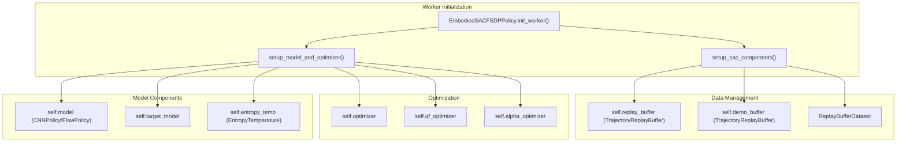
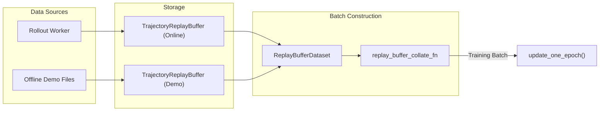
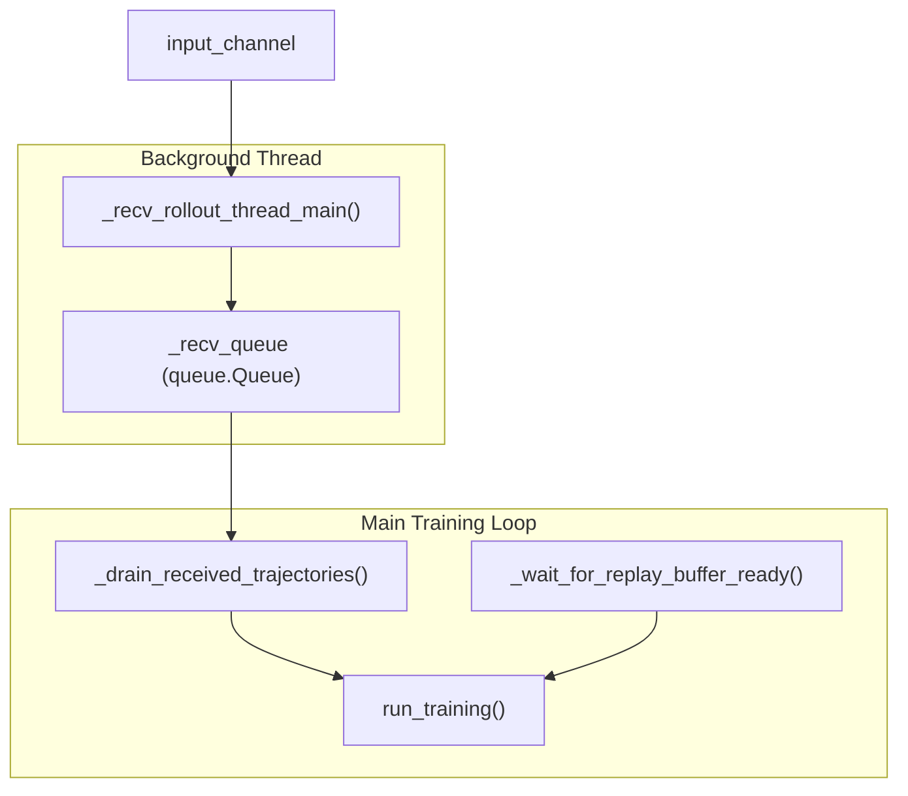
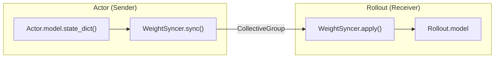

<!-- source: DeepWiki mcp.deepwiki.com · repo RLinf/RLinf · page 6.7 SAC and RLPD for Embodied AI · fetched 2026-10-21 -->

# SAC and RLPD for Embodied AI

Relevant source files

The following files were used as context for generating this wiki page:

- [examples/embodiment/config/dosw1_pick_sac_flow.yaml](examples/embodiment/config/dosw1_pick_sac_flow.yaml)
- [examples/embodiment/config/dosw1_pick_sac_flow_async.yaml](examples/embodiment/config/dosw1_pick_sac_flow_async.yaml)
- [examples/embodiment/config/env/realworld_bin_relocation.yaml](examples/embodiment/config/env/realworld_bin_relocation.yaml)
- [examples/embodiment/config/env/realworld_cap_tightening.yaml](examples/embodiment/config/env/realworld_cap_tightening.yaml)
- [examples/embodiment/config/frankasim_sac_cnn_async.yaml](examples/embodiment/config/frankasim_sac_cnn_async.yaml)
- [examples/embodiment/config/maniskill_crossq_mlp.yaml](examples/embodiment/config/maniskill_crossq_mlp.yaml)
- [examples/embodiment/config/maniskill_ppo_mlp.yaml](examples/embodiment/config/maniskill_ppo_mlp.yaml)
- [examples/embodiment/config/maniskill_ppo_mlp_collect.yaml](examples/embodiment/config/maniskill_ppo_mlp_collect.yaml)
- [examples/embodiment/config/maniskill_sac_flow_state.yaml](examples/embodiment/config/maniskill_sac_flow_state.yaml)
- [examples/embodiment/config/maniskill_sac_mlp.yaml](examples/embodiment/config/maniskill_sac_mlp.yaml)
- [examples/embodiment/config/maniskill_sac_mlp_async.yaml](examples/embodiment/config/maniskill_sac_mlp_async.yaml)
- [examples/embodiment/config/realworld_cap_tighten_rlpd_cnn_async.yaml](examples/embodiment/config/realworld_cap_tighten_rlpd_cnn_async.yaml)
- [examples/embodiment/config/realworld_charger_sac_cnn_async.yaml](examples/embodiment/config/realworld_charger_sac_cnn_async.yaml)
- [examples/embodiment/config/realworld_peginsertion_rlpd_cnn_async.yaml](examples/embodiment/config/realworld_peginsertion_rlpd_cnn_async.yaml)
- [examples/embodiment/config/realworld_peginsertion_rlpd_cnn_async_2arms.yaml](examples/embodiment/config/realworld_peginsertion_rlpd_cnn_async_2arms.yaml)
- [examples/embodiment/config/realworld_pnp_rlpd_cnn_async.yaml](examples/embodiment/config/realworld_pnp_rlpd_cnn_async.yaml)
- [examples/embodiment/config/realworld_sac_flow_image.yaml](examples/embodiment/config/realworld_sac_flow_image.yaml)
- [examples/sft/run_vlm_sft.sh](examples/sft/run_vlm_sft.sh)
- [rlinf/data/embodied_buffer_dataset.py](rlinf/data/embodied_buffer_dataset.py)
- [rlinf/data/embodied_io_struct.py](rlinf/data/embodied_io_struct.py)
- [rlinf/scheduler/worker/routing.py](rlinf/scheduler/worker/routing.py)
- [rlinf/utils/nested_dict_process.py](rlinf/utils/nested_dict_process.py)
- [rlinf/workers/actor/async_fsdp_dagger_policy_worker.py](rlinf/workers/actor/async_fsdp_dagger_policy_worker.py)
- [rlinf/workers/actor/async_fsdp_sac_policy_worker.py](rlinf/workers/actor/async_fsdp_sac_policy_worker.py)
- [rlinf/workers/actor/fsdp_dagger_policy_worker.py](rlinf/workers/actor/fsdp_dagger_policy_worker.py)
- [rlinf/workers/actor/fsdp_sac_policy_worker.py](rlinf/workers/actor/fsdp_sac_policy_worker.py)
- [rlinf/workers/sft/fsdp_vlm_sft_worker.py](rlinf/workers/sft/fsdp_vlm_sft_worker.py)
- [tests/e2e_tests/embodied/frankasim_sac_cnn_async.yaml](tests/e2e_tests/embodied/frankasim_sac_cnn_async.yaml)
- [tests/e2e_tests/embodied/maniskill_sac_flow_state.yaml](tests/e2e_tests/embodied/maniskill_sac_flow_state.yaml)
- [tests/unit_tests/test_comm_mapper.py](tests/unit_tests/test_comm_mapper.py)

This page documents the Soft Actor-Critic (SAC) and Reinforcement Learning with Prior Data (RLPD) implementations for embodied AI training in RLinf. SAC is an off-policy algorithm that uses replay buffers and target networks, making it suitable for real-world robotic tasks where sample efficiency is critical. RLPD extends SAC by incorporating offline demonstration data alongside online rollouts. This page covers the `EmbodiedSACFSDPPolicy` worker, replay buffer integration, asynchronous training modes for real-world deployment, and configurations for both simulation and physical robots.

---

## Algorithm Overview

SAC is an off-policy maximum entropy reinforcement learning algorithm that maintains:
- **Actor network**: Stochastic policy that samples actions.
- **Critic networks**: Multiple Q-functions (typically 2-10) for value estimation.
- **Target networks**: Slowly updated copies of critic networks for stable bootstrapping.
- **Entropy temperature**: Learnable parameter $\alpha$ that balances exploration vs. exploitation.

RLPD extends SAC by incorporating offline demonstration data alongside online rollout data, using a separate demonstration buffer that is sampled from during training.

Sources: [rlinf/workers/actor/fsdp_sac_policy_worker.py:49-61](), [examples/embodiment/config/realworld_peginsertion_rlpd_cnn_async.yaml:60-87]()

---

## SAC Actor Worker Architecture

The following diagram maps the logical components of the SAC implementation to the specific classes and methods in the codebase.

**SAC System to Code Entity Mapping**

**EmbodiedSACFSDPPolicy Class Structure**

The `EmbodiedSACFSDPPolicy` class extends `EmbodiedFSDPActor` to implement SAC-specific training logic.

| Method | Purpose | Line Reference |
|--------|---------|----------------|
| `setup_model_and_optimizer()` | Initialize online/target models, separate actor/critic optimizers, and `EntropyTemperature`. | [rlinf/workers/actor/fsdp_sac_policy_worker.py:78-157]() |
| `setup_sac_components()` | Initialize replay/demo buffers, `ReplayBufferDataset`, and `DataLoader`. | [rlinf/workers/actor/fsdp_sac_policy_worker.py:171-251]() |
| `soft_update_target_model()` | EMA update: target $\leftarrow (1-\tau)target + \tau \cdot online$. | [rlinf/workers/actor/fsdp_sac_policy_worker.py:265-311]() |
| `forward_critic()` | Compute critic loss using TD target with multiple Q-heads. | [rlinf/workers/actor/fsdp_sac_policy_worker.py:343-470]() |
| `forward_actor()` | Compute actor loss using Q-values and entropy regularization. | [rlinf/workers/actor/fsdp_sac_policy_worker.py:472-524]() |
| `forward_alpha()` | Compute entropy temperature loss based on `target_entropy`. | [rlinf/workers/actor/fsdp_sac_policy_worker.py:526-546]() |
| `update_one_epoch()` | Execute one training epoch with gradient accumulation across micro-batches. | [rlinf/workers/actor/fsdp_sac_policy_worker.py:548-660]() |

Sources: [rlinf/workers/actor/fsdp_sac_policy_worker.py:50-660]()

---

## Model and Optimizer Setup

**Dual Model Architecture**

SAC maintains both online and target networks. The `setup_model_and_optimizer` function handles the FSDP wrapping for both:

1.  **Online Model**: Wrapped via `_strategy.wrap_model` for distributed training [rlinf/workers/actor/fsdp_sac_policy_worker.py:99-101]().
2.  **Target Model**: A second instance of the module, also FSDP-wrapped but with `requires_grad_(False)` [rlinf/workers/actor/fsdp_sac_policy_worker.py:106-110]().
3.  **Entropy Tuning**: The `EntropyTemperature` module is initialized with a configurable `alpha_type` (e.g., `softplus`, `exp`, or `fixed_alpha`) [rlinf/workers/actor/fsdp_sac_policy_worker.py:133-141]().

**Parameter Grouping**

SAC uses separate optimizers for actor and critic parameters to allow for different learning rates and update frequencies. This is achieved using `param_filters` in `build_optimizers` [rlinf/workers/actor/fsdp_sac_policy_worker.py:116-127](). For models supporting DSRL (Domain-Specific Reinforcement Learning), it supports separate encoders for actor and critic [rlinf/workers/actor/fsdp_sac_policy_worker.py:112-114]().

Sources: [rlinf/workers/actor/fsdp_sac_policy_worker.py:78-157]()

---

## Replay Buffer System

**Trajectory Flow and RLPD Sampling**

The system manages online interaction data and offline demonstrations through a unified dataset interface.

**Replay Buffer Configuration**

| Parameter | Purpose | Typical Value |
|-----------|---------|---------------|
| `enable_cache` | Keep recent trajectories in memory for fast sampling. | `True` [examples/embodiment/config/realworld_peginsertion_rlpd_cnn_async.yaml:89]() |
| `cache_size` | Number of trajectories cached in memory. | 200 (real-world), 20000 (sim) [examples/embodiment/config/realworld_peginsertion_rlpd_cnn_async.yaml:90]() |
| `min_buffer_size` | Minimum trajectories required before training starts. | 2 (real-world), 5 (sim) [examples/embodiment/config/realworld_peginsertion_rlpd_cnn_async.yaml:91]() |
| `sample_window_size` | Size of the sliding window for sampling latest data. | 200-20000 [examples/embodiment/config/realworld_peginsertion_rlpd_cnn_async.yaml:92]() |

Sources: [rlinf/workers/actor/fsdp_sac_policy_worker.py:171-251](), [rlinf/data/embodied_buffer_dataset.py:26-30](), [rlinf/data/replay_buffer.py:23-23]()

---

## Training Loop: Critic, Actor, Alpha Updates

**Critic Update (TD Learning)**

The critic update computes the temporal difference target using the target network. In RLPD, the Q-values are typically aggregated from multiple Q-heads using `min` or `mean` as defined by `cfg.algorithm.agg_q` [rlinf/workers/actor/fsdp_sac_policy_worker.py:390-403](). The `forward_critic` method handles TD error calculation with support for `CrossQ` architectures [rlinf/workers/actor/fsdp_sac_policy_worker.py:343-470]() and specific support for the `q_head_type: "crossq"` configuration [examples/embodiment/config/maniskill_crossq_mlp.yaml:64]().

**Actor Update (Policy Gradient)**

The actor maximizes the expected Q-value while maintaining entropy. A `critic_actor_ratio` is used to update the actor less frequently than the critic (e.g., once every 4 critic updates in real-world settings) [examples/embodiment/config/realworld_peginsertion_rlpd_cnn_async.yaml:86](). For flow-based policies, the actor loss is computed using Gumbel-Softmax or pathwise gradients [rlinf/workers/actor/fsdp_sac_policy_worker.py:472-524]().

**Alpha Update (Automatic Entropy Tuning)**

The `alpha_optimizer` tunes the temperature parameter $\alpha$ to match the `target_entropy`, which is often set to `-action_dim` [rlinf/workers/actor/fsdp_sac_policy_worker.py:143-146]().

Sources: [rlinf/workers/actor/fsdp_sac_policy_worker.py:343-660](), [examples/embodiment/config/realworld_peginsertion_rlpd_cnn_async.yaml:77-104](), [examples/embodiment/config/maniskill_crossq_mlp.yaml:64-65]()

---

## Asynchronous Training Mode

For real-world deployment, `AsyncEmbodiedSACFSDPPolicy` decouples data collection from training using a background thread and a trajectory queue.

**Async Data Flow**

**Implementation Details**

- **Non-blocking Reception**: The background thread continuously polls the `input_channel` and pushes to a local queue [rlinf/workers/actor/async_fsdp_sac_policy_worker.py:46-53]().
- **Buffer Pre-warming**: `_wait_for_replay_buffer_ready` ensures training only begins once `min_buffer_size` is met [rlinf/workers/actor/async_fsdp_sac_policy_worker.py:83-90]().
- **Intervention Extraction**: Intervened trajectories (human corrections) are automatically extracted from the stream using `extract_intervene_traj()` and added to the `demo_buffer` [rlinf/workers/actor/async_fsdp_sac_policy_worker.py:73-81]().

Sources: [rlinf/workers/actor/async_fsdp_sac_policy_worker.py:15-131]()

---

## DAgger for Embodied Policies

Dataset Aggregation (DAgger) is implemented via `EmbodiedDAGGERFSDPPolicy`. It bridges imitation learning and online interaction by using an expert to relabel states visited by the student.

**DAgger Data Handling**
- **Classic Replay Buffer**: Stores expert-labeled trajectories in memory using `TrajectoryReplayBuffer` [rlinf/workers/actor/fsdp_dagger_policy_worker.py:44]().
- **Online LeRobot**: Streams episodes directly to the actor during training using `RollingLeRobotDataset` [rlinf/workers/actor/fsdp_dagger_policy_worker.py:79-94](). This mode supports frame-level rolling windows and success-only filtering [rlinf/workers/actor/fsdp_dagger_policy_worker.py:84-87]().

**Async DAgger Implementation**
`AsyncEmbodiedDAGGERFSDPPolicy` uses specialized threads for receiving rollout data:
- `_recv_lerobot_thread_main`: Specifically for LeRobot-formatted episode batches [rlinf/workers/actor/async_fsdp_dagger_policy_worker.py:57-71]().
- `_recv_rollout_thread_main`: For standard trajectory reception [rlinf/workers/actor/async_fsdp_dagger_policy_worker.py:72-80]().

Sources: [rlinf/workers/actor/fsdp_dagger_policy_worker.py:41-94](), [rlinf/workers/actor/async_fsdp_dagger_policy_worker.py:27-153]()

---

## Weight Synchronization for Off-Policy Learning

Efficient weight synchronization is critical for off-policy algorithms where the rollout worker must use the latest policy for data collection. RLinf provides specialized weight syncers for this purpose.

**Weight Sync Architecture**

**Sync Implementation Details**
- **PatchWeightSyncer**: Computes deltas between the current model state and a previous snapshot, transferring only modified weights to reduce bandwidth [examples/embodiment/config/realworld_peginsertion_rlpd_cnn_async.yaml:6]().
- **Collective Communication**: Uses `CollectiveGroup` for high-performance tensor communication, with configurable NCCL resource limits via `nccl_max_ctas` [examples/embodiment/config/realworld_peginsertion_rlpd_cnn_async.yaml:204-205]().
- **Blocking/Non-blocking Sync**: Configuration allows for various synchronization frequencies and behaviors to balance throughput and policy freshness [examples/embodiment/config/realworld_peginsertion_rlpd_cnn_async.yaml:103]().

Sources: [examples/embodiment/config/realworld_peginsertion_rlpd_cnn_async.yaml:6-205]()

---

## Hyperparameter Configurations

### SAC and RLPD Settings

| Category | Parameter | Description | Typical Value |
|-----------|-----------|-------------|---------------|
| **Algorithm** | `adv_type` | Returns computation type. | `embodied_sac` [examples/embodiment/config/realworld_peginsertion_rlpd_cnn_async.yaml:70]() |
| | `tau` | Soft update coefficient. | 0.005 [examples/embodiment/config/realworld_peginsertion_rlpd_cnn_async.yaml:76]() |
| | `gamma` | Discount factor. | 0.96 [examples/embodiment/config/realworld_peginsertion_rlpd_cnn_async.yaml:75]() |
| **Entropy** | `alpha_type` | Temperature tuning mode. | `softplus` [examples/embodiment/config/realworld_peginsertion_rlpd_cnn_async.yaml:78]() |
| | `target_entropy`| Desired entropy level. | -3 (real-world), -4 (sim) [examples/embodiment/config/realworld_sac_flow_image.yaml:86]() |
| **RLPD** | `critic_actor_ratio`| Critic updates per actor update. | 4 [examples/embodiment/config/realworld_peginsertion_rlpd_cnn_async.yaml:86]() |
| | `critic_subsample_size`| Q-heads used for target. | 2 [examples/embodiment/config/realworld_peginsertion_rlpd_cnn_async.yaml:68]() |

Sources: [examples/embodiment/config/realworld_peginsertion_rlpd_cnn_async.yaml:60-105](), [examples/embodiment/config/realworld_sac_flow_image.yaml:54-113]()

---

