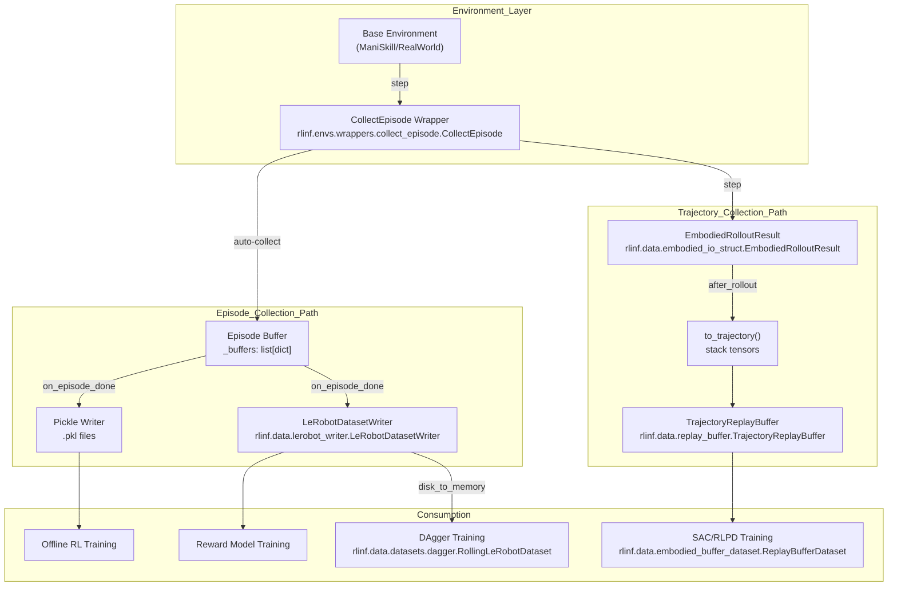
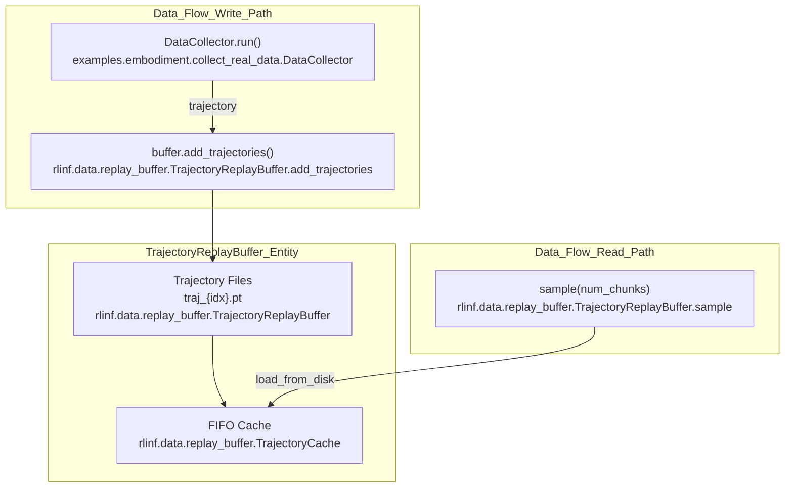
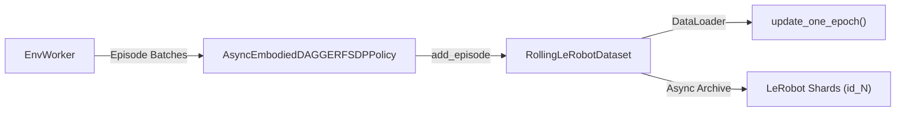

<!-- source: DeepWiki mcp.deepwiki.com · repo RLinf/RLinf · page 6.8 Replay Buffers and Data Collection · fetched 2026-10-21 -->

# Replay Buffers and Data Collection

Relevant source files

The following files were used as context for generating this wiki page:

- [docs/source-en/rst_source/guides/data_collection.rst](docs/source-en/rst_source/guides/data_collection.rst)
- [docs/source-zh/rst_source/guides/data_collection.rst](docs/source-zh/rst_source/guides/data_collection.rst)
- [examples/embodiment/collect_real_data.py](examples/embodiment/collect_real_data.py)
- [examples/embodiment/config/maniskill_ppo_mlp_collect.yaml](examples/embodiment/config/maniskill_ppo_mlp_collect.yaml)
- [examples/embodiment/config/realworld_collect_data.yaml](examples/embodiment/config/realworld_collect_data.yaml)
- [examples/sft/run_vlm_sft.sh](examples/sft/run_vlm_sft.sh)
- [rlinf/data/embodied_buffer_dataset.py](rlinf/data/embodied_buffer_dataset.py)
- [rlinf/data/embodied_io_struct.py](rlinf/data/embodied_io_struct.py)
- [rlinf/data/lerobot_writer.py](rlinf/data/lerobot_writer.py)
- [rlinf/envs/wrappers/collect_episode.py](rlinf/envs/wrappers/collect_episode.py)
- [rlinf/envs/wrappers/record_video.py](rlinf/envs/wrappers/record_video.py)
- [rlinf/scheduler/worker/routing.py](rlinf/scheduler/worker/routing.py)
- [rlinf/utils/nested_dict_process.py](rlinf/utils/nested_dict_process.py)
- [rlinf/workers/actor/async_fsdp_dagger_policy_worker.py](rlinf/workers/actor/async_fsdp_dagger_policy_worker.py)
- [rlinf/workers/actor/async_fsdp_sac_policy_worker.py](rlinf/workers/actor/async_fsdp_sac_policy_worker.py)
- [rlinf/workers/actor/fsdp_dagger_policy_worker.py](rlinf/workers/actor/fsdp_dagger_policy_worker.py)
- [rlinf/workers/actor/fsdp_sac_policy_worker.py](rlinf/workers/actor/fsdp_sac_policy_worker.py)
- [rlinf/workers/sft/fsdp_vlm_sft_worker.py](rlinf/workers/sft/fsdp_vlm_sft_worker.py)
- [tests/unit_tests/test_comm_mapper.py](tests/unit_tests/test_comm_mapper.py)
- [toolkits/lerobot/visualize_lerobot_dataset.py](toolkits/lerobot/visualize_lerobot_dataset.py)

This page documents RLinf's data collection mechanisms and replay buffer systems for embodied RL. Data collection supports two primary workflows: **episode-based collection** during training/evaluation for offline analysis and reward model training, and **trajectory replay buffers** for off-policy algorithms like SAC, RLPD, and DAgger.

---

## Data Collection Architecture

RLinf provides two complementary data collection systems targeting different use cases:

| System | Entry Point | Data Format | Primary Use Case |
|--------|------------|-------------|------------------|
| **Episode Collection** | `CollectEpisode` wrapper | Pickle / LeRobot Parquet | Offline RL datasets, reward model training, behavior analysis |
| **Trajectory Replay Buffer** | `TrajectoryReplayBuffer` | PyTorch `.pt` files | SAC/RLPD/DAgger online training, demo data integration |
| **Online DAgger Store** | `RollingLeRobotDataset` | In-memory Arrow | High-throughput online DAgger training with `InMemoryArrowStore` |

### Data Flow from Environment to Storage

The following diagram illustrates the path from environment interaction to data persistence and consumption, mapping high-level concepts to code entities.

Title: Data Flow from Environment to Storage

**Sources:** [rlinf/envs/wrappers/collect_episode.py:74-126](), [rlinf/data/embodied_io_struct.py:130-180](), [examples/embodiment/collect_real_data.py:124-186]()

---

## CollectEpisode Wrapper

The `CollectEpisode` wrapper transparently wraps any `gymnasium.Env` to record episode data. It buffers step-level data and writes completed episodes asynchronously.

### Key Features
- **Transparent integration**: Drop-in replacement for gymnasium environments [rlinf/envs/wrappers/collect_episode.py:74-89]().
- **Vectorized support**: Handles `num_envs > 1` with per-environment tracking in `_buffers` [rlinf/envs/wrappers/collect_episode.py:165-174]().
- **Asynchronous writes**: Background `ThreadPoolExecutor` for I/O operations to prevent blocking the RL loop [rlinf/envs/wrappers/collect_episode.py:158-163]().
- **Dual format export**: Supports `pickle` (raw buffer) or `lerobot` (structured Parquet) [rlinf/envs/wrappers/collect_episode.py:33-33]().
- **Resume Support**: Can scan existing `id_{N}` shards to resume collection without overwriting previously finalized data [rlinf/envs/wrappers/collect_episode.py:39-71]().

The wrapper is typically used in data collection scripts or training pipelines when `data_collection.enabled=True` is detected in the configuration [examples/embodiment/collect_real_data.py:51-64](), [examples/embodiment/config/realworld_collect_data.yaml:54-57]().

**Sources:** [rlinf/envs/wrappers/collect_episode.py:74-126](), [examples/embodiment/collect_real_data.py:51-64](), [examples/embodiment/config/realworld_collect_data.yaml:54-57]()

---

## Trajectory Replay Buffer

`TrajectoryReplayBuffer` implements a persistent trajectory storage system. It stores batched trajectories directly, rather than individual transitions, allowing for sequence-based sampling in VLA models [rlinf/data/replay_buffer.py:27-27]().

### Buffer Architecture

Title: Trajectory Replay Buffer System Components

**Sources:** [rlinf/data/replay_buffer.py:27-27](), [examples/embodiment/collect_real_data.py:82-88](), [examples/embodiment/collect_real_data.py:110-186]()

### Off-Policy Sampling Strategies
In algorithms like SAC and RLPD, the `TrajectoryReplayBuffer` is integrated into the training loop via `ReplayBufferDataset` [rlinf/workers/actor/fsdp_sac_policy_worker.py:26-32]().
- **Async Preloading**: `PreloadReplayBufferDataset` uses background threads to sample and move data to GPU, minimizing the bottleneck between environment steps and gradient updates [rlinf/workers/actor/fsdp_sac_policy_worker.py:26-30]().
- **Hybrid Sampling**: RLPD often samples a mixture of online rollout data and offline demonstrations. This is handled by maintaining a `demo_buffer` alongside the standard `replay_buffer` [rlinf/workers/actor/fsdp_sac_policy_worker.py:55-58]().

---

## Online DAgger and LeRobot Integration

For DAgger training (e.g., OpenPI), RLinf uses a rolling dataset to manage fresh expert interventions.

### RollingLeRobotDataset
The `RollingLeRobotDataset` manages a collection of LeRobot shards written incrementally during training [rlinf/workers/actor/fsdp_dagger_policy_worker.py:79-94]().
- **In-Memory Store**: Supports high-speed sampling by keeping frames in memory [rlinf/workers/actor/fsdp_dagger_policy_worker.py:88-88]().
- **Background Resuming**: Can asynchronously load existing LeRobot shards from disk on startup to populate the training buffer [rlinf/workers/actor/fsdp_dagger_policy_worker.py:141-163]().
- **Intervention Filtering**: If `only_save_expert` is enabled, the dataset only exposes samples where the human expert intervened [rlinf/workers/actor/fsdp_dagger_policy_worker.py:84-86]().

### Online Data Flow in DAgger
Title: DAgger Online Data Flow

**Sources:** [rlinf/workers/actor/async_fsdp_dagger_policy_worker.py:57-71](), [rlinf/workers/actor/fsdp_dagger_policy_worker.py:111-139]()

---

## Real-World Data Collection

For real-world robot experiments, RLinf provides specialized utilities to collect data via teleoperation.

### DataCollector Worker
The `DataCollector` class in `examples/embodiment/collect_real_data.py` serves as a standalone worker for high-fidelity data gathering [examples/embodiment/collect_real_data.py:32-49]().
- **SpaceMouse/Teleop**: Integrates with `RealWorldEnv` and teleoperation wrappers [examples/embodiment/collect_real_data.py:43-49]().
- **Intervention Tracking**: Monitors `info["intervene_action"]` to record expert corrections [examples/embodiment/collect_real_data.py:142-143]().
- **Lifecycle Control**: Uses keyboard events (`start`, `abort`, `rec`) to trigger data persistence [examples/embodiment/collect_real_data.py:137-140]().

**Sources:** [examples/embodiment/collect_real_data.py:32-186](), [examples/embodiment/config/realworld_collect_data.yaml:27-61]()

---

## Visualization and Tools

### Video Recording
The `RecordVideo` wrapper centralizes frame collection and MP4 writing [rlinf/envs/wrappers/record_video.py:33-63]().
- **Asynchronous Flushing**: Frames are buffered and flushed to disk via a `ThreadPoolExecutor` [rlinf/envs/wrappers/record_video.py:79-80]().
- **Metadata Overlay**: Can draw reward and custom environment `info` keys directly onto the video frames using `put_info_on_image` [rlinf/envs/wrappers/record_video.py:46-51]().

### LeRobot Visualization
The `visualize_lerobot_dataset.py` toolkit allows for headless inspection of collected Parquet datasets [toolkits/lerobot/visualize_lerobot_dataset.py:16-42]().
- **Multi-View Merge**: Automatically merges multiple camera views (e.g., wrist and global) into a single grid video [toolkits/lerobot/visualize_lerobot_dataset.py:37-41]().
- **Metadata Export**: Dumps episode-level and step-level non-image fields to text files for debugging [toolkits/lerobot/visualize_lerobot_dataset.py:18-22]().

**Sources:** [rlinf/envs/wrappers/record_video.py:33-107](), [toolkits/lerobot/visualize_lerobot_dataset.py:16-93]()

---

