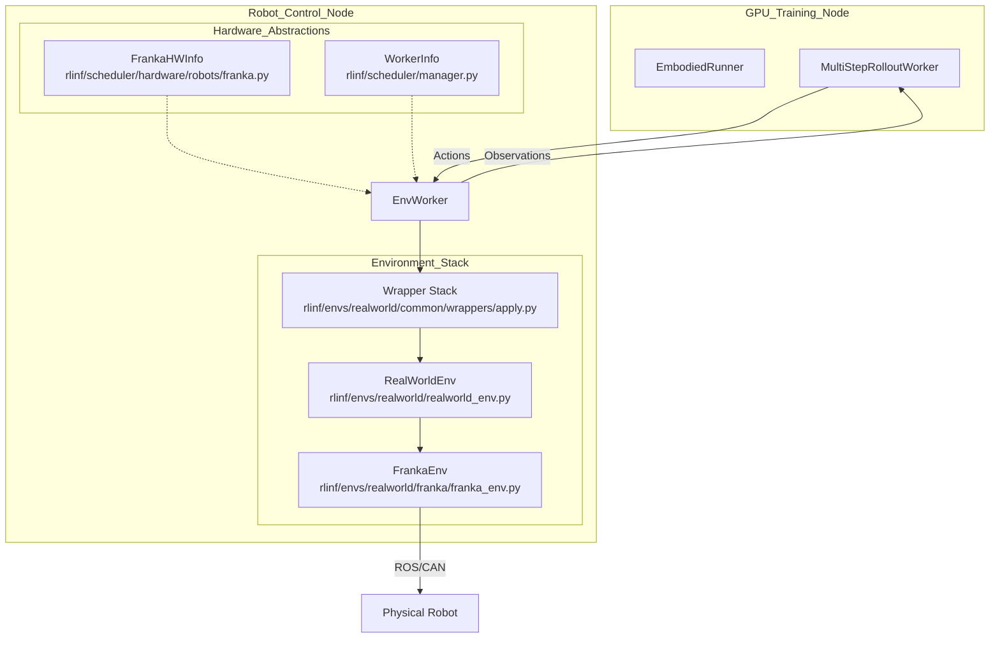
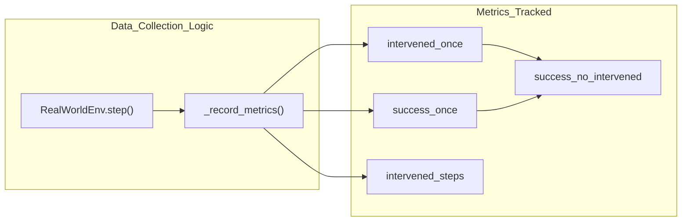

<!-- source: DeepWiki mcp.deepwiki.com · repo RLinf/RLinf · page 6.9 Real-World Robot Training · fetched 2026-10-21 -->

# Real-World Robot Training

<details>
<summary>Relevant source files</summary>

The following files were used as context for generating this wiki page:

- [docs/source-en/rst_source/examples/embodied/dual_franka_pico_dagger.rst](docs/source-en/rst_source/examples/embodied/dual_franka_pico_dagger.rst)
- [docs/source-en/rst_source/examples/embodied/franka.rst](docs/source-en/rst_source/examples/embodied/franka.rst)
- [docs/source-en/rst_source/examples/embodied/franka_gello.rst](docs/source-en/rst_source/examples/embodied/franka_gello.rst)
- [docs/source-en/rst_source/examples/embodied/franka_vr.rst](docs/source-en/rst_source/examples/embodied/franka_vr.rst)
- [docs/source-en/rst_source/examples/embodied/gim_arm.rst](docs/source-en/rst_source/examples/embodied/gim_arm.rst)
- [docs/source-en/rst_source/examples/embodied/xsquare_turtle2.rst](docs/source-en/rst_source/examples/embodied/xsquare_turtle2.rst)
- [docs/source-en/rst_source/examples/real_world_index.rst](docs/source-en/rst_source/examples/real_world_index.rst)
- [docs/source-zh/rst_source/examples/embodied/dual_franka_pico_dagger.rst](docs/source-zh/rst_source/examples/embodied/dual_franka_pico_dagger.rst)
- [docs/source-zh/rst_source/examples/embodied/franka.rst](docs/source-zh/rst_source/examples/embodied/franka.rst)
- [docs/source-zh/rst_source/examples/embodied/franka_gello.rst](docs/source-zh/rst_source/examples/embodied/franka_gello.rst)
- [docs/source-zh/rst_source/examples/embodied/franka_vr.rst](docs/source-zh/rst_source/examples/embodied/franka_vr.rst)
- [docs/source-zh/rst_source/examples/embodied/gim_arm.rst](docs/source-zh/rst_source/examples/embodied/gim_arm.rst)
- [docs/source-zh/rst_source/examples/embodied/xsquare_turtle2.rst](docs/source-zh/rst_source/examples/embodied/xsquare_turtle2.rst)
- [docs/source-zh/rst_source/examples/real_world_index.rst](docs/source-zh/rst_source/examples/real_world_index.rst)
- [examples/embodiment/config/env/realworld_peg_insertion.yaml](examples/embodiment/config/env/realworld_peg_insertion.yaml)
- [examples/embodiment/config/realworld_collect_data_gello.yaml](examples/embodiment/config/realworld_collect_data_gello.yaml)
- [examples/embodiment/config/realworld_collect_data_pico.yaml](examples/embodiment/config/realworld_collect_data_pico.yaml)
- [examples/embodiment/config/realworld_dual_franka_collect_data_pico.yaml](examples/embodiment/config/realworld_dual_franka_collect_data_pico.yaml)
- [examples/embodiment/config/realworld_dual_franka_dagger_openpi.yaml](examples/embodiment/config/realworld_dual_franka_dagger_openpi.yaml)
- [pyproject.toml](pyproject.toml)
- [rlinf/envs/realworld/__init__.py](rlinf/envs/realworld/__init__.py)
- [rlinf/envs/realworld/common/camera/__init__.py](rlinf/envs/realworld/common/camera/__init__.py)
- [rlinf/envs/realworld/common/camera/lumos_camera.py](rlinf/envs/realworld/common/camera/lumos_camera.py)
- [rlinf/envs/realworld/common/gello/__init__.py](rlinf/envs/realworld/common/gello/__init__.py)
- [rlinf/envs/realworld/common/gello/gello_expert.py](rlinf/envs/realworld/common/gello/gello_expert.py)
- [rlinf/envs/realworld/common/keyboard/keyboard_listener.py](rlinf/envs/realworld/common/keyboard/keyboard_listener.py)
- [rlinf/envs/realworld/common/pico/__init__.py](rlinf/envs/realworld/common/pico/__init__.py)
- [rlinf/envs/realworld/common/pico/pico_expert.py](rlinf/envs/realworld/common/pico/pico_expert.py)
- [rlinf/envs/realworld/common/wrappers/__init__.py](rlinf/envs/realworld/common/wrappers/__init__.py)
- [rlinf/envs/realworld/common/wrappers/apply.py](rlinf/envs/realworld/common/wrappers/apply.py)
- [rlinf/envs/realworld/common/wrappers/dual_euler_obs.py](rlinf/envs/realworld/common/wrappers/dual_euler_obs.py)
- [rlinf/envs/realworld/common/wrappers/dual_relative_frame.py](rlinf/envs/realworld/common/wrappers/dual_relative_frame.py)
- [rlinf/envs/realworld/common/wrappers/euler_obs.py](rlinf/envs/realworld/common/wrappers/euler_obs.py)
- [rlinf/envs/realworld/common/wrappers/pico_intervention.py](rlinf/envs/realworld/common/wrappers/pico_intervention.py)
- [rlinf/envs/realworld/common/wrappers/relative_frame.py](rlinf/envs/realworld/common/wrappers/relative_frame.py)
- [rlinf/envs/realworld/common/wrappers/spacemouse_intervention.py](rlinf/envs/realworld/common/wrappers/spacemouse_intervention.py)
- [rlinf/envs/realworld/franka/franka_env.py](rlinf/envs/realworld/franka/franka_env.py)
- [rlinf/envs/realworld/franka/tasks/__init__.py](rlinf/envs/realworld/franka/tasks/__init__.py)
- [rlinf/envs/realworld/franka/tasks/bottle.py](rlinf/envs/realworld/franka/tasks/bottle.py)
- [rlinf/envs/realworld/franka/tasks/franka_bin_relocation.py](rlinf/envs/realworld/franka/tasks/franka_bin_relocation.py)
- [rlinf/envs/realworld/franka/tasks/peg_insertion_env.py](rlinf/envs/realworld/franka/tasks/peg_insertion_env.py)
- [rlinf/envs/realworld/gim_arm/__init__.py](rlinf/envs/realworld/gim_arm/__init__.py)
- [rlinf/envs/realworld/gim_arm/gim_arm_controller.py](rlinf/envs/realworld/gim_arm/gim_arm_controller.py)
- [rlinf/envs/realworld/gim_arm/gim_arm_env.py](rlinf/envs/realworld/gim_arm/gim_arm_env.py)
- [rlinf/envs/realworld/gim_arm/gim_arm_robot_state.py](rlinf/envs/realworld/gim_arm/gim_arm_robot_state.py)
- [rlinf/envs/realworld/realworld_env.py](rlinf/envs/realworld/realworld_env.py)
- [rlinf/envs/realworld/xsquare/tasks/__init__.py](rlinf/envs/realworld/xsquare/tasks/__init__.py)
- [rlinf/envs/realworld/xsquare/turtle2_env.py](rlinf/envs/realworld/xsquare/turtle2_env.py)
- [rlinf/envs/realworld/xsquare/turtle2_smooth_controller.py](rlinf/envs/realworld/xsquare/turtle2_smooth_controller.py)
- [rlinf/scheduler/__init__.py](rlinf/scheduler/__init__.py)
- [rlinf/scheduler/collective/__init__.py](rlinf/scheduler/collective/__init__.py)
- [rlinf/scheduler/hardware/robots/franka.py](rlinf/scheduler/hardware/robots/franka.py)
- [toolkits/realworld_check/test_lumos_camera.py](toolkits/realworld_check/test_lumos_camera.py)

</details>


This document describes the infrastructure and procedures for training reinforcement learning policies on physical robots using RLinf. It covers hardware setup, multi-node distributed training, safety mechanisms, and configuration for real-world deployment on Franka Panda, GimArm, and XSquare Turtle2 platforms.

For simulation-based training, see [6.3. Environment Integrations](). For the overall embodied RL pipeline, see [6.1. Embodied Training Pipeline]().

---

## Overview

Real-world robot training in RLinf enables direct policy learning on physical hardware through a distributed architecture that separates compute-intensive training (on GPU nodes) from environment interaction (on robot control nodes). The system supports:

- **Franka Panda arms**: 7-DOF manipulation with ROS integration and custom controllers [rlinf/envs/realworld/franka/franka_env.py:142-171]().
- **XSquare Turtle2**: Dual-arm mobile robot platform with integrated smooth controllers [rlinf/envs/realworld/xsquare/turtle2_env.py:1-20]().
- **GimArm 6-DOF**: Robotic arms using Damiao servo motors and Linux SocketCAN interface [docs/source-en/rst_source/examples/embodied/gim_arm.rst:151-172]().
- **HG-DAgger**: Human-Gated DAgger for interactive imitation learning where human operators intervene via teleoperation [docs/source-en/rst_source/examples/embodied/franka.rst:61-66]().
- **Teleoperation interfaces**: Human demonstrations via SpaceMouse, GELLO, PICO (VR), or DexHand gloves [rlinf/envs/realworld/common/wrappers/apply.py:108-149]().
- **Relative Frame Transformations**: Wrappers to transform observations and actions into the end-effector frame [rlinf/envs/realworld/common/wrappers/apply.py:152-153]().

Sources: [rlinf/envs/realworld/franka/franka_env.py:142-171](), [rlinf/envs/realworld/common/wrappers/apply.py:97-156](), [docs/source-en/rst_source/examples/embodied/franka.rst:15-78]()

---

## Supported Hardware

### Franka Panda Robot
The Franka integration uses custom controllers for real-time impedance control and wraps the robot interface as a `gym.Env` [rlinf/envs/realworld/franka/franka_env.py:142-145]().

| Component | Specification |
|-----------|--------------|
| **DOF** | 7 (6 position/rotation + 1 gripper) [rlinf/envs/realworld/franka/franka_env.py:73-75]() |
| **Control Interface** | `FrankaController` via ROS [rlinf/envs/realworld/realworld_env.py:85-107]() |
| **End-Effectors** | Franka Gripper, Robotiq, or Ruiyan Hand [rlinf/envs/realworld/franka/franka_env.py:107-108]() |

### XSquare Turtle2
A dual-arm platform designed for mobile manipulation tasks. It utilizes `Turtle2Config` for hardware mapping and supports smooth trajectory control [rlinf/envs/realworld/xsquare/turtle2_env.py:1-20]().

### GimArm (6-DOF)
GimArm uses low-level communication via the Linux SocketCAN interface [docs/source-en/rst_source/examples/embodied/gim_arm.rst:151-172](). It requires specific CAN interface configuration (1 Mbps bitrate, 5 Mbps FD) and supports variants like `gim_arm_xl` [docs/source-en/rst_source/examples/embodied/gim_arm.rst:256-257]().

Sources: [rlinf/envs/realworld/franka/franka_env.py:45-108](), [rlinf/envs/realworld/realworld_env.py:85-107](), [docs/source-en/rst_source/examples/embodied/gim_arm.rst:151-172]()

---

## System Architecture



**Diagram: Real-World Robot Training Architecture**

The architecture leverages `Worker` abstractions to launch controllers on specific nodes. `RealWorldEnv` acts as a unified entry point, handling node-level concurrency and hardware-specific initialization [rlinf/envs/realworld/realworld_env.py:34-117](). It ensures that any existing ROS processes (`roscore`, `rosmaster`, `rosout`) are terminated before starting a new environment instance on the node to prevent conflicts [rlinf/envs/realworld/realworld_env.py:85-107]().

Sources: [rlinf/envs/realworld/realworld_env.py:34-117](), [rlinf/scheduler/hardware/robots/franka.py:32-42](), [rlinf/envs/realworld/common/wrappers/apply.py:97-156](), [rlinf/scheduler/manager.py:28-28]()

---

## Observation and Action Wrappers

RLinf provides a modular wrapper stack, primarily managed via `apply_single_arm_wrappers` and `apply_dual_franka_joint_wrappers`, to standardize real-world observations and actions [rlinf/envs/realworld/common/wrappers/apply.py:97-184]().

### Coordinate Frame Transformations
To improve learning efficiency, policies often operate in relative frames:
- **`RelativeFrame`**: Transforms observations and actions into the end-effector frame [rlinf/envs/realworld/common/wrappers/apply.py:152-153]().
- **`Quat2EulerWrapper`**: Converts orientation observations from quaternions to Euler angles [rlinf/envs/realworld/common/wrappers/apply.py:154-154]().

### Teleoperation and Intervention
Wrappers allow seamless switching between policy control and human teleoperation:
- **`SpacemouseIntervention`**: Overrides policy actions when SpaceMouse movement is detected [rlinf/envs/realworld/common/wrappers/spacemouse_intervention.py:29-78]().
- **`GelloIntervention`**: Supports GELLO-based teleoperation for single-arm setups [rlinf/envs/realworld/common/wrappers/apply.py:133-142]().
- **`PicoIntervention`**: Supports VR-based teleoperation using PICO headsets, allowing 6D end-effector control [rlinf/envs/realworld/common/wrappers/pico_intervention.py:109-200]().
- **`DualGelloJointIntervention`**: Specialized for dual-arm joint-space teleoperation [rlinf/envs/realworld/common/wrappers/apply.py:176-184]().

Sources: [rlinf/envs/realworld/common/wrappers/apply.py:97-184](), [rlinf/envs/realworld/common/pico/pico_expert.py:90-194](), [rlinf/envs/realworld/common/wrappers/spacemouse_intervention.py:29-78]()

---

## Data Collection and Metrics

RLinf tracks specific metrics for real-world reliability and safety [rlinf/envs/realworld/realworld_env.py:171-196]().



**Diagram: Real-World Metrics Tracking Logic**

1. **Intervention Tracking**: The system monitors `intervened_once` and `intervened_steps` to quantify human assistance [rlinf/envs/realworld/realworld_env.py:182-183]().
2. **Clean Success**: The metric `success_no_intervened` identifies episodes where the policy succeeded without human takeover [rlinf/envs/realworld/realworld_env.py:191-193]().
3. **Reset Management**: Real-world environments support `use_fixed_reset_state_ids` for reproducible evaluation [rlinf/envs/realworld/realworld_env.py:51-51]().

Sources: [rlinf/envs/realworld/realworld_env.py:142-196]()

---

## Configuration and Cluster Setup

Real-world experiments require mapping environment workers to robot-connected nodes.

### Hardware Enumeration
The `FrankaRobot` hardware class performs automated connectivity checks during cluster initialization, including ICMP pings and camera SDK validation [rlinf/scheduler/hardware/robots/franka.py:47-146](). `RobotAutoConfig.resolve` is used to fill unset fields from environment variables like `ROBOT_IP` [rlinf/scheduler/hardware/robots/franka.py:72-77]().

### Camera Verification
The `enumerate_cameras` method supports RealSense, ZED, and Lumos backends to ensure all sensors are detected [rlinf/scheduler/hardware/robots/franka.py:150-176]().

```python
# Hardware enumeration logic in FrankaRobot
robot_configs = RobotAutoConfig.resolve(
    robot_configs,
    config_cls=FrankaConfig,
    node_rank=node_rank,
    count_fields=("robot_ip",),
)
```

Sources: [rlinf/scheduler/hardware/robots/franka.py:47-176](), [rlinf/scheduler/hardware/robots/auto_config.py:28-28]()

---

## Hardware Verification Toolkits

RLinf provides utilities to verify hardware connectivity and safety:

- **Lumos Testing**: Dedicated toolkit scripts like `toolkits/realworld_check/test_lumos_camera.py` allow standalone testing of specific camera hardware.
- **GimArm Verification**: `toolkits/realworld_check/test_gim_arm_env.py` (referenced in documentation) verifies controller startup, state reading, and motion commands [docs/source-en/rst_source/examples/embodied/gim_arm.rst:250-261]().
- **Safety Limits**: `FrankaRobotConfig` enforces `ee_pose_limit_min` and `ee_pose_limit_max` workspace boundaries [rlinf/envs/realworld/franka/franka_env.py:92-93]().

Sources: [rlinf/envs/realworld/franka/franka_env.py:46-105](), [docs/source-en/rst_source/examples/embodied/gim_arm.rst:250-261](), [toolkits/realworld_check/test_lumos_camera.py:1-20]()

---

