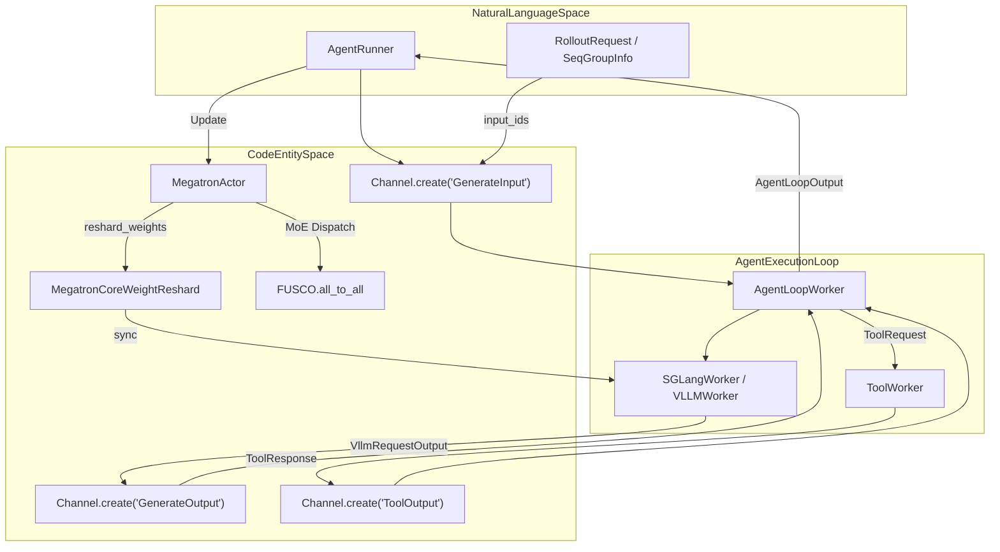
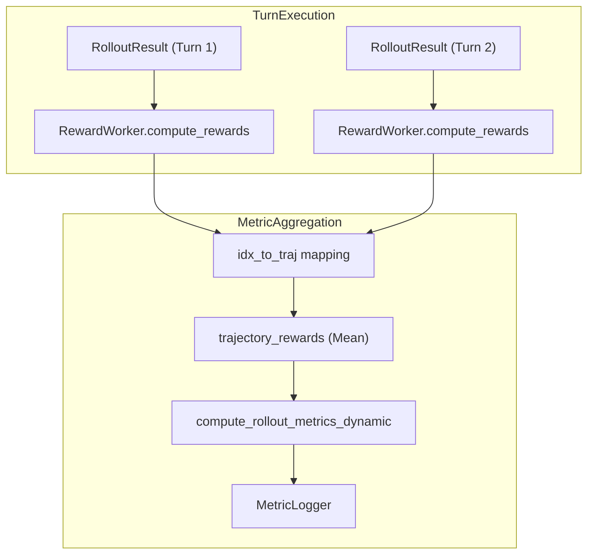

<!-- source: DeepWiki mcp.deepwiki.com · repo RLinf/RLinf · page 7 Agentic and Reasoning RL · fetched 2026-10-21 -->

# Agentic and Reasoning RL

Relevant source files

The following files were used as context for generating this wiki page:

- [.github/workflows/agent-e2e-tests.yml](.github/workflows/agent-e2e-tests.yml)
- [examples/reasoning/main_grpo.py](examples/reasoning/main_grpo.py)
- [rlinf/algorithms/losses.py](rlinf/algorithms/losses.py)
- [rlinf/hybrid_engines/megatron/token_dispatcher.py](rlinf/hybrid_engines/megatron/token_dispatcher.py)
- [rlinf/hybrid_engines/megatron/utils.py](rlinf/hybrid_engines/megatron/utils.py)
- [rlinf/runners/agent_eval_runner.py](rlinf/runners/agent_eval_runner.py)
- [rlinf/runners/agent_runner.py](rlinf/runners/agent_runner.py)
- [rlinf/runners/agentlightning_runner.py](rlinf/runners/agentlightning_runner.py)
- [rlinf/runners/coding_online_rl_runner.py](rlinf/runners/coding_online_rl_runner.py)
- [rlinf/runners/reasoning_eval_runner.py](rlinf/runners/reasoning_eval_runner.py)
- [rlinf/runners/reasoning_runner.py](rlinf/runners/reasoning_runner.py)
- [rlinf/utils/data_iter_utils.py](rlinf/utils/data_iter_utils.py)
- [rlinf/utils/distributed.py](rlinf/utils/distributed.py)
- [rlinf/utils/metric_utils.py](rlinf/utils/metric_utils.py)
- [rlinf/workers/actor/async_ppo_fsdp_worker.py](rlinf/workers/actor/async_ppo_fsdp_worker.py)
- [rlinf/workers/actor/ma_megatron_actor_worker.py](rlinf/workers/actor/ma_megatron_actor_worker.py)
- [rlinf/workers/actor/megatron_actor_worker.py](rlinf/workers/actor/megatron_actor_worker.py)
- [rlinf/workers/agent/agent_loop.py](rlinf/workers/agent/agent_loop.py)
- [rlinf/workers/agent/agentlightning_rollout_worker.py](rlinf/workers/agent/agentlightning_rollout_worker.py)
- [rlinf/workers/critic/megatron_critic_worker.py](rlinf/workers/critic/megatron_critic_worker.py)
- [rlinf/workers/inference/fsdp_inference_worker.py](rlinf/workers/inference/fsdp_inference_worker.py)
- [rlinf/workers/megatron_worker.py](rlinf/workers/megatron_worker.py)
- [tests/e2e_tests/reasoning/qwen3-moe-2.5b-collocated-mg-sgl-ep-fusco-test.yaml](tests/e2e_tests/reasoning/qwen3-moe-2.5b-collocated-mg-sgl-ep-fusco-test.yaml)

This page provides a high-level overview of the Agentic and Reasoning RL infrastructure in RLinf. It covers the pipeline architecture, the primary worker types, data flow, and how multi-turn agent interactions and tool-use are integrated into Reinforcement Learning training for Large Language Models (LLMs).

For detailed documentation of each sub-topic, see the child pages:
- [Agentic Training Pipeline](#7.1) — Detailed documentation of `ReasoningRunner`, `AgentRunner`, critic-actor coordination, and the training loop for LLM-based agents [rlinf/runners/reasoning_runner.py:54-73](), [rlinf/runners/agent_runner.py:42-58]().
- [Reasoning Tasks and Workflows](#7.2) — Document supported reasoning tasks (SearchR1, rStar2, Math Reasoning, AgentLightning), dataset integration, and evaluation protocols.
- [Multi-Agent Systems](#7.3) — Explain multi-agent training (WideSeek-R1), agent communication, coordination mechanisms, and AgentLightning framework integration [rlinf/workers/actor/ma_megatron_actor_worker.py:67-84]().

---

## Domain Overview

The Agentic and Reasoning RL domain focuses on training LLMs to perform complex multi-step tasks, such as mathematical derivation, code generation, and tool use. Unlike the Embodied RL domain, this domain primarily utilizes:

*   **Megatron-LM Backend**: For high-performance actor training with Tensor, Pipeline, and Expert parallelism [rlinf/runners/reasoning_runner.py:40-41](), [rlinf/workers/actor/megatron_actor_worker.py:50-59]().
*   **FSDP Backend**: Supported for rapid prototyping and smaller model scales using `FSDPActor` and `FSDPInference` [rlinf/runners/reasoning_runner.py:39-42](), [rlinf/workers/inference/fsdp_inference_worker.py:33-46]().
*   **Inference Engines**: Integration with `SGLangWorker` or `VLLMWorker` for optimized rollout generation, supporting both collocated and disaggregated placements [rlinf/runners/reasoning_runner.py:48-49](), [examples/reasoning/main_grpo.py:49-55]().
*   **Agent Orchestration**: Specialized runners like `AgentRunner` manage multi-turn loops and tool interactions [rlinf/runners/agent_runner.py:42-58]().
*   **AgentLightning Integration**: Support for training agents built with the AgentLightning framework, including support for multi-turn calculator tasks [tests/e2e_tests/agent-e2e-tests.yml:85-114]().

### Supported Tasks and Algorithms
| Task Category | Primary Algorithm | Key Workers / Components |
| :--- | :--- | :--- |
| **Math Reasoning** | GRPO / PPO | `ReasoningRunner`, `RewardWorker`, `MegatronActor` |
| **Search/Tool Agents** | Search-R1 / rStar2 | `AgentRunner`, `ToolWorker`, `AgentLoopWorker` |
| **Multi-Agent RL** | WideSeek-R1 | `MAMegatronActor`, `AgentLoopWorker` |
| **Agentic AI** | AgentLightning | `AgentLightningRolloutWorker`, `AgentLightningRunner` |
| **MoE Reasoning** | GRPO | `MoEAlltoAllTokenDispatcher`, `FUSCO` Optimization |

Sources: [rlinf/runners/reasoning_runner.py:54-73](), [rlinf/runners/agent_runner.py:42-58](), [rlinf/workers/actor/ma_megatron_actor_worker.py:67-88](), [rlinf/hybrid_engines/megatron/token_dispatcher.py:226-230](), [tests/e2e_tests/agent-e2e-tests.yml:109-114]()

---

## System Architecture

The architecture bridges the "Natural Language Space" (prompts, reasoning traces) with the "Code Entity Space" (distributed tensors, Megatron parallelism) through a distributed worker-channel system. For agentic tasks, this includes a dedicated loop for tool calls and multi-turn responses.

**Diagram: Agentic RL Data Flow and Entity Mapping**

Sources: [rlinf/runners/agent_runner.py:89-112](), [rlinf/workers/actor/megatron_actor_worker.py:99-108](), [rlinf/hybrid_engines/megatron/token_dispatcher.py:85-94](), [rlinf/runners/agent_runner.py:120-125]()

---

## Core Components

### 1. Runners (Orchestrators)
*   **`ReasoningRunner`**: The central orchestrator for reasoning tasks. It coordinates the `actor`, `rollout`, and optional `reward`/`critic` workers. It manages data flow through `dataloader_channel`, `rollout_channel`, and `reward_channel` [rlinf/runners/reasoning_runner.py:54-132]().
*   **`AgentRunner`**: Extends `ReasoningRunner` to support tool workers and the `AgentLoopWorker`. It manages complex channel mappings for multi-turn interactions including `GenerateInput`, `GenerateOutput`, and `ToolOutput` channels [rlinf/runners/agent_runner.py:42-112]().
*   **`AsyncPPOEmbodiedFSDPActor`**: Supports asynchronous PPO/decoupled actor-critic training using a `PriorityStore` to manage rollout trajectories and mitigate staleness [rlinf/workers/actor/async_ppo_fsdp_worker.py:72-82]().

### 2. Specialized Workers
*   **`MegatronActor`**: Implements policy gradient training with support for initial KL penalty and reference model offloading via `retrieve_model_state_dict_in_cpu`. It uses `MegatronCoreWeightReshard` to prepare weights for inference workers [rlinf/workers/actor/megatron_actor_worker.py:90-108]().
*   **`MAMegatronActor`**: Specialized for Multi-Agent scenarios, requiring `PlacementMode.COLLOCATED` and supporting dynamic rollout batches with DP load balancing [rlinf/workers/actor/ma_megatron_actor_worker.py:67-84]().
*   **`RewardWorker`**: Computes rewards for reasoning/agentic rollout batches. It can utilize rule-based rewards or external reward models [rlinf/workers/reward/reward_worker.py:46-76]().
*   **`ToolWorker`**: Executes external functions (e.g., Python interpreter, Search) and returns results via `ToolOutputChannel` [rlinf/runners/agent_runner.py:120-125]().

### 3. Optimization Primitives
*   **`MoEAlltoAllTokenDispatcher`**: Integrates with `FUSCO` to optimize MoE communication during training, supporting 2D dispatch modes (intra-node and cross-node) [rlinf/hybrid_engines/megatron/token_dispatcher.py:77-123]().
*   **`MegatronCoreWeightReshard`**: Handles the transformation of weights between different Tensor Parallel (TP) and Pipeline Parallel (PP) configurations between actor and rollout workers [rlinf/workers/actor/megatron_actor_worker.py:99-108]().

---

## Training and Optimization

### Metrics and Evaluation
The system computes specialized metrics for multi-turn and agentic scenarios:
*   **`compute_rollout_metrics_dynamic`**: Aggregates rewards at the trajectory level (rather than turn level) using `idx_to_traj` mapping. It calculates `reward_scores_traj` by averaging turn rewards within a trajectory [rlinf/utils/distributed.py:34-95]().
*   **`compute_decoupled_ppo_actor_loss`**: Computes actor loss for decoupled PPO with optional proximal policy anchor and behavioral weight thresholds [rlinf/algorithms/losses.py:24-164]().
*   **`compute_critic_explained_variance_stats`**: Provides sufficient statistics to track critic performance during PPO training [rlinf/utils/metric_utils.py:173-199]().

**Diagram: Multi-Turn Reward Aggregation**

Sources: [rlinf/utils/distributed.py:87-102](), [rlinf/runners/reasoning_runner.py:155-156](), [rlinf/workers/reward/reward_worker.py:81-105](), [rlinf/algorithms/losses.py:141-152]()

For details on implementing specific reasoning workflows, see [Reasoning Tasks and Workflows](#7.2).

Sources: [rlinf/runners/agent_runner.py:42-112](), [rlinf/workers/actor/megatron_actor_worker.py:50-108](), [rlinf/workers/actor/ma_megatron_actor_worker.py:67-84](), [rlinf/utils/distributed.py:34-183](), [rlinf/algorithms/losses.py:24-183](), [rlinf/hybrid_engines/megatron/token_dispatcher.py:226-230]()

---

