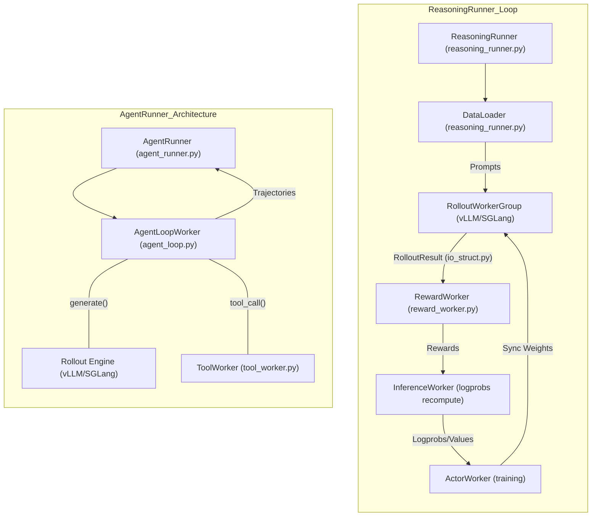
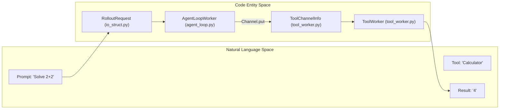
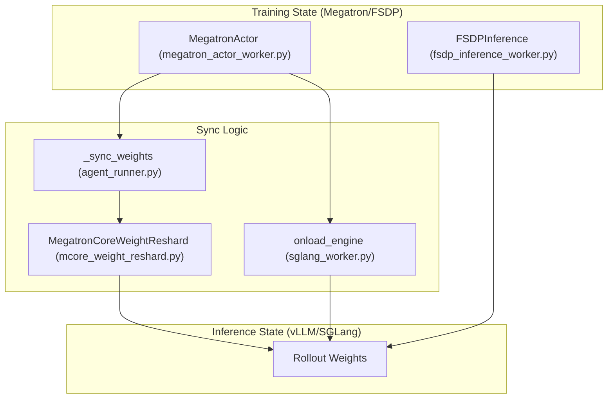

<!-- source: DeepWiki mcp.deepwiki.com · repo RLinf/RLinf · page 7.1 Agentic Training Pipeline · fetched 2026-10-21 -->

# Agentic Training Pipeline

Relevant source files

The following files were used as context for generating this wiki page:

- [.github/workflows/agent-e2e-tests.yml](.github/workflows/agent-e2e-tests.yml)
- [examples/reasoning/config/math/qwen2.5-1.5b-grpo-fsdp.yaml](examples/reasoning/config/math/qwen2.5-1.5b-grpo-fsdp.yaml)
- [examples/reasoning/config/vqa/qwen2.5-vl-3b-grpo-fsdp.yaml](examples/reasoning/config/vqa/qwen2.5-vl-3b-grpo-fsdp.yaml)
- [examples/reasoning/main_grpo.py](examples/reasoning/main_grpo.py)
- [rlinf/algorithms/losses.py](rlinf/algorithms/losses.py)
- [rlinf/hybrid_engines/megatron/token_dispatcher.py](rlinf/hybrid_engines/megatron/token_dispatcher.py)
- [rlinf/hybrid_engines/megatron/utils.py](rlinf/hybrid_engines/megatron/utils.py)
- [rlinf/runners/agent_eval_runner.py](rlinf/runners/agent_eval_runner.py)
- [rlinf/runners/agent_runner.py](rlinf/runners/agent_runner.py)
- [rlinf/runners/agentlightning_runner.py](rlinf/runners/agentlightning_runner.py)
- [rlinf/runners/coding_online_rl_runner.py](rlinf/runners/coding_online_rl_runner.py)
- [rlinf/runners/reasoning_eval_runner.py](rlinf/runners/reasoning_eval_runner.py)
- [rlinf/runners/reasoning_runner.py](rlinf/runners/reasoning_runner.py)
- [rlinf/utils/data_iter_utils.py](rlinf/utils/data_iter_utils.py)
- [rlinf/utils/distributed.py](rlinf/utils/distributed.py)
- [rlinf/utils/metric_utils.py](rlinf/utils/metric_utils.py)
- [rlinf/workers/actor/async_ppo_fsdp_worker.py](rlinf/workers/actor/async_ppo_fsdp_worker.py)
- [rlinf/workers/actor/ma_megatron_actor_worker.py](rlinf/workers/actor/ma_megatron_actor_worker.py)
- [rlinf/workers/actor/megatron_actor_worker.py](rlinf/workers/actor/megatron_actor_worker.py)
- [rlinf/workers/agent/agent_loop.py](rlinf/workers/agent/agent_loop.py)
- [rlinf/workers/agent/agentlightning_rollout_worker.py](rlinf/workers/agent/agentlightning_rollout_worker.py)
- [rlinf/workers/critic/megatron_critic_worker.py](rlinf/workers/critic/megatron_critic_worker.py)
- [rlinf/workers/inference/fsdp_inference_worker.py](rlinf/workers/inference/fsdp_inference_worker.py)
- [rlinf/workers/megatron_worker.py](rlinf/workers/megatron_worker.py)
- [tests/e2e_tests/reasoning/qwen2.5-1.5b-grpo-collocated-fsdp-sgl-rollout-logprobs.yaml](tests/e2e_tests/reasoning/qwen2.5-1.5b-grpo-collocated-fsdp-sgl-rollout-logprobs.yaml)
- [tests/e2e_tests/reasoning/qwen2.5-1.5b-grpo-collocated-fsdp-sgl.yaml](tests/e2e_tests/reasoning/qwen2.5-1.5b-grpo-collocated-fsdp-sgl.yaml)
- [tests/e2e_tests/reasoning/qwen2.5-1.5b-grpo-collocated-fsdp-vllm-rollout-logprobs.yaml](tests/e2e_tests/reasoning/qwen2.5-1.5b-grpo-collocated-fsdp-vllm-rollout-logprobs.yaml)
- [tests/e2e_tests/reasoning/qwen2.5-1.5b-grpo-collocated-fsdp-vllm.yaml](tests/e2e_tests/reasoning/qwen2.5-1.5b-grpo-collocated-fsdp-vllm.yaml)
- [tests/e2e_tests/reasoning/qwen2.5-vl-3b-grpo-collocated-fsdp-sgl.yaml](tests/e2e_tests/reasoning/qwen2.5-vl-3b-grpo-collocated-fsdp-sgl.yaml)
- [tests/e2e_tests/reasoning/qwen2.5-vl-3b-grpo-collocated-fsdp-vllm.yaml](tests/e2e_tests/reasoning/qwen2.5-vl-3b-grpo-collocated-fsdp-vllm.yaml)
- [tests/e2e_tests/reasoning/qwen3-moe-2.5b-collocated-mg-sgl-ep-fusco-test.yaml](tests/e2e_tests/reasoning/qwen3-moe-2.5b-collocated-mg-sgl-ep-fusco-test.yaml)

This page documents the end-to-end RL training pipelines for agentic and reasoning tasks. RLinf supports multiple runner architectures optimized for different agentic scenarios, ranging from single-turn mathematical reasoning to multi-turn tool-use workflows.

*   **`ReasoningRunner`**: Single-turn reasoning tasks (e.g., math problem solving) using algorithms like GRPO or PPO [rlinf/runners/reasoning_runner.py:54-55]().
*   **`AgentRunner`**: Multi-turn agent workflows with tool integration (e.g., SearchR1, multi-agent systems) [rlinf/runners/agent_runner.py:42-43]().
*   **`ReasoningEvalRunner`**: Evaluation-specific pipeline for measuring reasoning performance without training updates [rlinf/runners/reasoning_eval_runner.py:41-43]().

---

## Runner Architecture Comparison

**Agentic Runner Architectures**

Sources: [rlinf/runners/reasoning_runner.py:54-132](), [rlinf/runners/agent_runner.py:42-109](), [rlinf/workers/agent/agent_loop.py:1-180]()

**Key Components**

| Component | Code Symbol | Role |
|---|---|---|
| **Base Runner** | `ReasoningRunner` | Manages dataloading, weight sync, and the high-level step loop [rlinf/runners/reasoning_runner.py:54](). |
| **Agent Hub** | `AgentLoopWorker` | Orchestrates multi-turn interaction between LLM and tools [rlinf/runners/agent_runner.py:85](). |
| **Tool Execution** | `ToolWorker` | Executes external functions (search, calculator, code interpreter) [rlinf/runners/agent_runner.py:31](). |
| **Data Flow** | `Channel` | Asynchronous queues for distributed communication between worker groups [rlinf/scheduler/channel.py:1-50]() (referenced via [rlinf/runners/reasoning_runner.py:105]()). |

---

## ReasoningRunner (Base Pipeline)

`ReasoningRunner` orchestrates the standard RL loop: Rollout → Reward → Inference → Actor Training [rlinf/runners/reasoning_runner.py:54-156](). It is commonly used for GRPO (Group Relative Policy Optimization) training where multiple responses are generated for a single prompt to estimate relative advantages [rlinf/runners/reasoning_runner.py:135-139]().

### Coordination and Channels
The runner creates specialized `Channel` objects to facilitate data flow between distributed worker groups [rlinf/runners/reasoning_runner.py:105-132]():

| Channel | Code Symbol | Purpose |
|---|---|---|
| **DataLoader** | `self.dataloader_channel` | Distributes prompts from the dataset to rollout workers [rlinf/runners/reasoning_runner.py:105](). |
| **Rollout** | `self.rollout_channel` | Carries generated trajectories (`RolloutResult`) [rlinf/runners/reasoning_runner.py:106](). |
| **Reward** | `self.reward_channel` | Carries trajectories with attached scalar rewards [rlinf/runners/reasoning_runner.py:110-113](). |
| **Actor Inference** | `self.actor_inference_channel` | Used for logprob recomputation if `recompute_logprobs` is enabled [rlinf/runners/reasoning_runner.py:109](). |
| **Value** | `self.value_channel` | Used in PPO for value estimation (critic feedback) [rlinf/runners/reasoning_runner.py:123-131](). |

Sources: [rlinf/runners/reasoning_runner.py:105-132](), [rlinf/data/io_struct.py:1-50]()

---

## AgentRunner and Multi-Turn Workflows

`AgentRunner` extends the reasoning pipeline by introducing the `AgentLoopWorker` and `ToolWorker` ecosystem to handle multi-step trajectories [rlinf/runners/agent_runner.py:42-111]().

### AgentLoopWorker Coordination
The `AgentLoopWorker` acts as a central hub for multi-turn interactions. It coordinates between the LLM generation engine (SGLang/vLLM) and various tools [rlinf/runners/agent_runner.py:85-109]().

- **Generation Routing**: Routes generation calls to either the primary trainable LLM or frozen `solid_rollouts` via `generate_input_channel` [rlinf/runners/agent_runner.py:89-95]().
- **Tool Execution**: Connects to `ToolWorker` instances via `ToolChannelInfo` to invoke external tools [rlinf/runners/agent_runner.py:100-108]().
- **Output Channel**: Collects tool results via `self.tool_output_channel` [rlinf/runners/agent_runner.py:109]().

**Agentic Data Space Mapping**

Sources: [rlinf/data/io_struct.py:27-50](), [rlinf/runners/agent_runner.py:85-109](), [rlinf/workers/agent/agent_loop.py:30](), [rlinf/workers/agent/tool_worker.py:31]()

---

## Reward Computation and Metrics

### Reward Worker
The `RewardWorker` processes trajectories to assign scalar scores. It handles the interface between the training loop and specific reward models or rule-based verifiers [rlinf/workers/reward/reward_worker.py:46-47]().

- **Rule-Based Rewards**: Supports deterministic verifiers for tasks like coding, math, or VQA via `_compute_rule_based_rewards` [rlinf/workers/reward/reward_worker.py:134-158]().
- **Trajectory Aggregation**: In multi-turn scenarios, rewards are often computed at the trajectory level. `compute_rollout_metrics_dynamic` maps turn-level data back to trajectories using `idx_to_traj` [rlinf/utils/distributed.py:34-95]().
- **Tokenizer Integration**: Decodes `response_ids` to text for reward evaluation using `hf_tokenizer` [rlinf/workers/reward/reward_worker.py:77-80]().

### Loss Functions and Advantages
The pipeline supports various policy loss functions optimized for distributed LLM training:
- **PPO Actor Loss**: Computes the clipped policy gradient loss using `compute_ppo_actor_loss` [rlinf/algorithms/losses.py:167-183]().
- **Decoupled PPO**: Supports proximal policy anchors for improved stability in large-scale training by calculating `proximal_logprobs` [rlinf/algorithms/losses.py:24-164]().
- **GRPO**: Estimates advantages across a group of samples for the same prompt, implemented by comparing rewards within a group [rlinf/runners/reasoning_runner.py:135-139]().

Sources: [rlinf/workers/reward/reward_worker.py:46-158](), [rlinf/algorithms/losses.py:24-183](), [rlinf/utils/distributed.py:34-183]()

---

## Weight Synchronization and Resharding

To ensure rollout workers use the latest policy, the pipeline implements weight synchronization strategies across distributed nodes.

- **Megatron Actor Coordination**: `MegatronActor` handles policy loss computation and manages weight resharding using `MegatronCoreWeightReshard` to bridge the gap between training and rollout parallelism [rlinf/workers/actor/megatron_actor_worker.py:108-110]().
- **FSDP Inference Sync**: `FSDPInference` implements handshake protocols to synchronize model shards between training and inference ranks via `sync_model_from_actor` [rlinf/workers/inference/fsdp_inference_worker.py:134-147]().
- **Weight Reloading**: `SGLangWorker` (and vLLM counterparts) manages the weight update process, receiving tensors from the actor group and loading them into the model runner [rlinf/workers/rollout/sglang/sglang_worker.py:1-200]() (referenced via [rlinf/runners/agent_runner.py:158]()).
- **Onload/Offload**: `AgentRunner` manages the `onload_engine` calls for `solid_rollouts` (frozen models) during weight synchronization cycles to ensure memory efficiency [rlinf/runners/agent_runner.py:160-165]().

**Model Resharding Mapping**

Sources: [rlinf/runners/agent_runner.py:157-165](), [rlinf/workers/actor/megatron_actor_worker.py:108-110](), [rlinf/workers/inference/fsdp_inference_worker.py:134-147](), [rlinf/workers/actor/megatron_actor_worker.py:100-112]()

---

