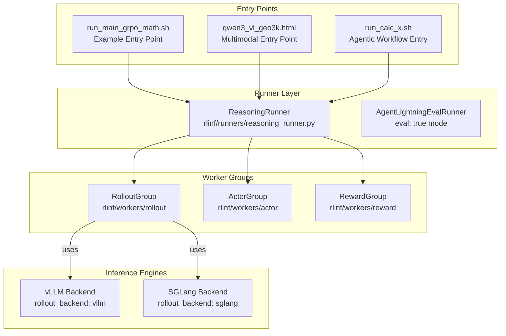
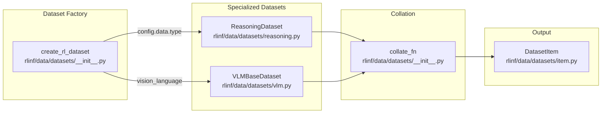

<!-- source: DeepWiki mcp.deepwiki.com · repo RLinf/RLinf · page 7.2 Reasoning Tasks and Workflows · fetched 2026-10-21 -->

# Reasoning Tasks and Workflows

Relevant source files

The following files were used as context for generating this wiki page:

- [docs/source-en/rst_source/examples/agentic/index.rst](docs/source-en/rst_source/examples/agentic/index.rst)
- [docs/source-en/rst_source/examples/agentic/reasoning.rst](docs/source-en/rst_source/examples/agentic/reasoning.rst)
- [docs/source-en/rst_source/examples/agentic/reasoning_ppo.rst](docs/source-en/rst_source/examples/agentic/reasoning_ppo.rst)
- [docs/source-zh/rst_source/examples/agentic/index.rst](docs/source-zh/rst_source/examples/agentic/index.rst)
- [docs/source-zh/rst_source/examples/agentic/reasoning.rst](docs/source-zh/rst_source/examples/agentic/reasoning.rst)
- [docs/source-zh/rst_source/examples/agentic/reasoning_ppo.rst](docs/source-zh/rst_source/examples/agentic/reasoning_ppo.rst)
- [examples/reasoning/config/math/qwen2.5-1.5b-is-megatron.yaml](examples/reasoning/config/math/qwen2.5-1.5b-is-megatron.yaml)
- [examples/reasoning/config/math/qwen2.5-1.5b-reinpp-megatron.yaml](examples/reasoning/config/math/qwen2.5-1.5b-reinpp-megatron.yaml)
- [rlinf/algorithms/rewards/math/__init__.py](rlinf/algorithms/rewards/math/__init__.py)
- [rlinf/data/__init__.py](rlinf/data/__init__.py)
- [rlinf/data/datasets/__init__.py](rlinf/data/datasets/__init__.py)
- [rlinf/data/datasets/item.py](rlinf/data/datasets/item.py)
- [rlinf/data/datasets/vlm.py](rlinf/data/datasets/vlm.py)
- [tests/e2e_tests/reasoning/qwen2.5-1.5b-is-collocated-mg-sgl.yaml](tests/e2e_tests/reasoning/qwen2.5-1.5b-is-collocated-mg-sgl.yaml)
- [tests/e2e_tests/reasoning/qwen2.5-1.5b-reinpp-collocated-mg-sgl.yaml](tests/e2e_tests/reasoning/qwen2.5-1.5b-reinpp-collocated-mg-sgl.yaml)

This page documents the reasoning tasks and workflows supported by RLinf for agentic AI training. It covers the architecture, data flow, and task-specific implementations for training large language models on reasoning, search-augmented, and multimodal tasks using reinforcement learning.

For information about the general training orchestration framework, see [4. Training Orchestration](). For details on the agentic training pipeline and runner architecture, see [7.1. Agentic Training Pipeline](). For multi-agent coordination, see [7.3. Multi-Agent Systems]().

## Overview

RLinf supports multiple reasoning task types for training language models with reinforcement learning and supervised fine-tuning. The system is designed to handle long-context reasoning, tool-use trajectories, and multimodal inputs.

| Task Type | Description | Primary Use Case |
|-----------|-------------|------------------|
| **Math Reasoning** | Standard mathematical problem solving | Training on datasets like AIME24, GSM8K, MATH using GRPO or PPO [docs/source-en/rst_source/examples/agentic/index.rst:78-82]() |
| **SearchR1** | Search-based reasoning with external knowledge | Web search-augmented reasoning tasks via tool-calling LLMs [docs/source-en/rst_source/examples/agentic/index.rst:43-51]() |
| **rStar2** | Code reasoning with tool-use and reflection | Programming problems with Python tool verification [docs/source-en/rst_source/examples/agentic/index.rst:54-62]() |
| **WideSeek-R1** | Multi-agent collaborative reasoning | Broad information seeking via width scaling and MARL [docs/source-en/rst_source/examples/agentic/index.rst:10-19]() |
| **AgentLightning** | Orchestrated agent workflows | Calc-X and multi-turn trajectory training using RLinf as a distributed backend [docs/source-en/rst_source/examples/agentic/index.rst:21-29]() |
| **VQA Reasoning** | Visual Question Answering | Multimodal reasoning tasks using models like Qwen3-VL [docs/source-en/rst_source/examples/agentic/index.rst:95-103]() |

Sources: [docs/source-en/rst_source/examples/agentic/index.rst:10-103]()

## Reasoning Task Architecture

The reasoning workflow is orchestrated by runners that coordinate specialized worker groups for rollout, tool execution, reward computation, and policy updates.

### Reasoning System Component Mapping

Sources: [examples/reasoning/config/math/qwen2.5-1.5b-is-megatron.yaml:14-100](), [docs/source-en/rst_source/examples/agentic/reasoning.rst:116-151]()

## Dataset Integration

Reasoning tasks utilize specialized data structures to track multi-completion groups and complex agentic trajectories. The `create_rl_dataset` factory manages dataset instantiation based on the configuration.

| Config `data.type` | Dataset Class | Description |
|-------------------|---------------|-------------|
| `math` / `reasoning` | `ReasoningDataset` | Standard text-based reasoning [rlinf/data/datasets/__init__.py:46-47]() |
| `vision_language` | `VLMBaseDataset` | Multimodal inputs with image support [rlinf/data/datasets/__init__.py:71-80]() |
| `wideseek_r1` | `WideSeekR1Dataset` | Multi-agent retrieval context [rlinf/data/datasets/__init__.py:48]() |
| `rstar2` | `Rstar2Dataset` | Code reflection and Python tool-use [rlinf/data/datasets/__init__.py:49]() |

### Data Loading Flow

Sources: [rlinf/data/datasets/__init__.py:30-96](), [rlinf/data/datasets/item.py:21-46](), [rlinf/data/datasets/vlm.py:67-116]()

## Task-Specific Workflows

### Math Reasoning & GRPO
Math reasoning relies on Group Relative Policy Optimization (GRPO) to stabilize training without a separate value function.
- **Group Sampling**: Uses a `group_size` (e.g., 16) to generate multiple completions per prompt for relative advantage calculation [examples/reasoning/config/math/qwen2.5-1.5b-is-megatron.yaml:38]().
- **Reward Function**: Employs `MathReward` which uses `math_verify_call` to check final boxed answers. It returns a scaled score (e.g., +5 for correct, -5 for incorrect) [rlinf/algorithms/rewards/math/__init__.py:20-44](), [docs/source-en/rst_source/examples/agentic/reasoning.rst:111-114]().
- **Token-Level Loss**: Computes the average loss over tokens rather than the entire sequence to prevent long responses from dominating the gradient [docs/source-en/rst_source/examples/agentic/reasoning.rst:106-107]().

### Agentic RL (AgentLightning & rStar2)
- **Agentic Workflows**: RLinf serves as the distributed training backend for Agent Lightning, which orchestrates agentic RL tasks like Calc-X [docs/source-en/rst_source/examples/agentic/index.rst:21-29]().
- **Tool Use**: `rStar2` enables models to autonomously reason and reflect using Python tools, achieving high performance at low computational cost [docs/source-en/rst_source/examples/agentic/index.rst:54-62]().

### Search-Augmented Reasoning (Search-R1)
Search-R1 trains models to answer questions by invoking external search tools.
- **Performance**: RLinf infrastructure accelerates the search-augmented training process by 55% [docs/source-en/rst_source/examples/agentic/index.rst:43-51]().

### Vision-Language Reasoning (Qwen3-VL)
Multimodal reasoning tasks extend the GRPO workflow to include visual tokens.
- **VLM Support**: Uses the `VLMBaseDataset` which handles image loading (bytes, PIL, or paths) and chat template application [rlinf/data/datasets/vlm.py:134-151](), [rlinf/data/datasets/vlm.py:163-200]().
- **Prompt Construction**: Supports interleaved text and image placeholders (e.g., `<image>`) for complex geometric problem solving [rlinf/data/datasets/vlm.py:189-200]().

Sources: [rlinf/algorithms/rewards/math/__init__.py:20-44](), [docs/source-en/rst_source/examples/agentic/reasoning.rst:101-114](), [rlinf/data/datasets/vlm.py:67-116](), [examples/reasoning/config/math/qwen2.5-1.5b-is-megatron.yaml:38-71]()

## Evaluation Protocols

RLinf includes comprehensive metric tracking and validation utilities:
- **Validation Intervals**: Configured via `runner.val_check_interval` to perform periodic evaluation during training [examples/reasoning/config/math/qwen2.5-1.5b-is-megatron.yaml:25]().
- **Weight Validation**: Supports `validate_weight` in the rollout configuration to compare actor and rollout weights at the start of training [examples/reasoning/config/math/qwen2.5-1.5b-is-megatron.yaml:118]().
- **Metrics Logging**: Supports multiple backends including TensorBoard, WandB, and SwanLab [examples/reasoning/config/math/qwen2.5-1.5b-is-megatron.yaml:20]().
- **External Toolkits**: Performance is typically measured on benchmarks like AIME24, AIME25, and GPQA-diamond using the `LLMEvalKit` [docs/source-en/rst_source/examples/agentic/reasoning.rst:183-186]().

Sources: [examples/reasoning/config/math/qwen2.5-1.5b-is-megatron.yaml:14-124](), [docs/source-en/rst_source/examples/agentic/reasoning.rst:153-186]()

---

