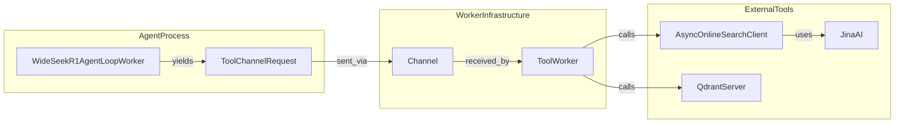
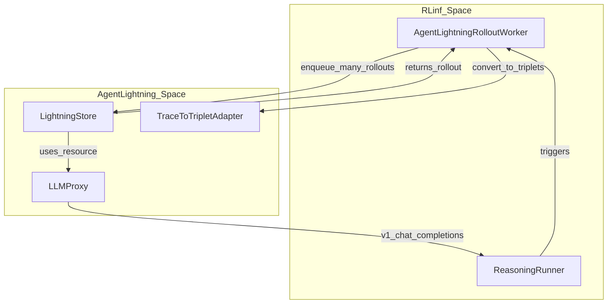

<!-- source: DeepWiki mcp.deepwiki.com · repo RLinf/RLinf · page 7.3 Multi-Agent Systems · fetched 2026-10-21 -->

# Multi-Agent Systems

<details>
<summary>Relevant source files</summary>

The following files were used as context for generating this wiki page:

- [.github/workflows/agent-e2e-tests.yml](.github/workflows/agent-e2e-tests.yml)
- [docs/source-en/rst_source/examples/agentic/agentlightning_calc_x.rst](docs/source-en/rst_source/examples/agentic/agentlightning_calc_x.rst)
- [docs/source-en/rst_source/examples/agentic/wideseek_r1/eval.rst](docs/source-en/rst_source/examples/agentic/wideseek_r1/eval.rst)
- [docs/source-en/rst_source/examples/agentic/wideseek_r1/index.rst](docs/source-en/rst_source/examples/agentic/wideseek_r1/index.rst)
- [docs/source-en/rst_source/examples/agentic/wideseek_r1/tools.rst](docs/source-en/rst_source/examples/agentic/wideseek_r1/tools.rst)
- [docs/source-zh/rst_source/examples/agentic/agentlightning_calc_x.rst](docs/source-zh/rst_source/examples/agentic/agentlightning_calc_x.rst)
- [docs/source-zh/rst_source/examples/agentic/wideseek_r1/eval.rst](docs/source-zh/rst_source/examples/agentic/wideseek_r1/eval.rst)
- [docs/source-zh/rst_source/examples/agentic/wideseek_r1/index.rst](docs/source-zh/rst_source/examples/agentic/wideseek_r1/index.rst)
- [docs/source-zh/rst_source/examples/agentic/wideseek_r1/tools.rst](docs/source-zh/rst_source/examples/agentic/wideseek_r1/tools.rst)
- [examples/agent/agentlightning/calc_x/calc_agent.py](examples/agent/agentlightning/calc_x/calc_agent.py)
- [examples/agent/agentlightning/calc_x/config/base_calc_x.yaml](examples/agent/agentlightning/calc_x/config/base_calc_x.yaml)
- [examples/agent/agentlightning/calc_x/config/qwen2.5-1.5b-enginehttp-multiturn.yaml](examples/agent/agentlightning/calc_x/config/qwen2.5-1.5b-enginehttp-multiturn.yaml)
- [examples/agent/agentlightning/calc_x/config/qwen2.5-1.5b-enginehttp-multiturn_eval.yaml](examples/agent/agentlightning/calc_x/config/qwen2.5-1.5b-enginehttp-multiturn_eval.yaml)
- [examples/agent/agentlightning/calc_x/config/qwen2.5-1.5b-enginehttp-trajectory.yaml](examples/agent/agentlightning/calc_x/config/qwen2.5-1.5b-enginehttp-trajectory.yaml)
- [examples/agent/wideseek_r1/config/base_eval.yaml](examples/agent/wideseek_r1/config/base_eval.yaml)
- [examples/agent/wideseek_r1/config/base_train.yaml](examples/agent/wideseek_r1/config/base_train.yaml)
- [examples/agent/wideseek_r1/config/eval_qwen3_widesearch.yaml](examples/agent/wideseek_r1/config/eval_qwen3_widesearch.yaml)
- [examples/agent/wideseek_r1/config/eval_qwen3_widesearch_local_judge.yaml](examples/agent/wideseek_r1/config/eval_qwen3_widesearch_local_judge.yaml)
- [examples/agent/wideseek_r1/config/train_qwen3_hybrid.yaml](examples/agent/wideseek_r1/config/train_qwen3_hybrid.yaml)
- [examples/agent/wideseek_r1/config/train_qwen3_hybrid_local_judge.yaml](examples/agent/wideseek_r1/config/train_qwen3_hybrid_local_judge.yaml)
- [examples/agent/wideseek_r1/eval.py](examples/agent/wideseek_r1/eval.py)
- [examples/agent/wideseek_r1/train.py](examples/agent/wideseek_r1/train.py)
- [rlinf/agents/wideseek_r1/tools.py](rlinf/agents/wideseek_r1/tools.py)
- [rlinf/agents/wideseek_r1/utils/reward.py](rlinf/agents/wideseek_r1/utils/reward.py)
- [rlinf/agents/wideseek_r1/wideseek_r1.py](rlinf/agents/wideseek_r1/wideseek_r1.py)
- [rlinf/algorithms/losses.py](rlinf/algorithms/losses.py)
- [rlinf/hybrid_engines/megatron/token_dispatcher.py](rlinf/hybrid_engines/megatron/token_dispatcher.py)
- [rlinf/hybrid_engines/megatron/utils.py](rlinf/hybrid_engines/megatron/utils.py)
- [rlinf/runners/agentlightning_runner.py](rlinf/runners/agentlightning_runner.py)
- [rlinf/utils/metric_utils.py](rlinf/utils/metric_utils.py)
- [rlinf/workers/actor/async_ppo_fsdp_worker.py](rlinf/workers/actor/async_ppo_fsdp_worker.py)
- [rlinf/workers/actor/ma_megatron_actor_worker.py](rlinf/workers/actor/ma_megatron_actor_worker.py)
- [rlinf/workers/actor/megatron_actor_worker.py](rlinf/workers/actor/megatron_actor_worker.py)
- [rlinf/workers/agent/agentlightning_rollout_worker.py](rlinf/workers/agent/agentlightning_rollout_worker.py)
- [rlinf/workers/critic/megatron_critic_worker.py](rlinf/workers/critic/megatron_critic_worker.py)
- [rlinf/workers/megatron_worker.py](rlinf/workers/megatron_worker.py)
- [tests/e2e_tests/reasoning/qwen3-moe-2.5b-collocated-mg-sgl-ep-fusco-test.yaml](tests/e2e_tests/reasoning/qwen3-moe-2.5b-collocated-mg-sgl-ep-fusco-test.yaml)

</details>


## Purpose and Scope

This page documents the multi-agent training infrastructure in RLinf, specifically focusing on the **WideSeek-R1** framework and **AgentLightning** integration. WideSeek-R1 is a hierarchical lead-agent and subagent framework trained with Multi-Agent Reinforcement Learning (MARL) for broad information-seeking tasks [docs/source-en/rst_source/examples/agentic/wideseek_r1/index.rst:6-9](). Unlike single-agent systems that suffer from context pollution and sequential execution bottlenecks, WideSeek-R1 utilizes a "width scaling" approach to synergize task decomposition (lead agent) with parallel execution (subagents) through isolated contexts and specialized tools [docs/source-en/rst_source/examples/agentic/wideseek_r1/index.rst:6-9]().

Key features include:
- **Hierarchical MARL**: Joint optimization of lead and subagents using a shared LLM with isolated contexts [docs/source-en/rst_source/examples/agentic/wideseek_r1/index.rst:6-9]().
- **Parallel Execution**: Subagents execute assigned subtasks in parallel using external tools (search and access) to gather information [docs/source-en/rst_source/examples/agentic/wideseek_r1/index.rst:39-43]().
- **Outcome-Based Rewards**: Integration of LLM-based judges (e.g., Qwen3-30B) to provide reliable feedback for complex reasoning and search tasks [rlinf/agents/wideseek_r1/utils/reward.py:183-200]().
- **Multi-Agent Advantage Assignment**: Extending GRPO to multi-agent systems with agent-level and token-level reweighting, supporting both trajectory-level and turn-level advantage modes [rlinf/agents/wideseek_r1/utils/reward.py:122-126](), [examples/agent/wideseek_r1/config/base_train.yaml:72-73]().
- **AgentLightning Integration**: Support for high-level agentic workflows using frameworks like AutoGen, integrated into RLinf for scalable RL training [rlinf/workers/agent/agentlightning_rollout_worker.py:43-50]().

Sources: [docs/source-en/rst_source/examples/agentic/wideseek_r1/index.rst:6-43](), [rlinf/agents/wideseek_r1/utils/reward.py:183-200](), [examples/agent/wideseek_r1/config/base_train.yaml:72-73](), [rlinf/workers/agent/agentlightning_rollout_worker.py:43-50]()

---

## Architecture and Components

The system architecture bridges high-level agent logic with distributed worker infrastructure. The `WideSeekR1AgentLoopWorker` manages the lifecycle of a trajectory, switching between roles (`planner`, `worker`, or `single`) based on the configured `workflow` [rlinf/agents/wideseek_r1/wideseek_r1.py:58-99]().

**Diagram: WideSeek-R1 Logic to Code Mapping**

```mermaid
graph TD
    subgraph "NaturalLanguageSpace"
        ["LeadAgent_Planner"]
        ["Subagent_Worker"]
        ["LLM_Judge"]
    end

    subgraph "CodeEntitySpace_rlinf_agents_wideseek_r1"
        ALW["WideSeekR1AgentLoopWorker"]
        TP["toolcall_parser"]
        RC["credit_assignment"]
        SGL["SGLangClient"]
        LJG["local_judge_llm_generator"]
    end

    ["LeadAgent_Planner"] -- "manages" --> ALW
    ["Subagent_Worker"] -- "manages" --> ALW
    ALW -- "parses_actions" --> TP
    ALW -- "calculates_rewards" --> RC
    ["LLM_Judge"] -- "external_service" --> SGL
    ["LLM_Judge"] -- "internal_engine" --> LJG
    ALW -- "requests_scoring" --> SGL
    ALW -- "requests_scoring" --> LJG
```

Sources: [rlinf/agents/wideseek_r1/wideseek_r1.py:58-115](), [rlinf/agents/wideseek_r1/utils/reward.py:28-46](), [rlinf/agents/wideseek_r1/wideseek_r1.py:147-160]()

### Key Classes
- `WideSeekR1AgentLoopWorker`: Inherits from `MultiAgentLoopWorker`. It handles multi-turn interactions, tool call extraction via `extract_tool_calls`, and context management for different agent roles [rlinf/agents/wideseek_r1/wideseek_r1.py:58-66](), [rlinf/agents/wideseek_r1/wideseek_r1.py:162-187]().
- `MultiAgentLoopWorker`: Base class for workers managing agentic loops with multiple roles or turns [rlinf/agents/wideseek_r1/wideseek_r1.py:51-55]().
- `SGLangClient`: Provides the interface for communicating with an external LLM judge server to compute reasoning rewards [rlinf/agents/wideseek_r1/wideseek_r1.py:102-111]().
- `MAMegatronActor`: The multi-agent actor training class that extends `MegatronActor` to support dynamic rollout batches and load balancing [rlinf/workers/actor/ma_megatron_actor_worker.py:66-87]().
- `AgentLightningRolloutWorker`: Specialized worker for handling agentic tasks through the AgentLightning store and proxy system [rlinf/workers/agent/agentlightning_rollout_worker.py:43-66]().

---

## Multi-Agent Reinforcement Learning (MARL)

WideSeek-R1 utilizes an extension of Group Relative Policy Optimization (GRPO) for multi-agent settings, defined as `grpo_dynamic` in the configuration [examples/agent/wideseek_r1/config/base_train.yaml:72]().

### Reward Shaping and Credit Assignment
The `credit_assignment` function determines which turns in a multi-agent trajectory are trainable and calculates the final reward score by combining:
- **LLM Reward**: Outcome-based score from the judge [rlinf/agents/wideseek_r1/utils/reward.py:99-100]().
- **Format Reward**: Bonus for following specific output structures (default 0.1) [rlinf/agents/wideseek_r1/utils/reward.py:51](), [examples/agent/wideseek_r1/config/base_train.yaml:120]().
- **Search Credit**: Encouragement for using information-gathering tools, specifically when `access` calls exist in the trajectory [rlinf/agents/wideseek_r1/utils/reward.py:62-64](), [examples/agent/wideseek_r1/config/base_train.yaml:121]().
- **Length Penalty**: Penalty applied if responses exceed `length_limit` (default 3000 tokens) to prevent verbosity [rlinf/agents/wideseek_r1/utils/reward.py:66-73](), [examples/agent/wideseek_r1/config/base_train.yaml:122-124]().

### Training Optimizations
The actor backend `MAMegatronActor` handles dynamic multi-agent trajectories with several optimizations:
- **Trajectory Packing**: The `pack_traj` option packs multiple turns into a single training sequence if the previous context is contained within the current turn [rlinf/workers/actor/ma_megatron_actor_worker.py:86-87](), [examples/agent/wideseek_r1/config/base_train.yaml:198-199]().
- **Dynamic Load Balancing**: Multi-agent training must set `enable_dp_load_balance: True` to handle the variance in trajectory lengths between different agent roles [rlinf/workers/actor/ma_megatron_actor_worker.py:76-78](), [examples/agent/wideseek_r1/config/base_train.yaml:194-195]().
- **Collocated Placement**: Multi-agent actors currently require `PlacementMode.COLLOCATED` to ensure efficient data exchange during dynamic rollout processing [rlinf/workers/actor/ma_megatron_actor_worker.py:81-83]().

Sources: [rlinf/agents/wideseek_r1/utils/reward.py:28-131](), [examples/agent/wideseek_r1/config/base_train.yaml:72-124](), [rlinf/workers/actor/ma_megatron_actor_worker.py:66-87]()

---

## Tool Integration and Backends

Agents interact with tools via a worker architecture that manages requests over a `Channel`. WideSeek-R1 supports both online and offline backends.

| Backend | Implementation | Key Features |
|---|---|---|
| **Online** | `AsyncOnlineSearchClient` | Live web search via `Serper` and webpage access via `Jina AI` [rlinf/agents/wideseek_r1/tools.py:35-111](). |
| **Offline** | `Qdrant` + `E5 Retriever` | Local vector search against Wiki-2018 corpus via `POST /retrieve` and `POST /access` [docs/source-en/rst_source/examples/agentic/wideseek_r1/tools.rst:82-153](). |

**Diagram: Tool Execution Flow**



Sources: [docs/source-en/rst_source/examples/agentic/wideseek_r1/tools.rst:1-153](), [rlinf/agents/wideseek_r1/wideseek_r1.py:162-187](), [rlinf/agents/wideseek_r1/tools.py:35-77](), [rlinf/agents/wideseek_r1/tools.py:126-160]()

---

## AgentLightning Framework Integration

RLinf integrates with the **AgentLightning** framework to serve as a distributed training backend for high-level agent workflows.

### Rollout Orchestration
The `AgentLightningRolloutWorker` manages the communication between RLinf and the AgentLightning store. It uses a `LightningStoreClient` to enqueue rollout requests and retrieve completed results [rlinf/workers/agent/agentlightning_rollout_worker.py:78-86]().

**Diagram: AgentLightning Data Flow**



### Key Integration Functions
- `init_worker`: Initializes the `LightningStoreClient` and sets up the adapter for converting agent traces into training triplets [rlinf/workers/agent/agentlightning_rollout_worker.py:68-86]().
- `_async_setup_data`: Handles the creation of `EnqueueRolloutRequest` objects, assigning unique `data_id`s and managing resource IDs for the LLM proxy [rlinf/workers/agent/agentlightning_rollout_worker.py:88-154]().
- `_update_proxy_server`: Starts an `LLMProxy` on a free port, allowing AgentLightning agents to call back into RLinf's inference engines using standard OpenAI-compatible APIs [rlinf/workers/agent/agentlightning_rollout_worker.py:156-188]().

Sources: [rlinf/workers/agent/agentlightning_rollout_worker.py:43-192](), [rlinf/runners/agentlightning_runner.py:1-50]()

---

## Configuration and Deployment

### Multi-Node Training
WideSeek-R1 supports multi-node execution to mitigate the overhead of multi-agent generation [docs/source-en/rst_source/examples/agentic/wideseek_r1/index.rst:196-198](). Component placement is managed via the `cluster` configuration, typically collocated for actors and rewards [examples/agent/wideseek_r1/config/base_train.yaml:11-16]().

### LLM Judge Integration
The framework supports two judge deployment modes:
1. **External Server**: Connecting to an SGLang server via `llm_ip` and `llm_port` [examples/agent/wideseek_r1/config/base_train.yaml:128-131]().
2. **Local Judge**: Running the judge LLM within the RLinf rollout engine by setting `use_local_judge: true` [examples/agent/wideseek_r1/config/base_train.yaml:133](). This uses a separate `RolloutJudgeGroup` for resource isolation [docs/source-en/rst_source/examples/agentic/wideseek_r1/index.rst:167-168](). The implementation uses `local_judge_llm_generator` to invoke the internal `generate` method [rlinf/agents/wideseek_r1/wideseek_r1.py:147-160]().

### Evaluation Settings
Evaluation supports two primary benchmarks:
- **WideSearch**: Focuses on broad information retrieval, requiring `is_markdown: True` for table-based answers [rlinf/agents/wideseek_r1/utils/reward.py:159-163]().
- **Standard QA**: Used for standard depth-based reasoning tasks [docs/source-en/rst_source/examples/agentic/wideseek_r1/index.rst:96-98]().

Sources: [examples/agent/wideseek_r1/config/base_train.yaml:11-135](), [docs/source-en/rst_source/examples/agentic/wideseek_r1/index.rst:153-198](), [rlinf/agents/wideseek_r1/wideseek_r1.py:147-160](), [rlinf/agents/wideseek_r1/utils/reward.py:159-163]()

---

