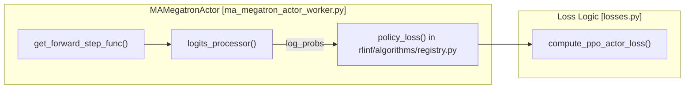

<!-- source: DeepWiki mcp.deepwiki.com · repo RLinf/RLinf · page 8.2 Policy Loss Functions · fetched 2026-10-21 -->

# Policy Loss Functions

<details>
<summary>Relevant source files</summary>

The following files were used as context for generating this wiki page:

- [.github/workflows/agent-e2e-tests.yml](.github/workflows/agent-e2e-tests.yml)
- [docs/source-en/rst_source/examples/embodied/opd.rst](docs/source-en/rst_source/examples/embodied/opd.rst)
- [docs/source-en/rst_source/examples/methods_index.rst](docs/source-en/rst_source/examples/methods_index.rst)
- [docs/source-zh/rst_source/examples/embodied/opd.rst](docs/source-zh/rst_source/examples/embodied/opd.rst)
- [docs/source-zh/rst_source/examples/methods_index.rst](docs/source-zh/rst_source/examples/methods_index.rst)
- [examples/embodiment/config/libero_10_opd_openvlaoft.yaml](examples/embodiment/config/libero_10_opd_openvlaoft.yaml)
- [examples/embodiment/config/libero_spatial_opd_openvlaoft.yaml](examples/embodiment/config/libero_spatial_opd_openvlaoft.yaml)
- [rlinf/algorithms/advantages.py](rlinf/algorithms/advantages.py)
- [rlinf/algorithms/expert.py](rlinf/algorithms/expert.py)
- [rlinf/algorithms/losses.py](rlinf/algorithms/losses.py)
- [rlinf/algorithms/registry.py](rlinf/algorithms/registry.py)
- [rlinf/algorithms/rlt/__init__.py](rlinf/algorithms/rlt/__init__.py)
- [rlinf/algorithms/rlt/expert.py](rlinf/algorithms/rlt/expert.py)
- [rlinf/algorithms/utils.py](rlinf/algorithms/utils.py)
- [rlinf/hybrid_engines/megatron/token_dispatcher.py](rlinf/hybrid_engines/megatron/token_dispatcher.py)
- [rlinf/hybrid_engines/megatron/utils.py](rlinf/hybrid_engines/megatron/utils.py)
- [rlinf/runners/agentlightning_runner.py](rlinf/runners/agentlightning_runner.py)
- [rlinf/utils/metric_utils.py](rlinf/utils/metric_utils.py)
- [rlinf/workers/actor/async_ppo_fsdp_worker.py](rlinf/workers/actor/async_ppo_fsdp_worker.py)
- [rlinf/workers/actor/ma_megatron_actor_worker.py](rlinf/workers/actor/ma_megatron_actor_worker.py)
- [rlinf/workers/actor/megatron_actor_worker.py](rlinf/workers/actor/megatron_actor_worker.py)
- [rlinf/workers/agent/agentlightning_rollout_worker.py](rlinf/workers/agent/agentlightning_rollout_worker.py)
- [rlinf/workers/critic/megatron_critic_worker.py](rlinf/workers/critic/megatron_critic_worker.py)
- [rlinf/workers/megatron_worker.py](rlinf/workers/megatron_worker.py)
- [tests/e2e_tests/reasoning/qwen3-moe-2.5b-collocated-mg-sgl-ep-fusco-test.yaml](tests/e2e_tests/reasoning/qwen3-moe-2.5b-collocated-mg-sgl-ep-fusco-test.yaml)

</details>


This page documents the loss functions, utility helpers, and the policy loss registry used during RL training in RLinf. It covers implementation details for PPO, GRPO, and SAC actor losses, as well as entropy bonuses, KL penalties, and specialized supervision for embodied and reasoning tasks.

## Policy Loss Registry

All policy losses are registered using the `@register_policy_loss` decorator in `rlinf/algorithms/registry.py` [rlinf/algorithms/registry.py:19-25](). At training time, actor workers dispatch to the correct implementation via the `policy_loss()` function based on the `algorithm.loss_type` configuration [rlinf/algorithms/registry.py:27-27]().

**Policy Loss Dispatch Diagram**

```mermaid
graph TD
    ["algorithm.loss_type (YAML config)"] --> registry["policy_loss() in rlinf/algorithms/registry.py"]

    registry --> ac["'actor_critic' -> compute_ppo_actor_critic_loss"]
    registry --> dac["'decoupled_actor_critic' -> compute_decoupled_ppo_actor_critic_loss"]
    registry --> a["'actor' -> compute_grpo_actor_loss_fn"]
    registry --> sac["'embodied_sac' -> SAC losses"]
    registry --> dagger["'embodied_dagger' -> DAgger loss"]
    registry --> nft["'embodied_nft' -> compute_nft_loss"]

    ac --> ppo_actor["compute_ppo_actor_loss"]
    ac --> ppo_critic["compute_ppo_critic_loss"]
    dac --> dppo_actor["compute_decoupled_ppo_actor_loss"]
    dac --> ppo_critic
    a --> ppo_actor
```

Sources: [rlinf/algorithms/registry.py:19-32](), [rlinf/workers/actor/megatron_actor_worker.py:25-26](), [rlinf/workers/actor/ma_megatron_actor_worker.py:28-32]()

---

## PPO Actor Loss

**Function:** `compute_ppo_actor_loss` in [rlinf/algorithms/losses.py:170-294]()

Implements the standard Proximal Policy Optimization clipped objective. It calculates the ratio between current and old action probabilities and clips it to prevent excessively large updates. The implementation enforces `float32` for logprobs, old_logprobs, and advantages to maintain numerical stability [rlinf/algorithms/losses.py:188-195]().

**Algorithm Logic:**
1. Calculate `ratio = exp(logprobs - old_logprobs)`.
2. Compute two surrogate objectives:
   - `obj1 = ratio * advantages`
   - `obj2 = clamp(ratio, 1 - clip_low, 1 + clip_high) * advantages`
3. The loss is the negative mean of `min(obj1, obj2)`.
4. **Dual Clipping:** If `clip_ratio_c` is set (typically 3.0), it applies an additional lower bound to the loss when advantages are negative to prevent the policy from moving too far from the old policy even if it results in a better objective [rlinf/algorithms/losses.py:228-232]().

**Key Parameters:**
| Parameter | Config Source | Description |
|---|---|---|
| `clip_ratio_low` | `algorithm.ratio_clip_eps` | Lower bound for clipping [rlinf/workers/actor/megatron_actor_worker.py:72-77]() |
| `clip_ratio_high` | `algorithm.ratio_clip_eps` | Upper bound for clipping [rlinf/workers/actor/megatron_actor_worker.py:78-82]() |
| `clip_ratio_c` | `algorithm.clip_ratio_c` | Threshold for dual-clipping [rlinf/workers/actor/megatron_actor_worker.py:84-84]() |

Sources: [rlinf/algorithms/losses.py:170-294](), [rlinf/workers/actor/megatron_actor_worker.py:67-84]()

---

## GRPO Actor Loss

**Function:** `compute_grpo_actor_loss_fn` in [rlinf/algorithms/losses.py:419-446]()

Group Relative Policy Optimization (GRPO) is designed for reasoning tasks where multiple trajectories are generated for a single prompt. In RLinf, GRPO is registered under the `"actor"` loss type. The loss computation itself reuses `compute_ppo_actor_loss` [rlinf/algorithms/losses.py:419-425](), but the advantages are calculated by comparing a group of outputs [rlinf/algorithms/advantages.py:89-121]().

**Dynamic GRPO for Multi-Turn:**
For multi-turn multi-agent scenarios, `compute_grpo_dynamic_advantages` supports two modes [rlinf/algorithms/advantages.py:124-163]():
- **Trajectory Mode:** Computes mean/std over group_size trajectory rewards per question and broadcasts to all turns [rlinf/algorithms/advantages.py:182-193]().
- **Turn Mode:** Computes mean/std over all turns within each question [rlinf/algorithms/advantages.py:148-152]().

**Data Flow for Reasoning (GRPO/PPO)**



Sources: [rlinf/algorithms/losses.py:419-446](), [rlinf/algorithms/advantages.py:124-163](), [rlinf/workers/actor/ma_megatron_actor_worker.py:120-177]()

---

## Decoupled PPO Actor Loss

**Function:** `compute_decoupled_ppo_actor_loss` in [rlinf/algorithms/losses.py:27-167]()

Used for off-policy updates (e.g., in `AsyncPPOEmbodiedFSDPActor`) where the policy is updated multiple times per rollout. It clips against a "proximal" policy to maintain stability.

**Key Features:**
- **Version Tracking:** Interpolates `proximal_logprobs` based on token age using `versions` and `current_version` to handle staleness in asynchronous training [rlinf/algorithms/losses.py:69-89]().
- **Behavior Weighting:** Applies importance sampling weights `exp(proximal_logprobs - old_logprobs)` to adjust for the difference between the behavior policy and the current proximal anchor [rlinf/algorithms/losses.py:115-123]().

Sources: [rlinf/algorithms/losses.py:27-167](), [rlinf/workers/actor/async_ppo_fsdp_worker.py:72-132]()

---

## Entropy and KL Penalties

### Entropy Bonus
Used to encourage exploration by penalizing deterministic policies.
- **Megatron Implementation:** Entropy is calculated from logits via `vocab_parallel_entropy_and_log_probs` [rlinf/workers/actor/megatron_actor_worker.py:146-150]().
- **Configuration:** Enabled if `algorithm.entropy_bonus > 0` and `calculate_entropy` is true [rlinf/workers/actor/megatron_actor_worker.py:68-71](). In multi-agent scenarios, entropy is similarly processed in the `logits_processor` [rlinf/workers/actor/ma_megatron_actor_worker.py:151-158]().

### KL Penalty
Prevents the model from drifting too far from a reference model (e.g., the original SFT model).
- **Function:** `kl_penalty` in `rlinf/algorithms/utils.py` [rlinf/algorithms/utils.py:26-64](). Supports multiple modes: `kl`, `abs`, `mse`, and `low_var_kl` (Schulman, 2020) [rlinf/algorithms/utils.py:41-58]().
- **Reference Model:** For full-parameter tuning, the reference policy state dict is retrieved into CPU memory during initialization via `retrieve_model_state_dict_in_cpu` to save GPU memory [rlinf/workers/actor/megatron_actor_worker.py:93-97]().

Sources: [rlinf/workers/actor/megatron_actor_worker.py:68-71](), [rlinf/workers/actor/megatron_actor_worker.py:93-97](), [rlinf/algorithms/utils.py:26-64](), [rlinf/workers/actor/ma_megatron_actor_worker.py:151-158]()

---

## Loss Aggregation and Masking

The system supports various aggregation methods to handle sequences of varying lengths and token importance.

| Aggregation Method | Description |
|---|---|
| `masked_mean` | Simple mean over all unmasked tokens/steps [rlinf/algorithms/losses.py:24](). |
| `masked_mean_ratio` | Normalizes losses by a ratio (e.g., `loss_mask_sum / max_episode_steps`) to handle variable episode lengths [rlinf/algorithms/losses.py:66](). |
| `seq-mean-token-sum` | Computes mean over sequences of the sum of token losses [rlinf/workers/megatron_worker.py:137-138](). |

**Loss Masking Logic:**
For LLM reasoning tasks, masks are typically constructed to only calculate loss on the "response" tokens. In `MAMegatronActor`, labels are shifted left to align with model outputs, and the `label_mask` is similarly shifted to ensure loss is computed on the correct prediction targets [rlinf/workers/actor/ma_megatron_actor_worker.py:137-146]().

Sources: [rlinf/algorithms/losses.py:24](), [rlinf/algorithms/losses.py:59-66](), [rlinf/workers/megatron_worker.py:135-144](), [rlinf/workers/actor/ma_megatron_actor_worker.py:137-146]()

---

## Configuration Summary

| YAML Key | Description |
|---|---|
| `algorithm.loss_type` | Dispatch key for the registry (`actor`, `actor_critic`, `decoupled_actor_critic`) [rlinf/algorithms/registry.py:19-25]() |
| `algorithm.kl_beta` | Weight for standard KL penalty [rlinf/workers/actor/megatron_actor_worker.py:94-95]() |
| `algorithm.entropy_bonus` | Weight for entropy exploration bonus [rlinf/workers/actor/megatron_actor_worker.py:70]() |
| `algorithm.ratio_clip_eps` | Default clipping epsilon for PPO [rlinf/workers/actor/megatron_actor_worker.py:72]() |
| `algorithm.loss_agg_func` | Selection for loss reduction (`token-mean`, `seq-mean-token-sum`, etc.) [rlinf/workers/megatron_worker.py:135-141]() |

Sources: [rlinf/workers/actor/megatron_actor_worker.py:67-84](), [rlinf/algorithms/registry.py:19-25](), [rlinf/workers/megatron_worker.py:133-144](), [tests/e2e_tests/reasoning/qwen3-moe-2.5b-collocated-mg-sgl-ep-fusco-test.yaml:58-63]()

---

