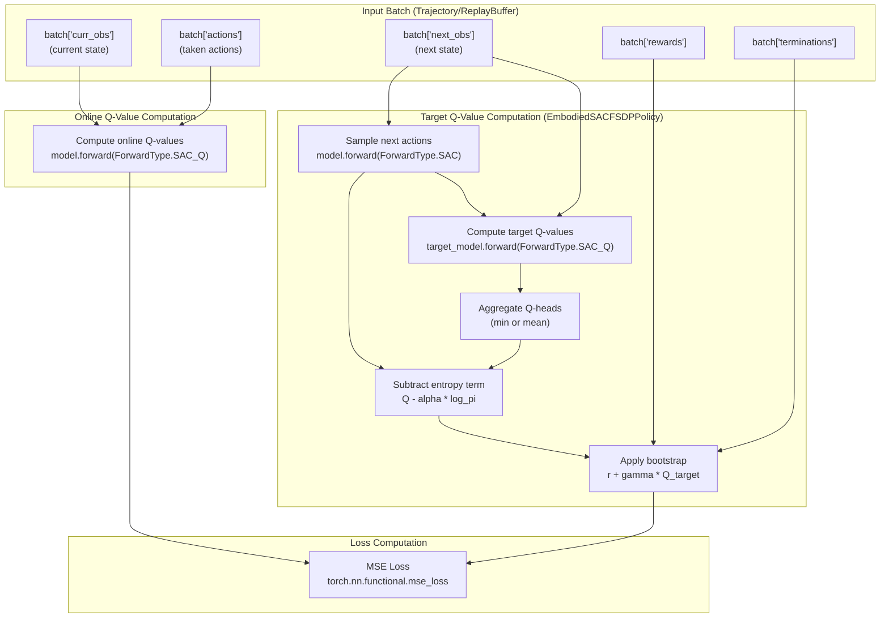
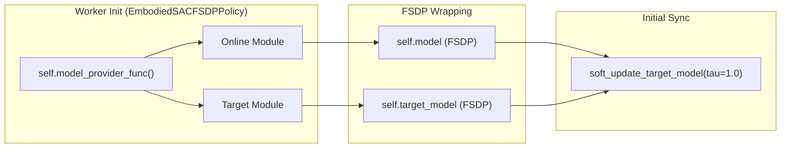
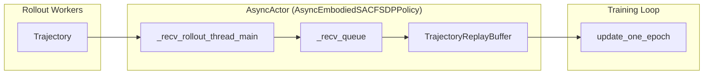

<!-- source: DeepWiki mcp.deepwiki.com · repo RLinf/RLinf · page 8.3 Value and Q-Function Training · fetched 2026-10-21 -->

# Value and Q-Function Training

Relevant source files

The following files were used as context for generating this wiki page:

- [.github/workflows/agent-e2e-tests.yml](.github/workflows/agent-e2e-tests.yml)
- [docs/source-en/rst_source/extending/weight_syncer.rst](docs/source-en/rst_source/extending/weight_syncer.rst)
- [docs/source-zh/rst_source/extending/weight_syncer.rst](docs/source-zh/rst_source/extending/weight_syncer.rst)
- [examples/embodiment/config/maniskill_async_ppo_openvlaoft.yaml](examples/embodiment/config/maniskill_async_ppo_openvlaoft.yaml)
- [examples/embodiment/config/maniskill_ppo_mlp_collect.yaml](examples/embodiment/config/maniskill_ppo_mlp_collect.yaml)
- [examples/sft/run_vlm_sft.sh](examples/sft/run_vlm_sft.sh)
- [rlinf/algorithms/losses.py](rlinf/algorithms/losses.py)
- [rlinf/data/embodied_buffer_dataset.py](rlinf/data/embodied_buffer_dataset.py)
- [rlinf/data/embodied_io_struct.py](rlinf/data/embodied_io_struct.py)
- [rlinf/hybrid_engines/megatron/token_dispatcher.py](rlinf/hybrid_engines/megatron/token_dispatcher.py)
- [rlinf/hybrid_engines/megatron/utils.py](rlinf/hybrid_engines/megatron/utils.py)
- [rlinf/hybrid_engines/weight_syncer/base.py](rlinf/hybrid_engines/weight_syncer/base.py)
- [rlinf/hybrid_engines/weight_syncer/bucket_syncer.py](rlinf/hybrid_engines/weight_syncer/bucket_syncer.py)
- [rlinf/hybrid_engines/weight_syncer/patch_syncer.py](rlinf/hybrid_engines/weight_syncer/patch_syncer.py)
- [rlinf/runners/agentlightning_runner.py](rlinf/runners/agentlightning_runner.py)
- [rlinf/scheduler/worker/routing.py](rlinf/scheduler/worker/routing.py)
- [rlinf/utils/metric_utils.py](rlinf/utils/metric_utils.py)
- [rlinf/utils/nested_dict_process.py](rlinf/utils/nested_dict_process.py)
- [rlinf/utils/utils.py](rlinf/utils/utils.py)
- [rlinf/workers/actor/async_fsdp_dagger_policy_worker.py](rlinf/workers/actor/async_fsdp_dagger_policy_worker.py)
- [rlinf/workers/actor/async_fsdp_sac_policy_worker.py](rlinf/workers/actor/async_fsdp_sac_policy_worker.py)
- [rlinf/workers/actor/async_ppo_fsdp_worker.py](rlinf/workers/actor/async_ppo_fsdp_worker.py)
- [rlinf/workers/actor/fsdp_dagger_policy_worker.py](rlinf/workers/actor/fsdp_dagger_policy_worker.py)
- [rlinf/workers/actor/fsdp_iql_policy_worker.py](rlinf/workers/actor/fsdp_iql_policy_worker.py)
- [rlinf/workers/actor/fsdp_sac_policy_worker.py](rlinf/workers/actor/fsdp_sac_policy_worker.py)
- [rlinf/workers/actor/ma_megatron_actor_worker.py](rlinf/workers/actor/ma_megatron_actor_worker.py)
- [rlinf/workers/actor/megatron_actor_worker.py](rlinf/workers/actor/megatron_actor_worker.py)
- [rlinf/workers/agent/agentlightning_rollout_worker.py](rlinf/workers/agent/agentlightning_rollout_worker.py)
- [rlinf/workers/critic/megatron_critic_worker.py](rlinf/workers/critic/megatron_critic_worker.py)
- [rlinf/workers/megatron_worker.py](rlinf/workers/megatron_worker.py)
- [rlinf/workers/sft/fsdp_vlm_sft_worker.py](rlinf/workers/sft/fsdp_vlm_sft_worker.py)
- [tests/e2e_tests/reasoning/qwen3-moe-2.5b-collocated-mg-sgl-ep-fusco-test.yaml](tests/e2e_tests/reasoning/qwen3-moe-2.5b-collocated-mg-sgl-ep-fusco-test.yaml)
- [tests/unit_tests/test_comm_mapper.py](tests/unit_tests/test_comm_mapper.py)
- [tests/unit_tests/test_weight_syncer.py](tests/unit_tests/test_weight_syncer.py)

This page documents the implementation of critic (value/Q-function) training in RLinf's algorithms, covering both off-policy methods (SAC, RLPD, IQL) and on-policy methods (PPO). It details critic loss computation, target network management, soft updates, and specific architectural extensions like DSRL and weight synchronization.

---

## Q-Function Loss Computation

RLinf implements soft actor-critic Q-learning with configurable bootstrapping and entropy backup strategies. The critic learns to estimate action-value functions $Q(s, a)$ by minimizing the temporal difference (TD) error against target Q-values.

### Core Computation Flow

The following diagram bridges the high-level RL logic with the specific implementation in `EmbodiedSACFSDPPolicy`.

**Diagram: Q-Function Loss Computation Pipeline**

The forward pass for critic training is implemented in `EmbodiedSACFSDPPolicy.forward_critic` within `rlinf/workers/actor/fsdp_sac_policy_worker.py`.

**Sources:** `[rlinf/workers/actor/fsdp_sac_policy_worker.py:339-466]()`, `[rlinf/models/embodiment/base_policy.py:33-33]()`, `[rlinf/workers/actor/fsdp_sac_policy_worker.py:553-580]()`

### Target Q-Value Calculation

Target Q-values are computed using the target network to provide stable regression targets. The computation follows the soft Bellman equation:

$$Q_{target}(s, a) = r + \gamma \cdot (\min_i Q_{target, i}(s', a') - \alpha \cdot \log \pi(a'|s'))$$

Where:
- `r` is the immediate reward.
- `γ` is the discount factor (`algorithm.gamma`).
- $Q_{target, i}$ are the target Q-heads.
- `a'` is sampled from the current policy $\pi(\cdot|s')$.
- `α` is the entropy temperature.

**Key Implementation Details:**
- **Next action sampling:** Performed via `model.forward(forward_type=ForwardType.SAC, ...)` `[rlinf/workers/actor/fsdp_sac_policy_worker.py:360-376]()`.
- **Target Q-evaluation:** Computed via `target_model.forward(forward_type=ForwardType.SAC_Q, ...)` `[rlinf/workers/actor/fsdp_sac_policy_worker.py:379-409]()`.
- **Entropy Backup:** Controlled by `algorithm.backup_entropy` (default: `True`). If enabled, the entropy term is subtracted from the target Q-value `[rlinf/workers/actor/fsdp_sac_policy_worker.py:405-409]()`.

**Sources:** `[rlinf/workers/actor/fsdp_sac_policy_worker.py:339-466]()`, `[rlinf/workers/actor/fsdp_sac_policy_worker.py:379-409]()`

---

## Target Networks and Soft Updates

Target networks provide stable regression targets by using a slowly-updated copy of the Q-function parameters.

### Initialization and FSDP Wrapping

Target networks are initialized as exact copies of the online model. In `EmbodiedSACFSDPPolicy.setup_model_and_optimizer`, two instances of the module are created and wrapped with FSDP.

**Sources:** `[rlinf/workers/actor/fsdp_sac_policy_worker.py:79-110]()`, `[rlinf/workers/actor/fsdp_sac_policy_worker.py:63-68]()`

### Soft Update Mechanism

Target networks are updated using exponential moving average (EMA) with coefficient `tau` (`algorithm.tau`):

$$\theta_{target} \leftarrow (1 - \tau) \theta_{target} + \tau \theta_{online}$$

RLinf implements a specific **DSRL** (Decoupled State-Representation Learning) soft update. If `use_dsrl` is enabled, the system initializes a `_target_shadow_f32` buffer to maintain high-precision weights during the EMA process, preventing precision loss when the main model uses `bf16`.

**Sources:** `[rlinf/workers/actor/fsdp_sac_policy_worker.py:248-307]()`, `[rlinf/workers/actor/fsdp_sac_policy_worker.py:274-290]()`

---

## Q-Head Aggregation and Value Prediction

### Q-Head Aggregation Strategies
For off-policy algorithms like SAC or RLPD, RLinf supports multiple Q-heads to mitigate overestimation bias. Strategies are controlled via `algorithm.agg_q`:

| Strategy | Implementation | Purpose |
|----------|----------------|---------|
| `min` | `torch.min(all_qf_next_target, dim=1)` | Pessimistic estimation (Standard SAC/REDQ) |
| `mean` | `torch.mean(all_qf_next_target, dim=1)` | Average estimation (Standard RLPD) |

**Sources:** `[rlinf/workers/actor/fsdp_sac_policy_worker.py:398-403]()`

### Expectile Loss (IQL)
For offline learning, RLinf provides `EmbodiedIQLFSDPPolicy` which utilizes an expectile loss for value function training:
`iql_expectile_loss(diff, expectile) = |expectile - 1(diff < 0)| * diff^2`

**Sources:** `[rlinf/workers/actor/fsdp_iql_policy_worker.py:32-35]()`

### Explained Variance
Critic performance is monitored using Explained Variance, which measures how well the value function predicts the returns. RLinf computes sufficient statistics (`count`, `returns_sum`, `returns_sq_sum`, `errors_sum`, `errors_sq_sum`) to aggregate this metric across distributed ranks.

**Sources:** `[rlinf/utils/metric_utils.py:143-166]()`, `[rlinf/utils/metric_utils.py:173-199]()`

---

## Weight Synchronization Strategies

RLinf provides advanced weight synchronization mechanisms to keep actor and rollout workers in sync.

### Bucket and Patch Syncer
- **BucketWeightSyncer:** Synchronizes model weights by sending state dict tensors in buckets. It materializes tensors via `materialize_tensor`, optionally casts them to a specific `bucket_dtype`, and moves them to a `bucket_device`.
- **PatchWeightSyncer:** A sparse patch payload for changed state dict entries. It stores changed tensors in a COO-like form (`rows`, `cols`, `values`) to minimize communication overhead.

**Sources:** `[rlinf/hybrid_engines/weight_syncer/bucket_syncer.py:113-149]()`, `[rlinf/hybrid_engines/weight_syncer/patch_syncer.py:138-163]()`, `[rlinf/utils/utils.py:58-63]()`

---

## Distributed Orchestration

Value and Q-function training is integrated into the distributed actor workers, supporting both synchronous and asynchronous execution.

### Training Loop (Async SAC)
In `AsyncEmbodiedSACFSDPPolicy`, trajectories are received from rollout workers via a background thread and added to a `TrajectoryReplayBuffer`.

**Diagram: Async Training Data Flow**

**Sources:** `[rlinf/workers/actor/async_fsdp_sac_policy_worker.py:32-54]()`, `[rlinf/workers/actor/async_fsdp_sac_policy_worker.py:71-82]()`, `[rlinf/workers/actor/async_fsdp_sac_policy_worker.py:93-131]()`

### Distributed Optimization
- **Separate Optimizers:** The actor and critic (Q-function) use separate optimizers (`optimizer` and `qf_optimizer`) and schedulers (`lr_scheduler` and `qf_lr_scheduler`).
- **Entropy Tuning:** An `alpha_optimizer` manages the `EntropyTemperature` parameter for automatic entropy tuning in SAC.
- **Gradient Accumulation:** Managed via `self.gradient_accumulation` to support large global batch sizes across multiple GPUs.

**Sources:** `[rlinf/workers/actor/fsdp_sac_policy_worker.py:122-130]()`, `[rlinf/workers/actor/fsdp_sac_policy_worker.py:136-141]()`, `[rlinf/workers/actor/async_fsdp_sac_policy_worker.py:110-114]()`

---

