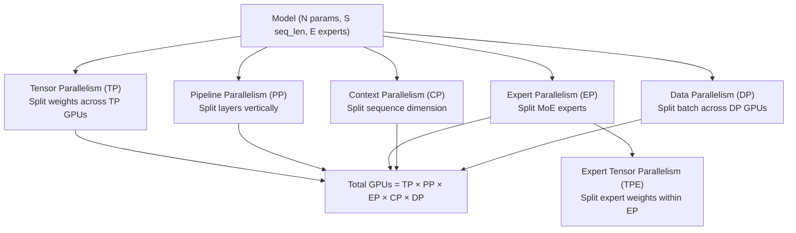
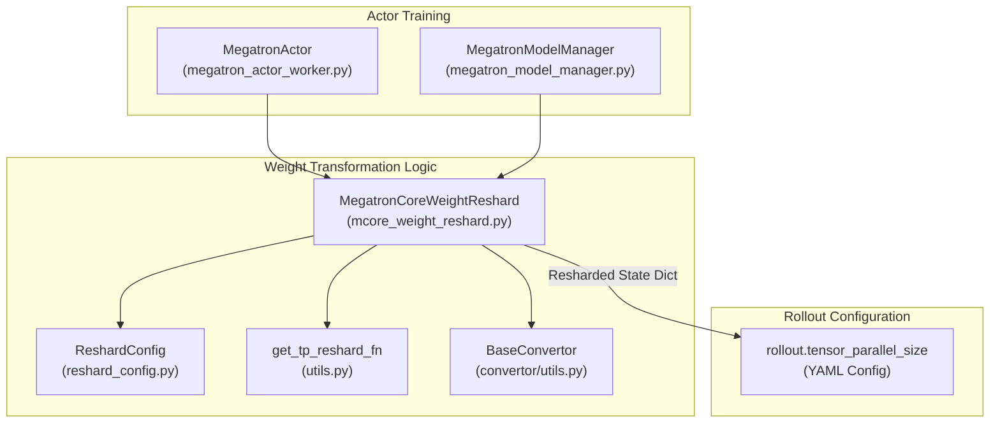
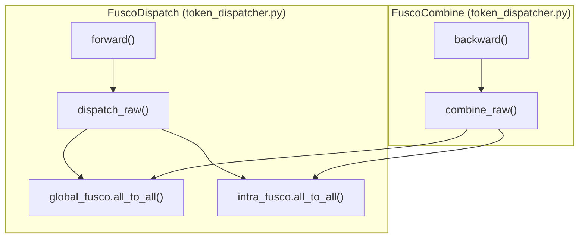

<!-- source: DeepWiki mcp.deepwiki.com · repo RLinf/RLinf · page 9.1 Model Parallelism Strategies · fetched 2026-10-21 -->

# Model Parallelism Strategies

Relevant source files

The following files were used as context for generating this wiki page:

- [.github/workflows/agent-e2e-tests.yml](.github/workflows/agent-e2e-tests.yml)
- [examples/reasoning/config/math/qwen3-30b-grpo-megatron.yaml](examples/reasoning/config/math/qwen3-30b-grpo-megatron.yaml)
- [rlinf/algorithms/losses.py](rlinf/algorithms/losses.py)
- [rlinf/hybrid_engines/megatron/megatron_model_manager.py](rlinf/hybrid_engines/megatron/megatron_model_manager.py)
- [rlinf/hybrid_engines/megatron/token_dispatcher.py](rlinf/hybrid_engines/megatron/token_dispatcher.py)
- [rlinf/hybrid_engines/megatron/utils.py](rlinf/hybrid_engines/megatron/utils.py)
- [rlinf/runners/agentlightning_runner.py](rlinf/runners/agentlightning_runner.py)
- [rlinf/utils/convertor/utils.py](rlinf/utils/convertor/utils.py)
- [rlinf/utils/metric_utils.py](rlinf/utils/metric_utils.py)
- [rlinf/utils/resharding/mcore_weight_reshard.py](rlinf/utils/resharding/mcore_weight_reshard.py)
- [rlinf/utils/resharding/reshard_config.py](rlinf/utils/resharding/reshard_config.py)
- [rlinf/utils/resharding/utils.py](rlinf/utils/resharding/utils.py)
- [rlinf/workers/actor/async_ppo_fsdp_worker.py](rlinf/workers/actor/async_ppo_fsdp_worker.py)
- [rlinf/workers/actor/ma_megatron_actor_worker.py](rlinf/workers/actor/ma_megatron_actor_worker.py)
- [rlinf/workers/actor/megatron_actor_worker.py](rlinf/workers/actor/megatron_actor_worker.py)
- [rlinf/workers/agent/agentlightning_rollout_worker.py](rlinf/workers/agent/agentlightning_rollout_worker.py)
- [rlinf/workers/critic/megatron_critic_worker.py](rlinf/workers/critic/megatron_critic_worker.py)
- [rlinf/workers/megatron_worker.py](rlinf/workers/megatron_worker.py)
- [tests/e2e_tests/reasoning/qwen3-4b-collocated-mg-sgl-test.yaml](tests/e2e_tests/reasoning/qwen3-4b-collocated-mg-sgl-test.yaml)
- [tests/e2e_tests/reasoning/qwen3-moe-2.5b-collocated-mg-sgl-ep-fusco-test.yaml](tests/e2e_tests/reasoning/qwen3-moe-2.5b-collocated-mg-sgl-ep-fusco-test.yaml)
- [tests/e2e_tests/reasoning/qwen3-moe-2.5b-collocated-mg-sgl-ep-test.yaml](tests/e2e_tests/reasoning/qwen3-moe-2.5b-collocated-mg-sgl-ep-test.yaml)
- [tests/e2e_tests/reasoning/qwen3-moe-2.5b-collocated-mg-sgl-sequentialmlp.yaml](tests/e2e_tests/reasoning/qwen3-moe-2.5b-collocated-mg-sgl-sequentialmlp.yaml)
- [tests/e2e_tests/reasoning/qwen3-moe-2.5b-collocated-mg-sgl-tegroupgemm.yaml](tests/e2e_tests/reasoning/qwen3-moe-2.5b-collocated-mg-sgl-tegroupgemm.yaml)
- [tests/e2e_tests/reasoning/qwen3-moe-2.5b-collocated-mg-sgl-tp-test.yaml](tests/e2e_tests/reasoning/qwen3-moe-2.5b-collocated-mg-sgl-tp-test.yaml)
- [tests/e2e_tests/reasoning/qwen3-moe-2.5b-collocated-mg-sgl-tpe-test.yaml](tests/e2e_tests/reasoning/qwen3-moe-2.5b-collocated-mg-sgl-tpe-test.yaml)

This page provides a comprehensive technical reference for model parallelism strategies in RLinf. It covers the primary parallelism dimensions (Tensor, Pipeline, Expert, Context, Data), their implementation in the Megatron backend, weight resharding for heterogeneous parallelism configurations, and FUSCO-optimized MoE communication.

For distributed infrastructure and worker group management, see [Core Infrastructure](3). For FSDP-specific sharding strategies, see [FSDP Backend](5.1). For hybrid execution and dynamic GPU allocation, see [Hybrid Execution and Dynamic Scheduling](9.3).

---

## Parallelism Dimensions Overview

RLinf's Megatron backend supports five orthogonal parallelism dimensions that can be combined to scale training. Each dimension partitions the model or data differently to optimize memory usage, communication overhead, and computational efficiency.

**Parallelism Dimension Composition**

**Sources:** [rlinf/hybrid_engines/megatron/megatron_model_manager.py:178-232](), [examples/reasoning/config/math/qwen3-30b-grpo-megatron.yaml:164-167]()

---

## Tensor Parallelism (TP)

Tensor Parallelism partitions weight matrices within each transformer layer across multiple GPUs. In self-attention, query/key/value projection matrices and output projections are split. This enables training models whose single-layer weights exceed single GPU memory.

**Configuration:**
- Set via `actor.model.tensor_model_parallel_size` [examples/reasoning/config/math/qwen3-30b-grpo-megatron.yaml:164]().
- Configured in Hydra YAML files for specific model types (e.g., `qwen2.5`) [rlinf/utils/resharding/utils.py:22-33]().

**Implementation Details:**
The system uses specialized resharding functions to handle the logic of gathering and concatenating tensors across TP groups. The utility `_gather_tp_group_tensor_and_reshard` uses `torch.distributed.all_gather` to reconstruct the full tensor before re-splitting for the target TP size [rlinf/utils/resharding/utils.py:65-72](). 

Specific resharding functions are registered for different models:
- `tp_reshard_fn_qwen2_5`: Defines ColumnParallel parameters (split on `dim=0`) like `self_attention.linear_qkv.weight` and RowParallel parameters (split on `dim=1`) like `self_attention.linear_proj.weight` [rlinf/utils/resharding/utils.py:75-114]().
- `tp_reshard_fn_qwen3_dense`: Handles Qwen3 dense specific layers such as `q_layernorm.weight` [rlinf/utils/resharding/utils.py:117-159]().
- `tp_reshard_fn_qwen3_moe`: Skips MLP weights during standard TP resharding as they are handled by TPE resharding [rlinf/utils/resharding/utils.py:162-211]().

**Sources:** [rlinf/utils/resharding/utils.py:65-211](), [examples/reasoning/config/math/qwen3-30b-grpo-megatron.yaml:164]()

---

## Pipeline Parallelism (PP)

Pipeline Parallelism splits transformer layers vertically into stages. RLinf supports both standard PP and virtual pipeline parallelism (interleaved schedules) to reduce pipeline bubbles.

**Configuration:**
- Set via `actor.model.pipeline_model_parallel_size` [examples/reasoning/config/math/qwen3-30b-grpo-megatron.yaml:165]().
- `MegatronCoreWeightReshard` detects virtual pipeline (VP) size via `parallel_state.get_virtual_pipeline_model_parallel_world_size()` to correctly bucketize model chunks [rlinf/utils/resharding/mcore_weight_reshard.py:79-107]().

**Data Flow in Pipeline Mode:**
In pipeline mode, specific data channels are created to route values and outputs between stages. For example, `ReasoningRunner` creates `critic_inference_channel_to_actor_train` and `critic_inference_channel_to_critic_train` when `is_pipeline` is true [rlinf/runners/reasoning_runner.py:116-126]().

**Sources:** [rlinf/utils/resharding/mcore_weight_reshard.py:79-107](), [rlinf/runners/reasoning_runner.py:116-126](), [examples/reasoning/config/math/qwen3-30b-grpo-megatron.yaml:165]()

---

## Expert Parallelism (EP) and Expert Tensor Parallelism (TPE)

Expert Parallelism distributes Mixture-of-Experts (MoE) experts across GPUs. Expert Tensor Parallelism (TPE) further partitions expert weights within an EP group.

**Configuration:**
- EP size: `actor.model.expert_model_parallel_size` [examples/reasoning/config/math/qwen3-30b-grpo-megatron.yaml:166]().
- TPE size: `actor.model.expert_tensor_parallel_size` [examples/reasoning/config/math/qwen3-30b-grpo-megatron.yaml:167]().

**Expert Resharding:**
The `MegatronCoreWeightReshard` class manages the complexity of gathering weights across `ep_group` and `tpe_group`. It creates communication subgroups for TP during initialization to facilitate the merge [rlinf/utils/resharding/mcore_weight_reshard.py:45-59](). Specialized functions like `tpe_reshard_fn_qwen3_moe` handle the specific layout of MoE weights, specifically splitting or merging `linear_fc1` and `linear_fc2` across expert and tensor dimensions [rlinf/utils/resharding/utils.py:219-250]().

**Sources:** [rlinf/utils/resharding/mcore_weight_reshard.py:45-59](), [rlinf/utils/resharding/utils.py:219-250](), [examples/reasoning/config/math/qwen3-30b-grpo-megatron.yaml:166-167]()

---

## Context Parallelism (CP)

Context Parallelism splits the sequence dimension across GPUs, enabling training on extremely long sequences.

**Sequence Packing Implementation:**
When sequences are packed, RLinf uses `preprocess_packed_seqs` to calculate the necessary padding and split points for CP [rlinf/hybrid_engines/megatron/megatron_model_manager.py:36](). After processing, `postprocess_packed_seqs` reconstructs the full sequence output [rlinf/hybrid_engines/megatron/megatron_model_manager.py:35]().

**Sources:** [rlinf/hybrid_engines/megatron/megatron_model_manager.py:34-40]()

---

## Weight Resharding for Heterogeneous Parallelism

RLinf allows training (Actor) and inference (Rollout) to use different parallelism configurations. The `MegatronCoreWeightReshard` class facilitates this by bucketizing and re-partitioning weights.

**Resharding Flow and Code Entities**

**Key Implementation Components:**
- **Bucketization:** `divide_model_to_bucket` splits the model into memory-limited chunks based on `bucket_capacity` to prevent OOM during resharding [rlinf/utils/resharding/mcore_weight_reshard.py:72-111]().
- **Transformation Rules:** `BaseConvertor` uses `ConvertorRule` to map names and apply transforms like `split_qkv` or `split_fc1` [rlinf/utils/convertor/utils.py:150-184](). 
- **GQA Handling:** `TransformFunc._split_gqa_tensor` specifically handles Grouped-Query Attention resharding, ensuring query groups are divisible by the target TP size [rlinf/utils/convertor/utils.py:34-95]().
- **Actor Integration:** `MegatronActor` initializes `rollout_weights_reshard` using a `ReshardConfig` derived from both actor and rollout configurations [rlinf/workers/actor/megatron_actor_worker.py:99-108]().

**Sources:** [rlinf/utils/resharding/mcore_weight_reshard.py:72-111](), [rlinf/utils/convertor/utils.py:34-184](), [rlinf/workers/actor/megatron_actor_worker.py:99-108]()

---

## FUSCO MoE Optimization

FUSCO (Fast Unified Sparse COmmunication) provides optimized All-to-All kernels for MoE routing.

**Implementation Details:**
- **Initialization:** `MegatronModelManager` detects the `FUSCOLibrary` and checks for the required `idxtools` [rlinf/hybrid_engines/megatron/megatron_model_manager.py:94-109]().
- **Dispatcher Integration:** `MoEAlltoAllTokenDispatcher` is extended to use FUSCO when available. The `FuscoDispatch` and `FuscoCombine` autograd functions wrap the raw All-to-All calls [rlinf/hybrid_engines/megatron/token_dispatcher.py:196-225]().
- **2D Mode:** FUSCO supports a "2D mode" that optimizes communication by performing separate intra-node and cross-node All-to-All steps [rlinf/hybrid_engines/megatron/token_dispatcher.py:77-123]().

**FUSCO Communication Logic**

**Sources:** [rlinf/hybrid_engines/megatron/megatron_model_manager.py:94-130](), [rlinf/hybrid_engines/megatron/token_dispatcher.py:77-225]()

---

