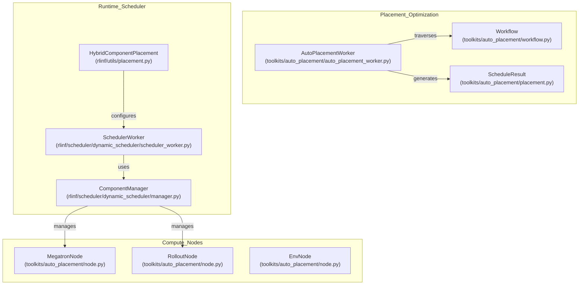
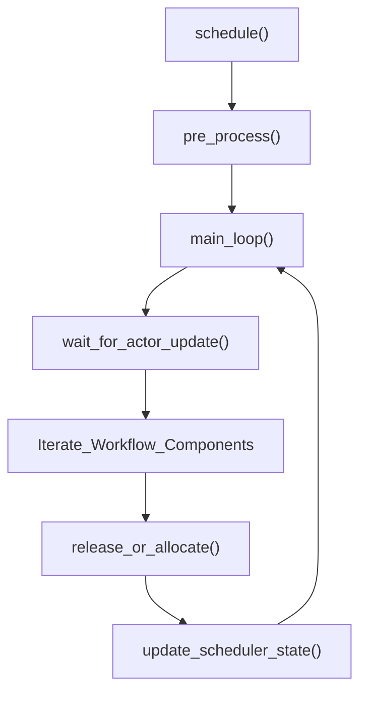
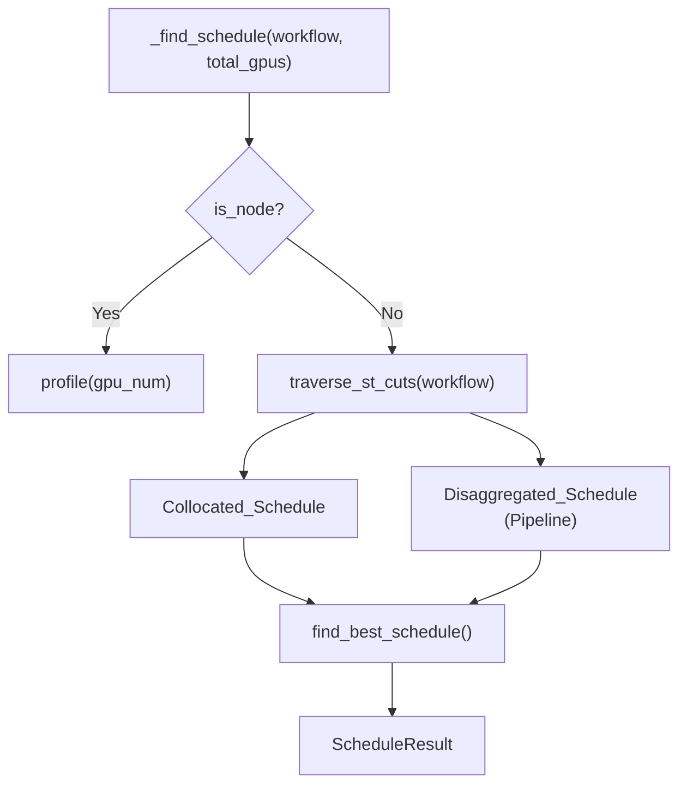

<!-- source: DeepWiki mcp.deepwiki.com · repo RLinf/RLinf · page 9.3 Hybrid Execution and Dynamic Scheduling · fetched 2026-10-21 -->

# Hybrid Execution and Dynamic Scheduling

<details>
<summary>Relevant source files</summary>

The following files were used as context for generating this wiki page:

- [.github/workflows/scheduler-tests.yml](.github/workflows/scheduler-tests.yml)
- [examples/embodiment/run_placement_autotune.sh](examples/embodiment/run_placement_autotune.sh)
- [examples/reasoning/run_placement_autotune.sh](examples/reasoning/run_placement_autotune.sh)
- [rlinf/scheduler/cluster/config.py](rlinf/scheduler/cluster/config.py)
- [rlinf/scheduler/dynamic_scheduler/scheduler_worker.py](rlinf/scheduler/dynamic_scheduler/scheduler_worker.py)
- [rlinf/scheduler/placement/flexible.py](rlinf/scheduler/placement/flexible.py)
- [rlinf/scheduler/placement/packed.py](rlinf/scheduler/placement/packed.py)
- [rlinf/utils/data_process.py](rlinf/utils/data_process.py)
- [tests/e2e_tests/auto_placement/qwen2.5-1.5b-grpo.yaml](tests/e2e_tests/auto_placement/qwen2.5-1.5b-grpo.yaml)
- [tests/e2e_tests/auto_placement/run.sh](tests/e2e_tests/auto_placement/run.sh)
- [tests/e2e_tests/dynamic_scheduler/qwen2.5-1.5b-grpo-dynamic-mg-vllm.yaml](tests/e2e_tests/dynamic_scheduler/qwen2.5-1.5b-grpo-dynamic-mg-vllm.yaml)
- [tests/e2e_tests/reasoning/qwen2.5-1.5b-grpo-collocated-mg-sgl-rollout-logprobs.yaml](tests/e2e_tests/reasoning/qwen2.5-1.5b-grpo-collocated-mg-sgl-rollout-logprobs.yaml)
- [tests/e2e_tests/reasoning/qwen2.5-1.5b-grpo-collocated-mg-vllm.yaml](tests/e2e_tests/reasoning/qwen2.5-1.5b-grpo-collocated-mg-vllm.yaml)
- [tests/e2e_tests/reasoning/qwen2.5-1.5b-grpo-pipeline-mg-sgl-rollout-logprobs.yaml](tests/e2e_tests/reasoning/qwen2.5-1.5b-grpo-pipeline-mg-sgl-rollout-logprobs.yaml)
- [tests/e2e_tests/reasoning/qwen2.5-1.5b-grpo-pipeline-mg-sgl.yaml](tests/e2e_tests/reasoning/qwen2.5-1.5b-grpo-pipeline-mg-sgl.yaml)
- [tests/e2e_tests/reasoning/qwen2.5-1.5b-grpo-pipeline-mg-vllm-rollout-logprobs.yaml](tests/e2e_tests/reasoning/qwen2.5-1.5b-grpo-pipeline-mg-vllm-rollout-logprobs.yaml)
- [tests/e2e_tests/reasoning/qwen2.5-1.5b-grpo-pipeline-mg-vllm.yaml](tests/e2e_tests/reasoning/qwen2.5-1.5b-grpo-pipeline-mg-vllm.yaml)
- [tests/unit_tests/test_auto_placement.py](tests/unit_tests/test_auto_placement.py)
- [tests/unit_tests/test_placement.py](tests/unit_tests/test_placement.py)
- [toolkits/auto_placement/__init__.py](toolkits/auto_placement/__init__.py)
- [toolkits/auto_placement/auto_placement_worker.py](toolkits/auto_placement/auto_placement_worker.py)
- [toolkits/auto_placement/fitter.py](toolkits/auto_placement/fitter.py)
- [toolkits/auto_placement/node.py](toolkits/auto_placement/node.py)
- [toolkits/auto_placement/placement.py](toolkits/auto_placement/placement.py)
- [toolkits/auto_placement/util.py](toolkits/auto_placement/util.py)
- [toolkits/auto_placement/workflow.py](toolkits/auto_placement/workflow.py)

</details>


This document documents the hybrid execution and dynamic scheduling system in RLinf. This system achieves a **2.434× throughput** improvement compared to traditional RL frameworks by dynamically and intelligently allocating GPU resources between environment interaction (rollout/inference) and policy training (actor). It leverages Megatron-LM's online scaling and SGLang/vLLM's request migration to reallocate resources without interrupting the training process.

Sources: [rlinf/scheduler/dynamic_scheduler/scheduler_worker.py:30-85](), [toolkits/auto_placement/placement.py:173-193]()

---

## Overview and Motivation

In standard RL training, resources are often partitioned statically. This leads to inefficiencies where GPUs assigned to Rollout workers sit idle during Actor training, or vice versa. RLinf's dynamic scheduling addresses this by:

1.  **Scaling Up**: Temporarily adding GPUs to a component when it becomes a bottleneck.
2.  **Scaling Down**: Reclaiming GPUs from idle or ahead-of-schedule components.
3.  **Hybrid Execution**: Allowing tasks to share the same set of GPUs or use separate GPUs based on demand.
4.  **Pipelining**: Using fine-grained pipelining and data queues to decouple producer and consumer rates, virtually eliminating performance bottlenecks.

**Performance Impact**:
*   **Higher Throughput**: Accelerates bottleneck components in real-time.
*   **Better Utilization**: Reassigns idle resources to effective computation.
*   **Memory Efficiency**: Uses weight offloading to CPU memory for inactive components to avoid OOM errors.

Sources: [toolkits/auto_placement/placement.py:23-29](), [rlinf/scheduler/dynamic_scheduler/scheduler_worker.py:55-61](), [tests/e2e_tests/auto_placement/qwen2.5-1.5b-grpo.yaml:145-147]()

---

## System Architecture and Components

The dynamic scheduling and placement logic is primarily implemented within the `HybridComponentPlacement` system, the `SchedulerWorker`, and the `AutoPlacementWorker` toolkit.

### Key Code Entities

*   **`SchedulerWorker`**: The core dynamic scheduler that manages the main loop of resource reallocation across the workflow components. [rlinf/scheduler/dynamic_scheduler/scheduler_worker.py:30-44]()
*   **`ComponentManager`**: Created via `create_component_manager`, it handles component-specific logic for releasing or allocating resources (e.g., triggering Megatron-LM resharding or SGLang migration). [rlinf/scheduler/dynamic_scheduler/scheduler_worker.py:72-78]()
*   **`AutoPlacementWorker`**: A toolkit utility that uses performance models to find the optimal static or dynamic placement strategy based on profiling data. [toolkits/auto_placement/auto_placement_worker.py:42-53]()
*   **`HybridComponentPlacement`**: The placement strategy used in hybrid mode that allows overlapping resource assignments for different components. [rlinf/utils/placement.py:86-97]()
*   **`Workflow`**: Represents the directed acyclic graph (DAG) of the RL process (e.g., env -> rollout -> actor), used to calculate critical paths and scheduling cuts. [toolkits/auto_placement/workflow.py:22-35]()

### Natural Language to Code Entity Mapping

The following diagram bridges the conceptual scheduling flow to the specific classes and files in the codebase.

Title: "Hybrid Scheduling System Mapping"


Sources: [toolkits/auto_placement/auto_placement_worker.py:90-100](), [toolkits/auto_placement/placement.py:31-50](), [rlinf/scheduler/dynamic_scheduler/scheduler_worker.py:64-79]()

---

## Scheduling Logic and Workflow

The dynamic scheduler operates by monitoring component progress and reallocating resources at specific synchronization points, typically after actor updates.

### Runtime Scheduling Loop

The `SchedulerWorker` executes a main loop that iterates through the training workflow, checking for opportunities to release or allocate GPUs.

Title: "Dynamic Scheduling Loop Implementation"


Sources: [rlinf/scheduler/dynamic_scheduler/scheduler_worker.py:87-130]()

### Resource Reallocation Policies

1.  **`use_pre_process_policy`**: In the early phase of each iteration, actor resources are temporarily transferred to rollout to maximize pipeline efficiency. [rlinf/scheduler/dynamic_scheduler/scheduler_worker.py:56-58]()
2.  **`use_wait_before_last_iter_policy`**: Before the final actor iteration, the system waits for rollout/inference to finish, then gives the actor all resources for an expanded final training step. [rlinf/scheduler/dynamic_scheduler/scheduler_worker.py:59-61]()
3.  **Cost Estimation**: The `MegatronNode` and `RolloutNode` use performance models to estimate execution time based on GPU count. For example, `MegatronNode` uses a non-linear scaling ratio to account for communication overhead. [toolkits/auto_placement/node.py:85-98]()
4.  **Automatic Tuning**: The `AutoPlacementWorker` can be run independently to find the best configuration for a given model and hardware setup by simulating different `DisaggregatedScheduleResult` and `CollocatedScheduleResult` combinations. [toolkits/auto_placement/auto_placement_worker.py:132-161]()

Sources: [rlinf/scheduler/dynamic_scheduler/scheduler_worker.py:55-61](), [toolkits/auto_placement/node.py:67-98](), [toolkits/auto_placement/placement.py:173-193]()

---

## Auto-Placement Optimization

The system uses a recursive algorithm to find the optimal GPU allocation by traversing "s-t cuts" in the workflow graph. The `AutoPlacementWorker` determines whether a `COLLOCATED` or `DISAGGREGATED` strategy is more efficient based on profiled costs.

Title: "Auto-Placement Decision Flow"


Sources: [toolkits/auto_placement/auto_placement_worker.py:101-161](), [toolkits/auto_placement/placement.py:68-73](), [toolkits/auto_placement/workflow.py:132-137]()

---

## Configuration and Deployment

Hybrid and dynamic scheduling are configured through the `cluster` and `runner` sections in Hydra YAML files.

### YAML Configuration Example (Dynamic GRPO)

To enable dynamic execution, backends like `sglang` or `vllm` must be used for rollout, and `megatron` for the actor.

```yaml
cluster:
  num_nodes: 1
  component_placement:
    actor,rollout,reward: all

rollout:
  rollout_backend: sglang     # [sglang, vllm]
  gpu_memory_utilization: 0.55
  max_running_requests: 64

actor:
  training_backend: megatron
  offload_optimizer: True
  offload_weight: True
  model:
    tensor_model_parallel_size: 2
```

Sources: [tests/e2e_tests/auto_placement/qwen2.5-1.5b-grpo.yaml:11-12](), [tests/e2e_tests/auto_placement/qwen2.5-1.5b-grpo.yaml:96-119](), [rlinf/scheduler/dynamic_scheduler/scheduler_worker.py:46-51]()

### Deployment and Testing
Dynamic scheduling features are validated through specialized test suites and autotune scripts. The `AutoPlacementWorker` can be invoked directly to output the optimized placement string.

```bash
# Run the auto-placement tuner for reasoning tasks
bash examples/reasoning/run_placement_autotune.sh qwen2.5-1.5b-grpo-megatron

# Run the auto-placement tuner for embodiment tasks
bash examples/embodiment/run_placement_autotune.sh maniskill_ppo_openvla_quickstart

# Run the dynamic scheduler E2E test
bash tests/e2e_tests/dynamic_scheduler/run.sh qwen2.5-1.5b-grpo-dynamic-mg-vllm
```

Sources: [examples/reasoning/run_placement_autotune.sh:17-21](), [examples/embodiment/run_placement_autotune.sh:21-23](), [.github/workflows/scheduler-tests.yml:75-76](), [tests/e2e_tests/auto_placement/run.sh:7-13]()

---

