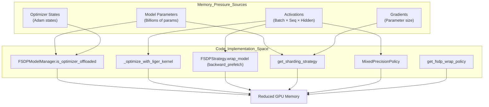
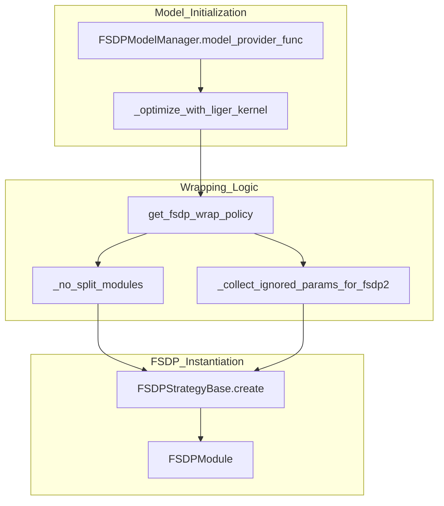

<!-- source: DeepWiki mcp.deepwiki.com · repo RLinf/RLinf · page 9.4 Memory Optimization Techniques · fetched 2026-10-21 -->

# Memory Optimization Techniques

Relevant source files

The following files were used as context for generating this wiki page:

- [docs/source-en/rst_source/extending/weight_syncer.rst](docs/source-en/rst_source/extending/weight_syncer.rst)
- [docs/source-zh/rst_source/extending/weight_syncer.rst](docs/source-zh/rst_source/extending/weight_syncer.rst)
- [examples/embodiment/config/maniskill_async_ppo_openvlaoft.yaml](examples/embodiment/config/maniskill_async_ppo_openvlaoft.yaml)
- [examples/embodiment/train_async.py](examples/embodiment/train_async.py)
- [examples/embodiment/train_embodied_agent.py](examples/embodiment/train_embodied_agent.py)
- [rlinf/config.py](rlinf/config.py)
- [rlinf/hybrid_engines/fsdp/fsdp_model_manager.py](rlinf/hybrid_engines/fsdp/fsdp_model_manager.py)
- [rlinf/hybrid_engines/fsdp/strategy/base.py](rlinf/hybrid_engines/fsdp/strategy/base.py)
- [rlinf/hybrid_engines/fsdp/strategy/fsdp.py](rlinf/hybrid_engines/fsdp/strategy/fsdp.py)
- [rlinf/hybrid_engines/fsdp/utils.py](rlinf/hybrid_engines/fsdp/utils.py)
- [rlinf/hybrid_engines/weight_syncer/base.py](rlinf/hybrid_engines/weight_syncer/base.py)
- [rlinf/hybrid_engines/weight_syncer/bucket_syncer.py](rlinf/hybrid_engines/weight_syncer/bucket_syncer.py)
- [rlinf/hybrid_engines/weight_syncer/patch_syncer.py](rlinf/hybrid_engines/weight_syncer/patch_syncer.py)
- [rlinf/models/__init__.py](rlinf/models/__init__.py)
- [rlinf/runners/embodied_runner.py](rlinf/runners/embodied_runner.py)
- [rlinf/utils/utils.py](rlinf/utils/utils.py)
- [rlinf/workers/actor/fsdp_actor_worker.py](rlinf/workers/actor/fsdp_actor_worker.py)
- [rlinf/workers/actor/fsdp_iql_policy_worker.py](rlinf/workers/actor/fsdp_iql_policy_worker.py)
- [rlinf/workers/env/env_worker.py](rlinf/workers/env/env_worker.py)
- [rlinf/workers/rollout/hf/huggingface_worker.py](rlinf/workers/rollout/hf/huggingface_worker.py)
- [tests/unit_tests/test_overlap_env_bootstrap.py](tests/unit_tests/test_overlap_env_bootstrap.py)
- [tests/unit_tests/test_weight_syncer.py](tests/unit_tests/test_weight_syncer.py)

This page documents memory optimization strategies used in RLinf to train large models efficiently on GPU-constrained hardware. These techniques enable training models that would otherwise exceed available GPU memory by strategically offloading data to CPU, reducing activation memory through gradient checkpointing and kernel optimizations, and balancing memory loads across distributed processes.

For parallel training strategies that complement these optimizations, see **9.1 Model Parallelism Strategies**. For FSDP-specific configuration, see **5.1 FSDP Backend**.

---

## Overview

Memory optimization in RLinf addresses three primary bottlenecks:

1.  **Model parameters and optimizer states** - Reduced via CPU offloading and FSDP sharding.
2.  **Activations and Intermediate States** - Reduced via gradient checkpointing and kernel optimizations (Liger).
3.  **Data transfer overhead** - Reduced via bucket-based synchronization and sparse patching.

These techniques are primarily orchestrated by the `FSDPModelManager` [rlinf/hybrid_engines/fsdp/fsdp_model_manager.py:53-58]() and configured through `cfg.fsdp_config`.

### Memory Pressure and Mitigation Mapping

Title: "Memory Pressure Sources and RLinf Optimization Entities"

**Sources:** [rlinf/hybrid_engines/fsdp/fsdp_model_manager.py:53-124](), [rlinf/hybrid_engines/fsdp/utils.py:150-166]()

---

## CPU Offloading

CPU offloading moves model parameters, gradients, and optimizer states to CPU memory when not actively needed for computation.

### Offloading Configuration

In the FSDP backend, offloading is managed by strategy implementations and the `FSDPModelManager`.

*   **Implementation**: Parameters and gradients are moved to CPU using the `CPUOffloadPolicy` configuration [rlinf/hybrid_engines/fsdp/utils.py:49-55]().
*   **State Tracking**: `FSDPModelManager` tracks offloading status via `is_weight_offloaded` and `is_optimizer_offloaded` flags [rlinf/hybrid_engines/fsdp/fsdp_model_manager.py:105-106]().
*   **Initialization**: During setup, `FSDPModelManager` initializes the platform and sets the local rank to manage device-specific memory allocation [rlinf/hybrid_engines/fsdp/fsdp_model_manager.py:102-103]().

### Weight Swapping and State Retrieval
RLinf provides mechanisms to swap weights into GPU for computation and return them to CPU afterward. 

*   **Bucket Capacity**: The `FSDPModelManager` allows configuring `bucket_capacity` (default 128MB) for weight synchronization to control the memory footprint of communication buffers [rlinf/hybrid_engines/fsdp/fsdp_model_manager.py:109-110]().
*   **CPU State Retrieval**: The `retrieve_model_state_dict_in_cpu` utility provides a way to get a copy of model states on CPU, optionally using an existing offloaded buffer to avoid re-allocation [rlinf/utils/utils.py:199-208]().
*   **Selective Sync**: Trainable parameters and persistent buffers are selectively collected for synchronization using `collect_param_names_need_sync` [rlinf/utils/utils.py:119-142]().

**Sources:** [rlinf/hybrid_engines/fsdp/fsdp_model_manager.py:102-110](), [rlinf/utils/utils.py:119-142](), [rlinf/utils/utils.py:199-208]()

---

## Sparse Weight Synchronization

To optimize memory and bandwidth during distributed weight updates, RLinf implements specialized weight syncers that avoid full state-dict transfers.

### Patch Weight Syncer
The `PatchWeightSyncer` [rlinf/hybrid_engines/weight_syncer/patch_syncer.py:25]() calculates sparse deltas (patches) between the current model and a cached snapshot.

*   **Sparse Encoding**: Changed values are stored in a COO-like format using `WeightPatch` [rlinf/hybrid_engines/weight_syncer/patch_syncer.py:35]().
*   **Memory Efficiency**: Index tensors are downscaled to the smallest possible integer type using `downscale_nonnegative_indices` to minimize transport size [rlinf/hybrid_engines/weight_syncer/patch_syncer.py:37-38]().

### Bucket Weight Syncer
The `BucketWeightSyncer` [rlinf/hybrid_engines/weight_syncer/bucket_syncer.py:113]() groups model tensors into fixed-size buckets for staged transmission.

*   **Memory Capping**: The `bucket_size` parameter [rlinf/hybrid_engines/weight_syncer/bucket_syncer.py:151]() ensures that no single transfer exceeds a specified memory limit.
*   **Staged Loading**: The `load_instant` flag [rlinf/hybrid_engines/weight_syncer/bucket_syncer.py:148]() controls whether buckets are loaded into the target model immediately upon receipt or staged on CPU.

**Sources:** [rlinf/hybrid_engines/weight_syncer/patch_syncer.py:25-38](), [rlinf/hybrid_engines/weight_syncer/bucket_syncer.py:113-156]()

---

## Kernel Optimization and Gradient Checkpointing

Kernel optimization and prefetching strategies reduce the memory footprint of activations and intermediate computations.

### Liger Kernel Integration

The `FSDPModelManager` integrates `liger-kernel` to replace standard transformer modules with memory-efficient versions [rlinf/hybrid_engines/fsdp/fsdp_model_manager.py:191-194]().

*   **Optimized Architectures**: The system applies Liger kernels to supported architectures during the `model_provider_func` execution [rlinf/hybrid_engines/fsdp/fsdp_model_manager.py:142-194]().
*   **Quantization Compatibility**: Optimization checks against quantization flags like `use_gptq` and `load_in_8bit` [rlinf/hybrid_engines/fsdp/fsdp_model_manager.py:143-174]().

### Gradient Checkpointing and Prefetching
Memory is saved by recomputing activations during the backward pass instead of storing them.
*   **Configuration**: Enabled via `fsdp_config.gradient_checkpointing: True` in experiment YAMLs [examples/embodiment/config/maniskill_async_ppo_openvlaoft.yaml:143]().
*   **Backward Prefetch**: Controlled via `BackwardPrefetch` settings to manage when sharded parameters are all-gathered during the backward pass [rlinf/hybrid_engines/fsdp/utils.py:48]().

**Sources:** [rlinf/hybrid_engines/fsdp/fsdp_model_manager.py:142-194](), [examples/embodiment/config/maniskill_async_ppo_openvlaoft.yaml:143](), [rlinf/hybrid_engines/fsdp/utils.py:48-55]()

---

## FSDP Sharding and Wrapping Policies

Effective memory management in FSDP requires correct module wrapping to allow for granular sharding of parameters across the device mesh.

### Wrapping Policies

The `get_fsdp_wrap_policy` [rlinf/hybrid_engines/fsdp/utils.py:151]() function handles complex models including:
*   **VLA Models**: It automatically detects `language_model` and `visual` submodules to apply `_no_split_modules` policies [rlinf/hybrid_engines/fsdp/utils.py:188-196]().
*   **Custom Policies**: Users can define specific `transformer_layer_cls_to_wrap` or `module_classes_to_wrap` in the configuration [rlinf/hybrid_engines/fsdp/utils.py:168-185]().
*   **FSDP2 Support**: Supports `_collect_ignored_params_for_fsdp2` for parameters that should stay unsharded/replicated, such as small frozen towers [rlinf/hybrid_engines/fsdp/utils.py:128-148]().

### Sharding Strategies

RLinf supports various FSDP sharding strategies (e.g., `SHARD_GRAD_OP`, `FULL_SHARD`) via `ShardingStrategy` [rlinf/hybrid_engines/fsdp/utils.py:54]().

Title: "FSDP Model Wrapping and Sharding Flow"

**Sources:** [rlinf/hybrid_engines/fsdp/fsdp_model_manager.py:135-194](), [rlinf/hybrid_engines/fsdp/utils.py:128-210](), [rlinf/hybrid_engines/fsdp/strategy/base.py:97-99]()

---

## Memory Management Utilities

RLinf provides primitives to ensure stable long-running training sessions.

### Precision and Mixed Precision

Precision directly impacts memory footprint. RLinf supports multiple precision modes:
*   **AMP Autocast**: `FSDPModelManager` creates an AMP context based on `fsdp_config.amp_autocast` [rlinf/hybrid_engines/fsdp/fsdp_model_manager.py:113-133]().
*   **Mixed Precision Policy**: FSDP utilizes `MixedPrecisionPolicy` to configure `param_dtype`, `reduce_dtype`, and `buffer_dtype` [rlinf/hybrid_engines/fsdp/utils.py:53]().

### Memory Cleanup
The `clear_memory` utility provides a standard way to release unused memory. It triggers `gc.collect()`, synchronizes the platform via `Worker.torch_platform.synchronize()`, and calls `empty_cache()` [rlinf/utils/utils.py:35-40]().

### Stream Recording
To prevent the caching allocator from reusing memory while asynchronous kernels (like NCCL transfers) are still running, RLinf uses `tensors_record_stream` [rlinf/utils/utils.py:145-180](). This keeps tensor storage alive until the specified stream has completed its work.

**Sources:** [rlinf/hybrid_engines/fsdp/fsdp_model_manager.py:113-133](), [rlinf/utils/utils.py:35-40](), [rlinf/utils/utils.py:145-180]()

---

