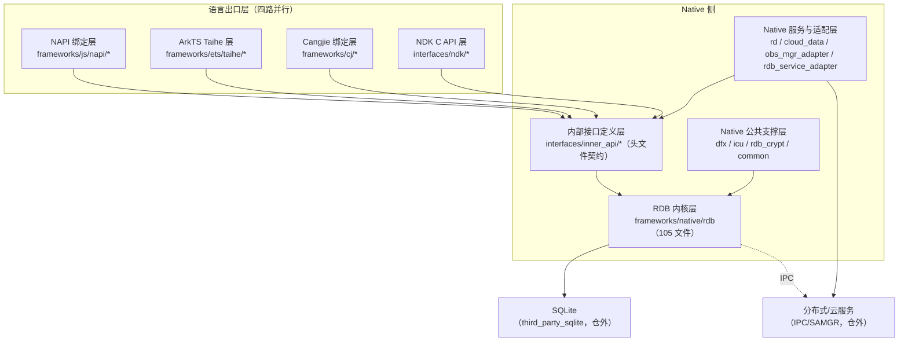

# Relational Store（RDB 部件）新人上手指南

> 依据仓库 `distributeddatamgr_relational_store`（commit `cce98de98`）代码图谱自动生成；所有论断均落到具体文件路径，可直接按图索骥。

## 1. 项目概览

**RDB（Relational Database）部件**是 OpenHarmony 的关系型数据存储机制：底层以 SQLite 为持久化引擎（仓外依赖 `third_party_sqlite`），向上提供事务、连接池、加密、备份恢复、损坏自愈、分布式同步与云同步能力。源码树位置 `//foundation/distributeddatamgr/relational_store`，隶属 `distributeddatamgr` 子系统（见 `bundle.json` 与 `AGENTS.md`）。`README_zh.md` 用一句话讲清运作机制：用户程序经 JS 接口调用本部件，部件调用 SQLite 读写数据库。

对新人而言，这个仓最容易被体量吓住，但结构其实极其规整：**一份 native 内核，四路语言出口**。所有复杂度都压在内核层，出口层大量工作是参数解析与值转换的样板；只要先立住"契约在头文件、实现在 frameworks"这条主线，剩下的就是按图索骥。

**三层（实为四路）API 出口**是理解本仓的第一把钥匙：

- **ArkTS/JS（NAPI）**：`frameworks/js/napi/relationalstore/`（`@ohos.data.relationalStore`）与 `frameworks/js/napi/rdb/`（旧接口），另有 `cloud_data`、`dataability`、`sendablerelationalstore`；
- **Taihe/Cangjie 直通**：`frameworks/ets/taihe/`（基于 taihe IDL 的 ArkTS 对象直通）与 `frameworks/cj/`（仓颉 FFI）；
- **NDK C API**：`interfaces/ndk/`（`oh_rdb_*`/`OH_Rdb_*`，面向三方 native 应用，符号边界由 `interfaces/ndk/libnative_rdb.ndk.json` 硬性约束）。

四路出口殊途同归，最终都汇聚到 native 内核 `frameworks/native/rdb/src/rdb_store_impl.cpp`。

**核心数字**：图谱分析范围 511 个文件——C 头文件 232、C++ 源文件 203、GN/GNI 构建文件 41、versionscript 14、taihe IDL 4 等。核心模块清单（目录即职责）：`frameworks/native/rdb`（内核 105 文件）、`frameworks/native/rd`（GRD 第二引擎适配）、`frameworks/native/cloud_data`（云数据）、`frameworks/native/rdb_crypt`（HUKS 加密）、`frameworks/native/dfx`（故障/雷达上报）、`frameworks/native/icu`（本地化排序）、`frameworks/native/obs_mgr_adapter`（观察者）、`rdb_data_share_adapter`/`rdb_data_ability_adapter`（DataShare/DataAbility 适配）。

## 2. 架构分层

图谱将全仓划为 10 层。依赖方向自上而下：四路语言出口 → inner_api 契约 → RDB 内核 → SQLite；支撑层横向服务内核；构建与文档是仓库级横切。读下图时抓住两条主干即可：左边一条是"数据流主干"（API 调用如何一路下到 SQLite），右边一条是"能力扩展主干"（分布式与云能力如何经 IPC 外挂进来而不污染内核）。

**逐层职责**（层名沿用图谱，成员数为图谱统计）。依赖方向上只有一条硬规则：出口层与内核之间永远隔着 inner_api 头文件契约，任何出口不得绕过契约直接摸内核实现——这也是仓内"接口层 NEVER 破坏兼容"红线得以成立的结构基础：

| # | 层 | 成员 | 职责与关键文件 |
|---|---|---|---|
| 1 | 内部接口定义层 | 45 | inner_api 头文件契约，全仓 fan-in 最高：`interfaces/inner_api/rdb/include/rdb_store.h`（938 行接口总纲）、`rdb_errno.h`（deg=87）、`rdb_types.h`，以及 `cloud_data`/`rdb_data_share_adapter`/`appdatafwk` 等子目录 |
| 2 | RDB 内核层 | 105 | 部件心脏：`rdb_store_impl.cpp`（3806 行门面）、`sqlite_connection.cpp`（2591 行）、`connection_pool.cpp`（1343 行）、`sqlite_statement.cpp`、`sqlite_sql_builder.cpp`、`rdb_security_manager.cpp` 等 |
| 3 | Native 服务与适配层 | 46 | 桥接系统能力与替代引擎：`cloud_service_proxy.cpp`、`rd/`（GRD 高可用第二引擎）、`rdb_service_adapter/src/rdb_manager_impl.cpp`、`obs_mgr_adapter.cpp`、`dataability/src/ishared_result_set_stub.cpp` |
| 4 | Native 公共支撑层 | 13 | 横切能力：`frameworks/common/include/logger.h`（deg=132 全仓最高）、`dfx/src/rdb_fault_hiview_reporter.cpp`、`rdb_crypt/relational_store_crypt.cpp`、`icu/src/icu_collect.cpp`、`frameworks/common/include/delay_actuator.h` |
| 5 | NAPI 绑定层 | 113 | 值转换+异步调度：`napi_rdb_store.cpp`（2711 行）、`napi_rdb_context.cpp`、`common/include/js_utils.h`、`rdb/src/napi_async_call.cpp` |
| 6 | ArkTS Taihe 层 | 54 | IDL 直通：`ani_rdb_utils.cpp`（deg=94 类型转换中枢）、`rdb_store_impl.cpp`（1682 行 ANI 绑定）、`ohos.data.relationalStore.impl.cpp` |
| 7 | Cangjie 绑定层 | 27 | 仓颉 FFI：`relational_store_utils.h`（30+ C ABI 结构）、`relational_store_store_ffi.cpp`（60 个 FFI_EXPORT）及 `*_proxy` 包装 |
| 8 | NDK C API 出口层 | 46 | C 接口：`interfaces/ndk/src/relational_store.cpp`（deg=175 全仓第一）、`oh_data_value.cpp`、`oh_rdb_transaction.cpp`、`relational_asset.cpp` |
| 9 | 构建与配置层 | 54 | `relational_store.gni`（路径常量与编译开关）、`relational_store_deps.gni`、各模块 `BUILD.gn`、`conf/trusts_config.json`、platform/ 跨平台 gni |
| 10 | 文档层 | 8 | `docs/rdb_native.md`（核心类关系）、`docs/dynamic_loading.md`、`docs/error_code_layers.md`、`docs/code_standards.md`、`AGENTS.md`（任务路由） |

## 3. 核心概念

**RdbStore / RdbStoreImpl**：`interfaces/inner_api/rdb/include/rdb_store.h` 定义纯虚接口总纲（CRUD/批量 RETURNING/事务/备份恢复/Rekey/云同步/订阅/Attach）；`frameworks/native/rdb/src/rdb_store_impl.cpp` 是其唯一完整实现，持有 ConnectionPool 与分布式 syncer 参数。打开入口是 `rdb_helper.cpp` → `rdb_store_manager.cpp`（按路径缓存、配置合法性校验 `IsConfigInvalidChanged`、调用方权限检查 `IsPermitted`）。配置词汇表在 `rdb_store_config.h`（979 行，100+ getter/setter）。理解开库链路是理解一切生命周期的起点：一个库从配置校验、权限检查到实例缓存，全部发生在这三个文件里。

**ConnectionPool（最多 4 连接、单写者）**：`frameworks/native/rdb/src/connection_pool.cpp` 实现读写连接分离、事务连接独占与超时回收、惰性扩容等待、损坏自愈（HandleDataCorruption，rename/copy 双路径恢复）与 Rekey。上限常量 `MAX_TRANS = 4` 见 `frameworks/native/rdb/include/connection_pool.h`。`README_zh.md` 明确两条约束：连接池最大 4 个；同一时刻仅支持一个写操作——这是 SQLite 单写者模型决定的，RDB 的全部并发设计都在这两个数字的框架内做文章。`connection.h` 以静态注册工厂（RegisterCreator/Repairer/Deleter 等）使 SQLite 与 GRD 两种内核可替换，是"可替换内核"设计的关键接缝。

**事务模型**：`interfaces/inner_api/rdb/include/transaction.h` 定义 DEFERRED/IMMEDIATE/EXCLUSIVE 三型事务的 Commit/Rollback 契约；`base_transaction.cpp` 管理嵌套事务与 markedSuccessful 标志，`transaction_impl.cpp` 持有独占连接实现。注意 `AGENTS.md` 红线：`BeginTransaction()` 写事务只作用于写连接，读连接是独立快照——存量代码连接读写方向 NEVER 改。

**ResultSet 三形态**（契约在 `result_set.h`）：① `step_result_set.cpp` 步进式逐行读、不物化全表，适合大结果集；② `sqlite_shared_result_set.cpp` 基于 Ashmem SharedBlock 跨进程共享、窗口按需续填，块满时降级；③ `cache_result_set.cpp`/`cache_block.cpp` 缓存形态。共享内存布局（块头+行组索引+九种单元格类型）定义在 `interfaces/inner_api/appdatafwk/include/shared_block.h`。这个共享块方案值得单独体会：它把"跨进程传大结果集"的序列化开销压到接近零，是本部件为多进程 DataShare 场景做的关键优化；判断该用哪种形态的准绳是结果集规模与消费方是否跨进程。

**RdbPredicates 谓词→SQL**：应用不拼 SQL，`rdb_predicates.h`/`abs_rdb_predicates.cpp` 积累结构化查询状态（含 JOIN 链式构造），`sqlite_sql_builder.cpp` 统一翻译成带绑定参数的 SELECT/INSERT/UPDATE/DELETE（含冲突解决与 RETURNING）。

**加密**：密钥管理重于算法——`rdb_security_manager.cpp` 单例经 HKS 根密钥派生工作密钥（经 dlsym 动态加载的 Huks 代理），V0/V1 双版本密钥文件（Aead 加密+HMAC-SHA256 校验）、密钥轮换（`.new` 后缀换名）与 flock 跨进程互斥；底层 `frameworks/native/rdb_crypt/relational_store_crypt.cpp` 提供 AES-GCM 三段式原语；`sqlite_connection.cpp` 负责 codec 接入与三段式 rekey。

**分布式与云**：`interfaces/inner_api/rdb/include/rdb_service.h` 定义 30+ 个 IPC 方法（SetDistributedTables/Sync/Subscribe/RemoteQuery/全量捐赠），`rdb_service_adapter/src/rdb_service_proxy.cpp` 逐个序列化为 IPC 请求；`cloud_data/include/cloud_service.h` 再扩到云开关/共享协作/云同步。

**值系统**：`value_object.h` 用 std::variant 承载 10+ 列值形态（含 Asset/Assets 大文件资产、FloatVector、BigInt）；`values_bucket.h` 以 map<string,ValueObject> 组织一行数据，两者是所有出口层共用的数据词汇表。新人改值系统时务必记住：NAPI 的 `js_utils.cpp`、Taihe 的 `ani_rdb_utils.cpp`、NDK 的 `oh_data_value.cpp` 三处各有一份 variant 双向转换代码，加一种列值类型意味着三处出口同步改造，漏一处就是特定语言接口静默丢数据。

**结果集、谓词、值系统三者合起来构成 RDB 的"安全使用面"**：应用侧永远不接触 SQL 字符串拼接与裸内存，全部经类型安全 API 进出——这是本部件区别于直接用 SQLite 的核心增值，也是代码评审时判断"该不该在出口层开新口子"的准绳。

## 4. 推荐学习路径（15 步 tour → 4 周计划）

学习主线与图谱 15 步导览一致，按"先契约、再内核、后出口"排成四周。每天的产出不是"读完了"，而是能回答对应问题；答不上来就回去重读。

**第 1 周：契约与数据模型（Step 1-5）**
- D1 读 `README_zh.md` + `AGENTS.md`：RDB 是什么、目录分层、任务路由表。问题：连接池上限与单写约束分别是什么？
- D2 读 `interfaces/inner_api/rdb/include/rdb_store.h` + `rdb_errno.h`：这是"宪法"。问题：RdbStore 接口分哪几族能力？错误码如何跨三层统一？
- D3 读 `values_bucket.h`/`value_object.h` 对照 `frameworks/native/rdb/src/values_bucket.cpp`/`value_object.cpp`：问题：ValueObject 为什么选 variant 而非继承？
- D4 读 `rdb_predicates.h` → `abs_rdb_predicates.cpp` → `sqlite_sql_builder.cpp`：问题：谓词状态如何变成带绑定参数的 SQL？
- D5 读 `rdb_helper.cpp` → `rdb_store_manager.cpp` → `rdb_store_config.h`：问题：打开一个库要过哪几道校验？配置非法变更如何检测？

**第 2 周：内核深潜（Step 6-10）**
- D6-7 读 `rdb_store_impl.cpp`（3806 行，先看头文件 `frameworks/native/rdb/include/rdb_store_impl.h` 分区再逐族读，配合 `docs/rdb_native.md` 的核心类关系图）：问题：Insert/Query 各走哪条连接？备份恢复的 exchange 策略何时触发？
- D8 读 `connection_pool.cpp` + `connection.h` + `transaction.h`：问题：写事务为何独占连接？超时回收如何触发？
- D9 读 `sqlite_connection.cpp`（2591 行）+ `sqlite_statement.cpp` + `rd/include/rd_connection.h`：问题：GRD 引擎如何经静态注册器替换 SQLite？
- D10 读三种结果集 + `rdb_security_manager.cpp` + `relational_store_crypt.cpp`：问题：SharedBlock 窗口满了怎么办？密钥文件 V0→V1 如何迁移？

**第 3 周：横切与端云（Step 11-12）**
- D11 读 `dfx/src/rdb_fault_hiview_reporter.cpp` + `icu/src/icu_collect.cpp` + `obs_mgr_adapter.cpp` + `docs/dynamic_loading.md`：问题：5 个 dlopen 动态库（GRD 内核 `libarkdata_db_core.z.so`、ICU、观察者适配器、知识图谱处理器、加密适配器）为何独立成 so、何时卸载？ICU collation 如何注册进 SQLite 使中文排序正确？
- D12 读 `rdb_service.h` + `rdb_service_proxy.cpp` + `cloud_service.h`：问题：40+ 个分布式操作如何逐个序列化成 IPC 请求？同步回调表如何维护、观察者如何跨进程导入导出？

**第 4 周：三出口与收尾（Step 13-15）**
- D13 读 NAPI：`frameworks/js/napi/relationalstore/src/entry_point.cpp` → `napi_rdb_store.cpp` → `include/napi_async_call.h`（ContextBase 三段式 lambda）：问题：promise 创建/异步入队/JS 线程回调如何解耦？模块注册顺序意味着什么？
- D14 读 Taihe `ohos.data.relationalStore.impl.cpp`/`rdb_store_impl.cpp` 与 Cangjie `relational_store_store_ffi.cpp`/`relational_store_utils.h`：问题：与 NAPI 相比 ABI 差异在哪？60 个 FFI_EXPORT 如何覆盖 store 全量操作？（注意 `*.ani.cpp` 生成物 NEVER 手改，改 `idl/*.taihe` 后重新生成）
- D15 读 NDK `interfaces/ndk/include/relational_store.h`（1794 行）+ `src/relational_store.cpp` + `libnative_rdb.ndk.json`，最后以 `relational_store.gni` 收尾：问题：51 个符号的 ABI 边界如何被 versionscript/ndk.json 双重约束？至此从 README 到构建体系完成闭环。

**验收方式**：四周结束，尝试独立回答两个综合题——①一条 `INSERT` 语句从 ArkTS 调用到落盘，依次经过哪些文件哪些对象？②库文件损坏后自愈链路如何走（提示：从 `connection_pool.cpp` 的 HandleDataCorruption 到 `corrupted_handle_manager.cpp` 再到 `rdb_fault_hiview_reporter.cpp`）。能画出这两条链路图，说明已具备在本仓独立承接任务的地图感。

## 5. 文件地图（按层速查）

| 路径 | 一句话职责 |
|---|---|
| `interfaces/inner_api/rdb/include/rdb_store.h` | RdbStore 纯虚接口总纲（938 行） |
| `interfaces/inner_api/rdb/include/rdb_errno.h` | 三层出口统一的错误码总表 |
| `interfaces/inner_api/rdb/include/rdb_store_config.h` | 开库配置中枢（100+ getter/setter） |
| `interfaces/inner_api/rdb/include/value_object.h`/`values_bucket.h` | 列值 variant 与单行容器 |
| `interfaces/inner_api/rdb/include/transaction.h` | 三型事务 Commit/Rollback 契约 |
| `interfaces/inner_api/rdb/include/rdb_service.h` | 分布式 RDB IPC 契约（30+ 方法） |
| `interfaces/inner_api/appdatafwk/include/shared_block.h` | Ashmem 共享块布局 |
| `frameworks/native/rdb/src/rdb_store_impl.cpp` | 内核门面（3806 行，deg=95） |
| `frameworks/native/rdb/src/rdb_helper.cpp`/`rdb_store_manager.cpp` | 应用侧开库入口与全局管理器 |
| `frameworks/native/rdb/src/connection_pool.cpp` | 并发中枢（4 连接/单写/损坏自愈） |
| `frameworks/native/rdb/src/sqlite_connection.cpp`/`sqlite_statement.cpp` | SQLite C API 唯一封装层 |
| `frameworks/native/rdb/src/sqlite_sql_builder.cpp` | 谓词→SQL 翻译器 |
| `frameworks/native/rdb/src/step_result_set.cpp`/`sqlite_shared_result_set.cpp` | 步进/共享块两形态结果集 |
| `frameworks/native/rdb/src/rdb_security_manager.cpp` | HKS 密钥全生命周期 |
| `frameworks/native/rd/src/rd_connection.cpp` | GRD 第二引擎接入 |
| `frameworks/native/rdb_service_adapter/src/rdb_service_proxy.cpp` | 分布式操作 IPC 代理 |
| `frameworks/native/cloud_data/src/cloud_service_proxy.cpp` | 云服务 IPC 代理（610 行） |
| `frameworks/native/dfx/src/rdb_fault_hiview_reporter.cpp` | HiSysEvent 故障上报 |
| `frameworks/native/rdb_crypt/relational_store_crypt.cpp` | AES-GCM 加密原语 |
| `frameworks/js/napi/relationalstore/src/napi_rdb_store.cpp` | JS RdbStore 类全量实现（2711 行） |
| `frameworks/js/napi/rdb/src/napi_async_call.cpp` | NAPI 异步模板（三段 lambda） |
| `frameworks/ets/taihe/relational_store/src/ani_rdb_utils.cpp` | ANI↔Native 类型转换中枢（55 函数） |
| `frameworks/cj/include/relational_store_utils.h` | Cangjie C ABI 结构中枢 |
| `interfaces/ndk/src/relational_store.cpp` | NDK 主入口（deg=175 全仓第一） |
| `interfaces/ndk/libnative_rdb.ndk.json` | 51 个对外符号的 ABI 清单 |
| `relational_store.gni` | 路径常量+编译开关总配置 |
| `AGENTS.md` | 任务路由/编码规范/已知陷阱（改码前必读） |

## 6. 复杂度热点（Top 10，按图谱依赖度）

| # | 文件 | deg | 规模 | 为何复杂/如何切入 |
|---|---|---|---|---|
| 1 | `interfaces/ndk/src/relational_store.cpp` | 175 | 1660 行 | 全仓被依赖之最：ConfigV2 全套 Set* 工厂+打开/关闭+对象创建。从 `interfaces/ndk/include/relational_store.h`（1794 行）按函数族分组读 |
| 2 | `frameworks/native/rdb/src/rdb_store_impl.cpp` | 95 | 3806 行 | 内核门面实现 RdbStore 全接口。先读 `rdb_store.h` 契约，再按 CRUD/事务/备份三族切换 |
| 3 | `frameworks/ets/taihe/relational_store/src/ani_rdb_utils.cpp` | 94 | 1198 行 | 55 个 ANI↔Native 双向转换函数。当字典查，不必通读 |
| 4 | `interfaces/inner_api/rdb/include/rdb_errno.h` | 87 | — | 数百错误码宏。理解分段（参数/SQLite 映射/IPC/同步/加密）即可 |
| 5 | `frameworks/ets/taihe/relational_store/src/rdb_store_impl.cpp` | 79 | 1682 行 | Taihe 侧 store 全能力绑定。与第 2 名对照读，体会出口层模式 |
| 6 | `frameworks/native/rdb/src/sqlite_connection.cpp` | 78 | 2591 行 | 打开配置+加解密+主备双写+binlog 回放。按 open/rekey/binlog 三主题分次读 |
| 7 | `frameworks/js/napi/relationalstore/src/napi_rdb_store.cpp` | 68 | 2711 行 | NAPI 最大文件。每个方法都是 Parse→native 调用→Convert 三段式，抽 3 个代表方法读透即通 |
| 8 | `interfaces/inner_api/rdb/include/rdb_types.h` | 61 | 590 行 | 分布式同步模型类型集中地（SyncMode/Progress/Statistic） |
| 9 | `frameworks/js/napi/relationalstore/src/napi_rdb_context.cpp` | 58 | — | 约 30 个 Parse* 函数把 JS 参数转 native 结构 |
| 10 | `frameworks/native/rdb/src/sqlite_utils.cpp` | 53 | — | 静态工具集：错误码转换/权限 ACL/文件操作/SQL 脱敏。工具类，按需查 |

共性规律：**出口层大文件是"转换样板"的堆叠**（NAPI/Taihe/NDK 三处各一份），**内核大文件是"分支密集"**（配置/加密/双写正交叠加）。新人先立契约（inner_api 头文件）再下内核，最后才碰出口样板。给三个出口层改同一个功能时，建议按 NAPI → Taihe → Cangjie/NDK 的顺序做，因为 NAPI 层的 Parse/Convert 函数族最完整，可直接当参照实现抄结构。

## 7. 构建与调试

**GN/Ninja 体系**：每个模块目录一个 `BUILD.gn`（如 `frameworks/js/napi/relationalstore/BUILD.gn`、`interfaces/inner_api/rdb/BUILD.gn`）；根级 `relational_store.gni` 集中定义路径常量（`relational_store_base_path`/`napi`/`innerapi`/`rdbmock`）与编译开关（ICU 支持、arkdata 内核、es2abc 等 declare_args），`relational_store_deps.gni` 汇总依赖；`bundle.json` 声明部件元信息与对外导出（新增导出 MUST 同步更新它）；`versionscript` 文件 14 个负责符号裁剪，NDK 另有 `libnative_rdb.ndk.json` 锁 51 个符号。跨平台变体放在 `interfaces/inner_api/rdb/platform/`（ohos/linux/mac/mingw/android/ios 各自 `config.gni`）。新人接手构建问题的排查顺序：先查 `relational_store.gni` 的开关是否命中，再看模块 `BUILD.gn` 的 sources/deps 是否漏加，最后才看 versionscript 是否把符号裁掉。

**测试布局**（`test/` 五大区）：`test/native/rdb/unittest/`（C++ 单测，含 `connection_pool_test.cpp`、`rdb_double_write_test.cpp` 主备双写、`rdb_encrypt_decrypt_test.cpp` 加密等，以及 `multiThread/`/`multiProcess/` 并发场景与 `mockservice/`）；`test/ets/`（ArkTS 用例，`relational_store` 与 `relational_store_system` 分普通/系统应用两套，cloud_data 同理）；`test/ndk/`（`unittest/` + `fuzztest/`）；`test/js/`（JS 用例）；`test/interface/`。性能基线在 `test/js/relationalstore/performance`（AGENTS.md 要求改动后跑对 BASE_LINE 阈值）。

**mock 体系（rdbmock）**：仓根 `rdbmock/` 提供脱离 OpenHarmony 系统环境的宿主编译 mock——`rdbmock/external_inner_kit/` 下按系统部件铺头文件桩（`huks/`、`ipc/`、`samgr/`、`hilog/`、`hisysevent/`、`ability_runtime/`、`access_token/`、`eventhandler/` 等 20+ 目录），`rdbmock/frameworks/native/` 提供 rdb/win32/kvstore_mock 实现。配合 `frameworks/js/napi/relationalstore/platform/{linux,mac,mingw}/config.gni`，使内核可在 PC 上直接编译调试——这是新人最实用的第一步：不刷机也能跑通 `test/native/rdb/unittest/` 的大部分单测，快速建立对内核行为的直觉。

## 8. 常见坑与本地约定（改码前必读）

以下条目综合自 `AGENTS.md`（权威）与图谱结构，均为仓内硬约定。第 1、2、3 条几乎覆盖了本仓绝大多数评审驳回案例，值得背下来；其余按遇到再查即可：

1. **兼容性是绝对红线**：`interfaces/inner_api/` 与 `interfaces/ndk/include/` NEVER 破坏向后兼容——"破坏兼容"包括删减接口/参数、改返回值含义、同场景返回不同错误码、改行为语义。修复存量 bug 若导致不兼容，NEVER 修改，走新增接口（如 `RdbStoreProxy` 析构漏取消 PerfStat 注册属已知瑕疵但 NEVER 改）。
2. **连接池 4 上限与单写约束**：`MAX_TRANS = 4`（`connection_pool.h`）；写事务只作用于写连接，读连接是独立快照——因此 NEVER 把存量代码的连接从写改读或反之，否则破坏事务内 read-your-writes 语义。
3. **SQLite 分层约束**：只有 `SqliteConnection`/`SqliteStatement` 可直接持有/调用 `sqlite3*` 系函数；`RdbStoreImpl`、`StepResultSet` 等上层类 MUST 经 Connection/Statement 抽象（`docs/rdb_native.md`"SQLite 分层约束"节）。
4. **临时连接必须走池**：临时连接 MUST 经 `ConnectionPool::CreateConn` 创建并纳入 `temps_` 管理，NEVER 直接 `Connection::Create` 造游离连接。
5. **新依赖必须动态加载**：native_rdb 支持动态卸载，新增 so 依赖 MUST 走 dlopen（`docs/dynamic_loading.md` 列出 5 个既有动态库：GRD 内核 `libarkdata_db_core.z.so`、ICU、观察者适配器、知识图谱处理器、加密适配器），禁止静态链接。
6. **SA 进程可能不在**：MUST 考虑 SA 未启动场景做降级容错，NEVER 硬依赖 SA 进程；跨进程共享资源 MUST 走 IPC（DataShare 经 `rdb_data_share_adapter` 隔离）。
7. **错误码三处同步**：新增错误码须同步 NDK `relational_store_error_code.h` 与 JS `napi_rdb_error` 映射，NEVER 给存量接口加新返回码；分层规则见 `docs/error_code_layers.md`。
8. **Taihe 生成物 NEVER 手改**：`*.ani.cpp`/`*.abi.c` 由 `ohos_taihe` 从 `frameworks/ets/taihe/*/idl/*.taihe` 生成，改接口 MUST 改 IDL 重新生成；`*.impl.cpp` 才是手写区。
9. **mock 与真实实现头文件是两份**：`rdbmock/external_inner_kit/` 下的桩头文件与真机系统头文件同名双份，改内核接口时两处都要对齐，否则 PC 宿主编译（linux/mac/mingw `config.gni`）与真机构建一个会断。
10. **跨平台目录**：平台相关代码集中在 `platform/{ohos,linux,mac,mingw,android,ios}/config.gni`；改平台逻辑先看对应 gni 的开关条件，别把 ohos 专有代码写进 common 路径，否则 PC 宿主编译会因符号缺失而失败。
11. **工程规约**：单文件建议 ≤2000 行超过 MUST 拆分（`rdb_store_impl.cpp` 3806 行属历史存量）；测试文件 `*_test.cpp`、mock 文件 `mock_*.cpp`；工具类 MUST 优先复用 `kv_store:datamgr_common`（ConcurrentMap/ITypesUtil 等）；commit MUST 含 `Co-Authored-By: Agent`。改动必须有对应单测跑通才算 done——这是 `AGENTS.md` 专家经验一节明确的验收口径，也是评审时最常被追问的一条。

> 进阶阅读顺序建议：本指南 → `AGENTS.md`（任务路由）→ `docs/rdb_native.md`（核心类关系图）→ `docs/code_standards.md`（R1-R10 强制规范）→ 按任务域加载 `docs/error_code_layers.md` 或 `docs/dynamic_loading.md`。
