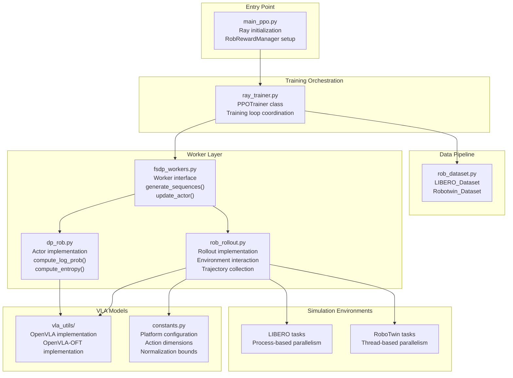

<!-- source: DeepWiki mcp.deepwiki.com · repo PRIME-RL/SimpleVLA-RL · page 1 Overview · fetched 2026-10-30 -->

# Overview

<details>
<summary>Relevant source files</summary>

The following files were used as context for generating this wiki page:

- [README.md](README.md)
- [figs/logo.png](figs/logo.png)
- [figs/main.png](figs/main.png)
- [figs/simplevla-rl.png](figs/simplevla-rl.png)

</details>


## Purpose and Scope

This document provides an introduction to **SimpleVLA-RL**, an open-source reinforcement learning framework designed for training Vision-Language-Action (VLA) models on robotic manipulation tasks with minimal reward engineering. The framework uses binary (0/1) outcome rewards from simulation environments and leverages distributed training infrastructure to achieve efficient policy optimization.

For detailed information about specific subsystems:
- To understand the training algorithm and PPO implementation, see [Training with PPO](#3)
- For environment and benchmark integration details, see [Benchmarks and Environments](#4)
- For practical usage and configuration, see [Running Experiments](#7)

## What is SimpleVLA-RL

SimpleVLA-RL is a reinforcement learning framework that extends [veRL](https://github.com/volcengine/verl) (Volcengine Reinforcement Learning) with VLA-specific components for robotic manipulation. The framework addresses the challenge of training large vision-language-action models to perform long-horizon manipulation tasks through policy optimization rather than supervised fine-tuning alone.

**Key Characteristics:**

| Aspect | Description |
|--------|-------------|
| **Base Framework** | Built on veRL for distributed RL infrastructure |
| **Algorithm** | Proximal Policy Optimization (PPO) with multiple advantage estimators |
| **Models Supported** | OpenVLA, OpenVLA-OFT |
| **Environments** | LIBERO benchmark (libero-10, libero-90, spatial/object/goal tasks), RoboTwin 1.0/2.0 |
| **Reward Signal** | Binary (0/1) task success indicators |
| **Parallelization** | Ray-based distributed execution with FSDP model sharding |
| **Training Efficiency** | Multi-environment parallel rendering, oversampling with filtering |

Sources: [README.md:1-89](), [verl/trainer/main_ppo.py:1-50]()

## Core Components



**Diagram: Core Component Architecture**

This diagram maps the natural language concept of "training system" to the actual Python modules that implement it. Each box represents a file or directory in the codebase with its key classes and functions.

Sources: [verl/trainer/main_ppo.py](), [verl/trainer/ppo/ray_trainer.py](), [verl/workers/fsdp_workers.py](), [verl/workers/actor/dp_rob.py](), [verl/workers/rollout/rob_rollout.py](), [verl/utils/dataset/rob_dataset.py](), [verl/utils/vla_utils/]()

## Training Workflow

```mermaid
sequenceDiagram
    participant User
    participant Script["run_openvla_oft_rl_*.sh"]
    participant Main["main_ppo.py"]
    participant Trainer["PPOTrainer<br/>(ray_trainer.py)"]
    participant Dataset["LIBERO_Dataset or<br/>Robotwin_Dataset"]
    participant Rollout["RobRolloutWorkerGroup"]
    participant Actor["ActorRolloutWorkerGroup<br/>(dp_rob.py)"]
    
    User->>Script: Execute training script
    Script->>Main: Launch with Hydra config
    Main->>Main: ray.init()
    Main->>Main: RobRewardManager.remote()
    Main->>Trainer: Initialize PPOTrainer
    
    Trainer->>Dataset: Create train/val dataloaders
    
    loop Training Epochs
        Trainer->>Dataset: Sample batch (task_id, trial_id, seed)
        Dataset-->>Trainer: Return prompts
        
        loop Rollout Collection (n_samples per prompt)
            Trainer->>Rollout: generate_sequences(prompts)
            Rollout->>Rollout: Initialize parallel environments
            
            loop Episode Steps
                Rollout->>Rollout: Process observations (images, proprioception)
                Rollout->>Rollout: VLA.generate_action()
                Rollout->>Rollout: env.step(actions)
            end
            
            Rollout-->>Trainer: Trajectories + binary rewards
        end
        
        Trainer->>Trainer: Filter samples (success rate, truncation)
        Trainer->>Trainer: Compute advantages (GAE/RLOO/GRPO)
        Trainer->>Actor: update_actor(batch)
        Actor->>Actor: Compute PPO loss + entropy
        Actor-->>Trainer: Return metrics
        
        Trainer->>Trainer: Log to WandB
        Trainer->>Trainer: Save checkpoint
    end
```

**Diagram: Training Loop Execution Flow**

This sequence diagram shows the actual execution flow through the codebase. Key classes include `PPOTrainer` in [ray_trainer.py](), `LIBERO_Dataset` and `Robotwin_Dataset` in [rob_dataset.py](), rollout workers in [rob_rollout.py](), and actor workers in [dp_rob.py]().

Sources: [verl/trainer/main_ppo.py:1-200](), [verl/trainer/ppo/ray_trainer.py:1-500](), [verl/workers/rollout/rob_rollout.py:1-800](), [verl/workers/actor/dp_rob.py:1-300]()

## Key Design Principles

### 1. Minimal Reward Engineering

SimpleVLA-RL uses **binary success indicators** (0 or 1) from simulation environments rather than shaped rewards. The environments return a single scalar indicating task success:

- `reward = 1` if task completed successfully
- `reward = 0` otherwise

This simplifies environment design and focuses the learning signal on task completion.

Sources: [README.md:55-58](), [verl/workers/rollout/rob_rollout.py:450-550]()

### 2. Oversampling with Filtering

The framework employs an **oversampling strategy** where multiple rollout trajectories are collected per training prompt, then filtered based on:

- **Accuracy filtering**: Retains trajectories with higher success rates
- **Truncation filtering**: Removes trajectories that hit max episode length without success

Excess filtered samples are buffered and reused in subsequent iterations via the `BufferedDataLoader`.

Sources: [verl/trainer/ppo/ray_trainer.py:350-450](), [verl/utils/dataset/rob_dataset.py:200-250]()

### 3. Platform-Agnostic VLA Integration

The system adapts to different robot platforms through dynamic configuration in [constants.py]():

```python
# Platform detection and configuration
LIBERO: 8 action chunks, 7D actions (xyz + quaternion + gripper)
RoboTwin: 5 action chunks, 7D actions
ALOHA: 6-25 action chunks, 14D actions (bimanual)
```

Each platform has specific normalization bounds (`BOUNDS`, `BOUNDS_Q99`) for proprioception and action spaces.

Sources: [verl/utils/vla_utils/constants.py](), [verl/workers/rollout/rob_rollout.py:100-200]()

### 4. Distributed Execution with Ray

Training leverages **Ray** for distributed execution across multiple GPUs and nodes. Worker groups are organized by role:

| Worker Role | Responsibility | File Location |
|------------|----------------|---------------|
| `ActorRollout` | Policy generation + environment interaction | [fsdp_workers.py](), [rob_rollout.py]() |
| `Critic` | Value function estimation (for GAE) | [fsdp_workers.py]() |
| `RefPolicy` | Reference policy for KL divergence | [fsdp_workers.py]() |
| `RewardModel` | Optional reward scoring | [fsdp_workers.py]() |

The `ResourcePoolManager` allocates GPU resources to each role via named resource pools.

Sources: [verl/trainer/main_ppo.py:50-150](), [verl/workers/fsdp_workers.py:1-100]()

### 5. FSDP Model Sharding

Large VLA models are sharded using PyTorch's **Fully Sharded Data Parallel** (FSDP) to fit in GPU memory. The framework supports:

- Parameter sharding across devices
- Gradient sharding
- Optimizer state sharding
- CPU offloading for memory-constrained scenarios

Sources: [verl/workers/fsdp_workers.py:200-400]()

## System Entry Points

The main entry points for interacting with SimpleVLA-RL are:

### Training Entry Point

**File**: [verl/trainer/main_ppo.py]()

```python
# Key responsibilities:
# 1. Initialize Ray cluster
# 2. Setup RobRewardManager for reward distribution
# 3. Create PPOTrainer instance
# 4. Launch training loop
```

Invoked via shell scripts in `examples/run_openvla_oft_rl_*.sh` with Hydra configuration overrides.

### Configuration Files

| File | Purpose |
|------|---------|
| [align.json]() | Environment variables (NCCL, CUDA, WandB) |
| [ppo_trainer.yaml]() | Default training hyperparameters |
| [examples/*.sh]() | Experiment-specific overrides |

Sources: [verl/trainer/main_ppo.py:1-50](), [align.json](), [examples/]()

## Supported Models and Environments

### VLA Models

**OpenVLA**: Transformer-based VLA model that generates action tokens, post-processed to extract continuous actions.

**OpenVLA-OFT**: Orthogonal Fine-Tuning variant with direct action prediction via `generate_action_verl()` method.

Implementation location: [verl/utils/vla_utils/]()

### Simulation Benchmarks

**LIBERO**: 
- Task suites: libero-10 (10 tasks), libero-90 (90 tasks), libero-spatial, libero-object, libero-goal
- Parallelism: Process-based with multiprocessing
- Seed management: Fixed trial seeds (-1)

**RoboTwin**:
- Versions: RoboTwin 1.0, RoboTwin 2.0
- Parallelism: Thread-based with ThreadPoolExecutor
- Seed management: Pre-collected feasible seeds (v2.0) or offset-based generation (v1.0)

Sources: [verl/utils/dataset/rob_dataset.py:1-500](), [verl/workers/rollout/rob_rollout.py:500-800]()

## Performance Features

1. **Multi-environment parallel rendering**: Spawns multiple environment instances per rollout worker to accelerate trajectory collection
2. **Hybrid engine mode**: Combines actor (policy) and rollout (environment) workers in the same group for efficiency
3. **Buffered data loading**: Reuses excess filtered samples to maximize data efficiency
4. **Gradient accumulation**: Supports large effective batch sizes across limited GPU memory

Sources: [README.md:45-49](), [verl/trainer/ppo/ray_trainer.py:100-200]()

## Next Steps

- For installation and setup instructions, see [Getting Started](#1.1)
- For detailed architecture explanation, see [System Architecture](#1.2)
- For VLA model integration details, see [VLA Models](#2)
- For PPO training mechanics, see [Training with PPO](#3)

---

