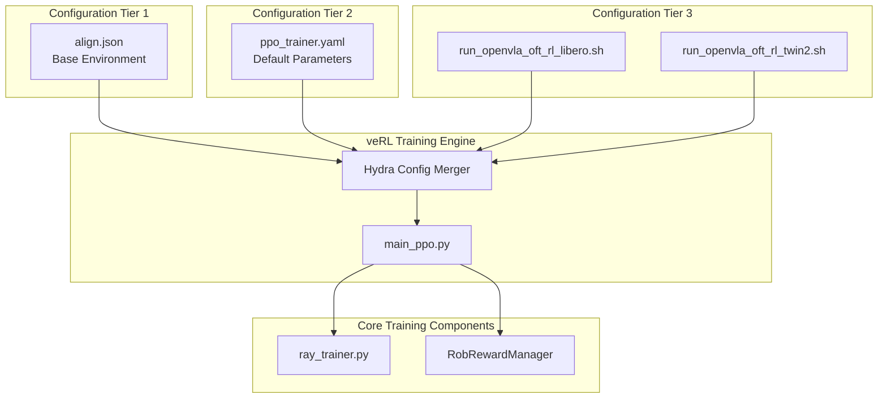
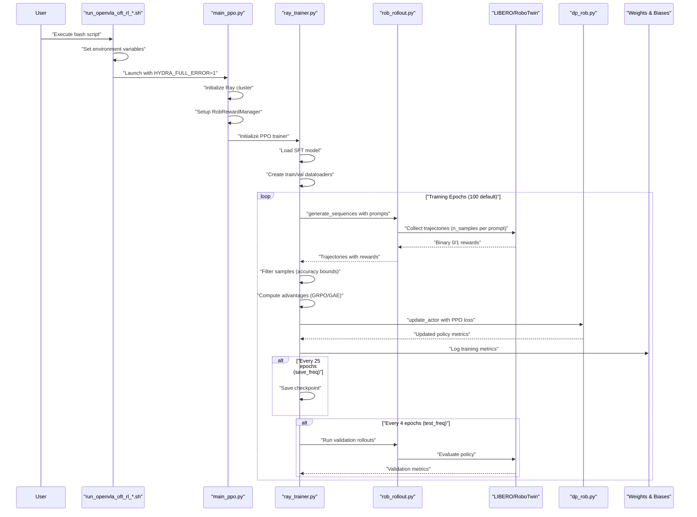

<!-- source: DeepWiki mcp.deepwiki.com · repo PRIME-RL/SimpleVLA-RL · page 1.1 Getting Started · fetched 2026-10-30 -->

# Getting Started

<details>
<summary>Relevant source files</summary>

The following files were used as context for generating this wiki page:

- [README.md](README.md)
- [SETUP.md](SETUP.md)
- [examples/run_openvla_oft_rl_libero.sh](examples/run_openvla_oft_rl_libero.sh)

</details>


This page provides a comprehensive guide for setting up and running your first SimpleVLA-RL training session. It covers environment setup, configuration, and the basic training workflow for online reinforcement learning with Vision-Language-Action models.

For detailed information about the training pipeline internals, see [Training Pipeline](#1.2). For model architecture details, see [Model Architecture](#2).

## Prerequisites

SimpleVLA-RL requires several key components to function properly:

- **veRL Framework**: The distributed RL training engine (v0.2 or v0.3 recommended)
- **OpenVLA-OFT**: The Vision-Language-Action model implementation 
- **Simulation Benchmark**: Either LIBERO or RoboTwin 2.0 robotic simulation environment
- **Pre-trained SFT Model**: A supervised fine-tuned model as the starting point
- **Multi-GPU Hardware**: Recommended 8+ GPUs with 80GB memory each

The system has been tested on configurations with 1-2 nodes, each containing 8 NVIDIA A800 GPUs with CUDA 12.4 and driver version 470.161.03.

Sources: [README.md:131-134](), [SETUP.md:6-8](), [SETUP.md:58]()

## Environment Setup

### Installation Overview

SimpleVLA-RL requires installing three main components: veRL, a simulation benchmark (LIBERO or RoboTwin 2.0), and OpenVLA-OFT. Detailed step-by-step instructions are provided in [SETUP.md]().

#### Option 1: Running RL on LIBERO Benchmark

1. Install veRL (v0.2 or v0.3 recommended)
2. Install LIBERO and OpenVLA-OFT
3. Install Flash Attention 2 for training

#### Option 2: Running RL on RoboTwin 2.0 Benchmark

1. Install veRL (v0.2 or v0.3 recommended)
2. Install RoboTwin 2.0 and its system dependencies (libvulkan1, mesa-vulkan-drivers)
3. Download RoboTwin assets
4. Install OpenVLA-OFT
5. Apply RoboTwin modifications using `copy_overwrite_robotwin2.sh`

**Important**: All repositories (veRL, OpenVLA-OFT, LIBERO/RoboTwin) should be cloned at the same directory level as SimpleVLA-RL, not inside the SimpleVLA-RL folder.

Sources: [SETUP.md:1-131](), [README.md:94]()

### Obtain SFT Models

You need a supervised fine-tuned model as the starting point for RL training. Available options include:

| Model Type | Source | Description |
|------------|--------|-------------|
| OpenVLA-OFT SFT | [SimpleVLA-RL Collection](https://huggingface.co/collections/Haozhan72/simplevla-rl-6833311430cd9df52aeb1f86) | LIBERO: `libero-10 traj1/trajall SFT`, `libero-goal/object/spatial traj1 SFT`<br/>RoboTwin: `Robotwin2.0 tasks traj1000 SFT` |
| OpenVLA SFT | [OpenVLA Hub](https://huggingface.co/openvla) | Original OpenVLA models |
| Custom Models | Self-trained | Fine-tune your own models |

Sources: [README.md:98-109]()

## Configuration Overview

SimpleVLA-RL uses a three-tier configuration system: environment variables in `align.json`, default training parameters in `ppo_trainer.yaml`, and experiment-specific overrides in shell scripts.

### Environment Configuration

The `align.json` file centralizes environment-specific settings for GPU memory management, multi-GPU communication, and experiment tracking:

**Critical Configuration**: Set your Weights & Biases API key in `align.json` before running any experiments.

```bash
# In align.json, set:
"WANDB_API_KEY": "your_wandb_key_here"
```

Additional environment variables configured in shell scripts include:
- `NCCL_DEBUG`: Controls NCCL logging verbosity
- `PYTORCH_CUDA_ALLOC_CONF`: Enables expandable memory segments
- `TOKENIZERS_PARALLELISM`: Enables parallel tokenization
- `ROBOT_PLATFORM`: Sets platform detection (LIBERO or ALOHA for RoboTwin)

Sources: [README.md:116](), [examples/run_openvla_oft_rl_libero.sh:3-9]()

### Configuration Flow Diagram



Sources: [README.md:64-66](), [README.md:68-70](), [examples/run_openvla_oft_rl_libero.sh:24-89]()

## Training Process

The training process follows a structured workflow orchestrated by shell scripts that invoke `main_ppo.py` with Hydra configuration parameters.

### Key Training Parameters

| Parameter Category | Key Settings | Purpose |
|-------------------|--------------|---------|
| **Model Configuration** | `SFT_MODEL_PATH`, `VLA_NAME` | Define base model and architecture |
| **Data Configuration** | `DATASET_NAME`, `n_samples`, `train_batch_size` | Control training data and batching |
| **PPO Configuration** | `ppo_mini_batch_size`, `clip_ratio_high/low` | PPO algorithm parameters |
| **Hardware Configuration** | `NUM_GPUS`, `NUM_NODES` | Distributed training setup |
| **Experiment Tracking** | `EXPERIMENT_NAME`, `PROJECT_NAME` | WandB logging and checkpointing |

Sources: [examples/run_openvla_oft_rl_libero.sh:10-21](), [examples/run_openvla_oft_rl_libero.sh:32-52]()

### Training Execution Flow



Sources: [README.md:64-87](), [examples/run_openvla_oft_rl_libero.sh:24](), [examples/run_openvla_oft_rl_libero.sh:82-84]()

## Running Your First Training

### Step 1: Configure Key Variables

Choose the appropriate script for your benchmark:
- **LIBERO**: `examples/run_openvla_oft_rl_libero.sh`
- **RoboTwin 2.0**: `examples/run_openvla_oft_rl_twin2.sh`

Edit the following variables in your chosen script:

```bash
# Required modifications (example from run_openvla_oft_rl_libero.sh)
export WANDB_API_KEY='YOUR_WANDB_KEY'            # Line 4
export ROBOT_PLATFORM=LIBERO                     # Line 9 (or ALOHA for RoboTwin)
PROJECT_NAME='SimpleVLA-RL'                      # Line 10
EXPERIMENT_NAME='your_experiment_name'           # Line 11  
SFT_MODEL_PATH="path/to/your/sft/model"         # Line 13
CKPT_PATH="path/to/save/checkpoints"            # Line 14
DATASET_NAME="libero_10"                        # Line 16
VLA_NAME="openvla-oft"                          # Line 17
NUM_GPUS=8                                      # Line 18
NUM_NODES=1                                     # Line 20
ALIGN_PATH="path/to/SimpleVLA-RL/align.json"   # Line 21
```

**LIBERO Dataset Options**: `libero_10`, `libero_90`, `libero_spatial`, `libero_object`, `libero_goal`

**RoboTwin 2.0 Dataset Options**: Refer to `examples/run_openvla_oft_rl_twin2.sh` for available tasks

Sources: [examples/run_openvla_oft_rl_libero.sh:4-21](), [README.md:119-127]()

### Step 2: Launch Training

Execute the appropriate training script:

```bash
# For LIBERO
bash examples/run_openvla_oft_rl_libero.sh

# For RoboTwin 2.0
bash examples/run_openvla_oft_rl_twin2.sh
```

The script will invoke `python -u -m verl.trainer.main_ppo` with all configured parameters via the Hydra configuration system.

Sources: [examples/run_openvla_oft_rl_libero.sh:24](), [README.md:137-143]()

### Step 3: Monitor Training

Training progress is automatically logged to Weights & Biases with the following key metrics:

- **Episode Rewards**: Binary 0/1 outcome-based rewards from environment tasks
- **Policy Updates**: PPO loss, gradient norms, and entropy information  
- **Evaluation Performance**: Validation success rates on held-out tasks or seeds
- **System Metrics**: GPU utilization and memory usage
- **Rollout Videos**: Success and failure cases saved during validation

The training runs for 100 epochs by default with checkpoints saved every 25 epochs and evaluation every 4 epochs. These frequencies are configurable via `trainer.save_freq` and `trainer.test_freq` parameters.

Sources: [examples/run_openvla_oft_rl_libero.sh:82-84](), [examples/run_openvla_oft_rl_libero.sh:76-78](), [README.md:81]()

## Evaluation Mode

To evaluate a trained model without further training, modify the training script to enable evaluation-only mode:

```bash
# In run_openvla_oft_rl_libero.sh or run_openvla_oft_rl_twin2.sh, change:
trainer.val_only=False    # to
trainer.val_only=True
```

Then execute the same script. The system will load the specified model checkpoint and run evaluation on the configured dataset without performing any policy updates.

Sources: [examples/run_openvla_oft_rl_libero.sh:85](), [README.md:146-154]()

## Hardware Requirements

The system supports flexible hardware configurations:

| Configuration | Nodes | GPUs per Node | Total GPUs | Memory per GPU |
|---------------|-------|---------------|------------|----------------|
| **Single Node** | 1 | 8 | 8 | 80GB (A800) |
| **Multi Node** | 2 | 8 | 16 | 80GB (A800) |

Memory optimization features like parameter offloading and gradient offloading are enabled by default to maximize hardware utilization.

Sources: [examples/run_openvla_oft_rl.sh:44-46](), [README.md:103-106]()

---

