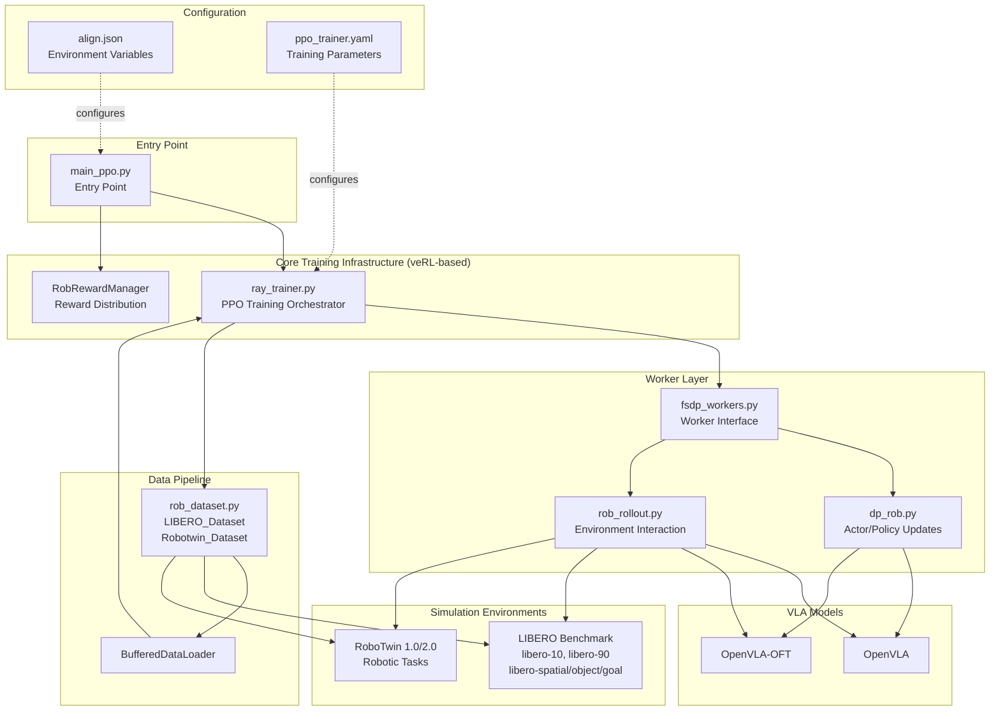
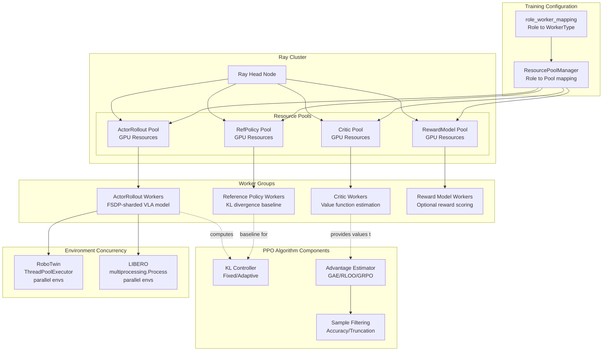
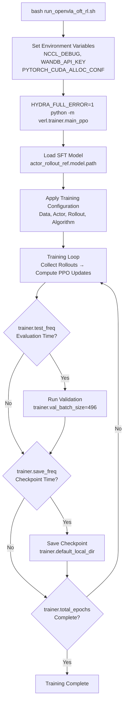

<!-- source: DeepWiki mcp.deepwiki.com · repo PRIME-RL/SimpleVLA-RL · page 1.2 System Architecture · fetched 2026-10-30 -->

# System Architecture

<details>
<summary>Relevant source files</summary>

The following files were used as context for generating this wiki page:

- [README.md](README.md)
- [figs/logo.png](figs/logo.png)
- [figs/main.png](figs/main.png)
- [verl/trainer/ppo/ray_trainer.py](verl/trainer/ppo/ray_trainer.py)

</details>


This page explains the high-level architecture of SimpleVLA-RL, showing how it extends the veRL framework with Vision-Language-Action (VLA) model-specific components and how major subsystems interact during training.

## Architecture Overview

SimpleVLA-RL is built on top of veRL (Volcano Engine Reinforcement Learning), extending it with components specifically designed for training VLA models on robotic manipulation tasks. The system follows a distributed architecture using Ray for resource management and parallel execution.

### Overall System Structure



The architecture consists of several key layers:

1. **Entry Point Layer**: `main_ppo.py` initializes Ray cluster and `RobRewardManager`
2. **Training Infrastructure Layer**: `ray_trainer.py` orchestrates PPO training, built on veRL
3. **Worker Layer**: FSDP workers provide interfaces for policy updates (`dp_rob.py`) and environment interactions (`rob_rollout.py`)
4. **Model Layer**: Supports OpenVLA and OpenVLA-OFT architectures
5. **Environment Layer**: Integrates LIBERO and RoboTwin benchmarks
6. **Data Layer**: Manages datasets with buffered loading and excess sample management

Sources: [README.md:62-88](), [verl/trainer/main_ppo.py:64-66]()

## Extending veRL

SimpleVLA-RL extends veRL by adding VLA-specific modules while leveraging veRL's core infrastructure for distributed training, FSDP support, and PPO implementation.

### VLA-Specific Extensions

| Module | Purpose | Key Files |
|--------|---------|-----------|
| VLA Rollout | Environment interaction with VLA models | `verl/workers/rollout/rob_rollout.py` |
| VLA Actor | Policy updates for VLA architectures | `verl/workers/actor/dp_rob.py` |
| Robot Datasets | LIBERO/RoboTwin data loading | `verl/utils/dataset/rob_dataset.py` |
| VLA Models | OpenVLA/OpenVLA-OFT implementations | `verl/utils/vla_utils/` |
| Reward Manager | Robotic task reward distribution | `verl/trainer/main_ppo.py` (RobRewardManager) |

### veRL Core Components (Inherited)

SimpleVLA-RL leverages the following core veRL infrastructure:

- **FSDP Workers**: Fully Sharded Data Parallel implementation in `fsdp_workers.py`
- **Ray Infrastructure**: Distributed execution framework with resource pooling
- **PPO Algorithm**: Core RL algorithm implementation in `core_algos`
- **Resource Pools**: GPU allocation and management through `RayResourcePool`

Sources: [README.md:62-88](), [verl/trainer/main_ppo.py:64-66]()

## Distributed Training Architecture

The system uses Ray to distribute work across multiple GPUs and nodes, with different worker groups handling specific roles in the training pipeline.

### Ray-Based Distribution



### Resource Pool Management

The distributed architecture consists of:

**Resource Pools**: Ray manages GPU resources through configurable pools defined in `ResourcePoolManager`:
- `ActorRollout Pool`: Handles both policy generation and environment interaction
- `Critic Pool`: Manages value function estimation (when using GAE)
- `RefPolicy Pool`: Provides reference policy for KL divergence computation
- `RewardModel Pool`: Optional reward model workers

**Worker Groups**: Each pool contains one or more worker groups:
- Workers are FSDP-sharded for memory efficiency
- Supports both single-node and multi-node setups
- Configurable through `process_on_nodes` parameter

**Hybrid Engine Mode**: `ActorRollout` workers combine policy generation and trajectory collection in a single group for efficiency. This is the default and recommended mode.

Sources: [verl/trainer/ppo/ray_trainer.py:42-53](), [verl/trainer/ppo/ray_trainer.py:55-79]()

### Worker Role Definitions

The system uses a role-based architecture where different components are mapped to specific worker types:

```python
class Role(Enum):
    Actor = 0
    Rollout = 1
    ActorRollout = 2  # Hybrid mode
    Critic = 3
    RefPolicy = 4
    RewardModel = 5
    ActorRolloutRef = 6
```

**Role Responsibilities**:

| Role | Purpose | When Used |
|------|---------|-----------|
| `ActorRollout` | Combined policy + environment interaction | Hybrid engine mode (default) |
| `Actor` | Policy network updates only | Separate actor/rollout mode |
| `Rollout` | Environment interaction only | Separate actor/rollout mode |
| `Critic` | Value function estimation | When using GAE advantage estimator |
| `RefPolicy` | KL divergence baseline | When KL penalty coefficient > 0 |
| `RewardModel` | Reward scoring (optional) | Advanced reward modeling |

The `ResourcePoolManager` maps roles to resource pools and manages worker group instantiation.

Sources: [verl/trainer/ppo/ray_trainer.py:42-53](), [verl/trainer/ppo/ray_trainer.py:55-79]()

### FSDP and Memory Optimization

SimpleVLA-RL uses PyTorch's Fully Sharded Data Parallel (FSDP) with configurable offloading:

- **Parameter Offloading**: Typically disabled for speed
- **Gradient Offloading**: Enabled to save GPU memory during backward pass
- **Optimizer Offloading**: Enabled to save GPU memory during optimization
- **Sharding Strategy**: Full model sharding across all available GPUs

Environment-specific parallelism strategies:
- **RoboTwin**: Uses `ThreadPoolExecutor` for lightweight concurrency
- **LIBERO**: Uses `multiprocessing.Process` for better isolation with Queue-based IPC

Sources: [README.md:48](), [verl/trainer/ppo/ray_trainer.py:264-275]()

## Main Training Flow

The training process follows a structured flow from initialization through iterative policy updates.

### Training Sequence

```mermaid
sequenceDiagram
    participant User
    participant Scripts as "Run Scripts<br/>(examples/*.sh)"
    participant Main as "main_ppo.py"
    participant Trainer as "ray_trainer.py"
    participant Dataset as "rob_dataset.py"
    participant Rollout as "rob_rollout.py"
    participant Env as "LIBERO/RoboTwin"
    participant Actor as "dp_rob.py"
    participant VLA as "VLA Model"
    
    User->>Scripts: "Execute training script"
    Scripts->>Main: "Launch with Hydra config"
    Main->>Main: "Initialize Ray cluster"
    Main->>Main: "Setup RobRewardManager"
    Main->>Trainer: "Initialize trainer"
    
    Trainer->>Dataset: "Create train/val dataloaders"
    Dataset->>Dataset: "Load LIBERO/Robotwin tasks"
    
    loop "Training Epochs"
        Trainer->>Dataset: "Get batch (task_id, trial_id, seed)"
        Dataset-->>Trainer: "Return prompts"
        
        loop "Collect rollouts (n_samples per prompt)"
            Trainer->>Rollout: "generate_sequences(prompts)"
            Rollout->>Env: "Initialize environments (parallel)"
            Env-->>Rollout: "Initial observations"
            
            loop "Episode Steps (until max_steps or done)"
                Rollout->>Rollout: "process_input(observations)"
                Rollout->>VLA: "Generate actions"
                VLA-->>Rollout: "Actions (proprioception + gripper)"
                Rollout->>Env: "Execute actions"
                Env-->>Rollout: "New observations + binary rewards"
            end
            
            Rollout-->>Trainer: "Trajectories + rewards"
        end
        
        Trainer->>Trainer: "Filter samples (accuracy/truncation)"
        Trainer->>Trainer: "Compute advantages (GRPO/GAE)"
        
        Trainer->>Actor: "update_actor(batch)"
        Actor->>VLA: "Compute policy loss + entropy"
        VLA-->>Actor: "Gradients"
        Actor->>Actor: "Optimizer step"
        Actor-->>Trainer: "Metrics"
        
        Trainer->>Trainer: "Log to WandB"
        Trainer->>Trainer: "Save checkpoints"
    end
```

### Training Loop Steps

Key steps in each training iteration:

1. **Initialization**:
   - User launches training via shell script with Hydra overrides
   - `main_ppo.py` initializes Ray cluster and `RobRewardManager`
   - `ray_trainer.py` loads datasets and creates buffered dataloaders

2. **Data Collection**:
   - Trainer samples batch from dataset (task_id, trial_id, seed)
   - Dataset returns language instruction prompts for robotic tasks
   - Multiple rollouts collected per prompt (`n_samples` parameter)

3. **Rollout Generation**:
   - Rollout worker initializes parallel environments (threading or multiprocessing)
   - VLA model generates actions for each observation step
   - Environments execute actions and return binary (0/1) rewards
   - Process repeats until episode completion (max_steps or task success)

4. **Sample Filtering and Advantage Computation**:
   - Samples filtered based on success rates and truncation criteria
   - Advantages computed using selected estimator (GRPO, GAE, RLOO, etc.)
   - KL penalty applied if reference policy is enabled

5. **Policy Update**:
   - Actor worker computes PPO loss with clipping and entropy bonus
   - Gradient descent step with gradient clipping
   - FSDP-based optimizer updates policy parameters

6. **Logging and Checkpointing**:
   - Metrics logged to console and WandB
   - Periodic checkpoint saving based on `save_freq`
   - Validation runs at intervals defined by `test_freq`

Sources: [verl/trainer/ppo/ray_trainer.py:247-335](), [verl/trainer/main_ppo.py:1-14]()

### Oversampling and Buffering Strategy

SimpleVLA-RL uses an oversampling strategy to maximize data efficiency:

- **Oversampling**: Generate `oversample_factor * train_batch_size` rollouts
- **Filtering**: Keep only samples meeting accuracy thresholds (0.1 < accuracy < 0.9)
- **Buffering**: `BufferedDataLoader` stores excess filtered samples
- **Reuse**: Excess samples added back to queue for future training iterations

This approach ensures the training always has high-quality samples while avoiding repeated rollouts for difficult tasks.

Sources: [verl/trainer/ppo/ray_trainer.py:312-321](), [verl/utils/dataset/rob_dataset.py:1-50]()

## Experiment Tracking and Logging

The training pipeline includes comprehensive experiment tracking through Weights & Biases and console logging.

### Logging Configuration

```mermaid
graph TB
    subgraph "Logging Setup"
        LoggerTypes["trainer.logger=['console','wandb']"]
        ProjectName["trainer.project_name=SimpleVLA-RL"]
        ExperimentName["trainer.experiment_name"]
        WandBMode["trainer.wandb_mode=online"]
    end
    
    subgraph "Environment Variables"
        WandBKey["WANDB_API_KEY"]
        AlignPath["trainer.runtime_env=align.json"]
        EnvVars["NCCL_DEBUG, PYTORCH_CUDA_ALLOC_CONF<br/>TOKENIZERS_PARALLELISM"]
    end
    
    subgraph "Checkpoint Management"
        SaveFreq["trainer.save_freq=25"]
        TestFreq["trainer.test_freq=4"]
        TotalEpochs["trainer.total_epochs=100"]
        LocalDir["trainer.default_local_dir"]
    end
    
    LoggerTypes --> ProjectName
    ProjectName --> ExperimentName
    WandBKey --> AlignPath
    AlignPath --> EnvVars
    SaveFreq --> TestFreq
    TestFreq --> TotalEpochs
```



**Sources:** [examples/run_openvla_oft_rl.sh:74-89](), [align.json:1-13]()

### Hardware Configuration

The training script supports both single-node and multi-node distributed training:

- **GPU Configuration**: `trainer.n_gpus_per_node` and `trainer.nnodes`
- **Tested Configurations**: 
  - Single-node: 1 node × 8 NVIDIA A800 GPUs (80GB each)
  - Multi-node: 2 nodes × 8 NVIDIA A800 GPUs (80GB each)
- **CUDA Settings**: Driver 470.161.03, CUDA 12.4

**Sources:** [examples/run_openvla_oft_rl.sh:78-79](), [README.md:103-106]()

## Training Execution Flow

The complete training execution follows a structured flow from script launch to completion.

### Execution Pipeline



**Sources:** [examples/run_openvla_oft_rl.sh:1-92](), [examples/run_openvla_oft_rl.sh:80-83]()

### Evaluation Mode

The training script supports evaluation-only mode by setting `trainer.val_only=True`. In this mode:

- No training updates are performed
- The model is evaluated on the validation set
- Useful for testing trained checkpoints

**Sources:** [examples/run_openvla_oft_rl.sh:83](), [README.md:117-121]()

---

