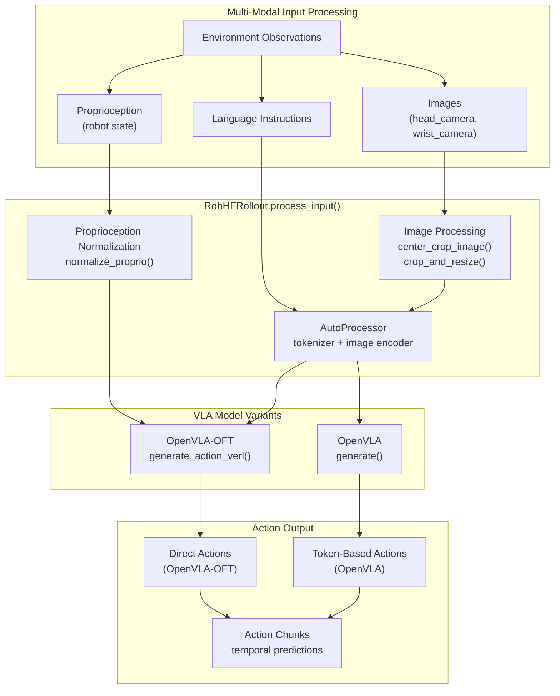
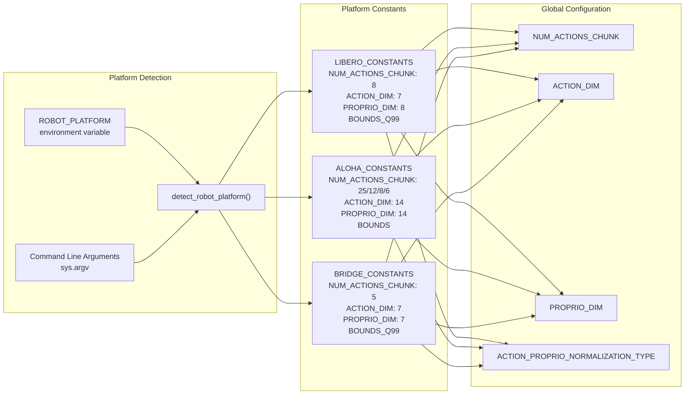
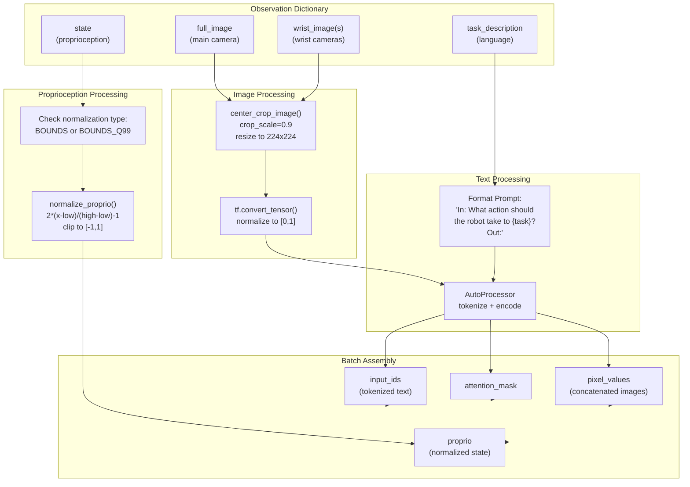
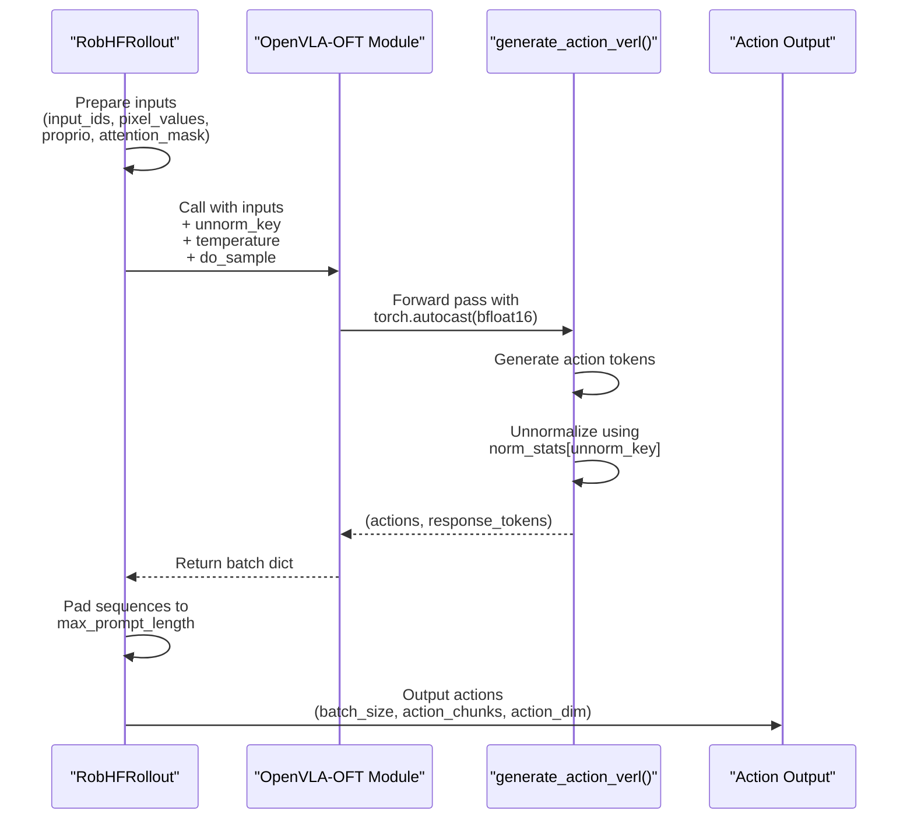
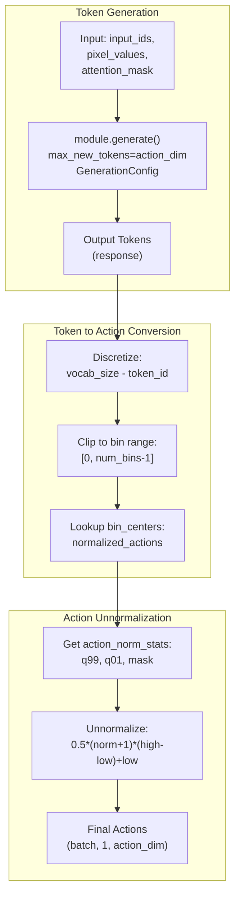

<!-- source: DeepWiki mcp.deepwiki.com · repo PRIME-RL/SimpleVLA-RL · page 2 VLA Models · fetched 2026-10-30 -->

# VLA Models

<details>
<summary>Relevant source files</summary>

The following files were used as context for generating this wiki page:

- [README.md](README.md)
- [verl/utils/vla_utils/openvla_oft/constants.py](verl/utils/vla_utils/openvla_oft/constants.py)
- [verl/workers/rollout/rob_rollout.py](verl/workers/rollout/rob_rollout.py)

</details>


This document describes the Vision-Language-Action (VLA) models supported by SimpleVLA-RL, their architectures, and how they process multi-modal inputs to generate robot actions. VLA models are the core policy networks that map observations (images, proprioception, language) to robot actions.

For information about how VLA models are integrated into the PPO training loop, see [Training with PPO](#3). For details on specific platform benchmarks, see [Benchmarks and Environments](#4).

## Overview

SimpleVLA-RL supports two VLA model variants that generate robot actions from multi-modal inputs:

| Model | Description | Action Generation Method |
|-------|-------------|-------------------------|
| **OpenVLA** | Base model that generates discrete action tokens | Generates tokens → bins → unnormalizes to continuous actions |
| **OpenVLA-OFT** | Optimized variant with direct action prediction | Directly predicts continuous actions via `generate_action_verl()` |

Both models share the same input processing pipeline but differ in their action generation mechanisms. The framework automatically adapts to different robot platforms (LIBERO, RoboTwin, ALOHA) through platform-specific configuration.

**Sources:** [README.md:50-51](), [verl/workers/rollout/rob_rollout.py:918-923]()

## VLA Model Architecture

The following diagram shows how VLA models fit into the rollout process:



**Sources:** [verl/workers/rollout/rob_rollout.py:504-595](), [verl/workers/rollout/rob_rollout.py:915-1083]()

## Platform Detection and Configuration

The system uses `constants.py` to automatically detect the robot platform and configure appropriate action dimensions and normalization schemes:



### Platform-Specific Constants

The framework defines constants for each supported platform:

| Platform | Action Chunks | Action Dim | Proprio Dim | Normalization Type |
|----------|--------------|------------|-------------|-------------------|
| **LIBERO** | 8 | 7 | 8 | BOUNDS_Q99 |
| **ALOHA** | 25 (default) | 14 | 14 | BOUNDS |
| **ALOHA_12** | 12 | 14 | 14 | BOUNDS |
| **ALOHA_8** | 8 | 14 | 14 | BOUNDS |
| **ALOHA_6** | 6 | 14 | 14 | BOUNDS |
| **BRIDGE** | 5 | 7 | 7 | BOUNDS_Q99 |

The `detect_robot_platform()` function [verl/utils/vla_utils/openvla_oft/constants.py:71-105]() checks:
1. `ROBOT_PLATFORM` environment variable first
2. Command line arguments (e.g., "libero", "aloha_12chunk")
3. Defaults to ALOHA if unclear

**Sources:** [verl/utils/vla_utils/openvla_oft/constants.py:27-67](), [verl/utils/vla_utils/openvla_oft/constants.py:71-138]()

## Input Processing Pipeline

### Multi-Modal Input Assembly

The `process_input()` method [verl/workers/rollout/rob_rollout.py:504-595]() processes observations into model-ready inputs:



### Image Processing Details

Images are center-cropped and resized using the `crop_and_resize()` function [verl/workers/rollout/rob_rollout.py:77-109]():

1. **Center Crop**: Crops to 90% of original area (`crop_scale=0.9`)
2. **Resize**: Resizes to 224×224 pixels
3. **Normalization**: Converts to float32 and clips to [0, 1]
4. **Multiple Views**: Concatenates head camera and wrist camera(s) along channel dimension

### Proprioception Normalization

The `normalize_proprio()` function [verl/workers/rollout/rob_rollout.py:129-149]() normalizes robot state:

**For BOUNDS_Q99 (LIBERO, BRIDGE):**
```
normalized = 2 * (proprio - q01) / (q99 - q01) - 1
clipped to [-1, 1]
```

**For BOUNDS (ALOHA):**
```
normalized = 2 * (proprio - min) / (max - min) - 1
clipped to [-1, 1]
```

**Sources:** [verl/workers/rollout/rob_rollout.py:504-595](), [verl/workers/rollout/rob_rollout.py:77-149]()

## Action Generation Methods

### OpenVLA-OFT: Direct Action Prediction

The `_generate_one_step_oft()` method [verl/workers/rollout/rob_rollout.py:925-978]() generates actions directly:



**Key Parameters:**
- `unnorm_key`: Dataset-specific normalization statistics key
- `do_sample`: Whether to sample or use greedy decoding
- `temperature`: Sampling temperature (default from config)
- `padding_idx`: Tokenizer's pad token ID

**Sources:** [verl/workers/rollout/rob_rollout.py:925-978]()

### OpenVLA: Token-Based Action Generation

The `_generate_one_step_openvla()` method [verl/workers/rollout/rob_rollout.py:980-1083]() generates actions through token discretization:



**Processing Steps:**

1. **Generate Tokens**: Uses `module.generate()` with generation config [verl/workers/rollout/rob_rollout.py:1009-1021]()
2. **Discretize**: `discretized_actions = vocab_size - token_ids` [verl/workers/rollout/rob_rollout.py:1036-1041]()
3. **Map to Bins**: `normalized_actions = bin_centers[discretized_actions]` [verl/workers/rollout/rob_rollout.py:1042]()
4. **Unnormalize**: Apply inverse normalization using dataset statistics [verl/workers/rollout/rob_rollout.py:1044-1051]()

**Sources:** [verl/workers/rollout/rob_rollout.py:980-1083]()

## Action Chunking

Both model variants output temporal action sequences (chunks) for smooth robot control:

| Platform | Action Chunks | Action Dimension | Total Output Shape |
|----------|--------------|------------------|-------------------|
| **LIBERO** | 8 | 7 (xyz + quat + gripper) | (batch, 8, 7) |
| **ALOHA** | 25 | 14 (dual arm) | (batch, 25, 14) |
| **RoboTwin** | 5 | 7 (xyz + quat + gripper) | (batch, 5, 7) |

The rollout loop executes actions chunk-by-chunk, with each chunk representing a temporal sequence of robot commands. The `action_chunks_len` configuration parameter determines how many actions from each chunk are executed before requesting new predictions [verl/workers/rollout/rob_rollout.py:738]().

**Sources:** [verl/workers/rollout/rob_rollout.py:429-456](), [verl/utils/vla_utils/openvla_oft/constants.py:27-67]()

## Observation to Input Conversion

The `_obs_to_input()` method [verl/workers/rollout/rob_rollout.py:1085-1126]() converts platform-specific observations to a unified format:

### LIBERO Format

```python
{
    "full_image": get_libero_image(obs, 224),      # agentview
    "wrist_image": get_libero_wrist_image(obs, 224),  # if multi-view
    "state": np.concatenate([
        obs["robot0_eef_pos"],              # xyz position
        quat2axisangle(obs["robot0_eef_quat"]),  # rotation
        obs["robot0_gripper_qpos"]          # gripper state
    ])
}
```

### RoboTwin Format

```python
{
    "full_image": obs['observation']['head_camera']['rgb'],
    "left_wrist": obs['observation']['left_camera']['rgb'],   # if multi-view
    "right_wrist": obs['observation']['right_camera']['rgb'],  # if multi-view
    "state": obs['joint_action']['vector']  # 2.0 format
}
```

**Sources:** [verl/workers/rollout/rob_rollout.py:1085-1126]()

## VLA Preprocessing Configuration

The `vla_preprocess()` method [verl/workers/rollout/rob_rollout.py:475-488]() configures VLA-specific settings:

1. **TensorFlow GPU Memory**: Sets memory growth for TensorFlow operations [verl/workers/rollout/rob_rollout.py:477-480]()
2. **Unnormalization Key Validation**: 
   - For LIBERO: Checks for `_no_noops` suffix variants [verl/workers/rollout/rob_rollout.py:484-485]()
   - For RoboTwin: Strips `robotwin_` / `robotwin2_` prefix [verl/workers/rollout/rob_rollout.py:487]()
3. **Statistics Lookup**: Verifies unnorm_key exists in `module.norm_stats` [verl/workers/rollout/rob_rollout.py:488]()

**Sources:** [verl/workers/rollout/rob_rollout.py:475-488]()

## Model Integration Points

Key integration points between VLA models and the RL framework:

| Component | Location | Purpose |
|-----------|----------|---------|
| **RobHFRollout** | [verl/workers/rollout/rob_rollout.py:424]() | Main rollout class managing VLA execution |
| **process_input()** | [verl/workers/rollout/rob_rollout.py:504]() | Multi-modal input processing |
| **_generate_one_step()** | [verl/workers/rollout/rob_rollout.py:916]() | Single-step action generation dispatcher |
| **_generate_one_step_oft()** | [verl/workers/rollout/rob_rollout.py:925]() | OpenVLA-OFT action generation |
| **_generate_one_step_openvla()** | [verl/workers/rollout/rob_rollout.py:980]() | OpenVLA action generation |
| **AutoProcessor** | [verl/workers/rollout/rob_rollout.py:457]() | Tokenizer and image encoder |
| **module.norm_stats** | [verl/workers/rollout/rob_rollout.py:484]() | Normalization statistics per dataset |

**Sources:** [verl/workers/rollout/rob_rollout.py:424-1131]()

---

