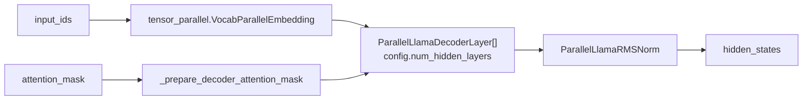
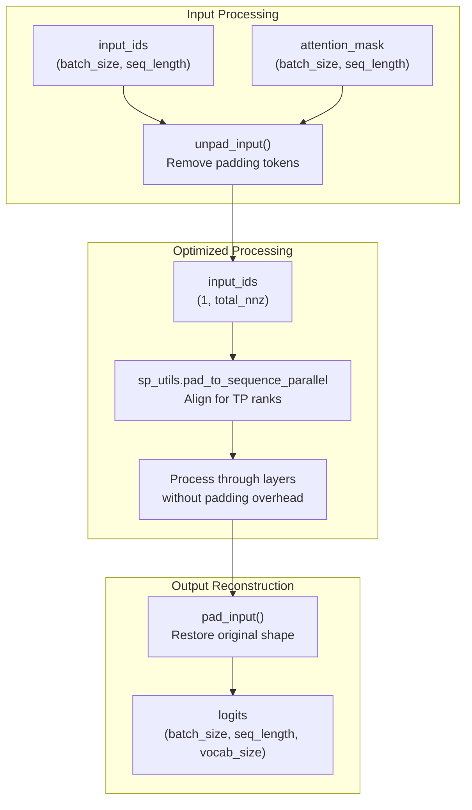
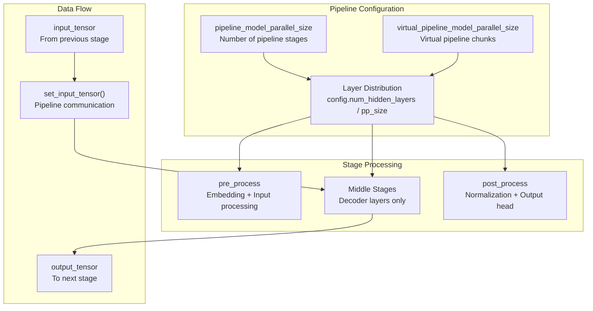

<!-- source: DeepWiki mcp.deepwiki.com · repo PRIME-RL/SimpleVLA-RL · page 2.1 OpenVLA and OpenVLA-OFT · fetched 2026-10-30 -->

# Parallel Llama Models

Relevant source files

The following files were used as context for generating this wiki page:

- [README.md](README.md)
- [examples/overwrite_vla_ckpt_utils.sh](examples/overwrite_vla_ckpt_utils.sh)
- [verl/workers/rollout/rob_rollout.py](verl/workers/rollout/rob_rollout.py)

This document covers the parallel Llama model implementations that form the core of SimpleVLA-RL's distributed training system. These models integrate with Megatron-LM to provide tensor, pipeline, and data parallelism for efficient large-scale training. For information about the layer components that compose these models, see [Layer Components](#2.2). For details on Megatron integration patterns, see [Megatron Integration](#2.3).

## Model Architecture Overview

The parallel Llama implementation provides several specialized variants optimized for different training scenarios and memory constraints.

### Model Hierarchy

```mermaid
graph TB
    subgraph "Base Models"
        ParallelLlamaModel["ParallelLlamaModel<br/>Base transformer decoder"]
        ParallelLlamaForCausalLM["ParallelLlamaForCausalLM<br/>Language modeling head"]
    end
    
    subgraph "RmPad Optimized Models"
        ParallelLlamaModelRmPad["ParallelLlamaModelRmPad<br/>Memory optimized decoder"]
        ParallelLlamaForCausalLMRmPad["ParallelLlamaForCausalLMRmPad<br/>RmPad + LM head"]
        ParallelLlamaForValueRmPad["ParallelLlamaForValueRmPad<br/>Value function estimation"]
    end
    
    subgraph "Pipeline Parallel Models"
        ParallelLlamaModelRmPadPP["ParallelLlamaModelRmPadPP<br/>PP + RmPad decoder"]
        ParallelLlamaForCausalLMRmPadPP["ParallelLlamaForCausalLMRmPadPP<br/>PP + RmPad + LM head"]
        ParallelLlamaForValueRmPadPP["ParallelLlamaForValueRmPadPP<br/>PP + RmPad + Value head"]
    end
    
    ParallelLlamaModel --> ParallelLlamaForCausalLM
    ParallelLlamaModelRmPad --> ParallelLlamaForCausalLMRmPad
    ParallelLlamaForCausalLMRmPad --> ParallelLlamaForValueRmPad
    ParallelLlamaModelRmPadPP --> ParallelLlamaForCausalLMRmPadPP
    ParallelLlamaForCausalLMRmPadPP --> ParallelLlamaForValueRmPadPP
```

**Sources:** [verl/models/llama/megatron/__init__.py:15-24](), [verl/models/llama/megatron/modeling_llama_megatron.py:73-664]()

## Base Parallel Implementation

The foundational models provide standard Llama architecture with Megatron tensor parallelism integration.

### ParallelLlamaModel

The `ParallelLlamaModel` class implements the core transformer decoder with distributed embedding and normalization layers.

| Component | Implementation | Parallelism |
|-----------|---------------|-------------|
| Embedding | `tensor_parallel.VocabParallelEmbedding` | Vocab parallel across tensor parallel ranks |
| Decoder Layers | `ParallelLlamaDecoderLayer` | Tensor parallel attention and MLP |
| Output Norm | `ParallelLlamaRMSNorm` | Sequence parallel compatible |

**Sources:** [verl/models/llama/megatron/modeling_llama_megatron.py:73-153]()

### ParallelLlamaForCausalLM

Extends the base model with a language modeling head using `tensor_parallel.ColumnParallelLinear` for distributed vocabulary prediction.

Key implementation details:
- Uses `gather_output=False` to avoid communication until necessary
- Performs final gather with `tensor_parallel.gather_from_tensor_model_parallel_region`
- Converts to float32 for numerical stability

**Sources:** [verl/models/llama/megatron/modeling_llama_megatron.py:156-211]()

## RmPad Memory Optimization

The RmPad variants implement padding removal optimization using FlashAttention's padding utilities to improve memory efficiency and training speed.

### Memory Optimization Strategy

**Sources:** [verl/models/llama/megatron/modeling_llama_megatron.py:213-364]()

### ParallelLlamaForValueRmPad

Specialized for value function estimation in RL training, replacing the vocabulary head with a single-output value head.

Key differences from causal LM:
- Linear layer outputs single value per token: `nn.Linear(hidden_size, 1)`
- Uses sequence parallel marking: `sp_utils.mark_parameter_as_sequence_parallel`
- Squeezes final dimension for scalar values

**Sources:** [verl/models/llama/megatron/modeling_llama_megatron.py:367-394]()

## Pipeline Parallelism Support

The PP variants enable training across multiple pipeline stages by distributing layers across different devices.

### Pipeline Stage Management

**Sources:** [verl/models/llama/megatron/modeling_llama_megatron.py:401-517]()

### Virtual Pipeline Parallelism

When `virtual_pipeline_model_parallel_size` is configured, models support interleaved pipeline scheduling:

- `num_layer_per_pp = config.num_hidden_layers // pp_size`
- `num_layer_vpp_chunk = num_layer_per_pp // vpp_size`
- Each model instance contains only `num_layer_vpp_chunk` layers

This enables better pipeline bubble reduction through interleaved execution.

**Sources:** [verl/models/llama/megatron/modeling_llama_megatron.py:430-443]()

## Model Registration and Usage

All model variants are exported through the module's `__init__.py` for dynamic loading by the model registry system.

### Available Model Classes

| Model Class | Use Case | Optimization Features |
|-------------|----------|----------------------|
| `ParallelLlamaModel` | Base transformer | Tensor parallelism |
| `ParallelLlamaForCausalLM` | Language modeling | Tensor parallelism |
| `ParallelLlamaForCausalLMRmPad` | Memory-efficient LM | RmPad + Tensor parallelism |
| `ParallelLlamaForValueRmPad` | RL value estimation | RmPad + Value head |
| `ParallelLlamaForCausalLMRmPadPP` | Large-scale LM | RmPad + Pipeline + Tensor parallelism |
| `ParallelLlamaForValueRmPadPP` | Large-scale RL | RmPad + Pipeline + Value head |

These models integrate with the broader SimpleVLA-RL training pipeline through the model registry system, enabling dynamic selection based on training configuration and hardware constraints.

**Sources:** [verl/models/llama/megatron/__init__.py:15-24]()

---

