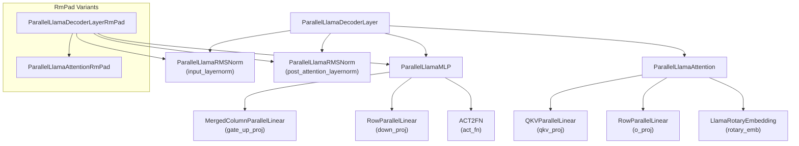
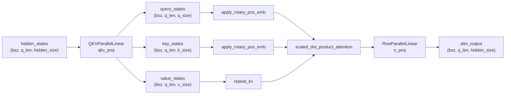
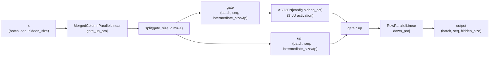
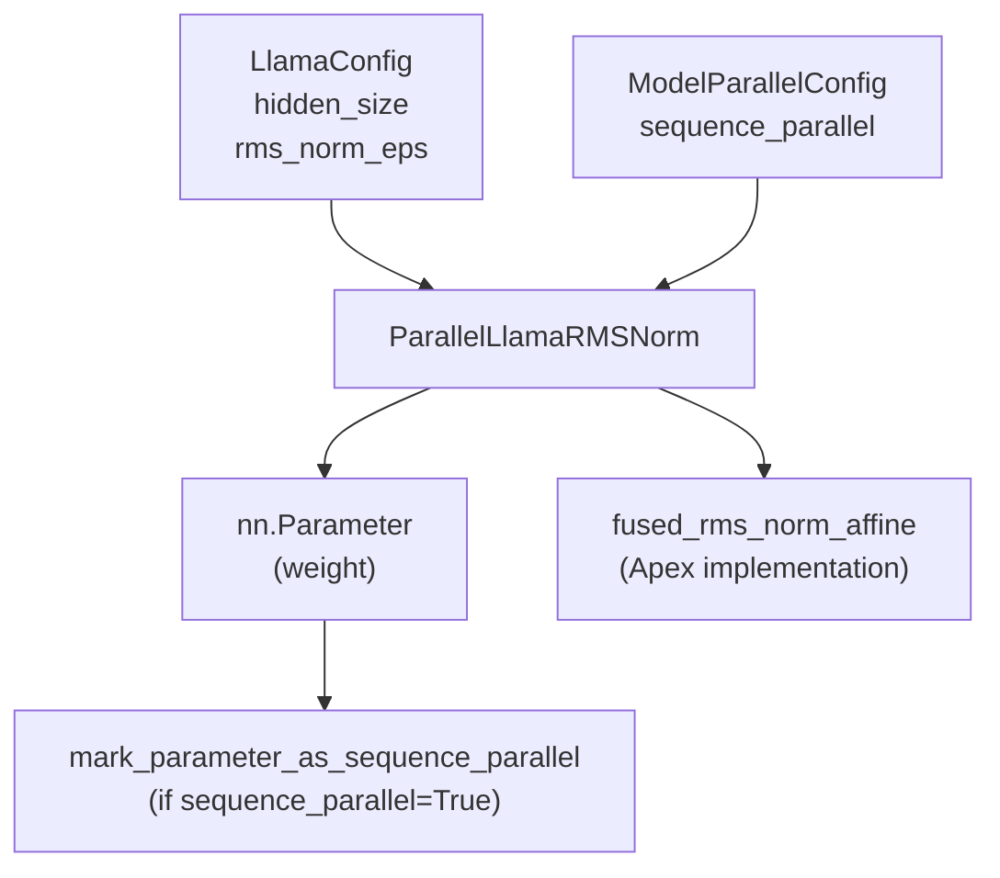
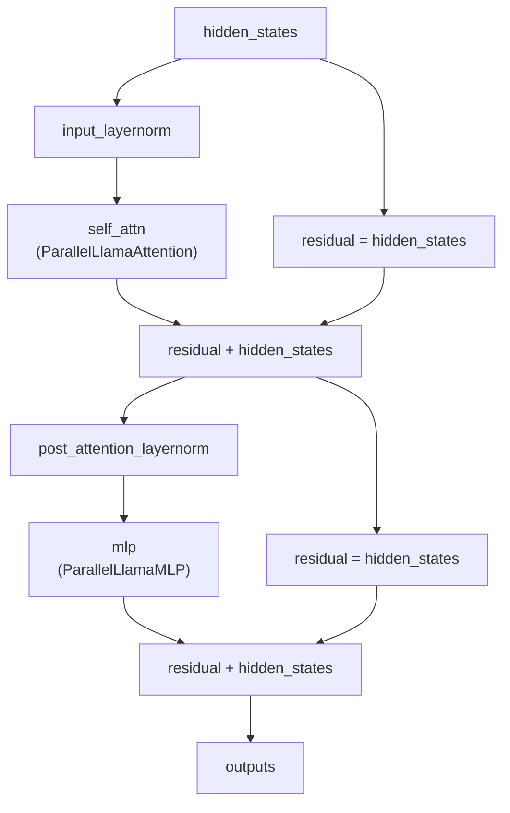
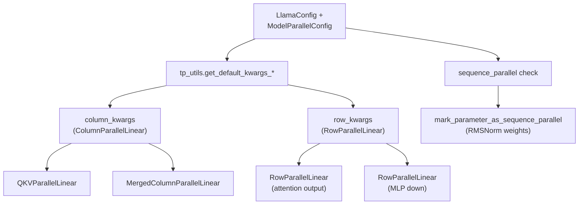

<!-- source: DeepWiki mcp.deepwiki.com · repo PRIME-RL/SimpleVLA-RL · page 2.2 Platform Configuration · fetched 2026-10-30 -->

# Layer Components

<details>
<summary>Relevant source files</summary>

The following files were used as context for generating this wiki page:

- [verl/utils/vla_utils/openvla_oft/constants.py](verl/utils/vla_utils/openvla_oft/constants.py)
- [verl/workers/rollout/rob_rollout.py](verl/workers/rollout/rob_rollout.py)

</details>


This document covers the individual parallel layer implementations that compose the Llama models in SimpleVLA-RL. These components implement the core building blocks of the transformer architecture with tensor parallelism support through Megatron-LM integration.

For information about how these layers are assembled into complete models, see [Parallel Llama Models](#2.1). For details on the underlying Megatron-LM parallelization strategies, see [Megatron Integration](#2.3).

## Layer Architecture Overview

The layer components follow a hierarchical structure where decoder layers compose attention, MLP, and normalization sublayers. All components are designed for tensor parallelism and include specialized variants for memory optimization.

### Layer Component Hierarchy



**Sources:** [verl/models/llama/megatron/layers/__init__.py:15-18](), [verl/models/llama/megatron/layers/parallel_decoder.py:33-43](), [verl/models/llama/megatron/layers/parallel_attention.py:143-202]()

## Attention Layer Implementation

The `ParallelLlamaAttention` class implements multi-head attention with tensor parallelism support and rotary position embeddings (RoPE).

### Attention Component Structure



The attention layer handles tensor parallelism by:
- Splitting attention heads across tensor parallel ranks
- Using `QKVParallelLinear` for efficient QKV projection parallelization
- Applying `RowParallelLinear` for output projection with reduce-scatter

**Sources:** [verl/models/llama/megatron/layers/parallel_attention.py:143-280](), [verl/models/llama/megatron/layers/parallel_linear.py:21-50]()

### Rotary Position Embeddings

The implementation includes multiple RoPE variants:

| Class | Purpose | Key Features |
|-------|---------|--------------|
| `LlamaRotaryEmbedding` | Standard RoPE | Base implementation with cached cos/sin |
| `LlamaLinearScalingRotaryEmbedding` | Linear scaling | Extends context length with scaling factor |
| `LlamaDynamicNTKScalingRotaryEmbedding` | Dynamic NTK scaling | Adaptive base frequency for longer sequences |

**Sources:** [verl/models/llama/megatron/layers/parallel_attention.py:35-114](), [verl/models/llama/megatron/layers/parallel_attention.py:204-230]()

## MLP Layer Implementation

The `ParallelLlamaMLP` class implements the SwiGLU feed-forward network with gate and up projections merged for efficiency.

### MLP Component Flow



The MLP uses `MergedColumnParallelLinear` to combine gate and up projections into a single matrix multiplication, reducing memory bandwidth requirements.

**Sources:** [verl/models/llama/megatron/layers/parallel_mlp.py:31-74](), [verl/models/llama/megatron/layers/parallel_linear.py:52-75]()

## RMSNorm Layer Implementation

The `ParallelLlamaRMSNorm` class provides root mean square layer normalization with sequence parallelism support.

### RMSNorm Configuration



The implementation leverages Apex's fused RMSNorm for performance and includes sequence parallelism parameter marking when enabled.

**Sources:** [verl/models/llama/megatron/layers/parallel_rmsnorm.py:25-46]()

## Decoder Layer Implementation

The `ParallelLlamaDecoderLayer` orchestrates the attention, MLP, and normalization components with residual connections.

### Decoder Layer Forward Pass



**Sources:** [verl/models/llama/megatron/layers/parallel_decoder.py:33-96]()

## RmPad Variants for Memory Optimization

The RmPad (Remove Padding) variants optimize memory usage by removing padding tokens from packed sequences, particularly beneficial for variable-length inputs.

### RmPad Attention Differences

| Feature | Standard Attention | RmPad Attention |
|---------|-------------------|-----------------|
| Input Format | `(batch, seq_len, hidden)` | `(total_nnz, 1, hidden)` |
| Attention Function | Standard scaled dot-product | Flash Attention 2 with varlen |
| Position Encoding | Standard RoPE application | Flash-attn compatible RoPE |
| Sequence Parallel | Standard tensor operations | Padding-aware operations |

The `ParallelLlamaAttentionRmPad` class uses different forward pass parameters:

```python
def forward(self,
            hidden_states: torch.Tensor,
            position_ids: Optional[torch.LongTensor] = None,
            sequence_length: int = None,
            indices: torch.Tensor = None,
            cu_seqlens: torch.Tensor = None,
            max_seqlen_in_batch: int = None)
```

**Sources:** [verl/models/llama/megatron/layers/parallel_attention.py:338-418](), [verl/models/llama/megatron/layers/parallel_decoder.py:99-146]()

## Tensor Parallelism Integration

All layer components integrate with Megatron-LM's tensor parallelism through:

### Parallelism Configuration Flow



The tensor parallelism configuration ensures proper parameter sharding and communication patterns across all layer components.

**Sources:** [verl/models/llama/megatron/layers/parallel_attention.py:172-180](), [verl/models/llama/megatron/layers/parallel_mlp.py:40-47](), [verl/utils/megatron/tensor_parallel.py]()

---

